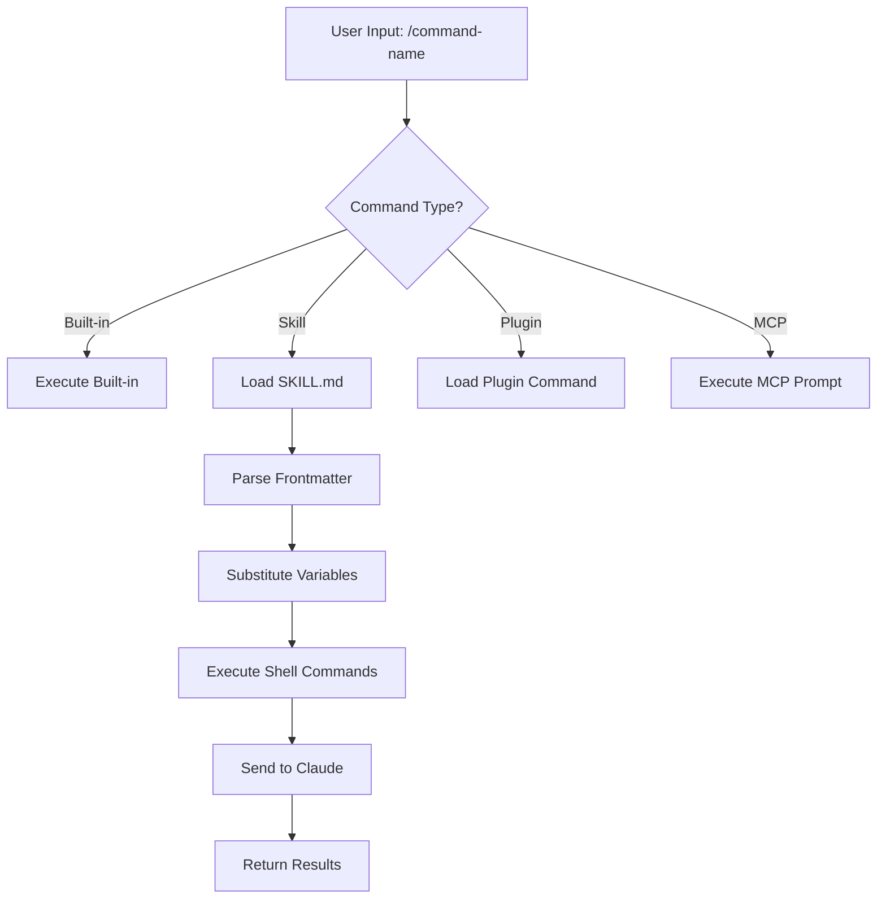
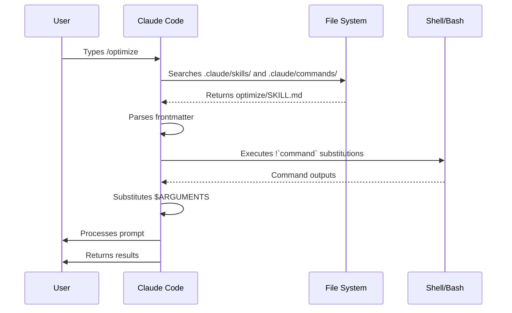

<picture>
  <source media="(prefers-color-scheme: dark)" srcset="../../resources/logos/claude-howto-logo-dark.svg">
  
</picture>

# دستورات اسلش

## مرور کلی

دستورات اسلش میانبرهایی هستند که رفتار Claude را در طول یک نشست تعاملی کنترل می‌کنند. این دستورات در چند نوع ارائه می‌شوند:

- **دستورات داخلی**: ارائه‌شده توسط Claude Code (`/help`, `/clear`, `/model`)
- **مهارت‌ها**: دستورات تعریف‌شده توسط کاربر به‌عنوان فایل‌های `SKILL.md` (`/optimize`, `/pr`)
- **دستورات پلاگین**: دستورات از پلاگین‌های نصب‌شده (`/frontend-design:frontend-design`)
- **پرامپت‌های MCP**: دستورات از سرورهای MCP (`/mcp__github__list_prs`)

> **نکته**: دستورات اسلش سفارشی در مهارت‌ها ادغام شده‌اند. فایل‌های `.claude/commands/` هنوز کار می‌کنند، اما مهارت‌ها (`.claude/skills/`) اکنون رویکرد توصیه‌شده هستند. هر دو میانبر `/command-name` ایجاد می‌کنند. برای مرجع کامل به [راهنمای مهارت‌ها](../03-skills/) مراجعه کنید.

## مرجع دستورات داخلی

دستورات داخلی میانبرهایی برای اقدامات متداول هستند. **بیش از ۶۰ دستور داخلی** و **حدود ۲۰ مهارت همراه** (برخی نیاز به فعال‌سازی ویژگی دارند) موجود است. در Claude Code `/` را تایپ کنید تا لیست کامل را ببینید، یا `/` و سپس هر حرفی را تایپ کنید تا فیلتر شود.

> **نکته**: از v2.1.236، فشردن Enter روی یک دستور اسلش اشتباه‌تایپ‌شده — یا روی دستوری که در نشست فعلی در دسترس نیست — خطا گزارش می‌کند به‌جای آنکه نزدیک‌ترین تطابق فازی را بی‌صدا اجرا کند. پیشوندهای بدون ابهام و نام‌های مستعار تعریف‌شده همچنان به‌طور قبلی اجرا می‌شوند.

| دستور | هدف |
|---------|---------|
| `/add-dir <path>` | افزودن دایرکتوری کاری |
| `/advisor [model\|off]` | پیکربندی مشاور. به‌صورت یک گفت‌وگوی تعاملی باز می‌شود؛ در برنامه دسکتاپ، Remote Control و نشست‌های headless (`-p` / Agent SDK) به جای آن فرم متنی می‌گیرد — `/advisor` ساده، `/advisor <model>` یا `/advisor off` (v2.1.260+) |
| `/agents` | دیگر یک دستور کارآمد نیست: ویزارد تعاملی در v2.1.198 حذف شد، و از v2.1.281 دیگر در منوی `/` یا `/help` ظاهر نمی‌شود — تایپ کردن آن فقط توضیح می‌دهد که ویزارد کجا رفت. از Claude بخواهید subagentها را ایجاد یا مدیریت کند، یا فایل‌های `.claude/agents/` را مستقیماً ویرایش کنید |
| `/artifacts` | فهرست artifactهایی که مالک آن‌ها هستید یا با شما به اشتراک گذاشته شده‌اند، سپس یکی را به نشست پیوست کنید، در مرورگر باز کنید یا لینکش را کپی کنید (v2.1.208+). حذف یک مورد با `d` تأیید می‌خواهد: 1 یا Enter نگهش می‌دارد، 2 حذفش می‌کند، Esc لغو می‌کند (v2.1.305) |
| `/auto-mode-setup` | نوشتن مدخل‌های `autoMode.environment` از پروژه و نشست‌های اخیرتان، بررسی پیش‌نویس، و ذخیرهٔ آن در تنظیمات کاربر. Pro/Max/Team: v2.1.228+ (v2.1.233+ روی ویندوز بومی)؛ کلید Enterprise یا Console API: v2.1.283+. همچنین روی Bedrock، Vertex، Foundry، دروازهٔ اپ‌های Claude و نشست‌های با تلمتری خاموش از v2.1.304 در دسترس است |
| `/branch [name]` | تغییر به یک کپی از گفت‌وگو در این نقطه، با حفظ اصل (با `/resume` به آن برگردید) |
| `/fork [prompt]` | کپی گفت‌وگوی فعلی به یک **نشست پس‌زمینه جدید** و ادامه کار در اینجا؛ این دو از آن نقطه مستقل هستند و کپی ردیف خود را در `claude agents` می‌گیرد (v2.1.212+). به‌جز در مواردی که کپی در محل ویرایش می‌کند، Claude Code به آن دستور می‌دهد پیش از ایجاد تغییرات کد یک worktree اختصاصی بسازد (دستور جداسازی نیازمند v2.1.221+ است) |
| `/subtask <task>` | ایجاد یک **subagent منشعب** که کل گفت‌وگو را به ارث می‌برد و روی وظیفه کار می‌کند در حالی که شما ادامه می‌دهید؛ نتیجه آن پس از پایان به این گفت‌وگو برمی‌گردد (v2.1.212+) |
| `/btw [question]` | پرسیدن یک پرسش جانبی موقت در حالی که Claude روی وظیفه اصلی کار می‌کند؛ زمینه گفت‌وگوی اصلی را آلوده نمی‌کند. `/btw` ساده آخرین پرسش جانبی شما را باز می‌کند (v2.1.212+) |
| `/cd <path>` | انتقال نشست به دایرکتوری کاری جدید بدون شکستن cache پرامپت (اضافه شده در v2.1.169) |
| `/chrome` | پیکربندی یکپارچگی مرورگر Chrome |
| `/clear` | پاک‌کردن گفت‌وگو (نام‌های مستعار: `/reset`, `/new`) |
| `/color [color\|default]` | تنظیم رنگ نوار پرامپت. `/color` ساده (بدون آرگومان) یک رنگ نشست تصادفی انتخاب می‌کند (v2.1.128+)؛ یک نام رنگ یا hex را برای تنظیم صریح ارسال کنید. |
| `/compact [instructions]` | فشرده‌سازی گفت‌وگو با دستورالعمل‌های تمرکز اختیاری. یک compact ناموفق اکنون به‌جای بی‌صدا انجام ندادن، به‌عنوان خطا در UI نمایش می‌یابد (v2.1.216) |
| `/config` | باز کردن تنظیمات (نام مستعار: `/settings`) |
| `/context` | تجسم استفاده از زمینه به‌عنوان شبکه رنگی. هنگامی که استفاده بیش از حد پنجره زمینه است یک هشدار صریح نشان می‌دهد (v2.1.216) |
| `/copy [N]` | کپس‌کردن پاسخ دستیار به کلیپ‌بورد؛ `w` در فایل می‌نویسد |
| `/cost` | نام مستعار میانبر تایپ برای `/usage` — تب هزینه را باز می‌کند (v2.1.118+) |
| `/desktop` | ادامه در برنامه دسکتاپ (نام مستعار: `/app`) |
| `/diff` | نمایشگر diff تعاملی برای تغییرات commit‌نشده. در رندر fullscreen به‌جای آن یک پنل diff در کنار گفت‌وگو باز می‌کند که باز می‌ماند در حالی که به کار ادامه می‌دهید — فایل‌های تغییر یافته با تعداد خطوط اضافه/حذف‌شده لیست می‌شود و هر بار که Claude فایلی را ویرایش می‌کند یا دستور شل اجرا می‌کند تازه می‌شود؛ `/diff` را مجدداً اجرا کنید یا `✕` را کلیک کنید تا بسته شود (v2.1.260+). رندر کلاسیک نمایشگر را به‌جای نوار پرامپت باز می‌کند |
| `/doctor` | تشخیص سلامت نصب — در حین پاسخ‌گویی Claude قابل باز شدن است؛ یک مهارت همراه: Claude نصب شما را بررسی می‌کند و راه‌حل‌هایی پیشنهاد می‌کند که پس از تأیید شما اعمال می‌کند (`claude doctor` تشخیص فقط‌خواندی اجرا می‌کند); در طرح‌های Pro، Max، Team و Enterprise این بررسی همچنین تغییراتی را که `/usage` پیشنهاد می‌کند پیشنهاد می‌دهد (v2.1.305؛ وقتی Remote Control متصل است رد می‌شود)؛ `/doctor prompt-audit` (همچنین `/checkup prompt-audit`) فایل‌های CLAUDE.md، مهارت‌ها، agentها و دستورات را برای الگوهای پرامپت‌نویسی نوشته‌شده برای مدل‌های قدیمی‌تر ممیزی می‌کند (v2.1.283) |
| `/effort [low\|medium\|high\|xhigh\|max\|auto\|ultracode [on\|off]]` | تنظیم سطح تلاش از طریق اسلایدر فلش کلیدی تعاملی. سطوح: `low` → `medium` → `high` → `xhigh` (جدید در v2.1.111) → `max`. پیش‌فرض `medium` روی Opus 5.5 (مدل پیش‌فرض از v2.1.280)، Sonnet 5.5 و Haiku 5.5، `high` روی Opus 5، Sonnet 5 و Opus 4.8، و `xhigh` روی Opus 4.7 است؛ `xhigh` نیازمند Fable 5.1، Fable 5، Opus 5.5، Sonnet 5.5، Haiku 5.5، Opus 5، Sonnet 5، Opus 4.8 یا Opus 4.7 است؛ `max` روی Fable 5.1، Fable 5، Opus 5.5، Sonnet 5.5، Haiku 5.5، Opus 5، Sonnet 5، Opus 4.8/4.7/4.6 و Sonnet 4.6 کار می‌کند. یک سطح ذخیره‌شده پیش از اینکه `/effort` به‌ازای مدل شود برای مدل‌های جدید منتشر‌شده مثل Opus 5.5 اعمال نمی‌شود (v2.1.280). اسلایدر همچنین یک toggle **Ultracode** دارد (Tab یا `/effort ultracode [on\|off]`) — یک سطح تلاش مدل نیست: به Claude می‌گوید گردش کارهای پویا را در هر سطح تلاشی که نشست اجرا می‌شود هماهنگ کند. از v2.1.284 دیگر `xhigh` را تحمیل نمی‌کند و با تغییر سطح روشن می‌ماند؛ `/effort ultracode` برای نشست باقی می‌ماند و تنظیم `ultracode` آن را پایدار می‌کند |
| `/exit` | خروج از REPL (نام مستعار: `/quit`) |
| `/export [filename]` | صادرات گفت‌وگوی فعلی به یک فایل یا کلیپ‌بورد |
| `/usage-credits` | پیکربندی استفاده اضافی برای محدودیت‌های نرخ (تغییر نام از `/extra-usage` در v2.1.144؛ `/extra-usage` همچنان به‌عنوان نام مستعار کار می‌کند) |
| `/fast [on\|off]` | toggle حالت سریع. برای Opus 5.5 (پیش‌فرض حالت سریع از v2.1.280)، Opus 5 و Opus 4.8 اعمال می‌شود |
| `/feedback` | ارسال بازخورد. از v2.1.141، می‌تواند نشست‌های اخیر (آخر ۲۴ ساعت یا ۷ روز) را ضمیمه کند تا گزارش‌هایی که بیش از یک نشست را در بر می‌گیرند شامل زمینه باشند. از v2.1.178، `/bug` نیازمند یک توضیح پیش از ارسال است. |
| `/focus` | toggle نمای تمرکز (اضافه شده در v2.1.110؛ جایگزین `Ctrl+O` برای toggle تمرکز) |
| `/goal <statement>` | ثبت یک شرط تکمیل سطح نشست؛ Claude تا زمان تحقق هدف کار می‌کند. `/goal clear` آن را حذف می‌کند. هدف فعال در خط وضعیت ظاهر می‌شود، با یک پنل overlay زنده که زمان سپری‌شده، تعداد نوبت و استفاده از token را نشان می‌دهد (اضافه شده در v2.1.139). |
| `/help` | نمایش راهنما |
| `/hooks` | مشاهده پیکربندی‌های هوک |
| `/ide` | مدیریت یکپارچگی‌های IDE |
| `/init` | مقداردهی اولیه `CLAUDE.md`. تنظیم `CLAUDE_CODE_NEW_INIT=1` برای گردش کار تعاملی |
| `/insights` | تولید گزارش تحلیل نشست |
| `/install-github-app` | راه‌اندازی برنامه GitHub Actions |
| `/install-slack-app` | نصب برنامه Slack |
| `/keybindings` | باز کردن پیکربندی keybindingها |
| `/fewer-permission-prompts` | تحلیل فراخوانی‌های اخیر Bash/MCP و افزودن یک allowlist با اولویت به `.claude/settings.json` برای کاهش اعلان‌های مجوز (اضافه شده در v2.1.111) |
| `/login` | تعویض حساب‌های Anthropic |
| `/logout` | خروج از حساب Anthropic |
| `/mcp` | مدیریت سرورهای MCP و OAuth |
| `/memory` | ویرایش `CLAUDE.md`، toggle حافظه خودکار |
| `/mobile` | QR code برای برنامه موبایل (نام‌های مستعار: `/ios`, `/android`) |
| `/model [model]` | انتخاب مدل با فلش چپ/راست برای تلاش. از v2.1.153، انتخاب **به‌عنوان پیش‌فرض ذخیره می‌شود** برای نشست‌های جدید (هماهنگ با IDE); پس از انتخاب `s` را بفشارید تا فقط روی نشست فعلی اعمال شود. (keybinding `modelPicker:setAsDefault` به `modelPicker:thisSessionOnly` تغییر نام یافت; اکشن قدیمی `d` اکنون `s` است.) از v2.1.219 انتخاب‌گر ردیف ادغام‌شده Opus را به‌عنوان "Opus (1M زمینه)" نشان می‌داد; v2.1.283 این برچسب از ردیف‌های Opus و Default که در آن Opus از قبل پنجره ۱M دارد حذف می‌کند (پنجره تغییر نکرده). |
| `/output-style [name]` | لیست و تعویض سبک‌های خروجی (در v2.1.269 پس از حذف در v2.1.91 مجدداً اضافه شد). بدون آرگومان سبک‌ها را لیست می‌کند و سبک فعلی را علامت‌گذاری می‌کند. در نشست‌های headless و Remote Control کار می‌کند; انتخاب در `.claude/settings.local.json` ذخیره می‌شود |
| `/passes` | اشتراک‌گذاری یک هفته رایگان Claude Code |
| `/permissions` | مشاهده/به‌روزرسانی مجوزها (نام مستعار: `/allowed-tools`) |
| `/plan [description]` | ورود به حالت برنامه‌ریزی |
| `/plugin` | مدیریت پلاگین‌ها |
| `/proactive` | نام مستعار برای `/loop` (اضافه شده در v2.1.105) |
| `/powerup` | کشف ویژگی‌ها از طریق درس‌های تعاملی با دموهای انیمیشن |
| `/privacy-settings` | تنظیمات حریم خصوصی (فقط Pro/Max) |
| `/release-notes` | مشاهده changelog |
| `/recap` | نمایش خلاصه/مرور نشست هنگام بازگشت به یک نشست (اضافه شده در v2.1.108) |
| `/reload-plugins` | بارگذاری مجدد پلاگین‌های فعال. از v2.1.221 اکثر نصب‌ها بلافاصله فعال می‌شوند، بنابراین این فقط زمانی لازم است که خلاصه نصب بگوید `Run /reload-plugins to activate.` در نشست‌های headless از v2.1.260 در دسترس است، بنابراین در لیست دستورات Claude Code Desktop و SDK هم ظاهر می‌شود |
| `/reload-skills` | اسکن مجدد دایرکتوری‌های مهارت بدون راه‌اندازی مجدد نشست (اضافه شده در v2.1.152). از v2.1.304 فقط مهارت‌های جدید یا تغییرکرده را به Claude می‌فرستد؛ compaction دیگر خودش لیست مهارت‌ها را دوباره می‌فرستد، پس بعد از compact کردن به `/reload-skills` نیازی نیست |
| `/remote-control` | کنترل از راه دور از claude.ai (نام مستعار: `/rc`) |
| `/remote-env` | پیکربندی محیط راه دور پیش‌فرض |
| `/rename [name]` | تغییر نام نشست |
| `/resume [session]` | ازسرگیری گفت‌وگو (نام مستعار: `/continue`) |
| `/review [low\|medium\|high\|xhigh\|max\|ultra] [--fix] [--comment] [pr#\|branch\|path]` | نام مستعار `/code-review` (v2.1.223): diff فعلی، یا یک شماره PR، شاخه یا مسیر ارسالی را بازبینی می‌کند — مثلاً `/review 1234`. همان سطوح تلاش و flagها را می‌گیرد. بدون سطح داده‌شده، آخرین سطح `low`–`max` تایپ‌شده را بازاستفاده می‌کند |
| `/rewind` | بازگردانی گفت‌وگو و/یا کد (نام‌های مستعار: `/checkpoint`, `/undo`) |
| `/sandbox` | toggle حالت sandbox |
| `/schedule [description]` | ایجاد، به‌روزرسانی، فهرست یا اجرای وظایف زمان‌بندی‌شده ابری (سابقاً routines). نام مستعار: `/routines` |
| `/scroll-speed` | باز کردن یک گفت‌وگوی تعاملی برای تنظیم سرعت پیمایش چرخ ماوس در حالت fullscreen: ←/→ را برای تنظیم، `r` برای بازنشانی، Enter برای ذخیره بفشارید. در `~/.claude/settings.json` ذخیره می‌شود (اضافه شده در v2.1.139). |
| `/security-review` | تحلیل شاخه برای آسیب‌پذیری‌های امنیتی |
| `/skill-doctor` | نشان می‌دهد کدام مهارت‌های بارگذاری‌شده بلااستفاده می‌مانند و هرکدام چقدر در زمینه هزینه دارند، تا تصمیم بگیرید کدام را خاموش کنید. گزارش در تب **Stats** مدیر `/plugin` باز می‌شود; در حالت `-p` غیرتعاملی به‌صورت متن چاپ می‌شود. روی Remote Control پاسخ می‌دهد `Skill usage reports are not available on this connection.` — آن را در ترمینال روی ماشینی که نشست را میزبانی می‌کند اجرا کنید (نیازمند v2.1.252+) |
| `/skills` | لیست مهارت‌های در دسترس |
| `/stats` | نام مستعار میانبر تایپ برای `/usage` — تب آمار را باز می‌کند (مصرف روزانه، نشست‌ها، streakها) (v2.1.118+) |
| `/stickers` | سفارش استیکرهای Claude Code |
| `/status` | نمایش نسخه، مدل، حساب و یک ردیف `Session kind` با محتوای `background job · attached`, `background job · unattended` یا `interactive` (ردیف اضافه شد در v2.1.221). در حین پاسخ‌گویی Claude قابل باز شدن است |
| `/statusline` | پیکربندی خط وضعیت |
| `/tasks` | لیست/مدیریت وظایف پس‌زمینه |
| `/team-onboarding` | تولید راهنمای ramp-up هم‌تیمی از ۳۰ روز اخیر نشست‌ها، دستورات و استفاده از MCP Claude Code شما؛ در طرح‌های Team و Enterprise یک لینک اشتراک‌گذاری هم برمی‌گرداند (جدید در v2.1.101) |
| `/teleport` | ازسرگیری یک نشست Claude Code on the web در این ترمینال; یک انتخاب‌گر از نشست‌های وب شما باز می‌کند (نام مستعار: `/tp`). نیازمند اشتراک claude.ai |
| `/terminal-setup` | پیکربندی keybindingهای ترمینال |
| `/theme` | باز کردن انتخاب‌گر تم / مدیریت تم‌های سفارشی (v2.1.118). تعریف تم‌های سفارشی از طریق JSON در `~/.claude/themes/<name>.json` |
| `/tui [default\|fullscreen]` | تنظیم رندرر UI ترمینال (`fullscreen` رندر بدون پرش می‌دهد) و راه‌اندازی مجدد در آن; یک `/tui` ساده رندرر فعلی را چاپ می‌کند (اضافه شده در v2.1.110) |
| `/ultrareview` | بازبینی کد جامع مبتنی بر cloud با چند agent (اضافه شده در v2.1.111). فراخوانی ترجیحی اکنون `/code-review ultra` است; `/ultrareview` به‌عنوان نام مستعار باقی می‌ماند. شامل ۳ اجرای رایگان روی Pro و Max، سپس نیازمند usage credit |
| `/upgrade` | باز کردن صفحه ارتقا برای طرح بالاتر |
| `/usage` | داشبورد استفاده کانونی (v2.1.118) — محدودیت‌های استفاده طرح، محدودیت‌های نرخ، هزینه و آمار نشست روزانه را ترکیب می‌کند. `/cost` و `/stats` نام‌های مستعار میانبر تایپ هستند که تب‌های خاصی را باز می‌کنند. در مورد تلاش max، گردش کارها، زمینه همیشه روشن و نتایج ابزار بزرگ هشدار می‌دهد (v2.1.299)؛ از v2.1.305 هر هشدار یک اصلاح یک‌خطی پیشنهاد می‌دهد و فشردن `f` آن‌هایی را که Claude Code می‌تواند انجام دهد اعمال می‌کند |
| `/voice` | toggle دیکته‌صوتی push-to-talk |
| `/workflows` | مشاهده اجراهای گردش کار پویای در حال اجرا و تکمیل‌شده (اضافه شده در v2.1.154). به [گردش کارهای پویا](../09-advanced-features/README.md#گردش‌کارهای-پویا) مراجعه کنید |

> **چرا `/cd` مهم است:** تغییر دایرکتوری قبلاً گرمای cache را از دست می‌داد (نوبت بعدی را کندتر و پرهزینه‌تر می‌کرد); `/cd` cache پرامپت را در طول تعویض حفظ می‌کند.

### مهارت‌های همراه

این مهارت‌ها با Claude Code ارائه می‌شوند و مانند دستورات اسلش فراخوانی می‌شوند:

| مهارت | هدف |
|-------|---------|
| `/batch <instruction>` | هماهنگ‌سازی تغییرات موازی مقیاس‌بزرگ با استفاده از worktreeها |
| `/claude-api` | بارگذاری مرجع Claude API برای زبان پروژه. زیردستورها شامل `api-version` (بردن کد به یک نسخهٔ جدیدتر API، v2.1.307+) و `managed-agents-secure` (ممیزی تنظیمات یک Managed Agent، v2.1.304+) است |
| `/dataviz` | راهنمای طراحی نمودار و داشبورد با یک اعتبارسنج قابل‌اجرا palette رنگ (v2.1.198) |
| `/debug [description]` | فعال‌سازی لاگ دیباگ |
| `/design [description]` | ایجاد یک **بوم طراحی** — یک طراحی بصری چندصفحه‌ای (mockupهای UI، جریان‌های صفحه، صفحات فرود، پوستر) که به‌عنوان artifact منتشر و به‌صورت بصری به‌جای کد اصلاح می‌شود. به‌جای نوشتن دستی HTML زمانی استفاده کنید که چیدمان چیزی است که می‌خواهید روی آن تکرار کنید. نیازمند v2.1.265+، یک نشست که در آن artifactها در دسترس‌اند، و یک حساب با قالب Design; در Bedrock، Vertex، Foundry یا Claude Platform on AWS در دسترس نیست. Claude Design مستقل (claude.ai/design) تا ۱۴ دسامبر ۲۰۲۶ بسته می‌شود. `/design consent` و `/design revoke` دسترسی Claude به Claude Design را اعطا یا لغو می‌کنند؛ وقتی Claude از شما می‌خواهد `/design consent` را اجرا کنید، خودتان آن را در خط فرمان تایپ کنید. |
| `/loop [interval] [prompt]` | اجرای پرامپت تکراری روی بازه |
| `/code-review [low\|medium\|high\|xhigh\|max\|ultra] [--fix] [--comment] [--max-findings n\|all\|default] [pr#\|branch\|path]` | بازبینی diff فعلی — یا یک شماره PR، شاخه یا مسیر ارسالی — برای باگ‌های صحت. `--fix` برای اعمال یافته‌ها، `--comment` برای ارسال آن‌ها به‌عنوان کامنت‌های درون‌خطی GitHub PR، یا `ultra` برای اجرای بازبینی عمیق cloud; با `ultra` روی هدف PR `github.com`، `--post` ارسال یافته‌ها به PR را پیش‌انتخاب می‌کند. بدون سطح تلاش داده‌شده، بازبینی آخرین سطح تایپ‌شده را بازاستفاده می‌کند (v2.1.223). در ابتدا `/simplify` را در v2.1.147 جذب کرد، اما `/simplify` در v2.1.154 به‌عنوان یک دستور مجزا بازگشت. `--max-findings <n>\|all` را برای گزارش بیشتر یا کمتر از حد معمول ارسال کنید; انتخاب تا زمانی که `--max-findings default` ارسال کنید بازاستفاده می‌شود (v2.1.288) |
| `/simplify` | اجرای یک بازبینی فقط-پاکسازی (بازاستفاده / ساده‌سازی / کارایی / ارتفاع) و اعمال راه‌حل‌ها; برای شکار باگ **نیست** — برای آن از `/code-review` استفاده کنید. به‌طور خلاصه یک نام مستعار `/code-review --fix` بود (v2.1.152)، در v2.1.154 فقط-پاکسازی شد |

### دستورات منسوخ‌شده

| دستور | وضعیت |
|---------|--------|
| `/pr-comments` | در v2.1.91 حذف شد — از Claude مستقیماً بخواهید کامنت‌های PR را ببیند |
| `/vim` | در v2.1.92 حذف شد — از /config → Editor mode استفاده کنید |

### تغییرات اخیر

- `/fork` و `/subtask` در **v2.1.212** نقش‌ها را تعویض کردند. `/fork` اکنون گفت‌وگو را در یک نشست مستقل پس‌زمینه جدید کپی می‌کند; رفتار subagent منشعب که قبلاً داشت به دستور جدید `/subtask` منتقل شد. تاریخچه: `/fork` از v2.1.77 تا v2.1.161 یک نام مستعار برای `/branch` بود; از v2.1.161 تا v2.1.211 یک subagent منشعب را شروع می‌کرد (کاری که `/subtask` اکنون می‌کند). هنگامی که نمای agent خاموش است، `/subtask` در دسترس نیست و `/fork` رفتار subagent منشعب را نگه می‌دارد
- `/resume` (بدون آرگومان) یک انتخاب‌گر از نشست‌های گذشته — از جمله نشست‌های حذف‌شده از لیست قابل‌مشاهده — باز می‌کند و نشست انتخابی را به‌عنوان نشست پس‌زمینه ازسرگیری می‌کند (v2.1.212)
- `/resume` و `claude --resume` روی نشستی که در پس‌زمینه در حال اجراست، آن نشست را به‌جای امتناع باز می‌کنند، و `claude --resume <id> "prompt"` پرامپت را به‌عنوان نوبت بعدی ارسال می‌کند (v2.1.285)
- `/output-style` منسوخ (v2.1.73) و حذف (v2.1.91) شد، سپس **در v2.1.269 مجدداً اضافه شد** — در v2.1.278 یک دستور زنده است دوباره، و در نشست‌های headless و Remote Control کار می‌کند. سبک‌های خروجی همچنین از طریق `/config` → Output style یا تنظیم `outputStyle` در دسترس‌اند; سبک‌های داخلی Default، Proactive، Explanatory، Learning و Concise (اضافه شده در v2.1.237) هستند
- `/review` یک نام مستعار کامل `/code-review` شد — همان اهداف، سطوح تلاش و flagها (v2.1.223). تاریخچه: در ابتدا در v2.1.186 روی موتور `/code-review medium` منتقل شد در حالی که همچنان فقط-PR بود
- دستور `/effort` اضافه شد; سطح `max` روی Opus 4.6+ در دسترس است (در ابتدا فقط Opus 4.6)
- دستور `/voice` برای دیکته‌صوتی push-to-talk اضافه شد
- دستور `/schedule` برای ایجاد/مدیریت وظایف زمان‌بندی‌شده اضافه شد
- دستور `/color` برای سفارشی‌سازی نوار پرامپت اضافه شد
- /pr-comments در v2.1.91 حذف شد — از Claude مستقیماً بخواهید کامنت‌های PR را ببیند
- /vim در v2.1.92 حذف شد — به‌جای آن از /config → Editor mode استفاده کنید
- `/ultraplan` در v2.1.222 حذف شد — به‌جای آن از حالت برنامه‌ریزی استفاده کنید
- /powerup برای درس‌های تعاملی ویژگی اضافه شد
- /sandbox برای toggle حالت sandbox اضافه شد
- انتخاب‌گر `/model` اکنون برچسب‌های قابل‌خواندن توسط انسان (مثلاً "Sonnet 4.6") به‌جای شناسه‌های مدل خام نشان می‌دهد
- `/resume` از نام مستعار `/continue` پشتیبانی می‌کند
- پرامپت‌های MCP به‌عنوان دستورات `/mcp__<server>__<prompt>` در دسترس‌اند (به [پرامپت‌های MCP به‌عنوان دستور](#پرامپت‌های-mcp-به‌عنوان-دستور) مراجعه کنید)
- `/team-onboarding` برای تولید خودکار راهنماهای ramp-up هم‌تیمی اضافه شد (v2.1.101)
- `/tui` برای رندر TUI fullscreen بدون پرش اضافه شد (v2.1.110)
- `/focus` برای toggle نمای تمرکز اضافه شد; `Ctrl+O` اکنون فقط transcript پر‌حرف را toggle می‌کند (v2.1.110)
- `/recap` برای راه‌اندازی دستی خلاصه زمینه نشست اضافه شد (v2.1.108)
- `/undo` به‌عنوان نام مستعار `/rewind` اضافه شد (v2.1.108); همچنان یک نام مستعار `/rewind` است، در کنار `/checkpoint`
- `/proactive` به‌عنوان نام مستعار `/loop` اضافه شد (v2.1.105)
- `/effort` اسلایدر فلش کلیدی تعاملی و سطح جدید `xhigh` بین `high` و `max` گرفت; تلاش پیش‌فرض برای طرح‌های Opus 4.7 به `xhigh` افزایش یافت (v2.1.111). روی Opus 4.8 پیش‌فرض `high` است (v2.1.154); Opus 5 نیز پیش‌فرض `high` (v2.1.219)
- `/ultrareview` برای بازبینی کد جامع مبتنی بر cloud با چند agent اضافه شد (v2.1.111)
- `/fewer-permission-prompts` برای تحلیل فراخوانی‌های Bash/MCP و کاهش اعلان‌های مجوز از طریق allowlist در `.claude/settings.json` اضافه شد (v2.1.111)
- حالت Auto دیگر برای مشترکین Max روی Opus 4.7 نیازمند flag `--enable-auto-mode` نیست (v2.1.112)
- `/goal` اضافه شد — شرط تکمیل سطح نشست که Claude در طول نوبت‌ها به‌سوی آن کار می‌کند; overlay زنده زمان سپری‌شده، تعداد نوبت و مصرف توکن را نشان می‌دهد (v2.1.139)
- `/scroll-speed` اضافه شد — تنظیم سرعت پیمایش چرخ ماوس پنل پیش‌نمایش زنده TUI; به‌ازای ماشین پایدار است (v2.1.139)
- `/reload-skills` اضافه شد — اسکن مجدد دایرکتوری‌های مهارت بدون راه‌اندازی مجدد نشست (v2.1.152)
- `/model` اکنون مدل انتخاب‌شده را به‌عنوان پیش‌فرض برای نشست‌های جدید ذخیره می‌کند; برای فقط-نشست `s` را بفشارید (keybinding `modelPicker:setAsDefault` → `modelPicker:thisSessionOnly`) (v2.1.153)
- `/workflows` اضافه شد — مشاهده اجراهای گردش کار پویای در حال اجرا و تکمیل‌شده (v2.1.154)
- `/simplify` به‌عنوان یک دستور بازبینی فقط-پاکسازی مجزا بازگشت (بازاستفاده / ساده‌سازی / کارایی / ارتفاع)، جدا از شکار باگ `/code-review` (v2.1.154)
- `/status` یک ردیف `Session kind` گرفت که کارهای پس‌زمینه متصل و نظارت‌نشده را از نشست‌های تعاملی متمایز می‌کند (v2.1.221)
- نصب‌های پلاگین اکنون زمانی که ایمن باشد بلافاصله فعال می‌شوند; `/reload-plugins` فقط زمانی لازم است که خلاصه نصب آن را بخواهد (v2.1.221)
- `/ultraplan` حذف شد — از حالت برنامه‌ریزی استفاده کنید (v2.1.222)
- `/code-review` و `/review` آخرین سطح تلاش تایپ‌شده شما را هنگام حذف آن به یاد می‌آورند (v2.1.223)
- `/code-review ultra` نقطه ورودی ترجیحی برای بازبینی چندایجنتـی ابری شد؛ `/ultrareview` به‌عنوان نام مستعار باقی می‌ماند (v2.1.223)
- `/code-review` در تلاش `high`, `xhigh` و `max` اکنون مانند سایر سطوح در یک agent پس‌زمینه اجرا می‌شود (v2.1.232)
- نکته شروع که پیشنهاد ایجاد زیرایجنت‌های سفارشی می‌کرد، و یادآوری مطابق در تور `/powerup`، حذف شدند (v2.1.232)
- `/permissions` اکنون می‌تواند در حین کار Claude باز شود — تغییرات قانون برای بقیه نوبت فعلی اعمال می‌شود (v2.1.234)
- `/add-dir <path>` اکنون می‌تواند در حین کار Claude استفاده شود; گفت‌وگوهای `/add-dir`, `/autocompact`, `/theme`, `/help`, `/config` و `/advisor` در **fullscreen TUI** میان نوبت باز می‌شوند، به‌جای اینکه تا پایان پاسخ‌گویی Claude در صف بمانند (`/bug` از v2.1.232 از قبل بلافاصله باز می‌شد) (v2.1.234)

### `/goal` — شرط تکمیل سطح نشست

> **جدید در v2.1.139**

از `/goal` برای ثبت یک شرط تکمیل برای نشست فعلی استفاده کنید. Claude در طول نوبت‌ها به‌سوی آن کار می‌کند، و یک پنل overlay زمان سپری‌شده، تعداد نوبت و tokenهای استفاده‌شده را نشان می‌دهد. با `/goal clear` آن را پاک کنید. در حالت تعاملی، `claude -p` و Remote Control کار می‌کند.

```
User: /goal Migrate the payments service from REST to gRPC and get the integration tests passing.
Claude: Goal registered. I'll work toward this until you clear it.
[Goal panel: ⏱ 0s · turns 0 · tokens 0]

User: start by listing the REST endpoints
Claude: [کار را انجام می‌دهد، پنل به‌روز می‌شود]
```

**بررسی روی وظایف پس‌زمینه متوقف‌شده (v2.1.234):** در حالی که یک هدف فعال است، اگر یک وظیفه پس‌زمینه ۳۰+ دقیقه پیشرفتی نداشته باشد، Claude به‌جای ادامه بی‌صدا با یک به‌روزرسانی وضعیت بررسی می‌کند. آستانه (به دقیقه) را با متغیر محیط `CLAUDE_CODE_GOAL_CHECKIN_MINUTES` تنظیم کنید، یا `0` قرار دهید تا بررسی‌ها کاملاً غیرفعال شوند.

### `/team-onboarding` — راهنمای ramp-up هم‌تیمی

> **جدید در v2.1.101**

از `/team-onboarding` برای تولید یک راهنمای ramp-up هم‌تیمی از استفاده محلی Claude Code پروژه استفاده کنید. Claude نشست‌ها، دستورات و استفاده از سرور MCP شما از ۳۰ روز گذشته را تحلیل می‌کند، سپس یک راهنمای onboarding تولید می‌کند که به توسعه‌دهندگان جدید کمک می‌کند سریع‌تر بهره‌ور شوند. برای مشترکان claude.ai در طرح‌های Team و Enterprise، یک لینک اشتراک‌گذاری هم برمی‌گرداند که هم‌تیمی‌ها می‌توانند مستقیم در Claude Code باز کنند.

این یک دستور داخلی است — چیزی برای نصب نیست.

**استفاده:**

```bash
claude /team-onboarding
```

راهنمای تولیدشده بر اساس:

- گردش کارهایی که در سراسر نشست‌های اخیر شما تکرار می‌شوند
- دستوراتی که اغلب اجرا می‌کنید
- [سرورهای MCP](../05-mcp/README.md) که استفاده می‌کنید

**در دسترس بودن:** در Claude Code v2.1.101 (۱۱ آوریل ۲۰۲۶) ارائه شد.

## دستورات سفارشی (اکنون مهارت‌ها)

دستورات اسلش سفارشی در مهارت‌ها **ادغام شده‌اند**. هر دو رویکرد دستوراتی ایجاد می‌کنند که می‌توانید با `/command-name` فراخوانی کنید:

| رویکرد | مکان | وضعیت |
|----------|----------|--------|
| **مهارت‌ها (توصیه‌شده)** | `.claude/skills/<name>/SKILL.md` | استاندارد فعلی |
| **دستورات قدیمی** | `.claude/commands/<name>.md` | هنوز کار می‌کند |

اگر یک مهارت و یک دستور هم‌نام باشند، **مهارت تقدم دارد**. مثلاً وقتی هم `.claude/commands/review.md` و هم `.claude/skills/review/SKILL.md` وجود دارند، نسخه مهارت استفاده می‌شود.

### مسیر مهاجرت

فایل‌های `.claude/commands/` موجود شما بدون تغییر به کار ادامه می‌دهند. برای مهاجرت به مهارت‌ها:

**قبل (دستور):**
```
.claude/commands/optimize.md
```

**بعد (مهارت):**
```
.claude/skills/optimize/SKILL.md
```

### چرا مهارت‌ها؟

مهارت‌ها ویژگی‌های اضافی نسبت به دستورات قدیمی ارائه می‌دهند:

- **ساختار دایرکتوری**: بسته‌بندی اسکریپت‌ها، قالب‌ها و فایل‌های مرجع
- **فراخوانی خودکار**: Claude می‌تواند مهارت‌ها را هنگام ارتباط به‌صورت خودکار راه‌اندازی کند
- **کنترل فراخوانی**: انتخاب اینکه کاربر، Claude یا هر دو بتوانند فراخوانی کنند
- **اجرای subagent**: اجرای مهارت‌ها در contextهای ایزوله با `context: fork`
- **افشا تدریجی**: بارگذاری فایل‌های اضافی فقط هنگام نیاز

### ایجاد یک دستور سفارشی به‌عنوان مهارت

یک دایرکتوری با یک فایل `SKILL.md` ایجاد کنید:

```bash
mkdir -p .claude/skills/my-command
```

**فایل:** `.claude/skills/my-command/SKILL.md`

```yaml
---
name: my-command
description: What this command does and when to use it
---

# دستور من

Instructions for Claude to follow when this command is invoked.

1. First step
2. Second step
3. Third step
```

### مرجع Frontmatter

| فیلد | هدف | پیش‌فرض |
|-------|---------|---------|
| `name` | نام دستور (به `/name` تبدیل می‌شود) | نام دایرکتوری |
| `description` | توضیح کوتاه (به Claude کمک می‌کند بداند چه زمان استفاده کند) | اولین خط غیرخالی |
| `argument-hint` | آرگومان‌های مورد انتظار برای تکمیل خودکار | هیچ |
| `allowed-tools` | ابزارهایی که دستور بدون مجوز می‌تواند استفاده کند | به ارث می‌برد |
| `model` | مدل خاص برای استفاده | به ارث می‌برد |
| `disable-model-invocation` | اگر `true`، فقط کاربر می‌تواند فراخوانی کند (نه Claude) | `false` |
| `user-invocable` | اگر `false`، از منوی `/` پنهان می‌شود | `true` |
| `context` | تنظیم به `fork` برای اجرا در subagent ایزوله | هیچ |
| `agent` | نوع agent هنگام استفاده از `context: fork` | `general-purpose` |
| `hooks` | هوک‌های ثبت‌شده هنگام اجرای مهارت (هر رویداد هوک; آنها برای بقیه نشست فعال می‌مانند) | هیچ |

### آرگومان‌ها

دستورات می‌توانند آرگومان دریافت کنند:

**همه آرگومان‌ها با `$ARGUMENTS`:**

```yaml
---
name: fix-issue
description: Fix a GitHub issue by number
---

Fix issue #$ARGUMENTS following our coding standards
```

استفاده: `/fix-issue 123` → `$ARGUMENTS` تبدیل به "123" می‌شود

**آرگومان‌های تکی با `$0`, `$1` و غیره:**

```yaml
---
name: review-pr
description: Review a PR with priority
---

Review PR #$0 with priority $1
```

استفاده: `/review-pr 456 high` → `$0`="456", `$1`="high"

`${CLAUDE_PROJECT_DIR}` به مسیر مطلق ریشه پروژه تبدیل می‌شود (v2.1.196).

### Context پویا با دستورات شل

دستورات bash را پیش از پرامپت با `` !`command` `` اجرا کنید:

> **نکته (v2.1.299)**: هوک‌های `UserPromptSubmit` پیش از بسط دستور اجرا می‌شوند، بنابراین یک هوک که پرامپت را مسدود می‌کند این دستورات `!` را نیز از اجرا بازمی‌دارد.

```yaml
---
name: commit
description: ایجاد یک git commit با زمینه
allowed-tools: Bash(git *)
---

## Context

- Current git status: !`git status`
- Current git diff: !`git diff HEAD`
- Current branch: !`git branch --show-current`
- Recent commits: !`git log --oneline -5`

## Your task

Based on the above changes, create a single git commit.
```

### ارجاعات فایل

شامل محتوای فایل با استفاده از `@`:

```markdown
Review the implementation in @src/utils/helpers.js
Compare @src/old-version.js with @src/new-version.js
```

## دستورات پلاگین

پلاگین‌ها می‌توانند دستورات سفارشی ارائه دهند:

```
/plugin-name:command-name
```

یا به‌سادگی `/command-name` زمانی که تعارض نام‌گذاری وجود ندارد.

**مثال‌ها:**
```bash
/frontend-design:frontend-design
/commit-commands:commit
```

## پرامپت‌های MCP به‌عنوان دستور

سرورهای MCP می‌توانند پرامپت‌ها را به‌عنوان دستورات اسلش در دسترس قرار دهند:

```
/mcp__<server-name>__<prompt-name> [arguments]
```

**مثال‌ها:**
```bash
/mcp__github__list_prs
/mcp__github__pr_review 456
/mcp__jira__create_issue "Bug title" high
```

### نحو مجوز MCP

کنترل دسترسی به سرور MCP در مجوزها:

- `mcp__github` - دسترسی به کل سرور GitHub MCP
- `mcp__github__*` - دسترسی wildcard به همه ابزارها
- `mcp__github__get_issue` - دسترسی به ابزار خاص

> **v2.1.299+:** یک قانون فقط به سروری که نام‌گذاری می‌کند می‌رسد — `mcp__github` دیگر با سروری به‌نام `github__x` یا `github_` تطابق نمی‌کند. برای سروری که نام نرمال‌شده‌اش شامل `__` است، `mcp__<whole normalized name>__*` بنویسید (همین برای لیست‌های `tools:` subagent نیز اعمال می‌شود).

## معماری دستور



## چرخه‌حیات دستور



## دستورات در دسترس در این پوشه

این دستورات نمونه می‌توانند به‌عنوان مهارت یا دستورات قدیمی نصب شوند.

### ۱. `/optimize` - بهینه‌سازی کد

کد را برای مسائل عملکرد، نشت حافظه و فرصت‌های بهینه‌سازی تحلیل می‌کند.

**استفاده:**
```
/optimize
[Paste your code]
```

### ۲. `/pr` - آماده‌سازی Pull Request

از طریق چک‌لیست آماده‌سازی PR شامل linting، تست و قالب‌بندی commit راهنمایی می‌کند.

**استفاده:**
```
/pr
```

**اسکرین‌شات:**


### ۳. `/generate-api-docs` - تولید مستندات API

مستندات جامع API از کد منبع تولید می‌کند.

**استفاده:**
```
/generate-api-docs
```

### ۴. `/commit` - Git Commit با Context

یک git commit با زمینه پویا از مخزن شما ایجاد می‌کند.

**استفاده:**
```
/commit [optional message]
```

### ۵. `/push-all` - Stage، Commit و Push

همه تغییرات را stage می‌کند، یک commit ایجاد می‌کند و با بررسی‌های ایمنی به remote ارسال می‌کند.

**استفاده:**
```
/push-all
```

**بررسی‌های ایمنی:**
- اسرار: `.env*`, `*.key`, `*.pem`, `credentials.json`
- کلیدهای API: کلیدهای واقعی در مقابل placeholderها را شناسایی می‌کند
- فایل‌های بزرگ: `>10MB` بدون Git LFS
- artifactهای build: `node_modules/`, `dist/`, `__pycache__/`

### ۶. `/doc-refactor` - بازسازی مستندات

ساختار مستندات پروژه را برای وضوح و دسترسایی بازسازی می‌کند.

**استفاده:**
```
/doc-refactor
```

### ۷. `/setup-ci-cd` - راه‌اندازی خط لوله CI/CD

pre-commit hookها و GitHub Actions را برای اطمینان کیفیت پیاده‌سازی می‌کند.

**استفاده:**
```
/setup-ci-cd
```

### ۸. `/unit-test-expand` - گسترش پوشش تست

پوشش تست را با هدف‌گیری شاخه‌های تست‌نشده و موارد لبه افزایش می‌دهد.

**استفاده:**
```
/unit-test-expand
```

## نصب

### به‌عنوان مهارت (توصیه‌شده)

در دایرکتوری مهارت‌های خود کپی کنید:

```bash
# ساخت پوشه مهارت‌ها
mkdir -p .claude/skills

# برای هر فایل دستور، یک پوشه مهارت بسازید
for cmd in optimize pr commit; do
  mkdir -p .claude/skills/$cmd
  cp 01-slash-commands/$cmd.md .claude/skills/$cmd/SKILL.md
done
```

### به‌عنوان دستورات قدیمی

در دایرکتوری دستورات خود کپی کنید:

```bash
# در سطح پروژه (تیم)
mkdir -p .claude/commands
cp 01-slash-commands/*.md .claude/commands/ && rm .claude/commands/README.md

# استفاده شخصی
mkdir -p ~/.claude/commands
cp 01-slash-commands/*.md ~/.claude/commands/ && rm ~/.claude/commands/README.md
```

## ایجاد دستورات خودتان

### قالب مهارت (توصیه‌شده)

ایجاد `.claude/skills/my-command/SKILL.md`:

```yaml
---
name: my-command
description: What this command does. Use when [trigger conditions].
argument-hint: [optional-args]
allowed-tools: Bash(npm *), Read, Grep
---

# عنوان دستور

## Context

- Current branch: !`git branch --show-current`
- Related files: @package.json

## Instructions

1. First step
2. Second step with argument: $ARGUMENTS
3. Third step

## Output Format

- How to format the response
- What to include
```

### دستور فقط-کاربر (بدون فراخوانی خودکار)

برای دستورات با عوارض جانبی که Claude نباید خودکار راه‌اندازی کند:

```yaml
---
name: deploy
description: Deploy to production
disable-model-invocation: true
allowed-tools: Bash(npm *), Bash(git *)
---

Deploy the application to production:

1. Run tests
2. Build application
3. Push to deployment target
4. Verify deployment
```

## بهترین شیوه‌ها

| انجام دهید | انجام ندهید |
|------|---------|
| از نام‌های روشن، کنش‌محور استفاده کنید | دستوراتی برای وظایف یک‌باره ایجاد کنید |
| شامل `description` با شرایط راه‌اندازی | منطق پیچیده در دستورات بسازید |
| دستورات را روی یک وظیفه تمرکز کنید | اطلاعات حساس را hardcode کنید |
| از `disable-model-invocation` برای عوارض جانبی استفاده کنید | فیلد description را رد کنید |
| از پیشوند `!` برای زمینه پویا استفاده کنید | فرض کنید Claude وضعیت فعلی را می‌داند |
| فایل‌های مرتبط را در دایرکتوری‌های مهارت سازماندهی کنید | همه چیز را در یک فایل قرار دهید |

## رفع اشکال

### دستور یافت نشد

**راه‌حل‌ها:**
- بررسی کنید فایل در `.claude/skills/<name>/SKILL.md` یا `.claude/commands/<name>.md` است
- فیلد `name` در frontmatter را با نام دستور مورد انتظار تطابق دهید
- نشست Claude Code را مجدداً راه‌اندازی کنید
- `/help` را اجرا کنید تا دستورات در دسترس را ببینید

### دستور طبق انتظار اجرا نمی‌شود

**راه‌حل‌ها:**
- دستورالعمل‌های خاص‌تری اضافه کنید
- مثال‌ها را در فایل مهارت شامل کنید
- `allowed-tools` را در صورت استفاده از دستورات bash بررسی کنید
- ابتدا با ورودی‌های ساده تست کنید

### تعارض مهارت در مقابل دستور

اگر هر دو با نام یکسان وجود داشته باشند، **مهارت تقدم دارد**. یکی را حذف یا تغییر نام دهید.

## راهنماهای مرتبط

- **[مهارت‌ها](../03-skills/)** - مرجع کامل برای مهارت‌ها (قابلیت‌های فراخوانی‌شده خودکار)
- **[حافظه](../02-memory/)** - زمینه پایدار با CLAUDE.md
- **[Subagentها](../04-subagents/)** - agentهای هوشمند واگذار‌شده
- **[پلاگین‌ها](../07-plugins/)** - مجموعه‌های دستور بسته‌بندی‌شده
- **[هوک‌ها](../06-hooks/)** - خودکار‌سازی رویدادمحور

## منابع اضافی

- [مستندات رسمی حالت تعاملی](https://code.claude.com/docs/en/interactive-mode) - مرجع دستورات داخلی
- [مستندات رسمی مهارت‌ها](https://code.claude.com/docs/en/skills) - مرجع کامل مهارت‌ها
- [مرجع CLI](https://code.claude.com/docs/en/cli-reference) - گزینه‌های خط فرمان

---

**آخرین به‌روزرسانی**: ۲۶ اکتبر ۲۰۲۶
**نسخه Claude Code**: 2.1.310
**منبع**:
- https://code.claude.com/docs/en/output-styles
- https://code.claude.com/docs/en/skills
- https://code.claude.com/docs/en/slash-commands
- https://code.claude.com/docs/en/interactive-mode
- https://code.claude.com/docs/en/interactive-mode#review-changes-with-diff
- https://code.claude.com/docs/en/changelog
- https://code.claude.com/docs/en/commands
- https://code.claude.com/docs/en/whats-new/2026-w34
- https://code.claude.com/docs/en/model-config
- https://github.com/anthropics/claude-code/blob/main/CHANGELOG.md
- https://github.com/anthropics/claude-code/releases/tag/v2.1.139
- https://github.com/anthropics/claude-code/releases/tag/v2.1.144
- https://github.com/anthropics/claude-code/releases/tag/v2.1.152
- https://github.com/anthropics/claude-code/releases/tag/v2.1.153
- https://github.com/anthropics/claude-code/releases/tag/v2.1.154
- https://github.com/anthropics/claude-code/releases/tag/v2.1.281
- https://code.claude.com/docs/en/fast-mode
- https://github.com/anthropics/claude-code/releases/tag/v2.1.283
- https://code.claude.com/docs/en/workflows#let-claude-decide-with-ultracode
- https://github.com/anthropics/claude-code/releases/tag/v2.1.285
- https://code.claude.com/docs/en/hooks#hooks-in-skills-and-agents
- https://code.claude.com/docs/en/permissions#mcp
- https://code.claude.com/docs/en/changelog#2-1-299
- https://code.claude.com/docs/en/hooks#hook-lifecycle
- https://code.claude.com/docs/en/fullscreen
- https://support.claude.com/en/articles/17440474-migrate-from-standalone-claude-design-to-claude
- https://code.claude.com/docs/en/changelog#2-1-304
- https://code.claude.com/docs/en/commands#all-commands
- https://code.claude.com/docs/en/context-window#what-survives-compaction
- https://code.claude.com/docs/en/changelog#2-1-305
- https://code.claude.com/docs/en/changelog#2-1-307
- https://code.claude.com/docs/en/skills#work-on-claude-api-projects
- https://code.claude.com/docs/en/costs#apply-recommendations-with-the-fix-shortcut
- https://code.claude.com/docs/en/skills#check-your-setup-with-/doctor
- https://code.claude.com/docs/en/routines#where-the-name-routines-still-appears
- https://code.claude.com/docs/en/artifacts#find-an-artifact-again
- https://code.claude.com/docs/en/auto-mode-config#generate-environment-entries-with-auto-mode-setup
**مدل‌های سازگار**: Claude Fable 5, Claude Opus 5, Claude Sonnet 5, Claude Sonnet 4.6, Claude Opus 4.8, Claude Haiku 4.5

*بخشی از سری راهنمای [Claude How To](../)*
