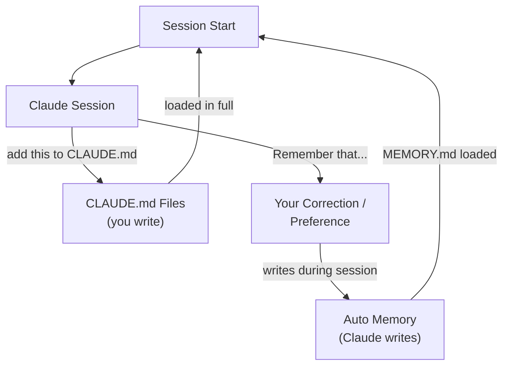
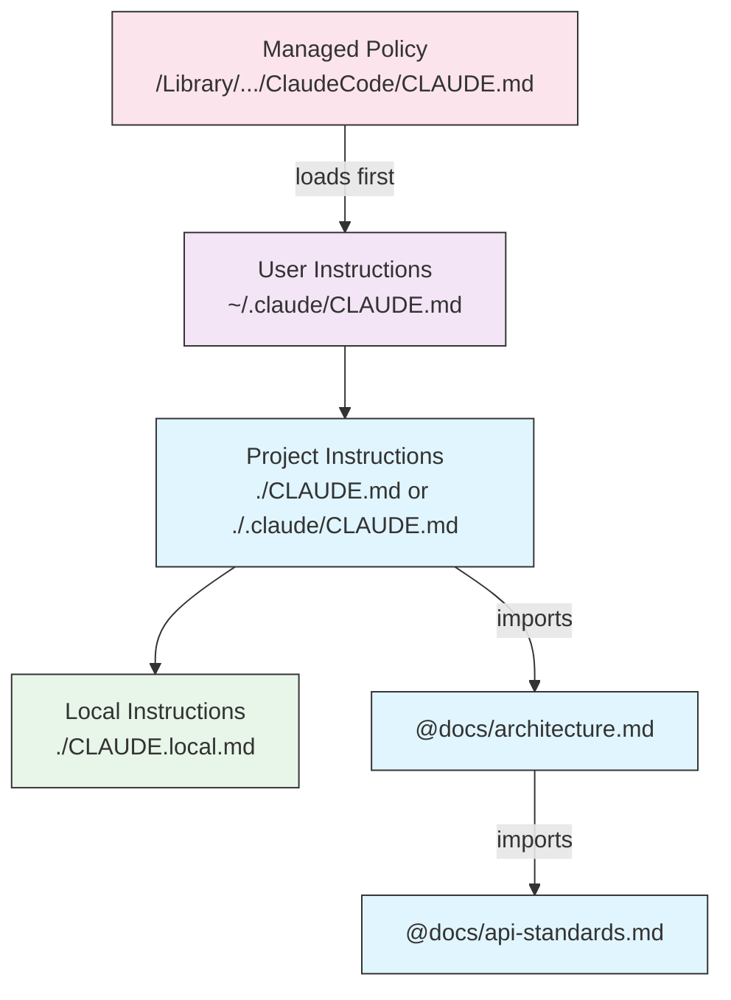
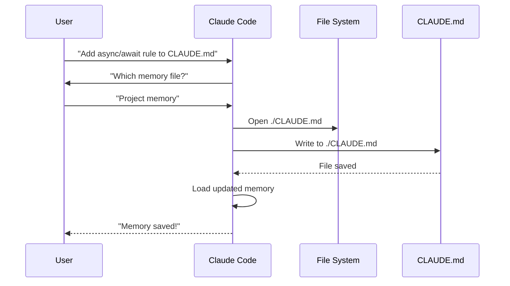
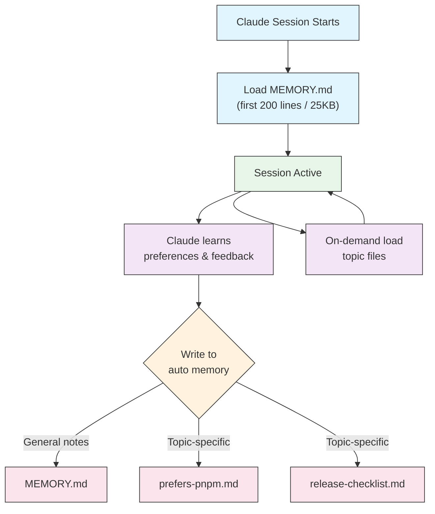

<picture>
  <source media="(prefers-color-scheme: dark)" srcset="../../resources/logos/claude-howto-logo-dark.svg">
  
</picture>

# راهنمای حافظه

حافظه به Claude اجازه می‌دهد زمینه را در سراسر نشست‌ها و گفت‌وگوها حفظ کند. این به دو شکل وجود دارد: سنتز خودکار در claude.ai، و CLAUDE.md مبتنی بر filesystem در Claude Code.

## مرور کلی

حافظه در Claude Code زمینه پایداری ارائه می‌دهد که در سراسر نشست‌ها و گفت‌وگوهای متعدد حمل می‌شود. برخلاف پنجره‌های زمینه موقت، فایل‌های حافظه به شما اجازه می‌دهند:

- استانداردهای پروژه را در سراسر تیم به اشتراک بگذارید
- ترجیحات توسعه شخصی را ذخیره کنید
- قوانین و پیکربندی‌های خاص دایرکتوری را نگه دارید
- مستندات خارجی را وارد کنید
- حافظه را به‌عنوان بخشی از پروژه کنترل نسخه کنید

سیستم حافظه در سطوح متعدد عمل می‌کند، از ترجیحات شخصی سراسری تا زیردایرکتوری‌های خاص، که کنترل دانه‌بندی‌شده‌ای روی آنچه Claude به یاد می‌آورد و چگونگی اعمال آن دانش فراهم می‌کند.

## مرجع سریع دستورات حافظه

| دستور | هدف | استفاده | چه زمانی استفاده شود |
|---------|---------|-------|-------------|
| `/init` | مقداردهی اولیه حافظه پروژه | `/init` | شروع پروژه جدید، راه‌اندازی اولیه CLAUDE.md |
| `/memory` | ویرایش فایل‌های حافظه در ویرایشگر | `/memory` | به‌روزرسانی‌های گسترده، سازماندهی مجدد، بازبینی محتوا |
| پیشوند `#` | ~~افزودن سریع حافظه یک‌خطی~~ **متوقف‌شده** | — | به‌جای آن از `/memory` یا درخواست محاوره‌ای استفاده کنید |
| `@path/to/file` | وارد کردن محتوای خارجی | `@README.md` یا `@docs/api.md` | ارجاع به مستندات موجود در CLAUDE.md |

## شروع سریع: مقداردهی اولیه حافظه

### دستور `/init`

دستور `/init` سریع‌ترین راه برای راه‌اندازی حافظه پروژه در Claude Code است. این یک فایل CLAUDE.md با مستندات پایه پروژه مقداردهی اولیه می‌کند.

**استفاده:**

```bash
/init
```

**کاری انجام می‌دهد:**

- یک فایل CLAUDE.md جدید در پروژه شما ایجاد می‌کند (معمولاً در `./CLAUDE.md` یا `./.claude/CLAUDE.md`)
- قراردادها و دستورالعمل‌های پروژه را تأسیس می‌کند
- پایه را برای پایداری زمینه در سراسر نشست‌ها تنظیم می‌کند
- یک ساختار قالب برای مستندسازی استانداردهای پروژه ارائه می‌دهد

**حالت تعاملی بهبودیافته:** تنظیم `CLAUDE_CODE_NEW_INIT=1` یک گردش کار تعاملی چندمرحله‌ای را فعال می‌کند که شما را گام‌به‌گام از راه‌اندازی پروژه عبور می‌دهد:

```bash
CLAUDE_CODE_NEW_INIT=1 claude
/init
```

**چه زمانی از `/init` استفاده کنید:**

- شروع یک پروژه جدید با Claude Code
- تأسیس استانداردهای کدنویسی و قراردادهای تیم
- ایجاد مستندات درباره ساختار codebase خود
- راه‌اندازی سلسله‌مراتب حافظه برای توسعه مشارکتی

**گردش کار نمونه:**

```markdown
# در پوشه پروژه شما
/init

# Claude فایل CLAUDE.md را با ساختاری مانند این می‌سازد:
# پیکربندی پروژه
## Project Overview
- Name: Your Project
- Tech Stack: [Your technologies]
- Team Size: [Number of developers]

## Development Standards
- Code style preferences
- Testing requirements
- Git workflow conventions
```

### به‌روزرسانی‌های سریع حافظه

> **نکته**: میانبر `#` برای حافظه درون‌خطی متوقف شد. از `/memory` برای ویرایش مستقیم فایل‌های حافظه استفاده کنید، یا از Claude به‌صورت محاوره‌ای بخواهید چیزی را به یاد بسپارد (مثلاً "remember that we always use TypeScript strict mode").

راه‌های توصیه‌شده برای افزودن اطلاعات به حافظه:

**گزینه ۱: استفاده از دستور `/memory`**

```bash
/memory
```

فایل‌های حافظه شما را در ویرایشگر سیستم برای ویرایش مستقیم باز می‌کند.

**گزینه ۲: درخواست محاوره‌ای**

```
Remember that we always use TypeScript strict mode in this project.
Please add to memory: prefer async/await over promise chains.
```

درخواست از Claude برای به یاد سپردن چیزی آن را در حافظه خودکار ذخیره می‌کند. برای تغییر CLAUDE.md به‌جای آن بگویید "add this to CLAUDE.md"، یا فایل را خودتان با `/memory` ویرایش کنید.

**مرجع تاریخی** (دیگر کارآمد نیست):

میانبر پیشوند `#` قبلاً اجازه افزودن قوانین درون‌خطی را می‌داد:

```markdown
# همیشه در این پروژه از حالت سخت‌گیرانه TypeScript استفاده کن  ← دیگر کار نمی‌کند
```

اگر به این الگو متکی بودید، به دستور `/memory` یا درخواست‌های محاوره‌ای تغییر دهید.

### دستور `/memory`

دستور `/memory` دسترسی مستقیم به ویرایشش فایل‌های حافظه CLAUDE.md در نشست‌های Claude Code فراهم می‌کند. این فایل‌های حافظه شما را در ویرایشگر سیستم برای ویرایش جامع باز می‌کند. هنگامی که فایل در یک ویرایشگر GUI باز می‌شود، نشست دیگر در حالی که فایل باز است مسدود نمی‌شود، بنابراین می‌توانید به‌صورت موازی کار کنید (v2.1.216); ویرایشگرهای ترمینال مثل Vim همچنان ترمینال را تا خروج تصرف می‌کنند.

**استفاده:**

```bash
/memory
```

**کاری انجام می‌دهد:**

- فایل‌های حافظه شما را در ویرایشگر پیش‌فرض سیستم باز می‌کند
- امکان افزودن‌ها، اصلاحات و سازماندهی مجدد گسترده را فراهم می‌کند
- دسترسی مستقیم به همه فایل‌های حافظه در سلسله‌مراتب
- مدیریت زمینه پایدار در سراسر نشست‌ها را فعال می‌کند

**چه زمانی از `/memory` استفاده کنید:**

- بازبینی محتوای حافظه موجود
- به‌روزرسانی‌های گسترده استانداردهای پروژه
- سازماندهی مجدد ساختار حافظه
- افزودن مستندات یا دستورالعمل‌های دقیق
- نگه‌داری و به‌روزرسانی حافظه با تکامل پروژه

**مقایسه: `/memory` در مقابل `/init`**

| جنبه | `/memory` | `/init` |
|--------|-----------|---------|
| **هدف** | ویرایش فایل‌های حافظه موجود | مقداردهی اولیه CLAUDE.md جدید |
| **چه زمانی** | به‌روزرسانی/اصلاح زمینه پروژه | شروع پروژه‌های جدید |
| **اکشن** | باز کردن ویرایشگر برای تغییرات | تولید قالب آغازین |
| **گردش کار** | نگه‌داری مستمر | راه‌اندازی یک‌باره |

**گردش کار نمونه:**

```markdown
# باز کردن حافظه برای ویرایش
/memory

# Claude گزینه‌ها را ارائه می‌دهد:
# ۱. حافظه سیاست مدیریت‌شده
# ۲. حافظه پروژه (./CLAUDE.md)
# ۳. حافظه کاربر (~/.claude/CLAUDE.md)
# ۴. حافظه پروژه محلی

# گزینه ۲ را انتخاب کنید (حافظه پروژه)
# ویرایشگر پیش‌فرض شما با محتوای ./CLAUDE.md باز می‌شود

# تغییرات را بدهید، ذخیره کنید و ویرایشگر را ببندید
# Claude حافظه به‌روزشده را خودکار دوباره بارگذاری می‌کند
```

**استفاده از importهای حافظه:**

فایل‌های CLAUDE.md از نحو `@path/to/file` برای شامل کردن محتوای خارجی پشتیبانی می‌کنند:

```markdown
# مستندات پروژه
See @README.md for project overview
See @package.json for available npm commands
See @docs/architecture.md for system design

# وارد کردن از پوشه خانه با مسیر مطلق
@~/.claude/my-project-instructions.md
```

**ویژگی‌های import:**

- هم مسیرهای نسبی و هم مطلق پشتیبانی می‌شوند (مثلاً `@docs/api.md` یا `@~/.claude/my-project-instructions.md`)
- importهای بازگشتی با حداکثر عمق ۴ hop پشتیبانی می‌شوند
- importهای اولین‌بار از مکان‌های خارجی یک گفت‌وگوی تأیید برای امنیت ایجاد می‌کنند
- دستورالعمل‌های import داخل code spanها یا بلوک‌های کد markdown ارزیابی نمی‌شوند (بنابراین مستندسازی آنها در مثال‌ها بی‌خطر است)
- با ارجاع به مستندات موجود از تکرار جلوگیری می‌کند
- به‌صورت خودکار محتوای ارجاع‌شده را در زمینه Claude شامل می‌کند

## معماری حافظه

حافظه در Claude Code یک سیستم سلسله‌مراتبی پیروی می‌کند که در آن scopeهای مختلف اهداف متفاوتی را خدمت می‌کنند. برخلاف چرخه سنتز ۲۴-ساعته Claude Web/Desktop (به [حافظه در Claude Web/Desktop](#حافظه-در-claude-webdesktop) در زیر مراجعه کنید)، Claude Code دو سیستم حافظه دارد که هر دو در شروع هر نشست بارگذاری و به‌طور مستمر به‌روزرسانی می‌شوند، نه روی تایمر:



## سلسله‌مراتب حافظه در Claude Code

Claude Code دو سیستم حافظه مکمل دارد، که هر دو در شروع هر گفت‌وگو بارگذاری می‌شوند: **فایل‌های CLAUDE.md** (دستورالعمل‌هایی که شما می‌نویسید) و **حافظه خودکار** (یادداشت‌هایی که Claude خودش می‌نویسد). فایل‌های CLAUDE.md **به زمینه الحاق می‌شوند به‌جای اینکه یکدیگر را بازنویسی کنند** — این یک زنجیره تقدم سخت‌گیرانه نیست که در آن لایه بالاتر جای پایین‌تر را بگیرد. فایل‌های `.claude/rules/*.md` یک مکانیسم جداگانه و مرتبط برای دستورالعمل‌های موضوعی یا مسیر-محور هستند.

**مکان‌های فایل CLAUDE.md، به ترتیب بارگذاری (وسیع‌ترین scope تا خاص‌ترین):**

| Scope | مکان | هدف |
|-------|----------|---------|
| Managed policy | macOS: `/Library/Application Support/ClaudeCode/CLAUDE.md`<br>Linux/WSL: `/etc/claude-code/CLAUDE.md`<br>Windows: `C:\Program Files\ClaudeCode\CLAUDE.md` | دستورالعمل‌های سازمان‌گستر مدیریت‌شده توسط IT/DevOps. CLAUDE.md مدیریت‌شده اول بارگذاری می‌شود و با `claudeMdExcludes` قابل رد کردن نیست، اما نشستی که با بارگذاری خاموش CLAUDE.md شروع شده باشد آن را هم بارگذاری نمی‌کند — قواعد سخت را با `permissions.deny` مدیریت‌شده اعمال کنید. |
| User instructions | `~/.claude/CLAUDE.md` | ترجیحات شخصی برای همه پروژه‌ها |
| Project instructions | `./CLAUDE.md` یا `./.claude/CLAUDE.md` | دستورالعمل‌های مشترک تیم، کنترل نسخه. از v2.1.277، `./AGENTS.md` در همین لایه بارگذاری می‌شود، زمانی که هیچ `CLAUDE.md` یا `CLAUDE.local.md` در یا بالای دایرکتوری کاری وجود ندارد — کنترل‌شده توسط **Project instructions** در `/config` |
| Local instructions | `./CLAUDE.local.md` | ترجیحات خاص پروژه شخصی; به `.gitignore` اضافه کنید |

در درون درخت دایرکتوری، Claude Code از دایرکتوری کاری شما به بالا حرکت می‌کند: `foo/CLAUDE.md` قبل از `foo/bar/CLAUDE.md` بارگذاری می‌شود اگر از `foo/bar/` راه‌اندازی کنید، بنابراین دستورالعمل‌های نزدیک‌تر به جایی که راه‌اندازی کردید *آخر* خوانده می‌شوند — نه "بالاترین اولویت" به معنای بازنویسی، فقط آخرین در زمینه. در هر دایرکتوری، `CLAUDE.local.md` پس از `CLAUDE.md` اضافه می‌شود. فایل‌های CLAUDE.md و CLAUDE.local.md در زیردایرکتوری‌های *زیر* دایرکتوری کاری شما هنگام تقاضا بارگذاری می‌شوند، وقتی Claude فایل‌ها را در آن زیردایرکتوری‌ها می‌خواند، نه در راه‌اندازی. از v2.1.309، یک فایل هنگام‌تقاضا که از حد اندازهٔ هر فایل بزرگ‌تر باشد فقط ابتدایش بارگذاری می‌شود و در پایان یادداشتی می‌آید که به Claude می‌گوید بقیه را Read کند. این شامل `CLAUDE.md`/`CLAUDE.local.md` زیردایرکتوری و importهای `@` آن‌ها، قوانین در `.claude/rules/` یک زیردایرکتوری، و قوانین مسیر-محور در `.claude/rules/` یا `~/.claude/rules/` می‌شود. این حد با پنجرهٔ زمینهٔ ۲۰۰K برابر ۴۰٬۰۰۰ کاراکتر است. با پنجرهٔ ۱M روی Opus 4.6 و Sonnet 4.6 برابر ۲۰۰٬۰۰۰ کاراکتر و روی مدل‌های بعدی ۱۵۰٬۰۰۰ است. فایل را با `wc -m path/to/CLAUDE.md` بررسی کنید.

سازمان‌ها همچنین می‌توانند محتوای CLAUDE.md مدیریت‌شده را مستقیماً داخل `managed-settings.json` از طریق کلید `claudeMd` قرار دهند، به‌جای استقرار یک فایل جداگانه. این فقط در تنظیمات مدیریت‌شده/سیاستی پذیرفته می‌شود — تنظیم `claudeMd` در تنظیمات کاربر یا پروژه بی‌تأثیر است.

**`.claude/rules/*.md`** — دستورالعمل‌های ماژولار، موضوعی، به‌صورت اختیاری محدود به مسیرهای فایل از طریق frontmatter `paths`. قوانین بدون فیلد `paths` بدون قیدوشروط با همان اولویت `.claude/CLAUDE.md` بارگذاری می‌شوند; قوانین مسیر-محور هنگام تقاضا بارگذاری می‌شوند وقتی Claude یک فایل تطابقی را می‌خواند، می‌نویسد یا ویرایش می‌کند — شامل مشاهده با یک خواندن Bash تک‌فایلی مثل `cat`, `head`, `tail`, `sed -n` یا `grep` (Write/Edit از v2.1.288، خواندن Bash از v2.1.293). قوانین سطح کاربر (`~/.claude/rules/`) قبل از قوانین پروژه بارگذاری می‌شوند. هر الگوی `paths` نسبت به دایرکتوری پایهٔ قاعده است: برای قوانین پروژه، دایرکتوری‌ای که پوشهٔ `.claude` قاعده را در خود دارد؛ برای قوانین سطح کاربر، دایرکتوری کاری اصلی نشست. برای اینکه قوانین مسیر-محور برای فایل‌های یک worktree گیت همسایه هم بارگذاری شوند، Claude Code را در همان worktree راه‌اندازی کنید یا نشست را با `/cd` به آنجا ببرید.

**حافظه خودکار** (`~/.claude/projects/<project>/memory/`) یک سیستم جداگانه است: یادداشت‌های خود Claude، نه محتوای CLAUDE.md، و نه بخشی از ترتیب الحاق بالا. به [حافظه خودکار](#حافظه-خودکار) در زیر مراجعه کنید.

> **نکته**: `CLAUDE.local.md` به‌طور کامل پشتیبانی و در [مستندات رسمی](https://code.claude.com/docs/en/memory) مستند شده است. این ترجیحات خاص پروژه شخصی را که به کنترل نسخه commit نمی‌شوند فراهم می‌کند. `CLAUDE.local.md` را به `.gitignore` خود اضافه کنید.

**رفتار کشف حافظه:**



همه فایل‌های نشان‌داده‌شده در یک زمینه الحاق می‌شوند، نه با بازنویسی انتخاب — جعبه‌های بعدی بعداً در زمینه ظاهر می‌شوند، نه "به‌جای" قبلی‌ها.

## AGENTS.md

`AGENTS.md` یک فایل زمینه پروژه چندابزاری است: همان *دسته* از مستندات CLAUDE.md، نوشته‌شده تا چند agent کدنویس بتوانند یک مجموعه از قراردادهای پروژه را به اشتراک بگذارند. از **v2.1.277**، Claude Code آن را مستقیماً به‌عنوان دستورالعمل‌های پروژه می‌خواند به‌جای آنکه نیازمند import آن باشید.

**رفتار پیش‌فرض** (`claude-md-or-agents-md`):

| آنچه پروژه شامل است | آنچه Claude Code می‌خواند |
|---------------------------|------------------------|
| `AGENTS.md`, بدون `CLAUDE.md` | `AGENTS.md` |
| هم `AGENTS.md` و هم `CLAUDE.md` | فقط `CLAUDE.md` |
| یک `CLAUDE.md` که `AGENTS.md` را با `@AGENTS.md` import می‌کند | `CLAUDE.md`, با بسط import |

**کدام فایل‌ها AGENTS.md را سرکوب می‌کنند.** Claude Code دایرکتوری کاری و هر دایرکتوری بالاتر از آن را برای `CLAUDE.md`, `.claude/CLAUDE.md` یا `CLAUDE.local.md` بررسی می‌کند. اگر هرکدام را پیدا کند، `AGENTS.md` خوانده نمی‌شود. `~/.claude/CLAUDE.md`، CLAUDE.md مدیریت‌شده، و `.claude/rules/` برای این بررسی **شمردن نمی‌شوند** و در کنار هر فایل پروژه‌ای که برنده شود بارگذاری ادامه می‌دهند.

> **هشدار**: افزودن یک `CLAUDE.local.md` به‌صورت بی‌صدا `AGENTS.md` از خوانده شدن را متوقف می‌کند. اگر دستورالعمل‌های پروژه شما پس از ایجاد یک بازنویسی محلی ناپدید به نظر می‌رسند، این معمولاً دلیل است.

**آنچه خوانده می‌شود.** هر `AGENTS.md` و `.claude/AGENTS.md` در و بالای دایرکتوری کاری در شروع نشست بارگذاری می‌شوند; فایل‌های زیردایرکتوری‌ها هنگام تقاضا، وقتی Claude فایل‌ها را آنجا می‌خواند. importهای `@path` همان‌طور که در CLAUDE.md انجام می‌دهند بسط می‌یابند، و `claudeMdExcludes` اعمال می‌شود.

**آنچه هرگز خوانده نمی‌شود**: `AGENTS.local.md`, `AGENTS.override.md`, و هر چیزی زیر `.agents/`.

**انتخاب رفتار.** تنظیم **Project instructions** چهار مقدار می‌گیرد:

| مقدار | اثر |
|-------|--------|
| `claude-md-or-agents-md` | پیش‌فرض — `AGENTS.md` فقط وقتی هیچ فایل CLAUDE.md یافت نشود |
| `claude-md-and-agents-md` | وقتی هر دو وجود دارند هر دو خوانده می‌شوند |
| `claude-md` | فقط فایل‌های CLAUDE.md; `AGENTS.md` نادیده گرفته می‌شود |
| `managed-only` | فقط دستورالعمل‌های سیاست مدیریت‌شده |

از طریق `/config` تنظیم کنید، یا در تنظیمات:

```jsonc
{
  "pluginConfigs": {
    "agents-md@builtin": {
      "options": {
        "instructionFiles": "claude-md-and-agents-md"
      }
    }
  }
}
```

این کلید فقط در تنظیمات کاربر و مدیریت‌شده پذیرفته می‌شود — تنظیم آن در تنظیمات پروژه یا محلی بی‌تأثیر است.

**کجا خواندن مستقیم در دسترس نیست.** روی نسخه‌های قبل از v2.1.277 (یا قبل از v2.1.281 روی Bedrock/Vertex/Foundry، پشت دروازه‌های LLM، یا با telemetry غیرفعال)، در طول اولین نشست پس از ارتقا، یا با پلاگین `agents-md` داخلی غیرفعال، Claude Code `AGENTS.md` را خودش به دست نمی‌آورد. در این موارد، آن را از CLAUDE.md import کنید:

```markdown
@AGENTS.md
```

## حذف فایل‌های CLAUDE.md با `claudeMdExcludes`

در monorepoهای بزرگ، برخی فایل‌های CLAUDE.md ممکن است به کار فعلی شما نامربوط باشند. تنظیم `claudeMdExcludes` به شما اجازه می‌دهد فایل‌های CLAUDE.md خاص را رد کنید تا در زمینه بارگذاری نشوند:

```jsonc
// در ~/.claude/settings.json یا .claude/settings.json
{
  "claudeMdExcludes": [
    "**/packages/legacy-app/CLAUDE.md",
    "**/vendors/**/CLAUDE.md"
  ]
}
```

الگوها علیه مسیرهای فایل مطلق با نحو glob تطابق می‌شوند، بنابراین الگوهای نسبی به repo را با `**/` شروع کنید. این به‌طور خاص مفید است برای:

- monorepoها با بسیاری از زیرپروژه‌ها، که فقط برخی مرتبط‌اند
- مخزن‌هایی که شامل فایل‌های CLAUDE.md فروشنده یا شخص‌ثالث هستند
- کاهش نویز در پنجره زمینه Claude با حذف دستورالعمل‌های کهنه یا نامرتبط

## سلسله‌مراتب فایل تنظیمات

تنظیمات Claude Code (شامل `autoMemoryDirectory`, `claudeMdExcludes` و سایر پیکربندی‌ها) بر اساس تقدم حل می‌شوند — برخلاف فایل‌های CLAUDE.md بالا، تنظیمات واقعاً بازنویسی می‌کنند به‌جای الحاق. وقتی همان تنظیم در چندین scope ظاهر می‌شود، سطح بالاتر برنده می‌شود:

| سطح | مکان | Scope |
|-------|----------|-------|
| ۱ (بالاترین) | مدیریت‌شده — `managed-settings.json`, plist/registry, یا سرور-مدیریت‌شده | اجرای سازمان‌گستر; نمی‌تواند بازنویسی شود |
| ۲ | آرگومان‌های خط فرمان | بازنویسی‌های نشست موقت |
| ۳ | `.claude/settings.local.json` | بازنویسی‌های محلی (git-ignored) |
| ۴ | `.claude/settings.json` | سطح پروژه (به git commit شده) |
| ۵ (پایین‌ترین) | `~/.claude/settings.json` | ترجیحات کاربر |

تنظیمات مدیریت‌شده همچنین یک دایرکتوری drop-in, `managed-settings.d/`، در کنار `managed-settings.json` پشتیبانی می‌کنند: فایل پایه اول merge می‌شود، سپس فایل‌های `*.json` در دایرکتوری drop-in به ترتیب حروف الفبا روی آن merge می‌شوند (اسکالرها بازنویسی، آرایه‌ها concat و de-duplicate می‌شوند، اشیاء deep-merge). این به تیم‌های جداگانه اجازه می‌دهد قطعات سیاست مستقل مستقر کنند بدون ویرایش یک فایل مشترک. توجه این یک مکانیسم **settings.json** است، نه CLAUDE.md — این به مکان‌های فایل CLAUDE.md توضیح‌داده‌شده بالا اعمال نمی‌شود.

قوانین مجوز (`allow`/`ask`/`deny`) متفاوت از سایر تنظیمات رفتار می‌کنند: آنها در سراسر scopeها merge می‌شوند به‌جای اینکه سطح بالاتر جای پایین‌تر را بگیرد.

**پیکربندی خاص پلتفرم (v2.1.51+):**

تنظیمات همچنین می‌توانند از طریق پیکربندی شوند:
- **macOS**: فایل‌های Property list (plist)
- **Windows**: Windows Registry

این مکانیسم‌های بومی پلتفرم در کنار فایل‌های تنظیمات JSON خوانده می‌شوند و همان قواعد تقدم را پیروی می‌کنند.

> **نکته (v2.1.119)**: تغییرات `/config` اکنون در `~/.claude/settings.json` پایدار می‌شوند. مقادیر نوشته‌شده از طریق `/config` در زنجیره تقدم نرمال سیاست/محلی/پروژه توضیح‌داده‌شده بالا شرکت می‌کنند — آنها دیگر فقط-نشست نیستند. از `/config` برای ویرایش‌های تعاملی استفاده کنید و فایل‌های `settings.json` را مستقیماً برای پیکربندی اسکریپت‌شده یا مدیریت‌شده ویرایش کنید.

### تنظیمات نگه‌داری و پاکسازی

| تنظیم | نوع | پیش‌فرض | توضیح |
|---------|------|---------|-------------|
| `cleanupPeriodDays` | integer (روز) | 30 | پنجره نگه‌داری برای transcriptهای نشست و سایر داده‌های برنامه زیر `~/.claude/`, شامل `file-history/` (snapshotهای checkpoint), `plans/`, `debug/`, `tasks/`, `shell-snapshots/`, و `backups/`. پوشه `~/.claude/checkpoints/` وجود ندارد. فایل‌های قدیمی‌تر از پنجره در شروع هرس می‌شوند. |

```jsonc
// ~/.claude/settings.json
{
  "cleanupPeriodDays": 14
}
```

### تنظیمات Attribution، Voice و PR URL

| تنظیم | نوع | توضیح |
|---------|------|-------------|
| `attribution.commit` | string | متنی که به commitهایی Claude ایجاد می‌کند اضافه می‌شود (به‌طور پیش‌فرض، trailer `Co-Authored-By: Claude`); `""` آن را پنهان می‌کند. flag منسوخ‌شده `includeCoAuthoredBy` را جایگزین می‌کند. |
| `attribution.pr` | string | متنی که به توضیحات pull requestهایی Claude ایجاد می‌کند اضافه می‌شود; `""` آن را پنهان می‌کند. flag منسوخ‌شده `includeCoAuthoredBy` برای PRها را جایگزین می‌کند. |
| `attribution.sessionUrl` | boolean | حذف لینک نشست claude.ai از commitها و PRهای ایجادشده در نشست‌های وب و Remote Control (v2.1.183+). |
| `voice.enabled` | boolean | دیکته‌صوتی push-to-talk را فعال می‌کند (`/voice`). flag منسوخ‌شده `voiceEnabled` را جایگزین می‌کند. |
| `prUrlTemplate` | string | **جدید در v2.1.119.** قالب URL سفارشی برای badge پای‌صف PR; مفید برای GitLab، Bitbucket یا پلتفرم‌های بازبینی کد داخلی. placeholderهای `{host}`, `{owner}`, `{repo}`, `{number}` و `{url}` را پشتیبانی می‌کند; لینک‌های merge request GitLab تغییر نمی‌کنند. |

```jsonc
// ~/.claude/settings.json
{
  "attribution": {
    "commit": "",
    "pr": ""
  },
  "voice": {
    "enabled": true
  },
  "prUrlTemplate": "https://reviews.example.com/{owner}/{repo}/pull/{number}"
}
```

یک رشته خالی (`""`) آن attribution را پنهان می‌کند; `"attribution": false` همه را پنهان می‌کند (v2.1.281+).

#### نام کلیدهای تنظیمات منسوخ‌شده

کلیدهای تنظیمات قدیمی زیر هنوز کار می‌کنند اما منسوخ‌شده‌اند. ترجیحاً از جایگزین‌های بالا استفاده کنید.

| کلید منسوخ‌شده | جایگزین | یادداشت‌ها |
|----------------|-------------|-------|
| `includeCoAuthoredBy` | `attribution.commit` / `attribution.pr` | flag تکی قدیمی به سوئیچ‌های commit و PR جداگانه تقسیم می‌شود. کاربران روی نصب‌های قدیمی‌تر می‌توانند کلید قدیمی را نگه دارند; پروژه‌های جدید باید از فرم تودرتو استفاده کنند. |
| `voiceEnabled` | `voice.enabled` | زیر namespace `voice` در کنار گزینه‌های آینده مرتبط با voice گروه‌بندی شده. |

## سیستم قوانین ماژولار

قوانین سازمان‌یافته، خاص مسیر با استفاده از ساختار دایرکتوری `.claude/rules/` ایجاد کنید. قوانین می‌توانند هم در سطح پروژه و هم در سطح کاربر تعریف شوند:

```
your-project/
├── .claude/
│   ├── CLAUDE.md
│   └── rules/
│       ├── code-style.md
│       ├── testing.md
│       ├── security.md
│       └── api/                  # Subdirectories supported
│           ├── conventions.md
│           └── validation.md

~/.claude/
├── CLAUDE.md
└── rules/                        # User-level rules (all projects)
    ├── personal-style.md
    └── preferred-patterns.md
```

قوانین به‌صورت بازگشتی در دایرکتوری `rules/` کشف می‌شوند، شامل هر زیردایرکتوری. قوانین سطح کاربر در `~/.claude/rules/` قبل از قوانین سطح پروژه بارگذاری می‌شوند، که اجازه می‌دهد پیش‌فرض‌های شخصی که پروژه‌ها می‌توانند بازنویسی کنند.

### قوانین خاص مسیر با YAML Frontmatter

قوانینی تعریف کنید که فقط به مسیرهای فایل خاص اعمال می‌شوند:

```markdown
---
paths: src/api/**/*.ts
---

# قواعد توسعه API

- All API endpoints must include input validation
- Use Zod for schema validation
- Document all parameters and response types
- Include error handling for all operations
```

**مثال‌های الگوی Glob:**

- `**/*.ts` - همه فایل‌های TypeScript
- `src/**/*` - همه فایل‌های زیر src/
- `src/**/*.{ts,tsx}` - چند پسوند
- `{src,lib}/**/*.ts, tests/**/*.test.ts` - چند الگو

### زیردایرکتوری‌ها و Symlinkها

قوانین در `.claude/rules/` از دو ویژگی سازماندهی پشتیبانی می‌کنند:

- **زیردایرکتوری‌ها**: قوانین به‌صورت بازگشتی کشف می‌شوند، بنابراین می‌توانید آنها را در پوشه‌های موضوعی سازماندهی کنید (مثلاً `rules/api/`, `rules/testing/`, `rules/security/`)
- **Symlinkها**: Symlinkها برای به اشتراک‌گذاری قوانین در سراسر پروژه‌های متعدد پشتیبانی می‌شوند. مثلاً می‌توانید یک فایل قانون مشترک را از یک مکان مرکزی به دایرکتوری `.claude/rules/` هر پروژه symlink کنید. از v2.1.284، یک قانون symlink‌شده از خارج پروژه — یا یک دایرکتوری `.claude` symlink‌شده از خارج — همان اعلان تأیید importهای خارجی را نشان می‌دهد

## جدول مکان‌های حافظه

فایل‌های CLAUDE.md و قوانین به زمینه الحاق می‌شوند، نه با بازنویسی سخت‌گیرانه انتخاب — "ترتیب بارگذاری" در زیر یعنی *کجا در زمینه ظاهر می‌شود*, نه *کدام برنده می‌شود*. حافظه خودکار یک مکانیسم جداگانه با مکان ذخیره‌سازی خود است.

| مکان | نوع | ترتیب بارگذاری | مشترک | دسترسی | مناسب برای |
|----------|------|-------------|--------|--------|----------|
| `/Library/Application Support/ClaudeCode/CLAUDE.md` (macOS) | Managed Policy | اول (اول بارگذاری) | سازمان | سیستم | سیاست‌های شرکت‌گستر |
| `/etc/claude-code/CLAUDE.md` (Linux/WSL) | Managed Policy | اول (اول بارگذاری) | سازمان | سیستم | استانداردهای سازمان |
| `C:\Program Files\ClaudeCode\CLAUDE.md` (Windows) | Managed Policy | اول (اول بارگذاری) | سازمان | سیستم | دستورالعمل‌های شرکتی |
| `~/.claude/rules/*.md` | User Rules | دوم | فردی | Filesystem | قوانین شخصی (همه پروژه‌ها) |
| `~/.claude/CLAUDE.md` | User Memory | سوم | فردی | Filesystem | ترجیحات شخصی (همه پروژه‌ها) |
| `./.claude/rules/*.md` | Project Rules | چهارم | تیم | Git | قوانین ماژولار، خاص مسیر |
| `./CLAUDE.md` یا `./.claude/CLAUDE.md` | Project Memory | پنجم | تیم | Git | استانداردهای تیم، معماری مشترک |
| `./CLAUDE.local.md` | Project Local | ششم (آخر بارگذاری) | فردی | Git (ignored) | ترجیحات خاص پروژه شخصی |
| `~/.claude/projects/<project>/memory/` | Auto Memory | N/A — مکانیسم جداگانه | فردی | Filesystem | یادداشت‌های خودکار و یادگیری‌های Claude |

## چرخه‌حیات به‌روزرسانی حافظه

نحوه جریان به‌روزرسانی‌های حافظه در نشست‌های Claude Code شما:



## حافظه خودکار

حافظه خودکار یک دایرکتوری پایدار است که در آن Claude به‌طور خودکار یادداشت‌های تایپ‌شده (`user`, `feedback`, `project`, `reference`) را با کار روی پروژه شما ذخیره می‌کند. این از هر چیزی که می‌تواند از codebase استنتاج کند، مثل معماری، مسیرهای فایل، یا رفع‌های دیباگ، صرف‌نظر می‌کند. برخلاف فایل‌های CLAUDE.md که شما دستی می‌نویسید و نگه‌داری می‌کنید، حافظه خودکار توسط خود Claude در طول نشست‌ها نوشته می‌شود.

### حافظه خودکار چگونه کار می‌کند

- **مکان**: `~/.claude/projects/<project>/memory/`
- **Entrypoint**: `MEMORY.md` به‌عنوان فایل اصلی در دایرکتوری حافظه خودکار خدمت می‌کند
- **فایل‌های موضوعی**: فایل‌های اختیاری اضافی، یکی به‌ازای حافظه (مثلاً `prefers-pnpm.md`, `release-checklist.md`)
- **رفتار بارگذاری**: اولین ۲۰۰ خط `MEMORY.md` (یا اولین ۲۵KB، هرکدام اول بیاید) در شروع نشست در زمینه بارگذاری می‌شود. فایل‌های موضوعی هنگام تقاضا بارگذاری می‌شوند، نه در راه‌اندازی.
- **خواندن/نوشتن**: Claude فایل‌های حافظه را در طول نشست‌ها می‌خواند و می‌نویسد وقتی ترجیحات، بازخورد و زمینه پروژه شما را یاد می‌گیرد
- **Frontmatter**: فایل‌هایی که با YAML frontmatter شروع می‌شوند یک فیلد `modified` می‌گیرند — یک timestamp ISO 8601 که Claude Code هر بار که فایل را می‌نویسد ثبت می‌کند (v2.1.214)

### معماری حافظه خودکار



### ساختار دایرکتوری حافظه خودکار

```
~/.claude/projects/<project>/memory/
├── MEMORY.md              # Entrypoint (first 200 lines / 25KB loaded at startup)
├── prefers-pnpm.md        # Topic file (loaded on demand)
├── release-checklist.md   # Topic file (loaded on demand)
└── team-contacts.md       # Topic file (loaded on demand)
```

### الزام نسخه

حافظه خودکار نیازمند **Claude Code v2.1.59 یا بعدتر** است. اگر روی نسخه قدیمی‌تر هستید، ابتدا ارتقا دهید:

```bash
npm install -g @anthropic-ai/claude-code@latest
```

### روشن یا خاموش کردن حافظه خودکار

حافظه خودکار **به‌طور پیش‌فرض روشن است**. تنظیم `autoMemoryEnabled` (پیش‌فرض `true`) آن را کنترل می‌کند; وقتی `false`، Claude نه از و نه به دایرکتوری حافظه خودکار می‌خواند یا می‌نویسد. همچنین می‌توانید با `/memory` در طول یک نشست toggle کنید.

```json
{
  "autoMemoryEnabled": false
}
```

برای غیرفعال‌سازی از طریق محیط به‌جای آن، `CLAUDE_CODE_DISABLE_AUTO_MEMORY=1` تنظیم کنید. تنظیم `0` حافظه خودکار را **روشن** می‌کند حتی وقتی `--bare` mode یا `autoMemoryEnabled: false` در غیر این صورت آن را غیرفعال می‌کرد.

### دایرکتوری حافظه خودکار سفارشی

به‌طور پیش‌فرض، حافظه خودکار در `~/.claude/projects/<project>/memory/` ذخیره می‌شود. می‌توانید این مکان را با تنظیم `autoMemoryDirectory` (در دسترس از **v2.1.74**) تغییر دهید:

```jsonc
// در هر فایل تنظیمات: کاربر، پروژه، محلی یا سیاست مدیریت‌شده
{
  "autoMemoryDirectory": "/path/to/custom/memory/directory"
}
```

> **نکته**: `autoMemoryDirectory` از هر scope تنظیمات خوانده می‌شود: کاربر، پروژه، محلی، سیاست مدیریت‌شده، یا `--settings`. مقدار باید یک مسیر مطلق یا با `~/` شروع شود.

این مفید است وقتی می‌خواهید:

- حافظه خودکار را در یک مکان مشترک یا همگام‌شده ذخیره کنید
- حافظه خودکار را از دایرکتوری پیکربندی پیش‌فرض Claude جدا کنید
- از یک مسیر خاص پروژه خارج از سلسله‌مراتب پیش‌فرض استفاده کنید

### اشتراک Worktree و مخزن

همه worktreeها و زیردایرکتوری‌های درون همان مخزن git یک دایرکتوری حافظه خودکار مشترک دارند. این یعنی تعویض بین worktreeها یا کار در زیردایرکتوری‌های متفاوت همان repo به همان فایل‌های حافظه می‌خواند و می‌نویسد.

### حافظه Subagent

Subagentها (ایجادشده از طریق ابزار Agent) می‌توانند حافظه پایدار خود را نگه دارند. فیلد frontmatter `memory` در تعریف subagent انتخاب می‌کند که دایرکتوری حافظه کجا قرار دارد:

```yaml
memory: user      # ~/.claude/agent-memory/<agent-name>/
memory: project   # .claude/agent-memory/<agent-name>/ (shareable via git)
memory: local     # .claude/agent-memory-local/<agent-name>/ (not checked in)
```

Subagent اولین ۲۰۰ خط / ۲۵KB از `MEMORY.md` آن دایرکتوری را در راه‌اندازی می‌خواند و Read/Write/Edit برای نگه‌داری آن دریافت می‌کند. وقتی حافظه خودکار غیرفعال است بی‌تأثیر است.

> **نکته**: Subagentها همچنین می‌توانند حافظه خودکار خود را نگه دارند. برای جزئیات به [مستندات رسمی حافظه subagent](https://code.claude.com/docs/en/sub-agents#enable-persistent-memory) مراجعه کنید.

### کنترل حافظه خودکار

حافظه خودکار می‌تواند از طریق متغیر محیط `CLAUDE_CODE_DISABLE_AUTO_MEMORY` کنترل شود:

| مقدار | رفتار |
|-------|----------|
| `0` | روشن کردن اجباری حافظه خودکار |
| `1` | خاموش کردن اجباری حافظه خودکار |
| *(unset)* | رفتار پیش‌فرض (حافظه خودکار فعال) |

```bash
# غیرفعال کردن حافظه خودکار برای یک نشست
CLAUDE_CODE_DISABLE_AUTO_MEMORY=1 claude

# روشن کردن اجباری حافظه خودکار
CLAUDE_CODE_DISABLE_AUTO_MEMORY=0 claude
```

## دایرکتوری‌های اضافی با `--add-dir`

flag `--add-dir` به Claude Code اجازه می‌دهد فایل‌های CLAUDE.md را از دایرکتوری‌های اضافی فراتر از دایرکتوری کاری فعلی بارگذاری کند. این برای monorepoها یا راه‌اندازی‌های چندپروژه‌ای مفید است که در آن زمینه از دایرکتوری‌های دیگر مرتبط است.

برای فعال‌سازی این ویژگی، متغیر محیط را تنظیم کنید:

```bash
CLAUDE_CODE_ADDITIONAL_DIRECTORIES_CLAUDE_MD=1
```

سپس Claude Code را با flag راه‌اندازی کنید:

```bash
claude --add-dir /path/to/other/project
```

Claude CLAUDE.md را از دایرکتوری اضافی مشخص‌شده در کنار فایل‌های حافظه از دایرکتوری کاری فعلی شما بارگذاری می‌کند.

## مثال‌های عملی

### مثال ۱: ساختار حافظه پروژه

**فایل:** `./CLAUDE.md`

```markdown
# پیکربندی پروژه

## Project Overview
- **Name**: E-commerce Platform
- **Tech Stack**: Node.js, PostgreSQL, React 18, Docker
- **Team Size**: 5 developers
- **Deadline**: Q4 2025

## Architecture
@docs/architecture.md
@docs/api-standards.md
@docs/database-schema.md

## Development Standards

### Code Style
- Use Prettier for formatting
- Use ESLint with airbnb config
- Maximum line length: 100 characters
- Use 2-space indentation

### Naming Conventions
- **Files**: kebab-case (user-controller.js)
- **Classes**: PascalCase (UserService)
- **Functions/Variables**: camelCase (getUserById)
- **Constants**: UPPER_SNAKE_CASE (API_BASE_URL)
- **Database Tables**: snake_case (user_accounts)

### Git Workflow
- Branch names: `feature/description` or `fix/description`
- Commit messages: Follow conventional commits
- PR required before merge
- All CI/CD checks must pass
- Minimum 1 approval required

### Testing Requirements
- Minimum 80% code coverage
- All critical paths must have tests
- Use Jest for unit tests
- Use Cypress for E2E tests
- Test filenames: `*.test.ts` or `*.spec.ts`

### API Standards
- RESTful endpoints only
- JSON request/response
- Use HTTP status codes correctly
- Version API endpoints: `/api/v1/`
- Document all endpoints with examples

### Database
- Use migrations for schema changes
- Never hardcode credentials
- Use connection pooling
- Enable query logging in development
- Regular backups required

### Deployment
- Docker-based deployment
- Kubernetes orchestration
- Blue-green deployment strategy
- Automatic rollback on failure
- Database migrations run before deploy

## Common Commands

| Command | Purpose |
|---------|---------|
| `npm run dev` | Start development server |
| `npm test` | Run test suite |
| `npm run lint` | Check code style |
| `npm run build` | Build for production |
| `npm run migrate` | Run database migrations |

## Team Contacts
- Tech Lead: Sarah Chen (@sarah.chen)
- Product Manager: Mike Johnson (@mike.j)
- DevOps: Alex Kim (@alex.k)

## Known Issues & Workarounds
- PostgreSQL connection pooling limited to 20 during peak hours
- Workaround: Implement query queuing
- Safari 14 compatibility issues with async generators
- Workaround: Use Babel transpiler

## Related Projects
- Analytics Dashboard: `/projects/analytics`
- Mobile App: `/projects/mobile`
- Admin Panel: `/projects/admin`
```

### مثال ۲: حافظه خاص دایرکتوری

**فایل:** `./src/api/CLAUDE.md`

````markdown
# استانداردهای ماژول API

This file supplements root CLAUDE.md for everything in /src/api/. Memory files are
concatenated, not overridden — the root CLAUDE.md still applies, and Claude Code
loads this file on demand when it reads, writes, or edits files in this subtree.

## API-Specific Standards

### Request Validation
- Use Zod for schema validation
- Always validate input
- Return 400 with validation errors
- Include field-level error details

### Authentication
- All endpoints require JWT token
- Token in Authorization header
- Token expires after 24 hours
- Implement refresh token mechanism

### Response Format

All responses must follow this structure:

```json
{
  "success": true,
  "data": { /* actual data */ },
  "timestamp": "2025-11-06T10:30:00Z",
  "version": "1.0"
}
```

Error responses:
```json
{
  "success": false,
  "error": {
    "code": "VALIDATION_ERROR",
    "message": "User message",
    "details": { /* field errors */ }
  },
  "timestamp": "2025-11-06T10:30:00Z"
}
```

### Pagination
- Use cursor-based pagination (not offset)
- Include `hasMore` boolean
- Limit max page size to 100
- Default page size: 20

### Rate Limiting
- 1000 requests per hour for authenticated users
- 100 requests per hour for public endpoints
- Return 429 when exceeded
- Include retry-after header

### Caching
- Use Redis for session caching
- Cache duration: 5 minutes default
- Invalidate on write operations
- Tag cache keys with resource type
````

### مثال ۳: حافظه شخصی

**فایل:** `~/.claude/CLAUDE.md`

```markdown
# ترجیحات توسعه من

## About Me
- **Experience Level**: 8 years full-stack development
- **Preferred Languages**: TypeScript, Python
- **Communication Style**: Direct, with examples
- **Learning Style**: Visual diagrams with code

## Code Preferences

### Error Handling
I prefer explicit error handling with try-catch blocks and meaningful error messages.
Avoid generic errors. Always log errors for debugging.

### Comments
Use comments for WHY, not WHAT. Code should be self-documenting.
Comments should explain business logic or non-obvious decisions.

### Testing
I prefer TDD (test-driven development).
Write tests first, then implementation.
Focus on behavior, not implementation details.

### Architecture
I prefer modular, loosely-coupled design.
Use dependency injection for testability.
Separate concerns (Controllers, Services, Repositories).

## Debugging Preferences
- Use console.log with prefix: `[DEBUG]`
- Include context: function name, relevant variables
- Use stack traces when available
- Always include timestamps in logs

## Communication
- Explain complex concepts with diagrams
- Show concrete examples before explaining theory
- Include before/after code snippets
- Summarize key points at the end

## Project Organization
I organize my projects as:

   project/
   ├── src/
   │   ├── api/
   │   ├── services/
   │   ├── models/
   │   └── utils/
   ├── tests/
   ├── docs/
   └── docker/

## Tooling
- **IDE**: VS Code with vim keybindings
- **Terminal**: Zsh with Oh-My-Zsh
- **Format**: Prettier (100 char line length)
- **Linter**: ESLint with airbnb config
- **Test Framework**: Jest with React Testing Library
```

_My Test_
از Claude بخواهید یک قاعدهٔ جدید ذخیره کند


Claude قاعده را ذخیره نکرد، چون هیچ فایل `Claude.md` در هیچ‌کجا نداشتم. سپس از Claude خواستم مکان را تأیید کند.


### مثال ۴: به‌روزرسانی حافظه در طول نشست

می‌توانید در طول یک نشست فعال Claude Code قوانین جدیدی به CLAUDE.md اضافه کنید با درخواست مستقیم از Claude (درخواست از آن برای *به یاد سپردن* چیزی به‌جای آن به حافظه خودکار ذخیره می‌شود):

```markdown
User: Add this to CLAUDE.md: I prefer using React hooks instead of class components
     for all new components.

Claude: I'm adding that to your memory. Which memory file should this go in?
        1. Project memory (./CLAUDE.md)
        2. Personal memory (~/.claude/CLAUDE.md)

User: Project memory

Claude: ✅ Memory saved!

Added to ./CLAUDE.md:
---

### Component Development
- Use functional components with React Hooks
- Prefer hooks over class components
- Custom hooks for reusable logic
- Use useCallback for event handlers
- Use useMemo for expensive computations
```

یا از `/memory` برای ویرایش مستقیم فایل‌های حافظه برای به‌روزرسانی‌های گسترده یا سازماندهی مجدد استفاده کنید.

#### نکات برای افزودن حافظه

- در قوانین خود خاص و کنش‌محور باشید
- قوانین مرتبط را زیر یک عنوان بخش گروه‌بندی کنید
- به‌جای تکرار محتوا، بخش‌های موجود را به‌روزرسانی کنید
- scope حافظه مناسب را انتخاب کنید (پروژه در مقابل شخصی)

## مقایسه ویژگی‌های حافظه

| ویژگی | Claude Web/Desktop | Claude Code (CLAUDE.md) |
|---------|-------------------|------------------------|
| سنتز خودکار | ✅ هر ۲۴h | ✅ حافظه خودکار |
| Cross-project | ✅ مشترک | ❌ خاص پروژه |
| دسترسی تیم | ✅ پروژه‌های مشترک | ✅ Git-tracked |
| قابل‌جستجو | ✅ داخلی | ✅ از طریق `/memory` |
| قابل‌ویرایش | ✅ در-گفت‌وگو | ✅ ویرایش مستقیم فایل |
| Import/Export | ✅ بله | ✅ کپی/جای‌گذاری |
| پایدار | ✅ ۲۴h+ | ✅ نامحدود |

### حافظه در Claude Web/Desktop

#### خط‌زمان سنتز حافظه


**مثال خلاصه حافظه:**

```markdown
## Claude's Memory of User

### Professional Background
- Senior full-stack developer with 8 years experience
- Focus on TypeScript/Node.js backends and React frontends
- Active open source contributor
- Interested in AI and machine learning

### Project Context
- Currently building e-commerce platform
- Tech stack: Node.js, PostgreSQL, React 18, Docker
- Working with team of 5 developers
- Using CI/CD and blue-green deployments

### Communication Preferences
- Prefers direct, concise explanations
- Likes visual diagrams and examples
- Appreciates code snippets
- Explains business logic in comments

### Current Goals
- Improve API performance
- Increase test coverage to 90%
- Implement caching strategy
- Document architecture
```

## بهترین شیوه‌ها

### انجام دهید — چه چیزی شامل شود

- **خاص و دقیق باشید**: از دستورالعمل‌های روشن و دقیق به‌جای راهنمایی مبهم استفاده کنید
  - ✅ خوب: "از تورفتگی ۲-فضایی برای همه فایل‌های JavaScript استفاده کنید"
  - ❌ اجتناب: "از بهترین شیوه‌ها پیروی کنید"

- **سازماندهی‌شده نگه دارید**: فایل‌های حافظه را با بخش‌های markdown روشن و عنوان‌ها ساختار دهید

- **از سطوح سلسله‌مراتب مناسب استفاده کنید**:
  - **سیاست مدیریت‌شده**: سیاست‌های شرکت‌گستر، استانداردهای امنیتی، الزامات انطباق
  - **حافظه پروژه**: استانداردهای تیم، معماری، قراردادهای کدنویسی (به git commit کنید)
  - **حافظه کاربر**: ترجیحات شخصی، سبک ارتباط، انتخاب ابزار
  - **حافظه دایرکتوری**: قوانین و بازنویسی‌های خاص ماژول

- **از importها استفاده کنید**: از نحو `@path/to/file` برای ارجاع به مستندات موجود استفاده کنید
  - حداکثر عمق ۴ hop برای importهای بازگشتی پشتیبانی می‌شود
  - از تکرار در سراسر فایل‌های حافظه جلوگیری می‌کند
  - مثال: `See @README.md for project overview`

- **دستورات متداول را مستند کنید**: دستوراتی که به‌طور مکرر استفاده می‌کنید شامل شوید تا در زمان صرفه‌جویی شود

- **حافظه پروژه را کنترل نسخه کنید**: فایل‌های CLAUDE.md سطح پروژه را به git commit کنید تا به نفع تیم باشد

- **به‌طور دوره‌ای بازبینی کنید**: حافظه را به‌طور منظم با تکامل پروژه و تغییر الزامات به‌روزرسانی کنید

- **مثال‌های ملموس ارائه دهید**: قطعات کد و سناریوهای خاص را شامل شوید

### انجام ندهید — چه چیزی اجتناب شود

- **اسرار ذخیره نکنید**: هرگز کلیدهای API، رمزهای عبور، tokenها یا اعتبارنامه‌ها شامل نکنید

- **داده‌های حساس شامل نکنید**: بدون PII، اطلاعات خصوصی، یا اسرار اختصاصی

- **محتوا را تکرار نکنید**: از importها (`@path`) برای ارجاع به مستندات موجود به‌جای آن استفاده کنید

- **مبهم نباشید**: از جملات عمومی مثل "از بهترین شیوه‌ها پیروی کنید" یا "کد خوب بنویسید" اجتناب کنید

- **بیش از حد طولانی نکنید**: هدف **زیر ۲۰۰ خط** به‌ازای CLAUDE.md. فایل‌های طولانی‌تر در راه‌اندازی همچنان به‌طور کامل بارگذاری می‌شوند، اما پایبندی کاهش می‌یابد — به [کوچک نگه‌داشتن CLAUDE.md](#کوچک-نگه‌داشتن-claudemd) در زیر مراجعه کنید

- **بیش از حد سازماندهی نکنید**: از سلسله‌مراتب به‌صورت استراتژیک استفاده کنید; بازنویسی‌های زیردایرکتوری افراطی ایجاد نکنید

- **به‌روزرسانی را فراموش نکنید**: حافظه کهنه می‌تواند باعث سردرگمی و شیوه‌های قدیمی شود

- **از محدودیت‌های تودرتو فراتر نروید**: importهای حافظه حداکثر عمق ۴ hop را پشتیبانی می‌کنند

### کوچک نگه‌داشتن CLAUDE.md

راهنمایی فعلی Anthropic برخلاف "همه چیز را در CLAUDE.md بگذارید" است. فایل در **هر** نشست بارگذاری می‌شود، بنابراین هر خطی که اضافه می‌کنید خطی است که برای توجه روی وظایفی که هیچ ربطی به آن ندارد رقابت می‌کند.

**قاعده سرانگشتی: CLAUDE.md را زیر ۲۰۰ خط نگه دارید.** CLAUDE.md که در راه‌اندازی بارگذاری می‌شود همچنان به‌طور کامل بارگذاری می‌شود (تا ۴ MiB؛ Claude Code فایل بزرگ‌تر را رد می‌کند)، اما پایبندی دستورالعمل با رشد فایل کاهش می‌یابد. فایل‌های CLAUDE.md زیردایرکتوری و قوانین مسیر-محور که هنگام تقاضا بارگذاری می‌شوند، در حد هر فایل بریده می‌شوند (v2.1.309): [سلسله‌مراتب حافظه در Claude Code](#سلسله‌مراتب-حافظه-در-claude-code) را ببینید.

وقتی شروع به رشد کرد، محتوا را به‌جای کوتاه‌کردن نثر منتقل کنید:

| محتوا | جایی که متعلق است | چرا |
|---------|------------------|-----|
| رویه‌های چندمرحله‌ای | یک [مهارت](../03-skills/) | هنگام تقاضا بارگذاری می‌شود، فقط وقتی مرتبط است |
| قوانین خاص دایرکتوری یا نوع فایل | `.claude/rules/*.md` با frontmatter `paths:` | با glob محدود; فقط وقتی فایل‌های تطابقی را لمس می‌کنید بارگذاری می‌شود |
| ماده مرجع و مثال‌های طولانی | دایرکتوری `references/` یک مهارت | فقط وقتی مهارت نیاز دارد خوانده می‌شود |
| چیزهایی که Claude باید درباره *شما* به یاد بیاورد | حافظه خودکار (به‌طور پیش‌فرض روشن) | به‌طور خودکار نوشته و بارگذاری می‌شود |

> **نکته**: importهای `@path` یک CLAUDE.md بزرگ را سازماندهی می‌کنند اما زمینه را **ذخیره نمی‌کنند** — فایل‌های importشده در زمان بارگذاری همان‌طور کشیده می‌شوند. تقسیم به قوانین مسیر-محور آن چیزی است که واقعاً آنچه بارگذاری می‌شود را کاهش می‌دهد.

`/doctor` (v2.1.206+) پیکربندی شما را بررسی و زمانی که CLAUDE.md از حد مفیدی عبور کرده پیشنهاد کوتاه‌کردن می‌کند.

### یادآوری‌های تأیید ننویسید

راهنمایی قدیمی‌تر خطوطی مثل "همیشه پیش از گفتن اتمام تست‌ها را اجرا کن" یا "کار خود را دوباره بررسی کن" را تشویق می‌کرد. روی **Claude Opus 5 و Fable 5 این اکنون باعث تأیید بیش از حد می‌شود** — Claude کاری که از قبل درست بود را دوباره بررسی می‌کند، نوبت و token را می‌سوزاند.

Anthropic بیش از ۸۰٪ از system prompt خود Claude Code را برای نسل Claude 5 بدون رگرسیون اندازه‌گیری‌شده حذف کرد. همین اصل به CLAUDE.md شما اعمال می‌شود: بیان هدف و letting Claude قضاوت اعمال کند را به شمارش بررسی‌هایی که باید انجام دهد ترجیح دهید.

یادآوری‌های تأیید را از فایل‌های CLAUDE.md موجود که Opus 5 یا Fable 5 را هدف قرار می‌دهند حذف کنید. الزامات پروژه واقعاً غیربدیهی را نگه دارید — "تست‌های یکپارچه به Docker در حال اجرا نیاز دارند" اطلاعات است، نه یک یادآوری.

### نکات مدیریت حافظه

**سطح حافظه مناسب را انتخاب کنید:**

| مورد استفاده | سطح حافظه | منطق |
|----------|-------------|-----------|
| سیاست امنیتی شرکت | Managed Policy | به همه پروژه‌های سازمان‌گستر اعمال می‌شود |
| راهنمای سبک کد تیم | Project | با تیم از طریق git مشترک |
| میانبرهای ویرایشگر ترجیحی شما | User | ترجیح شخصی، مشترک نیست |
| استانداردهای ماژول API | Directory | خاص آن ماژول |

**گردش کار به‌روزرسانی سریع:**

1. برای قوانین تکی: از `/memory` برای باز کردن ویرایشگر استفاده کنید، یا محاوره‌ای بخواهید
2. برای تغییرات متعدد: از `/memory` برای باز کردن ویرایشگر استفاده کنید
3. برای راه‌اندازی اولیه: از `/init` برای ایجاد قالب استفاده کنید

**بهترین شیوه‌های import:**

```markdown
# خوب: ارجاع به مستندات موجود
@README.md
@docs/architecture.md
@package.json

# بپرهیزید: کپی کردن محتوایی که جای دیگری هست
# به‌جای کپی محتوای README در CLAUDE.md، فقط آن را import کنید
```

## دستورالعمل‌های نصب

### راه‌اندازی حافظه پروژه

#### روش ۱: استفاده از دستور `/init` (توصیه‌شده)

سریع‌ترین راه برای راه‌اندازی حافظه پروژه:

1. **به دایرکتوری پروژه خود بروید:**
   ```bash
   cd /path/to/your/project
   ```

2. **دستور init را در Claude Code اجرا کنید:**
   ```bash
   /init
   ```

3. **Claude CLAUDE.md را ایجاد و پر می‌کند** با یک ساختار قالب

4. **فایل تولیدشده را سفارشی کنید** تا با نیازهای پروژه شما تطابق داشته باشد

5. **به git commit کنید:**
   ```bash
   git add CLAUDE.md
   git commit -m "Initialize project memory with /init"
   ```

#### روش ۲: ایجاد دستی

اگر راه‌اندازی دستی را ترجیح می‌دهید:

1. **یک CLAUDE.md در ریشه پروژه خود ایجاد کنید:**
   ```bash
   cd /path/to/your/project
   touch CLAUDE.md
   ```

2. **استانداردهای پروژه را اضافه کنید:**
   ```bash
   cat > CLAUDE.md << 'EOF'
   # پیکربندی پروژه

   ## Project Overview
   - **Name**: Your Project Name
   - **Tech Stack**: List your technologies
   - **Team Size**: Number of developers

   ## Development Standards
   - Your coding standards
   - Naming conventions
   - Testing requirements
   EOF
   ```

3. **به git commit کنید:**
   ```bash
   git add CLAUDE.md
   git commit -m "Add project memory configuration"
   ```

### راه‌اندازی حافظه شخصی

1. **دایرکتوری ~/.claude ایجاد کنید:**
   ```bash
   mkdir -p ~/.claude
   ```

2. **CLAUDE.md شخصی ایجاد کنید:**
   ```bash
   touch ~/.claude/CLAUDE.md
   ```

3. **ترجیحات خود را اضافه کنید:**
   ```bash
   cat > ~/.claude/CLAUDE.md << 'EOF'
   # ترجیحات توسعه من

   ## About Me
   - Experience Level: [Your level]
   - Preferred Languages: [Your languages]
   - Communication Style: [Your style]

   ## Code Preferences
   - [Your preferences]
   EOF
   ```

### راه‌اندازی حافظه خاص دایرکتوری

1. **حافظه برای دایرکتوری‌های خاص ایجاد کنید:**
   ```bash
   mkdir -p /path/to/directory/.claude
   touch /path/to/directory/CLAUDE.md
   ```

2. **قوانین خاص دایرکتوری اضافه کنید:**
   ```bash
   cat > /path/to/directory/CLAUDE.md << 'EOF'
   # استانداردهای [نام پوشه]

   This file supplements root CLAUDE.md for this directory. Memory files are
   concatenated, not overridden — Claude Code loads this file on demand when it
   reads, writes, or edits files in this directory.

   ## [Specific Standards]
   EOF
   ```

3. **به کنترل نسخه commit کنید:**
   ```bash
   git add /path/to/directory/CLAUDE.md
   git commit -m "Add [directory] memory configuration"
   ```

### تأیید راه‌اندازی

1. **مکان‌های حافظه را بررسی کنید:**
   ```bash
   # حافظه ریشه پروژه
   ls -la ./CLAUDE.md

   # حافظه شخصی
   ls -la ~/.claude/CLAUDE.md
   ```

2. **Claude Code به‌طور خودکار بارگذاری می‌کند** این فایل‌ها را هنگام شروع یک نشست

3. **با Claude Code تست کنید** با شروع یک نشست جدید در پروژه خود

## مستندات رسمی

برای به‌روزترین اطلاعات، به مستندات رسمی Claude Code مراجعه کنید:

- **[مستندات حافظه](https://code.claude.com/docs/en/memory)** - مرجع کامل سیستم حافظه
- **[مرجع دستورات اسلش](https://code.claude.com/docs/en/interactive-mode)** - همه دستورات داخلی شامل `/init` و `/memory`
- **[مرجع CLI](https://code.claude.com/docs/en/cli-reference)** - مستندات رابط خط فرمان

### جزئیات فنی کلیدی از مستندات رسمی

**بارگذاری حافظه:**

- فایل‌های CLAUDE.md در و بالای دایرکتوری کاری، قوانین بدون scope، و ابتدای `MEMORY.md` به‌طور خودکار بارگذاری می‌شوند وقتی Claude Code راه‌اندازی می‌شود
- Claude از دایرکتوری کاری فعلی به بالا حرکت می‌کند تا فایل‌های CLAUDE.md را کشف کند
- فایل‌های زیردرختی به‌صورت متنی کشف و بارگذاری می‌شوند هنگام دسترسی به آن دایرکتوری‌ها

**نحو import:**

- از `@path/to/file` برای شامل کردن محتوای خارجی استفاده کنید (مثلاً `@~/.claude/my-project-instructions.md`)
- هم مسیرهای نسبی و هم مطلق پشتیبانی می‌شوند (مسیرهای نسبی نسبت به فایل شامل‌کننده import حل می‌شوند، نه دایرکتوری کاری)
- importهای بازگشتی با حداکثر عمق ۴ hop پشتیبانی می‌شوند
- importهای اولین‌بار خارجی یک گفت‌وگوی تأیید ایجاد می‌کنند
- داخل code spanها یا بلوک‌های کد markdown ارزیابی نمی‌شوند
- به‌طور خودکار محتوای ارجاع‌شده در زمینه Claude شامل می‌شود

**ترتیب بارگذاری CLAUDE.md** (به زمینه الحاق، نه بازنویسی سخت‌گیرانه — به [سلسله‌مراتب حافظه در Claude Code](#سلسله‌مراتب-حافظه-در-claude-code) بالا مراجعه کنید):

1. سیاست مدیریت‌شده (اول بارگذاری)
2. قوانین سطح کاربر (`~/.claude/rules/`)
3. حافظه کاربر
4. قوانین پروژه (`.claude/rules/`)
5. حافظه پروژه
6. حافظه پروژه محلی (آخر بارگذاری)

حافظه خودکار یک مکانیسم جداگانه است (`~/.claude/projects/<project>/memory/`)، نه بخشی از این ترتیب الحاق.

## لینک‌های مفاهیم مرتبط

### نقاط یکپارچگی
- [پروتکل MCP](../05-mcp/) - دسترسی داده زنده در کنار حافظه
- [دستورات اسلش](../01-slash-commands/) - میانبرهای خاص نشست
- [مهارت‌ها](../03-skills/) - گردش کارهای خودکار با زمینه حافظه

### ویژگی‌های مرتبط Claude
- [حافظه Claude Web](https://claude.ai) - سنتز خودکار
- [مستندات رسمی حافظه](https://code.claude.com/docs/en/memory) - مستندات Anthropic

---

**آخرین به‌روزرسانی**: ۲۶ اکتبر ۲۰۲۶
**نسخه Claude Code**: 2.1.310
**منبع**:
- https://code.claude.com/docs/en/memory
- https://code.claude.com/docs/en/memory#agents-md
- https://code.claude.com/docs/en/memory#when-agents-md-support-is-unavailable
- https://github.com/anthropics/claude-code/releases/tag/v2.1.284
- https://github.com/anthropics/claude-code/releases/tag/v2.1.288
- https://github.com/anthropics/claude-code/releases/tag/v2.1.293
- https://code.claude.com/docs/en/sub-agents#enable-persistent-memory
- https://code.claude.com/docs/en/settings-reference
- https://code.claude.com/docs/en/claude-directory
- https://code.claude.com/docs/en/memory#deploy-organization-wide-claude-md
- https://code.claude.com/docs/en/memory#exclude-specific-claude-md-files
- https://code.claude.com/docs/en/changelog#2-1-309
- https://code.claude.com/docs/en/memory#claude-ignores-the-end-of-my-subdirectory-claude-md
- https://code.claude.com/docs/en/memory#how-it-works
- https://code.claude.com/docs/en/memory#path-specific-rules
- https://code.claude.com/docs/en/memory#how-claude-md-files-load
**مدل‌های سازگار**: Claude Fable 5, Claude Opus 5, Claude Sonnet 5, Claude Sonnet 4.6, Claude Opus 4.8, Claude Haiku 4.5
