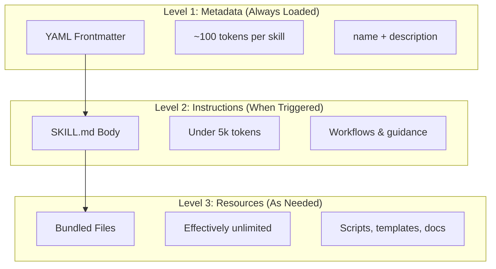
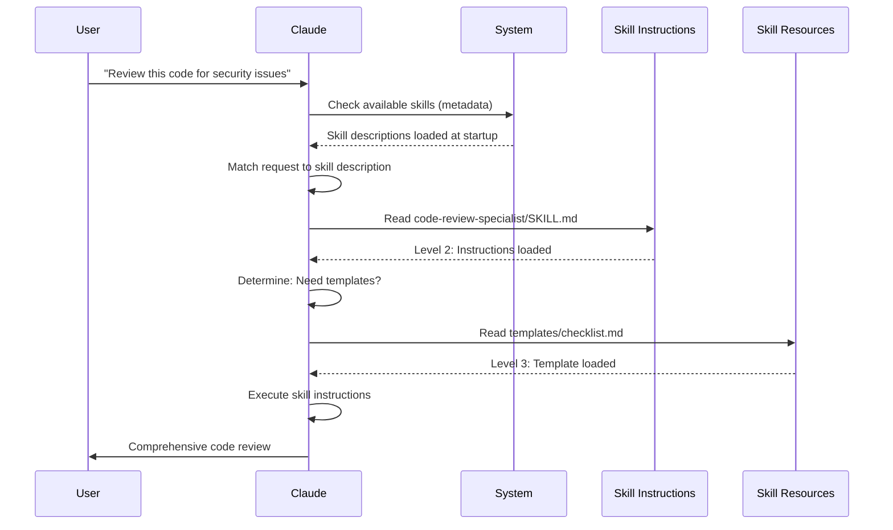

<picture>
  <source media="(prefers-color-scheme: dark)" srcset="../../resources/logos/claude-howto-logo-dark.svg">
  
</picture>

# راهنمای مهارت‌های ایجنت

مهارت‌های ایجنت قابلیت‌های قابل استفاده مجدد و مبتنی بر فایل‌سیستم هستند که عملکرد Claude را گسترش می‌دهند. آن‌ها تخصص حوزه‌ای، جریان‌های کاری و بهترین شیوه‌ها را در کامپوننت‌هایی قابل کشف بسته‌بندی می‌کنند که Claude در صورت لزوم به‌طور خودکار از آن‌ها استفاده می‌کند.

## مرور کلی

**مهارت‌های ایجنت** قابلیت‌های ماژولاری هستند که ایجنت‌های عمومی را به متخصص تبدیل می‌کنند. برخلاف پرامپت‌ها (دستورالعمل‌های سطح گفتگو برای وظایف یک‌باره)، مهارت‌ها به‌صورت درخواستی بارگذاری می‌شوند و نیاز به ارائه مکرر همان راهنمایی در چندین گفتگو را از بین می‌برند.

### مزایای کلیدی

- **تخصصی کردن Claude**: تنظیم قابلیت‌ها برای وظایف حوزه‌ای
- **کاهش تکرار**: یک بار بسازید، به‌طور خودکار در گفتگوها استفاده کنید
- **ترکیب قابلیت‌ها**: ترکیب مهارت‌ها برای ساخت جریان‌های کاری پیچیده
- **مقیاس‌پذیری جریان‌های کاری**: استفاده مجدد از مهارت‌ها در چندین پروژه و تیم
- **حفظ کیفیت**: جاسازی بهترین شیوه‌ها مستقیماً در جریان کاری شما

مهارت‌ها از استاندارد باز [Agent Skills](https://agentskills.io) پیروی می‌کنند که در چندین ابزار هوش مصنوعی کار می‌کند. Claude Code این استاندارد را با ویژگی‌های اضافی مانند کنترل فراخوانی، اجرای زیرایجنت و تزریق زمینه پویا گسترش می‌دهد.

> **توجه**: دستورات اسلش سفارشی در مهارت‌ها ادغام شده‌اند. فایل‌های `.claude/commands/` هنوز کار می‌کنند و از همان فیلدهای frontmatter پشتیبانی می‌کنند. برای توسعه جدید مهارت‌ها توصیه می‌شوند. وقتی هر دو در یک مسیر وجود داشته باشند (مثلاً `.claude/commands/review.md` و `.claude/skills/review/SKILL.md`)، مهارت اولویت دارد.

## نحوه کار مهارت‌ها: افشای تدریجی

مهارت‌ها از معماری **افشای تدریجی** بهره می‌گیرند — Claude اطلاعات را در مراحل و بر حسب نیاز بارگذاری می‌کند، نه اینکه از ابتدا زمینه را مصرف کند. این مدیریت کارآمد زمینه را همراه با مقیاس‌پذیری نامحدود ممکن می‌کند.

### سه سطح بارگذاری



| سطح | زمان بارگذاری | هزینه توکن | محتوا |
|-------|------------|------------|---------|
| **سطح ۱: فراداده** | همیشه (هنگام راه‌اندازی) | حدود ۱۰۰ توکن به ازای هر مهارت | `name` و `description` از YAML frontmatter |
| **سطح ۲: دستورالعمل‌ها** | وقتی مهارت فعال می‌شود | کمتر از ۵ هزار توکن | بدنه SKILL.md با دستورالعمل‌ها و راهنمایی |
| **سطح ۳ و بالاتر: منابع** | بر حسب نیاز | عملاً نامحدود | فایل‌های بسته‌بندی‌شده که از طریق bash بدون بارگذاری محتوا در زمینه اجرا می‌شوند |

این مهارت‌ها را سبک نگه می‌دارد — Claude فقط می‌داند هر مهارت وجود دارد و چه زمانی از آن استفاده کند تا زمانی که واقعاً فعال شود — اما رایگان نیست: هر مهارت فهرست‌شده توضیحاتش را در هر نوبت به زمینه اضافه می‌کند.

## فرایند بارگذاری مهارت



## انواع و مکان‌های مهارت

| نوع | مکان | دامنه | مشترک | بهترین برای |
|------|----------|-------|--------|----------|
| **سازمانی** | تنظیمات مدیریت‌شده | همه کاربران سازمان | بله | استانداردهای سراسر سازمان |
| **شخصی** | `~/.claude/skills/<skill-name>/SKILL.md` | فردی | خیر | جریان‌های کاری شخصی |
| **پروژه** | `.claude/skills/<skill-name>/SKILL.md` | تیمی | بله (از طریق گیت) | استانداردهای تیمی |
| **پلاگین** | `<plugin>/skills/<skill-name>/SKILL.md` | هرجا فعال باشد | بستگی دارد | بسته‌بندی‌شده با پلاگین‌ها |

وقتی مهارت‌ها در سطوح مختلف نام یکسان دارند، مکان‌های با اولویت بالاتر برنده می‌شوند: **سازمانی > شخصی > پروژه**. با نام یکسان در `~/.claude/skills/` و `.claude/skills/`، مهارت شخصی اجرا می‌شود. برای تغییر دیدپذیری یک مهارت (نه تقدم آن)، از تنظیم `skillOverrides` استفاده کنید (نسخه 2.1.129 به بعد) — به [کنترل رفتار بازنویسی مهارت](#کنترل-رفتار-بازنویسی-مهارت-skilloverrides) مراجعه کنید. مهارت‌های پلاگین از فضای نام `plugin-name:skill-name` استفاده می‌کنند، بنابراین نمی‌توانند تعارض داشته باشند.

> **کشف مهارت توسط زیرایجنت (نسخه 2.1.133 به بعد)**: زیرایجنت‌ها اکنون مهارت‌های پروژه، کاربر و پلاگین را از طریق ابزار Skill همانند نشست اصلی کشف می‌کنند. نسخه‌های قبلی زیرایجنت‌ها را به مجموعه جاسازی‌شده خودشان محدود می‌کردند، که باعث می‌شد جریان‌های کاری مهارت+زیرایجنت بی‌صدا تنزل کنند؛ از نسخه 2.1.133 همان کاتالوگ مهارت برای هر دو قابل مشاهده است.

### کشف خودکار

**دایرکتوری‌های تودرتو**: وقتی با فایل‌های زیردایرکتوری‌ها کار می‌کنید، Claude Code به‌طور خودکار مهارت‌ها را از دایرکتوری‌های تودرتوی `.claude/skills/` کشف می‌کند. مثلاً اگر فایلی در `packages/frontend/` ویرایش می‌کنید، Claude Code مهارت‌ها را در `packages/frontend/.claude/skills/` هم جستجو می‌کند. این از راه‌اندازی‌های monorepo که بسته‌ها مهارت خودشان را دارند پشتیبانی می‌کند. وقتی یک مهارت تودرتو نامی همانند مهارت ریشه مخزن دارد، **هر دو بارگذاری می‌شوند**: برای مهارت `deploy` در ریشه و در `apps/web/.claude/skills/`، `/deploy` مهارت ریشه و `/apps/web:deploy` مهارت تودرتو را اجرا می‌کند.

**دایرکتوری‌های `--add-dir`**: مهارت‌های دایرکتوری‌های افزوده‌شده از طریق `--add-dir` به‌طور خودکار با تشخیص زنده تغییرات بارگذاری می‌شوند. هر ویرایشی در فایل‌های مهارت آن دایرکتوری‌ها بلافاصله اعمال می‌شود، بدون راه‌اندازی مجدد Claude Code. اگر مهارت یک دایرکتوری افزوده‌شده هم‌نام مهارتی از سطح سازمان، شخصی یا پروژه باشد، یا هم‌نام مهارتی از دایرکتوری‌ای که پیش‌تر افزوده شده، با نام پیشوند‌دار اجرا می‌شود. برای مثال با `--add-dir ../cli` و یک مهارت `verify` در هر دو جا، `/verify` مهارت پروژه‌ی شما را اجرا می‌کند و `/cli:verify` مهارت `../cli` را (v2.1.309+).

**بارگذاری مجدد مهارت‌ها**: دستور `/reload-skills` (افزوده‌شده در نسخه 2.1.152) همه دایرکتوری‌های مهارت را بدون راه‌اندازی مجدد نشست دوباره اسکن می‌کند — مفید پس از افزودن یا ویرایش مهارتی که تشخیص زنده آن را برنمی‌دارد. یک هوک `SessionStart` می‌تواند با برگرداندن `reloadSkills: true` همان اسکن مجدد را فعال کند (به [هوک‌ها](../06-hooks/README.md) مراجعه کنید).

**بودجه توضیحات**: توضیحات مهارت (فراداده سطح ۱) به **۱ درصد پنجره زمینه** محدود است (جایگزین: **۸,۰۰۰ کاراکتر**). اگر مهارت‌های زیادی نصب کرده‌اید، توضیحات ممکن است کوتاه شوند. همه نام‌های مهارت همیشه گنجانده می‌شوند، اما توضیحات برای جا شدن بریده می‌شوند. کاربرد کلیدی را در ابتدای توضیحات بیاورید. بودجه را با متغیر محیطی `SLASH_COMMAND_TOOL_CHAR_BUDGET` بازنویسی کنید.

## ساخت مهارت‌های سفارشی

### ساختار پایه دایرکتوری

```
my-skill/
├── SKILL.md           # Main instructions (required)
├── template.md        # Template for Claude to fill in
├── examples/
│   └── sample.md      # Example output showing expected format
└── scripts/
    └── validate.sh    # Script Claude can execute
```

### قالب SKILL.md

```yaml
---
name: your-skill-name
description: Brief description of what this Skill does and when to use it
---

# نام مهارت شما

## Instructions
Provide clear, step-by-step guidance for Claude.

## Examples
Show concrete examples of using this Skill.
```

### فیلدهای توصیه‌شده

- **description** (توصیه‌شده): کاری که مهارت انجام می‌دهد **و** چه زمانی از آن استفاده شود. اگر حذف شود، Claude Code از نخستین خط غیرخالی محتوای markdown استفاده می‌کند. متن ترکیبی `description` + `when_to_use` در فهرست مهارت‌ها در **۱,۵۳۶ کاراکتر** بریده می‌شود (قابل پیکربندی از طریق `skillListingMaxDescChars`). این همان چیزی است که Claude با آن تطبیق می‌دهد تا تصمیم بگیرد چه زمانی مهارت را فعال کند.
- **name** (اختیاری): به‌طور پیش‌فرض **نام دایرکتوری** مهارت است. وقتی داده شود، نام نمایشی را تعیین می‌کند — حروف کوچک، اعداد و خط تیره تنها (حداکثر ۶۴ کاراکتر) شکل توصیه‌شده و قابل حمل است (الزامی برای claude.ai و Skills API). خود Claude Code (نسخه 2.1.299 به بعد) مهارت یا دستوری را که نامش شامل کاراکترهای پنهان، تغییردهنده جهت یا شبه‌فاصله، `<` یا `>` باشد یا بیش از ۲۵۶ کاراکتر باشد رد می‌کند، تا زمانی که نامش را تغییر دهید. در Claude Code، `anthropic-skills` و `synced` رزرو شده‌اند و بیرون از یک پلاگین بارگذاری نمی‌شوند؛ ممنوعیت سخت‌گیرانه‌تر روی «anthropic» یا «claude» برای مهارت‌هایی اعمال می‌شود که در claude.ai یا Skills API بارگذاری می‌شوند. برای مهارت‌های پلاگین، `name` آخرین بخش دستور را هم تعیین می‌کند.

همه فیلدهای frontmatter در SKILL.md اختیاری هستند؛ `description` تنها فیلد توصیه‌شده است.

### فیلدهای اختیاری frontmatter

```yaml
---
name: my-skill
description: What this skill does and when to use it
argument-hint: "[filename] [format]"        # Hint for autocomplete
disable-model-invocation: true              # Only user can invoke
user-invocable: false                       # Hide from slash menu
allowed-tools: Read, Grep, Glob             # Pre-approve these tools (no permission prompts) while the skill runs
disallowed-tools: Write, Edit               # Remove specific tools while active (v2.1.152)
model: opus                                 # Specific model to use
effort: high                                # Effort level override (low, medium, high, xhigh, max)
context: fork                               # Run in isolated subagent
agent: Explore                              # Which agent type (with context: fork)
background: false                           # Fork skills run in background (default true); false = foreground
shell: bash                                 # Shell for commands: bash (default) or powershell
hooks:                                      # Hooks registered when the skill is invoked
  PreToolUse:
    - matcher: "Bash"
      hooks:
        - type: command
          command: "./scripts/validate.sh"
paths: "src/api/**/*.ts"               # Glob patterns limiting when skill activates
---
```

| فیلد | توضیح |
|-------|-------------|
| `name` | توصیه‌شده (قابل حمل): فقط حروف کوچک، اعداد و خط تیره (حداکثر ۶۴ کاراکتر). `anthropic-skills` و `synced` در Claude Code رزرو شده‌اند. |
| `description` | کاری که مهارت انجام می‌دهد **و** چه زمانی از آن استفاده شود. متن ترکیبی `description` + `when_to_use` در فهرست مهارت‌ها در ۱,۵۳۶ کاراکتر بریده می‌شود (قابل پیکربندی از طریق `skillListingMaxDescChars`). برای تطبیق فراخوانی خودکار حیاتی است. |
| `when_to_use` | زمینه اضافی برای اینکه Claude چه زمانی باید مهارت را فراخوانی کند. در فهرست مهارت‌ها به `description` افزوده می‌شود و در سقف ۱,۵۳۶ کاراکتری حساب می‌شود. |
| `argument-hint` | راهنمایی نمایش‌داده‌شده در منوی تکمیل خودکار `/` (مثلاً `"[filename] [format]"`). |
| `disable-model-invocation` | `true` = فقط کاربر می‌تواند از طریق `/name` فراخوانی کند. Claude هرگز به‌طور خودکار فراخوانی نمی‌کند. |
| `user-invocable` | `false` = از منوی `/` پنهان است. فقط Claude می‌تواند آن را به‌طور خودکار فراخوانی کند. |
| `allowed-tools` | فهرست جداشده با ویرگول از ابزارهایی که مهارت می‌تواند بدون پرامپت مجوز استفاده کند. وقتی تنظیمات مدیریت‌شده `hooks` را در `strictPluginOnlyCustomization` فهرست کند، مهارت شخصی یا پروژه‌ای که frontmatter آن `hooks` را تعریف کرده این پیش‌تأیید را از دست می‌دهد (v2.1.304)؛ `hooks` آن را حذف کنید یا مهارت را به یک پلاگین منتقل کنید. |
| `disallowed-tools` | فهرست جداشده با ویرگول از ابزارهایی که هنگام فعال بودن مهارت حذف می‌شوند (مکمل `allowed-tools`). افزوده‌شده در نسخه 2.1.152. |
| `model` | بازنویسی مدل هنگام فعال بودن مهارت (مثلاً `opus`، `sonnet`). |
| `effort` | بازنویسی سطح تلاش هنگام فعال بودن مهارت: `low`، `medium`، `high`، `xhigh` یا `max` — هر پنج سطح در Fable 5.1، Fable 5، Opus 5.5، Sonnet 5.5، Haiku 5.5، Opus 5، Sonnet 5، Opus 4.8 و Opus 4.7 پشتیبانی می‌شوند. تلاش پیش‌فرض در هر مدلی که از effort پشتیبانی می‌کند `high` است، به‌جز Opus 5.5، Sonnet 5.5 و Haiku 5.5 که پیش‌فرض `medium` دارند، و Opus 4.7 که پیش‌فرض `xhigh` دارد. |
| `context` | `fork` برای اجرای مهارت در زمینه یک زیرایجنت منشعب با پنجره زمینه خودش. |
| `agent` | نوع زیرایجنت وقتی `context: fork` باشد (مثلاً `Explore`، `Plan`، `general-purpose`). |
| `background` | فقط با `context: fork` معنا دارد. برای مهارت‌های `context: fork` پیش‌فرض `true` است، بنابراین در پس‌زمینه اجرا می‌شوند؛ برای اجرا در پیش‌زمینه `false` بگذارید. افزوده‌شده در نسخه 2.1.218. |
| `shell` | شل استفاده‌شده برای جایگذاری‌های `` !`command` `` و اسکریپت‌ها: `bash` (پیش‌فرض) یا `powershell`. |
| `hooks` | هوک‌های ثبت‌شده هنگام فراخوانی مهارت (همان قالب هوک‌های تنظیمات؛ هر رویدادی). برای باقی نشست فعال می‌مانند. از v2.1.304، مهارت‌های یک منبع (پروژه‌ شما، پوشهٔ مهارت‌های شخصی شما یا یک پلاگین) حداکثر ۱٬۰۲۴ هوک و ۱۶٬۳۸۴ کاراکتر matcher در هر نشست ثبت می‌کنند؛ فراتر از آن، یک مهارت بدون هوک‌های frontmatter خود اجرا می‌شود (با `/hooks` بررسی کنید). |
| `paths` | الگوهای glob که زمان فعال‌سازی خودکار مهارت را محدود می‌کنند. رشته جداشده با ویرگول یا فهرست YAML. الگوها نسبت به دایرکتوری کاری فعلی Claude هستند و فایل‌های بیرون از آن، مثل یک worktree همسایه که با `/add-dir` افزوده شده، تطبیق نمی‌یابند (Claude Code را آنجا اجرا کنید یا از `/cd` استفاده کنید). همان قالب قواعد مخصوص مسیر. |
| `arguments` | آرگومان‌هایی را که مهارت می‌پذیرد اعلام می‌کند، برای تکمیل خودکار و جایگذاری آرگومان. فقط ۶۴ نام اول، هر کدام تا ۶۴ کاراکتر، پر می‌شوند (نسخه 2.1.301). |
| `metadata` | نگاشت کلید/مقدار آزاد برای دفترداری خودتان (مثلاً `version`، `author`). Claude Code آن را عبور می‌دهد. |
| `license` | شناسه مجوز مهارت (مثلاً `MIT`). |
| `compatibility` | بیانیه سازگاری متنی آزاد، تا ۵۰۰ کاراکتر. Claude Code آن را می‌پذیرد اما روی آن اقدامی نمی‌کند. |

> **توجه**: فقط `name`، `description`، `license`، `compatibility`، `metadata` و `allowed-tools` برای مهارت‌هایی معتبرند که در claude.ai بارگذاری می‌شوند یا از طریق Skills API ساخته می‌شوند. سایر فیلدهای این جدول مخصوص Claude Code هستند.

از نسخه 2.1.218، فیلدهای بولی frontmatter علاوه بر `true`/`false` مقادیر `yes`/`no`، `on`/`off` و `1`/`0` را هم می‌پذیرند (بدون حساسیت به حروف).

## انواع محتوای مهارت

مهارت‌ها می‌توانند دو نوع محتوا داشته باشند که هر کدام برای مقاصد متفاوتی مناسب است:

### محتوای مرجع

دانشی می‌افزاید که Claude روی کار جاری شما اعمال می‌کند — قراردادها، الگوها، راهنمای سبک، دانش حوزه‌ای. درون‌خطی با زمینه گفتگوی شما اجرا می‌شود.

```yaml
---
name: api-conventions
description: API design patterns for this codebase
---

When writing API endpoints:
- Use RESTful naming conventions
- Return consistent error formats
- Include request validation
```

### محتوای وظیفه

دستورالعمل‌های گام‌به‌گام برای اقدامات مشخص. اغلب مستقیماً با `/skill-name` فراخوانی می‌شود.

```yaml
---
name: deploy
description: Deploy the application to production
context: fork
disable-model-invocation: true
---

Deploy the application:
1. Run the test suite
2. Build the application
3. Push to the deployment target
```

## کنترل فراخوانی مهارت

به‌طور پیش‌فرض، هم شما و هم Claude می‌توانید هر مهارتی را فراخوانی کنید. دو فیلد frontmatter سه حالت فراخوانی را کنترل می‌کنند:

| frontmatter | شما می‌توانید فراخوانی کنید | Claude می‌تواند فراخوانی کند |
|---|---|---|
| (پیش‌فرض) | بله | بله |
| `disable-model-invocation: true` | بله | خیر |
| `user-invocable: false` | خیر | بله |

**از `disable-model-invocation: true` استفاده کنید** برای جریان‌های کاری با عوارض جانبی: `/commit`، `/deploy`، `/send-slack-message`. نمی‌خواهید Claude تصمیم بگیرد مستقر کند چون کد شما آماده به نظر می‌رسد.

**از `user-invocable: false` استفاده کنید** برای دانش زمینه‌ای که به‌عنوان دستور قابل اقدام نیست. یک مهارت `legacy-system-context` توضیح می‌دهد یک سیستم قدیمی چگونه کار می‌کند — برای Claude مفید است، اما اقدامی معنادار برای کاربران نیست.

## جایگذاری رشته

مهارت‌ها از مقادیر پویا پشتیبانی می‌کنند که پیش از رسیدن محتوای مهارت به Claude حل می‌شوند:

| متغیر | توضیح |
|----------|-------------|
| `$ARGUMENTS` | همه آرگومان‌های داده‌شده هنگام فراخوانی مهارت |
| `$ARGUMENTS[N]` یا `$N` | دسترسی به آرگومان مشخص با اندیس (از ۰) |
| `${CLAUDE_SESSION_ID}` | شناسه نشست جاری |
| `${CLAUDE_SKILL_DIR}` | دایرکتوری حاوی فایل SKILL.md مهارت |
| `${CLAUDE_PROJECT_DIR}` | مسیر مطلق ریشه پروژه. قابل استفاده در بدنه مهارت و در `allowed-tools` (نسخه 2.1.196) |
| `${CLAUDE_EFFORT}` | سطح تلاش جاری (`low`، `medium`، `high`، `xhigh` یا `max`). مفید برای انشعاب رفتار مهارت: مثلاً `[ "${CLAUDE_EFFORT}" = "max" ] && deep_analysis` (نسخه 2.1.120 به بعد) |
| `` !`command` `` | تزریق زمینه پویا — یک دستور شل اجرا می‌کند و خروجی را درون‌خطی می‌گذارد |

**مثال:**

```yaml
---
name: fix-issue
description: Fix a GitHub issue
---

Fix GitHub issue $ARGUMENTS following our coding standards.
1. Read the issue description
2. Implement the fix
3. Write tests
4. Create a commit
```

اجرای `/fix-issue 123` مقدار `$ARGUMENTS` را با `123` جایگزین می‌کند.

### روی هم گذاشتن مهارت‌ها

می‌توانید مهارت‌های اسلش را در یک فراخوانی در پرامپت ترمینال روی هم بگذارید، مانند `/write-tests /fix-issue 123`. از نسخه 2.1.199، این کار **همه** مهارت‌های ابتدایی را بارگذاری می‌کند — اولی به‌علاوه تا ۵ مورد دیگر — و آرگومان‌های انتهایی (`123`) را به هر کدام می‌دهد؛ پیش‌تر فقط مهارت اول بارگذاری می‌شد. بازشدن در مهارتی که به‌عنوان زیرایجنت منشعب اجرا می‌شود متوقف می‌شود، مانند `/code-review`، و از طریق Agent SDK یا `claude -p` فقط مهارت اول بارگذاری می‌شود. اگر یک مهارت بیش از یک بار فراخوانی شود، محتوای یکسان آن حذف تکراری می‌شود (نسخه 2.1.202) نه اینکه دو بار افزوده شود.

## تزریق زمینه پویا

نحو `` !`command` `` دستورات شل را پیش از ارسال محتوای مهارت به Claude اجرا می‌کند:

> **توجه (نسخه 2.1.299)**: هوک‌های `UserPromptSubmit` پیش از بازشدن دستور اجرا می‌شوند، بنابراین هوکی که پرامپت را مسدود می‌کند، اجرای این دستورات `!` را هم متوقف می‌کند.

```yaml
---
name: pr-summary
description: Summarize changes in a pull request
context: fork
agent: Explore
---

## Pull request context
- PR diff: !`gh pr diff`
- PR comments: !`gh pr view --comments`
- Changed files: !`gh pr diff --name-only`

## Your task
Summarize this pull request...
```

دستورات بلافاصله اجرا می‌شوند؛ Claude فقط خروجی نهایی را می‌بیند. به‌طور پیش‌فرض دستورات در `bash` اجرا می‌شوند. برای استفاده از PowerShell، در frontmatter مقدار `shell: powershell` را تعیین کنید.

## اجرای مهارت‌ها در زیرایجنت‌ها

`context: fork` را اضافه کنید تا مهارت در یک زمینه زیرایجنت ایزوله اجرا شود. محتوای مهارت وظیفه یک زیرایجنت اختصاصی با پنجره زمینه خودش می‌شود و گفتگوی اصلی را مرتب نگه می‌دارد. از نسخه 2.1.218، `background` برای مهارت‌های `context: fork` پیش‌فرض `true` است، بنابراین در پس‌زمینه اجرا می‌شوند؛ برای اجرای یک مهارت fork در پیش‌زمینه، در frontmatter مقدار `background: false` را تعیین کنید.

> **اصلاح نسخه 2.1.145**: یک مهارت با `context: fork` پیش‌تر در موارد نادر می‌توانست حلقه فراخوانی مجدد بی‌پایان ایجاد کند. اگر مهارت‌های fork را می‌نویسید یا به آن‌ها تکیه می‌کنید، به نسخه 2.1.145 به بعد ارتقا دهید.

فیلد `agent` تعیین می‌کند کدام نوع ایجنت استفاده شود:

| نوع ایجنت | بهترین برای |
|---|---|
| `Explore` | پژوهش فقط-خواندنی، تحلیل کدبیس |
| `Plan` | ساخت طرح‌های پیاده‌سازی |
| `general-purpose` | وظایف گسترده نیازمند همه ابزارها |
| ایجنت‌های سفارشی | ایجنت‌های تخصصی تعریف‌شده در پیکربندی شما |

**نمونه frontmatter:**

```yaml
---
context: fork
agent: Explore
---
```

**نمونه کامل مهارت:**

```yaml
---
name: topic-research
description: Research a topic thoroughly
context: fork
agent: Explore
---

Research $ARGUMENTS thoroughly:
1. Find relevant files using Glob and Grep
2. Read and analyze the code
3. Summarize findings with specific file references
```

## مثال‌های عملی

### مثال ۱: مهارت بازبینی کد

**ساختار دایرکتوری:**

```
~/.claude/skills/code-review-specialist/
├── SKILL.md
├── templates/
│   ├── review-checklist.md
│   └── finding-template.md
└── scripts/
    ├── analyze-metrics.py
    └── compare-complexity.py
```

**فایل:** `~/.claude/skills/code-review-specialist/SKILL.md`

```yaml
---
name: code-review-specialist
description: Comprehensive code review with security, performance, and quality analysis. Use when users ask to review code, analyze code quality, evaluate pull requests, or mention code review, security analysis, or performance optimization.
---

# مهارت بازبینی کد

This skill provides comprehensive code review capabilities focusing on:

1. **Security Analysis**
   - Authentication/authorization issues
   - Data exposure risks
   - Injection vulnerabilities
   - Cryptographic weaknesses

2. **Performance Review**
   - Algorithm efficiency (Big O analysis)
   - Memory optimization
   - Database query optimization
   - Caching opportunities

3. **Code Quality**
   - SOLID principles
   - Design patterns
   - Naming conventions
   - Test coverage

4. **Maintainability**
   - Code readability
   - Function size (should be < 50 lines)
   - Cyclomatic complexity
   - Type safety

## Review Template

For each piece of code reviewed, provide:

### Summary
- Overall quality assessment (1-5)
- Key findings count
- Recommended priority areas

### Critical Issues (if any)
- **Issue**: Clear description
- **Location**: File and line number
- **Impact**: Why this matters
- **Severity**: Critical/High/Medium
- **Fix**: Code example

For detailed checklists, see [templates/review-checklist.md](templates/review-checklist.md).
```

### مثال ۲: مهارت مصورسازی کدبیس

مهارتی که تجسم‌های HTML تعاملی تولید می‌کند:

**ساختار دایرکتوری:**

```
~/.claude/skills/codebase-visualizer/
├── SKILL.md
└── scripts/
    └── visualize.py
```

**فایل:** `~/.claude/skills/codebase-visualizer/SKILL.md`

````yaml
---
name: codebase-visualizer
description: Generate an interactive collapsible tree visualization of your codebase. Use when exploring a new repo, understanding project structure, or identifying large files.
allowed-tools: Bash(python *)
---

# مصورساز کدبیس

Generate an interactive HTML tree view showing your project's file structure.

## Usage

Run the visualization script from your project root:

```bash
python ~/.claude/skills/codebase-visualizer/scripts/visualize.py .
```

This creates `codebase-map.html` and opens it in your default browser.

## What the visualization shows

- **Collapsible directories**: Click folders to expand/collapse
- **File sizes**: Displayed next to each file
- **Colors**: Different colors for different file types
- **Directory totals**: Shows aggregate size of each folder
````

اسکریپت پایتون بسته‌بندی‌شده کار سنگین را انجام می‌دهد در حالی که Claude هماهنگ‌سازی را بر عهده دارد.

### مثال ۳: مهارت استقرار (فقط فراخوانی کاربر)

```yaml
---
name: deploy
description: Deploy the application to production
disable-model-invocation: true
allowed-tools: Bash(npm *), Bash(git *)
---

Deploy $ARGUMENTS to production:

1. Run the test suite: `npm test`
2. Build the application: `npm run build`
3. Push to the deployment target
4. Verify the deployment succeeded
5. Report deployment status
```

### مثال ۴: مهارت لحن برند (دانش زمینه‌ای)

```yaml
---
name: brand-voice
description: Ensure all communication matches brand voice and tone guidelines. Use when creating marketing copy, customer communications, or public-facing content.
user-invocable: false
---

## Tone of Voice
- **Friendly but professional** - approachable without being casual
- **Clear and concise** - avoid jargon
- **Confident** - we know what we're doing
- **Empathetic** - understand user needs

## Writing Guidelines
- Use "you" when addressing readers
- Use active voice
- Keep sentences under 20 words
- Start with value proposition

For templates, see [templates/](templates/).
```

### مثال ۵: مهارت تولیدکننده CLAUDE.md

```yaml
---
name: claude-md
description: Create or update CLAUDE.md files following best practices for optimal AI agent onboarding. Use when users mention CLAUDE.md, project documentation, or AI onboarding.
---

## Core Principles

**LLMs are stateless**: CLAUDE.md is the main project file loaded into every conversation (alongside auto memory and unscoped rules).

### The Golden Rules

1. **Less is More**: Keep each CLAUDE.md under 200 lines
2. **Universal Applicability**: Only include information relevant to EVERY session
3. **Don't Use Claude as a Linter**: Use deterministic tools instead
4. **Never Auto-Generate**: Craft it manually with careful consideration

## Essential Sections

- **Project Name**: Brief one-line description
- **Tech Stack**: Primary language, frameworks, database
- **Development Commands**: Install, test, build commands
- **Critical Conventions**: Only non-obvious, high-impact conventions
- **Known Issues / Gotchas**: Things that trip up developers
```

### مثال ۶: مهارت ری‌فاکتور با اسکریپت‌ها

**ساختار دایرکتوری:**

```
refactor/
├── SKILL.md
├── references/
│   ├── code-smells.md
│   └── refactoring-catalog.md
├── templates/
│   └── refactoring-plan.md
└── scripts/
    ├── analyze-complexity.py
    └── detect-smells.py
```

**فایل:** `refactor/SKILL.md`

```yaml
---
name: refactor
description: Systematic code refactoring based on Martin Fowler's methodology. Use when users ask to refactor code, improve code structure, reduce technical debt, or eliminate code smells.
---

# مهارت ری‌فاکتور کد

A phased approach emphasizing safe, incremental changes backed by tests.

## Workflow

Phase 1: Research & Analysis → Phase 2: Test Coverage Assessment →
Phase 3: Code Smell Identification → Phase 4: Refactoring Plan Creation →
Phase 5: Incremental Implementation → Phase 6: Review & Iteration

## Core Principles

1. **Behavior Preservation**: External behavior must remain unchanged
2. **Small Steps**: Make tiny, testable changes
3. **Test-Driven**: Tests are the safety net
4. **Continuous**: Refactoring is ongoing, not a one-time event

For code smell catalog, see [references/code-smells.md](references/code-smells.md).
For refactoring techniques, see [references/refactoring-catalog.md](references/refactoring-catalog.md).
```

## فایل‌های پشتیبان

مهارت‌ها می‌توانند علاوه بر `SKILL.md` چندین فایل در دایرکتوری خود داشته باشند. این فایل‌های پشتیبان (قالب‌ها، مثال‌ها، اسکریپت‌ها، اسناد مرجع) به شما اجازه می‌دهند فایل اصلی مهارت را متمرکز نگه دارید و در همان حال منابع اضافی در اختیار Claude بگذارید که بر حسب نیاز بارگذاری کند.

```
my-skill/
├── SKILL.md              # Main instructions (required, keep under 500 lines)
├── templates/            # Templates for Claude to fill in
│   └── output-format.md
├── examples/             # Example outputs showing expected format
│   └── sample-output.md
├── references/           # Domain knowledge and specifications
│   └── api-spec.md
└── scripts/              # Scripts Claude can execute
    └── validate.sh
```

رهنمودهایی برای فایل‌های پشتیبان:

- `SKILL.md` را زیر **۵۰۰ خط** نگه دارید. مطالب مرجع تفصیلی، مثال‌های بزرگ و مشخصات را به فایل‌های جداگانه منتقل کنید.
- با **مسیرهای نسبی** از `SKILL.md` به فایل‌های اضافی ارجاع دهید (مثلاً `[API reference](references/api-spec.md)`).
- فایل‌های پشتیبان در سطح ۳ (بر حسب نیاز) بارگذاری می‌شوند، بنابراین تا زمانی که Claude واقعاً آن‌ها را نخواند زمینه را مصرف نمی‌کنند.

## مدیریت مهارت‌ها

### مشاهده مهارت‌های موجود

مستقیماً از Claude بپرسید:
```
What Skills are available?
```

یا فایل‌سیستم را بررسی کنید:
```bash
# فهرست مهارت‌های شخصی
ls ~/.claude/skills/

# فهرست مهارت‌های پروژه
ls .claude/skills/
```

> **نکته (نسخه 2.1.121 به بعد):** منوی تعاملی `/skills` را با تایپ فیلتر کنید — مفید وقتی مهارت‌های زیادی نصب شده است.

### تست یک مهارت

دو راه برای تست:

**بگذارید Claude آن را به‌طور خودکار فراخوانی کند** با پرسیدن چیزی که با توضیحات مطابقت دارد:
```
Can you help me review this code for security issues?
```

**یا مستقیماً آن را فراخوانی کنید** با نام مهارت:
```
/code-review-specialist src/auth/login.ts
```

> **توجه**: این مهارت محلی با نام `code-review-specialist` نصب می‌شود تا با مهارت بسته‌بندی‌شده `/code-review` (بازبینی متمرکز بر باگ، مستعار `/review`) تصادم نداشته باشد. اگر آن را به‌جای آن در `~/.claude/skills/code-review/` کپی کنید، جایگزین `/code-review` بسته‌بندی‌شده می‌شود (هرچند `/review` همچنان نسخه بسته‌بندی‌شده را اجرا می‌کند) — پسوند `-specialist` را نگه دارید تا از این امر پرهیز کنید.

### به‌روزرسانی یک مهارت

فایل `SKILL.md` را مستقیماً ویرایش کنید، سپس `/reload-skills` (نسخه 2.1.152 به بعد) را برای اسکن مجدد دایرکتوری‌های مهارت اجرا کنید. راه‌اندازی مجدد Claude Code هم کار می‌کند، اما الزامی نیست — مهارت‌ها در دایرکتوری‌های `--add-dir` به‌صورت زنده برداشته می‌شوند، و یک هوک `SessionStart` که `reloadSkills: true` برمی‌گرداند همان اسکن مجدد را فعال می‌کند.

```bash
# مهارت شخصی
code ~/.claude/skills/my-skill/SKILL.md

# مهارت پروژه
code .claude/skills/my-skill/SKILL.md
```

### محدود کردن دسترسی Claude به مهارت‌ها

سه راه برای کنترل اینکه Claude کدام مهارت‌ها را می‌تواند فراخوانی کند:

**غیرفعال کردن همه مهارت‌ها** در `/permissions`:
```
# به قواعد رد افزوده شود:
Skill
```

**مجاز یا ممنوع کردن مهارت‌های مشخص**:
```
# فقط مهارت‌های مشخص را مجاز کن
Skill(commit)
Skill(review-pr *)

# مهارت‌های مشخص را رد کن
Skill(deploy *)
```

**پنهان کردن مهارت‌های تکی** با افزودن `disable-model-invocation: true` به frontmatter آن‌ها.

### کنترل رفتار بازنویسی مهارت (`skillOverrides`)

`skillOverrides` (نسخه 2.1.129 به بعد) یک نگاشت دیدپذیری برای هر مهارت است، نه یک کلید تقدم: تعیین می‌کند هر مهارت از تنظیمات چگونه نمایش داده شود، بدون ویرایش SKILL.md آن. هر کلید یک نام مهارت است؛ منوی `/skills` آن را برای شما می‌نویسد (در `.claude/settings.local.json` ذخیره می‌شود). تقدم بدون تغییر است — یک مهارت شخصی همچنان بر مهارت پروژه با همان نام برتری دارد. آن را به `~/.claude/settings.json` یا `.claude/settings.json` پروژه اضافه کنید:

```json
{
  "skillOverrides": {
    "deploy": "off",
    "legacy-helper": "name-only"
  }
}
```

مقادیر پذیرفته‌شده:

| مقدار | رفتار |
|-------|----------|
| `"on"` (پیش‌فرض) | نام و توضیحات به Claude فهرست می‌شود؛ در منوی `/` نمایش داده می‌شود. |
| `"name-only"` | فقط نام به Claude فهرست می‌شود؛ در منوی `/` نمایش داده می‌شود. |
| `"user-invocable-only"` | از Claude پنهان است؛ هنوز در منوی `/` نمایش داده می‌شود. |
| `"off"` | از هر دو Claude و منوی `/` پنهان است. |

مهارت‌های پلاگین تحت تأثیر `skillOverrides` نیستند؛ آن‌ها را از طریق `/plugin` مدیریت کنید.

## بهترین شیوه‌ها

### ۱. توضیحات را مشخص کنید

- **بد (مبهم)**: «کمک به کار با اسناد»
- **خوب (مشخص)**: «استخراج متن و جدول از فایل‌های PDF، پر کردن فرم‌ها، ادغام اسناد. استفاده هنگام کار با فایل‌های PDF یا وقتی کاربر به PDF، فرم یا استخراج سند اشاره می‌کند.»

### ۲. مهارت‌ها را متمرکز نگه دارید

- یک مهارت = یک قابلیت
- ✅ «پر کردن فرم PDF»
- ❌ «پردازش اسناد» (بیش از حد گسترده)

### ۳. اصطلاحات محرک را بگنجانید

کلیدواژه‌هایی در توضیحات اضافه کنید که با درخواست‌های کاربر مطابقت دارند:
```yaml
description: Analyze Excel spreadsheets, generate pivot tables, create charts. Use when working with Excel files, spreadsheets, or .xlsx files.
```

### ۴. SKILL.md را زیر ۵۰۰ خط نگه دارید

مطالب مرجع تفصیلی را به فایل‌های جداگانه‌ای منتقل کنید که Claude بر حسب نیاز بارگذاری می‌کند.

### ۵. به فایل‌های پشتیبان ارجاع دهید

```markdown
## Additional resources

- For complete API details, see [reference.md](reference.md)
- For usage examples, see [examples.md](examples.md)
```

### انجام دهید

- از نام‌های روشن و توصیفی استفاده کنید
- دستورالعمل‌های جامع بگنجانید
- مثال‌های مشخص اضافه کنید
- اسکریپت‌ها و قالب‌های مرتبط را بسته‌بندی کنید
- با سناریوهای واقعی تست کنید
- وابستگی‌ها را مستند کنید

### انجام ندهید

- برای وظایف یک‌باره مهارت نسازید
- عملکرد موجود را تکرار نکنید
- مهارت‌ها را بیش از حد گسترده نکنید
- فیلد description را حذف نکنید
- مهارت‌ها را از منابع نامعتبر بدون ممیزی نصب نکنید

## عیب‌یابی

### مرجع سریع

| مشکل | راه‌حل |
|-------|----------|
| Claude از مهارت استفاده نمی‌کند | توضیحات را با اصطلاحات محرک مشخص‌تر کنید |
| فایل مهارت یافت نمی‌شود | مسیر را تأیید کنید: `~/.claude/skills/name/SKILL.md` |
| خطاهای YAML | نشانگرهای `---`، تورفتگی و نبود tab را بررسی کنید |
| تعارض مهارت‌ها | از اصطلاحات محرک متمایز در توضیحات استفاده کنید |
| اسکریپت‌ها اجرا نمی‌شوند | مجوزها را بررسی کنید: `chmod +x scripts/*.py` |
| Claude همه مهارت‌ها را نمی‌بیند | مهارت‌ها زیاد است؛ `/context` را برای هشدارها بررسی کنید، سپس `/skill-doctor` (نسخه 2.1.252 به بعد) را برای دیدن مهارت‌های بی‌استفاده و هزینه‌شان اجرا کنید |

### مهارت فعال نمی‌شود

اگر Claude وقتی انتظار دارید از مهارت شما استفاده نمی‌کند:

1. بررسی کنید توضیحات شامل کلیدواژه‌هایی باشد که کاربران به‌طور طبیعی می‌گویند
2. تأیید کنید مهارت هنگام پرسیدن «What skills are available?» ظاهر می‌شود
3. درخواست خود را بازنویسی کنید تا با توضیحات مطابقت کند
4. برای تست مستقیماً با `/skill-name` فراخوانی کنید

### مهارت بیش از حد فعال می‌شود

اگر Claude وقتی نمی‌خواهید از مهارت شما استفاده می‌کند:

1. توضیحات را مشخص‌تر کنید
2. برای فراخوانی فقط دستی `disable-model-invocation: true` اضافه کنید

### Claude همه مهارت‌ها را نمی‌بیند

توضیحات مهارت در **۱ درصد پنجره زمینه** بارگذاری می‌شوند (جایگزین: **۸,۰۰۰ کاراکتر**). `description` + `when_to_use` هر ورودی به‌طور پیش‌فرض به ۱,۵۳۶ کاراکتر محدود است (`skillListingMaxDescChars`). برای بررسی هشدارهای مربوط به مهارت‌های حذف‌شده `/context` را اجرا کنید. بودجه را با متغیر محیطی `SLASH_COMMAND_TOOL_CHAR_BUDGET` بازنویسی کنید.

## ملاحظات امنیتی

**فقط از مهارت‌های منابع قابل اعتماد استفاده کنید.** مهارت‌ها از طریق دستورالعمل‌ها و کد به Claude قابلیت می‌دهند — یک مهارت مخرب می‌تواند Claude را به فراخوانی ابزارها یا اجرای کد به شیوه‌های زیان‌بار هدایت کند.

**ملاحظات کلیدی امنیتی:**

- **ممیزی کامل**: همه فایل‌های دایرکتوری مهارت را مرور کنید
- **منابع خارجی پرخطرند**: مهارت‌هایی که از URLهای خارجی واکشی می‌کنند می‌توانند آلوده شوند
- **سوءاستفاده از ابزار**: مهارت‌های مخرب می‌توانند ابزارها را به شیوه‌های زیان‌بار فراخوانی کنند
- **مانند نصب نرم‌افزار رفتار کنید**: فقط از مهارت‌های منابع قابل اعتماد استفاده کنید

### غیرفعال کردن جایگذاری شل در مهارت‌ها

مهارت‌ها از نحو `` !`command` `` برای تزریق خروجی دستورات شل به پرامپت پیش از دیدن توسط Claude پشتیبانی می‌کنند. در محیط‌های حساس به امنیت (استقرارهای سازمانی مشترک، runnerهای CI قفل‌شده) می‌توانید این جایگذاری را کاملاً از طریق تنظیم `disableSkillShellExecution` (افزوده‌شده در **نسخه 2.1.91**) غیرفعال کنید:

```jsonc
// ~/.claude/settings.json یا سیاست مدیریت‌شده
{
  "disableSkillShellExecution": true
}
```

وقتی `disableSkillShellExecution` برابر `true` باشد، هر نشانگر `` !`command` `` در یک مهارت با `[shell command execution disabled by policy]` جایگزین می‌شود به‌جای اینکه اجرا شود — سطح حمله تزریق شل در سطح مهارت را حذف می‌کند بدون غیرفعال کردن خود مهارت‌ها. ترکیب این با یک فهرست مجاز `allowedTools` را برای دفاع لایه‌ای در نظر بگیرید.

### پنهان کردن مهارت‌های بسته‌بندی‌شده (`disableBundledSkills`)

تنظیم `disableBundledSkills` (افزوده‌شده در **نسخه 2.1.169**) مهارت‌ها، جریان‌های کاری و دستورات بسته‌بندی‌شده‌ای را که همراه Claude Code عرضه می‌شوند از مدل پنهان می‌کند. وقتی مهارت‌های داخلی برای یک پروژه نویز هستند از آن استفاده کنید، یا برای کاهش سطح مهارت مدل:

```jsonc
// ~/.claude/settings.json یا .claude/settings.json پروژه
{
  "disableBundledSkills": true
}
```

شکل معادل متغیر محیطی:

```bash
export CLAUDE_CODE_DISABLE_BUNDLED_SKILLS=1
```

## مهارت‌ها در برابر سایر ویژگی‌ها

| ویژگی | فراخوانی | بهترین برای |
|---------|------------|----------|
| **مهارت‌ها** | خودکار یا `/name` | تخصص قابل استفاده مجدد، جریان‌های کاری |
| **دستورات اسلش** | `/name` آغازشده توسط کاربر | میان‌برهای سریع (ادغام‌شده در مهارت‌ها) |
| **زیرایجنت‌ها** | واگذاری خودکار | اجرای ایزوله وظیفه |
| **حافظه (CLAUDE.md)** | همیشه بارگذاری‌شده | زمینه پایدار پروژه |
| **MCP** | لحظه‌ای | دسترسی به داده/سرویس خارجی |
| **هوک‌ها** | رویدادمحور | عوارض جانبی خودکار |

## مهارت‌های بسته‌بندی‌شده

Claude Code مجموعه‌ای از مهارت‌های داخلی را عرضه می‌کند که همیشه بدون نصب در دسترس هستند (مفیدترین‌ها در پایین فهرست شده‌اند؛ برای مجموعه کامل به [مرجع دستورات](https://code.claude.com/docs/en/commands) مراجعه کنید):

| مهارت | توضیح |
|-------|-------------|
| `/batch <instruction>` | هماهنگ‌سازی تغییرات موازی در مقیاس بزرگ در کدبیس با استفاده از worktreeهای گیت |
| `/claude-api` | بارگذاری مرجع Claude API/SDK؛ فعال‌سازی خودکار روی importهای `anthropic`/`@anthropic-ai/sdk`. `/claude-api api-version` کد شما را به یک نسخهٔ جدیدتر API مثل `2026-10-21` به‌روز می‌کند (v2.1.307+)؛ `/claude-api managed-agents-secure [<agent-id>]` تنظیمات یک Managed Agent را با راهنمای امنیتی Anthropic مقایسه می‌کند، بدون تغییر چیزی (نیازمند CLI `ant`، v2.1.304+) |
| `/dataviz` | راهنمای طراحی نمودار و داشبورد با یک اعتبارسنج پالت رنگ قابل اجرا (نسخه 2.1.198) |
| `/debug [description]` | عیب‌یابی نشست جاری با خواندن لاگ اشکال‌زدایی |
| `/deep-research <question>` | یک **جریان کاری** بسته‌بندی‌شده، نه یک مهارت: جستجوهای وب را پخش می‌کند و یک گزارش استنادشده ترکیب می‌کند (از نسخه 2.1.218 فقط با فراخوانی صریح — Claude خودش آن را فعال نمی‌کند) |
| `/fewer-permission-prompts` | اسکن رونوشت‌ها و پیشنهاد یک فهرست مجاز اولویت‌دار برای ابزارهای رایج فقط-خواندنی |
| `/loop [interval] [prompt]` | اجرای مکرر پرامپت در بازه‌های زمانی (مثلاً `/loop 5m check the deploy`) |
| `/run` *(نسخه 2.1.145 به بعد)* | اجرای اپلیکیشن این پروژه برای دیدن تغییر در حال اجرا — یک مهارت پروژه را جستجو می‌کند، در غیر این صورت به الگوهای داخلی هر نوع پروژه بازمی‌گردد |
| `/run-skill-generator` *(نسخه 2.1.145 به بعد)* | آموزش به `/run` و `/verify` برای کار با یک پروژه مشخص با تولید یک مهارت مخصوص آن پروژه |
| `/code-review [effort]` | بازبینی diff جاری برای باگ‌های صحت در سطح تلاش انتخاب‌شده (مثلاً `/code-review high`)؛ `--comment` را برای ارسال یافته‌ها به‌عنوان توضیحات درون‌خطی PR بدهید. مهارتی متمایز از `/simplify` (پاکسازی کیفیت/استفاده مجدد)، که در نسخه 2.1.154 دوباره جدا شد. Claude می‌تواند خودش هم آن را شروع کند، از نسخه 2.1.246 در همه جا. از نسخه 2.1.218 به‌عنوان زیرایجنت پس‌زمینه اجرا می‌شود، بنابراین کار بازبینی دیگر گفتگوی شما را پر نمی‌کند و دستورات اسلش روی هم گذاشته‌شده هدف بازبینی آن می‌مانند. |
| `/simplify` | بازبینی فقط-پاکسازی — استفاده مجدد، ساده‌سازی، کارایی، سطح انتزاع — و اصلاحات را اعمال می‌کند. در نسخه 2.1.154 از `/code-review` دوباره جدا شد |
| `/verify` *(نسخه 2.1.145 به بعد)* | ساخت، اجرا و مشاهده اپلیکیشن برای تأیید کارکرد یک اصلاح (نه فقط گذر تست‌ها) (از نسخه 2.1.215 فقط با فراخوانی صریح — Claude خودش آن را فعال نمی‌کند) |

برای بازبینی‌های خودکار روی pull requestهای گیت‌هاب، سازمان‌های Team و Enterprise می‌توانند [Code Review مدیریت‌شده](https://code.claude.com/docs/en/code-review) را روشن کنند.

> **توجه**: اگر مهارت‌های پروژه یا کاربر شما شامل مهارتی با نام `verify` باشد، Claude آن را درست پیش از کامیت اجرا می‌کند، به‌جز کامیت‌های فقط-مستند و فقط-تست (نسخه 2.1.286).

این مهارت‌ها آماده استفاده هستند و نیازی به نصب یا پیکربندی ندارند. آن‌ها از همان قالب SKILL.md مهارت‌های سفارشی پیروی می‌کنند.

## اشتراک مهارت‌ها

### مهارت‌های پروژه (اشتراک تیمی)

1. مهارت را در `.claude/skills/` بسازید
2. در گیت کامیت کنید
3. اعضای تیم تغییرات را pull می‌کنند — مهارت‌ها بلافاصله در دسترس هستند

### مهارت‌های شخصی

```bash
# کپی به پوشه شخصی
cp -r my-skill ~/.claude/skills/

# اجرایی کردن اسکریپت‌ها
chmod +x ~/.claude/skills/my-skill/scripts/*.py
```

### توزیع با پلاگین

مهارت‌ها را در دایرکتوری `skills/` یک پلاگین برای توزیع گسترده‌تر بسته‌بندی کنید.

## فراتر رفتن: مجموعه مهارت و مدیر مهارت

وقتی جدی شروع به ساخت مهارت می‌کنید، دو چیز ضروری می‌شود: کتابخانه‌ای از مهارت‌های آزموده‌شده و ابزاری برای مدیریت آن‌ها.

**[luongnv89/skills](https://github.com/luongnv89/skills)** — مجموعه‌ای از مهارت‌هایی که روزانه در تقریباً همه پروژه‌هایم استفاده می‌کنم. از جمله موارد برجسته `logo-designer` (لوگوی پروژه را در لحظه تولید می‌کند) و `ollama-optimizer` (کارایی LLM محلی را برای سخت‌افزار شما تنظیم می‌کند). نقطه شروع خوبی است اگر مهارت‌های آماده استفاده می‌خواهید.

**[luongnv89/asm](https://github.com/luongnv89/asm)** — مدیر مهارت ایجنت. توسعه مهارت، تشخیص تکراری و تست را مدیریت می‌کند. دستور `asm link` به شما اجازه می‌دهد یک مهارت را در هر پروژه‌ای بدون کپی کردن فایل‌ها تست کنید — وقتی بیش از چند مهارت دارید ضروری است.

## منابع بیشتر

- [مستندات رسمی مهارت‌ها](https://code.claude.com/docs/en/skills)
- [وبلاگ معماری مهارت‌های ایجنت](https://claude.com/blog/equipping-agents-for-the-real-world-with-agent-skills)
- [مخزن مهارت‌ها](https://github.com/luongnv89/skills) - مجموعه‌ای از مهارت‌های آماده استفاده
- [راهنمای دستورات اسلش](../01-slash-commands/) - میان‌برهای آغازشده توسط کاربر
- [راهنمای زیرایجنت‌ها](../04-subagents/) - ایجنت‌های هوش مصنوعی واگذارشده
- [راهنمای حافظه](../02-memory/) - زمینه پایدار
- [MCP (پروتکل زمینه مدل)](../05-mcp/) - داده خارجی لحظه‌ای
- [راهنمای هوک‌ها](../06-hooks/) - خودکارسازی رویدادمحور

---

**آخرین به‌روزرسانی**: ۲۶ اکتبر ۲۰۲۶
**نسخه Claude Code**: 2.1.310
**منابع**:
- https://code.claude.com/docs/en/skills
- https://code.claude.com/docs/en/slash-commands
- https://github.com/anthropics/claude-code/blob/main/CHANGELOG.md
- https://code.claude.com/docs/en/model-config
- https://code.claude.com/docs/en/model-config#adjust-effort-level
- https://code.claude.com/docs/en/settings-reference
- https://github.com/anthropics/claude-code/releases/tag/v2.1.286
- https://code.claude.com/docs/en/hooks#hooks-in-skills-and-agents
- https://code.claude.com/docs/en/skills#characters-a-skill-name-cant-hold
- https://code.claude.com/docs/en/hooks#hook-lifecycle
- https://code.claude.com/docs/en/changelog#2-1-299
- https://code.claude.com/docs/en/skills#pre-approve-tools-for-a-skill
- https://code.claude.com/docs/en/commands
- https://code.claude.com/docs/en/memory#write-effective-instructions
- https://code.claude.com/docs/en/memory
- https://code.claude.com/docs/en/changelog#2-1-301
- https://code.claude.com/docs/en/code-review
- https://code.claude.com/docs/en/changelog#2-1-304
- https://code.claude.com/docs/en/changelog#2-1-307
- https://code.claude.com/docs/en/changelog#2-1-309
- https://code.claude.com/docs/en/commands#all-commands
- https://code.claude.com/docs/en/hooks#limits-on-skill-hooks
- https://code.claude.com/docs/en/skills#how-a-skill-gets-its-command-name
- https://code.claude.com/docs/en/skills#run-a-same-named-skill-from-an-added-directory
- https://code.claude.com/docs/en/skills#when-managed-settings-lock-hooks-to-plugins
- https://code.claude.com/docs/en/skills#frontmatter-reference
- https://code.claude.com/docs/en/skills#skill-not-triggering
- https://code.claude.com/docs/en/skills#work-on-claude-api-projects
**مدل‌های سازگار**: Claude Fable 5، Claude Opus 5، Claude Sonnet 5، Claude Sonnet 4.6، Claude Opus 4.8، Claude Haiku 4.5
