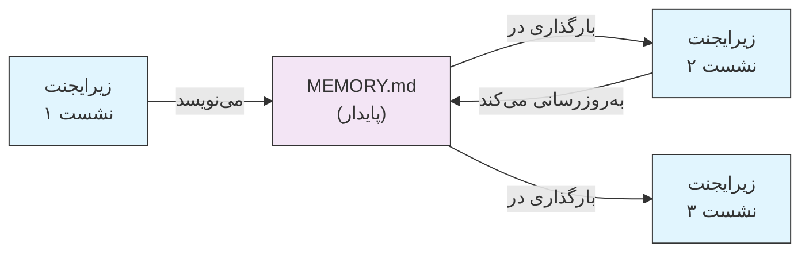
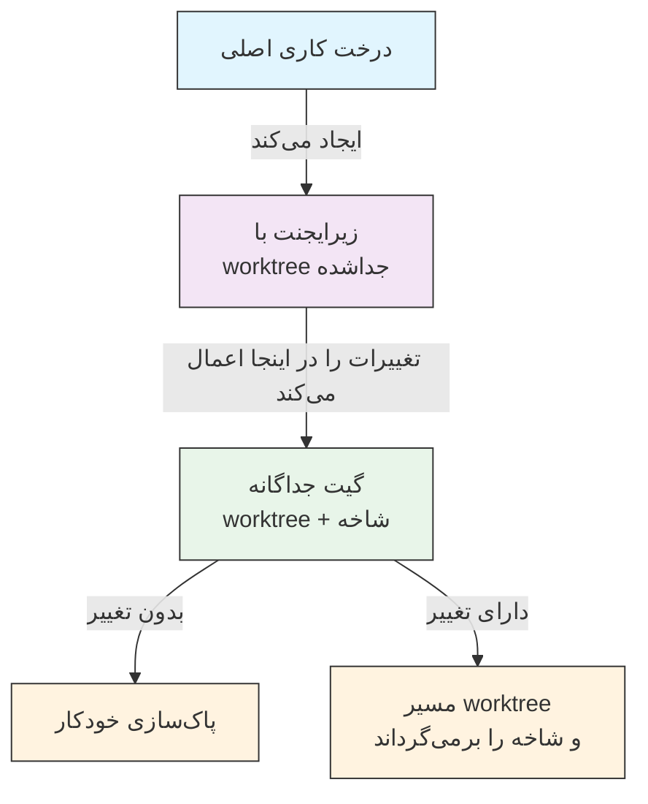
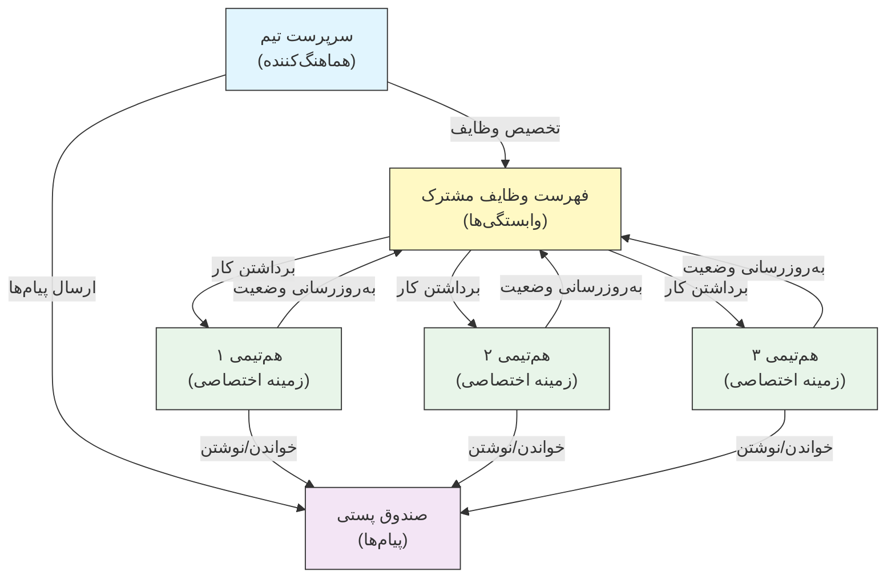
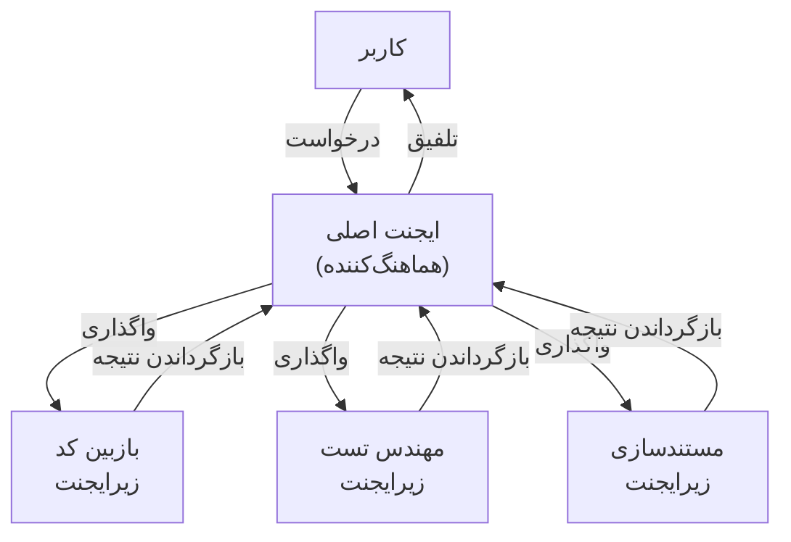
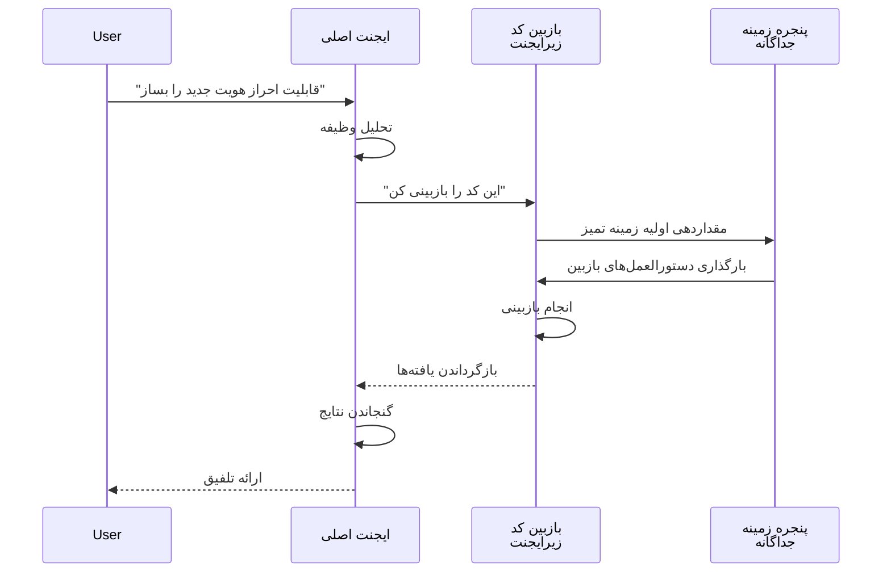
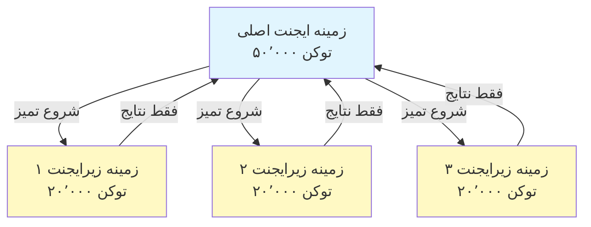
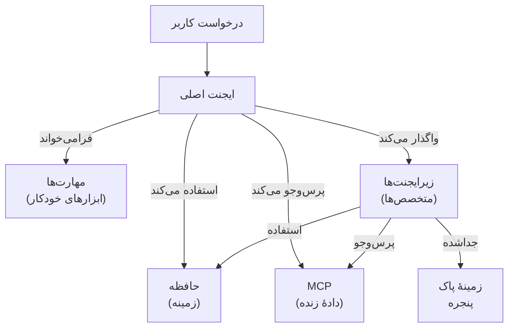

<picture>
  <source media="(prefers-color-scheme: dark)" srcset="../../resources/logos/claude-howto-logo-dark.svg">
  
</picture>

# زیرایجنت‌ها - راهنمای مرجع کامل

زیرایجنت‌ها دستیارهای هوش مصنوعی تخصصی‌ای هستند که Claude Code می‌تواند انجام وظایف را به آن‌ها واگذار کند. هر زیرایجنت هدف مشخصی دارد، از پنجرهٔ زمینهٔ خود جدا از گفت‌وگوی اصلی استفاده می‌کند و می‌توان آن را با ابزارهای مشخص و یک پرامپت سیستمی سفارشی پیکربندی کرد.

## فهرست مطالب

1. [نمای کلی](#نمای-کلی)
2. [مزایای کلیدی](#مزایای-کلیدی)
3. [مکان‌های فایل](#مکان‌های-فایل)
4. [پیکربندی](#پیکربندی)
5. [زیرایجنت‌های داخلی](#زیرایجنت‌های-داخلی)
6. [مدیریت زیرایجنت‌ها](#مدیریت-زیرایجنت‌ها)
7. [استفاده از زیرایجنت‌ها](#استفاده-از-زیرایجنت‌ها)
8. [ایجنت‌های قابل ادامه](#ایجنت‌های-قابل‌ادامه)
9. [زنجیره‌سازی زیرایجنت‌ها](#زنجیره‌سازی-زیرایجنت‌ها)
10. [حافظهٔ پایدار برای زیرایجنت‌ها](#حافظه-پایدار-برای-زیرایجنت‌ها)
11. [زیرایجنت‌های پس‌زمینه](#زیرایجنت‌های-پس‌زمینه)
12. [ایزوله‌سازی worktree](#جداسازی-worktree)
13. [زیرایجنت‌های فورک‌شده](#زیرایجنت‌های-فورک‌شده)
14. [محدود کردن زیرایجنت‌های قابل ساخت](#محدودکردن-زیرایجنت‌های-قابل‌ساخت)
15. [دستور CLI `claude agents`](#دستور-cli-claude-agents)
16. [تیم‌های ایجنت (آزمایشی)](#تیم‌های-ایجنت-آزمایشی)
17. [امنیت زیرایجنت‌های پلاگین](#امنیت-زیرایجنت‌های-پلاگین)
18. [معماری](#معماری)
19. [مدیریت زمینه](#مدیریت-زمینه)
20. [زمان استفاده از زیرایجنت‌ها](#چه-زمانی-از-زیرایجنت‌ها-استفاده-کنیم)
21. [بهترین شیوه‌ها](#بهترین-شیوه‌ها)
22. [زیرایجنت‌های نمونه در این پوشه](#زیرایجنت‌های-نمونه-در-این-پوشه)
23. [دستورالعمل نصب](#دستورالعمل-نصب)
24. [ساختار فایل](#ساختار-فایل‌ها)
25. [مفاهیم مرتبط](#مفاهیم-مرتبط)
26. [قابلیت مشاهده](#قابلیت-مشاهده‌پذیری)
27. [منابع بیشتر](#منابع-بیشتر)

---

## نمای کلی

زیرایجنت‌ها اجرای واگذارشدهٔ وظایف را در Claude Code از طریق موارد زیر ممکن می‌کنند:

- ایجاد **دستیارهای هوش مصنوعی ایزوله** با پنجره‌های زمینهٔ جداگانه
- ارائهٔ **پرامپت‌های سیستمی سفارشی** برای تخصص‌های ویژه
- اعمال **کنترل دسترسی به ابزار** برای محدود کردن قابلیت‌ها
- جلوگیری از **آلودگی زمینه** ناشی از وظایف پیچیده
- ممکن کردن **اجرای موازی** چندین وظیفهٔ تخصصی

هر زیرایجنت به‌صورت مستقل و با وضعیتی پاک کار می‌کند، تنها زمینهٔ مشخص لازم برای وظیفهٔ خود را دریافت می‌کند و سپس نتایج را برای ترکیب به ایجنت اصلی برمی‌گرداند.

**شروع سریع**: از Claude بخواهید یک زیرایجنت برایتان بسازد («زیرایجنتی بساز که امنیت را بازبینی کند»)، یا مستقیماً یک فایل `.claude/agents/<name>.md` اضافه کنید — بخش [مدیریت زیرایجنت‌ها](#مدیریت-زیرایجنت‌ها) را در ادامه ببینید.

> **توجه**: از نسخهٔ v2.1.198، دستور `/agents` دیگر ویزارد تعاملی ساخت را باز نمی‌کند. زیرایجنت‌ها را با درخواست از Claude یا با ویرایش مستقیم فایل‌های `.claude/agents/` بسازید و مدیریت کنید.

---

## مزایای کلیدی

| مزیت | توضیح |
|---------|-------------|
| **حفظ زمینه** | در زمینهٔ جداگانه کار می‌کند و از آلودگی گفت‌وگوی اصلی جلوگیری می‌کند |
| **تخصص ویژه** | برای حوزه‌های مشخص با نرخ موفقیت بالاتر تنظیم شده است |
| **قابلیت استفادهٔ مجدد** | در پروژه‌های مختلف قابل استفاده و قابل اشتراک با تیم‌هاست |
| **مجوزهای انعطاف‌پذیر** | سطوح مختلف دسترسی به ابزار برای انواع مختلف زیرایجنت |
| **مقیاس‌پذیری** | چندین ایجنت به‌طور هم‌زمان روی جنبه‌های مختلف کار می‌کنند |

---

## مکان‌های فایل

فایل‌های زیرایجنت می‌توانند در مکان‌های متعددی با دامنه‌های مختلف نگهداری شوند:

| اولویت | نوع | مکان | دامنه |
|----------|------|----------|-------|
| ۱ (بالاترین) | **مدیریت‌شده** | تنظیمات مدیریت‌شده | سراسر سازمان |
| ۲ | **تعریف‌شده با CLI** | از طریق پرچم `--agents` (JSON) | فقط نشست |
| ۳ | **زیرایجنت‌های پروژه** | `.claude/agents/` | پروژهٔ فعلی |
| ۴ | **زیرایجنت‌های کاربر** | `~/.claude/agents/` | همهٔ پروژه‌ها |
| ۵ (پایین‌ترین) | **ایجنت‌های پلاگین** | پوشهٔ `agents/` پلاگین | از طریق پلاگین‌ها |

وقتی نام‌های تکراری وجود داشته باشد، منابع با اولویت بالاتر برتری دارند.

> **اولویت `.claude/` تودرتو (v2.1.178)**: وقتی نام یک ایجنت در چندین پوشهٔ تودرتوی `.claude/agents/` تعریف شده باشد (برای مثال یک مونوریپو با پوشه‌های `.claude/` در سطح بسته)، تعریفی که **به پوشهٔ کاری فعلی شما نزدیک‌تر است برنده می‌شود**. همین قاعدهٔ نزدیک‌ترین برنده برای تعاریف تودرتوی گردش‌کار و سبک خروجی نیز اعمال می‌شود.

---

## پیکربندی

### قالب فایل

زیرایجنت‌ها در frontmatter YAML و سپس پرامپت سیستمی در markdown تعریف می‌شوند:

```yaml
---
name: your-sub-agent-name
description: توضیح اینکه چه زمانی این زیرایجنت باید فراخوانی شود
tools: tool1, tool2, tool3  # اختیاری - در صورت حذف، همهٔ ابزارها را به ارث می‌برد
disallowedTools: tool4  # اختیاری - ابزارهای صراحتاً غیرمجاز
model: sonnet  # اختیاری - sonnet، opus، haiku یا inherit
permissionMode: default  # اختیاری - حالت مجوز
maxTurns: 20  # اختیاری - محدود کردن نوبت‌های ایجنتی
skills: skill1, skill2  # اختیاری - مهارت‌هایی که از پیش در زمینه بارگذاری می‌شوند
mcpServers: server1  # اختیاری - سرورهای MCP برای در دسترس قرار دادن
memory: user  # اختیاری - دامنهٔ حافظهٔ پایدار (user، project، local)
background: false  # اختیاری - اجرا به‌عنوان وظیفهٔ پس‌زمینه
effort: high  # اختیاری - سطح تلاش استدلال (low، medium، high، xhigh، max)
isolation: worktree  # اختیاری - ایزوله‌سازی worktree گیت
initialPrompt: "با تحلیل کدبیس شروع کن"  # اختیاری - نوبت اول که به‌صورت خودکار ارسال می‌شود
experimental:  # اختیاری - بلوک تنظیمات آزمایشی
  cacheTtl: "1h"  # TTL کش برای این زیرایجنت: "5m" یا "1h" (v2.1.248+)
hooks:  # اختیاری - هوک‌های محدود به کامپوننت
  PreToolUse:
    - matcher: "Bash"
      hooks:
        - type: command
          command: "./scripts/security-check.sh"
---

پرامپت سیستمی زیرایجنت شما اینجا قرار می‌گیرد. این می‌تواند چند پاراگراف باشد
و باید نقش، قابلیت‌ها و رویکرد زیرایجنت را برای
حل مسئله به‌روشنی تعریف کند.
```

### فیلدهای پیکربندی

| فیلد | الزامی | توضیح |
|-------|----------|-------------|
| `name` | بله | شناسهٔ یکتا (حروف کوچک و خط تیره). جست‌وجو نرمال‌سازی می‌شود (به بزرگی و کوچکی حروف و جداکننده‌ها حساس نیست — پایین را ببینید)، اما نامی که شامل `:` باشد از نسخهٔ v2.1.218 **رد می‌شود**: `:` برای فضای‌نام پلاگین رزرو شده است |
| `description` | بله | توضیح هدف به زبان طبیعی. عبارت "use PROACTIVELY" را بگنجانید تا فراخوانی خودکار تشویق شود |
| `tools` | خیر | فهرست جداشده با کاما از ابزارهای مشخص. برای به ارث بردن همهٔ ابزارها حذف کنید. از نحو `Agent(agent_name)` برای محدود کردن زیرایجنت‌های قابل ساخت پشتیبانی می‌کند وقتی ایجنت به‌عنوان رشتهٔ اصلی با `claude --agent` اجرا می‌شود؛ درون یک زیرایجنت فهرست نوع نادیده گرفته می‌شود. MCP: `mcp__<server>__*` یک سرور کامل را اعطا می‌کند (v2.1.299+: فقط با نام دقیق همان سرور مطابقت می‌کند). |
| `disallowedTools` | خیر | فهرست جداشده با کاما از ابزارهایی که زیرایجنت نباید استفاده کند. برای سرورهای MCPی که در نامشان `__` دارند: `mcp__reports__*` در اینجا همهٔ ابزارهای `reports__v2` را هم می‌بندد، پس ابزارهای `reports` را یکی‌یکی فهرست کنید؛ در `tools` چنین سروری را به‌صورت `mcp__reports__v2__*` اعطا کنید |
| `model` | خیر | مدل مورد استفاده: `sonnet`، `opus`، `haiku`، شناسهٔ کامل مدل یا `inherit`. به‌طور پیش‌فرض مدل زیرایجنت پیکربندی‌شده است |
| `permissionMode` | خیر | `default` (حالت دستی؛ `manual` از نسخهٔ v2.1.200 به‌عنوان نام مستعار پذیرفته می‌شود)، `acceptEdits`، `dontAsk`، `bypassPermissions`، `plan`، `auto`. از نسخهٔ v2.1.212، پارامتر فراخوانی `mode` در ابزار Task منسوخ شده و نادیده گرفته می‌شود — زیرایجنت‌ها به‌طور پیش‌فرض حالت مجوز نشست والد را به ارث می‌برند مگر اینکه اینجا بازنویسی شود. وقتی والد در `bypassPermissions`، `acceptEdits` یا `auto` اجرا می‌شود، `permissionMode` زیرایجنت نادیده گرفته می‌شود. وقتی والد در حالت `plan` است، زیرایجنت هر چه `permissionMode` بگوید در حالت plan می‌ماند (مگر اینکه به‌عنوان هم‌تیمی تیم ایجنت اجرا شود)؛ اگر `dontAsk` را تنظیم کنید، اقداماتی که حالت plan دربارهٔ آن‌ها می‌پرسید به‌جای پرسیدن رد می‌شوند |
| `maxTurns` | خیر | حداکثر تعداد نوبت‌های ایجنتی که زیرایجنت می‌تواند انجام دهد |
| `skills` | خیر | فهرست جداشده با کاما از مهارت‌هایی که از پیش بارگذاری می‌شوند. محتوای کامل مهارت را در زمان راه‌اندازی در زمینهٔ زیرایجنت تزریق می‌کند. **v2.1.133+:** زیرایجنت‌ها همچنین مهارت‌های پروژه، کاربر و پلاگین را از طریق ابزار Skill کشف می‌کنند — همان فهرست نشست اصلی، دیگر محدود به مجموعهٔ جاسازی‌شدهٔ خودشان نیستند. حداکثر ۳۲ مهارت از پیش بارگذاری می‌شود، هرکدام یک‌بار؛ زیرایجنتی که ابزار Skill را دارد همچنان می‌تواند بقیه را فراخوانی کند (v2.1.295). |
| `mcpServers` | خیر | سرورهای MCP برای در دسترس قرار دادن برای زیرایجنت |
| `hooks` | خیر | هوک‌هایی که فقط زمانی که این زیرایجنت فعال است اجرا می‌شوند. همهٔ رویدادهای هوک پشتیبانی می‌شوند؛ رایج‌ترین‌ها `PreToolUse`، `PostToolUse` و `Stop` هستند (به‌صورت `SubagentStop` اجرا می‌شود) |
| `memory` | خیر | دامنهٔ پوشهٔ حافظهٔ پایدار: `user`، `project` یا `local` |
| `background` | خیر | زیرایجنت‌ها از قبل به‌طور پیش‌فرض در پس‌زمینه اجرا می‌شوند (v2.1.198). از نسخهٔ v2.1.302، زیرایجنت‌های گفت‌وگوی اصلی در اپ دسکتاپ و VS Code نیز در پس‌زمینه شروع می‌شوند. تا وقتی حالت fork روشن است (پیش‌فرض)، Claude نمی‌تواند منتظر آن‌ها بماند. فراخوانی‌های Agent خود زیرایجنت در `claude -p`، Agent SDK، اپ دسکتاپ و VS Code به‌طور پیش‌فرض در پیش‌زمینه اجرا می‌شوند. برای *اجبار* همیشگی پس‌زمینه و جلوگیری از اجرای درون‌خطی، روی `true` تنظیم کنید |
| `effort` | خیر | سطح تلاش استدلال: `low`، `medium`، `high`، `xhigh` یا `max`. سطح تلاش نشست را بازنویسی می‌کند؛ سطوح موجود به مدل بستگی دارد. Claude همچنین می‌تواند هنگام فراخوانی ابزار Agent مقداری برای `effort` ارسال کند (v2.1.292). |
| `isolation` | خیر | برای دادن worktree گیت اختصاصی به زیرایجنت، روی `worktree` تنظیم کنید |
| `initialPrompt` | خیر | نوبت اولی که به‌صورت خودکار ارسال می‌شود وقتی زیرایجنت به‌عنوان ایجنت اصلی اجرا می‌شود |
| `color` | خیر | رنگ نمایشی زیرایجنت در فهرست وظایف و ترنسکریپت. `red`، `blue`، `green`، `yellow`، `purple`، `orange`، `pink` یا `cyan` را می‌پذیرد |
| `experimental` | خیر | بلوک تنظیمات آزمایشی (v2.1.248+). `experimental.cacheTtl` مقدار TTL کش را برای این زیرایجنت تعیین می‌کند — `"5m"` یا `"1h"` |
| `omitClaudeMd` | خیر | برای راه‌اندازی زیرایجنت بدون فایل‌های CLAUDE.md کاربر، پروژه و محلی روی `true` تنظیم کنید (v2.1.271+). فایل‌های خط‌مشی مدیریت‌شده همچنان بارگذاری می‌شوند، به‌جز برای زیرایجنت‌های مدیریت‌شده. وقتی ایجنت از طریق `--agent` یا تنظیم `agent` به‌عنوان ایجنت نشست اصلی اجرا می‌شود نادیده گرفته می‌شود. در JSON `--agents` نیز پذیرفته می‌شود |
| `autoCompactWindow` | خیر | زمینهٔ این زیرایجنت را زودتر از پنجرهٔ گفت‌وگوی اصلی به‌صورت خودکار فشرده می‌کند (v2.1.296+؛ در JSON `--agents` نیز پذیرفته می‌شود) |

#### متغیرهای محیطی مدل زیرایجنت

دو متغیر محیطی تعیین می‌کنند که زیرایجنت با کدام مدل اجرا شود:

| متغیر | نسخه | توضیح |
|----------|---------|-------------|
| `CLAUDE_CODE_SUBAGENT_MODEL` | — | مدل مورد استفاده برای زیرایجنت‌ها را تعیین می‌کند |
| `CLAUDE_CODE_SUBAGENT_MODEL_FORCE` | v2.1.257+ | برای تحمیل مدل زیرایجنت بر `model:` در frontmatter زیرایجنت، روی `1` تنظیم کنید |

> **تغییر اولویت در v2.1.251**: پیش از آن انتشار، `CLAUDE_CODE_SUBAGENT_MODEL` اولویت داشت و frontmatter ایجنت را بازنویسی می‌کرد — از جمله `model: inherit`. از v2.1.251 به بعد، `model:` خود زیرایجنت برنده است. وقتی می‌خواهید متغیر محیطی دوباره frontmatter را بازنویسی کند، `CLAUDE_CODE_SUBAGENT_MODEL_FORCE=1` (v2.1.257+) را تنظیم کنید؛ مثلاً برای تثبیت یک اجرای ارزیابی کامل روی یک مدل.

### رعایت frontmatter ایجنت رشتهٔ اصلی (v2.1.117+/v2.1.119+)

وقتی یک ایجنت به‌عنوان ایجنت رشتهٔ اصلی فراخوانی می‌شود (از طریق `claude --agent <name>` یا حالت `--print`)، این فیلدهای frontmatter رعایت می‌شوند:

| فیلد | نسخه | یادداشت‌ها |
|-------|---------|-------|
| `mcpServers` | v2.1.117+ | زمانی بارگذاری می‌شود که ایجنت از طریق `claude --agent <name>` به‌عنوان ایجنت رشتهٔ اصلی فراخوانی شود |
| `permissionMode` | v2.1.119+ | برای ایجنت‌های داخلی از طریق `--agent <name>` رعایت می‌شود |
| `tools` / `disallowedTools` | v2.1.119+ | در حالت `--print` (استفادهٔ غیرتعاملی/اسکریپتی) رعایت می‌شود |

**مثال — ایجنتی با `mcpServers` و `permissionMode`:**

```yaml
---
name: secure-researcher
description: ایجنت پژوهشی با دسترسی محدود به MCP و مجوزهای محدود
permissionMode: acceptEdits
mcpServers:
  notion:
    type: http
    url: https://mcp.notion.com/mcp
  github:
    type: http
    url: https://api.githubcopilot.com/mcp/
    headers:
      Authorization: "Bearer ${GITHUB_PERSONAL_ACCESS_TOKEN}"
tools: Read, Grep, Glob
---

تو یک ایجنت پژوهشی هستی. می‌توانی از طریق سرورهای
MCP پیکربندی‌شده از Notion و GitHub پرس‌وجو کنی و فایل‌های محلی را بخوانی، اما نمی‌توانی
خارج از ویرایش‌های پذیرفته‌شده چیزی بنویسی یا فرمانی اجرا کنی.
```

اجرا با:

```bash
claude --agent secure-researcher
```

### گزینه‌های پیکربندی ابزار

**گزینهٔ ۱: به ارث بردن همهٔ ابزارها (حذف فیلد)**
```yaml
---
name: full-access-agent
description: ایجنتی با همهٔ ابزارهای موجود
---
```

**گزینهٔ ۲: تعیین ابزارهای مشخص**
```yaml
---
name: limited-agent
description: ایجنتی فقط با ابزارهای مشخص
tools: Read, Grep, Glob, Bash
---
```

> **یادداشت درباره Glob/Grep (v2.1.113+):** در بیلدهای بومی macOS/Linux، Glob و Grep به‌جای ابزارهای جداگانه از طریق ابزار Bash و به‌صورت `bfs`/`ugrep` ارائه می‌شوند. بیلدهای Windows و npm-JS همچنان آن‌ها را به‌عنوان ابزارهای مستقل ارائه می‌دهند. نویسندگان همچنان می‌توانند در `allowedTools` به Glob/Grep ارجاع دهند؛ جایگزینی بک‌اند شفاف است.

**گزینهٔ ۳: دسترسی شرطی به ابزار**
```yaml
---
name: conditional-agent
description: ایجنتی با دسترسی فیلترشده به ابزار
tools: Read, Bash(npm:*), Bash(test:*)
---
```

### پیکربندی مبتنی بر CLI

زیرایجنت‌ها را برای یک نشست واحد با پرچم `--agents` و قالب JSON تعریف کنید:

```bash
claude --agents '{
  "code-reviewer": {
    "description": "بازبین متخصص کد. پس از تغییرات کد به‌صورت فعالانه استفاده شود.",
    "prompt": "تو یک بازبین ارشد کد هستی. بر کیفیت کد، امنیت و بهترین شیوه‌ها تمرکز کن.",
    "tools": ["Read", "Grep", "Glob", "Bash"],
    "model": "sonnet"
  }
}'
```

**قالب JSON برای پرچم `--agents`:**

```json
{
  "agent-name": {
    "description": "الزامی: چه زمانی این ایجنت فراخوانی شود",
    "prompt": "الزامی: پرامپت سیستمی برای ایجنت",
    "tools": ["Optional", "array", "of", "tools"],
    "model": "اختیاری: sonnet|opus|haiku"
  }
}
```

> **توجه**: از نسخهٔ v2.1.243، `--agents` دیگر JSON نامعتبر یا تعاریف نامعتبر ایجنت را بی‌صدا نادیده نمی‌گیرد — Claude Code با خطای واضح خارج می‌شود، هم‌راستا با رفتار `--mcp-config`.

**اولویت تعاریف ایجنت:**

تعاریف ایجنت با این ترتیب اولویت بارگذاری می‌شوند (اولین تطابق برنده است):
1. **مدیریت‌شده** - تنظیمات مدیریت‌شده (سراسر سازمان)
2. **تعریف‌شده با CLI** - پرچم `--agents` (فقط نشست، JSON)
3. **سطح پروژه** - `.claude/agents/` (پروژهٔ فعلی)
4. **سطح کاربر** - `~/.claude/agents/` (همهٔ پروژه‌ها)
5. **سطح پلاگین** - پوشهٔ `agents/` پلاگین

این کار به تعاریف CLI امکان می‌دهد تعاریف پروژه، کاربر و پلاگین را برای یک نشست واحد بازنویسی کنند؛ تعاریف مدیریت‌شده همچنان اولویت دارند.

---

## زیرایجنت‌های داخلی

Claude Code چندین زیرایجنت داخلی دارد که همیشه در دسترس هستند:

| ایجنت | مدل | هدف |
|-------|-------|---------|
| **general-purpose** | به ارث می‌برد | وظایف پیچیدهٔ چندمرحله‌ای |
| **Plan** | به ارث می‌برد | پژوهش برای حالت برنامه |
| **Explore** | به ارث می‌برد (محدود به Opus) | کاوش فقط‌خواندنی کدبیس (سریع/متوسط/بسیار کامل) |
| **claude** | به ارث می‌برد | جامع برای وظایفی که در ایجنت تخصصی‌تر نمی‌گنجند؛ همهٔ ابزارهای در دسترس زیرایجنت‌ها را دارد. همچنین ایجنت پیش‌فرض برای یک نشست پس‌زمینهٔ ارسال‌شده |
| **statusline-setup** | Sonnet | وقتی از `/statusline` برای پیکربندی نوار وضعیت خود استفاده می‌کنید اجرا می‌شود |
| **claude-code-guide** | Haiku | به پرسش‌های مربوط به ویژگی‌های Claude Code پاسخ می‌دهد |

### زیرایجنت همه‌منظوره

| ویژگی | مقدار |
|----------|-------|
| **مدل** | از والد به ارث می‌برد |
| **ابزارها** | همهٔ ابزارها |
| **هدف** | وظایف پژوهشی پیچیده، عملیات چندمرحله‌ای، تغییرات کد |

**زمان استفاده**: وظایفی که هم کاوش و هم تغییر را همراه با استدلال پیچیده نیاز دارند.

### زیرایجنت Plan

| ویژگی | مقدار |
|----------|-------|
| **مدل** | از والد به ارث می‌برد |
| **ابزارها** | Read, Glob, Grep, Bash |
| **هدف** | در حالت برنامه به‌صورت خودکار برای پژوهش کدبیس استفاده می‌شود |

**زمان استفاده**: وقتی Claude باید پیش از ارائهٔ برنامه، کدبیس را درک کند.

### زیرایجنت Explore

| ویژگی | مقدار |
|----------|-------|
| **مدل** | مدل نشست را به ارث می‌برد، محدود به Opus (v2.1.198). برای حفظ سرعت و ارزانی `model: haiku` را تنظیم کنید |
| **حالت** | کاملاً فقط‌خواندنی |
| **ابزارها** | Glob, Grep, Read, Bash (فقط دستورهای فقط‌خواندنی) |
| **هدف** | جست‌وجو و تحلیل سریع کدبیس |

**زمان استفاده**: هنگام جست‌وجو در کد یا درک آن بدون اعمال تغییر.

**سطوح دقت** - عمق کاوش را مشخص کنید:
- **"quick"** - جست‌وجوهای سریع با حداقل کاوش، مناسب برای یافتن الگوهای مشخص
- **"medium"** - کاوش متعادل، توازن میان سرعت و دقت، رویکرد پیش‌فرض
- **"very thorough"** - تحلیل جامع در مکان‌ها و قراردادهای نام‌گذاری متعدد، ممکن است بیشتر طول بکشد

### زیرایجنت Claude

| ویژگی | مقدار |
|----------|-------|
| **مدل** | از والد به ارث می‌برد |
| **ابزارها** | همهٔ ابزارهای در دسترس زیرایجنت‌ها |
| **هدف** | ایجنت جامع برای وظایفی که در ایجنت تخصصی‌تر نمی‌گنجند |

**زمان استفاده**: وقتی وظیفه‌ای با ایجنت داخلی تخصصی‌تری مطابقت ندارد. همچنین ایجنت پیش‌فرض برای یک نشست پس‌زمینهٔ ارسال‌شده است؛ اینکه با کدام حالت مجوز شروع شود به نحوهٔ شروع آن نشست بستگی دارد.

### زیرایجنت راه‌اندازی نوار وضعیت

| ویژگی | مقدار |
|----------|-------|
| **مدل** | Sonnet |
| **ابزارها** | Read, Write, Bash |
| **هدف** | پیکربندی نمایش نوار وضعیت Claude Code |

**موارد استفاده**: هنگام راه‌اندازی یا سفارشی‌سازی نوار وضعیت.

### زیرایجنت راهنمای Claude Code (`claude-code-guide`)

| ویژگی | مقدار |
|----------|-------|
| **مدل** | Haiku (سریع، با تأخیر کم) |
| **ابزارها** | فقط‌خواندنی |
| **هدف** | پاسخ به پرسش‌ها دربارهٔ ویژگی‌ها و کاربردهای Claude Code |

**موارد استفاده**: هنگامی که کاربران دربارهٔ نحوهٔ کار Claude Code یا استفاده از ویژگی‌های مشخصی پرسش می‌کنند.

---

## مدیریت زیرایجنت‌ها

### پرسیدن از Claude (توصیه‌شده)

ساده‌ترین راه برای ساخت یا مدیریت یک زیرایجنت این است که مستقیماً از Claude بخواهید:

```text
یک زیرایجنت بساز که کد را از نظر آسیب‌پذیری‌های امنیتی بازبینی کند.
```

Claude فایل `.claude/agents/<name>.md` را برای شما می‌نویسد و فرادادهٔ مناسب (ابزارها، مدل، توضیحات) را برمی‌گزیند. سپس می‌توانید فایل را دستی بهبود دهید یا از Claude بخواهید آن را تنظیم کند.

> **توجه**: دستور `/agents` دیگر ویزارد تعاملی ساخت را باز نمی‌کند (در v2.1.198 حذف شد). اکنون شما را به پرسیدن از Claude یا ویرایش مستقیم فایل‌های `.claude/agents/` ارجاع می‌دهد.

### مدیریت مستقیم فایل

```bash
# ساخت یک زیرایجنت پروژه
mkdir -p .claude/agents
cat > .claude/agents/test-runner.md << 'EOF'
---
name: test-runner
description: برای اجرای تست‌ها و رفع خطاها به‌صورت پیش‌دستانه استفاده شود
---

شما یک متخصص خودکارسازی تست هستید. وقتی تغییری در کد می‌بینید، به‌صورت
پیش‌دستانه تست‌های مناسب را اجرا کنید. اگر تست‌ها شکست خوردند، شکست‌ها را
تحلیل کنید و آن‌ها را در حالی که قصد اصلی تست حفظ می‌شود، برطرف کنید.
EOF

# ساخت یک زیرایجنت کاربر (در همهٔ پروژه‌ها در دسترس است)
mkdir -p ~/.claude/agents
```

---

## استفاده از زیرایجنت‌ها

### واگذاری خودکار

Claude بر پایهٔ موارد زیر وظایف را به‌صورت پیش‌دستانه واگذار می‌کند:
- توضیح وظیفه در درخواست شما
- فیلد `description` در پیکربندی زیرایجنت‌ها
- زمینهٔ کنونی و ابزارهای موجود

برای تشویق استفادهٔ پیش‌دستانه، عبارت "use PROACTIVELY" یا "MUST BE USED" را در فیلد `description` خود بگنجانید:

```yaml
---
name: code-reviewer
description: متخصص بازبینی کد. پس از نوشتن یا تغییر کد به‌صورت PROACTIVELY استفاده شود.
---
```

### فراخوانی صریح

می‌توانید صریحاً یک زیرایجنت مشخص را درخواست کنید:

```
> از زیرایجنت test-runner برای رفع تست‌های ناموفق استفاده کن
> از زیرایجنت code-reviewer بخواه تغییرات اخیر من را بررسی کند
> از زیرایجنت debugger بخواه این خطا را بررسی کند
```

> **تطبیق `subagent_type` بدون حساسیت به حروف بزرگ و کوچک و جداکننده (v2.1.140)**: `subagent_type` (در فراخوانی‌های ابزار `Agent` یا پرچم‌های `--agent`) بدون حساسیت به حروف بزرگ و کوچک تطبیق داده می‌شود و سبک جداکننده را نادیده می‌گیرد — `code-reviewer`، `Code Reviewer` و `code_reviewer` همگی به یک ایجنت یکسان می‌رسند. این یک تلهٔ دیرینه را برمی‌دارد که در آن تفاوت‌های جزئی در حروف بزرگ و کوچک بی‌صدا به ایجنت پیش‌فرض برمی‌گشت.

### فراخوانی با @

از پیشوند `@` استفاده کنید تا تضمین کنید یک زیرایجنت مشخص فراخوانی می‌شود (هیوریستیک‌های واگذاری خودکار را دور می‌زند):

```
> @"code-reviewer (agent)" ماژول احراز هویت را بازبینی کن
```

### ایجنت سراسری نشست

یک نشست کامل را با استفاده از یک ایجنت مشخص به‌عنوان ایجنت اصلی اجرا کنید:

```bash
# از طریق پرچم CLI
claude --agent code-reviewer

# از طریق settings.json
{
  "agent": "code-reviewer"
}
```

### فهرست کردن ایجنت‌های موجود

برای دیدن زیرایجنت‌های پیکربندی‌شده، از Claude بپرسید یا `.claude/agents/` و `~/.claude/agents/` را مرور کنید. (`claude agents` ارتباطی ندارد: نمای ایجنت را برای نشست‌های پس‌زمینه باز می‌کند — به [CLI](../10-cli/README.md#agent-view-claude-agents-نسخه-21139-به-بعد) مراجعه کنید.)

---

## ایجنت‌های قابل‌ادامه

زیرایجنت‌ها می‌توانند گفتگوهای پیشین را با حفظ کامل زمینه ادامه دهند:

```bash
# فراخوانی اولیه
> از ایجنت code-analyzer استفاده کن تا بازبینی ماژول احراز هویت را شروع کند
# agentId را برمی‌گرداند: "abc123"

# ادامهٔ ایجنت در زمان بعدی
> ایجنت abc123 را ادامه بده و اکنون منطق مجوزدهی را هم تحلیل کن
```

**موارد استفاده**:
- پژوهش طولانی‌مدت در چند نشست
- اصلاح تدریجی بدون از دست دادن زمینه
- جریان‌های کاری چندمرحله‌ای با حفظ زمینه

---

## زنجیره‌سازی زیرایجنت‌ها

چند زیرایجنت را به‌ترتیب اجرا کنید:

```bash
> ابتدا از زیرایجنت code-analyzer برای یافتن مشکلات کارایی استفاده کن،
  سپس از زیرایجنت optimizer برای رفع آن‌ها استفاده کن
```

این امکان جریان‌های کاری پیچیده‌ای را فراهم می‌کند که در آن‌ها خروجی یک زیرایجنت به دیگری وارد می‌شود.

---

## حافظهٔ پایدار برای زیرایجنت‌ها

فیلد `memory` به زیرایجنت‌ها یک پوشهٔ پایدار می‌دهد که در میان گفتگوها باقی می‌ماند. این به زیرایجنت‌ها امکان می‌دهد تا با گذشت زمان دانش بسازند و یادداشت‌ها، یافته‌ها و زمینه‌ای را ذخیره کنند که میان نشست‌ها پایدار می‌ماند.

### دامنه‌های حافظه

| دامنه | پوشه | مورد استفاده |
|-------|-----------|----------|
| `user` | `~/.claude/agent-memory/<name>/` | یادداشت‌ها و ترجیحات شخصی در همهٔ پروژه‌ها |
| `project` | `.claude/agent-memory/<name>/` | دانش مخصوص پروژه که با تیم به اشتراک گذاشته می‌شود |
| `local` | `.claude/agent-memory-local/<name>/` | دانش محلی پروژه که در کنترل نسخه ثبت نمی‌شود |

### نحوهٔ کار

- نخستین ۲۰۰ خط از `MEMORY.md` در پوشهٔ حافظه به‌طور خودکار در پرامپت سیستمی زیرایجنت بارگذاری می‌شود
- ابزارهای `Read`، `Write` و `Edit` به‌طور خودکار برای زیرایجنت فعال می‌شوند تا فایل‌های حافظهٔ خود را مدیریت کند
- زیرایجنت می‌تواند در صورت نیاز فایل‌های بیشتری در پوشهٔ حافظهٔ خود بسازد

### نمونهٔ پیکربندی

```yaml
---
name: researcher
description: دستیار پژوهشی که یافته‌ها را در حافظهٔ پایدار میان نشست‌ها نگه می‌دارد
memory: user
---

شما یک دستیار پژوهشی هستید. از پوشهٔ حافظهٔ خود برای ذخیرهٔ یافته‌ها،
پیگیری پیشرفت در میان نشست‌ها و ساختن دانش در طول زمان استفاده کنید.

برای یادآوری زمینهٔ پیشین، در آغاز هر نشست فایل MEMORY.md خود را بررسی کنید.
```



---

## زیرایجنت‌های پس‌زمینه

زیرایجنت‌ها به‌طور پیش‌فرض در پس‌زمینه اجرا می‌شوند (v2.1.198). از v2.1.302 به بعد، زیرایجنت‌های گفتگوی اصلی در اپلیکیشن دسکتاپ و VS Code نیز در پس‌زمینه شروع می‌شوند. تا وقتی حالت fork روشن است (پیش‌فرض)، Claude نمی‌تواند منتظر آن‌ها بماند. فراخوانی‌های Agent خودِ یک زیرایجنت در `claude -p`، Agent SDK، اپلیکیشن دسکتاپ و VS Code به‌طور پیش‌فرض در پیش‌زمینه اجرا می‌شوند. Claude در حین اجرای یک زیرایجنت به کار روی گفتگوی اصلی ادامه می‌دهد و با پایان آن مطلع می‌شود، بنابراین دیگر لازم نیست پیش از ادامه منتظر بازگشت زیرایجنت بمانید. در VS Code (v2.1.304+) یک زیرایجنت پس‌زمینه به‌جای ریختن هر گام در گفتگو، به‌صورت یک خط وضعیت زیر کارت Agent خود نشان داده می‌شود؛ `/tasks` را باز کنید و روی آن کلیک کنید تا فراخوانی‌های ابزار و رونوشتش را ببینید.

### پیکربندی

از آنجا که پس‌زمینه از پیش پیش‌فرض است، `background: true` در فراداده زیرایجنت را *مجبور* می‌کند همیشه در پس‌زمینه اجرا شود و از اجرای درون‌خطی آن جلوگیری می‌کند:

```yaml
---
name: long-runner
background: true
description: وظایف تحلیلی طولانی‌مدت را در پس‌زمینه انجام می‌دهد
---
```

### میان‌برهای صفحه‌کلید

| میان‌بر | اقدام |
|----------|--------|
| `Ctrl+B` | بردن یک وظیفهٔ زیرایجنت در حال اجرا به پس‌زمینه |
| `Ctrl+X` `Ctrl+K` | توقف همهٔ زیرایجنت‌های پس‌زمینه در حال اجرا (برای تأیید دو بار در ۳ ثانیه فشار دهید؛ این جایگزین `Ctrl+F` شد) |

### غیرفعال‌کردن وظایف پس‌زمینه

متغیر محیطی را تنظیم کنید تا پشتیبانی از وظایف پس‌زمینه به‌کلی غیرفعال شود:

```bash
export CLAUDE_CODE_DISABLE_BACKGROUND_TASKS=1
```

### بگذارید Claude منتظر یک زیرایجنت بماند

با هیچ پیکربندی‌ای، زیرایجنتي که Claude از گفتگوی اصلی می‌سازد در پس‌زمینه شروع می‌شود. در `claude -p` و Agent SDK، Claude می‌تواند به تشخیص خودش یا وقتی شما بخواهید منتظر آن بماند. در ترمینال تعاملی، VS Code یا نشست دسکتاپ، Claude فقط پس از خاموش‌کردن حالت fork می‌تواند منتظر بماند (v2.1.302+):

```json
{
  "env": {
    "CLAUDE_CODE_FORK_SUBAGENT": "0"
  }
}
```

`claude` را دوباره اجرا کنید (یا یک گفتگوی جدید VS Code باز کنید)، سپس مثلاً بپرسید «زیرایجنت reviewer را اجرا کن و منتظر گزارشش بمان». `Ctrl+B` همچنان یک انتظار را به پس‌زمینه می‌برد. تنظیم `CLAUDE_CODE_DISABLE_BACKGROUND_TASKS=1` به‌جای آن باعث می‌شود Claude منتظر هر زیرایجنت بماند و فرمان‌های پس‌زمینه را هم خاموش می‌کند.

---

## جداسازی worktree

تنظیم `isolation: worktree` به یک زیرایجنت worktree گیت مخصوص خودش را می‌دهد و به آن اجازه می‌دهد بدون تأثیر بر درخت کاری اصلی، تغییرات را مستقلاً انجام دهد.

### پیکربندی

```yaml
---
name: feature-builder
isolation: worktree
description: ویژگی‌ها را در یک worktree گیت جداشده پیاده‌سازی می‌کند
tools: Read, Write, Edit, Bash, Grep, Glob
---
```

### نحوهٔ کار



- زیرایجنت در worktree گیت خودش روی یک شاخهٔ جداگانه کار می‌کند
- اگر زیرایجنت هیچ تغییری ایجاد نکند، worktree به‌طور خودکار پاک‌سازی می‌شود
- اگر تغییری وجود داشته باشد، مسیر worktree و نام شاخه برای بازبینی یا ادغام به ایجنت اصلی برگردانده می‌شود

---

## زیرایجنت‌های فورک‌شده

یک زیرایجنت فورک‌شده در لحظهٔ فورک شدن، تمام گفتگوی والد را به ارث می‌برد — پرامپت سیستمی، ابزارها، مدل، تاریخچهٔ پیام‌ها و کش پرامپت — و با صفحهٔ سفید شروع نمی‌کند. این برای کاوش مسیرهای جایگزین بدون از دست دادن کار انجام‌شده مفید است.

> **دسترس‌پذیری**: GA در v2.1.117. **از v2.1.232 به بعد، حالت فورک در نشست‌های تعاملی به‌طور پیش‌فرض فعال است** — روی هر بیلد، چه first-party و چه غیر آن. از v2.1.302 به بعد در حالت غیرتعاملی (`claude -p`)، Agent SDK، اپلیکیشن دسکتاپ و VS Code نیز به‌طور پیش‌فرض فعال است؛ `claude mcp serve` هرگز زیرایجنت‌های فورک را ارائه نمی‌دهد. در Claude Code قدیمی‌تر از v2.1.232 برای روشن‌کردن آن `CLAUDE_CODE_FORK_SUBAGENT=1` را تنظیم کنید.

> **زیرایجنت‌های حالت فورک در پس‌زمینه اجرا می‌شوند.** جایی که حالت فورک فعال است — همان‌طور که از v2.1.302 به بعد همه‌جا به‌طور پیش‌فرض هست — Claude Code زیرایجنت را در پس‌زمینه اجرا می‌کند، چه فورک‌شده و چه غیر فورک‌شده. در ترمینال تعاملی، VS Code یا نشست دسکتاپ، Claude پس از آن نمی‌تواند منتظر زیرایجنت بماند؛ برای اجازه‌دادن به انتظار، حالت fork را خاموش کنید (به [بگذارید Claude منتظر یک زیرایجنت بماند](#بگذارید-claude-منتظر-یک-زیرایجنت-بماند) مراجعه کنید).

### پیکربندی

فورک را در فایل ایجنت تعریف نمی‌کنید. Claude یکی را از طریق ابزار Agent با `subagent_type: "fork"` شروع می‌کند، یا خودتان آن را با `/subtask <task>` شروع می‌کنید (v2.1.212+):

```text
/subtask یک مسیر پیاده‌سازی جایگزین را بررسی کن و مزایا و معایب را گزارش بده
```

یک فورک نمی‌تواند فورک‌های بیشتری بسازد. برای مسدودکردن فورک‌ها، قاعدهٔ منع `Agent(fork)` را اضافه کنید:

```json
{
  "permissions": {
    "deny": ["Agent(fork)"]
  }
}
```

> **توجه**: `context: fork` یک فیلد فرادادهٔ **مهارت** است (به [Skills](../03-skills/README.md) مراجعه کنید)، نه یک فیلد زیرایجنت. Claude Code فیلدهایی را که در تعریف ایجنت نمی‌شناسد، بی‌صدا نادیده می‌گیرد.

### فعال‌سازی صریح حالت فورک

برای خاموش‌کردن حالت فورک در همه‌جا، `CLAUDE_CODE_FORK_SUBAGENT=0` را تنظیم کنید. در نسخه‌های پیش از v2.1.302، برای روشن‌کردن فورک‌ها در `claude -p` و Agent SDK آن را روی `1` تنظیم کنید.

```bash
export CLAUDE_CODE_FORK_SUBAGENT=0
claude
```

### زمان استفاده از فورک در برابر زمینهٔ تمیز

| سناریو | فورک (`subagent_type: "fork"`) | زمینهٔ تمیز (پیش‌فرض) |
|----------|-----------------|-------------------------|
| کاوش پیاده‌سازی‌های جایگزین | بله | خیر (زمینه از دست می‌رود) |
| پژوهش طولانی با زمینهٔ موجود | بله | خیر |
| وظیفهٔ تخصصی مستقل | خیر | بله |
| پرهیز از آلودگی زمینه | خیر | بله |

---

## محدودکردن زیرایجنت‌های قابل‌ساخت

با استفاده از نحو `Agent(agent_type)` در فیلد `tools` می‌توانید کنترل کنید که یک ایجنت که با `claude --agent` به‌عنوان رشتهٔ اصلی اجرا می‌شود، اجازهٔ ساخت کدام زیرایجنت‌ها را دارد. این راهی برای قرار دادن زیرایجنت‌های مشخص در فهرست مجاز برای واگذاری فراهم می‌کند. در تعریف یک زیرایجنت، هر فهرست نوعی داخل پرانتزها نادیده گرفته می‌شود.

> **توجه**: در v2.1.63، ابزار `Task` به `Agent` تغییر نام یافت. ارجاع‌های موجود `Task(...)` هنوز به‌عنوان نام‌های مستعار کار می‌کنند.

### نمونه

```yaml
---
name: coordinator
description: کار میان ایجنت‌های تخصصی را هماهنگ می‌کند
tools: Agent(worker, researcher), Read, Bash
---

شما یک ایجنت هماهنگ‌کننده هستید. می‌توانید کار را فقط به زیرایجنت‌های "worker" و
"researcher" واگذار کنید. برای کاوش خودتان از Read و Bash استفاده کنید.
```

در این مثال، وقتی `claude --agent coordinator` را اجرا می‌کنید، رشتهٔ اصلی فقط می‌تواند زیرایجنت‌های `worker` و `researcher` را بسازد. نمی‌تواند هیچ زیرایجنت دیگری بسازد، حتی اگر در جای دیگری تعریف شده باشند. اگر `coordinator` در عوض به‌عنوان زیرایجنت اجرا شود، فهرست نوع نادیده گرفته می‌شود.

---

## دستور CLI `claude agents`

`claude agents` نمای **ایجنت** را باز می‌کند (v2.1.139+): فهرستی تمام‌صفحه از نشست‌های پس‌زمینهٔ شما که بر اساس وضعیت گروه‌بندی شده‌اند. این تعریف‌های زیرایجنت پیکربندی‌شده را فهرست نمی‌کند؛ برای اسکریپت‌نویسی بر پایهٔ وضعیت نشست از `claude agents --json` استفاده کنید.

```bash
claude agents
claude agents --json
```

زیرایجنت‌های پیکربندی‌شده در `.claude/agents/` (پروژه) و `~/.claude/agents/` (کاربر) قرار دارند.

---

## تیم‌های ایجنت (آزمایشی)

تیم‌های ایجنت چندین نمونه Claude Code را هماهنگ می‌کنند که روی وظایف پیچیده با هم کار می‌کنند. برخلاف زیرایجنت‌ها (که وظایف فرعی محوله را انجام می‌دهند و نتیجه را برمی‌گردانند)، هم‌تیمی‌ها به‌صورت مستقل و با پنجره زمینه اختصاصی خود کار می‌کنند و می‌توانند از طریق یک سیستم صندوق پستی مشترک مستقیماً به یکدیگر پیام بفرستند.

> **مستندات رسمی**: [code.claude.com/docs/en/agent-teams](https://code.claude.com/docs/en/agent-teams)

> **توجه**: تیم‌های ایجنت آزمایشی است و به‌طور پیش‌فرض غیرفعال است. به Claude Code نسخه v2.1.32+ نیاز دارد. پیش از استفاده آن را فعال کنید.

### زیرایجنت‌ها در برابر تیم‌های ایجنت

| جنبه | زیرایجنت‌ها | تیم‌های ایجنت |
|--------|-----------|-------------|
| **مدل واگذاری** | والد وظیفه فرعی را واگذار می‌کند و منتظر نتیجه می‌ماند | سرپرست تیم کار را هماهنگ می‌کند و هم‌تیمی‌ها مستقل اجرا می‌کنند |
| **زمینه** | زمینه تازه برای هر وظیفه فرعی، نتایج تقطیرشده بازگردانده می‌شوند | هر هم‌تیمی پنجره زمینه پایدار خودش را نگه می‌دارد |
| **هماهنگی** | ترتیبی یا موازی، به مدیریت والد | فهرست وظایف مشترک با مدیریت خودکار وابستگی‌ها |
| **ارتباط** | نتایج فقط به والد بازگردانده می‌شوند (بدون پیام‌رسانی بین ایجنت‌ها) | هم‌تیمی‌ها می‌توانند مستقیماً از طریق صندوق پستی به هم پیام بدهند |
| **ازسرگیری نشست** | پشتیبانی می‌شود | برای هم‌تیمی‌های درون‌فرایندی پشتیبانی نمی‌شود |
| **مناسب برای** | وظایف فرعی متمرکز و به‌خوبی تعریف‌شده | کار پیچیده‌ای که نیازمند ارتباط بین ایجنت‌ها و اجرای موازی است |

### فعال‌سازی تیم‌های ایجنت

متغیر محیطی را تنظیم کنید یا آن را به `settings.json` خود اضافه کنید:

```bash
export CLAUDE_CODE_EXPERIMENTAL_AGENT_TEAMS=1
```

یا در `settings.json`:

```json
{
  "env": {
    "CLAUDE_CODE_EXPERIMENTAL_AGENT_TEAMS": "1"
  }
}
```

### راه‌اندازی یک تیم

پس از فعال‌سازی، در پرامپت خود از Claude بخواهید با هم‌تیمی‌ها کار کند:

```
کاربر: ماژول احراز هویت را بساز. از یک تیم استفاده کن — یک هم‌تیمی برای نقاط پایانی API،
      یکی برای طرح‌واره پایگاه داده، و یکی برای مجموعه تست.
```

Claude تیم را می‌سازد، وظایف را تخصیص می‌دهد و کار را به‌طور خودکار هماهنگ می‌کند.

### حالت‌های نمایش

نحوه نمایش فعالیت هم‌تیمی‌ها را کنترل کنید:

| حالت | پرچم | توضیح |
|------|------|-------------|
| **خودکار** | `--teammate-mode auto` | بهترین حالت نمایش را برای ترمینال شما به‌طور خودکار انتخاب می‌کند |
| **درون‌فرایندی** (پیش‌فرض) | `--teammate-mode in-process` | خروجی هم‌تیمی را به‌صورت درون‌خطی در ترمینال فعلی نشان می‌دهد |
| **پنجره‌های تقسیم‌شده** | `--teammate-mode tmux` | هر هم‌تیمی را در یک پنجره جداگانه tmux یا iTerm2 باز می‌کند |
| **iTerm2** | `--teammate-mode iterm2` | (v2.1.186+) هم‌تیمی‌ها را در پنجره‌های اختصاصی iTerm2 ایجاد می‌کند. به CLI ‏`it2` نیاز دارد؛ حالت خودکار وقتی آن را پیدا نکند هشدار می‌دهد |

```bash
claude --teammate-mode tmux
```

همچنین می‌توانید حالت نمایش را در `settings.json` تنظیم کنید:

```json
{
  "teammateMode": "tmux"
}
```

> **توجه**: حالت پنجره تقسیم‌شده به tmux یا iTerm2 نیاز دارد. در ترمینال VS Code، Windows Terminal یا Ghostty در دسترس نیست.

### پیمایش

برای جابه‌جایی بین هم‌تیمی‌ها، در پنل ایجنت از کلیدهای جهت بالا و پایین استفاده کنید و Enter را بزنید (حالت درون‌فرایندی)، یا روی پنجره یک هم‌تیمی کلیک کنید (حالت پنجره تقسیم‌شده).

### پیکربندی تیم

پیکربندی‌های تیم در `~/.claude/teams/{team-name}/config.json` ذخیره می‌شوند.

### انتخاب مدل هم‌تیمی

از نسخه v2.1.234، تنظیم «مدل پیش‌فرض هم‌تیمی» در `/config` حذف شده است. اکنون هم‌تیمی‌ها به‌طور پیش‌فرض مدل سرپرست تیم را به ارث می‌برند، مگر اینکه فراخوانی ایجاد، مدل دیگری را صراحتاً مشخص کند.

### معماری



**اجزای کلیدی**:

- **سرپرست تیم**: نشست اصلی Claude Code که تیم را می‌سازد، وظایف را تخصیص می‌دهد و هماهنگ می‌کند
- **فهرست وظایف مشترک**: فهرستی همگام‌شده از وظایف با ردیابی خودکار وابستگی‌ها
- **صندوق پستی**: سیستم پیام‌رسانی بین ایجنت‌ها برای اینکه هم‌تیمی‌ها وضعیت را اطلاع دهند و هماهنگ شوند
- **هم‌تیمی‌ها**: نمونه‌های مستقل Claude Code، هرکدام با پنجره زمینه اختصاصی خود

### تخصیص وظیفه و پیام‌رسانی

سرپرست تیم کار را به وظایف تقسیم می‌کند و آن‌ها را به هم‌تیمی‌ها می‌سپارد. فهرست وظایف مشترک این موارد را مدیریت می‌کند:

- **مدیریت خودکار وابستگی‌ها** — وظایف تا تکمیل وابستگی‌هایشان منتظر می‌مانند
- **ردیابی وضعیت** — هم‌تیمی‌ها هنگام کار وضعیت وظیفه را به‌روزرسانی می‌کنند
- **پیام‌رسانی بین ایجنت‌ها** — هم‌تیمی‌ها برای هماهنگی از طریق صندوق پستی پیام می‌فرستند (مثلاً «طرح‌واره پایگاه داده آماده است، می‌توانی نوشتن کوئری‌ها را شروع کنی»)

### گردش‌کار تأیید طرح

برای وظایف پیچیده یا پرخطر، پیش از درخواست یک هم‌تیمی، سرپرست را به حالت plan ببرید: هم‌تیمی‌ای که در حالی که سرپرست در حالت plan است ساخته شود تا زمانی که طرحش آماده شود فقط-خواندنی کار می‌کند و سپس درخواست تأیید طرح را به سرپرست می‌فرستد. اگر حالت مجوز آن هم‌تیمی را از زمانی که ساخته شده تغییر نداده باشید، Claude Code به‌محض رسیدن درخواست طرح را تأیید می‌کند (از شما پرسیده نمی‌شود) و ویرایش‌ها و فرمان‌های آن هم‌تیمی همچنان از درخواست‌های مجوز عادی می‌گذرند. اگر یک هم‌تیمی درون‌فرایندی در حال اجرا را با `Shift+Tab` به حالت plan ببرید، سرپرست همان طرح را بررسی می‌کند.

### رویدادهای هوک برای تیم‌ها

تیم‌های ایجنت دو [رویداد هوک](../06-hooks/) دیگر معرفی می‌کنند:

| رویداد | زمان اجرا | کاربرد |
|-------|-----------|----------|
| `TeammateIdle` | یک هم‌تیمی وظیفه فعلی خود را تمام می‌کند و کار معلقی ندارد | راه‌اندازی اعلان‌ها، تخصیص وظایف پیگیری |
| `TaskCompleted` | یک وظیفه در فهرست وظایف مشترک تکمیل‌شده علامت می‌خورد | اجرای اعتبارسنجی، به‌روزرسانی داشبوردها، زنجیره‌سازی کارهای وابسته |

### بهترین شیوه‌ها

- **اندازه تیم**: برای هماهنگی بهینه، تیم‌ها را در ۳ تا ۵ هم‌تیمی نگه دارید
- **اندازه وظیفه**: کار را به وظایفی تقسیم کنید که هرکدام ۵ تا ۱۵ دقیقه طول بکشند — به‌قدری کوچک که موازی‌سازی شوند و به‌قدری بزرگ که معنادار باشند
- **پرهیز از تعارض فایل**: فایل‌ها یا پوشه‌های متفاوت را به هم‌تیمی‌های متفاوت بسپارید تا از تعارض ادغام جلوگیری شود
- **ساده شروع کنید**: برای اولین تیم خود از حالت درون‌فرایندی استفاده کنید؛ وقتی راحت شدید به پنجره‌های تقسیم‌شده بروید
- **توضیحات روشن وظیفه**: توضیحات مشخص و قابل‌اجرا برای وظایف بدهید تا هم‌تیمی‌ها بتوانند مستقل کار کنند

### محدودیت‌ها

- **آزمایشی**: رفتار این قابلیت ممکن است در نسخه‌های آینده تغییر کند
- **بدون ازسرگیری نشست**: هم‌تیمی‌های درون‌فرایندی پس از پایان نشست قابل ازسرگیری نیستند
- **یک تیم در هر نشست**: نمی‌توان تیم‌های تودرتو یا چند تیم در یک نشست ساخت
- **رهبری ثابت**: نقش سرپرست تیم قابل انتقال به یک هم‌تیمی نیست
- **محدودیت‌های پنجره تقسیم‌شده**: tmux/iTerm2 لازم است؛ در ترمینال VS Code، Windows Terminal یا Ghostty در دسترس نیست
- **مجوزهای پنجره تقسیم‌شده**: یک هم‌تیمی پنجره تقسیم‌شده با `--disallowedTools` و `--tools` سرپرست شروع می‌کند (v2.1.309+) اما با `--allowedTools` او نه؛ برای پیش‌تأیید اقدامات در آنجا، سرپرست را با `claude --settings '{"permissions":{"allow":["Bash(npm *)"]}}'` اجرا کنید. هم‌تیمی‌های درون‌فرایندی از قوانین زندهٔ سرپرست استفاده می‌کنند
- **بدون تیم‌های بین‌نشستی**: هم‌تیمی‌ها فقط در نشست فعلی وجود دارند

> **هشدار**: تیم‌های ایجنت آزمایشی است. ابتدا با کارهای غیرحیاتی آزمایش کنید و هماهنگی هم‌تیمی‌ها را از نظر رفتار غیرمنتظره زیر نظر بگیرید.

---

## امنیت زیرایجنت‌های پلاگین

زیرایجنت‌هایی که پلاگین‌ها ارائه می‌دهند برای امنیت، قابلیت‌های frontmatter محدودشده دارند. فیلدهای زیر در تعریف زیرایجنت پلاگین **مجاز نیستند**:

- `hooks` - نمی‌تواند هوک‌های چرخه عمر تعریف کند
- `mcpServers` - نمی‌تواند سرورهای MCP را پیکربندی کند
- `permissionMode` - نمی‌تواند تنظیمات مجوز را بازنویسی کند

این کار مانع از آن می‌شود که پلاگین‌ها از طریق هوک‌های زیرایجنت، دسترسی‌ها را بالا ببرند یا دستورهای دلخواه اجرا کنند.

### پویش خروجی زیرایجنت (v2.1.210+)

از نسخه v2.1.210، Claude Code گزارش نهایی هر زیرایجنت را از نظر متنی بررسی می‌کند که قالب خروجی خودِ هارنس را تقلید کند — برچسب‌های جعلی به سبک `<system-reminder>`، نوبت‌های ساختگی `Human:`/`Assistant:`، یا اشاره به پرچم‌های دورزدن مجوز و مسیرهای فایل تنظیمات. این کار در برابر تزریق پرامپتِ حمل‌شده در خروجی زیرایجنت دفاع می‌کند؛ مثلاً زیرایجنت‌ای که یک صفحه وب مخرب را واکشی کرده که حاوی توکن‌های کنترلی جعلی برای دستکاری نشست والد است.

وقتی پویش چیزی را علامت‌گذاری می‌کند، Claude Code آن را خنثی می‌کند — با درج یک بک‌اسلش یا یک نشانگر درون‌خطی مانند `[harness: subagent output matched instruction-shaped pattern(s): ...]` که مشخص می‌کند چه چیزی باعث فعال‌شدن پویش شده است — و انتظار می‌رود نشست والد متن علامت‌خورده را به‌عنوان یافته‌ای برای انتقال تلقی کند، نه دستوری برای اجرا. این پویش به‌طور پیش‌فرض روشن است و هیچ راه غیرفعال‌سازی مستندی ندارد. تمایل آن به سمت علامت‌گذاری است: یک گزارش مشروع زیرایجنت که نام یک پرچم واقعی (مثلاً `--dangerously-skip-permissions`) را عیناً نقل کند می‌تواند نشانگر را فعال کند، حتی اگر هیچ امر مخربی رخ نداده باشد — مثبت کاذب بهتر از تزریق ازدست‌رفته است.

### محدودیت‌های هم‌زمانی و عمق زیرایجنت‌ها

> **سقف ایجاد در هر نشست حذف شده است.** Claude Code از نسخه v2.1.212 تعداد ایجاد زیرایجنت را در هر نشست به ۲۰۰ محدود می‌کرد، اما **v2.1.224 آن سقف را برداشت** — نشست‌های طولانی‌مدت دیگر ایجنت‌های جدید را رد نمی‌کنند، و مرجع رسمی زیرایجنت‌ها اکنون صریحاً می‌گوید هیچ محدودیتی بر تعداد کل زیرایجنت‌هایی که Claude می‌تواند در یک نشست ایجاد کند وجود ندارد. متغیر `CLAUDE_CODE_MAX_SUBAGENTS_PER_SESSION` که آن را بازنویسی می‌کرد نیز همراه آن حذف شده است.

دو محدودیت بر گسترش زیرایجنت‌ها هنوز اعمال می‌شود که هر دو با متغیر محیطی تنظیم می‌شوند:

- `CLAUDE_CODE_MAX_CONCURRENT_SUBAGENTS` (v2.1.217) - حداکثر تعداد زیرایجنت‌هایی که **به‌طور هم‌زمان** اجرا می‌شوند. پیش‌فرض: ۲۰.
- `CLAUDE_CODE_MAX_SUBAGENT_SPAWN_DEPTH` (v2.1.217) - حداکثر **عمق تودرتویی** برای زیرایجنت‌هایی که خودشان زیرایجنت می‌سازند. **پیش‌فرض: ۳ از نسخه v2.1.219** (در v2.1.217–v2.1.218 مقدار ۱ بود). برای غیرفعال‌کردن تودرتویی آن را روی `1` تنظیم کنید (به [رفتارهای کلیدی](#رفتارهای-کلیدی) مراجعه کنید).

```bash
export CLAUDE_CODE_MAX_CONCURRENT_SUBAGENTS=20
export CLAUDE_CODE_MAX_SUBAGENT_SPAWN_DEPTH=5
```

---

## معماری

### معماری سطح بالا



### چرخه عمر زیرایجنت



---

## مدیریت زمینه



### نکات کلیدی

- هر زیرایجنت یک **پنجره زمینه تازه** بدون تاریخچه گفتگوی اصلی دریافت می‌کند
- فقط **زمینه مرتبط** برای وظیفه مشخص آن به زیرایجنت داده می‌شود
- نتایج به‌صورت **تقطیرشده** به ایجنت اصلی بازگردانده می‌شوند
- این کار از **تمام‌شدن توکن‌های زمینه** در پروژه‌های طولانی جلوگیری می‌کند

### ملاحظات کارایی

- **کارایی زمینه** - ایجنت‌ها زمینه اصلی را حفظ می‌کنند و نشست‌های طولانی‌تر را ممکن می‌سازند
- **تأخیر** - زیرایجنت‌ها با شروع تمیز آغاز می‌کنند و ممکن است برای گردآوری زمینه اولیه تأخیر اضافه کنند

### رفتارهای کلیدی

- **ایجاد تودرتو به‌طور پیش‌فرض روشن، با عمق ۳ (v2.1.219)** - زیرایجنت‌ها می‌توانند تا سه لایه زیر گفتگوی اصلی، زیرایجنت خودشان را ایجاد کنند. برای تغییر این حد، `CLAUDE_CODE_MAX_SUBAGENT_SPAWN_DEPTH` را تنظیم کنید، یا آن را روی `1` بگذارید تا تودرتویی خاموش شود. در حد عمق، Claude Code ابزار `Agent` را از همه زیرایجنت‌ها به‌جز یک فورک دریغ می‌کند. (تاریخچه: v2.1.172–v2.1.216 به‌طور پیش‌فرض تا ۵ لایه تودرتو بود بدون راهی برای تغییرش؛ v2.1.217 تودرتویی را در عمق ۱ اختیاری کرد؛ v2.1.219 پیش‌فرض را ۳ گذاشت.) برای کنترل اینکه یک ایجنت رشته اصلی (`claude --agent`) کدام زیرایجنت‌ها را می‌تواند ایجاد کند، از نحو محدودسازی `Agent(agent_type)` استفاده کنید (به [محدودسازی زیرایجنت‌های قابل ایجاد](#محدودکردن-زیرایجنت‌های-قابل‌ساخت) مراجعه کنید)؛ درون یک زیرایجنت، فهرست نوع‌ها نادیده گرفته می‌شود
- **مجوزهای پس‌زمینه** - وقتی یک زیرایجنت پس‌زمینه به مجوزی نیاز دارد که از پیش تأیید نشده است، پرامپت در نشست اصلی شما ظاهر می‌شود و نام زیرایجنت درخواست‌کننده را می‌آورد
- **پس‌زمینه‌سازی** - برای پس‌زمینه‌کردن وظیفه‌ای که در حال اجراست، `Ctrl+B` را بزنید
- **نسخه‌های نوشتاری** - نسخه‌های نوشتاری زیرایجنت در `~/.claude/projects/{project}/{sessionId}/subagents/agent-{agentId}.jsonl` ذخیره می‌شوند
- **فشرده‌سازی خودکار** - زمینه زیرایجنت در حدود ۹۵٪ ظرفیت به‌طور خودکار فشرده می‌شود (با متغیر محیطی `CLAUDE_AUTOCOMPACT_PCT_OVERRIDE` بازنویسی کنید)
- **ارث‌بری تفکر گسترده (v2.1.198)** - زیرایجنت‌ها و فشرده‌سازی زمینه اکنون پیکربندی تفکر گسترده نشست را به ارث می‌برند (پیش‌تر همیشه غیرفعال بود). فیلد تفکر جداگانه‌ای برای هر زیرایجنت وجود ندارد

### کنترل‌های تکمیلی

- **غیرفعال‌کردن ایجنت‌های داخلی Explore/Plan** - برای حذف ایجنت‌های داخلی Explore و Plan، `CLAUDE_CODE_DISABLE_EXPLORE_PLAN_AGENTS=1` را تنظیم کنید (v2.1.198)
- **افزودن به پرامپت همه زیرایجنت‌ها** - در حالت غیرتعاملی / `--print`، گزینه `--append-subagent-system-prompt "<text>"` متن را به پرامپت سیستمی هر زیرایجنت اضافه می‌کند (v2.1.205)
- **افزودن از یک فایل** - گزینه `--append-subagent-system-prompt-file ./subagent-rules.txt` همان متن افزودنی را از یک فایل می‌خواند، برای پرامپت‌هایی که برای خط فرمان بیش از حد طولانی‌اند. همچنین فقط مخصوص `-p` است و نمی‌توان آن را با `--append-subagent-system-prompt` ترکیب کرد (v2.1.261)

---

## چه زمانی از زیرایجنت‌ها استفاده کنیم

| سناریو | استفاده از زیرایجنت | دلیل |
|----------|--------------|-----|
| قابلیت پیچیده با گام‌های زیاد | بله | جداسازی دغدغه‌ها، جلوگیری از آلودگی زمینه |
| بازبینی سریع کد | خیر | سربار غیرضروری |
| اجرای موازی وظایف | بله | هر زیرایجنت زمینه خودش را دارد |
| نیاز به تخصص ویژه | بله | پرامپت‌های سیستمی سفارشی |
| تحلیل طولانی‌مدت | بله | از تمام‌شدن زمینه اصلی جلوگیری می‌کند |
| وظیفه تک‌مرحله‌ای | خیر | تأخیر را بی‌دلیل اضافه می‌کند |

---

## بهترین شیوه‌ها

### اصول طراحی

**بکنید:**
- با ایجنت‌های تولیدشده توسط Claude شروع کنید - زیرایجنت اولیه را با Claude بسازید، سپس برای سفارشی‌سازی تکرار کنید
- زیرایجنت‌های متمرکز طراحی کنید - مسئولیت‌های یگانه و روشن، به‌جای یک ایجنت که همه کار را انجام دهد
- پرامپت‌های دقیق بنویسید - دستورالعمل‌های مشخص، مثال‌ها و محدودیت‌ها را بگنجانید
- دسترسی ابزار را محدود کنید - فقط ابزارهای لازم برای هدف زیرایجنت را بدهید
- کنترل نسخه - زیرایجنت‌های پروژه را برای همکاری تیمی در کنترل نسخه ثبت کنید

**نکنید:**
- زیرایجنت‌های هم‌پوشان با نقش‌های یکسان نسازید
- به زیرایجنت‌ها دسترسی ابزار غیرضروری ندهید
- از زیرایجنت‌ها برای وظایف ساده و تک‌مرحله‌ای استفاده نکنید
- دغدغه‌های مختلف را در پرامپت یک زیرایجنت مخلوط نکنید
- فراموش نکنید زمینه لازم را منتقل کنید

### بهترین شیوه‌های پرامپت سیستمی

1. **درباره نقش مشخص باشید**
   ```
   شما یک بازبین کد متخصص هستید که در [حوزه‌های مشخص] تخصص دارید
   ```

2. **اولویت‌ها را روشن تعریف کنید**
   ```
   اولویت‌های بازبینی (به ترتیب):
   1. مسائل امنیتی
   2. مشکلات کارایی
   3. کیفیت کد
   ```

3. **قالب خروجی را مشخص کنید**
   ```
   برای هر مشکل ارائه دهید: شدت، دسته، مکان، توضیح، اصلاح، تأثیر
   ```

4. **مراحل اقدام را بگنجانید**
   ```
   هنگام فراخوانی:
   ۱. اجرای git diff برای دیدن تغییرات اخیر
   ۲. تمرکز روی فایل‌های تغییر‌یافته
   ۳. شروع فوری بازبینی
   ```

### راهبرد دسترسی به ابزار

1. **شروع محدود**: با ابزارهای ضروری آغاز کنید
2. **گسترش فقط در صورت نیاز**: ابزارها را بر اساس نیاز اضافه کنید
3. **فقط‌خواندنی در صورت امکان**: برای ایجنت‌های تحلیل از Read/Grep استفاده کنید
4. **اجرای سندباکس‌شده**: دستورهای Bash را به الگوهای مشخصی محدود کنید

---

## زیرایجنت‌های نمونه در این پوشه

این پوشه شامل زیرایجنت‌های نمونهٔ آمادهٔ استفاده است:

### ۱. بازبین کد (`code-reviewer.md`)

**هدف**: تحلیل جامع کیفیت و قابلیت نگهداری کد

**ابزارها**: Read, Grep, Glob, Bash

**تخصص**:
- شناسایی آسیب‌پذیری‌های امنیتی
- شناسایی فرصت‌های بهینه‌سازی کارایی
- ارزیابی قابلیت نگهداری کد
- تحلیل پوشش تست

**زمان استفاده**: وقتی به بازبینی خودکار کد با تمرکز بر کیفیت و امنیت نیاز دارید

---

### ۲. مهندس تست (`test-engineer.md`)

**هدف**: راهبرد تست، تحلیل پوشش و تست خودکار

**ابزارها**: Read, Write, Bash, Grep

**تخصص**:
- ایجاد تست واحد
- طراحی تست یکپارچگی
- شناسایی موارد مرزی
- تحلیل پوشش (هدف بیش از ۸۰٪)

**زمان استفاده**: وقتی به ایجاد مجموعهٔ تست جامع یا تحلیل پوشش نیاز دارید

---

### ۳. نویسندهٔ مستندات (`documentation-writer.md`)

**هدف**: مستندات فنی، مستندات API و راهنماهای کاربر

**ابزارها**: Read, Write, Grep

**تخصص**:
- مستندسازی نقاط انتهایی API
- ایجاد راهنمای کاربر
- مستندسازی معماری
- بهبود توضیحات کد

**زمان استفاده**: وقتی به ایجاد یا به‌روزرسانی مستندات پروژه نیاز دارید

---

### ۴. بازبین امنیتی (`secure-reviewer.md`)

**هدف**: بازبینی کد با تمرکز بر امنیت و حداقل مجوزها

**ابزارها**: Read, Grep

**تخصص**:
- شناسایی آسیب‌پذیری‌های امنیتی
- مشکلات احراز هویت/مجوزدهی
- خطرهای افشای داده
- شناسایی حملات تزریقی

**زمان استفاده**: وقتی به ممیزی امنیتی بدون قابلیت تغییر نیاز دارید

---

### ۵. ایجنت پیاده‌سازی (`implementation-agent.md`)

**هدف**: قابلیت‌های کامل پیاده‌سازی برای توسعهٔ قابلیت‌ها

**ابزارها**: Read, Write, Edit, Bash, Grep, Glob

**تخصص**:
- پیاده‌سازی قابلیت‌ها
- تولید کد
- اجرای بیلد و تست
- تغییر پایگاه کد

**زمان استفاده**: وقتی به زیرایجنت برای پیاده‌سازی سرتاسری قابلیت‌ها نیاز دارید

---

### ۶. اشکال‌زدا (`debugger.md`)

**هدف**: متخصص اشکال‌زدایی برای خطاها، شکست تست‌ها و رفتارهای غیرمنتظره

**ابزارها**: Read, Edit, Bash, Grep, Glob

**تخصص**:
- تحلیل علت ریشه‌ای
- بررسی خطاها
- رفع شکست تست‌ها
- پیاده‌سازی حداقلی اصلاح

**زمان استفاده**: وقتی با باگ، خطا یا رفتار غیرمنتظره مواجه می‌شوید

---

### ۷. دانشمند داده (`data-scientist.md`)

**هدف**: متخصص تحلیل داده برای پرس‌وجوهای SQL و بینش‌های داده

**ابزارها**: Bash, Read, Write

**تخصص**:
- بهینه‌سازی پرس‌وجوی SQL
- عملیات BigQuery
- تحلیل و مصورسازی داده
- بینش‌های آماری

**زمان استفاده**: وقتی به تحلیل داده، پرس‌وجوی SQL یا عملیات BigQuery نیاز دارید

---

### ۸. بازبین کد پاک (`clean-code-reviewer.md`)

**هدف**: بازبینی خوانایی و قابلیت نگهداری بر پایهٔ اصول کد پاک

**ابزارها**: Read, Grep, Glob, Bash

**تخصص**:
- نام‌گذاری، طول تابع و تعداد آرگومان‌ها
- تکرار و کد مرده
- کیفیت و نیت توضیحات
- وضوح ساختاری به‌جای زیرکی

**زمان استفاده**: وقتی گذر سبک و قابلیت نگهداری جدا از بازبینی صحت می‌خواهید

---

### ۹. بهینه‌ساز کارایی (`performance-optimizer.md`)

**هدف**: شناسایی و رفع گلوگاه‌های کارایی

**ابزارها**: Read, Edit, Bash, Grep, Glob

**تخصص**:
- پیچیدگی الگوریتمی و مسیرهای داغ
- تخصیص حافظه و نشت حافظه
- کش و بهینه‌سازی پرس‌وجو
- همروندی و گلوگاه‌های I/O

**زمان استفاده**: وقتی کد به‌طور محسوس کند است و به بهینه‌سازی هدفمند نیاز دارید

---

## دستورالعمل نصب

### روش ۱: از Claude بخواهید (توصیه‌شده)

زیرایجنت مورد نظر را توصیف کنید و بگذارید Claude فایل را بسازد:

```text
یک زیرایجنت سطح پروژه بسازید که تست‌ها را اجرا و شکست‌ها را رفع کند.
به آن دسترسی به Bash، Read، Edit و Grep بدهید.
```

Claude فایل `.claude/agents/<name>.md` را با frontmatter مناسب می‌نویسد. فایل تولیدشده را بازبینی کنید و سپس استفاده کنید. (جادوگر تعاملی ساخت `/agents` در نسخهٔ v2.1.198 حذف شد — به‌جای آن از Claude بخواهید یا فایل را مستقیم ویرایش کنید.)

### روش ۲: کپی به پروژه

فایل‌های ایجنت را به پوشهٔ `.claude/agents/` پروژه‌تان کپی کنید:

```bash
# رفتن به پوشهٔ پروژه
cd /path/to/your/project

# ایجاد پوشهٔ ایجنت‌ها در صورت نبودن
mkdir -p .claude/agents

# کپی همهٔ فایل‌های ایجنت از این پوشه
cp /path/to/04-subagents/*.md .claude/agents/

# حذف README (در .claude/agents لازم نیست)
rm .claude/agents/README.md
```

### روش ۳: کپی به پوشهٔ کاربر

برای ایجنت‌هایی که در همهٔ پروژه‌های شما در دسترس باشند:

```bash
# ایجاد پوشهٔ ایجنت‌های کاربر
mkdir -p ~/.claude/agents

# کپی ایجنت‌ها
cp /path/to/04-subagents/code-reviewer.md ~/.claude/agents/
cp /path/to/04-subagents/debugger.md ~/.claude/agents/
# ... بقیه را در صورت نیاز کپی کنید
```

### بررسی صحت نصب

پس از نصب، با فهرست کردن پوشه بررسی کنید که ایجنت‌ها شناسایی می‌شوند:

```bash
ls .claude/agents/
```

همچنین می‌توانید از Claude بپرسید کدام زیرایجنت‌ها در نشست جاری در دسترس‌اند؛ او ایجنت‌های داخلی و سفارشی‌ای را که می‌تواند به آن‌ها واگذار کند گزارش می‌دهد.

---

## ساختار فایل‌ها

```
project/
├── .claude/
│   └── agents/
│       ├── code-reviewer.md
│       ├── test-engineer.md
│       ├── documentation-writer.md
│       ├── secure-reviewer.md
│       ├── implementation-agent.md
│       ├── debugger.md
│       ├── data-scientist.md
│       ├── clean-code-reviewer.md
│       └── performance-optimizer.md
└── ...
```

---

## مفاهیم مرتبط

### قابلیت‌های مرتبط

- **[دستورهای اسلش](../01-slash-commands/)** - میان‌برهای سریع فراخوانده‌شده توسط کاربر
- **[حافظه](../02-memory/)** - زمینهٔ پایدار میان‌نشستی
- **[مهارت‌ها](../03-skills/)** - قابلیت‌های خودمختار قابل استفادهٔ مجدد
- **[پروتکل MCP](../05-mcp/)** - دسترسی بلادرنگ به دادهٔ خارجی
- **[هوک‌ها](../06-hooks/)** - خودکارسازی دستورهای شل رویدادمحور
- **[پلاگین‌ها](../07-plugins/)** - بسته‌های افزونهٔ همراه

### مقایسه با سایر قابلیت‌ها

| قابلیت | فراخوانی توسط کاربر | فراخوانی خودکار | پایدار | دسترسی خارجی | زمینهٔ جداشده |
|---------|--------------|--------------|-----------|------------------|------------------|
| **دستورهای اسلش** | بله | خیر | خیر | خیر | خیر |
| **زیرایجنت‌ها** | بله | بله | خیر | خیر | بله |
| **حافظه** | خودکار | خودکار | بله | خیر | خیر |
| **MCP** | خودکار | بله | خیر | بله | خیر |
| **مهارت‌ها** | بله | بله | خیر | خیر | خیر |

### الگوی یکپارچه‌سازی



---

## قابلیت مشاهده‌پذیری

> **افزوده‌شده در v2.1.139.**

درخواست‌های API که از یک زیرایجنت صادر می‌شوند دو هدر HTTP اضافی حمل می‌کنند تا ردها و لاگ‌ها بتوانند به نشست ارسال‌کننده مرتبط شوند:

| هدر | توضیح |
|--------|-------------|
| `x-claude-code-agent-id` | UUID زیرایجنتی که درخواست را می‌فرستد. |
| `x-claude-code-parent-agent-id` | UUID ایجنتی که این زیرایجنت را ارسال کرده است (ایجنت اصلی، یا زیرایجنتی در سطح بالاتر در یک زنجیره). |

همین شناسه‌ها روی spanهای OpenTelemetry مربوط به `claude_code.llm_request` به‌صورت ویژگی‌های `claude.code.agent.id` و `claude.code.agent.parent_id` در دسترس‌اند. از آن‌ها برای این کارها استفاده کنید:

- نسبت دادن هزینهٔ API به نوع خاصی از زیرایجنت به‌جای نشست والد
- بازسازی زنجیرهٔ فراخوانی ایجنت‌ها پس از واقعه (parent_id یک درخت می‌سازد)
- هشدار دربارهٔ زیرایجنت‌های مهارگسیخته (مثلاً یک `agent.id` که بیش از ۵۰٪ هزینهٔ نشست را به خود اختصاص می‌دهد)

برای راه‌اندازی سرتاسری exporter به بخش OpenTelemetry در [قابلیت‌های پیشرفته → تله‌متری](../09-advanced-features/README.md) مراجعه کنید.

## منابع بیشتر

- [مستندات رسمی زیرایجنت‌ها](https://code.claude.com/docs/en/sub-agents)
- [مرجع CLI](https://code.claude.com/docs/en/cli-reference) - پرچم `--agents` و سایر گزینه‌های CLI
- [راهنمای پلاگین‌ها](../07-plugins/) - برای بسته‌بندی ایجنت‌ها همراه سایر قابلیت‌ها
- [راهنمای مهارت‌ها](../03-skills/) - برای قابلیت‌های خودکارفراخوانی
- [راهنمای حافظه](../02-memory/) - برای زمینهٔ پایدار
- [راهنمای هوک‌ها](../06-hooks/) - برای خودکارسازی رویدادمحور

---

**آخرین به‌روزرسانی**: ۲۶ اکتبر ۲۰۲۶
**نسخه Claude Code**: 2.1.310
**منابع**:
- https://code.claude.com/docs/en/sub-agents
- https://github.com/anthropics/claude-code/blob/main/CHANGELOG.md
- https://code.claude.com/docs/en/cli-reference
- https://code.claude.com/docs/en/agent-teams
- https://code.claude.com/docs/en/changelog#2-1-172
- https://code.claude.com/docs/en/changelog
- https://github.com/anthropics/claude-code/releases/tag/v2.1.117
- https://github.com/anthropics/claude-code/releases/tag/v2.1.131
- https://github.com/anthropics/claude-code/releases/tag/v2.1.138
- https://github.com/anthropics/claude-code/releases/tag/v2.1.139
- https://github.com/anthropics/claude-code/releases/tag/v2.1.140
- https://code.claude.com/docs/en/model-config
- https://code.claude.com/docs/en/interactive-mode
- https://github.com/anthropics/claude-code/releases/tag/v2.1.296
- https://code.claude.com/docs/en/hooks
- https://code.claude.com/docs/en/agent-view
- https://code.claude.com/docs/en/sub-agents#permission-modes
- https://code.claude.com/docs/en/sub-agents#available-tools
- https://code.claude.com/docs/en/mcp
- https://code.claude.com/docs/en/changelog#2-1-302
- https://code.claude.com/docs/en/sub-agents#turn-fork-mode-on-or-off
- https://code.claude.com/docs/en/sub-agents#which-subagents-run-in-the-background
- https://code.claude.com/docs/en/agent-teams#have-teammates-plan-before-implementing
- https://code.claude.com/docs/en/sub-agents#let-claude-wait-for-a-subagent
- https://code.claude.com/docs/en/sub-agents#mcp-server-names-that-contain-a-double-underscore
- https://code.claude.com/docs/en/agent-teams#permissions
- https://code.claude.com/docs/en/changelog#2-1-309
- https://code.claude.com/docs/en/changelog#2-1-304
- https://code.claude.com/docs/en/vs-code#see-a-background-subagents-tool-calls
**مدل‌های سازگار**: Claude Fable 5، Claude Opus 5، Claude Sonnet 5، Claude Sonnet 4.6، Claude Opus 4.8، Claude Haiku 4.5
