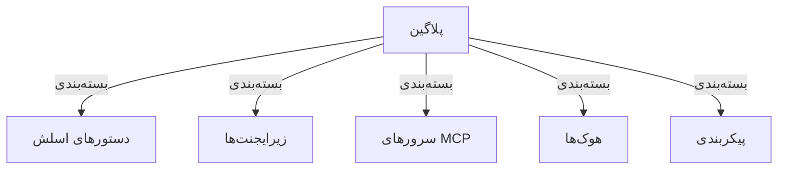
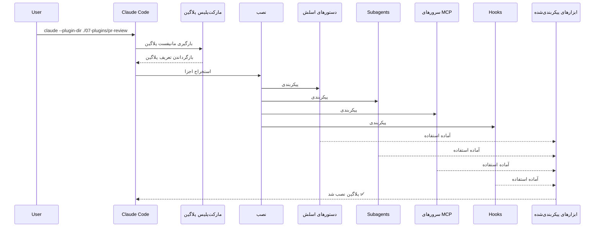
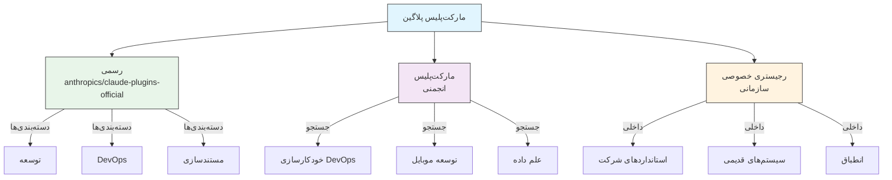
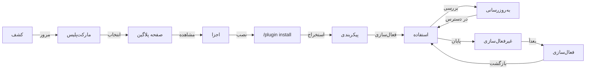
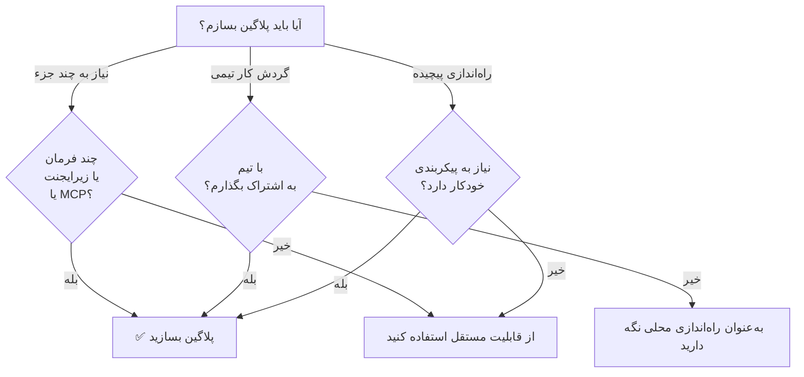

<picture>
  <source media="(prefers-color-scheme: dark)" srcset="../../resources/logos/claude-howto-logo-dark.svg">
  
</picture>

# پلاگین‌های Claude Code

این پوشه شامل نمونه‌های کامل پلاگین است که چندین قابلیت Claude Code را در بسته‌های یکپارچه و قابل نصب گرد هم می‌آورد.

## مرور کلی

پلاگین‌های Claude Code مجموعه‌های بسته‌بندی‌شده‌ای از سفارشی‌سازی‌ها (دستورهای اسلش، زیرایجنت‌ها، سرورهای MCP و هوک‌ها) هستند که با یک فرمان واحد نصب می‌شوند. آن‌ها بالاترین سطح سازوکار توسعه را نمایندگی می‌کنند — ترکیب چندین قابلیت در بسته‌های یکپارچه و قابل اشتراک.

## معماری پلاگین



## فرایند بارگذاری پلاگین



> **بدون نیاز به مارکت‌پلیس (v2.1.157+)**: پلاگین‌هایی که در پوشه‌های `.claude/skills` قرار می‌گیرند اکنون بدون مارکت‌پلیس به‌طور خودکار بارگذاری می‌شوند. یک پلاگین جدید را با `claude plugin init <name>` بسازید؛ این فرمان آن را در `~/.claude/skills/<name>/` (سراسری برای کاربر) ایجاد می‌کند و در نشست بعدی به‌صورت `<name>@skills-dir` به‌طور خودکار بارگذاری می‌شود. تنظیمات مدیریت‌شده می‌تواند پلاگین‌های پوشه مهارت‌ها را مسدود کند: `strictPluginOnlyCustomization` آن‌ها را حتی وقتی یک فهرست مجاز مدخلی با `{ "source": "skills-dir" }` دارد متوقف می‌کند، و یک فهرست مجاز مارکت‌پلیس بدون آن مدخل هم متوقفشان می‌کند. پوشه‌ای که مسدود شده در `/plugin` یا `claude plugin list` هیچ پلاگینی و هیچ خطایی نشان نمی‌دهد.

## انواع و توزیع پلاگین

| نوع | دامنه | اشتراک | مرجع | مثال‌ها |
|------|-------|--------|-----------|----------|
| رسمی | سراسری | همه کاربران | Anthropic | بازبینی PR، راهنمای امنیت |
| انجمنی | عمومی | همه کاربران | انجمن | DevOps، علم داده |
| سازمانی | داخلی | اعضای تیم | شرکت | استانداردها و ابزارهای داخلی |
| شخصی | فردی | یک کاربر | توسعه‌دهنده | گردش‌کارهای سفارشی |

## ساختار تعریف پلاگین

مانیفست پلاگین از قالب JSON در `.claude-plugin/plugin.json` استفاده می‌کند:

```json
{
  "name": "my-first-plugin",
  "description": "یک پلاگین خوش‌آمدگویی",
  "version": "1.0.0",
  "author": {
    "name": "نام شما"
  },
  "homepage": "https://example.com",
  "repository": "https://github.com/user/repo",
  "license": "MIT"
}
```

فراتر از این فیلدهای هویتی، مانیفست می‌تواند Claude Code را به اجزایی اشاره دهد که در جایی غیر از پوشه‌های پیش‌فرض قرار دارند و همچنین فراداده‌های کشف و وابستگی را حمل کند:

| فیلد | نوع | توضیح |
|-------|------|-------------|
| `workflows` | string \| array | فایل‌ها یا پوشه‌های اسکریپت [گردش کار](https://code.claude.com/docs/en/workflows) سفارشی (جایگزین `workflows/` پیش‌فرض) |
| `outputStyles` | string \| array | فایل‌ها یا پوشه‌های سبک خروجی سفارشی (جایگزین `output-styles/` پیش‌فرض) |
| `lspServers` | string \| array \| object | سرورهای LSP برای هوشمندی کد — رفتن به تعریف، یافتن ارجاع‌ها، تشخیص‌ها. معمولاً `"./.lsp.json"`. به [پیکربندی سرور LSP](#پیکربندی-سرور-lsp) مراجعه کنید |
| `channels` | array | اعلان‌های کانال برای تزریق پیام (به سبک Telegram، Slack، Discord) |
| `dependencies` | array | پلاگین‌های دیگری که این پلاگین به آن‌ها نیاز دارد، به‌صورت اختیاری با محدودیت نسخه semver |
| `keywords` | array | برچسب‌های کشف که هنگام مرور و جستجوی مارکت‌پلیس‌ها استفاده می‌شوند |
| `metadata` | object | شیء آزاد برای داده‌های خودتان، مانند فیلدهای حق اشتراک یا کاتالوگ |
| `experimental.themes` | string \| array | فایل‌ها یا پوشه‌های تم رنگی (جایگزین `themes/` پیش‌فرض) |
| `experimental.monitors` | string \| array | پیکربندی‌های [نظارت‌گر پس‌زمینه](#نظارت‌گرهای-پس‌زمینه-v21105) که با فعال شدن پلاگین به‌طور خودکار شروع می‌شوند |

## نمونه ساختار پلاگین

```
my-plugin/
├── .claude-plugin/
│   └── plugin.json       # مانیفست (نام، توضیح، نسخه، نویسنده)
├── commands/             # مهارت‌ها به‌صورت فایل‌های Markdown
│   ├── task-1.md
│   ├── task-2.md
│   └── workflows/
├── agents/               # تعریف‌های ایجنت سفارشی
│   ├── specialist-1.md
│   ├── specialist-2.md
│   └── configs/
├── skills/               # مهارت‌های ایجنت با فایل‌های SKILL.md
│   ├── skill-1/
│   │   └── SKILL.md
│   └── skill-2/
│       └── SKILL.md
├── hooks/                # گرداننده‌های رویداد در hooks.json
│   └── hooks.json
├── .mcp.json             # پیکربندی‌های سرور MCP
├── .lsp.json             # پیکربندی‌های سرور LSP برای هوشمندی کد
├── bin/                  # فایل‌های اجرایی که هنگام فعال بودن پلاگین به PATH ابزار Bash افزوده می‌شوند (فرمان‌های PowerShell بیرون از sandbox نیز آن‌ها را پیدا می‌کنند، v2.1.302)
├── settings.json         # تنظیمات پیش‌فرضی که هنگام فعال شدن پلاگین اعمال می‌شوند (فقط کلیدهای `agent` و `subagentStatusLine` اثر می‌گذارند)
├── themes/               # اختیاری: ارسال تم‌های سفارشی Claude Code (v2.1.118+)
├── templates/
│   └── issue-template.md
├── scripts/
│   ├── helper-1.sh
│   └── helper-2.py
├── docs/
│   ├── README.md
│   └── USAGE.md
└── tests/
    └── plugin.test.js
```

> **نکته**: پوشه `commands/` **قدیمی** است. راهنمایی رسمی این است: *«برای پلاگین‌های جدید از `skills/` استفاده کنید.»* پوشه‌های `commands/` موجود همچنان کار می‌کنند — سه پلاگین نمونه در این ماژول یکی از آن‌ها را دارند — اما یک پلاگین جدید باید قابلیت‌های خود را در `skills/` به‌صورت پوشه‌های `SKILL.md` قرار دهد، نه فایل‌های مسطح فرمان Markdown.

### پیکربندی سرور LSP

پلاگین‌ها می‌توانند از پشتیبانی Language Server Protocol (LSP) برای هوشمندی کد به‌صورت بی‌درنگ برخوردار باشند. سرورهای LSP هنگام کار، تشخیص‌ها، ناوبری کد و اطلاعات نمادها را فراهم می‌کنند.

**مکان‌های پیکربندی**:
- فایل `.lsp.json` در پوشه ریشه پلاگین
- کلید `lspServers` در `plugin.json` — نام فیلد رسمی مانیفست. یک رشته، یک آرایه یا یک شیء را می‌پذیرد: رشته یا آرایه به فایل‌ها یا پوشه‌های پیکربندی LSP اشاره می‌کند (مثلاً `"./.lsp.json"`) و یک شیء سرورها را درون‌خطی اعلان می‌کند.

#### مرجع فیلدها

| فیلد | الزامی | توضیح |
|-------|----------|-------------|
| `command` | بله | باینری سرور LSP (باید در PATH باشد) |
| `extensionToLanguage` | بله | پسوند فایل‌ها را به شناسه‌های زبان نگاشت می‌کند |
| `args` | خیر | آرگومان‌های خط فرمان برای سرور |
| `transport` | خیر | روش ارتباط: `stdio` (پیش‌فرض) یا `socket` |
| `env` | خیر | متغیرهای محیطی برای فرایند سرور |
| `initializationOptions` | خیر | گزینه‌هایی که هنگام راه‌اندازی اولیه LSP ارسال می‌شوند |
| `settings` | خیر | پیکربندی فضای کاری که به سرور داده می‌شود |
| `workspaceFolder` | خیر | بازنویسی مسیر پوشه فضای کاری |
| `startupTimeout` | خیر | حداکثر زمان (میلی‌ثانیه) برای انتظار راه‌اندازی سرور |
| `shutdownTimeout` | خیر | حداکثر زمان (میلی‌ثانیه) برای خاموش شدن تدریجی |
| `restartOnCrash` | خیر | در صورت از کار افتادن سرور، به‌طور خودکار راه‌اندازی مجدد شود |
| `maxRestarts` | خیر | حداکثر تلاش‌های راه‌اندازی مجدد پیش از رها کردن |

#### نمونه پیکربندی‌ها

**Go (gopls)**:

```json
{
  "go": {
    "command": "gopls",
    "args": ["serve"],
    "extensionToLanguage": {
      ".go": "go"
    }
  }
}
```

**Python (pyright)**:

```json
{
  "python": {
    "command": "pyright-langserver",
    "args": ["--stdio"],
    "extensionToLanguage": {
      ".py": "python",
      ".pyi": "python"
    }
  }
}
```

**TypeScript**:

```json
{
  "typescript": {
    "command": "typescript-language-server",
    "args": ["--stdio"],
    "extensionToLanguage": {
      ".ts": "typescript",
      ".tsx": "typescriptreact",
      ".js": "javascript",
      ".jsx": "javascriptreact"
    }
  }
}
```

#### پلاگین‌های LSP موجود

مارکت‌پلیس رسمی شامل پلاگین‌های LSP از پیش پیکربندی‌شده است:

| پلاگین | زبان | باینری سرور | فرمان نصب |
|--------|----------|---------------|----------------|
| `pyright-lsp` | Python | `pyright-langserver` | `pip install pyright` |
| `typescript-lsp` | TypeScript/JavaScript | `typescript-language-server` | `npm install -g typescript-language-server typescript` |
| `rust-analyzer-lsp` | Rust | `rust-analyzer` | نصب از طریق `rustup component add rust-analyzer` |

#### قابلیت‌های LSP

پس از پیکربندی، سرورهای LSP این موارد را فراهم می‌کنند:

- **تشخیص فوری** — خطاها و هشدارها بلافاصله پس از ویرایش ظاهر می‌شوند
- **ناوبری کد** — رفتن به تعریف، یافتن ارجاع‌ها و پیاده‌سازی‌ها
- **اطلاعات شناور** — امضای نوع و مستندات هنگام نگه داشتن نشانگر
- **فهرست نمادها** — مرور نمادهای فایل یا فضای کاری جاری

### پوشه `bin/` روی `PATH`

وقتی یک پلاگین فعال می‌شود، پوشه `bin/` آن پس از ورودی‌های `PATH` خودتان به `PATH` نشست افزوده می‌شود، تا پلاگین نتواند `git`، `ls` یا فرمان سیستمی دیگری را بپوشاند. هر فایل اجرایی که در آنجا قرار داده شود می‌تواند مستقیماً از ابزار Bash با نام فراخوانی شود — بدون نیاز به مسیر کامل (یک فرمان ابزار PowerShell بیرون از sandbox نیز آن‌ها را پیدا می‌کند، v2.1.302؛ فرمان sandbox‌شده نه).

```bash
# در ساختار یک پلاگین:
my-plugin/
├── .claude-plugin/
│   └── plugin.json
└── bin/
    └── my-tool          # فایل اجرایی (chmod +x)

# درون یک نشست Claude Code با پلاگین فعال:
$ my-tool --help
```

از این برای کمک‌کننده‌های CLI استفاده کنید که هوک‌ها، مهارت‌ها یا فرمان‌های درون همان پلاگین به آن‌ها شل می‌زنند. فایل‌ها را در مخزن پلاگین اجرایی علامت بزنید (`chmod +x`) — git این بیت را حفظ می‌کند.

## گزینه‌های پلاگین (v2.1.83+)

پلاگین‌ها می‌توانند در مانیفست از طریق `userConfig` گزینه‌های قابل پیکربندی توسط کاربر را اعلان کنند. مقادیری که با `sensitive: true` علامت خورده‌اند در جاکلیدی سیستم ذخیره می‌شوند، نه در فایل‌های تنظیمات متنی ساده:

```json
{
  "name": "my-plugin",
  "version": "1.0.0",
  "userConfig": {
    "apiKey": {
      "type": "string",
      "title": "کلید API",
      "description": "کلید API برای سرویس",
      "sensitive": true
    },
    "region": {
      "type": "string",
      "title": "منطقه",
      "description": "منطقه استقرار",
      "default": "us-east-1"
    }
  }
}
```

## داده‌های پایدار پلاگین (`${CLAUDE_PLUGIN_DATA}`) (v2.1.78+)

پلاگین‌ها از طریق متغیر محیطی `${CLAUDE_PLUGIN_DATA}` به یک پوشه حالت پایدار دسترسی دارند. این پوشه برای هر پلاگین یکتاست و در میان نشست‌ها باقی می‌ماند، که آن را برای حافظه‌های نهان، پایگاه‌های داده و سایر حالت‌های پایدار مناسب می‌کند:

```json
{
  "hooks": {
    "PostToolUse": [
      {
        "matcher": "*",
        "hooks": [
          {
            "type": "command",
            "command": "node \"${CLAUDE_PLUGIN_ROOT}\"/scripts/track-usage.js \"${CLAUDE_PLUGIN_DATA}\"/usage.json"
          }
        ]
      }
    ]
  }
}
```

این پوشه (`~/.claude/plugins/data/<id>/`) نخستین بار که به آن ارجاع داده شود ایجاد می‌شود و در طول به‌روزرسانی‌های پلاگین حفظ می‌شود. زمانی حذف می‌شود که پلاگین را از آخرین مکانی که در آن نصب شده حذف نصب کنید (مگر اینکه `--keep-data` را بدهید).

### نظارت‌گرهای پس‌زمینه (v2.1.105)

پلاگین‌ها می‌توانند نظارت‌گرهای پس‌زمینه‌ای ثبت کنند که با شروع یک نشست یا نخستین بار که یکی از مهارت‌های پلاگین اجرا می‌شود شروع به کار می‌کنند. آن‌ها را زیر `experimental.monitors` در `plugin.json` (یا در `monitors/monitors.json`) اعلان کنید:

```json
{
  "name": "my-plugin",
  "version": "1.0.0",
  "experimental": {
    "monitors": [
      {
        "name": "app-log",
        "command": "tail -f /var/log/app.log",
        "description": "خطاهای لاگ برنامه",
        "when": "always"
      }
    ]
  }
}
```

فیلدهای `name`، `command` و `description` الزامی هستند. `when` این مقادیر را می‌پذیرد:
- `"always"` (پیش‌فرض) — در شروع نشست و هنگام بارگذاری مجدد پلاگین شروع می‌شود
- `"on-skill-invoke:<skill>"` — نخستین بار که آن مهارت اجرا می‌شود شروع می‌شود

کلیدهای ناشناخته رد می‌شوند و پلاگین بارگذاری نمی‌شود. کلید سطح بالای `monitors` همچنان بارگذاری می‌شود اما `claude plugin validate` هشدار می‌دهد.

نظارت‌گرها در پشت صحنه از همان ابزار Monitor استفاده می‌کنند و خطوط stdout را به‌صورت رویدادهایی که Claude می‌تواند به آن‌ها واکنش نشان دهد جریان می‌دهند.

نظارت‌گرهای پلاگین در اجراهای غیرتعاملی `-p` شروع نمی‌شوند. روی Amazon Bedrock، Claude Platform on AWS، Agent Platform گوگل کلاد یا Microsoft Foundry، یا وقتی `DISABLE_TELEMETRY` یا `CLAUDE_CODE_DISABLE_NONESSENTIAL_TRAFFIC` تنظیم شده، به v2.1.310+ نیاز دارند (نسخه‌های پیشین آنجا شروعشان نمی‌کردند). وقتی تنظیمات مدیریت‌شده `allowManagedHooksOnly` را تنظیم کرده، فقط نظارت‌گرهای پلاگین‌هایی شروع می‌شوند که تنظیمات مدیریت‌شده شما را اجباراً فعال کرده‌ (v2.1.310+).

## پلاگین درون‌خطی از طریق تنظیمات (`source: 'settings'`) (v2.1.80+)

پلاگین‌ها می‌توانند درون فایل‌های تنظیمات به‌صورت ورودی‌های مارکت‌پلیس با استفاده از فیلد `source: 'settings'` تعریف شوند. این امکان تعریف یک پلاگین را مستقیماً و بدون نیاز به مخزن یا مارکت‌پلیس جداگانه فراهم می‌کند. آن را زیر `extraKnownMarketplaces.<name>.source` اعلان کنید؛ `name` باید با کلید مارکت‌پلیس مطابقت داشته باشد و پلاگین‌های آن باید به منابع خارجی مانند GitHub یا npm ارجاع دهند (مسیرهای نسبی رد می‌شوند):

```json
{
  "extraKnownMarketplaces": {
    "inline-tools": {
      "source": {
        "source": "settings",
        "name": "inline-tools",
        "plugins": [
          {
            "name": "quick-lint",
            "source": {
              "source": "github",
              "repo": "my-org/quick-lint"
            }
          }
        ]
      }
    }
  }
}
```

## مادها (v2.1.287+)

ماد یک پلاگین است که ظاهر و رفتار Claude Code را تغییر می‌دهد. کد آن یک ماژول هوک JavaScript یا TypeScript است: گرداننده‌های رویدادی که Claude Code هنگام رخ دادن چیزی فراخوانی می‌کند، مانند یک فراخوانی ابزار، یک پرامپت ارسال‌شده، یا بخشی از رابط کاربری که در حال رسم است. هر گرداننده می‌تواند رویداد را مشاهده کند، آن را بازنویسی کند، یا خودش به آن پاسخ دهد. یک ماد مانند هر پلاگین دیگری نصب می‌شود (`/plugin install <plugin>@<marketplace>`)، می‌تواند در همان پلاگین همراه با مهارت‌ها و سرورهای MCP ارسال شود، و با مجوزهای شما اجرا می‌شود، بنابراین مادها را فقط از نویسندگان و مارکت‌پلیس‌هایی نصب کنید که به آن‌ها اعتماد دارید. مادها در CLI Claude Code (v2.1.287+)، در زبانه Code اپلیکیشن Claude Desktop و در افزونه VS Code کار می‌کنند.

| کاری که یک ماد می‌تواند انجام دهد | مثال |
|-------------------|---------|
| رسم پنل‌ها و نواری بالای پرامپت | پنلی در کنار رونوشت مکالمه یا نواری بالای پرامپت، همراه با زبانه‌ها، دکمه‌ها و فیلدهای متنی |
| افزودن فرمان | یک `/command` که تابع شما را بی‌درنگ اجرا می‌کند، بدون هیچ نوبت Claude، حتی زمانی که Claude مشغول کار است |
| محافظت یا تغییر فراخوانی ابزارها | نگه داشتن یک فراخوانی ابزار تا زمانی که سؤال خود را از کاربر بپرسید، رد کردن آن، یا پاسخ دادن به آن بدون اجرای ابزار |
| واکنش به رویدادها | پیگیری فراخوانی ابزارها، پرامپت‌ها و نوبت‌ها؛ هوک‌های یک ماد متغیرها را به اشتراک می‌گذارند، بنابراین یکی می‌تواند فراخوانی‌های ابزار را بشمارد و دیگری تعداد را کنار نشانگر انتظار نمایش دهد |
| فراخوانی API مادها | فراخوانی یک مدل، خواندن و نوشتن فایل‌ها، شروع فرایندها یا ارسال درخواست‌های شبکه (یک هوک این کارها را فقط از طریق API مادها می‌تواند انجام دهد) |

برای ساخت یک ماد، آنچه می‌خواهید را در یک نشست Claude Code توصیف کنید: Claude از مهارت درون‌ساخت `plugin-authoring` کار می‌کند (یا خودتان `/plugin-authoring` را اجرا کنید)، ماد را می‌نویسد و، پس از آنکه بارگذاری مجدد داغ را برای نشست فعال کردید، آن را در پایان هر نوبتی که آن را تغییر دهد دوباره بارگذاری می‌کند؛ `claude plugin validate` یک ماد را بدون اجرای آن بررسی می‌کند. مدیران از طریق تنظیمات مدیریت‌شده تصمیم می‌گیرند که آیا مادها اجرا شوند و کدام‌ها — برای نمونه، `allowManagedModsOnly` اجازه می‌دهد فقط مادهای سازمان شما و مادهای درون‌ساخت Claude Code هوک‌هایشان را اجرا کنند. با تنظیمات مدیریت‌شده، یا یک `/login` در طرح Team یا Enterprise به‌عنوان اعتبارنامهٔ نشست، یک نگهبان درون‌ساخت مانع می‌شود که ماد یک کاربر فراخوانی‌ای را تأیید کند که قاعدهٔ `deny` یا `ask` یا هر هوک `PreToolUse` جلویش را می‌گیرد؛ بدون هیچ‌کدام، یک ماد می‌تواند چنین فراخوانی‌ای را تأیید کند.

> **نکته**: نسخه‌های v2.1.299–2.1.300 ویژگی‌های `Text` شامل `size`، `weight`، `mono`، `tabular`، `dir` (راست‌به‌چپ) را اضافه می‌کنند — `bold` به نفع `weight` منسوخ شده است — گام‌های فاصله‌گذاری `Box` از `xs` تا `xl`، `virtualText` پرامپت، `$.ui.view({ agentId })` و هوک `prompt.change`؛ نسخه v2.1.301 ویژگی `rows` را برای `Input` جهت یک فیلد چندخطی اضافه می‌کند (Enter ارسال می‌کند، Shift+Enter یک خط اضافه می‌کند). v2.1.304 ویژگی `e.isReadOnly` را روی `tool.check` (به‌همراه یک matcher `isReadOnly: true`)، هوک‌های `settings.read` را که هر لایهٔ تنظیمات (`e.layers`) را در خواندن‌های خود Claude Code می‌بینند — تا یک ماد مدیریت‌شده بتواند یک تنظیم سازمان را محدود کند — و آرگومان `key` را برای `$.settings.read()` اضافه می‌کند؛ v2.1.305 یک پنل docked را در ۴۵٪ عرض ترمینال نگه می‌دارد و `Image` را در iTerm2 3.5+ رسم می‌کند (رندر تمام‌صفحه)؛ v2.1.310 `Image` را داخل tmux 3.3+ با `allow-passthrough` و `focus-events` روشن رسم می‌کند.

> **نکته**: به [مرور کلی مادها](https://code.claude.com/docs/en/plugins/mods/overview)، [ساخت یک ماد](https://code.claude.com/docs/en/plugins/mods/create) و [مرجع مادها](https://code.claude.com/docs/en/plugins/mods/reference) رسمی مراجعه کنید.

## تنظیمات پلاگین

پلاگین‌ها می‌توانند فایل `settings.json` را برای ارائه پیکربندی پیش‌فرض ارسال کنند. دو کلید اثر می‌گذارند، `agent` و `subagentStatusLine`؛ هر کلید دیگری حذف می‌شود. `agent` نام یکی از ایجنت‌های پلاگین را می‌گیرد و آن را به‌عنوان رشته اصلی اجرا می‌کند:

```json
{
  "agent": "specialist-1"
}
```

وقتی یک پلاگین شامل `settings.json` باشد، پیش‌فرض‌های آن هنگام نصب اعمال می‌شوند. کاربران می‌توانند این تنظیمات را در پیکربندی پروژه یا کاربر خود بازنویسی کنند.

## رویکرد مستقل در برابر پلاگین

| رویکرد | نام فرمان‌ها | پیکربندی | بهترین برای |
|----------|---------------|---|---|
| **مستقل** | `/hello` | راه‌اندازی دستی در CLAUDE.md | شخصی، مخصوص پروژه |
| **پلاگین‌ها** | `/plugin-name:hello` | خودکار از طریق plugin.json | اشتراک‌گذاری، توزیع، استفاده تیمی |

از **دستورهای اسلش مستقل** برای گردش‌کارهای شخصی سریع استفاده کنید. از **پلاگین‌ها** زمانی استفاده کنید که می‌خواهید چندین قابلیت را بسته‌بندی کنید، با یک تیم به اشتراک بگذارید یا برای توزیع منتشر کنید.

> **فراخوانی با فاصله (v2.1.136+)**: دستورهای اسلش پلاگین با فاصله هم کار می‌کنند — `/myplugin review` به `/myplugin:review` متعارف تبدیل می‌شود. هر دو شکل درست هستند؛ شکل با دونقطه متعارف است و در اسکریپت‌ها توصیه می‌شود.

> **کشف `skills/` (v2.1.136+)**: یک ورودی `skills` در `plugin.json` دیگر پوشه پیش‌فرض `skills/` پلاگین را پنهان نمی‌کند. مهارت‌های اعلان‌شده در هر دو محل ادغام می‌شوند، بنابراین می‌توانید چند مورد برجسته را در `plugin.json` فهرست کنید بدون از دست دادن بقیه.

> **پلاگین‌های `SKILL.md` در سطح ریشه (v2.1.142+)**: پلاگینی که یک `SKILL.md` سطح بالا و **هیچ زیرپوشه `skills/`** ندارد، خودش به‌عنوان یک مهارت واحد نمایان می‌شود — پلاگین *همان* مهارت است. این یک الگوی افزوده است، نه جایگزینی برای پوشه `skills/` یا ورودی `skills` در `plugin.json`؛ از آن برای پلاگین‌های کوچک تک‌مهارتی استفاده کنید که چیدمان پوشه در آن‌ها ارزش افزوده‌ای ندارد.

## مثال‌های عملی

### مثال ۱: پلاگین بازبینی PR

**فایل:** `.claude-plugin/plugin.json`

```json
{
  "name": "pr-review",
  "version": "1.0.0",
  "description": "گردش کار کامل بازبینی PR با بررسی امنیت، تست و مستندات",
  "author": {
    "name": "Anthropic"
  },
  "repository": "https://github.com/your-org/pr-review",
  "license": "MIT"
}
```

**فایل:** `commands/review-pr.md`

```markdown
---
name: بازبینی PR
description: شروع بازبینی جامع PR همراه با بررسی‌های امنیتی و تست
---

# بازبینی PR

این فرمان یک بازبینی کامل درخواست ادغام را آغاز می‌کند شامل:

1. تحلیل امنیتی
2. بررسی پوشش تست
3. به‌روزرسانی مستندات
4. بررسی کیفیت کد
5. ارزیابی تأثیر عملکرد
```

**فایل:** `agents/security-reviewer.md`

```yaml
---
name: security-reviewer
description: بازبینی کد با تمرکز بر امنیت
tools: Read, Grep, Bash
---

# بازبین امنیت

تخصص در یافتن آسیب‌پذیری‌های امنیتی:
- مشکلات احراز هویت/مجوزدهی
- افشای داده
- حملات تزریق
- پیکربندی امن
```

**نصب:**

```bash
claude --plugin-dir ./07-plugins/pr-review

# نتیجه:
# ✅ ۳ دستور اسلش نصب شد
# ✅ ۳ زیرایجنت پیکربندی شد
# ✅ ۲ سرور MCP متصل شد
# ✅ ۴ هوک ثبت شد
# ✅ آماده استفاده!
```

### مثال ۲: پلاگین DevOps

**اجزا:**

```
devops-automation/
├── commands/
│   ├── deploy.md
│   ├── rollback.md
│   ├── status.md
│   └── incident.md
├── agents/
│   ├── deployment-specialist.md
│   ├── incident-commander.md
│   └── alert-analyzer.md
├── mcp/
│   └── kubernetes-config.json
├── hooks/
│   ├── pre-deploy.js
│   └── post-deploy.js
└── scripts/
    ├── deploy.sh
    ├── rollback.sh
    └── health-check.sh
```

### مثال ۳: پلاگین مستندسازی

**اجزای بسته‌بندی‌شده:**

```
documentation/
├── commands/
│   ├── generate-api-docs.md
│   ├── generate-readme.md
│   ├── sync-docs.md
│   └── validate-docs.md
├── agents/
│   ├── api-documenter.md
│   ├── code-commentator.md
│   └── example-generator.md
├── mcp/
│   └── github-docs-config.json
└── templates/
    ├── api-endpoint.md
    ├── function-docs.md
    └── adr-template.md
```

## مارکت‌پلیس پلاگین

دایرکتوری رسمی پلاگین که Anthropic آن را مدیریت می‌کند `anthropics/claude-plugins-official` است و در نخستین اجرای تعاملی به‌طور خودکار ثبت می‌شود. مدیران سازمانی می‌توانند مارکت‌پلیس‌های خصوصی پلاگین برای توزیع داخلی بسازند.

یک **مارکت‌پلیس انجمنی** هم وجود دارد، `anthropics/claude-plugins-community`، که پلاگین‌های شخص ثالثی را میزبانی می‌کند که اعتبارسنجی خودکار و غربالگری ایمنی Anthropic را گذرانده‌اند — هر یک در کاتالوگ به یک SHA مشخص از یک کامیت پین شده است. برخلاف مارکت‌پلیس رسمی، باید آن را به‌صورت دستی اضافه کنید:

```bash
/plugin marketplace add anthropics/claude-plugins-community

# سپس با استفاده از نام مارکت‌پلیس claude-community از آن نصب کنید
/plugin install <plugin-name>@claude-community
```



### پیکربندی مارکت‌پلیس

کاربران سازمانی و پیشرفته می‌توانند رفتار مارکت‌پلیس را از طریق تنظیمات کنترل کنند:

| تنظیم | توضیح |
|---------|-------------|
| `extraKnownMarketplaces` | افزودن منابع مارکت‌پلیس بیشتر فراتر از پیش‌فرض‌ها |
| `strictKnownMarketplaces` | کنترل اینکه کاربران مجاز به افزودن کدام مارکت‌پلیس‌ها هستند (فقط مدیریت‌شده) |
| `blockedMarketplaces` | فهرست مسدود مدیریت‌شده توسط مدیر برای مارکت‌پلیس‌ها (از فیلدهای regex `hostPattern` / `pathPattern` از v2.1.119 پشتیبانی می‌کند) |
| `enabledPlugins` (تنظیم روی `false`) | مسدود کردن یک پلاگین مشخص: `"enabledPlugins": { "<plugin>@<marketplace>": false }` در تنظیمات مدیریت‌شده آن را در همه دامنه‌ها از نصب مسدود می‌کند و از مارکت‌پلیس پنهان می‌کند |

> **نام‌های مستعار دوستانه‌تر (v2.1.232)**: `additionalMarketplaces` به‌عنوان نام مستعار برای
> `extraKnownMarketplaces` و `allowedMarketplaces` برای `strictKnownMarketplaces` پذیرفته می‌شود.
> مرجع رسمی تنظیمات هر دو را زیر
> [نام‌های مستعار کلید مارکت‌پلیس](https://code.claude.com/docs/en/settings-reference#marketplace-key-aliases) فهرست می‌کند.
> نسخه‌های پیشین نام‌های مستعار را نادیده می‌گیرند، بنابراین استفاده از کلیدهای متعارف ایمن است.

> **نویسه‌های عام مالک (v2.1.223+)**: یک ورودی `"owner/*"` همه مخازن مارکت‌پلیس
> زیر یک مالک GitHub را مجاز یا مسدود می‌کند. **فقط در `strictKnownMarketplaces` و
> `blockedMarketplaces` پذیرفته می‌شود.** در هر جای دیگری که یک منبع `github` ظاهر شود — از جمله
> `extraKnownMarketplaces` و `/plugin marketplace add` — مقدار `repo` باید به یک
> مخزن واحد اشاره کند.

> **اجرا** (v2.1.117+): `blockedMarketplaces` و `strictKnownMarketplaces` در هر رویداد چرخه عمر پلاگین اجرا می‌شوند — نصب، به‌روزرسانی، بازخوانی و به‌روزرسانی خودکار — نه فقط در نخستین افزودن. `strictKnownMarketplaces` فقط مدیریت‌شده است.

نمونه `blockedMarketplaces` با regex میزبان/مسیر (v2.1.119):

```json
{
  "blockedMarketplaces": [
    { "source": "hostPattern", "hostPattern": "^evil\\.example\\.com$" },
    { "source": "pathPattern", "pathPattern": "^/opt/approved/" }
  ]
}
```

#### `headersHelper` مارکت‌پلیس (v2.1.238)

یک مارکت‌پلیس `url` — یا یک ورودی کاتالوگ مستقل — می‌تواند فرمان `headersHelper` را نام ببرد که سرآیندهای HTTP مورد استفاده برای واکشی کاتالوگ و هر آرشیو هم‌مبدأ را تولید می‌کند. این‌گونه یک مارکت‌پلیس خصوصی پشت سرویسی که توکن صادر می‌کند بدون نیاز به یک راز ثابت در پیکربندی احراز هویت می‌شود.

کمک‌کننده یک **ورودی کاتالوگ** فقط هنگام نصب یا به‌روزرسانی اجرا می‌شود، و تنها پس از آنکه فرمان آن به شما نمایش داده شد: `claude plugin install` و `claude plugin update` پیش از اجرای آن `[y/N]` می‌پرسند. برای پذیرش بدون پرسش در خودکارسازی، `-y` را بدهید.

### ویژگی‌های بیشتر مارکت‌پلیس

- **نوار جستجوی مارکت‌پلیس (v2.1.172)**: هنگام مرور پلاگین‌های یک مارکت‌پلیس در `/plugin`، یک نوار جستجو به شما اجازه می‌دهد پلاگین‌های آن مارکت‌پلیس را بر اساس نام یا کلیدواژه فیلتر کنید — برای مارکت‌پلیس‌های بزرگ که پیمایش کل فهرست کند است مفید است.
- **مهلت پیش‌فرض git**: از ۳۰ ثانیه به ۱۲۰ ثانیه برای مخازن بزرگ پلاگین افزایش یافت
- **رجیستری‌های سفارشی npm**: پلاگین‌ها می‌توانند نشانی‌های رجیستری npm سفارشی برای حل وابستگی‌ها مشخص کنند
- **پین کردن نسخه**: پلاگین‌ها را به نسخه‌های مشخص قفل کنید تا محیط‌ها بازتولیدپذیر باشند
- **فقط زیرماژول‌های پلاگین clone می‌شوند (v2.1.295)**: وقتی Claude Code یک مخزن مارکت‌پلیس را clone می‌کند، فقط زیرماژول‌های gitی را که فایل‌های پلاگین را در خود دارند واکشی می‌کند (یک پلاگین ریشه‌ای با `"source": "./"` همه یا هیچ‌کدام را می‌گیرد، و `--sparse`/`sparsePaths` هیچ‌کدام را). نسخه‌های پیشین همهٔ زیرماژول‌ها را واکشی می‌کردند و می‌توانستند از مهلت clone عبور کنند.
- **هزینه پیش‌بینی‌شده زمینه در پنل مرور (v2.1.143)**: مرورگر مارکت‌پلیس `/plugin` هزینه پیش‌بینی‌شده توکن زمینه به‌ازای هر نوبت را برای هر پلاگین نشان می‌دهد — مجموع مهارت‌های همیشه‌بارگذاری‌شده، هوک‌ها و توصیفگرهای سرور MCP. از آن برای سنجش پذیرش پلاگین پیش از نصب استفاده کنید. همان پیش‌بینی پس از نصب از طریق [`claude plugin details <name>`](#claude-plugin-details-name-v21139) در دسترس است.

نمونه سطر مرور با ستون هزینه:

```text
NAME              VERSION   AUTHOR     CTX/TURN   DESCRIPTION
code-reviewer     1.2.0     anthropic  +1,420     Multi-agent PR review
devops-toolkit    0.4.1     acme       +3,180     SRE playbooks, on-call helpers
docs-helper       0.9.0     community  +610       Doc-style guide enforcement
```

### طرح‌واره تعریف مارکت‌پلیس

مارکت‌پلیس‌های پلاگین در `.claude-plugin/marketplace.json` تعریف می‌شوند:

```json
{
  "name": "my-team-plugins",
  "owner": { "name": "my-org" },
  "plugins": [
    {
      "name": "code-standards",
      "source": "./plugins/code-standards",
      "description": "اعمال استانداردهای کدنویسی تیم",
      "version": "1.2.0",
      "author": { "name": "platform-team" }
    },
    {
      "name": "deploy-helper",
      "source": {
        "source": "github",
        "repo": "my-org/deploy-helper",
        "ref": "v2.0.0"
      },
      "description": "گردش‌کارهای خودکارسازی استقرار"
    }
  ]
}
```

| فیلد | الزامی | توضیح |
|-------|----------|-------------|
| `name` | بله | نام مارکت‌پلیس به صورت kebab-case |
| `owner` | بله | سازمان یا کاربری که مارکت‌پلیس را نگهداری می‌کند: یک شیء با `name` الزامی (`email`، `url` اختیاری) |
| `plugins` | بله | آرایه‌ای از ورودی‌های پلاگین |
| `plugins[].name` | بله | نام پلاگین (kebab-case) |
| `plugins[].source` | بله | منبع پلاگین (رشته مسیر یا شیء منبع) |
| `plugins[].description` | خیر | توضیح کوتاه پلاگین |
| `plugins[].version` | خیر | رشته نسخه معنایی |
| `plugins[].author` | خیر | نویسنده پلاگین: یک شیء با `name` الزامی (`email`، `url` اختیاری) |
| `renames` | خیر | فیلد سطح بالای مارکت‌پلیس (نه برای هر ورودی): نام پیشین یک پلاگین را به نام کنونی آن نگاشت می‌کند (یا `null` اگر حذف شده باشد) تا کاربران به‌طور خودکار مهاجرت کنند (v2.1.193) |
| `plugins[].displayName` | خیر | نام خوانا برای انسان که در رابط کاربری نمایش داده می‌شود؛ برای جستجو استفاده نمی‌شود (v2.1.143) |
| `plugins[].defaultEnabled` | خیر | اگر `false` باشد، پلاگین غیرفعال نصب می‌شود تا کاربر خودش آن را فعال کند (v2.1.154) |

### انواع منبع پلاگین

پلاگین‌ها می‌توانند از مکان‌های متعددی منبع بگیرند:

| منبع | نحو | مثال |
|--------|--------|---------|
| **مسیر نسبی** | رشته مسیر | `"./plugins/my-plugin"` |
| **GitHub** | `{ "source": "github", "repo": "owner/repo" }` | `{ "source": "github", "repo": "acme/lint-plugin", "ref": "v1.0" }` |
| **نشانی Git** | `{ "source": "url", "url": "..." }` | `{ "source": "url", "url": "https://git.internal/plugin.git" }` |
| **زیرپوشه Git** | `{ "source": "git-subdir", "url": "...", "path": "..." }` | `{ "source": "git-subdir", "url": "https://github.com/org/monorepo.git", "path": "packages/plugin" }` |
| **npm** | `{ "source": "npm", "package": "..." }` | `{ "source": "npm", "package": "@acme/claude-plugin", "version": "^2.0" }` |
| **آرشیو** (v2.1.224+) | `{ "source": "archive", "url": "..." }` | `{ "source": "archive", "url": "https://cdn.example.com/lint-plugin-1.2.0.zip", "sha256": "…" }` |
| **فرمان** (v2.1.229+) | `{ "source": "command", "command": "..." }` | `{ "source": "command", "command": "acme-plugin-resolver --print-dir" }` |

منابع GitHub و git از فیلدهای اختیاری `ref` (شاخه/برچسب) و `sha` (هش کامیت) برای پین کردن نسخه پشتیبانی می‌کنند.

**نام‌های خالی منبع و `metadata.pluginRoot` (v2.1.239)**: `metadata.pluginRoot` یک مارکت‌پلیس اکنون اثر می‌گذارد — یک نام منبع خالی پلاگین در کاتالوگ به پوشه‌ای زیر آن ریشه تبدیل می‌شود، به‌جای آنکه در هر ورودی به‌صورت مسیر نسبی کامل نوشته شود.

**مهارت‌های همگام‌شده از claude.ai (v2.1.239)**: پلاگین‌هایی که از claude.ai همگام می‌شوند به‌صورت `name@synced` ظاهر می‌شوند. در `claude plugin enable <name>@synced` و `claude plugin disable <name>@synced` آن‌ها را با همین شکل خطاب کنید. یک پلاگین همگام‌شده هرگز پلاگین نصب‌شده‌ای با همان نام را بازنویسی نمی‌کند — این دو با پسوند `@synced` از هم متمایز شده و هم‌زیستی می‌کنند.

#### منبع `archive` (v2.1.224+)

یک پلاگین را از یک فایل zip روی HTTPS نصب کنید — بدون git clone و بدون npm install.

```json
{
  "source": "archive",
  "url": "https://cdn.example.com/lint-plugin-1.2.0.zip",
  "sha256": "3b1f0c2e9a7d4f5b8c6e1a2d3f4b5c6d7e8f9a0b1c2d3e4f5a6b7c8d9e0f1a2b"
}
```

| فیلد | الزامی | یادداشت‌ها |
|-------|----------|-------|
| `url` | بله | **فقط HTTPS.** میزبان‌های `http://`، loopback، link-local و فراداده ابری رد می‌شوند — و در **هر گام تغییر مسیر** دوباره بررسی می‌شوند، بنابراین یک تغییر مسیر نمی‌تواند شما را به میزبان مسدودشده قاچاق کند |
| `sha256` | خیر | ۶۴ نویسه هگز. در صورت عدم تطابق، نصب با `Plugin archive integrity check failed` شکست می‌خورد |

اندازه آرشیوها حداکثر **۲۵۶ MiB** است. برای هر چیزی که خودتان نساخته‌اید `sha256` را پین کنید — بدون آن، هر کسی که نشانی را کنترل می‌کند، کدی را کنترل می‌کند که در نشست شما اجرا می‌شود.

#### منبع `command` (v2.1.229+)

بگذارید یک ابزار نصب‌شده محلی تصمیم بگیرد پلاگین کجا زندگی می‌کند. زمانی مفید است که یک
مدیر بسته داخلی از قبل می‌داند چگونه پلاگین‌های شما را واکشی و چیدمان کند.

```json
{
  "source": "command",
  "command": "acme-plugin-resolver --print-dir",
  "timeout": 60,
  "mode": "copy"
}
```

قرارداد سخت‌گیرانه است: **فرمان باید دقیقاً یک خط روی stdout چاپ کند و با کد ۰ خارج
شود.** آن خط مسیر مطلق پوشه‌ای است که پلاگین کامل را در خود دارد.

| فیلد | الزامی | پیش‌فرض | یادداشت‌ها |
|-------|----------|---------|-------|
| `command` | بله | — | فرمانی که اجرا می‌شود |
| `timeout` | خیر | `60` (ثانیه) | حداکثر ۶۰۰ |
| `mode` | خیر | `"copy"` | `"copy"` از پوشه عکس می‌گیرد؛ `"link"` پیوند نمادین می‌سازد، بنابراین ویرایش‌ها زنده اعمال می‌شوند |

فرمان در هر نشست دوباره حل می‌شود و نتیجه بدون نیاز به راه‌اندازی مجدد اعمال می‌شود.
سازمان‌ها می‌توانند این نوع منبع را کاملاً با `disableCommandPluginSources` مسدود کنند.

نام‌های رزروشده مارکت‌پلیس اکنون شامل `first-party-plugins` و `healthcare` است (v2.1.205) — این‌ها برای استفاده رسمی نگه داشته شده‌اند و یک مارکت‌پلیس سفارشی نمی‌تواند آن‌ها را تصاحب کند.

### روش‌های توزیع

**GitHub (توصیه‌شده)**:
```bash
# کاربران مارکت‌پلیس شما را اضافه می‌کنند
/plugin marketplace add owner/repo-name
```

**سایر سرویس‌های git** (نشانی کامل لازم است):
```bash
/plugin marketplace add https://gitlab.com/org/marketplace-repo.git
```

نشانی‌های مخزن خالی `gitlab.com` — شامل زیرگروه‌های تودرتو — دقیقاً مانند نشانی‌های `github.com`
کلون می‌شوند (v2.1.232). **طرح اجباری است**: از v2.1.196 یک
`gitlab.example.com/team/plugins` خالی به‌عنوان کوتاه‌نویس نامعتبر `owner/repo` رد می‌شود، بنابراین از
شکل کامل `https://gitlab.com/company/plugins.git` استفاده کنید. نسخه v2.1.232 همچنین پاک‌سازی
رازهای خانواده توکن GitLab را اضافه کرد و به CLI `glab` همان سندباکس و محافظت مسیر
اعتبارنامه‌ای را داد که `gh` از قبل داشت.

**مخازن خصوصی**: از طریق کمک‌کننده‌های اعتبارنامه git یا توکن‌های محیطی پشتیبانی می‌شود. کاربران باید دسترسی خواندن به مخزن داشته باشند. روی HTTPS، Claude Code پرسش‌های git و برنامه‌های askpass (شامل `GIT_ASKPASS`) را خاموش می‌کند، پس اعتبارنامه باید از قبل ذخیره شده باشد، مثلاً با `gh auth login` و `gh auth setup-git`.

**ارسال به دایرکتوری**: برای توزیع گسترده‌تر، پلاگین‌ها را از پرتال توسعه‌دهنده در [claude.ai/directory/manage](https://claude.ai/directory/manage) به دایرکتوری Anthropic ارسال کنید. مارکت‌پلیس رسمی Anthropic، `claude-plugins-official`، از طریق پرتال دایرکتوری ارسال نمی‌پذیرد.

### مدیریت مارکت‌پلیس‌ها

```bash
# فرمان‌های CLI مارکت‌پلیس
claude plugin marketplace add <source>       # افزودن مارکت‌پلیس (GitHub، نشانی، محلی)
claude plugin marketplace update [name]      # بازخوانی فهرست کاتالوگ
claude plugin marketplace remove <name>      # حذف مارکت‌پلیس
claude plugin marketplace list               # فهرست مارکت‌پلیس‌های پیکربندی‌شده
```

> **مهم**: `marketplace update` فقط کاتالوگ پلاگین را بازخوانی می‌کند (آنچه برای نصب در دسترس است). پلاگین‌های نصب‌شده را به‌روزرسانی **نمی‌کند**. برای به‌روزرسانی پلاگین‌های نصب‌شده مشخص از `plugin update <name>` استفاده کنید.

### حالت سخت‌گیرانه

کنترل کنید که تعریف‌های مارکت‌پلیس چگونه با فایل‌های `plugin.json` محلی تعامل دارند:

| تنظیم | رفتار |
|---------|----------|
| `strict: true` (پیش‌فرض) | `plugin.json` محلی مرجع است؛ ورودی مارکت‌پلیس آن را تکمیل می‌کند |
| `strict: false` | ورودی مارکت‌پلیس تمام تعریف پلاگین است |

**محدودیت‌های سازمانی** با `strictKnownMarketplaces`:

| مقدار | اثر |
|-------|--------|
| تنظیم‌نشده | بدون محدودیت — کاربران می‌توانند هر مارکت‌پلیسی را اضافه کنند |
| آرایه خالی `[]` | قفل کامل — هیچ مارکت‌پلیسی مجاز نیست |
| آرایه‌ای از اشیاء منبع | فهرست مجاز — فقط مارکت‌پلیس‌های منطبق قابل افزودن هستند |

```json
{
  "strictKnownMarketplaces": [
    { "source": "github", "repo": "my-org/*" },
    { "source": "github", "repo": "trusted-vendor/*" }
  ]
}
```

> **هشدار**: در حالت سخت‌گیرانه با `strictKnownMarketplaces`، کاربران فقط می‌توانند از مارکت‌پلیس‌های فهرست مجاز پلاگین نصب کنند. این برای محیط‌های سازمانی که توزیع کنترل‌شده پلاگین می‌خواهند مفید است.

## نصب و چرخه عمر پلاگین



## مقایسه قابلیت‌های پلاگین

| قابلیت | دستور اسلش | مهارت | زیرایجنت | پلاگین |
|---------|---------------|-------|----------|--------|
| **نصب** | کپی دستی | کپی دستی | پیکربندی دستی | یک فرمان |
| **زمان راه‌اندازی** | ۵ دقیقه | ۱۰ دقیقه | ۱۵ دقیقه | ۲ دقیقه |
| **بسته‌بندی** | یک فایل | یک فایل | یک فایل | چندگانه |
| **نسخه‌بندی** | دستی | دستی | دستی | خودکار |
| **اشتراک تیمی** | کپی فایل | کپی فایل | کپی فایل | شناسه نصب |
| **به‌روزرسانی‌ها** | دستی | دستی | دستی | خودکار در دسترس |
| **وابستگی‌ها** | ندارد | ندارد | ندارد | ممکن است داشته باشد |
| **مارکت‌پلیس** | خیر | خیر | خیر | بله |
| **توزیع** | مخزن | مخزن | مخزن | مارکت‌پلیس |

## فرمان‌های CLI پلاگین

همه عملیات پلاگین به‌صورت فرمان‌های CLI در دسترس هستند:

```bash
claude plugin install <name>@<marketplace>   # نصب از یک مارکت‌پلیس
claude plugin uninstall <name>               # حذف یک پلاگین
claude plugin update <name>                  # به‌روزرسانی پلاگین نصب‌شده به آخرین نسخه
claude plugin list                           # فهرست پلاگین‌های نصب‌شده
claude plugin enable <name>                  # فعال کردن یک پلاگین غیرفعال
claude plugin disable <name>                 # غیرفعال کردن یک پلاگین
claude plugin validate <path>                # اعتبارسنجی ساختار پلاگین در <path>
claude plugin tag [path]                     # ساخت برچسب git انتشار {name}--v{version} (v2.1.118+)
claude plugin prune                          # حذف وابستگی‌های پلاگین یتیم خودکار-نصب‌شده (v2.1.121+)
claude plugin uninstall <name> --prune       # حذف نصب و پاک‌سازی آبشاری وابستگی‌های یتیم (v2.1.121+)
claude plugin details <name>                 # نمایش فهرست اجزا + هزینه پیش‌بینی‌شده توکن به‌ازای هر نوبت (v2.1.139+)
claude plugin configure <name>@<marketplace> # نمایش گزینه‌های پلاگین و اینکه کدام‌ها تنظیم نشده‌اند؛ ذخیره مقادیر از stdin با --values-stdin (v2.1.285+)
claude plugin init <name>                    # ساخت اسکلت یک پلاگین جدید (نام مستعار: claude plugin new)
```

**نام‌های مستعار**: `claude plugin new` برای `init`، `remove` / `rm` برای `uninstall`، `ls` برای `list` و `autoremove` برای `prune`.

**پرچم‌های قابل توجه:**

| فرمان | پرچم | هدف |
|---------|------|---------|
| `plugin init` | `--with <components...>` | ساخت پوشه‌های جزء مشخص: `skills`، `agents`، `hooks`، `mcp`، `lsp`، `output-style`، `channel` |
| `plugin init` | `-f`، `--force` | بازنویسی پوشه موجود `.claude-plugin/` |
| `plugin install` | `--config <key=value>` | تنظیم یک گزینه `userConfig` در زمان نصب؛ از v2.1.285، `<server>.<key>=<value>` تنظیم خودِ یک سرور MCP بسته‌بندی‌شده `.mcpb` را تعیین می‌کند تا بدون رفتن به `/plugin` → Configure شروع به کار کند |
| `plugin install` | `-y`، `--yes` | پذیرش فرمان‌ها بدون پرسش تأیید |
| `plugin list` | `--available` | فهرست پلاگین‌های موجود از مارکت‌پلیس‌ها هم اضافه شود (نیازمند `--json`) |
| `plugin tag` | `--push` | پس از ساخت برچسب، آن را به ریموت پوش کنید |
| `plugin tag` | `--dry-run` | چاپ آنچه برچسب می‌خورد بدون ساخت برچسب |
| `plugin validate` | `--strict` | برخورد با هشدارها به‌عنوان خطا |
| `plugin validate` | `--json` | تولید گزارش اعتبارسنجی ماشین‌خوان (v2.1.259+) |

`claude plugin validate` همچنین ورودی‌های `.mcp.json` را بررسی می‌کند (v2.1.281+) و زمانی شکست می‌خورد که مسیرهای `outputStyles`، `themes`، `monitors` یا `lspServers` موجود نباشند یا به خارج از پوشه پلاگین اشاره کنند (v2.1.283+).

مثال: `claude plugin tag ./my-plugin` یک **مسیر** به پلاگین می‌گیرد (نه یک رشته نسخه). این فرمان یک برچسب git به شکل `{name}--v{version}` برگرفته از `plugin.json` می‌سازد، بررسی می‌کند که `plugin.json` و هر ورودی مارکت‌پلیس دربرگیرنده با هم توافق دارند، و روش توصیه‌شده برای بریدن انتشارهای پلاگین جهت توزیع است.

`claude plugin prune` پس از نصب یا حذف نصب پلاگین‌های مارکت‌پلیسی که وابستگی‌های خودشان را آورده‌اند مفید است — هر پلاگین خودکار-نصب‌شده‌ای را که پلاگین والدش از آن پس حذف شده است پاک می‌کند. `plugin uninstall --prune` همان آبشار را در یک گام انجام می‌دهد.

> **اجرای وابستگی (v2.1.143)**: `claude plugin disable <name>` **خودداری می‌کند** اگر پلاگین فعال دیگری هنوز به هدف وابسته باشد (گراف وابستگی می‌شکست). `claude plugin enable <name>` پس از یک پرسش تأیید، **وابستگی‌های گذرا را به‌زور فعال می‌کند** به‌جای آنکه برای هر یک فعال‌سازی جداگانه لازم باشد. از `claude plugin prune` برای پاک‌سازی وابستگی‌هایی که وابسته‌هایشان بعداً حذف شده‌اند استفاده کنید.

### `claude plugin details <name>` (v2.1.139+)

`claude plugin details <name>` فهرست کامل اجزای پلاگین را چاپ می‌کند — مهارت‌ها، هوک‌ها، سرورهای MCP، سرورهای LSP، نظارت‌گرهای پس‌زمینه، دستورهای اسلش — به‌همراه یک **هزینه پیش‌بینی‌شده توکن به‌ازای هر نوبت (و هر فراخوانی)**. از آن برای سنجش اندازه یک پلاگین پیش از پذیرش آن استفاده کنید، خصوصاً روی مدل‌هایی که زمینه محدودی دارند.

نمونه خروجی (خلاصه‌شده):

```text
plugin: code-reviewer (1.2.0)
skills:        3      hooks: 2      mcp: 1      lsp: 0      monitors: 0
commands:      /review, /security-review
projected ctx: +1,420 tokens per turn  ·  +9,800 tokens per /review invocation
```

سرورهای LSP در v2.1.142 به پنل جزئیات اضافه شدند. هزینه پیش‌بینی‌شده زمینه در پنل مرور مارکت‌پلیس (v2.1.143) را نیز در [مارکت‌پلیس پلاگین](#مارکت‌پلیس-پلاگین) ببینید.

### `claude plugin eval` (v2.1.269+)

`claude plugin eval` مجموعه ارزیابی یک پلاگین را اجرا می‌کند و نتایج امتیازدهی‌شده و بازتولیدپذیر را گزارش می‌دهد، تا بتوانید تشخیص دهید آیا تغییری در یک مهارت یا ایجنت واقعاً آن را بهبود داده است یا نه. نتایج به‌صورت JSON به‌همراه یک گزارش HTML برمی‌گردند. از v2.1.283، وقتی git نصب باشد به git نسخه ۲.۳۱ یا بالاتر نیاز دارد.

```bash
claude plugin eval            # اجرای مجموعه ارزیابی پلاگین
claude plugin eval --help     # فهرست کامل گزینه‌ها
```

`--disallow-tools <tools…>` و فیلد `disallowed_tools` برای هر مورد، ابزارهای درون‌ساخت مانند Agent را از اجراهای ارزیابی بیرون نگه می‌دارند (v2.1.299).

### خروجی ماشین‌خوان با `--json` (v2.1.268+)

`--json` روی `install`، `uninstall`، `update`، `enable` و `disable` پذیرفته می‌شود، که مدیریت پلاگین را در CI قابل اسکریپت‌نویسی می‌کند. هر سطر `claude plugin list --json` همچنین `errorDetails` و `noteDetails` را حمل می‌کند، تا یک پلاگین خراب بدون فرمان دوم خودش را توضیح دهد.

```bash
claude plugin install my-plugin@my-marketplace --json
claude plugin list --json
```

### پذیرش یک فرمان دقیق با `--accept-command` (v2.1.271+)

`--accept-command <sha256>` روی `install` و `update` دقیقاً همان فرمانی را می‌پذیرد که یک اجرای پیشین `--json` نمایش داده بود، به‌جای یک `-y` فراگیر.

```bash
claude plugin install my-plugin@my-marketplace --accept-command <sha256>
```

### نصب از مارکت‌پلیسی که آن را اضافه نکرده‌اید (v2.1.275+)

در یک نشست، `/plugin install <plugin> --marketplace <source>` مارکت‌پلیس را درون‌خطی نام می‌برد و پیشنهاد می‌کند پیش از نصب آن را اضافه کنید، بنابراین کشف و افزودن یک مارکت‌پلیس دیگر گام جداگانه‌ای نیست. از پوسته خودتان، `claude plugin install <plugin> --marketplace <source>` همین کار را می‌کند (v2.1.292+): در صورت نیاز مارکت‌پلیس را اضافه می‌کند، با همان بررسی‌های سیاستی که `claude plugin marketplace add` دارد، سپس پلاگین را نصب می‌کند.

```bash
/plugin install code-review --marketplace anthropics/claude-code
claude plugin install code-review --marketplace anthropics/claude-code   # همین کار، از پوسته شما (v2.1.292+)
```

## روش‌های نصب

### از مارکت‌پلیس
```bash
/plugin install plugin-name
# یا از CLI:
claude plugin install plugin-name@marketplace-name
```

**آیا بی‌درنگ اثر می‌گذارد؟** از **v2.1.221** به بعد، معمولاً بله — آخرین خط
خلاصه نصب را بخوانید:

| خلاصه نصب می‌گوید | معنی آن |
|---|---|
| `Plugin is now active.` | Claude Code پلاگین را به‌عنوان بخشی از نصب فعال کرد. کار دیگری لازم نیست. |
| `Run /reload-plugins to activate.` | پلاگین نصب شده اما هنوز زنده نیست — یا فعال‌سازی آن حافظه نهان پرامپت را باطل می‌کرد، یا تلاش فعال‌سازی شکست خورد. |

پیش از v2.1.221، هیچ نصبی در نشست جاری اثر نمی‌گذاشت تا زمانی که
`/reload-plugins` را اجرا کنید یا دوباره راه‌اندازی کنید، بنابراین راهنماهای قدیمی‌تر آن گام را بی‌قید و شرط توصیف می‌کنند.

### فعال / غیرفعال کردن (با تشخیص خودکار دامنه)
```bash
/plugin enable plugin-name
/plugin disable plugin-name
```

رابط `/plugin` پلاگین‌های استفاده‌نشده را نمایان می‌کند تا بتوانید آن‌ها را پاک کنید (v2.1.187+). فعال/غیرفعال کردن همچنین زمانی کار می‌کند که `name` در `plugin.json` یک پلاگین با نام ورودی مارکت‌پلیس آن متفاوت باشد (v2.1.195+).

### فهرست پلاگین‌های نصب‌شده (v2.1.163)
تأیید کنید کدام پلاگین‌ها در نشست جاری فعال هستند:
```bash
/plugin list             # همه پلاگین‌های نصب‌شده
/plugin list --enabled   # فقط پلاگین‌های فعال
/plugin list --disabled  # فقط پلاگین‌های غیرفعال
```

### پلاگین محلی (برای توسعه)
```bash
# پرچم CLI برای آزمون محلی (برای چند پلاگین قابل تکرار است)
claude --plugin-dir ./path/to/plugin
claude --plugin-dir ./plugin-a --plugin-dir ./plugin-b

# --plugin-dir مسیر یک آرشیو .zip را هم می‌پذیرد (v2.1.128+)
claude --plugin-dir ./my-plugin.zip

# واکشی یک آرشیو .zip پلاگین از یک نشانی برای نشست جاری (v2.1.129+، قابل تکرار)
claude --plugin-url https://example.com/releases/my-plugin-0.3.0.zip
```

### از مخزن Git
```bash
/plugin marketplace add username/repo                    # افزودن مخزن GitHub به‌عنوان یک مارکت‌پلیس
/plugin install plugin-name@marketplace-name             # سپس نصب یک پلاگین از آن
/plugin install plugin-name --marketplace username/repo  # یا هر دو در یک گام (v2.1.275+)
```

## به‌روزرسانی خودکار

Claude Code می‌تواند مارکت‌پلیس‌ها و پلاگین‌های نصب‌شده آن‌ها را هنگام راه‌اندازی به‌طور خودکار به‌روزرسانی کند.

| نوع مارکت‌پلیس | پیش‌فرض به‌روزرسانی خودکار | نحوه تغییر |
|------------------|---------------------|---------------|
| رسمی (`claude-plugins-official`) | ✅ فعال | `/plugin` → Marketplaces → Select |
| شخص ثالث / محلی | ❌ غیرفعال | همان مسیر رابط کاربری |

وقتی به‌روزرسانی خودکار اجرا می‌شود، Claude Code:
1. کاتالوگ مارکت‌پلیس را بازخوانی می‌کند
2. پلاگین‌های نصب‌شده را به آخرین نسخه‌ها به‌روزرسانی می‌کند
3. نتیجه را برای هر پلاگین گزارش می‌دهد: `Plugin is now active.` وقتی Claude Code آن را به‌عنوان بخشی از به‌روزرسانی فعال کرد، یا `Run /reload-plugins to activate.` وقتی این کار را نکرد

### متغیرهای محیطی

| متغیر | اثر |
|----------|--------|
| `DISABLE_AUTOUPDATER=1` | غیرفعال کردن همه به‌روزرسانی‌های خودکار (Claude Code + پلاگین‌ها) |
| `DISABLE_AUTOUPDATER=1` + `FORCE_AUTOUPDATE_PLUGINS=1` | حفظ به‌روزرسانی پلاگین‌ها، غیرفعال کردن به‌روزرسانی Claude Code |
| `CLAUDE_CODE_PLUGIN_PREFER_HTTPS=1` | (v2.1.141+) وادار کردن `claude plugin install` به کلون کردن منابع پلاگین GitHub روی HTTPS به‌جای SSH، حتی وقتی ریموت SSH موجود است. در رانرهای CI یا کانتینرهایی که کلید SSH ندارند استفاده کنید. |

```bash
# غیرفعال کردن همه به‌روزرسانی‌های خودکار
export DISABLE_AUTOUPDATER=1

# فقط به‌روزرسانی خودکار پلاگین‌ها حفظ شود
export DISABLE_AUTOUPDATER=1
export FORCE_AUTOUPDATE_PLUGINS=1

# رانر CI بدون کلید SSH — وادار کردن HTTPS برای نصب پلاگین
export CLAUDE_CODE_PLUGIN_PREFER_HTTPS=1
claude plugin install code-review@claude-code-plugins
```

> **بارگذاری پلاگین در نشست راه دور (v2.1.179)**: کارایی بارگذاری پلاگین در نشست‌های راه دور در v2.1.179 بهبود یافت، بنابراین وقتی به یک نشست راه دور متصل می‌شوید پلاگین‌ها سریع‌تر در دسترس قرار می‌گیرند.

## چه زمانی پلاگین بسازیم



### موارد استفاده پلاگین

| مورد استفاده | توصیه | چرا |
|----------|-----------------|-----|
| **آشناسازی تیم** | ✅ از پلاگین استفاده کنید | راه‌اندازی فوری، همه پیکربندی‌ها |
| **راه‌اندازی فریم‌ورک** | ✅ از پلاگین استفاده کنید | فرمان‌های مخصوص فریم‌ورک را بسته‌بندی می‌کند |
| **استانداردهای سازمانی** | ✅ از پلاگین استفاده کنید | توزیع مرکزی، کنترل نسخه |
| **خودکارسازی وظایف سریع** | ❌ از فرمان استفاده کنید | پیچیدگی بیش از حد |
| **تخصص یک حوزه واحد** | ❌ از مهارت استفاده کنید | بیش از حد سنگین است، به‌جایش مهارت بسازید |
| **تحلیل تخصصی** | ❌ از زیرایجنت استفاده کنید | دستی بسازید یا از مهارت استفاده کنید |
| **دسترسی به داده زنده** | ❌ از MCP استفاده کنید | مستقل باشد، بسته‌بندی نکنید |

## آزمون یک پلاگین

پیش از انتشار، پلاگین خود را به‌صورت محلی با پرچم CLI `--plugin-dir` آزمایش کنید (برای چند پلاگین قابل تکرار است):

```bash
claude --plugin-dir ./my-plugin
claude --plugin-dir ./my-plugin --plugin-dir ./another-plugin

# --plugin-dir علاوه بر پوشه‌ها آرشیوهای .zip را هم می‌پذیرد (v2.1.128+)
claude --plugin-dir ./my-plugin.zip

# --plugin-url یک پلاگین .zip را از یک نشانی برای این نشست واکشی می‌کند (v2.1.129+، قابل تکرار)
claude --plugin-url https://example.com/releases/my-plugin-0.3.0.zip
```

این Claude Code را با پلاگین بارگذاری‌شده شما راه‌اندازی می‌کند و به شما اجازه می‌دهد:
- تأیید کنید همه دستورهای اسلش در دسترس هستند
- آزمون کنید که زیرایجنت‌ها و ایجنت‌ها درست کار می‌کنند
- تأیید کنید سرورهای MCP درست متصل می‌شوند
- اجرای هوک را اعتبارسنجی کنید
- پیکربندی‌های سرور LSP را بررسی کنید
- هر خطای پیکربندی را بررسی کنید

## بارگذاری مجدد داغ

پلاگین‌ها در طول توسعه از بارگذاری مجدد داغ پشتیبانی می‌کنند. وقتی فایل‌های پلاگین را تغییر می‌دهید، Claude Code می‌تواند تغییرات را به‌طور خودکار تشخیص دهد. همچنین می‌توانید بارگذاری مجدد را به‌زور انجام دهید با:

```bash
/reload-plugins
```

این فرمان همه مانیفست‌های پلاگین، فرمان‌ها، ایجنت‌ها، مهارت‌ها، هوک‌ها و پیکربندی‌های MCP/LSP را بدون راه‌اندازی مجدد نشست دوباره می‌خواند.

## تنظیمات مدیریت‌شده برای پلاگین‌ها

مدیران می‌توانند رفتار پلاگین را در سراسر یک سازمان با تنظیمات مدیریت‌شده کنترل کنند:

| تنظیم | توضیح |
|---------|-------------|
| `enabledPlugins` | فهرست مجاز پلاگین‌هایی که به‌طور پیش‌فرض فعال هستند |
| `enabledPlugins` (تنظیم روی `false`) | مسدود کردن یک پلاگین: `"enabledPlugins": { "<plugin>@<marketplace>": false }` در تنظیمات مدیریت‌شده آن را در همه دامنه‌ها از نصب مسدود می‌کند و از مارکت‌پلیس پنهان می‌کند |
| `extraKnownMarketplaces` | افزودن منابع مارکت‌پلیس بیشتر فراتر از پیش‌فرض‌ها |
| `strictKnownMarketplaces` | محدود کردن اینکه کاربران مجاز به افزودن کدام مارکت‌پلیس‌ها هستند (فقط مدیریت‌شده؛ از v2.1.117 در هر رویداد چرخه عمر پلاگین اجرا می‌شود) |
| `blockedMarketplaces` | فهرست مسدود مارکت‌پلیس‌ها؛ از v2.1.117 در هر رویداد چرخه عمر پلاگین اجرا می‌شود؛ از فیلدهای regex `hostPattern` / `pathPattern` از v2.1.119 پشتیبانی می‌کند |
| `allowedChannelPlugins` | فهرست مجاز پلاگین‌های [کانال](https://code.claude.com/docs/en/channels) که می‌توانند پیام‌ها را به نشست‌ها تزریق کنند (ورودی‌ها یک `marketplace` و یک `plugin` را نام می‌برند) |
| `disableCommandPluginSources` | مسدود کردن نوع منبع پلاگین `command` در سراسر سازمان (v2.1.229+) |

> **نام‌های مستعار دوستانه‌تر (v2.1.232)**: `additionalMarketplaces` به‌عنوان نام مستعار برای
> `extraKnownMarketplaces` و `allowedMarketplaces` برای `strictKnownMarketplaces` پذیرفته می‌شود.
> مرجع رسمی تنظیمات هر دو را زیر
> [نام‌های مستعار کلید مارکت‌پلیس](https://code.claude.com/docs/en/settings-reference#marketplace-key-aliases) فهرست می‌کند.
> نسخه‌های پیشین نام‌های مستعار را نادیده می‌گیرند، بنابراین استفاده از کلیدهای متعارف ایمن است.

> **نویسه‌های عام مالک (v2.1.223+)**: یک ورودی `"owner/*"` همه مخازن مارکت‌پلیس
> زیر یک مالک GitHub را مجاز یا مسدود می‌کند. **فقط در `strictKnownMarketplaces` و
> `blockedMarketplaces` پذیرفته می‌شود.** در هر جای دیگری که یک منبع `github` ظاهر شود — از جمله
> `extraKnownMarketplaces` و `/plugin marketplace add` — مقدار `repo` باید به یک
> مخزن واحد اشاره کند.

این تنظیمات می‌توانند در سطح سازمان از طریق فایل‌های پیکربندی مدیریت‌شده اعمال شوند و بر تنظیمات سطح کاربر اولویت دارند.

## امنیت پلاگین

زیرایجنت‌های پلاگین کلیدهای frontmatter زیر را **نادیده می‌گیرند** (ایجنت همچنان بارگذاری می‌شود؛ کلیدها اثری ندارند):

- `hooks` -- زیرایجنت‌ها نمی‌توانند گرداننده رویداد ثبت کنند
- `mcpServers` -- زیرایجنت‌ها نمی‌توانند سرورهای MCP را پیکربندی کنند
- `permissionMode` -- زیرایجنت‌ها نمی‌توانند مدل مجوز را بازنویسی کنند
- `initialPrompt` -- ایجنت‌های پلاگین نمی‌توانند نخستین پرامپت را به‌طور خودکار ارسال کنند

یک فایل ایجنت نمی‌تواند خودش هوک یا سرور MCP اضافه کند؛ آن‌ها را به‌جایش به‌صورت هوک‌ها و سرورهای MCP در سطح پلاگین ارسال کنید. یک `name` در frontmatter که بیش از ۲۵۶ نویسه باشد هم نادیده گرفته می‌شود و ایجنت به نام فایلش نام‌گذاری می‌شود.

## انتشار یک پلاگین

**مراحل انتشار:**

1. ساختار پلاگین را با همه اجزا بسازید
2. مانیفست `.claude-plugin/plugin.json` را بنویسید
3. یک `README.md` با مستندات بسازید
4. به‌صورت محلی با `claude --plugin-dir ./my-plugin` آزمایش کنید
5. انتشار را با `claude plugin tag ./my-plugin` برچسب بزنید (v2.1.118+) — **مسیر** پلاگین را می‌گیرد و یک برچسب git به شکل `{name}--v{version}` برگرفته از `plugin.json` می‌سازد
6. به مارکت‌پلیس پلاگین ارسال کنید
7. بازبینی و تأیید شوید
8. در مارکت‌پلیس منتشر می‌شوید
9. کاربران می‌توانند با یک فرمان نصب کنند

**نمونه ارسال:**

````markdown
# پلاگین بازبینی PR

## توضیح
گردش کار کامل بازبینی PR همراه با بررسی‌های امنیت، تست و مستندات.

## آنچه شامل می‌شود
- ۳ دستور اسلش برای انواع مختلف بازبینی
- ۳ زیرایجنت تخصصی
- یکپارچه‌سازی MCP با GitHub و CodeQL
- هوک‌های پویش خودکار امنیتی

## نصب
```bash
claude --plugin-dir ./07-plugins/pr-review
```

## قابلیت‌ها
✅ تحلیل امنیتی
✅ بررسی پوشش تست
✅ تأیید مستندات
✅ ارزیابی کیفیت کد
✅ تحلیل تأثیر عملکرد

## استفاده
```bash
/review-pr
/check-security
/check-tests
```

## پیش‌نیازها
- Claude Code 2.1+
- دسترسی GitHub
- CodeQL (اختیاری)
````

## پلاگین در برابر پیکربندی دستی

**راه‌اندازی دستی (بیش از ۲ ساعت):**
- نصب دستورهای اسلش یکی‌یکی
- ساخت زیرایجنت‌ها به‌صورت جداگانه
- پیکربندی MCPها به‌صورت جدا
- راه‌اندازی هوک‌ها به‌صورت دستی
- مستندسازی همه چیز
- اشتراک با تیم (به این امید که درست پیکربندی کنند)

**با پلاگین (۲ دقیقه):**
```bash
claude --plugin-dir ./07-plugins/pr-review
# ✅ همه چیز نصب و پیکربندی شد
# ✅ بی‌درنگ آماده استفاده است
# ✅ تیم می‌تواند همان راه‌اندازی دقیق را بازتولید کند
```

## بهترین شیوه‌ها

### بایدها ✅
- از نام‌های واضح و توصیفی برای پلاگین استفاده کنید
- یک README جامع بگنجانید
- پلاگین را به‌درستی نسخه‌بندی کنید (semver)
- همه اجزا را با هم آزمایش کنید
- پیش‌نیازها را به‌روشنی مستند کنید
- مثال‌های استفاده ارائه دهید
- مدیریت خطا را بگنجانید
- برای کشف‌پذیری به‌درستی برچسب بزنید
- سازگاری با نسخه‌های پیشین را حفظ کنید
- پلاگین‌ها را متمرکز و منسجم نگه دارید
- تست‌های جامع بگنجانید
- همه وابستگی‌ها را مستند کنید

### نبایدها ❌
- قابلیت‌های نامرتبط را بسته‌بندی نکنید
- اعتبارنامه‌ها را سخت‌کد نکنید
- آزمایش را نادیده نگیرید
- مستندسازی را فراموش نکنید
- پلاگین‌های تکراری نسازید
- نسخه‌بندی را نادیده نگیرید
- وابستگی‌های اجزا را بیش از حد پیچیده نکنید
- مدیریت مؤدبانه خطاها را فراموش نکنید

## دستورالعمل‌های نصب

### نصب از مارکت‌پلیس

1. **مرور پلاگین‌های موجود** (زبانه **Discover** پلاگین‌های مارکت‌پلیس‌های شما را فهرست می‌کند؛ `/plugin list` فقط پلاگین‌های نصب‌شده را نشان می‌دهد):
   ```bash
   /plugin
   ```

2. **مشاهده جزئیات پلاگین:** پلاگین را در زبانه **Discover** انتخاب کنید تا جزئیات آن باز شود. (`claude plugin details plugin-name` فقط زمانی کار می‌کند که پلاگین بارگذاری شده باشد: نصب‌شده، یا با `--plugin-dir` داده شده باشد.)

3. **نصب یک پلاگین:**
   ```bash
   /plugin install plugin-name
   ```

### نصب از مسیر محلی

```bash
# /plugin install به name@marketplace نیاز دارد؛ هدف مسیری «marketplace not found» گزارش می‌دهد
claude --plugin-dir ./path/to/plugin-directory
```

### نصب از GitHub

```bash
/plugin marketplace add username/repo                    # افزودن مخزن GitHub به‌عنوان یک مارکت‌پلیس
/plugin install plugin-name@marketplace-name             # سپس نصب یک پلاگین از آن
/plugin install plugin-name --marketplace username/repo  # یا هر دو در یک گام (v2.1.275+)
```

### فهرست پلاگین‌های نصب‌شده

```bash
/plugin list             # همه پلاگین‌های نصب‌شده
/plugin list --enabled   # فقط پلاگین‌های فعال
/plugin list --disabled  # فقط پلاگین‌های غیرفعال
```

### به‌روزرسانی یک پلاگین

از شکل CLI استفاده کنید — این همان شکلی است که زیر [`plugin update`](https://code.claude.com/docs/en/plugins-reference) مستند شده و خود Claude Code هنگام در دسترس بودن به‌روزرسانی شما را به آن ارجاع می‌دهد:

```bash
claude plugin update plugin-name
```

### غیرفعال/فعال کردن یک پلاگین

```bash
# غیرفعال‌سازی موقت
/plugin disable plugin-name

# فعال‌سازی مجدد
/plugin enable plugin-name
```

### حذف نصب یک پلاگین

```bash
/plugin uninstall plugin-name
```

## مفاهیم مرتبط

قابلیت‌های زیر از Claude Code در کنار پلاگین‌ها کار می‌کنند:

- **[دستورهای اسلش](../01-slash-commands/)** - فرمان‌های مستقل که در پلاگین‌ها بسته‌بندی می‌شوند
- **[حافظه](../02-memory/)** - زمینه پایدار برای پلاگین‌ها
- **[مهارت‌ها](../03-skills/)** - تخصص حوزه‌ای که می‌تواند در پلاگین‌ها پیچیده شود
- **[زیرایجنت‌ها](../04-subagents/)** - ایجنت‌های تخصصی که به‌عنوان اجزای پلاگین گنجانده می‌شوند
- **[سرورهای MCP](../05-mcp/)** - یکپارچه‌سازی‌های Model Context Protocol که در پلاگین‌ها بسته‌بندی می‌شوند
- **[هوک‌ها](../06-hooks/)** - گرداننده‌های رویداد که گردش‌کارهای پلاگین را راه می‌اندازند

## نمونه کامل گردش کار

### گردش کار کامل پلاگین بازبینی PR

```
1. کاربر: /review-pr

2. پلاگین اجرا می‌کند:
   ├── هوک pre-review.js مخزن git را اعتبارسنجی می‌کند
   ├── MCP گیت‌هاب داده‌های PR را واکشی می‌کند
   ├── زیرایجنت security-reviewer امنیت را تحلیل می‌کند
   ├── زیرایجنت test-checker پوشش را تأیید می‌کند
   └── زیرایجنت performance-analyzer عملکرد را بررسی می‌کند

3. نتایج ترکیب و ارائه می‌شوند:
   ✅ امنیت: مسئله بحرانی‌ای وجود ندارد
   ⚠️  تست: پوشش ۶۵٪ (توصیه ۸۰٪ به بالا)
   ✅ عملکرد: تأثیر قابل توجهی ندارد
   📝 ۱۲ توصیه ارائه شد
```

## عیب‌یابی

### پلاگین نصب نمی‌شود
- سازگاری نسخه Claude Code را بررسی کنید: `claude --version`
- نحو `plugin.json` را با یک اعتبارسنج JSON بررسی کنید
- اتصال اینترنت را بررسی کنید (برای پلاگین‌های راه دور)
- مجوزها را بررسی کنید: `ls -la plugin/`

### اجزا بارگذاری نمی‌شوند
- بررسی کنید مسیرهای `plugin.json` با ساختار واقعی پوشه‌ها مطابقت دارند
- مجوزهای فایل را بررسی کنید: `chmod +x scripts/`
- نحو فایل اجزا را بررسی کنید
- فهرست اجزا را بررسی کنید: `claude plugin details plugin-name`

### اتصال MCP ناموفق بود
- بررسی کنید متغیرهای محیطی درست تنظیم شده‌اند
- نصب و سلامت سرور MCP را بررسی کنید
- وضعیت سرور MCP را با `/mcp` بررسی کنید
- پیکربندی MCP را در پوشه `mcp/` بررسی کنید

### فرمان‌ها پس از نصب در دسترس نیستند
- مطمئن شوید پلاگین با موفقیت نصب شده است: `/plugin list`
- بررسی کنید پلاگین فعال است: `/plugin list --enabled`
- بررسی کنید آیا هنوز فعال شده است — راهنمای خلاصه نصب را در [روش‌های نصب](#روش‌های-نصب) ببینید: `Plugin is now active.` به هیچ اقدامی نیاز ندارد، `Run /reload-plugins to activate.` یعنی آن فرمان را اجرا کنید (راه‌اندازی مجدد لازم نیست)
- تضاد نام با فرمان‌های موجود را بررسی کنید

### پلاگین نسخه `unknown` نشان می‌دهد

اگر `claude plugin list` برای یک پلاگین منبع‌گرفته‌از git گزینهٔ `Version: unknown` را نشان می‌دهد، Claude Code را به v2.1.302+ ارتقا دهید (`claude update`)، سپس `claude plugin marketplace update <marketplace>` و `claude plugin update <plugin>@<marketplace>` را اجرا کنید. `plugin update` در هر اجرا فقط یک scope را بازنویسی می‌کند، پس آن را با `--scope project` (یا مقدار دیگر `Scope:` در همان بلوک) برای هر بلوکی که هنوز `unknown` نشان می‌دهد دوباره اجرا کنید.

### مشکلات اجرای هوک
- بررسی کنید فایل‌های هوک مجوزهای درست دارند
- نحو هوک و نام رویدادها را بررسی کنید
- لاگ‌های هوک را برای جزئیات خطا بررسی کنید
- در صورت امکان هوک‌ها را دستی آزمایش کنید

## منابع بیشتر

- [مستندات رسمی پلاگین‌ها](https://code.claude.com/docs/en/plugins)
- [کشف پلاگین‌ها](https://code.claude.com/docs/en/discover-plugins)
- [مارکت‌پلیس‌های پلاگین](https://code.claude.com/docs/en/plugin-marketplaces)
- [مرجع پلاگین‌ها](https://code.claude.com/docs/en/plugins-reference)
- [مرجع سرور MCP](https://modelcontextprotocol.io/)
- [راهنمای پیکربندی زیرایجنت](../04-subagents/README.md)
- [مرجع سیستم هوک](../06-hooks/README.md)

---

**آخرین به‌روزرسانی**: ۲۶ اکتبر ۲۰۲۶
**نسخه Claude Code**: 2.1.310
**منابع**:
- https://code.claude.com/docs/en/plugins
- https://code.claude.com/docs/en/plugins-reference
- https://code.claude.com/docs/en/changelog#2-1-172
- https://code.claude.com/docs/en/changelog
- https://code.claude.com/docs/en/commands
- https://code.claude.com/docs/en/plugin-marketplaces
- https://code.claude.com/docs/en/discover-plugins.md
- https://github.com/anthropics/claude-code/releases/tag/v2.1.117
- https://github.com/anthropics/claude-code/releases/tag/v2.1.118
- https://github.com/anthropics/claude-code/releases/tag/v2.1.131
- https://github.com/anthropics/claude-code/releases/tag/v2.1.138
- https://github.com/anthropics/claude-code/releases/tag/v2.1.139
- https://github.com/anthropics/claude-code/releases/tag/v2.1.141
- https://github.com/anthropics/claude-code/releases/tag/v2.1.142
- https://github.com/anthropics/claude-code/releases/tag/v2.1.143
- https://code.claude.com/docs/en/cli-reference
- https://code.claude.com/docs/en/model-config
- https://github.com/anthropics/claude-code/blob/main/CHANGELOG.md
- https://code.claude.com/docs/en/plugins/cli-reference
- https://code.claude.com/docs/en/plugin-evals
- https://github.com/anthropics/claude-code/releases/tag/v2.1.281
- https://github.com/anthropics/claude-code/releases/tag/v2.1.283
- https://code.claude.com/docs/en/plugins/install
- https://github.com/anthropics/claude-code/releases/tag/v2.1.285
- https://code.claude.com/docs/en/plugins/mods/overview
- https://code.claude.com/docs/en/plugins/mods/create
- https://code.claude.com/docs/en/plugins/mods/reference
- https://github.com/anthropics/claude-code/releases/tag/v2.1.287
- https://github.com/anthropics/claude-code/releases/tag/v2.1.292
- https://code.claude.com/docs/en/plugins-reference#monitors
- https://code.claude.com/docs/en/changelog#2-1-299
- https://code.claude.com/docs/en/changelog#2-1-300
- https://code.claude.com/docs/en/plugins/manifest-reference
- https://code.claude.com/docs/en/plugins/marketplace-reference
- https://code.claude.com/docs/en/settings-reference
- https://code.claude.com/docs/en/plugins/components
- https://code.claude.com/docs/en/plugins/publish
- https://code.claude.com/docs/en/plugins/overview
- https://code.claude.com/docs/en/changelog#2-1-301
- https://code.claude.com/docs/en/changelog#2-1-302
- https://code.claude.com/docs/en/plugins/components#executables
- https://code.claude.com/docs/en/plugins/security
- https://code.claude.com/docs/en/changelog#2-1-310
- https://code.claude.com/docs/en/plugins/components#monitors
- https://code.claude.com/docs/en/plugins/manifest-reference#monitors
- https://code.claude.com/docs/en/settings-reference#what-runs-under-allowmanagedhooksonly
- https://code.claude.com/docs/en/plugins/loading#skills-directory-plugins-blocked-by-managed-settings
- https://code.claude.com/docs/en/plugins/org#keep-skills-directory-plugins-loading
- https://code.claude.com/docs/en/changelog#2-1-304
- https://code.claude.com/docs/en/plugins/mods/events#change-or-refuse-a-settings-read
- https://code.claude.com/docs/en/plugins/mods/events#check-whether-a-tool-call-is-read-only
- https://code.claude.com/docs/en/plugins/mods/gallery#draw-an-image-inside-tmux
- https://code.claude.com/docs/en/plugins/mods/admin#know-what-happens-by-default
- https://code.claude.com/docs/en/plugins/create-marketplace#keep-unused-submodules-out-of-the-clone
- https://code.claude.com/docs/en/plugins/marketplace-reference#git-submodules-in-the-marketplace-repository
- https://code.claude.com/docs/en/plugins/troubleshooting#a-plugin-installed-from-a-git-repository-shows-version-unknown
- https://code.claude.com/docs/en/plugins/host-marketplace
- https://code.claude.com/docs/en/plugins/components#frontmatter-fields-in-plugin-agents
**مدل‌های سازگار**: Claude Fable 5، Claude Opus 5، Claude Sonnet 5، Claude Sonnet 4.6، Claude Opus 4.8، Claude Haiku 4.5
