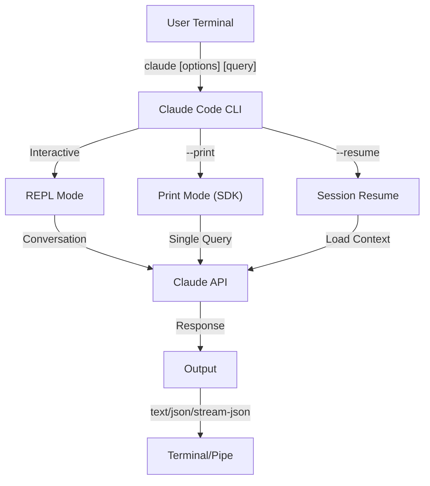
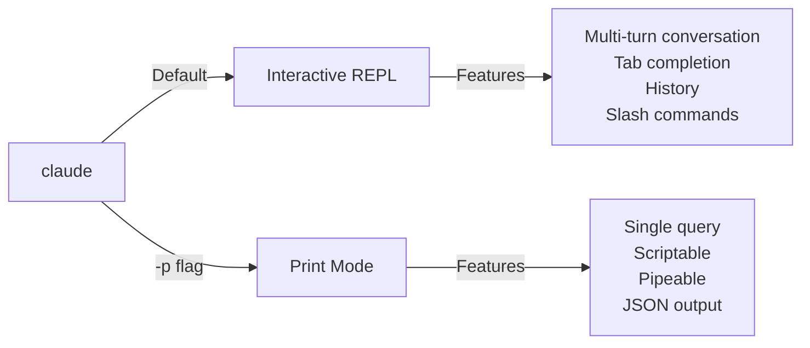

<picture>
  <source media="(prefers-color-scheme: dark)" srcset="../../resources/logos/claude-howto-logo-dark.svg">
  
</picture>

# مرجع CLI

## مرور کلی

رابط خط فرمان Claude Code (CLI) راه اصلی تعامل با Claude Code است. گزینه‌های قدرتمندی برای اجرای پرس‌وجوها، مدیریت نشست‌ها، پیکربندی مدل‌ها و یکپارچه‌سازی Claude در جریان‌های کاری توسعه شما فراهم می‌کند.

## معماری



## زمان اجرا و بسته‌بندی

از **نسخه 2.1.113**، CLI در Claude Code یک **باینری بومی مخصوص هر پلتفرم** (macOS، Linux، Windows) را از طریق وابستگی‌های اختیاری npm اجرا می‌کند. باینری هنگام نصب با سیستم‌عامل و معماری شما تطبیق داده می‌شود — زمان اجرای قدیمی جاوااسکریپت بسته‌بندی‌شده دیگر در macOS یا Linux پیش‌فرض نیست.

**نصب توصیه‌شده** نصب‌کننده بومی است (`curl -fsSL https://claude.ai/install.sh | bash`؛ در Windows `irm https://claude.ai/install.ps1 | iex`). نصب با npm در README رسمی منسوخ شده است؛ نصب‌کننده بومی، Homebrew (`brew install --cask claude-code`) یا WinGet (`winget install Anthropic.ClaudeCode`) را ترجیح دهید. برای مرجع، `npm install -g @anthropic-ai/claude-code` (Node.js 22 به بعد) همان باینری بومی را از طریق یک وابستگی اختیاری مخصوص هر پلتفرم نصب می‌کند.

**میزبان دانلود** (نسخه 2.1.116 به بعد): آرتیفکت‌های باینری بومی از `https://downloads.claude.ai/claude-code-releases` سرو می‌شوند.

> **کاربران سازمانی / پروکسی**: اگر شبکه شما نیازمند فهرست مجاز صریح است، `downloads.claude.ai` (و `https://downloads.claude.ai/claude-code-releases`) را به قواعد خروج پروکسی خود اضافه کنید. محیط‌هایی که پیش‌تر فقط `storage.googleapis.com` یا رجیستری npm را مجاز کرده بودند باید به‌روزرسانی شوند، در غیر این صورت `claude update` و نصب اولیه شکست می‌خورد.

بسته جاوااسکریپت قدیمی‌تر هنوز برای Windows و برای محیط‌هایی که به آن پین کرده‌اند تولید می‌شود؛ آن نصب‌ها همچنان Glob و Grep را به‌عنوان ابزارهای درجه یک ارائه می‌دهند (به پانوشت Glob/Grep زیر [ابزارها](#مدیریت-ابزار-و-مجوز) مراجعه کنید).

## دستورات CLI

| دستور | توضیح | مثال |
|---------|-------------|---------|
| `claude` | شروع REPL تعاملی | `claude` |
| `claude "query"` | شروع REPL با پرامپت اولیه | `claude "explain this project"` |
| `claude -p "query"` | حالت چاپ - پرس‌وجو سپس خروج | `claude -p "explain this function"` |
| `cat file \| claude -p "query"` | پردازش محتوای pipe‌شده | `cat logs.txt \| claude -p "explain"` |
| `claude -c` | ادامه آخرین گفتگو | `claude -c` |
| `claude -c -p "query"` | ادامه در حالت چاپ | `claude -c -p "check for type errors"` |
| `claude -r "<session>" "query"` | از سرگیری نشست با شناسه یا نام | `claude -r "auth-refactor" "finish this PR"` |
| `claude update` | به‌روزرسانی به آخرین نسخه | `claude update` |
| `/doctor` (دستور اسلش) | تشخیص سلامت نصب، پیکربندی و پلاگین. از نسخه 2.1.116 می‌تواند **در حین پاسخ‌دهی Claude** باز شود، آیکون‌های وضعیت را درون‌خطی نشان می‌دهد، و کلید `f` را برای رفع خودکار مشکلات شناسایی‌شده می‌پذیرد. نسخه 2.1.178 چیدمان را به یک درخت تخت با آیکون‌های وضعیت واضح‌تر و دستورات برجسته‌شده بازطراحی کرد | `/doctor` را درون REPL اجرا کنید |
| `claude mcp` | پیکربندی سرورهای MCP (شامل `login`/`logout` برای احراز هویت، نسخه 2.1.186 به بعد) | به [مستندات MCP](../05-mcp/) مراجعه کنید |
| `claude mcp serve` | اجرای Claude Code به‌عنوان یک سرور MCP | `claude mcp serve` |
| `claude agents` | باز کردن **Agent View** (پیش‌نمایش پژوهشی، نسخه 2.1.139 به بعد) — مدیر چند‌نشستی که همه نشست‌های Claude Code را با وضعیتشان فهرست می‌کند. به [Agent View](#agent-view-claude-agents-نسخه-21139-به-بعد) در پایین مراجعه کنید. | `claude agents` |
| `claude auto-mode defaults` | چاپ قواعد پیش‌فرض حالت auto به‌صورت JSON | `claude auto-mode defaults` |
| `claude auto-mode reset` | بازگرداندن پیکربندی پیش‌فرض حالت auto، با یک پرامپت تأیید (`--yes` برای رد کردن) (نسخه 2.1.212) | `claude auto-mode reset --yes` |
| `claude remote-control` | شروع یک سرور کنترل از راه دور (حالت سرور، بدون نشست تعاملی محلی؛ چند نشست را سرو می‌کند، پیش‌فرض `--capacity` ۳۲) | `claude remote-control --name "My Project"` |
| `claude --remote-control [name]` | شروع یک نشست تعاملی با کنترل از راه دور فعال (مستعار `--rc`) | `claude --rc` |
| `claude plugin` | مدیریت پلاگین‌ها (نصب، فعال‌سازی، غیرفعال‌سازی) | `claude plugin install my-plugin` |
| `claude plugin init <name>` | ایجاد اسکلت یک پلاگین جدید در `~/.claude/skills/<name>/` (سراسری کاربر) — در نشست بعدی به‌عنوان `<name>@skills-dir` به‌طور خودکار بارگذاری می‌شود، بدون نیاز به بازار (نسخه 2.1.157 به بعد) | `claude plugin init my-plugin` |
| `claude plugin tag [path]` | ایجاد یک تگ انتشار گیت `{name}--v{version}` برای پلاگین در `[path]`، با اعتبارسنجی هم‌خوانی `plugin.json` و هر ورودی بازار دربرگیرنده (نسخه 2.1.118 به بعد) | `claude plugin tag ./my-plugin` |
| `claude install [version]` | نصب یک نسخه مشخص از باینری بومی. `stable`، `latest` یا یک رشته نسخه صریح را می‌پذیرد | `claude install 2.1.131` |
| `claude purge [path]` | حذف همه وضعیت محلی Claude Code برای یک پروژه (رونوشت‌ها، وظایف، لاگ‌های اشکال‌زدایی، تاریخچه ویرایش فایل، تاریخچه پرامپت و ورودی `~/.claude.json`). برای انتخاب‌گر تعاملی `[path]` را حذف کنید. پرچم‌ها: `--dry-run` برای پیش‌نمایش، `-y/--yes` برای رد کردن تأیید، `-i/--interactive` برای تأیید هر مورد، `--all` برای همه پروژه‌ها (نسخه 2.1.126 به بعد) — در نسخه 2.1.288 از `claude project purge` تغییر نام یافت؛ نام قبلی هنوز کار می‌کند و یک اعلان چاپ می‌کند | `claude purge ~/work/repo --dry-run` |
| `claude plugin prune` | حذف وابستگی‌های پلاگین یتیم که به‌طور خودکار نصب شده‌اند (پلاگین والد رفته است). `plugin uninstall --prune` همان آبشار را پس از حذف یک هدف انجام می‌دهد (نسخه 2.1.121 به بعد) | `claude plugin prune` |
| `claude ultrareview [target]` | اجرای غیرتعاملی `/ultrareview`. یافته‌ها را در stdout چاپ می‌کند، در موفقیت ۰ و در شکست ۱، و اگر با Ctrl-C قطع شود ۱۳۰ خارج می‌شود. از `--json` برای بار خام، `--timeout <minutes>` برای بازنویسی پیش‌فرض ۴۵ دقیقه (از نسخه 2.1.260)، و `--post` / `--no-post` برای کنترل ارسال یافته‌ها به PR استفاده کنید. در پوشه‌ای که به آن اعتماد نکرده‌اید، روی ترمینال می‌پرسد و در غیر این صورت با ۱ خارج می‌شود؛ در اسکریپت‌ها و CI، `--trust-workspace` را بعد از هدف بیاویید (نسخه 2.1.309+). **نیازمند Claude Code نسخه 2.1.227 یا جدیدتر** | `claude ultrareview 1234 --json --no-post` |
| `claude self-hosted-runner [setup\|doctor\|orchestrator]` | شروع یک runner که نشست‌های ابری Claude Code را روی ماشین یا کانتینر خودتان میزبانی می‌کند. `setup` یک راهنمای گام‌به‌گام اپراتور است، `doctor` یک runner مستقر را تشخیص می‌دهد، `orchestrator` runnerهای درخواستی ایجاد می‌کند (`--shutdown-drain-sec` آن، نسخه 2.1.299، اجازه می‌دهد نظرسنجی و هوک‌های ایجاد در جریان، هنگام SIGTERM تمام شوند). **طرح‌های Team و Enterprise؛ نیازمند Claude Code نسخه 2.1.224 یا جدیدتر.** در Windows، راه‌اندازی نیازمند `--base-dir` صریح است (نسخه 2.1.229). از نسخه 2.1.307 هوک‌های checkout پس از ۳۰ دقیقه به‌طور پیش‌فرض متوقف می‌شوند، که باعث شکست راه‌اندازی نشست می‌شود؛ `--checkout-hook-timeout-min` را باال ببرید یا روی `0` بگذارید | `claude self-hosted-runner setup` |
| `claude auth login` | ورود (از `--email`، `--sso` پشتیبانی می‌کند). از نسخه 2.1.126، کد OAuth چسبانده‌شده در ترمینال را به‌عنوان جایگزین می‌پذیرد وقتی بازگشت مرورگر نمی‌تواند به localhost برسد (WSL2، SSH، کانتینرها) | `claude auth login --email user@example.com` |
| `claude auth logout` | خروج از حساب فعلی | `claude auth logout` |
| `claude auth status` | بررسی وضعیت احراز هویت (در صورت ورود ۰، در غیر این صورت ۱) | `claude auth status` |

## پرچم‌های اصلی

| پرچم | توضیح | مثال |
|------|-------------|---------|
| `-p, --print` | چاپ پاسخ بدون حالت تعاملی | `claude -p "query"` |
| `-c, --continue` | بارگذاری آخرین گفتگو | `claude --continue` |
| `-r, --resume` | از سرگیری نشست مشخص با شناسه یا نام | `claude --resume auth-refactor` |
| `-v, --version` | چاپ شماره نسخه | `claude -v` |
| `--system-prompt-snapshot off` | رندر تازه پرامپت سیستم در هر درخواست به‌جای استفاده مجدد از پرامپت ثبت‌شده با گفتگو. مفید هنگام تکرار روی متن پرامپت (نسخه 2.1.257 به بعد) | `claude --system-prompt-snapshot off` |
| `-w, --worktree` | شروع در worktree گیت ایزوله. از نسخه 2.1.233 یک URL merge request گیت‌لب و همچنین URL PR گیت‌هاب را می‌پذیرد | `claude -w` |
| `-n, --name` | نام نمایشی نشست | `claude -n "auth-refactor"` |
| `--from-pr <url-or-number>` | از سرگیری نشست‌های مرتبط با یک pull/merge request. از نسخه 2.1.119 URLهای GitHub (ابری + Enterprise)، MR گیت‌لب و PR Bitbucket را می‌پذیرد؛ پیش‌تر فقط GitHub.com | `claude --from-pr 42` یا `claude --from-pr https://gitlab.example.com/org/repo/-/merge_requests/17` |
| `--cloud [description\|session_id\|url]` | ایجاد یک نشست ابری در claude.ai با توضیح داده‌شده، یا اتصال به یک نشست موجود با شناسه نشست یا URL claude.ai/code | `claude --cloud "implement API"` |
| `--remote "task"` | **مستعار منسوخ برای `--cloud`**، شامل شکل نشست موجود. به‌جای آن از `--cloud` استفاده کنید | `claude --remote "implement API"` |
| `--remote-control, --rc` | نشست تعاملی با کنترل از راه دور | `claude --rc` |
| `--teleport [session]` | از سرگیری یک نشست وب به‌صورت محلی. شکل بدون آرگومان یک انتخاب‌گر از نشست‌های وب شما باز می‌کند؛ برای از سرگیری مستقیم آن نشست، شناسه نشست بدهید. نیازمند اشتراک claude.ai است | `claude --teleport` |
| `--teammate-mode` | حالت نمایش تیم ایجنت | `claude --teammate-mode tmux` |
| `--bare` | حالت کمینه (رد کردن هوک‌ها، مهارت‌ها، پلاگین‌ها، MCP، حافظه خودکار، CLAUDE.md) | `claude --bare` |
| `--safe-mode` | شروع با همه سفارشی‌سازی‌ها غیرفعال (CLAUDE.md، پلاگین‌ها، مهارت‌ها، هوک‌ها، MCP) برای جداسازی مشکلات پیکربندی؛ همچنین `CLAUDE_CODE_SAFE_MODE=1` (نسخه 2.1.169) | `claude --safe-mode` |
| `--restricted` | قفل کردن نشست برای استفاده غیرقابل اعتماد یا اشتراکی: ابزارهای داخلی اجرای دستور و کد و WebFetch را حذف می‌کند، تنظیمات کاربر/پروژه/محلی را نادیده می‌گیرد، ابزارهای فایل را به دایرکتوری‌های کاری محدود می‌کند، و `bypassPermissions` و نشست‌های ابری را رد می‌کند. همچنین `CLAUDE_CODE_RESTRICTED=1` (نسخه 2.1.248 به بعد) | `claude --restricted -p "summarize this repo"` |
| `--permission-mode auto` | شروع در حالت مجوز auto (جایگزین پرچم حذف‌شده `--enable-auto-mode` که از نسخه 2.1.111 رفته است) | `claude --permission-mode auto` |
| `--channels` | اشتراک در پلاگین‌های کانال MCP. ورودی‌ها باید با تگ `plugin:<name>@<marketplace>` باشند؛ نام‌های بدون تگ رد می‌شوند | `claude --channels plugin:discord@my-marketplace` |
| `--chrome` / `--no-chrome` | فعال/غیرفعال کردن یکپارچه‌سازی مرورگر Chrome | `claude --chrome` |
| `--effort` | تعیین سطح تلاش تفکر | `claude --effort high` |
| `--desktop` | باز کردن نشست در اپلیکیشن دسکتاپ Claude روی دایرکتوری جاری؛ `--continue` یا `--resume <id>` را برای انتخاب نشست اضافه کنید (نسخه 2.1.285) | `claude --desktop --continue` |
| `--init` / `--init-only` | `--init` هوک‌های مقداردهی اولیه (Setup) را پیش از نشست اجرا می‌کند، فقط در حالت چاپ؛ `--init-only` هوک‌های Setup و `SessionStart` را اجرا می‌کند و سپس خارج می‌شود | `claude -p --init "query"` |
| `--maintenance` | اجرای هوک‌های نگهداری (Setup) پیش از نشست (فقط حالت چاپ) | `claude -p --maintenance "query"` |
| `--disable-slash-commands` | غیرفعال کردن همه مهارت‌ها و دستورات اسلش | `claude --disable-slash-commands` |
| `--no-session-persistence` | غیرفعال کردن ذخیره نشست (حالت چاپ) | `claude -p --no-session-persistence "query"` |
| `--exclude-dynamic-system-prompt-sections` | حذف بخش‌های پویا از پرامپت سیستم برای نرخ بالاتر برخورد cache پرامپت | `claude -p --exclude-dynamic-system-prompt-sections "query"` |

### حالت محدود (`--restricted`، نسخه 2.1.248 به بعد)

`--restricted` (یا `CLAUDE_CODE_RESTRICTED=1`) برای اجرای `claude` از طرف کسی است که ورودی‌اش را کنترل نمی‌کنید — یک هارنس ارزیابی روی ماشین مشترک، یک کار CI که یک مشارکت‌کننده خارجی راه انداخته، یک ماشین نمایش. همه موارد زیر را اعمال می‌کند:

- **ابزارهایی را که دستور یا کد اجرا می‌کنند حذف می‌کند** — Bash، PowerShell و REPL — به‌علاوه WebFetch، مگر اینکه `--tools` صریحاً آن‌ها را نام ببرد.
- **فایل‌های تنظیمات کاربر، پروژه و محلی را نادیده می‌گیرد.** تنظیمات مدیریت‌شده و یک فایل `--settings` صریح هنوز اعمال می‌شوند، بنابراین یک مدیر کنترل خود را حفظ می‌کند در حالی که یک `.claude/settings.json` کامیت‌شده نمی‌تواند سندباکس را گسترش دهد.
- **ابزارهای فایل را به دایرکتوری‌های کاری محدود می‌کند**، بنابراین خواندن و نوشتن نمی‌تواند از مسیرهایی که در آن شروع کرده‌اید خارج شود.
- **`bypassPermissions` را رد می‌کند**، از هر راهی که درخواست شود.
- **از ایجاد نشست‌های ابری امتناع می‌کند**، بنابراین یک اجرای محدود نمی‌تواند کار را از ماشین بیرون بفرستد.

```bash
# محیط ارزیابی: بدون شل، بدون واکشی شبکه، بدون ارث‌بری تنظیمات
claude --restricted -p "summarize the architecture of this repo"

# همان قفل‌شدگی، اما با فعال‌سازی عمدی یک ابزار
claude --restricted --tools WebFetch -p "check the linked RFC"
```

> **توجه**: `--restricted` قفلی درشت‌تر از `--permission-mode` است. ابزارها را یکسره حذف می‌کند به‌جای اینکه برایشان سؤال بپرسد، بنابراین یک نشست محدود نمی‌تواند از درون خودش گسترش یابد.

### حالت تعاملی در برابر حالت چاپ



**حالت تعاملی** (پیش‌فرض):
```bash
# شروع نشست تعاملی
claude

# شروع با پرامپت اولیه
claude "explain the authentication flow"
```

**حالت چاپ** (غیرتعاملی):
```bash
# یک پرس‌وجوی واحد، سپس خروج
claude -p "what does this function do?"

# پردازش محتوای فایل
cat error.log | claude -p "explain this error"

# زنجیره‌سازی با ابزارهای دیگر
claude -p "list todos" | grep "URGENT"
```

## مدل و پیکربندی

| پرچم | توضیح | مثال |
|------|-------------|---------|
| `--model` | تعیین مدل (sonnet، opus، haiku یا نام کامل) | `claude --model opus` |
| `--fallback-model` | جایگزینی خودکار مدل وقتی مدل اصلی بیش‌بار یا در دسترس نباشد؛ تا سه مدل را از طریق تنظیم `fallbackModel` پیکربندی کنید. از نسخه 2.1.166 روی نشست‌های تعاملی هم اعمال می‌شود (پیش‌تر فقط حالت چاپ) | `claude -p --fallback-model sonnet "query"` |
| `--agent` | تعیین ایجنت برای نشست | `claude --agent my-custom-agent` |
| `--agents` | تعریف زیرایجنت‌های سفارشی از طریق JSON | به [پیکربندی ایجنت‌ها](#پیکربندی-ایجنت‌ها) مراجعه کنید |
| `--effort` | تعیین سطح تلاش (low، medium، high، xhigh، max) | `claude --effort xhigh` |

### مثال‌های انتخاب مدل

```bash
# استفاده از Opus 5.5 برای کارهای پیچیده
claude --model opus "design a caching strategy"

# استفاده از Haiku برای کارهای سریع (Haiku 5.5 روی Anthropic API از v2.1.293؛ Haiku 4.5 روی Bedrock، Vertex و Foundry)
claude --model haiku -p "format this JSON"

# نام کامل مدل
claude --model claude-sonnet-4-6 "review this code"

# با مدل جایگزین برای اطمینان بیشتر
claude -p --model opus --fallback-model sonnet "analyze architecture"

# استفاده از opusplan (Opus برنامه‌ریزی می‌کند، Sonnet اجرا می‌کند)
claude --model opusplan "design and implement the caching layer"
```

> **کشف مدل درگاه (نسخه 2.1.129 به بعد، اختیاری)**: وقتی `ANTHROPIC_BASE_URL` به یک درگاه سازگار با Anthropic اشاره می‌کند، `CLAUDE_CODE_ENABLE_GATEWAY_MODEL_DISCOVERY=1` را تعیین کنید تا `/model` از نقطه پایانی `/v1/models` درگاه پر شود. بدون این متغیر محیطی، `/model` به فهرست ایستای داخلی بازمی‌گردد. این پرچم اختیاری است (در نسخه 2.1.129 تغییر کرد) چون فراخوانی کشف می‌تواند مدل‌هایی را نشان دهد که کاربر ممکن است مجاز به استفاده از آن‌ها نباشد؛ نسخه 2.1.126 آن را ضمنی کرده بود و آن رفتار بازگردانده شد.

> **زمینه ۱ میلیونی پشت یک base URL سفارشی (نسخه 2.1.285)**: نشست‌هایی که `ANTHROPIC_BASE_URL` آن‌ها به یک نقطه پایانی سفارشی اشاره می‌کند، اکنون از پنجره زمینه ۱ میلیون توکنی مدل‌هایی که دارند استفاده می‌کنند (Opus 4.7 به بعد، Sonnet 5 به بعد، Fable). اگر درگاه شما روی ۲۰۰ هزار متوقف می‌شود، `/autocompact 200k` را اجرا کنید.

> **زمینه ۱ میلیونی به‌طور پیش‌فرض در ارائه‌دهندگان شخص ثالث (نسخه 2.1.287)**: Opus 4.7 به بعد و Fable اکنون به‌طور پیش‌فرض از پنجره زمینه ۱ میلیون توکنی در Amazon Bedrock، Google Vertex AI، Microsoft Foundry و درگاه اپلیکیشن‌های Claude استفاده می‌کنند، بدون پسوند `[1m]`. برای نگه‌داشتن آن‌ها روی ۲۰۰ هزار، `CLAUDE_CODE_DISABLE_1M_CONTEXT=1` را تعیین کنید.

> **مدل پیش‌فرض سازمان (نسخه 2.1.196)**: وقتی یک ادمین سازمان مدل پیش‌فرض تعیین می‌کند، `/model` آن را «Org default» (یا «Role default») برچسب می‌زند.

## سفارشی‌سازی پرامپت سیستم

| پرچم | توضیح | مثال |
|------|-------------|---------|
| `--system-prompt` | جایگزینی کل پرامپت پیش‌فرض | `claude --system-prompt "You are a Python expert"` |
| `--system-prompt-file` | بارگذاری پرامپت از فایل، جایگزین پرامپت پیش‌فرض | `claude -p --system-prompt-file ./prompt.txt "query"` |
| `--append-system-prompt` | افزودن به پرامپت پیش‌فرض | `claude --append-system-prompt "Always use TypeScript"` |
| `--append-subagent-system-prompt` | افزودن متن به پرامپت سیستم هر زیرایجنت (غیرتعاملی) | `claude -p --append-subagent-system-prompt "Cite sources" "query"` |
| `--append-subagent-system-prompt-file` | (نسخه 2.1.261) به‌جای آن، آن متن افزوده‌شده را از یک فایل بارگذاری می‌کند، برای پرامپت‌هایی که برای خط فرمان بیش از حد طولانی‌اند. فقط غیرتعاملی، و **نمی‌توان** با `--append-subagent-system-prompt` ترکیب کرد | `claude -p --append-subagent-system-prompt-file ./subagent-rules.txt "query"` |

### مثال‌های پرامپت سیستم

```bash
# شخصیت سفارشی کامل
claude --system-prompt "You are a senior security engineer. Focus on vulnerabilities."

# افزودن دستورهای مشخص
claude --append-system-prompt "Always include unit tests with code examples"

# بارگذاری پرامپت پیچیده از فایل
claude -p --system-prompt-file ./prompts/code-reviewer.txt "review main.py"
```

### مقایسه پرچم‌های پرامپت سیستم

| پرچم | رفتار | تعاملی | چاپ |
|------|----------|-------------|-------|
| `--system-prompt` | کل پرامپت سیستم پیش‌فرض را جایگزین می‌کند | ✅ | ✅ |
| `--system-prompt-file` | با پرامپت از فایل جایگزین می‌کند | ✅ | ✅ |
| `--append-system-prompt` | به پرامپت سیستم پیش‌فرض می‌افزاید | ✅ | ✅ |

**همه پرچم‌های پرامپت سیستم در هر دو حالت تعاملی و چاپ کار می‌کنند (شکل‌های فایلی از نسخه 2.1.69). `--system-prompt` و `--system-prompt-file` پرامپت پیش‌فرض را جایگزین می‌کنند؛ پرچم‌های append به آن می‌افزایند.**

## مدیریت ابزار و مجوز

| پرچم | توضیح | مثال |
|------|-------------|---------|
| `--tools` | محدود کردن ابزارهای داخلی موجود | `claude -p --tools "Bash,Edit,Read" "query"` |
| `--allowedTools` | ابزارهایی که بدون پرسش اجرا می‌شوند | `"Bash(git log:*)" "Read"` |
| `--disallowedTools` | ابزارهای حذف‌شده از زمینه | `"Bash(rm:*)" "Edit"` |
| `--dangerously-skip-permissions` | رد کردن همه پرامپت‌های مجوز | `claude --dangerously-skip-permissions` |
| `--permission-mode` | شروع در حالت مجوز مشخص‌شده | `claude --permission-mode auto` |
| `--permission-prompt-tool` | ابزار MCPی که در حالت چاپ به پرامپت‌های مجوز پاسخ می‌دهد؛ نام کامل `mcp__<server>__<tool>` آن را بدهید، از سروری که اجرا آن را بارگذاری می‌کند | `claude -p --mcp-config ./mcp.json --permission-prompt-tool mcp__permissions__approve "query"` |
| `--permission-prompts` | (نسخه 2.1.259) چه کسی در حالت چاپ به پرامپت‌های مجوز پاسخ می‌دهد. پیش‌فرض `host` آن‌ها را به میزبان Agent SDK یا ابزار `--permission-prompt-tool` می‌فرستد؛ وقتی هیچ‌کس نمی‌تواند پاسخ دهد `none` بدهید تا Claude Code خودش آن‌ها را رد کند | `claude -p --permission-prompts none "query"` |

> **به‌روزرسانی نسخه 2.1.111**: `--enable-auto-mode` حذف شد؛ حالت auto اکنون به‌طور پیش‌فرض در چرخه `Shift+Tab` است — برای شروع مستقیم در آن از `--permission-mode auto` استفاده کنید.

> **پانوشت Glob / Grep (نسخه 2.1.113 به بعد)**: در بیلدهای بومی macOS/Linux، `Glob` و `Grep` به‌عنوان باینری‌های جاسازی‌شده `bfs` و `ugrep` که از طریق ابزار Bash فراخوانی می‌شوند ارائه می‌شوند، نه به‌عنوان ابزارهای مستقل درجه یک. نصب‌های Windows و بسته npm (JS) آن‌ها را هنوز به‌عنوان ابزارهای مستقل نشان می‌دهند. برای فهرست‌های `allowedTools` / `disallowedTools` زیرایجنت، جایگزینی بک‌اند شفاف است — می‌توانید در پیکربندی خود در هر پلتفرمی به `Glob` / `Grep` ارجاع دهید.

> **تأیید خودکار PowerShell (نسخه 2.1.119)**: دستورات ابزار PowerShell می‌توانند در حالت مجوز دقیقاً مانند دستورات Bash به‌طور خودکار تأیید شوند. از همان نحو matcher که برای قواعد `Bash(...)` استفاده می‌کنید برای محدودکردن مجوزهای PowerShell استفاده کنید — مثلاً `PowerShell(Get-ChildItem:*)`.

> **اعمال `--permission-mode` هنگام از سرگیری (نسخه 2.1.132 به بعد)**: `claude -p --continue --permission-mode plan` (و `--resume`) اکنون به پرچم احترام می‌گذارد. نسخه‌های قبلی هنگام از سرگیری یک نشست، `--permission-mode` را بی‌صدا حذف می‌کردند، بنابراین یک نشست حالت plan که بدون ارسال دوباره پرچم از سر گرفته می‌شد بی‌صدا تنزل می‌یافت — این رفع شده است.

> **سخت‌سازی مجوز (نسخه 2.1.214)**: دستورات Docker/Podman که از پرچم‌های تغییر مسیر دیمون استفاده می‌کنند (مثلاً `--url`، `--connection`، `--identity`) اکنون به‌جای اجرای خودکار نیازمند پرامپت مجوز هستند. دستورات `file` که از `-m`/`--magic-file` یا `-f`/`--files-from` استفاده می‌کنند هم اکنون نیازمند مجوز هستند. دستورات Bash بیش از ۱۰,۰۰۰ کاراکتر همیشه پرامپت مجوز می‌دهند، بدون توجه به قواعد allow.

### مثال‌های مجوز

```bash
# حالت فقط‌خواندنی برای بازبینی کد
claude --permission-mode plan "review this codebase"

# محدود کردن به ابزارهای ایمن
claude --tools "Read,Grep,Glob" -p "find all TODO comments"

# اجازه دادن به دستورهای مشخص git بدون پرسش
claude --allowedTools "Bash(git status:*)" "Bash(git log:*)"

# مسدود کردن عملیات خطرناک
claude --disallowedTools "Bash(rm -rf:*)" "Bash(git push --force:*)"
```

> **تطبیق پارامتر `Tool(param:value)` (نسخه 2.1.178)**: قواعد مجوز از قالب `Tool` (هر استفاده) یا `Tool(specifier)` پیروی می‌کنند. از نسخه 2.1.178، یک specifier می‌تواند با **پارامترهای** ورودی یک ابزار مطابقت کند، نه فقط الگوهای دستور یا مسیر — با استفاده از شکل `Tool(param:value)` با پشتیبانی از نویسه عام. این تطبیقی را که پیش‌تر برای پیشوندهای دستور `Bash(...)` (مثلاً `Bash(npm run test *)`) و globهای مسیر `Read(...)` (مثلاً `Read(./.env.*)`) استفاده می‌کردید تعمیم می‌دهد تا ابزارهای دیگر هم بتوانند بر اساس آرگومان‌هایشان محدود شوند. پیش از نوشتن یک قاعده، [مرجع مجوزها](https://code.claude.com/docs/en/settings) را برای رشته‌های نمونه فعلی هر ابزار بررسی کنید، چون نام دقیق پارامترها بین ابزارها متفاوت است.

## خروجی و قالب

| پرچم | توضیح | گزینه‌ها | مثال |
|------|-------------|---------|---------|
| `--output-format` | تعیین قالب خروجی (حالت چاپ) | `text`، `json`، `stream-json` | `claude -p --output-format json "query"` |
| `--input-format` | تعیین قالب ورودی (حالت چاپ) | `text`، `stream-json` | `claude -p --input-format stream-json` |
| `--verbose` | فعال‌سازی گزارش‌گیری پرگو | | `claude --verbose` |
| `--include-partial-messages` | گنجاندن رویدادهای استریم | نیازمند `stream-json` | `claude -p --output-format stream-json --include-partial-messages "query"` |
| `--forward-subagent-text` | ارسال خروجی متنی زیرایجنت به استریم. از نسخه 2.1.219، زیرایجنت‌هایی که در عمق ۲ یا بیشتر ایجاد می‌شوند هم ارسال می‌شوند، کلیدگذاری‌شده با شناسه `tool_use` ابزار `Agent` ایجادکننده‌شان (این همان روشی است که تودرتویی فعال‌شده به‌طور پیش‌فرض از طریق `CLAUDE_CODE_MAX_SUBAGENT_SPAWN_DEPTH` را مشاهده می‌کنید) | نیازمند `stream-json` | `claude -p --output-format stream-json --forward-subagent-text "query"` |
| `--json-schema` | دریافت JSON اعتبارسنجی‌شده مطابق شمای داده‌شده | | `claude -p --json-schema '{"type":"object"}' "query"` |
| `--max-budget-usd` | حداکثر هزینه برای حالت چاپ. از نسخه 2.1.217، رسیدن به سقف اجرای زیرایجنت‌های پس‌زمینه در حال اجرا را هم متوقف می‌کند و ایجادهای جدید را رد می‌کند (پیش‌تر ایجنت‌های پس‌زمینه پس از سقف هم ادامه می‌دادند) | | `claude -p --max-budget-usd 5.00 "query"` |

### مثال‌های قالب خروجی

```bash
# متن ساده (پیش‌فرض)
claude -p "explain this code"

# JSON برای استفاده برنامه‌نویسی
claude -p --output-format json "list all functions in main.py"

# JSON جریانی برای پردازش بی‌درنگ
claude -p --output-format stream-json "generate a long report"

# خروجی ساخت‌یافته با اعتبارسنجی طرح‌واره
claude -p --json-schema '{"type":"object","properties":{"bugs":{"type":"array"}}}' \
  "find bugs in this code and return as JSON"
```

## فضای کاری و دایرکتوری

| پرچم | توضیح | مثال |
|------|-------------|---------|
| `--add-dir` | افزودن دایرکتوری‌های کاری اضافی | `claude --add-dir ../apps ../lib` |
| `--setting-sources` | منابع تنظیمات جداشده با ویرگول | `claude --setting-sources user,project` |

> **ماندگاری `/config` (نسخه 2.1.119)**: تغییراتی که به‌صورت تعاملی از طریق دستور `/config` اعمال می‌شوند اکنون در `~/.claude/settings.json` نوشته می‌شوند و در زنجیره اولویت عادی شرکت می‌کنند (خط‌مشی → محلی → پروژه → کاربر). پیش از نسخه 2.1.119، برخی تغییرات `/config` فقط محدود به نشست بودند. برای ترتیب کامل اولویت به [حافظه و تنظیمات](../02-memory/README.md) مراجعه کنید.
| `--settings` | بارگذاری تنظیمات از فایل یا JSON. فایل نباید بزرگ‌تر از ۲ مگابایت باشد (نسخه 2.1.214) | `claude --settings ./settings.json` |
| `--plugin-dir` | بارگذاری پلاگین‌ها از دایرکتوری (قابل تکرار). از نسخه 2.1.265 یک **پوشه از پلاگین‌ها** را هم می‌پذیرد — هر پوشه فرزندی که مانیفست دارد بارگذاری می‌شود، و فرزندانی که در حین اجرای نشست افزوده یا حذف می‌شوند برداشته می‌شوند | `claude --plugin-dir ./my-plugin` |

### مثال چند‌دایرکتوری

```bash
# کار روی چند پوشه پروژه
claude --add-dir ../frontend ../backend ../shared "find all API endpoints"

# بارگذاری تنظیمات سفارشی
claude --settings '{"model":"opus","verbose":true}' "complex task"
```

## پیکربندی MCP

| پرچم | توضیح | مثال |
|------|-------------|---------|
| `--mcp-config` | بارگذاری سرورهای MCP از JSON | `claude --mcp-config ./mcp.json` |
| `--strict-mcp-config` | فقط استفاده از پیکربندی MCP مشخص‌شده | `claude --strict-mcp-config --mcp-config ./mcp.json` |
| `--channels` | اشتراک در پلاگین‌های کانال MCP. ورودی‌ها باید با تگ `plugin:<name>@<marketplace>` باشند؛ نام‌های بدون تگ رد می‌شوند | `claude --channels plugin:discord@my-marketplace` |

### مثال‌های MCP

```bash
# بارگذاری سرور MCP گیت‌هاب
claude --mcp-config ./github-mcp.json "list open PRs"

# حالت سخت‌گیرانه — فقط سرورهای مشخص‌شده
claude --strict-mcp-config --mcp-config ./production-mcp.json "deploy to staging"
```

## مدیریت نشست

| پرچم | توضیح | مثال |
|------|-------------|---------|
| `--session-id` | استفاده از شناسه نشست مشخص (UUID) | `claude --session-id "550e8400-..."` |
| `--fork-session` | ایجاد نشست جدید هنگام از سرگیری | `claude --resume abc123 --fork-session` |

### مثال‌های نشست

```bash
# ادامه آخرین گفتگو
claude -c

# از سرگیری نشست نام‌دار
claude -r "feature-auth" "continue implementing login"

# انشعاب نشست برای آزمایش
claude --resume feature-auth --fork-session "try alternative approach"

# استفاده از شناسه نشست مشخص
claude --session-id "550e8400-e29b-41d4-a716-446655440000" "continue"
```

> **نسخه 2.1.299**: دستور از سرگیری که هنگام خروج چاپ می‌شود، نشست را با شناسه‌اش نام می‌برد.

### انشعاب نشست

ایجاد یک شاخه از نشست موجود برای آزمایش:

```bash
# انشعاب یک نشست برای امتحان رویکردی دیگر
claude --resume abc123 --fork-session "try alternative implementation"

# انشعاب با پیام سفارشی
claude -r "feature-auth" --fork-session "test with different architecture"
```

**موارد استفاده:**
- امتحان پیاده‌سازی‌های جایگزین بدون از دست دادن نشست اصلی
- آزمایش رویکردهای مختلف به‌صورت موازی
- ایجاد شاخه از کارهای موفق برای تغییرات
- تست تغییرات شکننده بدون تأثیر بر نشست اصلی

نشست اصلی بدون تغییر می‌ماند و انشعاب یک نشست مستقل جدید می‌شود.

### پاکسازی وضعیت پروژه (نسخه 2.1.126 به بعد)

`claude purge` همه وضعیت محلی Claude Code برای یک پروژه را حذف می‌کند — رونوشت‌ها، فهرست‌های وظایف، لاگ‌های اشکال‌زدایی، تاریخچه ویرایش فایل، خطوط تاریخچه پرامپت و ورودی `~/.claude.json` آن پروژه. پیش از نسخه 2.1.288 نام آن `claude project purge` بود؛ آن نام هنوز کار می‌کند و یک اعلان چاپ می‌کند. ابتدا از `--dry-run` برای پیش‌نمایش حذف استفاده کنید؛ `--all` همه پروژه‌های ماشین را می‌پیماید.

```bash
# پیش‌نمایش آنچه حذف می‌شود (ایمن)
claude purge ~/work/repo --dry-run

# حذف وضعیت یک پروژه مشخص، بدون پرسش
claude purge ~/work/repo --yes

# پیمایش تعاملی همه پروژه‌ها
claude purge --all --interactive
```

## ویژگی‌های پیشرفته

| پرچم | توضیح | مثال |
|------|-------------|---------|
| `--chrome` | فعال‌سازی یکپارچه‌سازی مرورگر Chrome | `claude --chrome` |
| `--no-chrome` | غیرفعال کردن یکپارچه‌سازی مرورگر Chrome | `claude --no-chrome` |
| `--ide` | اتصال خودکار به IDE در صورت وجود | `claude --ide` |
| `--max-turns` | محدود کردن نوبت‌های ایجنتی (غیرتعاملی) | `claude -p --max-turns 3 "query"` |
| `--debug` | فعال‌سازی حالت اشکال‌زدایی با فیلتر (فیلتر فقط در شکل `=` اعمال می‌شود) | `claude --debug=api,mcp` |
| `--enable-lsp-logging` | فعال‌سازی گزارش‌گیری پرگوی LSP | `claude --enable-lsp-logging` |
| `--betas` | هدرهای بتا برای درخواست‌های API | `claude --betas interleaved-thinking` |
| `--plugin-dir` | بارگذاری پلاگین‌ها از دایرکتوری (قابل تکرار). از نسخه 2.1.265 یک **پوشه از پلاگین‌ها** را هم می‌پذیرد — هر پوشه فرزندی که مانیفست دارد بارگذاری می‌شود، و فرزندانی که در حین اجرای نشست افزوده یا حذف می‌شوند برداشته می‌شوند | `claude --plugin-dir ./my-plugin` |
| `--effort` | تعیین سطح تلاش تفکر | `claude --effort high` |
| `--bare` | حالت کمینه (رد کردن هوک‌ها، مهارت‌ها، پلاگین‌ها، MCP، حافظه خودکار، CLAUDE.md) | `claude --bare` |
| `--channels` | اشتراک در پلاگین‌های کانال MCP (با تگ `plugin:<name>@<marketplace>`) | `claude --channels plugin:discord@my-marketplace` |
| `--tmux` | ایجاد نشست tmux برای worktree (نیازمند `--worktree`) | `claude --worktree feature-x --tmux` |
| `--fork-session` | ایجاد شناسه نشست جدید هنگام از سرگیری | `claude --resume abc --fork-session` |
| `--max-budget-usd` | حداکثر هزینه (حالت چاپ)؛ در صورت رسیدن، زیرایجنت‌های پس‌زمینه را هم متوقف می‌کند (نسخه 2.1.217) | `claude -p --max-budget-usd 5.00 "query"` |
| `--json-schema` | خروجی JSON اعتبارسنجی‌شده | `claude -p --json-schema '{"type":"object"}' "q"` |
| `--ax-screen-reader` | حالت رندر متن ساده برای صفحه‌خوان‌ها (نسخه 2.1.208) | `claude --ax-screen-reader` |

### نکات پلتفرم و تم (نسخه 2.1.112)

- **ابزار PowerShell در Windows**: یک ابزار PowerShell اختصاصی در Windows در حال عرضه است و از طریق متغیر محیطی قابل کنترل است.
- **تم Auto (match terminal)**: تم جدید «Auto (match terminal)» ظاهر روشن/تیره Claude Code را با ترمینال شما همگام می‌کند.
- **پرامپت‌های مجوز کم‌صداتر**: فراخوانی‌های فقط-خواندنی `Bash` و الگوهای `Glob` دیگر پرامپت مجوز ایجاد نمی‌کنند.

### مثال‌های پیشرفته

```bash
# محدود کردن اقدام‌های خودکار
claude -p --max-turns 5 "refactor this module"

# اشکال‌زدایی فراخوانی‌های API
claude --debug=api "test query"

# فعال‌سازی یکپارچه‌سازی با IDE
claude --ide "help me with this file"
```

## پیکربندی ایجنت‌ها

پرچم `--agents` یک شیء JSON می‌پذیرد که زیرایجنت‌های سفارشی را برای یک نشست تعریف می‌کند.

از **نسخه 2.1.243**، `--agents` دیگر JSON نامعتبر یا تعریف ایجنت نامعتبر را بی‌صدا نادیده نمی‌گیرد — با یک خطای روشن خارج می‌شود، مطابق رفتاری که `--mcp-config` از قبل داشت.

### قالب JSON ایجنت‌ها

```json
{
  "agent-name": {
    "description": "Required: when to invoke this agent",
    "prompt": "Required: system prompt for the agent",
    "tools": ["Optional", "array", "of", "tools"],
    "model": "optional: sonnet|opus|haiku"
  }
}
```

**فیلدهای الزامی:**
- `description` - توصیف به زبان طبیعی از اینکه چه زمانی از این ایجنت استفاده شود
- `prompt` - پرامپت سیستمی که نقش و رفتار ایجنت را تعریف می‌کند

**فیلدهای اختیاری:**
- `tools` - آرایه‌ای از ابزارهای موجود (در صورت حذف، همه را به ارث می‌برد)
  - قالب: `["Read", "Grep", "Glob", "Bash"]`
- `model` - مدل مورد استفاده: `sonnet`، `opus` یا `haiku`

### مثال کامل ایجنت‌ها

```json
{
  "code-reviewer": {
    "description": "Expert code reviewer. Use proactively after code changes.",
    "prompt": "You are a senior code reviewer. Focus on code quality, security, and best practices.",
    "tools": ["Read", "Grep", "Glob", "Bash"],
    "model": "sonnet"
  },
  "debugger": {
    "description": "Debugging specialist for errors and test failures.",
    "prompt": "You are an expert debugger. Analyze errors, identify root causes, and provide fixes.",
    "tools": ["Read", "Edit", "Bash", "Grep"],
    "model": "opus"
  },
  "documenter": {
    "description": "Documentation specialist for generating guides.",
    "prompt": "You are a technical writer. Create clear, comprehensive documentation.",
    "tools": ["Read", "Write"],
    "model": "haiku"
  }
}
```

### مثال‌های دستور Agents

```bash
# تعریف ایجنت‌های سفارشی به‌صورت درون‌خطی
claude --agents '{
  "security-auditor": {
    "description": "Security specialist for vulnerability analysis",
    "prompt": "You are a security expert. Find vulnerabilities and suggest fixes.",
    "tools": ["Read", "Grep", "Glob"],
    "model": "opus"
  }
}' "audit this codebase for security issues"

# بارگذاری ایجنت‌ها از فایل
claude --agents "$(cat ~/.claude/agents.json)" "review the auth module"

# ترکیب با سایر سوئیچ‌ها
claude -p --agents "$(cat agents.json)" --model sonnet "analyze performance"
```

### اولویت ایجنت

وقتی چندین تعریف ایجنت وجود دارد، با این ترتیب اولویت بارگذاری می‌شوند:
1. **تعریف‌شده در CLI** (پرچم `--agents`) - مخصوص نشست
2. **سطح پروژه** (`.claude/agents/`) - پروژه جاری
3. **سطح کاربر** (`~/.claude/agents/`) - همه پروژه‌ها

ایجنت‌های تعریف‌شده در CLI هم ایجنت‌های پروژه و هم کاربر را برای آن نشست بازنویسی می‌کنند. ایجنت‌های سطح پروژه وقتی نامشان تصادم دارد، ایجنت‌های سطح کاربر را بازنویسی می‌کنند. برای جدول کامل اولویت شامل ایجنت‌های سطح پلاگین به [درس ۰۴ — زیرایجنت‌ها](../04-subagents/README.md#مکان‌های-فایل) مراجعه کنید.

### Agent View (`claude agents`، نسخه 2.1.139 به بعد)

> **پیش‌نمایش پژوهشی** — این ویژگی به‌قدری پایدار است که برای استفاده روزمره مناسب باشد، اما ممکن است تغییر کند.

`claude agents` **Agent View** را باز می‌کند — یک فهرست واحد از همه نشست‌های Claude Code روی ماشین با وضعیت فعلی‌شان (`running`، `blocked on you`، `done`). این جایگزین دست‌وپنجه نرم کردن با چند تب ترمینال است وقتی ایجنت‌های پس‌زمینه، وظایف زمان‌بندی‌شده یا نشست‌های راه‌اندازی‌شده با `--bg` را اجرا می‌کنید.

```bash
# باز کردن نمای ایجنت
claude agents
```

وقتی از نمای فوق یک نشست ارسال می‌کنید (یا از طریق `claude --bg <prompt>`)، می‌توانید همان پرچم‌های پیکربندی را بدهید که به خود `claude` می‌دادید. پرچم‌هایی که برای مسیر ارسال Agent View معرفی شدند:

| پرچم | از نسخه | توضیح |
|------|-------|-------------|
| `--cwd <path>` | 2.1.141 | محدود کردن فهرست نشست‌ها (یا نشست جدید) به یک دایرکتوری کاری مشخص |
| `--add-dir <path>` | 2.1.142 | افزودن دایرکتوری‌ها به فضای کاری نشست ارسال‌شده |
| `--settings <path>` | 2.1.142 | استفاده از یک `settings.json` مشخص برای نشست ارسال‌شده |
| `--mcp-config <path>` | 2.1.142 | استفاده از یک پیکربندی MCP مشخص برای نشست ارسال‌شده |
| `--plugin-dir <path>` | 2.1.142 | استفاده از یک دایرکتوری پلاگین مشخص برای نشست ارسال‌شده |
| `--permission-mode <mode>` | 2.1.142 | تعیین حالت مجوز (`plan`، `acceptEdits`، `auto` و غیره) برای نشست ارسال‌شده |
| `--model <model>` | 2.1.142 | پین کردن یک مدل برای نشست ارسال‌شده |
| `--effort <level>` | 2.1.142 | پین کردن سطح تلاش (`low`/`medium`/`high`/`xhigh`/`max`) |
| `--dangerously-skip-permissions` | 2.1.142 | اجرای نشست ارسال‌شده بدون پرامپت مجوز (فقط در سندباکس‌ها استفاده کنید) |
| `--json` | 2.1.145 | چاپ فهرست ایجنت‌ها به‌صورت JSON قابل خواندن برای ماشین برای اسکریپت‌نویسی (نوارهای وضعیت، انتخاب‌گرهای نشست، ادغام با tmux-resurrect) |

نشست‌هایی که کارشان را تمام می‌کنند اما یک شل پس‌زمینه باز می‌گذارند از «Working» به «Completed» منتقل می‌شوند (اصلاح نسخه 2.1.141). درون یک نشست ایجنت متصل، `Shift+Tab` از حالت‌های مجوز شامل حالت auto می‌گذرد (نسخه 2.1.143).

**merge requestهای گیت‌لب (نسخه 2.1.233)** — Agent View URLهای MR گیت‌لب را در کنار URLهای PR گیت‌هاب می‌شناسد، و merge requestها را به‌صورت `!N` نمایش می‌دهد (pull requestهای گیت‌هاب همچنان `#N` می‌مانند). همان انتشار به `--worktree` یاد داد که URL MR گیت‌لب را بپذیرد.

**پین کردن یک نشست** — در `claude agents` روی یک نشست `Ctrl+T` بزنید تا پین شود (نسخه 2.1.147). نشست‌های پس‌زمینه پین‌شده وقتی بی‌کارند زنده می‌مانند، برای اعمال به‌روزرسانی‌های Claude Code در جای خودشان دوباره راه‌اندازی می‌شوند، و تحت فشار حافظه فقط پس از نشست‌های پین‌نشده تخلیه می‌شوند. (این `Ctrl+T` محدود به Agent View است؛ در نشست اصلی نمای فهرست وظایف را تغییر می‌دهد.)

**پیش‌فرض‌های نشست‌های جدید (نسخه 2.1.299)** — در agent view، `/effort` و `/fast` تعیین می‌کنند نشست‌های جدید با چه چیزی شروع شوند؛ `/model`، `/effort` یا `/fast` بدون آرگومان یک انتخاب‌گر باز می‌کند.

---

## موارد استفاده پرکاربرد

### ۱. یکپارچه‌سازی CI/CD

از Claude Code در خطوط لوله CI/CD خود برای بازبینی خودکار کد، تست و مستندسازی استفاده کنید.

**مثال GitHub Actions:**

```yaml
name: AI Code Review

on: [pull_request]

jobs:
  review:
    runs-on: ubuntu-latest
    steps:
      - uses: actions/checkout@v4

      - name: Install Claude Code
        run: npm install -g @anthropic-ai/claude-code

      - name: Run Code Review
        env:
          ANTHROPIC_API_KEY: ${{ secrets.ANTHROPIC_API_KEY }}
        run: |
          claude -p --output-format json \
            --max-turns 1 \
            "Review the changes in this PR for:
            - Security vulnerabilities
            - Performance issues
            - Code quality
            Output as JSON with 'issues' array" > review.json

      - name: Post Review Comment
        uses: actions/github-script@v7
        with:
          script: |
            const fs = require('fs');
            const review = JSON.parse(fs.readFileSync('review.json', 'utf8'));
            // پردازش و ارسال نظرهای بازبینی
```

**خط لوله Jenkins:**

```groovy
pipeline {
    agent any
    stages {
        stage('AI Review') {
            steps {
                sh '''
                    claude -p --output-format json \
                      --max-turns 3 \
                      "Analyze test coverage and suggest missing tests" \
                      > coverage-analysis.json
                '''
            }
        }
    }
}
```

**`ultrareview` بدون رابط (نیازمند نسخه 2.1.227 به بعد؛ `--trust-workspace` نیازمند نسخه 2.1.309+):**

```yaml
# .github/workflows/ultrareview.yml
# یک شاخه مورد اعتماد را checkout کنید، مثلاً actions/checkout با `ref: ${{ github.base_ref }}`؛
# ultrareview خودش pull request را در فضای ابری clone می‌کند.
- name: Claude ultrareview
  run: claude ultrareview ${{ github.event.pull_request.number }} --trust-workspace --json --no-post > review.json
```

`claude ultrareview` وقتی بازبینی کامل شود ۰ خارج می‌شود، با یا بدون یافته، وقتی راه‌اندازی نشود، خطا بدهد، مهلتش تمام شود یا پوشه قابل‌اعتماد نباشد ۱، و وقتی هنگام راه‌اندازی بازبینی، انتظار برای یافته‌ها یا ارسال نظر `--post` Ctrl-C بزنید ۱۳۰ — پس دروازه‌ی PR را بر یافته‌های داخل `review.json` بگذارید، نه بر کد خروج. در CI اجرا نمی‌تواند دربارهٔ اعتماد به checkout بپرسد، پس از نسخه 2.1.309 با `Error: Workspace not trusted` و کد ۱ خارج می‌شود مگر `--trust-workspace` را بعد از شمارهٔ PR یا شاخهٔ پایه بیاویید (مقدار نمی‌گیرد) یا `CLAUDE_CODE_DISABLE_ULTRAREVIEW_TRUST_CHECK=1` را در محیط job تنظیم کنید. هر کدام را فقط روی checkoutی استفاده کنید که به آن اعتماد دارید. از `--timeout <minutes>` برای بازنویسی پیش‌فرض ۴۵ دقیقه استفاده کنید (از نسخه 2.1.260). `--post` یافته‌های نهایی را به pull request ارسال می‌کند؛ `--no-post` آن‌ها را فقط در stdout نگه می‌دارد، که وقتی یک گام CI بعدی خودش گزارش را قالب‌بندی می‌کند همان چیزی است که می‌خواهید.

### ۲. Pipe کردن اسکریپت

پردازش فایل‌ها، لاگ‌ها و داده‌ها از طریق Claude برای تحلیل.

**تحلیل لاگ:**

```bash
# تحلیل گزارش‌های خطا
tail -1000 /var/log/app/error.log | claude -p "summarize these errors and suggest fixes"

# یافتن الگوها در گزارش‌های دسترسی
cat access.log | claude -p "identify suspicious access patterns"

# تحلیل تاریخچه git
git log --oneline -50 | claude -p "summarize recent development activity"
```

**پردازش کد:**

```bash
# بازبینی یک فایل مشخص
cat src/auth.ts | claude -p "review this authentication code for security issues"

# تولید مستندات
cat src/api/*.ts | claude -p "generate API documentation in markdown"

# یافتن TODOها و اولویت‌بندی
grep -r "TODO" src/ | claude -p "prioritize these TODOs by importance"
```

### ۳. جریان‌های کاری چند‌نشستی

مدیریت پروژه‌های پیچیده با چند رشته گفتگو.

```bash
# شروع نشست شاخه ویژگی
claude -r "feature-auth" "let's implement user authentication"

# بعداً، ادامه نشست
claude -r "feature-auth" "add password reset functionality"

# انشعاب برای امتحان رویکردی جایگزین
claude --resume feature-auth --fork-session "try OAuth instead"

# جابه‌جایی میان نشست‌های ویژگی مختلف
claude -r "feature-payments" "continue with Stripe integration"
```

### ۴. پیکربندی ایجنت سفارشی

تعریف ایجنت‌های تخصصی برای جریان‌های کاری تیم شما.

```bash
# ذخیره پیکربندی ایجنت‌ها در فایل
cat > ~/.claude/agents.json << 'EOF'
{
  "reviewer": {
    "description": "Code reviewer for PR reviews",
    "prompt": "Review code for quality, security, and maintainability.",
    "model": "opus"
  },
  "documenter": {
    "description": "Documentation specialist",
    "prompt": "Generate clear, comprehensive documentation.",
    "model": "sonnet"
  },
  "refactorer": {
    "description": "Code refactoring expert",
    "prompt": "Suggest and implement clean code refactoring.",
    "tools": ["Read", "Edit", "Glob"]
  }
}
EOF

# استفاده از ایجنت‌ها در نشست
claude --agents "$(cat ~/.claude/agents.json)" "review the auth module"
```

### ۵. پردازش دسته‌ای

پردازش چندین پرس‌وجو با تنظیمات یکسان.

```bash
# پردازش چند فایل
for file in src/*.ts; do
  echo "Processing $file..."
  claude -p --model haiku "summarize this file: $(cat $file)" >> summaries.md
done

# بازبینی دسته‌ای کد
find src -name "*.py" -exec sh -c '
  echo "## $1" >> review.md
  cat "$1" | claude -p "brief code review" >> review.md
' _ {} \;

# تولید تست برای همه ماژول‌ها
for module in $(ls src/modules/); do
  claude -p "generate unit tests for src/modules/$module" > "tests/$module.test.ts"
done
```

### ۶. توسعه با ملاحظات امنیتی

استفاده از کنترل‌های مجوز برای عملیات ایمن.

```bash
# ممیزی امنیتی فقط‌خواندنی
claude --permission-mode plan \
  --tools "Read,Grep,Glob" \
  "audit this codebase for security vulnerabilities"

# مسدود کردن دستورهای خطرناک
claude --disallowedTools "Bash(rm:*)" "Bash(curl:*)" "Bash(wget:*)" \
  "help me clean up this project"

# خودکارسازی محدود
claude -p --max-turns 2 \
  --allowedTools "Read" "Glob" \
  "find all hardcoded credentials"
```

### ۷. یکپارچه‌سازی API با JSON

استفاده از Claude به‌عنوان یک API قابل برنامه‌نویسی برای ابزارهای شما با تجزیه `jq`.

```bash
# دریافت تحلیل ساخت‌یافته
claude -p --output-format json \
  --json-schema '{"type":"object","properties":{"functions":{"type":"array"},"complexity":{"type":"string"}}}' \
  "analyze main.py and return function list with complexity rating"

# یکپارچه‌سازی با jq برای پردازش (خروجی طرح‌واره در .structured_output می‌نشیند)
claude -p --output-format json \
  --json-schema '{"type":"object","properties":{"endpoints":{"type":"array"}}}' \
  "list all API endpoints" | jq '.structured_output.endpoints[]'

# استفاده در اسکریپت‌ها
RESULT=$(claude -p --output-format json \
  --json-schema '{"type":"object","properties":{"secure":{"type":"boolean"},"issues":{"type":"array"}},"required":["secure","issues"]}' \
  "is this code secure?" < code.py)
if echo "$RESULT" | jq -e '.structured_output.secure == false' > /dev/null; then
  echo "Security issues found!"
  echo "$RESULT" | jq '.structured_output.issues[]'
fi
```

### مثال‌های تجزیه با jq

خروجی JSON Claude را با `jq` تجزیه و پردازش کنید. متن پاسخ در `.result` است؛ با `--json-schema`، شیء اعتبارسنجی‌شده در `.structured_output` است (`$SCHEMA` در پایین به شمایی اشاره دارد که فیلدهای خوانده‌شده توسط هر فیلتر را تعریف می‌کند):

```bash
# استخراج متن پاسخ
claude -p --output-format json "analyze this code" | jq -r '.result'

# فیلتر کردن عناصر آرایه
claude -p --output-format json --json-schema "$SCHEMA" "list issues" | jq -r '.structured_output.issues[] | select(.severity=="high")'

# استخراج چند فیلد
claude -p --output-format json --json-schema "$SCHEMA" "describe the project" | jq -r '.structured_output | {name, version, description}'

# تبدیل به CSV
claude -p --output-format json --json-schema "$SCHEMA" "list functions" | jq -r '.structured_output.functions[] | [.name, .lineCount] | @csv'

# پردازش شرطی
claude -p --output-format json --json-schema "$SCHEMA" "check security" | jq 'if (.structured_output.vulnerabilities | length) > 0 then "UNSAFE" else "SAFE" end'

# استخراج مقادیر تودرتو
claude -p --output-format json --json-schema "$SCHEMA" "analyze performance" | jq '.structured_output.metrics.cpu.usage'

# پردازش کل آرایه
claude -p --output-format json --json-schema "$SCHEMA" "find todos" | jq '.structured_output.todos | length'

# تغییر شکل خروجی
claude -p --output-format json --json-schema "$SCHEMA" "list improvements" | jq '.structured_output.improvements | map({title: .title, priority: .priority})'
```

---

## مدل‌ها

Claude Code از چندین مدل با قابلیت‌های متفاوت پشتیبانی می‌کند:

| مدل | شناسه | پنجره زمینه | یادداشت‌ها |
|-------|-----|----------------|-------|
| Opus 5.5 | `claude-opus-5-5` | ۱ میلیون توکن | مدل پیش‌فرض و مدل پیش‌فرض Opus از نسخه 2.1.280 در Pro، Max، Team، Enterprise، Anthropic API، Claude Platform روی AWS، Amazon Bedrock و Agent Platform گوگل کلاد (Pro و Team Standard پیش‌تر پیش‌فرض Sonnet 5 داشتند)؛ Microsoft Foundry هنوز `opus` را به Opus 4.6 و `default` را به Sonnet 4.5 تبدیل می‌کند. سطوح تلاش تطبیقی `low → max`، تلاش پیش‌فرض `medium`؛ تفکر نمی‌تواند خاموش شود. نیازمند نسخه 2.1.280 به بعد |
| Sonnet 5.5 | `claude-sonnet-5-5` | ۱ میلیون توکن | مدل پیش‌فرض Sonnet روی Anthropic API از نسخه 2.1.284 (مستعار `sonnet` در آنجا به آن تبدیل می‌شود)؛ سطوح تلاش تطبیقی `low → max`، تلاش پیش‌فرض `medium`؛ تفکر نمی‌تواند خاموش شود؛ در حالت fast در دسترس نیست. نیازمند نسخه 2.1.284 به بعد |
| Haiku 5.5 | `claude-haiku-5-5` | ۱ میلیون توکن | مدل پیش‌فرض Haiku روی Anthropic API از نسخه 2.1.293 (مستعار `haiku` در آنجا به آن تبدیل می‌شود؛ Bedrock، Vertex، Foundry و Claude Platform روی AWS هنوز `haiku` را به Haiku 4.5 تبدیل می‌کنند)؛ سطوح تلاش تطبیقی `low → max`، تلاش پیش‌فرض `medium`؛ تفکر نمی‌تواند خاموش شود. نیازمند نسخه 2.1.293 به بعد |
| Sonnet 5 | `claude-sonnet-5` | ۱ میلیون توکن | پیش‌فرض روی صندلی‌های Pro / Team Standard از نسخه 2.1.197 تا نسخه 2.1.280، که آن طرح‌ها به Opus 5.5 منتقل شدند؛ پنجره زمینه بومی ۱ میلیون توکنی |
| Opus 5 | `claude-opus-5` | ۱ میلیون توکن | مدل پیش‌فرض Opus از نسخه 2.1.219 تا نسخه 2.1.280 (اکنون Opus 5.5)؛ هنوز قابل انتخاب است؛ سطوح تلاش تطبیقی `low → max`، تلاش پیش‌فرض `high` |
| Opus 4.8 | `claude-opus-4-8` | ۱ میلیون توکن | پرچمدار قبلی Opus، هنوز قابل انتخاب؛ سطوح تلاش تطبیقی `low → max`؛ تلاش پیش‌فرض `high` (نسخه 2.1.154) |
| Sonnet 4.6 | `claude-sonnet-4-6` | ۱ میلیون توکن | سرعت و قابلیت متوازن؛ تلاش پیش‌فرض برای مشترکان Pro/Max در نسخه 2.1.117 از `medium` به `high` افزایش یافت |
| Haiku 4.5 | `claude-haiku-4-5` | ۲۰۰ هزار توکن | Haiku قبلی، هنوز مستعار `haiku` در Bedrock، Vertex، Foundry و Claude Platform روی AWS؛ بدون سطوح تلاش |
| Fable 5.1 | `claude-fable-5-1` | — | مدل فعلی Fable؛ مستعار `fable` به آن تبدیل می‌شود (نسخه 2.1.257) |
| Fable 5 | `claude-fable-5` | — | مدل کلاس Mythos، ایمن‌شده برای استفاده عمومی (نسخه 2.1.170) |

> **توجه**: Sonnet 4.5 در ۳۰ نوامبر ۲۰۲۶ در Claude API، Claude Platform روی AWS، Claude Models در Google Cloud (مدیریت Anthropic) و Microsoft Foundry بازنشسته می‌شود؛ Amazon Bedrock و Agent Platform گوگل کلاد تاریخ‌های خودشان را تعیین می‌کنند. در Foundry، جایی که `default` و `sonnet` هنوز به Sonnet 4.5 تبدیل می‌شوند، مدل جدیدتری را صریحاً تعیین کنید.

### انتخاب مدل

```bash
# استفاده از نام‌های کوتاه
claude --model opus "complex architectural review"
claude --model sonnet "implement this feature"
claude --model haiku -p "format this JSON"

# استفاده از نام مستعار opusplan (Opus برنامه‌ریزی می‌کند، Sonnet اجرا می‌کند)
claude --model opusplan "design and implement the API"

# تغییر حالت سریع در طول نشست
/fast
```

> **Fable 5.1 و مستعار `fable` (نسخه 2.1.257)**: Fable 5.1 (`claude-fable-5-1`) در **نسخه 2.1.257** عرضه می‌شود، و مستعار `fable` اکنون به آن تبدیل می‌شود نه به Fable 5. صفحه رسمی پیکربندی مدل می‌گوید Fable 5.1 «نیازمند Claude Code نسخه 2.1.255 یا جدیدتر است»، اما 2.1.255 هرگز منتشر نشد — 2.1.257 نخستین انتشاری است که کاربران واقعاً می‌توانند آن را با آن نصب کنند. روی درگاه اپلیکیشن‌های Claude، `fable` و `best` هنوز به **Fable 5** تبدیل می‌شوند؛ آنجا 5.1 را صریحاً در `/model` انتخاب کنید. اگر جدیدترین مدل Fable برای سازمان شما در دسترس نیست، `fable` و `best` یک بار روی مدل Fable قبلی دوباره تلاش می‌کنند (نسخه 2.1.301).

> **حالت Fast روی Opus 5.5، Opus 5 و Opus 4.8 اجرا می‌شود (نسخه 2.1.280)**: از نسخه 2.1.219، `/fast` روی **Opus 5 و Opus 4.8** اعمال می‌شود — Opus 4.7 از حالت fast حذف شد. حالت fast در Opus 5 با نرخ ۱۰ دلار / ۵۰ دلار به ازای هر میلیون توکن صورت‌حساب می‌شود. حالت fast نخست در نسخه 2.1.154 به Opus 4.8 منتقل شد (حدود ۲ برابر نرخ استاندارد برای حدود ۲.۵ برابر سرعت خروجی)، که در نسخه 2.1.142 از Opus 4.6 به Opus 4.7 تغییر کرده بود. متغیر محیطی `CLAUDE_CODE_OPUS_4_6_FAST_MODE_OVERRIDE` در **نسخه 2.1.154 منسوخ و در ۲۰۲۶-۰۶-۰۱ حذف شد**؛ حالت fast دیگر در Opus 4.6 در دسترس نیست — به‌جای آن Opus 5 یا Opus 4.8 را انتخاب کنید. **از نسخه 2.1.280، حالت fast به‌طور پیش‌فرض Opus 5.5 است** (۸ دلار / ۴۰ دلار به ازای هر میلیون توکن)؛ Opus 5 و Opus 4.8 همچنان با ۱۰ دلار / ۵۰ دلار پشتیبانی می‌شوند. حالت fast و سرعت استاندارد کش پرامپت جداگانه دارند: نخستین سوئیچ به حالت fast گفتگو را بدون کش با نرخ حالت fast دوباره می‌خواند، و هر جابه‌جایی بعدی، شامل بازگشت خودکار پس از محدودیت نرخ، آنچه را که آن سرعت کش نکرده دوباره می‌خواند، پس آن را در آغاز نشست روشن کنید.

### سطوح تلاش (Opus 5 / Sonnet 5 / Opus 4.8 / Opus 4.7)

Opus 5، Sonnet 5، Opus 4.8 و Opus 4.7 از استدلال تطبیقی با سطوح تلاش پشتیبانی می‌کنند، مرتب‌شده از سبک‌ترین به سنگین‌ترین: `low` (○)، `medium` (◐)، `high` (●)، `xhigh` و `max`. Opus 5.5، Sonnet 5.5 و Haiku 5.5 هم از هر پنج سطح پشتیبانی می‌کنند. **پیش‌فرض** `medium` است در Opus 5.5 (مدل پیش‌فرض از نسخه 2.1.280)، Sonnet 5.5 و Haiku 5.5، `high` در Opus 5، Sonnet 5، Opus 4.8 (از نسخه 2.1.154)، Opus 4.6 و Sonnet 4.6، و `xhigh` در Opus 4.7. `xhigh` در Opus 5.5، Sonnet 5.5، Haiku 5.5، Opus 5، Sonnet 5، Opus 4.8 و Opus 4.7 در دسترس است؛ `max` در Opus 5.5، Sonnet 5.5، Haiku 5.5، Opus 5، Sonnet 5، Opus 4.8/4.7/4.6 و Sonnet 4.6 کار می‌کند (فقط نشست). Haiku 4.5 هیچ سطح تلاشی ندارد. در Opus 4.6 / Sonnet 4.6، تلاش پیش‌فرض برای مشترکان Pro/Max در نسخه 2.1.117 از `medium` به `high` افزایش یافت.

```bash
# تنظیم سطح تلاش با سوئیچ CLI
claude --effort high "complex review"

# تنظیم سطح تلاش با دستور اسلش
/effort high

# تنظیم سطح تلاش با متغیر محیطی
export CLAUDE_CODE_EFFORT_LEVEL=high   # low, medium, high, xhigh (Opus 5.5, Sonnet 5.5, Haiku 5.5, Opus 5, Sonnet 5, Opus 4.8/4.7), or max — default is high on Opus 5
```

کلیدواژه «ultrathink» در پرامپت‌ها استدلال عمیق را فعال می‌کند. اسلایدر `/effort` یک کلید **Ultracode** هم دارد (Tab، یا `/effort ultracode [on|off]`) که **سطح تلاش مدل نیست** — باعث می‌شود Claude جریان‌های کاری پویا را در همان سطح تلاشی که نشست اجرا می‌شود هماهنگ کند. از نسخه 2.1.284 دیگر `xhigh` را الزام نمی‌کند و هنگام تغییر سطح روشن می‌ماند؛ `--effort ultracode` و `effortLevel: "ultracode"` در Agent SDK هنوز `xhigh` را تعیین می‌کنند.

---

## متغیرهای محیطی کلیدی

| متغیر | توضیح |
|----------|-------------|
| `ANTHROPIC_API_KEY` | کلید API برای احراز هویت |
| `ANTHROPIC_MODEL` | بازنویسی مدل پیش‌فرض |
| `ANTHROPIC_DEFAULT_MODEL` | (نسخه 2.1.236) مدلی را تعیین می‌کند که نشست‌های جدید با آن شروع می‌شوند. برخلاف `ANTHROPIC_MODEL` که مدل را پین می‌کند، یک انتخاب در `/model` این مقدار را بازنویسی می‌کند **و در راه‌اندازی‌های مجدد پایدار می‌ماند** — همین تقابل نکته اصلی این متغیر است. |
| `ANTHROPIC_CUSTOM_MODEL_OPTION` | گزینه مدل سفارشی برای API |
| `ANTHROPIC_DEFAULT_OPUS_MODEL` | بازنویسی شناسه مدل پیش‌فرض Opus |
| `ANTHROPIC_DEFAULT_SONNET_MODEL` | بازنویسی شناسه مدل پیش‌فرض Sonnet |
| `ANTHROPIC_DEFAULT_HAIKU_MODEL` | بازنویسی شناسه مدل پیش‌فرض Haiku |
| `MAX_THINKING_TOKENS` | تعیین بودجه توکن تفکر گسترده |
| `CLAUDE_CODE_EFFORT_LEVEL` | تعیین سطح تلاش (`low`/`medium`/`high`/`xhigh`/`max`) — پیش‌فرض `medium` در Opus 5.5، Sonnet 5.5 و Haiku 5.5، `high` در Opus 5، Sonnet 5 و Opus 4.8 (`xhigh` در Opus 4.7)؛ `xhigh` نیازمند Opus 5.5، Sonnet 5.5، Haiku 5.5، Opus 5، Sonnet 5 یا Opus 4.8/4.7 است؛ `max` در Opus 5.5، Sonnet 5.5، Haiku 5.5، Opus 5، Sonnet 5، Opus 4.8/4.7/4.6 و Sonnet 4.6 کار می‌کند |
| `CLAUDE_CODE_SIMPLE` | حالت کمینه، تعیین‌شده با پرچم `--bare` |
| `CLAUDE_CODE_SAFE_MODE` | برای شروع با همه سفارشی‌سازی‌ها غیرفعال (CLAUDE.md، پلاگین‌ها، مهارت‌ها، هوک‌ها، MCP) آن را `1` بگذارید — شکل متغیر محیطی `--safe-mode`، برای جداسازی مشکلات پیکربندی (نسخه 2.1.169) |
| `CLAUDE_CODE_DISABLE_BUNDLED_SKILLS` | برای پنهان کردن مهارت‌ها، جریان‌های کاری و دستورات بسته‌بندی‌شده از مدل آن را `1` بگذارید (نسخه 2.1.169) |
| `CLAUDE_CODE_DISABLE_AUTO_MEMORY` | برای غیرفعال کردن حافظه خودکار آن را `1` بگذارید (هیچ فایل حافظه خودکاری ساخته یا بارگذاری نمی‌شود) |
| `CLAUDE_CODE_DISABLE_BACKGROUND_TASKS` | غیرفعال کردن اجرای وظایف پس‌زمینه |
| `CLAUDE_CODE_DISABLE_CRON` | غیرفعال کردن وظایف زمان‌بندی‌شدهٔ محدود به نشست (`/loop`، ابزارهای cron)؛ وظایف زمان‌بندی‌شدهٔ ابری تحت‌تأثیر نیستند |
| `CLAUDE_CODE_AUTO_COMPACT_WINDOW` | پنجرهٔ فشرده‌سازی خودکار، از `100000` تا `1000000` توکن. پسوندهای `k`/`M` مثل `200k` را از نسخه 2.1.304 می‌پذیرد (نسخه‌های پیشین `200k` را 200 می‌خواندند و به 100K می‌بردند) و روی مقادیر بیرون از بازه هشدار می‌دهد |
| `API_TIMEOUT_MS` | مدت زمانی که هر تلاش درخواست API برای دریافت سرآیندهای پاسخ دارد (پیش‌فرض 600000). از نسخه 2.1.305 مقدار `0` حد را برمی‌دارد؛ یک تلاش غیراستریمی همچنان پس از ۳۰۰ ثانیه به‌صورت محلی متوقف می‌شود |
| `CLAUDE_CODE_WARN_DISK_FREE_GIB` / `CLAUDE_CODE_WARN_MEMORY_FREE_GIB` | آستانه‌های GiB کامل که زیر آن‌ها به Claude دربارهٔ فضای آزاد دیسک فایل‌سیستم دایرکتوری کاری / حافظهٔ آزاد (حافظه: Linux و WSL) هشدار داده می‌شود؛ فقط از محیط راه‌انداز (نسخه 2.1.304) |
| `CLAUDE_CODE_DISABLE_GIT_INSTRUCTIONS` | غیرفعال کردن دستورالعمل‌های مربوط به گیت |
| `CLAUDE_CODE_DISABLE_TERMINAL_TITLE` | غیرفعال کردن به‌روزرسانی‌های عنوان ترمینال |
| `CLAUDE_CODE_DISABLE_1M_CONTEXT` | غیرفعال کردن پنجره زمینه ۱ میلیون توکنی |
| `CLAUDE_CODE_DISABLE_MOUSE_CLICKS` | غیرفعال کردن کلیک/کشیدن/شناور ماوس در حالت تمام‌صفحه؛ اسکرول با چرخ هنوز کار می‌کند (نسخه 2.1.195 به بعد) |
| `CLAUDE_CODE_DISABLE_NONSTREAMING_FALLBACK` | غیرفعال کردن جایگزین غیراستریمی |
| `CLAUDE_CODE_ENABLE_TASKS` | ابزارهای وظیفه پیش‌فرض هستند؛ برای بازگشت به ابزار قدیمی `TodoWrite` آن را `0` بگذارید |
| `CLAUDE_CODE_TASK_LIST_ID` | دایرکتوری وظایف نام‌دار مشترک بین نشست‌ها |
| `CLAUDE_CODE_ENABLE_PROMPT_SUGGESTION` | تغییر وضعیت پیشنهادهای پرامپت (`true`/`false`) |
| `CLAUDE_CODE_EXPERIMENTAL_AGENT_TEAMS` | فعال‌سازی تیم‌های ایجنت آزمایشی |
| `CLAUDE_CODE_NEW_INIT` | استفاده از جریان مقداردهی اولیه جدید |
| `CLAUDE_CODE_SUBAGENT_MODEL` | مدل اجرای زیرایجنت |
| `CLAUDE_CODE_PLUGIN_SEED_DIR` | دایرکتوری فایل‌های seed پلاگین |
| `CLAUDE_CODE_SUBPROCESS_ENV_SCRUB` | متغیرهای محیطی که از زیرفرایندها پاک می‌شوند |
| `CLAUDE_AUTOCOMPACT_PCT_OVERRIDE` | بازنویسی درصد فشرده‌سازی خودکار |
| `CLAUDE_STREAM_IDLE_TIMEOUT_MS` | مهلت بی‌کاری استریم به میلی‌ثانیه |
| `SLASH_COMMAND_TOOL_CHAR_BUDGET` | بودجه کاراکتری ابزارهای دستور اسلش |
| `ENABLE_TOOL_SEARCH` | فعال‌سازی قابلیت جستجوی ابزار |
| `MAX_MCP_OUTPUT_TOKENS` | حداکثر توکن خروجی ابزار MCP |
| `CLAUDE_CODE_PERFORCE_MODE` | برای فعال‌سازی حالت Perforce آن را `1` بگذارید — فایل‌ها را به‌طور پیش‌فرض فقط-خواندنی در نظر می‌گیرد (برای جریان‌های کاری کنترل نسخه Perforce/P4) (افزوده‌شده در نسخه 2.1.98) |
| `DISABLE_UPDATES` | همه مسیرهای به‌روزرسانی شامل `claude update` دستی را مسدود می‌کند. سخت‌گیرانه‌تر از `DISABLE_AUTOUPDATER` است که فقط به‌روزرسان خودکار پس‌زمینه را مسدود می‌کند (نسخه 2.1.118 به بعد) |
| `CLAUDE_CODE_HIDE_CWD` | وقتی `1` باشد، دایرکتوری کاری جاری را در لوگوی راه‌اندازی پنهان می‌کند (استفاده حریم خصوصی / اشتراک صفحه) (نسخه 2.1.119 به بعد) |
| `CLAUDE_CODE_FORK_SUBAGENT` | برای خاموش کردن زیرایجنت‌های منشعب آن را `0` بگذارید. از نسخه 2.1.302 آن‌ها به‌طور پیش‌فرض در ترمینال، `claude -p`، Agent SDK، اپلیکیشن دسکتاپ و VS Code روشن هستند؛ پیش از نسخه 2.1.302 برای روشن کردنشان در `claude -p` و Agent SDK آن را `1` می‌گذاشتید. |
| `CLAUDE_CODE_DISABLE_ALTERNATE_SCREEN` | برای انصراف از رندر‌کننده صفحه جایگزین تمام‌صفحه آن را `1` بگذارید؛ نشست در اسکرول‌بک عادی ترمینال می‌ماند. مفید هنگام pipe کردن رونوشت‌ها به لاگ‌ها یا جفت کردن با `script(1)` (نسخه 2.1.132 به بعد). |
| `CLAUDE_CODE_SESSION_ID` | در هر زیرفرایند ابزار Bash که Claude Code اجرا می‌کند تعیین می‌شود؛ برابر با `session_id` در JSON ورودی هوک است. برای همبسته‌سازی لاگ‌های bash با تله‌متری هوک استفاده کنید (نسخه 2.1.132 به بعد). |
| `CLAUDE_CODE_ENABLE_FEEDBACK_SURVEY_FOR_OTEL` | برای فعال‌سازی مجدد نظرسنجی کیفیت نشست Anthropic برای سازمان‌هایی که داده OpenTelemetry جمع می‌کنند آن را `1` بگذارید. در استقرارهای OTEL به‌طور پیش‌فرض خاموش است (نسخه 2.1.136 به بعد). |
| `OTEL_LOG_TOOL_DETAILS` | برای برداشتن پوشش از نام دستورات سفارشی و MCP در رویدادهای OpenTelemetry آن را `1` بگذارید (نسخه 2.1.117 به بعد). پوشاندن همچنان پیش‌فرض است. همچنین `classifier_category` را به رویدادهای `tool_decision` اضافه می‌کند (نسخه 2.1.301). |
| `CLAUDE_CODE_OTEL_CONTENT_MAX_LENGTH` | محدودیت برش (پیش‌فرض ۶۰ کیلوبایت) اعمال‌شده بر صفات محتوای OpenTelemetry را پیکربندی می‌کند (نسخه 2.1.214) |
| `FORCE_HYPERLINK` | برای انصراف از ابرپیوندهای نشان PR قابل کلیک در پاورقی که اکنون حتی وقتی پشتیبانی ترمینال به‌طور خودکار قابل تشخیص نیست رندر می‌شوند، آن را `0` بگذارید (نسخه 2.1.217) |
| `ANTHROPIC_BEDROCK_SERVICE_TIER` | انتخاب لایه سرویس Bedrock: `default`، `flex` یا `priority` (نسخه 2.1.122 به بعد) |
| `AI_AGENT` | به‌طور خودکار روی زیرفرایندها تعیین می‌شود تا CLIهای خارجی (مثلاً `gh`) بتوانند ترافیک را به Claude Code نسبت دهند (نسخه 2.1.120 به بعد) |
| `CLAUDE_CODE_FORCE_SYNC_OUTPUT` | برای اجبار خروجی همگام در ترمینال‌هایی که تشخیص خودکار آن‌ها را از دست می‌دهد (مثلاً `eat` در Emacs) آن را `1` بگذارید (نسخه 2.1.129 به بعد) |
| `CLAUDE_CODE_PACKAGE_MANAGER_AUTO_UPDATE` | برای فعال‌سازی ارتقای پس‌زمینه برای نصب‌های Homebrew/WinGet (که معمولاً به‌طور خودکار به‌روزرسانی نمی‌شوند) آن را `1` بگذارید (نسخه 2.1.129 به بعد) |
| `CLAUDE_CODE_ENABLE_GATEWAY_MODEL_DISCOVERY` | برای انصراف از کشف `/v1/models` درگاه وقتی `ANTHROPIC_BASE_URL` تعیین شده، آن را `1` بگذارید. بدون آن، `/model` فهرست ایستای داخلی را نشان می‌دهد (نسخه 2.1.129 به بعد) |
| `CLAUDE_CODE_DISABLE_STRUCTURED_OUTPUTS` | برای توقف ارسال فیلد `output_config.format` خروجی ساختاریافته و مقدار `anthropic-beta` جفت آن، برای درگاه LLM که بالادستش آن‌ها را رد می‌کند، آن را `1` بگذارید. سایر قابلیت‌های پیش‌انتشار که `CLAUDE_CODE_DISABLE_EXPERIMENTAL_BETAS` خاموش می‌کند روشن می‌مانند (نسخه 2.1.288) |
| `CLAUDE_CODE_ENABLE_AUTO_MODE` | انصراف قدیمی برای حالت auto در Bedrock، Vertex و Foundry (نسخه‌های 2.1.158 تا 2.1.206). از نسخه 2.1.207، حالت auto به‌طور پیش‌فرض در آن ارائه‌دهندگان برای Sonnet 5، Opus 4.7/4.8 و Fable 5 در دسترس است (Opus 5 در نسخه 2.1.219 اضافه شد) — این متغیر برای سازگاری پذیرفته می‌شود اما اثری ندارد |
| `CLAUDE_CODE_MAX_WEB_SEARCHES_PER_SESSION` | سقف فراخوانی‌های ابزار WebSearch در هر نشست، برای توقف حلقه‌های جستجوی بی‌کنترل. پیش‌فرض ۲۰۰ (نسخه 2.1.212). از نسخه 2.1.290 این بودجه در نشست‌های تعاملی به‌مرور زمان پر می‌شود — به `CLAUDE_CODE_WEB_SEARCH_REFILLS_PER_HOUR` مراجعه کنید |
| `CLAUDE_CODE_WEB_SEARCH_REFILLS_PER_HOUR` | نرخی که بودجه WebSearch یک نشست پر می‌شود، به فراخوانی در ساعت. پیش‌فرض `100` در نشست تعاملی؛ `0` (بدون پر شدن) در نشست غیرتعاملی (`-p`). فقط ارقام ساده (نسخه 2.1.290) |
| `CLAUDE_CODE_MAX_CONCURRENT_SUBAGENTS` | سقف زیرایجنت‌های در حال اجرای هم‌زمان. پیش‌فرض ۲۰ (نسخه 2.1.217) |
| `CLAUDE_CODE_MAX_SUBAGENT_SPAWN_DEPTH` | کنترل می‌کند ایجاد تودرتوی زیرایجنت تا چه عمقی می‌تواند برود. از نسخه 2.1.219 پیش‌فرض **۳ لایه** است (قبلاً ۱)؛ برای غیرفعال کردن کامل تودرتویی آن را `1` بگذارید |
| `CLAUDE_CODE_MCP_AUTO_BACKGROUND_MS` | آستانه، به میلی‌ثانیه، پیش از آنکه یک فراخوانی طولانی ابزار MCP به‌طور خودکار به پس‌زمینه منتقل شود. پیش‌فرض 120000 (۲ دقیقه) (نسخه 2.1.212) |
| `CLAUDE_CODE_DISABLE_MCP_TASK_BACKGROUND` | برای اینکه Claude در یک نشست تعاملی منتظر نتیجهٔ یک MCP task بماند آن را `1` بگذارید؛ انتقال خودکار به پس‌زمینه همچنان پس از دو دقیقه اعمال می‌شود (نسخه 2.1.304) |
| `CLAUDE_AX_SCREEN_READER` | برای فعال‌سازی حالت رندر متن ساده صفحه‌خوان آن را `1` و برای اجبار به خاموشی `0` بگذارید. همان اثر `--ax-screen-reader` یا `"axScreenReader": true` در تنظیمات کاربر یا مدیریت‌شده (نسخه 2.1.208). از نسخه 2.1.305 این کلید، و این متغیر در بلوک `env` تنظیمات، در تنظیمات پروژه و محلی نادیده گرفته می‌شوند |
| `CLAUDE_CODE_RETRY_WATCHDOG_USAGE_LIMIT_RECHECK_MS` | کمترین فاصلهٔ بین بررسی‌های برداشته‌شدن زودهنگام محدودیت مصرف claude.ai در حالی که `CLAUDE_CODE_RETRY_WATCHDOG` منتظر بازنشانی آن است؛ ارقام ساده از `60000` تا `10800000`. تنظیم‌نشده یعنی هیچ بررسی‌ای (نسخه 2.1.305) |
| `CLAUDE_CLIENT_PRESENCE_FILE` | به یک فایل نشانگر اشاره کنید تا اعلان‌های فشاری موبایل وقتی پای ماشین هستید سرکوب شوند (نسخه 2.1.181 به بعد). توجه: نام آن `CLAUDE_CLIENT_PRESENCE_FILE` است، نه `CLAUDE_CODE_CLIENT_PRESENCE_FILE`. |
| `CLAUDE_CODE_MAX_RETRIES` | حداکثر تعداد تلاش‌های مجدد API. از نسخه 2.1.186 حداکثر ۱۵. |
| `CLAUDE_CODE_RETRY_WATCHDOG` | کنترل تلاش مجدد توصیه‌شده برای نشست‌های بدون نظارت، به‌عنوان جایگزین افزایش `CLAUDE_CODE_MAX_RETRIES` (نسخه 2.1.186 به بعد). |
| `CLAUDE_CODE_RETRY_WATCHDOG_MAX_WAIT_MS` | حداکثر زمانی به میلی‌ثانیه که هر درخواست API برای گذراندن خطاهای `429` و `529` صرف می‌کند وقتی `CLAUDE_CODE_RETRY_WATCHDOG` تعیین شده باشد؛ پس از آن، خطای بعدی از این نوع درخواست را پایان می‌دهد. عدد صحیح مثبت با ارقام ساده (مثلاً `1800000` برای ۳۰ دقیقه)؛ تعیین‌نشدن یعنی بدون محدودیت (نسخه 2.1.295) |
| `CLAUDE_CODE_RETRY_WATCHDOG_MAX_USAGE_LIMIT_WAIT_MS` | طولانی‌ترین بازنشانی محدودیت استفاده که حالت تلاش مجدد بدون نظارت (`CLAUDE_CODE_RETRY_WATCHDOG`) منتظرش می‌ماند؛ درخواستی که در محدودیتی است که دیرتر بازنشانی می‌شود، به‌جای انتظار پایان می‌یابد (نسخه 2.1.301) |
| `CLAUDE_CODE_OVERLOADED_RETRY_BASE_DELAY_MS` | تأخیر شروع به میلی‌ثانیه، به‌جای پیش‌فرض ۵۰۰، برای عقب‌نشینی نمایی بین تلاش‌های مجدد خودکار یک درخواست ردشده با خطای بیش‌بار `529`. میلی‌ثانیه کامل از ۵۰۰ تا ۳۲۰۰۰ با ارقام ساده؛ بدون اثر وقتی `CLAUDE_CODE_RETRY_WATCHDOG=1` باشد یا در حالت fast (نسخه 2.1.292) |
| `CLAUDE_ENABLE_STREAM_WATCHDOG` | نگهبان بی‌کاری استریم (لغو/تلاش مجدد پس از ۵ دقیقه بدون رویداد استریم) به‌طور پیش‌فرض برای همه ارائه‌دهندگان روشن است؛ برای غیرفعال کردن آن را `0` بگذارید (نسخه 2.1.196). |
| `CLAUDE_CODE_MCP_TOOL_IDLE_TIMEOUT` | بازنویسی قطع ۵ دقیقه‌ای بی‌کاری برای فراخوانی‌های ابزار MCP از راه دور که بدون پاسخ معلق می‌مانند (نسخه 2.1.187 به بعد). |
| `CLAUDE_CODE_OPUS_4_6_FAST_MODE_OVERRIDE` | **حذف شد (از نسخه 2.1.160 بی‌اثر).** پیش‌تر حالت Fast (`/fast`) را به Opus 4.6 پین می‌کرد. `/fast` فقط روی **Opus 5.5 (پیش‌فرض از نسخه 2.1.280)، Opus 5 و Opus 4.8** اعمال می‌شود — Opus 4.6 و Opus 4.7 دیگر هدف حالت fast نیستند. |
| `CLAUDE_CODE_MCP_STARTUP_WAIT_MS` | محدود می‌کند نخستین نوبت غیرتعاملی چه مدت منتظر سرورهای MCP که هنوز در حال اتصال هستند بماند. برای عدم انتظار `0` بگذارید (نسخه 2.1.274)، با این استثنا که از نسخه 2.1.284 نخستین نوبت همچنان تا ۲ ثانیه برای سرورهای نام‌برده‌شده در `--allowedTools` یا یک هوک `mcp_tool` منتظر می‌ماند |
| `MCP_PROTOCOL_NEGOTIATION` | فقط در زمان اجرای کلاینت MCP نسخه ۲، اینکه Claude Code سرورها را برای بازبینی پروتکل MCP 2026-07-28 بررسی کند یا نه: `auto` سرورهای HTTP، کانکتور claude.ai و stdio را بررسی می‌کند؛ `legacy` هیچ‌کدام را. هر مقدار دیگر با یک هشدار در لاگ اشکال‌زدایی نادیده گرفته می‌شود (نسخه 2.1.221) |
| `CLAUDE_CODE_DISABLE_WEB_FETCH` | ابزار WebFetch را خاموش می‌کند (نسخه 2.1.285) |
| `CLAUDE_CODE_NONSTREAMING_TIMEOUT_RETRIES` | محدود می‌کند یک درخواست جایگزین غیراستریمی مهلت‌گذشته چند بار دوباره ارسال شود (نسخه 2.1.285) |
| `CLAUDE_CODE_WEBFETCH_DEADLINE_MS` | مهلت ۳۰۰ ثانیه‌ای WebFetch را بازنویسی می‌کند، که در نسخه 2.1.268 معرفی شد. برای غیرفعال کردن مهلت `0` بگذارید (نسخه 2.1.268) |
| `CLAUDE_CODE_WORKFLOW_MAX_CONCURRENT_AGENTS` | محدودیت ایجنت‌های هم‌زمان در هر اجرای ابزار Workflow را بالا می‌برد. ۱ تا ۲۵۶ را می‌پذیرد (نسخه 2.1.269) |
| `CLAUDE_CODE_AUTO_MODE_SERVER` | برای استفاده از درخواست‌های طبقه‌بند حالت auto خود Claude Code به‌جای بازبینی سمت سرور آن را `0` بگذارید — در Bedrock، Vertex، Foundry و درگاه‌ها از نسخه 2.1.278، و در اتصال مستقیم Anthropic API از نسخه 2.1.281 (در آنجا طبقه‌بند محلی به مصرف شما اضافه می‌شود، و `1` انصراف می‌دهد) |
| `CLAUDE_CODE_AUTO_MODE_MODEL` | شناسهٔ کامل مدل، مثل `claude-sonnet-4-6`، برای طبقه‌بند حالت auto سمت کلاینت که در غیر این صورت از Sonnet 5 استفاده می‌کند؛ مدل حالت auto سمت سرور را تغییر نمی‌دهد. برای Opus 5، Sonnet 5.5، Opus 5.5 یا مدلی که سیاست سازمان شما حذف کرده نادیده گرفته می‌شود (نسخه 2.1.302) |
| `CLAUDE_CODE_DISABLE_MOUNTED_DRIVE_RM_PROMPT` | در محیط راه‌انداز `1` بگذارید (در بلوک `env` تنظیمات نادیده گرفته می‌شود) تا پرامپت `rm` بازگشتی روی مسیر یک درایو mount‌شده مثل `/Volumes/USB` یا `/mnt/c` در WSL خاموش شود (نسخه 2.1.304) |
| `CLAUDE_CODE_DISABLE_ULTRAREVIEW_TRUST_CHECK` | در محیط راه‌انداز `1` بگذارید تا `claude ultrareview` در پوشه‌ای که نمی‌تواند دربارهٔ آن بپرسد (مثل CI) با `Error: Workspace not trusted` خارج نشود؛ فقط جایی استفاده کنید که هر اجرا در پوشه‌ای مورد اعتماد شما شروع می‌شود (نسخه 2.1.309) |
| `CLAUDE_CODE_DISABLE_DANGEROUS_RM_TIMEOUT` | برای خاموش کردن مهلت ۲ دقیقه‌ای پرامپت خطرناک `rm` در `--dangerously-skip-permissions` و حالت auto، که در غیر این صورت دستور را با یک راهنمای بازنویسی رد می‌کند تا نشست‌های بدون نظارت ادامه یابند، آن را `1` بگذارید (نسخه 2.1.281) |
| `CLAUDE_CODE_DISABLE_FILE_MENTIONS` | برای توقف بازکردن اشاره‌های `@` به فایل‌ها و دایرکتوری‌ها آن را `1` بگذارید؛ Claude مسیرهای اشاره‌شده را با یادداشتی برای خواندنشان با ابزارهای فایل خود دریافت می‌کند. در تنظیمات پروژه و محلی نادیده گرفته می‌شود (نسخه 2.1.299) |
| `CLAUDE_CODE_IDLE_COMPACT_MIN_TOKENS` | اندازه زمینه، به توکن، که فشرده‌سازی در حالت بی‌کار در آن اعمال می‌شود (پیش‌فرض `200000`؛ مقادیر کمتر از `100000` به `100000` افزایش می‌یابند). فشرده‌سازی در حالت بی‌کار را با `"idleCompaction": false` خاموش کنید، یا از ردیف `Idle compaction` در `/config` خاموش کنید (نسخه 2.1.302). در نسخه 2.1.299 اضافه شد؛ نیازمند نسخه 2.1.290 به بعد |
| `CLAUDE_CODE_GZIP_REQUEST_BODIES` | برای خاموش کردن فشرده‌سازی gzip بدنه‌های بزرگ درخواست API، تله‌متری و انتشار آرتیفکت که به `api.anthropic.com` فرستاده می‌شوند، آن را `0` بگذارید. فشرده‌سازی به‌طور خودکار پشت پروکسی، با گواهی کلاینت، یا با `NODE_EXTRA_CA_CERTS` رد می‌شود؛ اگر یک پروکسی بازرسی‌کننده TLS که Claude Code نمی‌تواند تشخیص دهد درخواست‌های فشرده را بد مدیریت می‌کند، از `0` استفاده کنید. از نسخه 2.1.300 فشرده‌سازی حتی وقتی تله‌متری غیرفعال است اعمال می‌شود (نسخه 2.1.300) |
| `CLAUDE_CODE_ARTIFACT_PUBLISH_EDITS` | برای توقف اعمال تغییرات کوچک توسط Claude روی فایل یک آرتیفکت به‌عنوان بخشی از انتشار آن، آن را `0` بگذارید؛ Claude سپس فایل را با ابزارهای فایل خود ویرایش می‌کند و در گامی جداگانه منتشر می‌کند (نسخه 2.1.300) |
| `CLAUDE_CODE_ENABLE_TODO_TOOLS` | برای بازگرداندن ابزارهای todo/پیگیری وظایف (`TaskCreate`/`Get`/`Update`/`List`، `TodoWrite`) آن را `1` بگذارید؛ این ابزارها به‌طور پیش‌فرض فقط در مدل‌های Claude 3.x، Opus 4 تا 4.7، Sonnet 4 تا 4.6 و Haiku 4.5 در دسترس هستند (نسخه 2.1.268) |
| `CLAUDE_CODE_WEBFETCH_CACHE_TTL_MS` | چه مدت WebFetch یک URL واکشی‌شده را در cache نگه می‌دارد. پیش‌فرض ۱۵ دقیقه (نسخه 2.1.233) |
| `CLAUDE_CODE_TOOL_MEMORY_LIMIT` | فقط Linux: انصراف از اعمال یک memory cgroup روی دستورات Bash (نسخه 2.1.233) |
| `ANTHROPIC_BEDROCK_REGION_PREFIX` | ترجیح یک پروفایل استنتاج بین‌منطقه‌ای مشخص Bedrock (نسخه 2.1.224) |
| `CLAUDE_CODE_DISABLE_UNKNOWN_MODEL_WINDOW_ENFORCEMENT` | برای بازگرداندن رفتار فشرده‌سازی خودکار پیش از نسخه 2.1.223 روی شناسه‌های مدل ناشناخته آن را `1` بگذارید (نسخه 2.1.223) |
| `CLAUDE_CODE_WORKFLOW_PREFIX_STAGGER_MS` | برای غیرفعال کردن پخش‌شوندگی پیشوند در fan-out جریان کاری پویا آن را `0` بگذارید (نسخه 2.1.229) |
| `CLAUDE_CODE_USER_DIALOG_TIMEOUT_MS` | تنظیم `dialogExpiry` را بازنویسی می‌کند (نسخه 2.1.224) |
| `CLAUDE_CODE_PROJECT_DIR_NAME` | نام دایرکتوری رونوشت هر پروژه که Claude Code از مسیر پروژه مشتق می‌کند را بازنویسی می‌کند (نسخه 2.1.234) |

> **این هشت ردیف از تغییرنگار گرفته شده‌اند.** صفحه مرجع CLI بخش اختصاصی
> متغیر محیطی ندارد، بنابراین آن‌ها از ورودی‌های تغییرنگار نسخه‌های 2.1.221 تا 2.1.234
> مستند شده‌اند، نه از یک صفحه مرجع.

> **`CLAUDE_CODE_DISABLE_1M_CONTEXT` در نسخه 2.1.223 گسترده شد**: اکنون **همه** مدل‌های Claude با پنجره بومی ۱ میلیون توکنی را از طریق فشرده‌سازی خودکار به ۲۰۰ هزار محدود می‌کند، نه فقط یک فهرست ثابت از شناسه‌های مدل.

> **`ENABLE_TOOL_SEARCH` روی Agent Platform (Vertex AI) و دروازه‌ها**: پیش از نسخه 2.1.221، جست‌وجوی ابزار روی Agent Platform گوگل کلاد خاموش بود مگر `ENABLE_TOOL_SEARCH=true` را تنظیم می‌کردید؛ اکنون برای Claude Opus 4.5، Sonnet 4.5، Haiku 4.5 و مدل‌های بعدی روشن است (مدل‌های پیشین همهٔ ابزارهای MCP را از ابتدا بارگذاری می‌کنند و `true` تغییری در آن نمی‌دهد). جست‌وجوی ابزار به‌طور پیش‌فرض روشن است، از نسخه 2.1.304 پشت یک دروازهٔ سفارشی `ANTHROPIC_BASE_URL` هم (از نسخه 2.1.305 دروازه‌ای که آن را با 400 یا 422 رد کند بدون آن دوباره تلاش می‌شود)؛ برای بارگذاری همهٔ ابزارها از ابتدا `ENABLE_TOOL_SEARCH=false` بگذارید.

> **متغیرهای OpenTelemetry در تنظیمات پروژه (نسخه 2.1.282)**: تنظیمات پروژه و محلی متغیرهای OpenTelemetry را که صادرات را روشن می‌کنند، نقطه پایانی آن را تعیین می‌کنند یا محتوا جمع می‌کنند نادیده می‌گیرند، مانند `CLAUDE_CODE_ENABLE_TELEMETRY` و `OTEL_LOG_*`.

---

## کلیدهای Settings.json

این کلیدها در یک فایل `settings.json` قرار دارند (`~/.claude/settings.json` برای دامنه کاربر، `.claude/settings.json` برای دامنه پروژه) نه اینکه به‌عنوان پرچم یا متغیر محیطی داده شوند. جدول زیر چند کلید اخیراً افزوده‌شده رابط کاربری را پوشش می‌دهد؛ برای کلید مدیریت‌شده `enforceAvailableModels` به [ویژگی‌های پیشرفته → تنظیمات مدیریت‌شده](../09-advanced-features/README.md#تنظیمات-مدیریت‌شده-موجود) مراجعه کنید.

| کلید | توضیح |
|-----|-------------|
| `respondToBashCommands` | (نسخه 2.1.186) پاسخ خودکار به خروجی دستورات bash با `!`. پیش‌فرض `true`. برای رفتار فقط-زمینه (پیش از نسخه 2.1.186) `false` بگذارید. به [ویژگی‌های پیشرفته → حالت Bash](../09-advanced-features/README.md#حالت-بش) مراجعه کنید. |
| `wheelScrollAccelerationEnabled` | (نسخه 2.1.174) برای غیرفعال کردن شتاب اسکرول چرخ ماوس در رندر‌کننده تمام‌صفحه `false` بگذارید. مفید وقتی تکان‌های سریع چرخ از هدف فراتر می‌روند. |
| `footerLinksRegexes` | (نسخه 2.1.176) آرایه‌ای از regexها که پیوندهای منطبق را به‌عنوان نشان در ردیف پاورقی رندر می‌کند. قابل پیکربندی در تنظیمات کاربر یا مدیریت‌شده. |
| `language` | زبان پاسخ ترجیحی Claude و زبان دیکته صوتی را تعیین می‌کند (مثلاً `"french"`، `"japanese"`). از **نسخه 2.1.176** زبان استفاده‌شده برای عنوان‌های خودکار نشست را هم پین می‌کند. |
| `sandbox.filesystem.disabled` | (نسخه 2.1.216) سندباکس فایل‌سیستم را رد می‌کند در حالی که کنترل خروج شبکه اجرا می‌ماند. برای جریان‌های کاری‌ای که سندباکس فایل ابزار را می‌شکند اما سیاست شبکه باید اجرا بماند. |
| `emojiCompletionEnabled` | (نسخه 2.1.217) تکمیل خودکار کد کوتاه ایموجی را در ورودی پرامپت فعال می‌کند (مثلاً تایپ `:heart:` مقدار ❤️ را درج می‌کند). برای غیرفعال کردن `false` بگذارید. |
| `workflowSizeGuideline` | (نسخه 2.1.219) دستورالعمل مشورتی اندازه جریان کاری پویا را از هر فایل تنظیمات تعیین می‌کند. این دستورالعمل راهنمایی است که Claude هدف می‌گیرد، نه یک سقف سخت — پیش‌فرض متوسط است (هدف: کمتر از ۱۰ ایجنت)، یا کوچک وقتی با طرح Pro وارد شده‌اید (نسخه 2.1.271 به بعد)، و اندازه‌های دیگر یا بدون محدودیت قابل انتخاب است. تا وقتی این کلید تعیین شده، ردیف «Dynamic workflow size» در `/config` پنهان است. با `CLAUDE_CODE_MAX_CONCURRENT_SUBAGENTS` که یک محدودیت هم‌زمانی اجرایی است تفاوت دارد. |
| `spellcheck` | (نسخه 2.1.235) کلمات غلط‌املایی را در ورودی پرامپت با هر کدام از `aspell`، `hunspell` یا `ispell` که در `PATH` شما باشد زیرخط می‌کشد، به همان ترتیب. شیء‌مقدار — `{"enabled": true, "language": "en_GB"}` — و به‌طور پیش‌فرض خاموش. **فقط از تنظیمات کاربر، پرچم `--settings` و تنظیمات مدیریت‌شده خوانده می‌شود**: بلوک `spellcheck` در `.claude/settings.json` یا `.claude/settings.local.json` پروژه نادیده گرفته می‌شود. همچنین به [ویژگی‌های پیشرفته → تنظیمات اضافی هر کاربر](../09-advanced-features/README.md#تنظیمات-اضافی-به‌ازای-هر-کاربر) مراجعه کنید. |
| `modelPicker` | (نسخه 2.1.243) انتخاب کنید انتخاب‌گر `/model` کدام مدل‌ها را فهرست کند، با ترتیب و برچسب‌های خودتان. یکی از معدود تنظیماتی که در لایه‌های تنظیمات **جایگزین می‌کند نه ادغام**. |
| `promptCacheTtl` | (نسخه 2.1.243) طول عمر cache پرامپت را برای گفتگوی اصلی انتخاب کنید. |
| `subagentPromptCacheTtl` | (نسخه 2.1.243) همان انتخاب برای زیرایجنت‌ها و سایر درخواست‌های بیرون از گفتگوی اصلی. |
| `modelPricing` | (نسخه 2.1.243) **تنظیم مدیریت‌شده.** نرخ‌های قراردادی سازمان شما را تأمین می‌کند تا `/cost`، خط وضعیت و تله‌متری به‌جای قیمت فهرست، آن‌ها را گزارش دهند. |
| `availableModelsMatch` | (نسخه 2.1.283) **تنظیم مدیریت‌شده.** با `"exact"`، یک ورودی `availableModels` فقط نسخه مدلی را که نام می‌برد مجاز می‌کند، بنابراین انتشارهای جدید تا فهرست شدن مسدود می‌مانند. |
| `deniedModels` | (نسخه 2.1.283) **تنظیم مدیریت‌شده.** مدل‌های مشخص را مسدود می‌کند، حتی وقتی `availableModels` آن‌ها را مجاز می‌داند. |
| `keybindingFlavor` | **از نسخه 2.1.261 منسوخ و بی‌اثر.** کلیدهای ویرایش کلمه در پرامپت همیشه از قراردادهای readline پیروی می‌کنند، مانند Bash: `Ctrl+W` تا فاصله پاک می‌کند، `Alt+F` و `Alt+D` در پایان کلمه متوقف می‌شوند، و نقطه‌گذاری کلمات را جدا می‌کند. Claude Code هنوز کلید را می‌پذیرد، بنابراین فایل تنظیماتی که آن را تعیین کند معتبر می‌ماند. (در نسخه‌های 2.1.238 تا 2.1.260 بین `"classic"` و `"readline"` انتخاب می‌کرد.) |
| `bashOutputMaxChars` | (نسخه 2.1.261) Claude چند کاراکتر از خروجی یک دستور **موفق** Bash یا PowerShell را درون‌خطی دریافت می‌کند، تا ۱۲۸ هزار. فراتر از آن، Claude Code خروجی را در یک فایل ذخیره می‌کند و Claude یک پیش‌نمایش کوتاه به‌همراه مسیر می‌گیرد. تعیین آن باعث می‌شود Claude Code `BASH_MAX_OUTPUT_LENGTH` را نادیده بگیرد. |
| `taskOutputMaxChars` | (نسخه 2.1.261) **در نسخه 2.1.278 جایگزین شد و بی‌اثر است.** پیش‌تر سقف می‌گذاشت بر چند کاراکتر از خروجی یک **وظیفه پس‌زمینه** که Claude هنگام خواندن با ابزار `TaskOutput` درون‌خطی دریافت می‌کرد. نسخه 2.1.278 ابزار `TaskOutput` را حذف کرد — Claude اکنون فایل خروجی یک وظیفه پس‌زمینه را با `Read` می‌خواند — بنابراین این کلید و `TASK_MAX_OUTPUT_LENGTH` هر دو بی‌اثرند. Claude Code هنوز کلید را می‌پذیرد، بنابراین فایل تنظیماتی که آن را تعیین کند معتبر می‌ماند. |
| `maxEffortLevel` | (نسخه 2.1.267) سطح تلاشی که Claude Code می‌تواند استفاده کند را محدود می‌کند، در هر ارائه‌دهنده شامل Bedrock، Vertex و Foundry. آن را در سطح بالا یا به‌ازای هر مدل زیر `modelSettings` تعیین کنید. کاربران همچنان می‌توانند سطح پایین‌تری انتخاب کنند. |
| `bashEditDiffEnabled` | (نسخه 2.1.269) نتایج ابزار Bash شامل یک diff از فایل‌هایی است که دستور تغییر داده است. |
| `syncClaudeAiSkills` / `syncClaudeAiPlugins` | (نسخه 2.1.275) هر کدام را `false` بگذارید تا از همگام‌سازی مهارت‌ها یا پلاگین‌هایی که در حساب claude.ai خود فعال کرده‌اید در نشست‌های ترمینال انصراف دهید. |
| `attribution` | (نسخه 2.1.281) برای پنهان کردن همه انتساب‌های کامیت و PR `"attribution": false` را تعیین کنید. نسخه‌های قدیمی‌تر CLI فایلی را که آن را داشته باشد رد می‌کنند، بنابراین شکل شیئی را در فایل‌هایی که بین نسخه‌ها به اشتراک گذاشته می‌شوند نگه دارید. |
| `maxProseWidth` | (نسخه 2.1.282) عرض متن Claude را در ترمینال‌های عریض محدود می‌کند؛ جدول‌ها و بلوک‌های کد عرض کامل را حفظ می‌کنند. |
| `idleCompaction` | (نسخه 2.1.290) یک گفتگوی طولانی که از آن دور شده‌اید را کمی پیش از انقضای cache پرامپتش فشرده می‌کند، تا پیام بعدی شما به‌جای کل گفتگو یک خلاصه بفرستد. به‌طور پیش‌فرض در نشست‌های تعاملی با TTL cache یک‌ساعته روشن است وقتی زمینه به ۲۰۰ هزار توکن می‌رسد (`CLAUDE_CODE_IDLE_COMPACT_MIN_TOKENS`) و حدود ۵۴ دقیقه گذشته باشد. برای خاموش کردن آن `false` بگذارید، یا از ردیف `Idle compaction` در `/config` خاموش کنید (نسخه 2.1.302)؛ `DISABLE_AUTO_COMPACT` هم آن را خاموش می‌کند. |

```json
{
  "wheelScrollAccelerationEnabled": false,
  "language": "french",
  "footerLinksRegexes": ["https://jira\\.example\\.com/.*"]
}
```

---

## مرجع سریع

### رایج‌ترین دستورات

```bash
# نشست تعاملی
claude

# پرسش سریع
claude -p "how do I..."

# ادامه گفتگو
claude -c

# پردازش یک فایل
cat file.py | claude -p "review this"

# خروجی JSON برای اسکریپت‌ها
claude -p --output-format json "query"
```

### ترکیب پرچم‌ها

| مورد استفاده | دستور |
|----------|---------|
| بازبینی سریع کد | `cat file \| claude -p "review"` |
| خروجی ساختاریافته | `claude -p --output-format json "query"` |
| کاوش ایمن | `claude --permission-mode plan` |
| خودمختار با ایمنی | `claude --permission-mode auto` |
| یکپارچه‌سازی CI/CD | `claude -p --max-turns 3 --output-format json` |
| از سرگیری کار | `claude -r "session-name"` |
| مدل سفارشی | `claude --model opus "complex task"` |
| حالت کمینه | `claude --bare "quick query"` |
| اجرای سقف‌دار بودجه | `claude -p --max-budget-usd 2.00 "analyze code"` |

---

## عیب‌یابی

### دستور یافت نمی‌شود

**مشکل:** `claude: command not found`

**راه‌حل‌ها:**
- نصب Claude Code: `curl -fsSL https://claude.ai/install.sh | bash` (بومی، توصیه‌شده) یا `npm install -g @anthropic-ai/claude-code`
- بررسی کنید `PATH` شامل `~/.local/bin` (نصب بومی) یا دایرکتوری bin سراسری npm باشد
- `claude doctor` را اجرا کنید

### مشکلات کلید API

**مشکل:** احراز هویت شکست خورد

**راه‌حل‌ها:**
- تعیین کلید API: `export ANTHROPIC_API_KEY=your-key`
- بررسی کنید کلید معتبر است و اعتبار کافی دارد
- مجوزهای کلید برای مدل درخواستی را تأیید کنید

### نشست یافت نمی‌شود

**مشکل:** نمی‌توان نشست را از سر گرفت

**راه‌حل‌ها:**
- نشست‌های موجود را فهرست کنید تا نام/شناسه درست را پیدا کنید
- نشست‌ها ممکن است پس از دوره‌ای بی‌کاری منقضی شوند
- برای ادامه آخرین نشست از `-c` استفاده کنید

### مشکلات قالب خروجی

**مشکل:** خروجی JSON بدشکل است

**راه‌حل‌ها:**
- برای اعمال ساختار از `--json-schema` استفاده کنید
- دستورالعمل‌های صریح JSON را در پرامپت اضافه کنید
- از `--output-format json` استفاده کنید (نه فقط درخواست JSON در پرامپت)

### مجوز رد شد

**مشکل:** اجرای ابزار مسدود شد

**راه‌حل‌ها:**
- تنظیم `--permission-mode` را بررسی کنید
- از نسخه 2.1.302، یک اجرای `claude -p` یا Agent SDK که هیچ حالت مجوزی تنظیم نکرده باشد در حالت Manual (مقدار تنظیمات `default`) شروع می‌شود و فراخوانی‌های ابزاری که به تأیید نیاز دارند را رد می‌کند؛ `--permission-mode` (مثلاً `auto` یا `acceptEdits`) یا `--allowedTools` را بدهید.
- پرچم‌های `--allowedTools` و `--disallowedTools` را مرور کنید
- برای خودکارسازی از `--dangerously-skip-permissions` استفاده کنید (با احتیاط)

---

## منابع بیشتر

- **[مرجع رسمی CLI](https://code.claude.com/docs/en/cli-reference)** - مرجع کامل دستورات
- **[مستندات حالت بدون رابط](https://code.claude.com/docs/en/headless)** - اجرای خودکار
- **[دستورات اسلش](../01-slash-commands/)** - میان‌برهای سفارشی درون Claude
- **[راهنمای حافظه](../02-memory/)** - زمینه پایدار از طریق CLAUDE.md
- **[پروتکل MCP](../05-mcp/)** - یکپارچه‌سازی ابزارهای خارجی
- **[ویژگی‌های پیشرفته](../09-advanced-features/)** - حالت برنامه‌ریزی، تفکر گسترده
- **[راهنمای زیرایجنت‌ها](../04-subagents/)** - اجرای واگذارشده وظایف

---

*بخشی از مجموعه راهنماهای [Claude How To](../)*

---

**آخرین به‌روزرسانی**: ۲۶ اکتبر ۲۰۲۶
**نسخه Claude Code**: 2.1.310
**منابع**:
- https://raw.githubusercontent.com/anthropics/claude-code/main/CHANGELOG.md
- https://code.claude.com/docs/en/workflows#set-a-size-guideline
- https://code.claude.com/docs/en/tools-reference#task-tool-availability
- https://code.claude.com/docs/en/cli-reference
- https://code.claude.com/docs/en/env-vars
- https://code.claude.com/docs/en/changelog#2-1-174
- https://code.claude.com/docs/en/changelog#2-1-176
- https://code.claude.com/docs/en/changelog
- https://code.claude.com/docs/en/settings
- https://github.com/anthropics/claude-code/blob/main/CHANGELOG.md
- https://code.claude.com/docs/en/troubleshooting
- https://code.claude.com/docs/en/commands
- https://code.claude.com/docs/en/model-config
- https://platform.claude.com/docs/en/about-claude/models/overview
- https://www.anthropic.com/news/claude-opus-4-8
- https://github.com/anthropics/claude-code/releases/tag/v2.1.117
- https://github.com/anthropics/claude-code/releases/tag/v2.1.139
- https://github.com/anthropics/claude-code/releases/tag/v2.1.142
- https://github.com/anthropics/claude-code/releases/tag/v2.1.154
- https://code.claude.com/docs/en/plugins
- https://code.claude.com/docs/en/overview
- https://code.claude.com/docs/en/sub-agents
- https://code.claude.com/docs/en/headless
- https://code.claude.com/docs/en/cli-reference.md
- https://code.claude.com/docs/en/settings.md
- https://code.claude.com/docs/en/settings-reference
- https://code.claude.com/docs/en/fast-mode
- https://github.com/anthropics/claude-code/releases/tag/v2.1.281
- https://github.com/anthropics/claude-code/releases/tag/v2.1.282
- https://github.com/anthropics/claude-code/releases/tag/v2.1.283
- https://code.claude.com/docs/en/settings-reference#ultracode
- https://github.com/anthropics/claude-code/releases/tag/v2.1.284
- https://github.com/anthropics/claude-code/releases/tag/v2.1.285
- https://code.claude.com/docs/en/permission-modes
- https://github.com/anthropics/claude-code/releases/tag/v2.1.287
- https://github.com/anthropics/claude-code/releases/tag/v2.1.288
- https://github.com/anthropics/claude-code/releases/tag/v2.1.290
- https://github.com/anthropics/claude-code/releases/tag/v2.1.293
- https://code.claude.com/docs/en/cli-reference#cli-commands
- https://code.claude.com/docs/en/remote-control
- https://code.claude.com/docs/en/setup
- https://code.claude.com/docs/en/troubleshoot-install#command-not-found-claude-after-installation
- https://code.claude.com/docs/en/self-hosted-environments-reference
- https://code.claude.com/docs/en/settings-reference#idlecompaction
- https://code.claude.com/docs/en/prompt-caching#compacting-the-conversation
- https://code.claude.com/docs/en/agent-view
- https://code.claude.com/docs/en/changelog#2-1-299
- https://code.claude.com/docs/en/changelog#2-1-300
- https://code.claude.com/docs/en/changelog#2-1-301
- https://code.claude.com/docs/en/changelog#2-1-302
- https://github.com/anthropics/claude-code
- https://platform.claude.com/docs/en/about-claude/model-deprecations
- https://code.claude.com/docs/en/changelog#2-1-309
- https://code.claude.com/docs/en/errors#workspace-not-trusted-when-running-claude-ultrareview
- https://code.claude.com/docs/en/ultrareview#trust-the-folder-before-the-review-runs
- https://code.claude.com/docs/en/env-vars#variables
- https://code.claude.com/docs/en/ultrareview#run-ultrareview-non-interactively
- https://code.claude.com/docs/en/settings-reference#axscreenreader
- https://code.claude.com/docs/en/cli-reference#cli-flags
- https://code.claude.com/docs/en/changelog#2-1-304
- https://code.claude.com/docs/en/mcp#configure-tool-search
- https://code.claude.com/docs/en/mcp#tool-search-through-a-gateway
- https://code.claude.com/docs/en/permission-modes#default-classifier-model
- https://code.claude.com/docs/en/permission-modes#which-mode-a-non-interactive-run-starts-in
- https://code.claude.com/docs/en/prompt-caching#turning-on-fast-mode
- https://code.claude.com/docs/en/changelog#2-1-307
- https://code.claude.com/docs/en/scheduled-tasks
**مدل‌های سازگار**: Claude Fable 5، Claude Opus 5، Claude Sonnet 5، Claude Sonnet 4.6، Claude Opus 4.8، Claude Haiku 4.5
