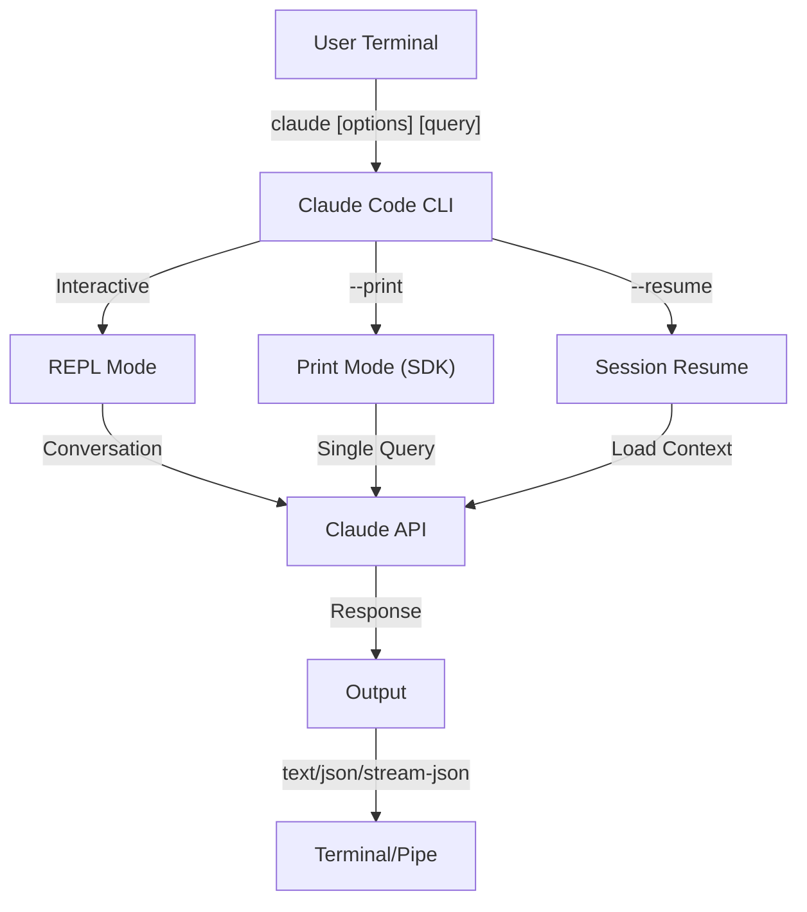
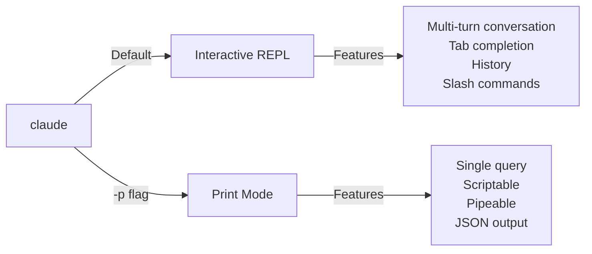

<picture>
  <source media="(prefers-color-scheme: dark)" srcset="../resources/logos/claude-howto-logo-dark.svg">
  
</picture>

# مرجع CLI

## مرور کلی

CLI کد کلود (رابط خط فرمان) روش اصلی تعامل با کد کلود است. این ابزار گزینه‌های قدرتمندی برای اجرای کوئری‌ها، مدیریت نشست‌ها، پیکربندی مدل‌ها و یکپارچه‌سازی کلود در گردش‌های کاری توسعه شما فراهم می‌کند.

## معماری



## Runtime & Packaging

از **v2.1.113** به بعد، CLI کد کلود یک **باینری بومی per-platform** (macOS، Linux، Windows) را از طریق وابستگی‌های اختیاری npm راه‌اندازی می‌کند. باینری در زمان نصب با OS و معماری شما مطابقت داده می‌شود — runtime قدیمی bundled-JavaScript دیگر پیش‌فرض در macOS یا Linux نیست.

**نصب توصیه‌شده** نصب‌کننده بومی است (`curl -fsSL https://claude.ai/install.sh | bash`؛ در Windows `irm https://claude.ai/install.ps1 | iex`). نصب npm در README رسمی منسوخ شده است؛ نصب‌کننده بومی، Homebrew (`brew install --cask claude-code`) یا WinGet (`winget install Anthropic.ClaudeCode`) را ترجیح دهید. برای مرجع، `npm install -g @anthropic-ai/claude-code` (Node.js 22+) همان باینری بومی را از طریق وابستگی اختیاری per-platform نصب می‌کند.

**Download host** (v2.1.116+): artifactهای باینری بومی از `https://downloads.claude.ai/claude-code-releases` ارائه می‌شوند.

> **کاربران corporate / proxy**: اگر شبکه شما allowlist صریحی نیاز دارد، `downloads.claude.ai` (و `https://downloads.claude.ai/claude-code-releases`) را به قوانین egress پراکسی خود اضافه کنید. محیط‌هایی که قبلاً فقط `storage.googleapis.com` یا npm registry را allowlist کرده بودند باید به‌روزرسانی شوند یا `claude update` و نصب اولیه fail خواهد شد.

bundle قدیمی JavaScript همچنان برای Windows و محیط‌هایی که به آن pin شده‌اند تولید می‌شود؛ آن نصب‌ها همچنان Glob و Grep را به عنوان ابزار first-class ارائه می‌دهند (پانویس Glob/Grep تحت [Tools](#tool--permission-management) را ببینید).

## دستورات CLI

| دستور | توضیحات | مثال |
|---------|-------------|---------|
| `claude` | شروع REPL تعاملی | `claude` |
| `claude "query"` | شروع REPL با prompt اولیه | `claude "explain this project"` |
| `claude -p "query"` | حالت Print - کوئری سپس خروج | `claude -p "explain this function"` |
| `cat file \| claude -p "query"` | پردازش محتوای pipeشده | `cat logs.txt \| claude -p "explain"` |
| `claude -c` | ادامه جدیدترین مکالمه | `claude -c` |
| `claude -c -p "query"` | ادامه در حالت print | `claude -c -p "check for type errors"` |
| `claude -r "<session>" "query"` | resume نشست با ID یا نام | `claude -r "auth-refactor" "finish this PR"` |
| `claude update` | به‌روزرسانی به آخرین نسخه | `claude update` |
| `/doctor` (slash command) | تشخیص نصب، پیکربندی و سلامت plugin. از v2.1.116 می‌تواند **در حین پاسخ Claude** باز شود، آیکون‌های وضعیت inline نشان می‌دهد و کلید `f` را برای auto-fix مشکلات شناسایی‌شده می‌پذیرد. v2.1.178 layout را به درخت مسطح با آیکون‌های وضعیت واضح‌تر و دستورات highlighted تازه‌سازی کرد | `/doctor` را داخل REPL اجرا کنید |
| `claude mcp` | پیکربندی سرورهای MCP (شامل `login`/`logout` برای auth، v2.1.186+) | [مستندات MCP](../05-mcp/) را ببینید |
| `claude mcp serve` | اجرای کد کلود به عنوان سرور MCP | `claude mcp serve` |
| `claude agents` | باز کردن **Agent View** (Research Preview، v2.1.139+) — مدیر چند-نشستی که هر نشست کد کلود را با وضعیت آن لیست می‌کند. [Agent View](#agent-view-claude-agents-v21139) را در پایین ببینید. | `claude agents` |
| `claude auto-mode defaults` | چاپ قوانین پیش‌فرض auto mode به صورت JSON | `claude auto-mode defaults` |
| `claude auto-mode reset` | بازگردانی پیکربندی پیش‌فرض auto-mode، با prompt تأیید (`--yes` برای رد شدن) (v2.1.212) | `claude auto-mode reset --yes` |
| `claude remote-control` | شروع سرور Remote Control (server mode، بدون نشست تعاملی محلی؛ چند نشست را serve می‌کند، پیش‌فرض `--capacity` 32) | `claude remote-control --name "My Project"` |
| `claude --remote-control [name]` | شروع نشست تعاملی با Remote Control فعال (alias `--rc`) | `claude --rc` |
| `claude plugin` | مدیریت pluginها (install، enable، disable) | `claude plugin install my-plugin` |
| `claude plugin init <name>` | scaffold یک plugin جدید در `~/.claude/skills/<name>/` (user-global) — در نشست بعدی به صورت `<name>@skills-dir` auto-load می‌شود، بدون نیاز به marketplace (v2.1.157+) | `claude plugin init my-plugin` |
| `claude plugin tag [path]` | ایجاد git tag release `{name}--v{version}` برای plugin در `[path]`، با اعتبارسنجی توافق `plugin.json` و ورودی marketplace احاطه‌کننده (v2.1.118+) | `claude plugin tag ./my-plugin` |
| `claude install [version]` | نصب یک نسخه مشخص از باینری بومی. `stable`، `latest` یا یک رشته نسخه صریح را می‌پذیرد | `claude install 2.1.131` |
| `claude purge [path]` | حذف تمام state محلی کد کلود برای یک پروژه (transcriptها، taskها، debug logها، تاریخچه ویرایش فایل، تاریخچه prompt، و ورودی `~/.claude.json`). `[path]` را برای picker تعاملی حذف کنید. پرچم‌ها: `--dry-run` برای پیش‌نمایش، `-y/--yes` برای رد شدن تأیید، `-i/--interactive` برای تأیید هر item، `--all` برای هر پروژه (v2.1.126+) — در v2.1.288 از `claude project purge` rename شد؛ نام قدیمی هنوز کار می‌کند و یک notice چاپ می‌کند | `claude purge ~/work/repo --dry-run` |
| `claude plugin prune` | حذف وابستگی‌های plugin auto-installed orphaned (plugin والد gone). `plugin uninstall --prune` همان cascade را پس از uninstall یک target انجام می‌دهد (v2.1.121+) | `claude plugin prune` |
| `claude ultrareview [target]` | اجرای `/ultrareview` به صورت غیرتعاملی. یافته‌ها را به stdout چاپ می‌کند، exit 0 در موفقیت / 1 در شکست. از `--json` برای raw payload، `--timeout <minutes>` برای override پیش‌فرض ۴۵ دقیقه (از v2.1.260)، و `--post` / `--no-post` برای کنترل post شدن یافته‌ها به PR استفاده کنید. **نیازمند کد کلود v2.1.227 یا بالاتر** | `claude ultrareview 1234 --json --no-post` |
| `claude self-hosted-runner [setup\|doctor\|orchestrator]` | شروع runner که نشست‌های cloud کد کلود را روی ماشین یا container خودتان host می‌کند. `setup` یک walkthrough تعاملی operator است، `doctor` یک runner مستقر را تشخیص می‌دهد، `orchestrator` runnerهای on-demand spawn می‌کند (its `--shutdown-drain-sec`، v2.1.299، به hookهای poll و spawn in-flight اجازه می‌دهد در SIGTERM تمام شوند). **طرح‌های Team و Enterprise؛ نیازمند کد کلود v2.1.224 یا بالاتر.** در Windows، startup نیازمند `--base-dir` صریح است (v2.1.229) | `claude self-hosted-runner setup` |
| `claude auth login` | ورود (از `--email`، `--sso` پشتیبانی می‌کند). از v2.1.126، کد OAuth pasteشده در ترمینال را به عنوان fallback وقتی callback مرورگر نمی‌تواند به localhost برسد (WSL2، SSH، containerها) می‌پذیرد | `claude auth login --email user@example.com` |
| `claude auth logout` | خروج از حساب فعلی | `claude auth logout` |
| `claude auth status` | بررسی وضعیت auth (exit 0 اگر logged in، 1 اگر not) | `claude auth status` |

## پرچم‌های اصلی

| پرچم | توضیحات | مثال |
|------|-------------|---------|
| `-p, --print` | چاپ پاسخ بدون حالت تعاملی | `claude -p "query"` |
| `-c, --continue` | بارگذاری جدیدترین مکالمه | `claude --continue` |
| `-r, --resume` | resume نشست مشخص با ID یا نام | `claude --resume auth-refactor` |
| `-v, --version` | خروجی شماره نسخه | `claude -v` |
| `--system-prompt-snapshot off` | render system prompt fresh در هر request به جای reuse prompt ثبت‌شده با مکالمه. وقتی روی متن prompt تکرار می‌کنید مفید است (v2.1.257+) | `claude --system-prompt-snapshot off` |
| `-w, --worktree` | شروع در git worktree جدا. از v2.1.233 URL merge-request GitLab را نیز علاوه بر URL PR گیت‌هاب می‌پذیرد | `claude -w` |
| `-n, --name` | نام نمایشی نشست | `claude -n "auth-refactor"` |
| `--from-pr <url-or-number>` | resume نشست‌های متصل به pull/merge request. از v2.1.119 URLهای GitHub (cloud + Enterprise)، GitLab MR و Bitbucket PR را می‌پذیرد؛ قبلاً فقط GitHub.com | `claude --from-pr 42` یا `claude --from-pr https://gitlab.example.com/org/repo/-/merge_requests/17` |
| `--cloud [description\|session_id\|url]` | ایجاد نشست cloud روی claude.ai با توضیح داده‌شده، یا attach به یک نشست موجود با session ID یا URL claude.ai/code | `claude --cloud "implement API"` |
| `--remote "task"` | **alias منسوخ‌شده `--cloud`**، شامل فرم نشست موجود. به جای آن از `--cloud` استفاده کنید | `claude --remote "implement API"` |
| `--remote-control, --rc` | نشست تعاملی با Remote Control | `claude --rc` |
| `--teleport [session]` | resume یک نشست web به صورت محلی. فرم bare یک picker از نشست‌های web شما را باز می‌کند؛ یک session ID برای resume مستقیم آن نشست بدهید. نیازمند subscription claude.ai | `claude --teleport` |
| `--teammate-mode` | حالت نمایش تیم ایجنت | `claude --teammate-mode tmux` |
| `--bare` | حالت minimal (skip hookها، skillها، pluginها، MCP، auto memory، CLAUDE.md) | `claude --bare` |
| `--safe-mode` | شروع با تمام customizationها غیرفعال (CLAUDE.md، pluginها، skillها، hookها، MCP) برای isolate مشکلات پیکربندی؛ همچنین `CLAUDE_CODE_SAFE_MODE=1` (v2.1.169) | `claude --safe-mode` |
| `--restricted` | قفل کردن نشست برای استفاده untrusted یا shared: ابزارهای built-in command- و code-running و WebFetch را حذف می‌کند، settings user/project/local را نادیده می‌گیرد، ابزارهای فایل را به working directoryها محدود می‌کند، و `bypassPermissions` و نشست‌های cloud را رد می‌کند. همچنین `CLAUDE_CODE_RESTRICTED=1` (v2.1.248+) | `claude --restricted -p "summarize this repo"` |
| `--permission-mode auto` | شروع در حالت دسترسی auto (جایگزین پرچم حذف‌شده `--enable-auto-mode`، از v2.1.111 gone) | `claude --permission-mode auto` |
| `--channels` | subscribe به pluginهای channel MCP. ورودی‌ها باید به صورت `plugin:<name>@<marketplace>` tag شده باشند؛ نام‌های bare رد می‌شوند | `claude --channels plugin:discord@my-marketplace` |
| `--chrome` / `--no-chrome` | فعال/غیرفعال کردن یکپارچه‌سازی مرورگر Chrome | `claude --chrome` |
| `--effort` | تنظیم سطح effort تفکر | `claude --effort high` |
| `--desktop` | باز کردن نشست در اپ دسکتاپ کلود روی directory فعلی؛ `--continue` یا `--resume <id>` برای انتخاب نشست اضافه کنید (v2.1.285) | `claude --desktop --continue` |
| `--init` / `--init-only` | `--init` hookهای initialization (Setup) را قبل از نشست اجرا می‌کند، فقط حالت print؛ `--init-only` hookهای Setup و `SessionStart` را اجرا می‌کند، سپس خارج می‌شود | `claude -p --init "query"` |
| `--maintenance` | اجرای hookهای maintenance (Setup) قبل از نشست (فقط حالت print) | `claude -p --maintenance "query"` |
| `--disable-slash-commands` | غیرفعال کردن تمام skillها و slash commandها | `claude --disable-slash-commands` |
| `--no-session-persistence` | غیرفعال کردن ذخیره نشست (حالت print) | `claude -p --no-session-persistence "query"` |
| `--exclude-dynamic-system-prompt-sections` | exclude بخش‌های پویا از system prompt برای cache hit rate بهتر | `claude -p --exclude-dynamic-system-prompt-sections "query"` |

### حالت Restricted (`--restricted`, v2.1.248+)

`--restricted` (یا `CLAUDE_CODE_RESTRICTED=1`) برای اجرای `claude` به نمایندگی کسی است که ورودی او را کنترل نمی‌کنید — یک harness ارزیابی روی ماشین shared، یک job CI توسط contributor خارجی، یک demo box. همه موارد زیر را اعمال می‌کند:

- **ابزارهایی که command یا code اجرا می‌کنند را حذف می‌کند** — Bash، PowerShell و REPL — به علاوه WebFetch، مگر اینکه `--tools` صراحتاً آن‌ها را نام ببرد.
- **فایل‌های settings user، project و local را نادیده می‌گیرد.** settings managed و یک فایل `--settings` صریح همچنان اعمال می‌شوند، بنابراین administrator کنترل را حفظ می‌کند در حالی که یک `.claude/settings.json` checked-in نمی‌تواند sandbox را گسترش دهد.
- **ابزارهای فایل را به working directoryها محدود می‌کند**، بنابراین read و write نمی‌توانند از pathهایی که در آن‌ها شروع کردید escape کنند.
- **`bypassPermissions` را رد می‌کند**، به هر طریقی که درخواست شود.
- **از ایجاد نشست‌های cloud امتناع می‌کند**، بنابراین یک run restricted نمی‌تواند کار را از ماشین خارج کند.

```bash
# Evaluation harness: no shell, no network fetches, no settings inheritance
claude --restricted -p "summarize the architecture of this repo"

# Same lockdown, but deliberately re-enable one tool
claude --restricted --tools WebFetch -p "check the linked RFC"
```

> **نکته**: `--restricted` یک lock درشت‌تر از `--permission-mode` است. ابزارها را به طور کامل حذف می‌کند به جای prompt کردن برای آن‌ها، بنابراین یک نشست restricted نمی‌تواند از داخل نشست گسترش یابد.

### حالت تعاملی در برابر حالت Print



**حالت تعاملی** (پیش‌فرض):
```bash
# شروع نشست تعاملی
claude

# شروع با prompt اولیه
claude "explain the authentication flow"
```

**حالت Print** (غیرتعاملی):
```bash
# یک کوئری، سپس خروج
claude -p "what does this function do?"

# پردازش محتوای فایل
cat error.log | claude -p "explain this error"

# Chain با ابزارهای دیگر
claude -p "list todos" | grep "URGENT"
```

## مدل و پیکربندی

| پرچم | توضیحات | مثال |
|------|-------------|---------|
| `--model` | تنظیم مدل (sonnet، opus، haiku یا نام کامل) | `claude --model opus` |
| `--fallback-model` | fallback خودکار مدل وقتی primary overloaded/unavailable است؛ تا سه مورد از طریق setting `fallbackModel` پیکربندی کنید. از v2.1.166 در نشست‌های تعاملی نیز اعمال می‌شود (قبلاً فقط حالت print) | `claude -p --fallback-model sonnet "query"` |
| `--agent` | مشخص کردن ایجنت برای نشست | `claude --agent my-custom-agent` |
| `--agents` | تعریف subagentهای سفارشی از طریق JSON | [پیکربندی ایجنت‌ها](#agents-configuration) را ببینید |
| `--effort` | تنظیم سطح effort (low، medium، high، xhigh، max) | `claude --effort xhigh` |

### مثال‌های انتخاب مدل

```bash
# استفاده از Opus 5.5 برای taskهای پیچیده
claude --model opus "design a caching strategy"

# استفاده از Haiku برای taskهای سریع (Haiku 5.5 روی Anthropic API از v2.1.293؛ Haiku 4.5 روی Bedrock، Vertex و Foundry)
claude --model haiku -p "format this JSON"

# نام کامل مدل
claude --model claude-sonnet-4-6 "review this code"

# با fallback برای reliability
claude -p --model opus --fallback-model sonnet "analyze architecture"

# استفاده از opusplan (Opus برنامه‌ریزی، Sonnet اجرا)
claude --model opusplan "design and implement the caching layer"
```

> **Gateway model discovery (v2.1.129+، opt-in)**: وقتی `ANTHROPIC_BASE_URL` به یک gateway سازگار با Anthropic اشاره می‌کند، `CLAUDE_CODE_ENABLE_GATEWAY_MODEL_DISCOVERY=1` را تنظیم کنید تا `/model` از endpoint `/v1/models` gateway پر شود. بدون env var، `/model` به لیست static built-in fallback می‌کند. این پرچم opt-in است (در v2.1.129 تغییر کرد) زیرا فراخوانی discovery می‌تواند modelهایی را نشان دهد که کاربر ممکن است مجاز به استفاده از آن‌ها نباشد؛ v2.1.126 آن را implicit کرد و آن رفتار revert شد.

> **1M context پشت base URL سفارشی (v2.1.285)**: نشست‌هایی که `ANTHROPIC_BASE_URL` آن‌ها به یک endpoint سفارشی اشاره می‌کند اکنون از context window 1M modelهایی که دارند (Opus 4.7+، Sonnet 5+، Fable) استفاده می‌کنند. اگر gateway شما در 200K متوقف می‌شود، `/autocompact 200k` را اجرا کنید.

> **1M context به طور پیش‌فرض روی providerهای third-party (v2.1.287)**: Opus 4.7+ و Fable اکنون به طور پیش‌فرض روی Amazon Bedrock، Google Vertex AI، Microsoft Foundry و Claude apps gateway از context window 1M استفاده می‌کنند، بدون suffix `[1m]`. `CLAUDE_CODE_DISABLE_1M_CONTEXT=1` را تنظیم کنید تا در 200K بمانند.

> **Org default model (v2.1.196)**: وقتی admin یک org default model تنظیم می‌کند، `/model` آن را به عنوان "Org default" (یا "Role default") label می‌کند.

## سفارشی‌سازی System Prompt

| پرچم | توضیحات | مثال |
|------|-------------|---------|
| `--system-prompt` | جایگزینی کل default prompt | `claude --system-prompt "You are a Python expert"` |
| `--system-prompt-file` | بارگذاری prompt از فایل، جایگزین default prompt | `claude -p --system-prompt-file ./prompt.txt "query"` |
| `--append-system-prompt` | append به default prompt | `claude --append-system-prompt "Always use TypeScript"` |
| `--append-subagent-system-prompt` | append متن به system prompt هر subagent (غیرتعاملی) | `claude -p --append-subagent-system-prompt "Cite sources" "query"` |
| `--append-subagent-system-prompt-file` | (v2.1.261) بارگذاری آن متن appendشده از یک فایل به جای آن، برای promptهایی که برای command line خیلی طولانی هستند. فقط غیرتعاملی، و **نمی‌توان با `--append-subagent-system-prompt` ترکیب شد** | `claude -p --append-subagent-system-prompt-file ./subagent-rules.txt "query"` |

### مثال‌های System Prompt
### مثال‌های System Prompt

```bash
# persona سفارشی کامل
claude --system-prompt "You are a senior security engineer. Focus on vulnerabilities."

# append دستورالعمل‌های مشخص
claude --append-system-prompt "Always include unit tests with code examples"

# بارگذاری prompt پیچیده از فایل
claude -p --system-prompt-file ./prompts/code-reviewer.txt "review main.py"
```

### مقایسه پرچم‌های System Prompt

| پرچم | رفتار | تعاملی | Print |
|------|----------|-------------|-------|
| `--system-prompt` | جایگزینی کل default system prompt | ✅ | ✅ |
| `--system-prompt-file` | جایگزینی با prompt از فایل | ✅ | ✅ |
| `--append-system-prompt` | append به default system prompt | ✅ | ✅ |

**همه پرچم‌های system prompt در هر دو حالت تعاملی و print کار می‌کنند (فرم‌های فایل از v2.1.69). `--system-prompt` و `--system-prompt-file` default prompt را جایگزین می‌کنند؛ پرچم‌های append به آن اضافه می‌کنند.**

## مدیریت ابزار و دسترسی

| پرچم | توضیحات | مثال |
|------|-------------|---------|
| `--tools` | محدود کردن ابزارهای built-in موجود | `claude -p --tools "Bash,Edit,Read" "query"` |
| `--allowedTools` | ابزارهایی که بدون prompt اجرا می‌شوند | `"Bash(git log:*)" "Read"` |
| `--disallowedTools` | ابزارهای حذف‌شده از context | `"Bash(rm:*)" "Edit"` |
| `--dangerously-skip-permissions` | رد کردن تمام promptهای دسترسی | `claude --dangerously-skip-permissions` |
| `--permission-mode` | شروع در حالت دسترسی مشخص | `claude --permission-mode auto` |
| `--permission-prompt-tool` | ابزار MCP برای مدیریت دسترسی | `claude -p --permission-prompt-tool mcp_auth "query"` |
| `--permission-prompts` | (v2.1.259) چه کسی به promptهای دسترسی در حالت print پاسخ می‌دهد. پیش‌فرض `host` آن‌ها را به host Agent SDK یا ابزار `--permission-prompt-tool` می‌فرستد؛ `none` بدهید وقتی کسی نمی‌تواند پاسخ دهد و کد کلود آن‌ها را رد می‌کند | `claude -p --permission-prompts none "query"` |

> **به‌روزرسانی v2.1.111**: `--enable-auto-mode` حذف شد؛ auto mode اکنون به طور پیش‌فرض در چرخه `Shift+Tab` است — از `--permission-mode auto` برای شروع مستقیم در آن استفاده کنید.

> **پانویس Glob / Grep (v2.1.113+)**: روی buildهای بومی macOS/Linux، `Glob` و `Grep` به عنوان باینری‌های embedded `bfs` و `ugrep` که از طریق ابزار Bash فراخوانی می‌شوند ارائه می‌شوند، نه به عنوان ابزار first-class جداگانه. نصب‌های Windows و npm-bundled (JS) همچنان آن‌ها را به عنوان ابزار standalone نشان می‌دهند. برای لیست‌های `allowedTools` / `disallowedTools` subagent، جایگزینی backend شفاف است — می‌توانید به `Glob` / `Grep` در پیکربندی خود روی همه platformها اشاره کنید.

> **auto-approve PowerShell (v2.1.119)**: commandهای ابزار PowerShell می‌توانند در حالت دسترسی دقیقاً مانند commandهای Bash auto-approve شوند. از همان syntax matcher که برای ruleهای `Bash(...)` استفاده می‌کنید برای scope کردن دسترسی‌های PowerShell استفاده کنید — برای مثال، `PowerShell(Get-ChildItem:*)`.

> **`--permission-mode` در resume رعایت می‌شود (v2.1.132+)**: `claude -p --continue --permission-mode plan` (و `--resume`) اکنون پرچم را رعایت می‌کنند. نسخه‌های قبلی `--permission-mode` را هنگام resume نشست به طور بی‌صدا drop می‌کردند، بنابراین یک نشست plan-mode که بدون re-pass کردن پرچم resume می‌شد به طور بی‌صدا downgrade می‌شد — این مشکل حل شد.

> **سخت‌گیری دسترسی (v2.1.214)**: commandهای Docker/Podman که از پرچم‌های daemon-redirect (مانند `--url`، `--connection`، `--identity`) استفاده می‌کنند اکنون به جای اجرای خودکار به یک prompt دسترسی نیاز دارند. commandهای `file` که از `-m`/`--magic-file` یا `-f`/`--files-from` استفاده می‌کنند نیز اکنون به دسترسی نیاز دارند. commandهای Bash بیش از ۱۰,۰۰۰ کاراکتر همیشه prompt دسترسی می‌گیرند، بدون توجه به allow ruleها.

### مثال‌های دسترسی

```bash
# حالت read-only برای code review
claude --permission-mode plan "review this codebase"

# محدود کردن به ابزارهای امن
claude --tools "Read,Grep,Glob" -p "find all TODO comments"

# اجازه دادن به commandهای git مشخص بدون prompt
claude --allowedTools "Bash(git status:*)" "Bash(git log:*)"

# block کردن عملیات خطرناک
claude --disallowedTools "Bash(rm -rf:*)" "Bash(git push --force:*)"
```

> **Parameter matching `Tool(param:value)` (v2.1.178)**: ruleهای دسترسی از فرمت `Tool` (هر استفاده) یا `Tool(specifier)` پیروی می‌کنند. از v2.1.178، یک specifier می‌تواند پارامترهای **input** ابزار را match کند، نه فقط patternهای command یا path — با استفاده از فرم `Tool(param:value)` با پشتیبانی wildcard. این matching که قبلاً برای prefixهای command `Bash(...)` (مانند `Bash(npm run test *)`) و globهای path `Read(...)` (مانند `Read(./.env.*)`) استفاده می‌کردید را تعمیم می‌دهد تا ابزارهای دیگر بتوانند بر اساس آرگومان‌هایشان scope شوند. قبل از نوشتن یک rule، stringهای example per-tool را در [permissions reference](https://code.claude.com/docs/en/settings) بررسی کنید، زیرا نام دقیق پارامترها بسته به ابزار متفاوت است.

## خروجی و فرمت

| پرچم | توضیحات | گزینه‌ها | مثال |
|------|-------------|---------|---------|
| `--output-format` | مشخص کردن فرمت خروجی (حالت print) | `text`، `json`، `stream-json` | `claude -p --output-format json "query"` |
| `--input-format` | مشخص کردن فرمت ورودی (حالت print) | `text`، `stream-json` | `claude -p --input-format stream-json` |
| `--verbose` | فعال کردن verbose logging | | `claude --verbose` |
| `--include-partial-messages` | شامل کردن eventهای streaming | نیازمند `stream-json` | `claude -p --output-format stream-json --include-partial-messages "query"` |
| `--forward-subagent-text` | forward کردن خروجی متن subagent به stream. از v2.1.219، subagentهای spawnشده در depth 2 یا عمیق‌تر نیز forward می‌شوند، keyed توسط id `tool_use` ایجنت spawnکننده آن‌ها (این نحوه مشاهده nesting فعال‌شده به طور پیش‌فرض از طریق `CLAUDE_CODE_MAX_SUBAGENT_SPAWN_DEPTH` است) | نیازمند `stream-json` | `claude -p --output-format stream-json --forward-subagent-text "query"` |
| `--json-schema` | دریافت JSON validated matching schema | | `claude -p --json-schema '{"type":"object"}' "query"` |
| `--max-budget-usd` | حداکثر هزینه برای حالت print. از v2.1.217، رسیدن به cap همچنین subagentهای background در حال اجرا را متوقف می‌کند و spawnهای جدید را رد می‌کند (قبلاً agentهای background پس از cap به اجرا ادامه می‌دادند) | | `claude -p --max-budget-usd 5.00 "query"` |

### مثال‌های فرمت خروجی

```bash
# متن ساده (پیش‌فرض)
claude -p "explain this code"

# JSON برای استفاده برنامه‌نویسی
claude -p --output-format json "list all functions in main.py"

# streaming JSON برای پردازش real-time
claude -p --output-format stream-json "generate a long report"

# خروجی ساختاریافته با اعتبارسنجی schema
claude -p --json-schema '{"type":"object","properties":{"bugs":{"type":"array"}}}' \
  "find bugs in this code and return as JSON"
```

## Workspace & Directory

| پرچم | توضیحات | مثال |
|------|-------------|---------|
| `--add-dir` | اضافه کردن working directoryهای اضافی | `claude --add-dir ../apps ../lib` |
| `--setting-sources` | منابع setting جداشده با کاما | `claude --setting-sources user,project` |

> **persistence `/config` (v2.1.119)**: تغییرات انجام‌شده به صورت تعاملی از طریق command `/config` اکنون در `~/.claude/settings.json` نوشته می‌شوند و در زنجیره precedence معمول شرکت می‌کنند (policy → local → project → user). قبل از v2.1.119، برخی تغییرات `/config` فقط session-only بودند. [Memory & Settings](../02-memory/README.md) را برای ترتیب کامل precedence ببینید.
| `--settings` | بارگذاری settings از فایل یا JSON. فایل نباید بزرگ‌تر از 2 MiB باشد (v2.1.214) | `claude --settings ./settings.json` |
| `--plugin-dir` | بارگذاری pluginها از directory (قابل تکرار). از v2.1.265 همچنین یک **folder of plugins** را می‌پذیرد — هر child folder با manifest بارگذاری می‌شود، و childهای اضافه یا حذف‌شده در حین اجرای نشست picked up می‌شوند | `claude --plugin-dir ./my-plugin` |

### مثال Multi-Directory

```bash
# کار در چند directory پروژه
claude --add-dir ../frontend ../backend ../shared "find all API endpoints"

# بارگذاری settings سفارشی
claude --settings '{"model":"opus","verbose":true}' "complex task"
```

## پیکربندی MCP

| پرچم | توضیحات | مثال |
|------|-------------|---------|
| `--mcp-config` | بارگذاری سرورهای MCP از JSON | `claude --mcp-config ./mcp.json` |
| `--strict-mcp-config` | فقط استفاده از MCP config مشخص | `claude --strict-mcp-config --mcp-config ./mcp.json` |
| `--channels` | subscribe به pluginهای channel MCP. ورودی‌ها باید به صورت `plugin:<name>@<marketplace>` tag شده باشند؛ نام‌های bare رد می‌شوند | `claude --channels plugin:discord@my-marketplace` |

### مثال‌های MCP

```bash
# بارگذاری سرور MCP گیت‌هاب
claude --mcp-config ./github-mcp.json "list open PRs"

# حالت strict - فقط سرورهای مشخص
claude --strict-mcp-config --mcp-config ./production-mcp.json "deploy to staging"
```

## مدیریت نشست

| پرچم | توضیحات | مثال |
|------|-------------|---------|
| `--session-id` | استفاده از session ID مشخص (UUID) | `claude --session-id "550e8400-..."` |
| `--fork-session` | ایجاد نشست جدید هنگام resume | `claude --resume abc123 --fork-session` |

### مثال‌های نشست

```bash
# ادامه آخرین مکالمه
claude -c

# resume نشست نام‌گذاری‌شده
claude -r "feature-auth" "continue implementing login"

# fork نشست برای آزمایش
claude --resume feature-auth --fork-session "try alternative approach"

# استفاده از session ID مشخص
claude --session-id "550e8400-e29b-41d4-a716-446655440000" "continue"
```

> **v2.1.299**: command resume چاپ‌شده در exit نشست را با ID آن نام‌گذاری می‌کند.

### Fork نشست

ایجاد یک branch از یک نشست موجود برای آزمایش:

```bash
# fork یک نشست برای امتحان رویکرد متفاوت
claude --resume abc123 --fork-session "try alternative implementation"

# fork با یک پیام سفارشی
claude -r "feature-auth" --fork-session "test with different architecture"
```

**موارد استفاده:**
- امتحان پیاده‌سازی‌های جایگزین بدون از دست دادن نشست اصلی
- آزمایش رویکردهای متفاوت به صورت موازی
- ایجاد branch از کار موفق برای variations
- تست تغییرات breaking بدون تأثیر بر نشست اصلی

نشست اصلی بدون تغییر می‌ماند، و fork به یک نشست مستقل جدید تبدیل می‌شود.

### پاکسازی state پروژه (v2.1.126+)

`claude purge` تمام state محلی کد کلود را برای یک پروژه حذف می‌کند — transcriptها، لیست taskها، debug logها، تاریخچه ویرایش فایل، خطوط تاریخچه prompt، و ورودی `~/.claude.json` پروژه. قبل از v2.1.288 `claude project purge` نامیده می‌شد؛ آن نام هنوز کار می‌کند و یک notice چاپ می‌کند. ابتدا `--dry-run` را برای پیش‌نمایش حذف استفاده کنید؛ `--all` همه پروژه‌ها روی ماشین را walk می‌کند.

```bash
# پیش‌نمایش آنچه حذف می‌شود (امن)
claude purge ~/work/repo --dry-run

# حذف state برای یک پروژه مشخص، بدون prompt
claude purge ~/work/repo --yes

# walk تعاملی همه پروژه‌ها
claude purge --all --interactive
```

## ویژگی‌های پیشرفته

| پرچم | توضیحات | مثال |
|------|-------------|---------|
| `--chrome` | فعال کردن یکپارچه‌سازی مرورگر Chrome | `claude --chrome` |
| `--no-chrome` | غیرفعال کردن یکپارچه‌سازی مرورگر Chrome | `claude --no-chrome` |
| `--ide` | auto-connect به IDE در صورت موجود بودن | `claude --ide` |
| `--max-turns` | محدود کردن turnهای agentic (غیرتعاملی) | `claude -p --max-turns 3 "query"` |
| `--debug` | فعال کردن حالت debug با فیلتر (فیلتر فقط در فرم `=` اعمال می‌شود) | `claude --debug=api,mcp` |
### Platform & Theme Notes (v2.1.112)

- **PowerShell tool on Windows**: ابزار PowerShell dedicated روی Windows در حال rollout است و از طریق environment variable کنترل می‌شود.
- **Auto (match terminal) theme**: theme جدید "Auto (match terminal)" ظاهر light/dark کد کلود را با terminal شما sync می‌کند.
- **Quieter permission prompts**: فراخوانی‌های read-only `Bash` و patternهای `Glob` دیگر prompt دسترسی trigger نمی‌کنند.

### مثال‌های پیشرفته

```bash
# محدود کردن actionهای autonomous
claude -p --max-turns 5 "refactor this module"

# debug کردن API callها
claude --debug=api "test query"

# فعال کردن یکپارچه‌سازی IDE
claude --ide "help me with this file"
```

## پیکربندی ایجنت‌ها

پرچم `--agents` یک object JSON تعریف‌کننده subagentهای سفارشی برای یک نشست را می‌پذیرد.

از **v2.1.243**، `--agents` دیگر JSON نامعتبر یا تعریف ایجنت نامعتبر را به طور بی‌صدا نادیده نمی‌گیرد — با یک خطای واضح exit می‌کند، مانند رفتار `--mcp-config`.

### فرمت JSON ایجنت‌ها

```json
{
  "agent-name": {
    "description": "Required: when to invoke this agent",
    "prompt": "Required: system prompt for the agent",
    "tools": ["Optional", "array", "of", "tools"],
    "model": "optional: sonnet|opus|haiku"
  }
}
```

**فیلدهای الزامی:**
- `description` - توضیح به زبان طبیعی از زمانی که این ایجنت استفاده می‌شود
- `prompt` - system prompt که نقش و رفتار ایجنت را تعریف می‌کند

**فیلدهای اختیاری:**
- `tools` - آرایه‌ای از ابزارهای موجود (اگر omitted شود همه را inherit می‌کند)
  - فرمت: `["Read", "Grep", "Glob", "Bash"]`
- `model` - مدل برای استفاده: `sonnet`، `opus` یا `haiku`

### مثال کامل ایجنت‌ها

```json
{
  "code-reviewer": {
    "description": "Expert code reviewer. Use proactively after code changes.",
    "prompt": "You are a senior code reviewer. Focus on code quality, security, and best practices.",
    "tools": ["Read", "Grep", "Glob", "Bash"],
    "model": "sonnet"
  },
  "debugger": {
    "description": "Debugging specialist for errors and test failures.",
    "prompt": "You are an expert debugger. Analyze errors, identify root causes, and provide fixes.",
    "tools": ["Read", "Edit", "Bash", "Grep"],
    "model": "opus"
  },
  "documenter": {
    "description": "Documentation specialist for generating guides.",
    "prompt": "You are a technical writer. Create clear, comprehensive documentation.",
    "tools": ["Read", "Write"],
    "model": "haiku"
  }
}
```

### مثال‌های command ایجنت‌ها

```bash
# تعریف ایجنت‌های سفارشی inline
claude --agents '{
  "security-auditor": {
    "description": "Security specialist for vulnerability analysis",
    "prompt": "You are a security expert. Find vulnerabilities and suggest fixes.",
    "tools": ["Read", "Grep", "Glob"],
    "model": "opus"
  }
}' "audit this codebase for security issues"

# بارگذاری ایجنت‌ها از فایل
claude --agents "$(cat ~/.claude/agents.json)" "review the auth module"

# ترکیب با پرچم‌های دیگر
claude -p --agents "$(cat agents.json)" --model sonnet "analyze performance"
```

### اولویت ایجنت

وقتی چند تعریف ایجنت وجود دارد، به این ترتیب اولویت بارگذاری می‌شوند:
1. **CLI-defined** (`--agents` flag) - مخصوص نشست
2. **Project-level** (`.claude/agents/`) - پروژه فعلی
3. **User-level** (`~/.claude/agents/`) - همه پروژه‌ها

ایجنت‌های CLI-defined هر دو ایجنت project و user را برای نشست override می‌کنند. ایجنت‌های project-level هنگام برخورد نام، ایجنت‌های user-level را override می‌کنند. [درس ۰۴ — Subagents](../04-subagents/README.md#file-locations) را برای جدول کامل اولویت شامل ایجنت‌های plugin-level ببینید.

### Agent View (`claude agents`, v2.1.139+)

> **Research Preview** — ویژگی به اندازه کافی برای استفاده روزانه پایدار است اما ممکن است تغییر کند.

`claude agents` **Agent View** را باز می‌کند — یک لیست واحد از هر نشست کد کلود روی ماشین با وضعیت فعلی آن (`running`، `blocked on you`، `done`). جایگزین juggling چند tab ترمینال هنگام اجرای ایجنت‌های background، taskهای scheduled یا نشست‌های `--bg`-launched است.

```bash
# باز کردن Agent View
claude agents
```

وقتی یک نشست را از view (یا از طریق `claude --bg <prompt>`) dispatch می‌کنید، می‌توانید همان پرچم‌های پیکربندی را که به `claude` خودتان می‌دهید پاس دهید. پرچم‌های معرفی‌شده برای مسیر dispatch Agent View:

| پرچم | از | توضیحات |
|------|-------|-------------|
| `--cwd <path>` | v2.1.141 | scope کردن لیست نشست (یا نشست جدید) به یک working directory مشخص |
| `--add-dir <path>` | v2.1.142 | اضافه کردن directoryها به workspace نشست dispatchشده |
| `--settings <path>` | v2.1.142 | استفاده از یک `settings.json` مشخص برای نشست dispatchشده |
| `--mcp-config <path>` | v2.1.142 | استفاده از یک MCP config مشخص برای نشست dispatchشده |
| `--plugin-dir <path>` | v2.1.142 | استفاده از یک plugin directory مشخص برای نشست dispatchشده |
| `--permission-mode <mode>` | v2.1.142 | تنظیم حالت دسترسی (`plan`، `acceptEdits`، `auto` و غیره) برای نشست dispatchشده |
| `--model <model>` | v2.1.142 | pin کردن یک مدل برای نشست dispatchشده |
| `--effort <level>` | v2.1.142 | pin کردن یک سطح effort (`low`/`medium`/`high`/`xhigh`/`max`) |
| `--dangerously-skip-permissions` | v2.1.142 | اجرای نشست dispatchشده بدون prompt دسترسی (فقط در sandboxها استفاده کنید) |
| `--json` | v2.1.145 | چاپ لیست ایجنت به صورت JSON machine-readable برای scripting (status barها، session pickerها، یکپارچه‌سازی tmux-resurrect) |

نشست‌هایی که کارشان را تمام می‌کنند اما یک shell background باز می‌گذارند از "Working" به "Completed" منتقل می‌شوند (fix v2.1.141). در داخل یک نشست ایجنت attached، `Shift+Tab` بین حالت‌های دسترسی از جمله auto mode چرخش می‌کند (v2.1.143).

**merge requestهای GitLab (v2.1.233)** — Agent View URLهای MR گیت‌لب را علاوه بر URLهای PR گیت‌هاب تشخیص می‌دهد، و merge requestها را به صورت `!N` نشان می‌دهد (pull requestهای گیت‌هاب `#N` می‌مانند). همان release به `--worktree` یاد داد URL MR گیت‌لب را بپذیرد.

**pin کردن یک نشست** — `Ctrl+T` را روی یک نشست در `claude agents` بزنید تا pin شود (v2.1.147). نشست‌های background pin‌شده هنگام idle زنده می‌مانند، برای اعمال به‌روزرسانی‌های کد کلود در جای خود restart می‌شوند، و فقط پس از نشست‌های non-pinned تحت فشار حافظه shed می‌شوند. (این `Ctrl+T` به Agent View scope شده است؛ در نشست اصلی لیست task را toggle می‌کند.)

**پیش‌فرض‌ها برای نشست‌های جدید (v2.1.299)** — در agent view، `/effort` و `/fast` تعیین می‌کنند نشست‌های جدید با چه چیزی شروع شوند؛ یک `/model`، `/effort` یا `/fast` bare یک picker باز می‌کند.

---

## موارد استفاده با ارزش بالا

### ۱. یکپارچه‌سازی CI/CD

استفاده از کد کلود در pipelineهای CI/CD شما برای code review، testing و documentation خودکار.

**مثال GitHub Actions:**

```yaml
name: AI Code Review

on: [pull_request]

jobs:
  review:
    runs-on: ubuntu-latest
    steps:
      - uses: actions/checkout@v4

      - name: Install Claude Code
        run: npm install -g @anthropic-ai/claude-code

      - name: Run Code Review
        env:
          ANTHROPIC_API_KEY: ${{ secrets.ANTHROPIC_API_KEY }}
        run: |
          claude -p --output-format json \
            --max-turns 1 \
            "Review the changes in this PR for:
            - Security vulnerabilities
            - Performance issues
            - Code quality
            Output as JSON with 'issues' array" > review.json

      - name: Post Review Comment
        uses: actions/github-script@v7
        with:
          script: |
            const fs = require('fs');
            const review = JSON.parse(fs.readFileSync('review.json', 'utf8'));
            // Process and post review comments
```

**Jenkins Pipeline:**

```groovy
pipeline {
    agent any
    stages {
        stage('AI Review') {
            steps {
                sh '''
```
### ۲. Script Piping

پردازش فایل‌ها، logها و داده‌ها از طریق کلود برای تحلیل.

**تحلیل Log:**

```bash
# تحلیل error logها
tail -1000 /var/log/app/error.log | claude -p "summarize these errors and suggest fixes"

# یافتن patternها در access logها
cat access.log | claude -p "identify suspicious access patterns"

# تحلیل git history
git log --oneline -50 | claude -p "summarize recent development activity"
```

**پردازش کد:**

```bash
# review یک فایل مشخص
cat src/auth.ts | claude -p "review this authentication code for security issues"

# تولید مستندات
cat src/api/*.ts | claude -p "generate API documentation in markdown"

# یافتن TODOها و اولویت‌بندی
grep -r "TODO" src/ | claude -p "prioritize these TODOs by importance"
```

### ۳. گردش‌های کاری چند-نشستی

مدیریت پروژه‌های پیچیده با چند thread مکالمه.

```bash
# شروع یک نشست feature branch
claude -r "feature-auth" "let's implement user authentication"

# بعداً، ادامه نشست
claude -r "feature-auth" "add password reset functionality"

# fork برای امتحان رویکرد جایگزین
claude --resume feature-auth --fork-session "try OAuth instead"

# جابجایی بین نشست‌های feature مختلف
claude -r "feature-payments" "continue with Stripe integration"
```

### ۴. پیکربندی ایجنت سفارشی

تعریف ایجنت‌های تخصصی برای گردش‌های کاری تیم شما.

```bash
# ذخیره config ایجنت‌ها در فایل
cat > ~/.claude/agents.json << 'EOF'
{
  "reviewer": {
    "description": "Code reviewer for PR reviews",
    "prompt": "Review code for quality, security, and maintainability.",
    "model": "opus"
  },
  "documenter": {
    "description": "Documentation specialist",
    "prompt": "Generate clear, comprehensive documentation.",
    "model": "sonnet"
  },
  "refactorer": {
    "description": "Code refactoring expert",
    "prompt": "Suggest and implement clean code refactoring.",
    "tools": ["Read", "Edit", "Glob"]
  }
}
EOF

# استفاده از ایجنت‌ها در نشست
claude --agents "$(cat ~/.claude/agents.json)" "review the auth module"
```

### ۵. پردازش دسته‌ای

پردازش چند کوئری با settings یکنواخت.

```bash
# پردازش چند فایل
for file in src/*.ts; do
  echo "Processing $file..."
  claude -p --model haiku "summarize this file: $(cat $file)" >> summaries.md
done

# code review دسته‌ای
find src -name "*.py" -exec sh -c '
  echo "## $1" >> review.md
  cat "$1" | claude -p "brief code review" >> review.md
' _ {} \;

# تولید تست برای همه moduleها
for module in $(ls src/modules/); do
  claude -p "generate unit tests for src/modules/$module" > "tests/$module.test.ts"
done
```

### ۶. توسعه امنیت‌محور

استفاده از کنترل‌های دسترسی برای عملیات امن.

```bash
# audit امنیتی read-only
claude --permission-mode plan \
  --tools "Read,Grep,Glob" \
  "audit this codebase for security vulnerabilities"

# block کردن commandهای خطرناک
claude --disallowedTools "Bash(rm:*)" "Bash(curl:*)" "Bash(wget:*)" \
  "help me clean up this project"

# automation restricted
claude -p --max-turns 2 \
  --allowedTools "Read" "Glob" \
  "find all hardcoded credentials"
```

### ۷. یکپارچه‌سازی JSON API

استفاده از کلود به عنوان یک API برنامه‌پذیر برای ابزارهای شما با parsing `jq`.

```bash
# دریافت تحلیل ساختاریافته
claude -p --output-format json \
  --json-schema '{"type":"object","properties":{"functions":{"type":"array"},"complexity":{"type":"string"}}}' \
  "analyze main.py and return function list with complexity rating"

# یکپارچه‌سازی با jq برای پردازش (خروجی schema در .structured_output قرار می‌گیرد)
claude -p --output-format json \
  --json-schema '{"type":"object","properties":{"endpoints":{"type":"array"}}}' \
  "list all API endpoints" | jq '.structured_output.endpoints[]'

# استفاده در scriptها
RESULT=$(claude -p --output-format json \
  --json-schema '{"type":"object","properties":{"secure":{"type":"boolean"},"issues":{"type":"array"}},"required":["secure","issues"]}' \
  "is this code secure?" < code.py)
if echo "$RESULT" | jq -e '.structured_output.secure == false' > /dev/null; then
  echo "Security issues found!"
  echo "$RESULT" | jq '.structured_output.issues[]'
fi
```

### مثال‌های Parsing jq

Parse و پردازش خروجی JSON کلود با استفاده از `jq`. متن پاسخ در `.result` است؛ با `--json-schema`، object validated در `.structured_output` قرار دارد (`$SCHEMA` در زیر یک schema است که فیلدهایی که هر filter می‌خواند را تعریف می‌کند):

```bash
# استخراج متن پاسخ
claude -p --output-format json "analyze this code" | jq -r '.result'

# فیلتر کردن عنصرهای آرایه
claude -p --output-format json --json-schema "$SCHEMA" "list issues" | jq -r '.structured_output.issues[] | select(.severity=="high")'

# استخراج چند فیلد
claude -p --output-format json --json-schema "$SCHEMA" "describe the project" | jq -r '.structured_output | {name, version, description}'

# تبدیل به CSV
claude -p --output-format json --json-schema "$SCHEMA" "list functions" | jq -r '.structured_output.functions[] | [.name, .lineCount] | @csv'

# پردازش شرطی
claude -p --output-format json --json-schema "$SCHEMA" "check security" | jq 'if (.structured_output.vulnerabilities | length) > 0 then "UNSAFE" else "SAFE" end'

# استخراج مقدارهای nested
claude -p --output-format json --json-schema "$SCHEMA" "analyze performance" | jq '.structured_output.metrics.cpu.usage'

# پردازش کل آرایه
claude -p --output-format json --json-schema "$SCHEMA" "find todos" | jq '.structured_output.todos | length'

# transform کردن خروجی
claude -p --output-format json --json-schema "$SCHEMA" "list improvements" | jq '.structured_output.improvements | map({title: .title, priority: .priority})'
```

---

## مدل‌ها
## مدل‌ها

کد کلود از چند مدل با قابلیت‌های مختلف پشتیبانی می‌کند:

| مدل | ID | Context Window | یادداشت |
|-------|-----|----------------|-------|
| Opus 5.5 | `claude-opus-5-5` | 1M tokens | مدل پیش‌فرض و مدل پیش‌فرض Opus از v2.1.280 روی Pro، Max، Team، Enterprise، Anthropic API، Claude Platform on AWS، Amazon Bedrock و Google Cloud's Agent Platform (Pro و Team Standard قبلاً به Sonnet 5 پیش‌فرض بودند)؛ Microsoft Foundry همچنان `opus` را به Opus 4.6 و `default` را به Sonnet 4.5 resolve می‌کند. سطوح effort تطبیقی `low → max`، effort پیش‌فرض `medium`؛ تفکر نمی‌تواند خاموش شود. نیازمند v2.1.280+ |
| Sonnet 5.5 | `claude-sonnet-5-5` | 1M tokens | مدل پیش‌فرض Sonnet روی Anthropic API از v2.1.284 (alias `sonnet` آن را resolve می‌کند)؛ سطوح effort تطبیقی `low → max`، effort پیش‌فرض `medium`؛ تفکر نمی‌تواند خاموش شود؛ در fast mode موجود نیست. نیازمند v2.1.284+ |
| Haiku 5.5 | `claude-haiku-5-5` | 1M tokens | مدل پیش‌فرض Haiku روی Anthropic API از v2.1.293 (alias `haiku` آن را resolve می‌کند؛ Bedrock، Vertex، Foundry و Claude Platform on AWS همچنان `haiku` را به Haiku 4.5 resolve می‌کنند)؛ سطوح effort تطبیقی `low → max`، effort پیش‌فرض `medium`؛ تفکر نمی‌تواند خاموش شود. نیازمند v2.1.293+ |
| Sonnet 5 | `claude-sonnet-5` | 1M tokens | پیش‌فرض روی صندلی‌های Pro / Team Standard از v2.1.197 تا v2.1.280، وقتی آن planها به Opus 5.5 منتقل شدند؛ context window native 1M-token |
| Opus 5 | `claude-opus-5` | 1M tokens | مدل پیش‌فرض Opus از v2.1.219 تا v2.1.280 (اکنون Opus 5.5)؛ همچنان قابل انتخاب؛ سطوح effort تطبیقی `low → max`، effort پیش‌فرض `high` |
| Opus 4.8 | `claude-opus-4-8` | 1M tokens | پرچمدار Opus قبلی، همچنان قابل انتخاب؛ سطوح effort تطبیقی `low → max`؛ effort پیش‌فرض `high` (v2.1.154) |
| Sonnet 4.6 | `claude-sonnet-4-6` | 1M tokens | تعادل سرعت و قابلیت؛ effort پیش‌فرض برای subscriberهای Pro/Max از `medium` به `high` در v2.1.117 افزایش یافت |
| Haiku 4.5 | `claude-haiku-4-5` | 200K tokens | Haiku قبلی، همچنان alias `haiku` روی Bedrock، Vertex، Foundry و Claude Platform on AWS؛ بدون سطوح effort |
| Fable 5.1 | `claude-fable-5-1` | — | مدل Fable فعلی؛ alias `fable` آن را resolve می‌کند (v2.1.257) |
| Fable 5 | `claude-fable-5` | — | مدل Mythos-class، برای استفاده عمومی امن شده (v2.1.170) |

> **نکته**: Sonnet 4.5 در ۳۰ نوامبر ۲۰۲۶ روی Claude API، Claude Platform on AWS و Microsoft Foundry بازنشسته می‌شود. روی Foundry، جایی که `default` و `sonnet` همچنان به Sonnet 4.5 resolve می‌شوند، صراحتاً یک مدل جدیدتر تنظیم کنید.

### انتخاب مدل

```bash
# استفاده از نام‌های کوتاه
claude --model opus "complex architectural review"
claude --model sonnet "implement this feature"
claude --model haiku -p "format this JSON"

# استفاده از alias opusplan (Opus برنامه‌ریزی، Sonnet اجرا)
claude --model opusplan "design and implement the API"

# toggle fast mode در طول نشست
/fast
```

> **Fable 5.1 و alias `fable` (v2.1.257)**: Fable 5.1 (`claude-fable-5-1`) در **v2.1.257** عرضه می‌شود، و alias `fable` اکنون به آن resolve می‌شود به جای Fable 5. صفحه رسمی model-config می‌گوید Fable 5.1 "نیازمند کد کلود v2.1.255 یا بالاتر" است، اما 2.1.255 هرگز publish نشد — v2.1.257 اولین release است که کاربران واقعاً می‌توانند آن را نصب کنند. روی Claude apps gateway، `fable` و `best` همچنان به **Fable 5** resolve می‌شوند؛ در آنجا 5.1 را صراحتاً در `/model` انتخاب کنید. اگر جدیدترین مدل Fable برای سازمان شما موجود نیست، `fable` و `best` یک بار روی مدل Fable قبلی retry می‌کنند (v2.1.301).

> **Fast Mode روی Opus 5.5، Opus 5 و Opus 4.8 اجرا می‌شود (v2.1.280)**: از v2.1.219، `/fast` روی **Opus 5 و Opus 4.8** اعمال می‌شود — Opus 4.7 از fast mode حذف شد. fast mode Opus 5 با نرخ $10/$50 per Mtok صورت‌حساب می‌شود. fast mode ابتدا در v2.1.154 به Opus 4.8 منتقل شد (حدود ۲ برابر نرخ استاندارد برای ~۲.۵ برابر سرعت خروجی)، پس از flip از Opus 4.6 به Opus 4.7 در v2.1.142. env var `CLAUDE_CODE_OPUS_4_6_FAST_MODE_OVERRIDE` در **v2.1.154 منسوخ و در 2026-06-01 حذف شد**؛ fast mode دیگر روی Opus 4.6 موجود نیست — به جای آن Opus 5 یا Opus 4.8 را انتخاب کنید. **از v2.1.280، fast mode به طور پیش‌فرض روی Opus 5.5 است** ($8/$40 per Mtok)؛ Opus 5 و Opus 4.8 در $10/$50 پشتیبانی می‌شوند.

### سطوح Effort (Opus 5 / Sonnet 5 / Opus 4.8 / Opus 4.7)

Opus 5، Sonnet 5، Opus 4.8 و Opus 4.7 reasoning تطبیقی را با سطوح effort پشتیبانی می‌کنند، از سبک‌ترین به سنگین‌ترین: `low` (○)، `medium` (◐)، `high` (●)، `xhigh` و `max`. Opus 5.5، Sonnet 5.5 و Haiku 5.5 نیز هر پنج سطح را پشتیبانی می‌کنند. **پیش‌فرض** `medium` روی Opus 5.5 (مدل پیش‌فرض از v2.1.280)، Sonnet 5.5 و Haiku 5.5، `high` روی Opus 5، Sonnet 5، Opus 4.8 (از v2.1.154)، Opus 4.6 و Sonnet 4.6، و `xhigh` روی Opus 4.7 است. `xhigh` روی Opus 5.5، Sonnet 5.5، Haiku 5.5، Opus 5، Sonnet 5، Opus 4.8 و Opus 4.7 موجود است؛ `max` روی Opus 5.5، Sonnet 5.5، Haiku 5.5، Opus 5، Sonnet 5، Opus 4.8/4.7/4.6 و Sonnet 4.6 کار می‌کند (فقط نشست). Haiku 4.5 سطوح effort ندارد. روی Opus 4.6 / Sonnet 4.6، effort پیش‌فرض برای subscriberهای Pro/Max از `medium` به `high` در v2.1.117 افزایش یافت.

```bash
# تنظیم سطح effort از طریق پرچم CLI
claude --effort high "complex review"

# تنظیم سطح effort از طریق slash command
/effort high

# تنظیم سطح effort از طریق environment variable
export CLAUDE_CODE_EFFORT_LEVEL=high   # low, medium, high, xhigh (Opus 5.5, Sonnet 5.5, Haiku 5.5, Opus 5, Sonnet 5, Opus 4.8/4.7), or max — default is high on Opus 5
```

کلمه کلیدی "ultrathink" در promptها reasoning عمیق را فعال می‌کند. slider `/effort` همچنین یک toggle **Ultracode** دارد (Tab، یا `/effort ultracode [on|off]`)، که **یک سطح effort مدل نیست** — Claude را وادار می‌کند workflowهای dynamic را در هر سطح effort که نشست اجرا می‌شود orchestrate کند. از v2.1.284 دیگر `xhigh` را force نمی‌کند و هنگام تغییر سطح روشن می‌ماند؛ `--effort ultracode` و `effortLevel: "ultracode"` Agent SDK همچنان `xhigh` را تنظیم می‌کنند.

---

## متغیرهای محیطی کلیدی

| متغیر | توضیحات |
|----------|-------------|
| `ANTHROPIC_API_KEY` | کلید API برای احراز هویت |
| `ANTHROPIC_MODEL` | override مدل پیش‌فرض |
| `ANTHROPIC_DEFAULT_MODEL` | (v2.1.236) مدلی که نشست‌های جدید روی آن شروع می‌شوند را تنظیم می‌کند. برخلاف `ANTHROPIC_MODEL` که مدل را pin می‌کند، یک انتخاب `/model` همچنان این مقدار را override می‌کند **و در restartها persist می‌شود** — این تفاوت هدف متغیر است. |
| `ANTHROPIC_CUSTOM_MODEL_OPTION` | گزینه مدل سفارشی برای API |
| `ANTHROPIC_DEFAULT_OPUS_MODEL` | override ID مدل پیش‌فرض Opus |
| `ANTHROPIC_DEFAULT_SONNET_MODEL` | override ID مدل پیش‌فرض Sonnet |
| `ANTHROPIC_DEFAULT_HAIKU_MODEL` | override ID مدل پیش‌فرض Haiku |
| `MAX_THINKING_TOKENS` | تنظیم بودجه توکن extended thinking |
| `CLAUDE_CODE_EFFORT_LEVEL` | تنظیم سطح effort (`low`/`medium`/`high`/`xhigh`/`max`) — پیش‌فرض `medium` روی Opus 5.5، Sonnet 5.5 و Haiku 5.5، `high` روی Opus 5، Sonnet 5 و Opus 4.8 (`xhigh` روی Opus 4.7)؛ `xhigh` نیازمند Opus 5.5، Sonnet 5.5، Haiku 5.5، Opus 5، Sonnet 5 یا Opus 4.8/4.7؛ `max` روی Opus 5.5، Sonnet 5.5، Haiku 5.5، Opus 5، Sonnet 5، Opus 4.8/4.7/4.6 و Sonnet 4.6 کار می‌کند |
| `CLAUDE_CODE_SIMPLE` | حالت minimal، توسط پرچم `--bare` تنظیم می‌شود |
| `CLAUDE_CODE_SAFE_MODE` | تنظیم به `1` برای شروع با تمام customizationها غیرفعال (CLAUDE.md، pluginها، skillها، hookها، MCP) — فرم env-var از `--safe-mode`، برای isolate مشکلات پیکربندی (v2.1.169) |
| `CLAUDE_CODE_DISABLE_BUNDLED_SKILLS` | تنظیم به `1` برای مخفی کردن skillها، workflowها و commandهای bundled از مدل (v2.1.169) |
| `CLAUDE_CODE_DISABLE_AUTO_MEMORY` | تنظیم به `1` برای غیرفعال کردن auto memory (هیچ فایل auto memory ایجاد یا بارگذاری نمی‌شود) |
| `CLAUDE_CODE_DISABLE_BACKGROUND_TASKS` | غیرفعال کردن اجرای وظیفه پس‌زمینه |
| `CLAUDE_CODE_DISABLE_CRON` | غیرفعال کردن taskهای scheduled/cron |
| `CLAUDE_CODE_DISABLE_GIT_INSTRUCTIONS` | غیرفعال کردن دستورالعمل‌های مرتبط با git |
| `CLAUDE_CODE_DISABLE_TERMINAL_TITLE` | غیرفعال کردن به‌روزرسانی title ترمینال |
| `CLAUDE_CODE_DISABLE_1M_CONTEXT` | غیرفعال کردن context window 1M token |
| `CLAUDE_CODE_DISABLE_MOUSE_CLICKS` | غیرفعال کردن کلیک/کشیدن/hover ماوس در حالت fullscreen؛ scroll با wheel همچنان کار می‌کند (v2.1.195+) |
| `CLAUDE_CODE_DISABLE_NONSTREAMING_FALLBACK` | غیرفعال کردن fallback non-streaming |
| `CLAUDE_CODE_ENABLE_TASKS` | ابزارهای Task پیش‌فرض هستند؛ `0` تنظیم کنید تا به ابزار legacy `TodoWrite` revert شود |
| `CLAUDE_CODE_TASK_LIST_ID` | directory task نام‌گذاری‌شده shared در نشست‌ها |
| `CLAUDE_CODE_ENABLE_PROMPT_SUGGESTION` | toggle پیشنهادهای prompt (`true`/`false`) |
| `CLAUDE_CODE_EXPERIMENTAL_AGENT_TEAMS` | فعال کردن تیم‌های ایجنت آزمایشی |
| `CLAUDE_CODE_NEW_INIT` | استفاده از flow initialization جدید |
| `CLAUDE_CODE_SUBAGENT_MODEL` | مدل برای اجرای subagent |
| `CLAUDE_CODE_PLUGIN_SEED_DIR` | directory برای فایل‌های seed plugin |
| `CLAUDE_CODE_SUBPROCESS_ENV_SCRUB` | env varهایی که از subprocessها scrub می‌شوند |
| `CLAUDE_AUTOCOMPACT_PCT_OVERRIDE` | override درصد auto-compaction |
| `CLAUDE_STREAM_IDLE_TIMEOUT_MS` | timeout idle stream به میلی‌ثانیه |
| `SLASH_COMMAND_TOOL_CHAR_BUDGET` | بودجه کاراکتر برای ابزارهای slash command |
| `ENABLE_TOOL_SEARCH` | فعال کردن قابلیت جستجوی ابزار |
| `MAX_MCP_OUTPUT_TOKENS` | حداکثر توکن برای خروجی ابزار MCP |
| `CLAUDE_CODE_PERFORCE_MODE` | تنظیم به `1` برای فعال کردن حالت Perforce — فایل‌ها را به طور پیش‌فرض read-only می‌کند (برای گردش‌های کاری Perforce/P4) (اضافه‌شده v2.1.98) |
| `DISABLE_UPDATES` | block کردن تمام مسیرهای update شامل `claude update` دستی. سخت‌گیرانه‌تر از `DISABLE_AUTOUPDATER` که فقط autoupdater background را block می‌کند (v2.1.118+) |
| `CLAUDE_CODE_HIDE_CWD` | وقتی به `1` تنظیم شود، CWD فعلی را در لوگوی startup مخفی می‌کند (privacy / screen-share) (v2.1.119+) |
| `CLAUDE_CODE_FORK_SUBAGENT` | تنظیم به `0` برای خاموش کردن fork subagentها. از v2.1.302 به طور پیش‌فرض در terminal، `claude -p`، Agent SDK، desktop app و VS Code روشن هستند؛ قبل از v2.1.302، `1` تنظیم کنید تا در `claude -p` و Agent SDK روشن شوند. |
| `CLAUDE_CODE_DISABLE_ALTERNATE_SCREEN` | تنظیم به `1` برای opt out از renderer fullscreen alternate-screen؛ نشست در scrollback معمولی ترمینال می‌ماند. وقتی transcriptها را به logها pipe می‌کنید یا با `script(1)` pair می‌کنید مفید است (v2.1.132+) |
| `CLAUDE_CODE_SESSION_ID` | در هر subprocess Bash tool راه‌اندازی‌شده توسط کد کلود تنظیم می‌شود؛ برابر `session_id` در hook input JSON است. برای correlate کردن bash logها با telemetry hook استفاده کنید (v2.1.132+) |
| `CLAUDE_CODE_ENABLE_FEEDBACK_SURVEY_FOR_OTEL` | تنظیم به `1` برای re-enable نظرسنجی session-quality Anthropic برای سازمان‌هایی که OpenTelemetry data capture می‌کنند. در deploymentهای OTEL به طور پیش‌فرض off است (v2.1.136+) |
| `OTEL_LOG_TOOL_DETAILS` | تنظیم به `1` برای unredact کردن نام‌های command سفارشی و MCP در eventهای OpenTelemetry (v2.1.117+). redaction پیش‌فرض می‌ماند. همچنین `classifier_category` به eventهای `tool_decision` اضافه می‌کند (v2.1.301) |
| `CLAUDE_CODE_OTEL_CONTENT_MAX_LENGTH` | پیکربندی محدودیت truncation (پیش‌فرض 60 KB) اعمال‌شده به attributeهای content OpenTelemetry (v2.1.214) |
| `FORCE_HYPERLINK` | تنظیم به `0` برای opt out از hyperlinkهای PR-badge قابل کلیک در footer، که اکنون حتی وقتی پشتیبانی ترمینال auto-detect نمی‌شود render می‌شوند (v2.1.217) |
| `ANTHROPIC_BEDROCK_SERVICE_TIER` | انتخاب tier سرویس Bedrock: `default`، `flex` یا `priority` (v2.1.122+) |
| `AI_AGENT` | به طور خودکار روی subprocessها تنظیم می‌شود تا CLIهای خارجی (مانند `gh`) ترافیک را به کد کلود attribute کنند (v2.1.120+) |
| `CLAUDE_CODE_FORCE_SYNC_OUTPUT` | تنظیم به `1` برای force کردن output همزمان برای terminalهایی که auto-detection آن‌ها را از دست می‌دهد (مانند Emacs `eat`) (v2.1.129+) |
| `CLAUDE_CODE_PACKAGE_MANAGER_AUTO_UPDATE` | تنظیم به `1` برای فعال کردن upgradeهای background برای نصب‌های Homebrew/WinGet (که معمولاً auto-update نمی‌شوند) (v2.1.129+) |
| `CLAUDE_CODE_ENABLE_GATEWAY_MODEL_DISCOVERY` | تنظیم به `1` برای opt in به discovery `/v1/models` gateway وقتی `ANTHROPIC_BASE_URL` تنظیم شده است. بدون آن، `/model` لیست static built-in را نشان می‌دهد (v2.1.129+) |
| `CLAUDE_CODE_DISABLE_STRUCTURED_OUTPUTS` | تنظیم به `1` برای stop کردن ارسال فیلد structured-output `output_config.format` و مقدار paired `anthropic-beta` آن، برای یک LLM gateway که upstream آن‌ها را reject می‌کند. دیگر قابلیت‌های pre-release که `CLAUDE_CODE_DISABLE_EXPERIMENTAL_BETAS` خاموش می‌کند را روشن نگه می‌دارد (v2.1.288) |
| `CLAUDE_CODE_ENABLE_AUTO_MODE` | opt-in legacy برای auto mode روی Bedrock، Vertex و Foundry (v2.1.158–v2.1.206). از v2.1.207، auto mode به طور پیش‌فرض روی آن providerها برای Sonnet 5، Opus 4.7/4.8 و Fable 5 موجود است (Opus 5 در v2.1.219 اضافه شد) — این متغیر برای سازگاری پذیرفته می‌شود اما اثری ندارد |
| `CLAUDE_CODE_MAX_WEB_SEARCHES_PER_SESSION` | cap روی فراخوانی‌های ابزار WebSearch per session، برای stop کردن loopهای search runaway. پیش‌فرض 200 (v2.1.212). از v2.1.290 بودجه در نشست‌های تعاملی به مرور زمان refill می‌شود — `CLAUDE_CODE_WEB_SEARCH_REFILLS_PER_HOUR` را ببینید |
| `CLAUDE_CODE_WEB_SEARCH_REFILLS_PER_HOUR` | نرخ refill بودجه WebSearch یک نشست، در call per hour. پیش‌فرض `100` در نشست تعاملی؛ `0` (بدون refill) در نشست non-interactive (`-p`). فقط ارقام ساده (v2.1.290) |
| `CLAUDE_CODE_MAX_CONCURRENT_SUBAGENTS` | cap روی subagentهایی که همزمان اجرا می‌شوند. پیش‌فرض 20 (v2.1.217) |
| `CLAUDE_CODE_MAX_SUBAGENT_SPAWN_DEPTH` | کنترل عمق spawn subagent nested. از v2.1.219 پیش‌فرض **3 لایه** است (قبلاً 1)؛ `1` تنظیم کنید تا nesting کاملاً غیرفعال شود |
| `CLAUDE_CODE_MCP_AUTO_BACKGROUND_MS` | threshold، به میلی‌ثانیه، قبل از اینکه یک فراخوانی ابزار MCP long-running auto-background شود. پیش‌فرض 120000 (2 دقیقه) (v2.1.212) |
| `CLAUDE_AX_SCREEN_READER` | تنظیم به `1` برای فعال کردن حالت render plain-text screen reader. همان اثر `--ax-screen-reader` یا `"axScreenReader": true` در settings (v2.1.208) |
| `CLAUDE_CLIENT_PRESENCE_FILE` | اشاره به یک فایل marker برای suppress کردن push notificationهای موبایل وقتی پشت ماشین هستید (v2.1.181+). نکته: نام `CLAUDE_CLIENT_PRESENCE_FILE` است، نه `CLAUDE_CODE_CLIENT_PRESENCE_FILE`. |
| `CLAUDE_CODE_MAX_RETRIES` | حداکثر تعداد تلاش retry API. از v2.1.186 به 15 cap شده است. |
| `CLAUDE_CODE_RETRY_WATCHDOG` | کنترل retry توصیه‌شده برای نشست‌های unattended، به عنوان جایگزینی برای افزایش `CLAUDE_CODE_MAX_RETRIES` (v2.1.186+) |
| `CLAUDE_CODE_RETRY_WATCHDOG_MAX_WAIT_MS` | حداکثر زمان به میلی‌ثانیه که هر request API صرف wait کردن خطاهای `429` و `529` می‌کند وقتی `CLAUDE_CODE_RETRY_WATCHDOG` تنظیم شده است؛ وقتی spent شود، request بعدی چنین خطایی request را پایان می‌دهد. عدد صحیح مثبت به ارقام ساده (مثلاً `1800000` برای ۳۰ دقیقه)؛ unset به معنای بدون محدودیت است (v2.1.295) |
| `CLAUDE_CODE_RETRY_WATCHDOG_MAX_USAGE_LIMIT_WAIT_MS` | طولانی‌ترین reset usage-limit که حالت retry unattended (`CLAUDE_CODE_RETRY_WATCHDOG`) برای آن wait می‌کند؛ یک request در limitی که بعدتر reset می‌شود به جای wait کردن پایان می‌یابد (v2.1.301) |
| `CLAUDE_CODE_OVERLOADED_RETRY_BASE_DELAY_MS` | تأخیر شروع به میلی‌ثانیه، به جای پیش‌فرض 500، backoff تصاعدی بین retryهای خودکار یک request rejected با خطای `529` overloaded. میلی‌ثانیه‌های کامل از 500 تا 32000 به ارقام ساده؛ وقتی `CLAUDE_CODE_RETRY_WATCHDOG=1` یا در fast mode اثری ندارد (v2.1.292) |
| `CLAUDE_ENABLE_STREAM_WATCHDOG` | watchdog idle streaming (abort/retry پس از ۵ دقیقه بدون event stream) به طور پیش‌فرض برای همه providerها روشن است؛ `0` تنظیم کنید تا غیرفعال شود (v2.1.196) |
| `CLAUDE_CODE_MCP_TOOL_IDLE_TIMEOUT` | override timeout idle ۵ دقیقه برای فراخوانی‌های ابزار MCP remote که بدون پاسخ hang می‌کنند (v2.1.187+) |
| `CLAUDE_CODE_OPUS_4_6_FAST_MODE_OVERRIDE` | **حذف شده (از v2.1.160 no-op).** قبلاً Fast Mode (`/fast`) را روی Opus 4.6 pin می‌کرد. `/fast` فقط روی **Opus 5.5 (پیش‌فرض از v2.1.280)، Opus 5 و Opus 4.8** اعمال می‌شود — Opus 4.6 و Opus 4.7 دیگر targetهای fast-mode نیستند. |
| `CLAUDE_CODE_MCP_STARTUP_WAIT_MS` | bounds کردن اینکه اولین turn غیرتعاملی چقدر برای سرورهای MCP که هنوز در حال connect هستند wait می‌کند. `0` تنظیم کنید تا wait نکند (v2.1.274)، به جز اینکه از v2.1.284 اولین turn همچنان تا ۲ ثانیه برای سرورهای نام‌برده توسط `--allowedTools` یا یک hook `mcp_tool` wait می‌کند |
| `MCP_PROTOCOL_NEGOTIATION` | فقط روی runtime v2 MCP client، اینکه آیا کد کلود سرورها را برای MCP protocol revision 2026-07-28 probe می‌کند: `auto` HTTP، claude.ai connector و stdio serverها را probe می‌کند؛ `legacy` هیچ‌کدام را probe نمی‌کند. هر مقدار دیگر با یک warning در debug log نادیده گرفته می‌شود (v2.1.221) |
| `CLAUDE_CODE_DISABLE_WEB_FETCH` | خاموش کردن ابزار WebFetch (v2.1.285) |
| `CLAUDE_CODE_NONSTREAMING_TIMEOUT_RETRIES` | cap کردن اینکه یک request fallback non-streaming timed-out چند بار re-sent می‌شود (v2.1.285) |
| `CLAUDE_CODE_WEBFETCH_DEADLINE_MS` | override کردن deadline 300-second WebFetch، معرفی‌شده در v2.1.268. `0` تنظیم کنید تا deadline غیرفعال شود (v2.1.268) |
| `CLAUDE_CODE_WORKFLOW_MAX_CONCURRENT_AGENTS` | افزایش محدودیت concurrent agent per-run ابزار Workflow. 1–256 را می‌پذیرد (v2.1.269) |
| `CLAUDE_CODE_AUTO_MODE_SERVER` | تنظیم به `0` برای استفاده از requestهای classifier auto-mode خود کد کلود به جای review server-side — روی Bedrock، Vertex، Foundry و gatewayها از v2.1.278، و روی یک اتصال Anthropic API مستقیم از v2.1.281 (آنجا classifier محلی سپس به usage حساب می‌شود، و `1` opt in می‌کند) |
| `CLAUDE_CODE_AUTO_MODE_MODEL` | مدلی که classifier auto mode client-side استفاده می‌کند؛ مدل auto mode server-side را تغییر نمی‌دهد (v2.1.302) |
| `CLAUDE_CODE_DISABLE_DANGEROUS_RM_TIMEOUT` | تنظیم به `1` برای خاموش کردن timeout ۲ دقیقه روی prompt `rm` خطرناک در `--dangerously-skip-permissions` و auto mode، که در غیر این صورت command را با یک rewrite hint deny می‌کند تا نشست‌های unattended ادامه یابند (v2.1.281) |
| `CLAUDE_CODE_DISABLE_FILE_MENTIONS` | تنظیم به `1` برای stop کردن expand کردن mentionهای `@` فایل و directory؛ کلود pathهای mentioned را با یک یادداشت برای read با ابزارهای فایلش دریافت می‌کند. در settings project و local نادیده گرفته می‌شود (v2.1.299) |
| `CLAUDE_CODE_IDLE_COMPACT_MIN_TOKENS` | اندازه context، به token، که در آن idle compaction اعمال می‌شود (پیش‌فرض `200000`؛ مقدارهای زیر `100000` به `100000` افزایش می‌یابند). idle compaction را با `"idleCompaction": false` خاموش کنید، یا از ردیف `Idle compaction` در `/config` (v2.1.302)؛ `DISABLE_AUTO_COMPACT` نیز آن را خاموش می‌کند. اضافه‌شده در v2.1.299؛ نیازمند v2.1.290+ |
| `CLAUDE_CODE_GZIP_REQUEST_BODIES` | تنظیم به `0` برای خاموش کردن فشرده‌سازی gzip بدنه‌های request API، telemetry و artifact-publish بزرگ ارسال‌شده به `api.anthropic.com`. فشرده‌سازی به طور خودکار پشت یک پراکسی، با یک client certificate یا با `NODE_EXTRA_CA_CERTS` skip می‌شود؛ `0` استفاده کنید اگر یک پراکسی TLS-inspecting که کد کلود نمی‌تواند detect کند requestهای فشرده را mishandle می‌کند. از v2.1.300 فشرده‌سازی حتی وقتی telemetry غیرفعال است اعمال می‌شود (v2.1.300) |
| `CLAUDE_CODE_ARTIFACT_PUBLISH_EDITS` | تنظیم به `0` برای stop کردن Claude از اعمال تغییرات کوچک به یک فایل artifact به عنوان بخشی از publish آن؛ Claude سپس فایل را با ابزارهای فایلش ویرایش می‌کند و به عنوان یک مرحله جداگانه publish می‌کند (v2.1.300) |
| `CLAUDE_CODE_ENABLE_TODO_TOOLS` | تنظیم به `1` برای restore کردن ابزارهای todo/task-tracking (`TaskCreate`/`Get`/`Update`/`List`، `TodoWrite`)، که به طور پیش‌فرض فقط روی مدل‌های Claude 3.x، Opus 4 تا 4.7، Sonnet 4 تا 4.6 و Haiku 4.5 موجود هستند (v2.1.268) |
| `CLAUDE_CODE_WEBFETCH_CACHE_TTL_MS` | مدت cache یک URL fetched توسط WebFetch. پیش‌فرض ۱۵ دقیقه (v2.1.233) |
| `CLAUDE_CODE_TOOL_MEMORY_LIMIT` | فقط Linux: opt in به یک memory cgroup اعمال‌شده به commandهای Bash (v2.1.233) |
| `ANTHROPIC_BEDROCK_REGION_PREFIX` | ترجیح یک profile cross-region inference Bedrock مشخص (v2.1.224) |
| `CLAUDE_CODE_DISABLE_UNKNOWN_MODEL_WINDOW_ENFORCEMENT` | تنظیم به `1` برای restore کردن رفتار auto-compact pre-v2.1.223 روی IDهای مدل ناشناخته (v2.1.223) |
| `CLAUDE_CODE_WORKFLOW_PREFIX_STAGGER_MS` | تنظیم به `0` برای غیرفعال کردن prefix staggering روی fan-out dynamic-workflow (v2.1.229) |
| `CLAUDE_CODE_USER_DIALOG_TIMEOUT_MS` | override کردن setting `dialogExpiry` (v2.1.224) |
| `CLAUDE_CODE_PROJECT_DIR_NAME` | override کردن نام directory transcript per-project که کد کلود از project path derive می‌کند (v2.1.234) |

> **این هشت ردیف changelog-sourced هستند.** صفحه مرجع CLI بخش dedicated environment-variable ندارد، بنابراین از entryهای changelog v2.1.221–v2.1.234 به جای صفحه reference مستند شده‌اند.

> **`CLAUDE_CODE_DISABLE_1M_CONTEXT` در v2.1.223 گسترش یافت**: اکنون **همه** مدل‌های Claude با context window native 1M-token را به 200K از طریق auto-compaction نگه می‌دارد، نه فقط یک لیست ثابت از model IDها.

> **`ENABLE_TOOL_SEARCH` روی Vertex AI (v2.1.119+)**: جستجوی ابزار به طور **پیش‌فرض روی Google Cloud Vertex AI** deploymentها غیرفعال است. کاربرانی که می‌خواهند قابلیت tool-search روی Vertex داشته باشند باید صراحتاً opt in کنند با `export ENABLE_TOOL_SEARCH=true`. روی Anthropic API مستقیم به طور پیش‌فرض فعال می‌ماند.

> **متغیرهای OpenTelemetry در settings پروژه (v2.1.282)**: settings project و local متغیرهای OpenTelemetry که export را روشن می‌کنند، endpoint آن را تنظیم می‌کنند یا content را capture می‌کنند را نادیده می‌گیرند، مانند `CLAUDE_CODE_ENABLE_TELEMETRY` و `OTEL_LOG_*`.

---

## کلیدهای Settings.json

این کلیدها در یک فایل `settings.json` زندگی می‌کنند (`~/.claude/settings.json` برای scope user، `.claude/settings.json` برای scope project) به جای اینکه به عنوان flag یا env var پاس داده شوند. جدول زیر چند کلید UI/UX اخیراً اضافه‌شده را پوشش می‌دهد؛ برای کلید managed `enforceAvailableModels`، [ویژگی‌های پیشرفته → Managed Settings](../09-advanced-features/README.md#available-managed-settings) را ببینید.

| کلید | توضیحات |
|-----|-------------|
| `respondToBashCommands` | (v2.1.186) auto-respond به خروجی commandهای bash `!`. پیش‌فرض `true`. `false` تنظیم کنید برای رفتار context-only (pre-v2.1.186). [ویژگی‌های پیشرفته → Bash Mode](../09-advanced-features/README.md#bash-mode) را ببینید. |
| `wheelScrollAccelerationEnabled` | (v2.1.174) `false` تنظیم کنید تا mouse-wheel scroll acceleration را در renderer fullscreen غیرفعال کنید. هنگامی که flickهای سریع wheel overshoot می‌کنند مفید است. |
| `footerLinksRegexes` | (v2.1.176) آرایه‌ای از regexها که linkهای matched را به عنوان badge در ردیف footer render می‌کنند. در settings user یا managed پیکربندی‌پذیر است. |
| `language` | زبان پاسخ ترجیحی Claude و زبان voice-dictation را تنظیم می‌کند (مثلاً `"french"`، `"japanese"`). از **v2.1.176** همچنین زبان استفاده‌شده برای عنوان‌های session auto-generated را pin می‌کند. |
| `sandbox.filesystem.disabled` | (v2.1.216) filesystem sandboxing را skip می‌کند در حالی که کنترل network egress همچنان enforce می‌شود. برای گردش‌های کاری که filesystem sandboxing tooling را break می‌کند اما policy شبکه باید enforce بماند. |
| `emojiCompletionEnabled` | (v2.1.217) emoji shortcode autocomplete را در prompt input فعال می‌کند (مثلاً تایپ `:heart:` ❤️ را insert می‌کند). `false` تنظیم کنید تا غیرفعال شود. |
| `workflowSizeGuideline` | (v2.1.219) guideline advisory Dynamic workflow size را از هر فایل settings تنظیم می‌کند. guideline یک راهنمایی است که Claude برای آن تلاش می‌کند، نه یک cap سخت — پیش‌فرض medium است (کمتر از ۱۰ agent هدف)، یا small وقتی روی یک plan Pro sign in شده‌اید (v2.1.271+)، و sizeهای دیگر یا unrestricted قابل انتخاب هستند. وقتی این کلید تنظیم شده است، ردیف "Dynamic workflow size" در `/config` مخفی است. متمایز از `CLAUDE_CODE_MAX_CONCURRENT_SUBAGENTS` که یک محدودیت concurrency enforceشده است. |
| `spellcheck` | (v2.1.235) کلمات املای اشتباه را در prompt input با استفاده از هر کدام از `aspell`، `hunspell` یا `ispell` که روی `PATH` شما است underline می‌کند، به ترتیب. object-valued — `{"enabled": true, "language": "en_GB"}` — و به طور پیش‌فرض off. **فقط از settings user، پرچم `--settings` و settings managed خوانده می‌شود**: یک block `spellcheck` در یک project `.claude/settings.json` یا `.claude/settings.local.json` نادیده گرفته می‌شود. همچنین [ویژگی‌های پیشرفته → Additional Per-User Settings](../09-advanced-features/README.md#additional-per-user-settings) را ببینید. |
| `modelPicker` | (v2.1.243) انتخاب اینکه کدام مدل‌ها در picker `/model` لیست می‌شوند، به ترتیب خودتان و با labelهای خودتان. یکی از معدود settings که **به جای merge جایگزین می‌شود** در لایه‌های settings. |
| `promptCacheTtl` | (v2.1.243) انتخاب lifetime cache prompt برای مکالمه اصلی. |
| `subagentPromptCacheTtl` | (v2.1.243) همان انتخاب برای subagentها و requestهای دیگر خارج از مکالمه اصلی. |
| `modelPricing` | (v2.1.243) **Managed setting.** نرخ‌های contractشده سازمان شما را فراهم می‌کند تا `/cost`، status line و telemetry آن‌ها را به جای list price گزارش دهند. |
| `availableModelsMatch` | (v2.1.283) **Managed setting.** با `"exact"`، یک entry `availableModels` فقط آن نسخه مدل را که نام می‌برد اجازه می‌دهد، بنابراین releaseهای جدید تا وقتی list نشده‌اند block می‌مانند. |
| `deniedModels` | (v2.1.283) **Managed setting.** block کردن مدل‌های مشخص، حتی وقتی `availableModels` آن‌ها را اجازه می‌دهد. |
| `keybindingFlavor` | **از v2.1.261 منسوخ و اثری ندارد.** کلیدهای word-editing prompt همیشه از قراردادهای readline پیروی می‌کنند، مانند Bash: `Ctrl+W` تا whitespace پاک می‌کند، `Alt+F` و `Alt+D` در انتهای word متوقف می‌شوند، و punctuation wordها را جدا می‌کند. کد کلود همچنان کلید را می‌پذیرد، بنابراین یک فایل settings که آن را تنظیم می‌کند valid می‌ماند. (در v2.1.238–v2.1.260 بین `"classic"` و `"readline"` انتخاب می‌کرد.) |
| `bashOutputMaxChars` | (v2.1.261) چند کاراکتر از خروجی commandهای Bash یا PowerShell **موفق** Claude به صورت inline دریافت می‌کند، تا 128K. پس از محدودیت، کد کلود خروجی را در یک فایل ذخیره می‌کند و Claude یک preview کوتاه به علاوه path دریافت می‌کند. تنظیم آن باعث می‌شود کد کلود `BASH_MAX_OUTPUT_LENGTH` را نادیده بگیرد. |
| `taskOutputMaxChars` | (v2.1.261) **از v2.1.278 superseded و اثری ندارد.** قبلاً cap می‌کرد چند کاراکتر از خروجی **یک task background** Claude به صورت inline هنگام read کردن آن با ابزار `TaskOutput` دریافت می‌کند. v2.1.278 ابزار `TaskOutput` را حذف کرد — Claude اکنون خروجی یک task background را با `Read` می‌خواند — بنابراین این کلید و `TASK_MAX_OUTPUT_LENGTH` هر دو inert هستند. کد کلود همچنان کلید را می‌پذیرد، بنابراین یک فایل settings که آن را تنظیم می‌کند valid می‌ماند. |
| `maxEffortLevel` | (v2.1.267) cap کردن سطح effort که کد کلود می‌تواند استفاده کند، روی همه providerها شامل Bedrock، Vertex و Foundry. top-level یا per-model تحت `modelSettings` تنظیم کنید. کاربران همچنان می‌توانند سطح پایین‌تری انتخاب کنند. |
| `bashEditDiffEnabled` | (v2.1.269) نتایج ابزار Bash شامل یک diff از فایل‌هایی که command تغییر داده است. |
| `syncClaudeAiSkills` / `syncClaudeAiPlugins` | (v2.1.275) هر کدام را `false` تنظیم کنید تا opt out از sync skillها یا pluginهایی که روی حساب claude.ai خود فعال کرده‌اید به نشست‌های terminal. |
| `attribution` | (v2.1.281) `"attribution": false` تنظیم کنید تا تمام attribution commit و PR مخفی شود. نسخه‌های قدیمی‌تر CLI یک فایل settings را که آن را نگه می‌دارد skip می‌کنند، بنابراین فرم object را در فایل‌های shared در نسخه‌ها نگه دارید. |
| `maxProseWidth` | (v2.1.282) cap کردن عرض prose Claude در terminalهای wide؛ tableها و code blockها عرض کامل را حفظ می‌کنند. |
| `idleCompaction` | (v2.1.290) compact کردن یک مکالمه طولانی که از آن دور شده‌اید کمی قبل از expire شدن prompt cache آن، بنابراین پیام بعدی شما به جای کل مکالمه یک summary می‌فرستد. به طور پیش‌فرض در نشست‌های تعاملی روی cache TTL یک ساعته وقتی context به 200K token می‌رسد (`CLAUDE_CODE_IDLE_COMPACT_MIN_TOKENS`) و ~۵۴ دقیقه گذشته است روشن است. `false` تنظیم کنید تا خاموش شود، یا از ردیف `Idle compaction` در `/config` (v2.1.302) خاموش کنید؛ `DISABLE_AUTO_COMPACT` نیز آن را خاموش می‌کند. |

```json
{
  "wheelScrollAccelerationEnabled": false,
  "language": "french",
  "footerLinksRegexes": ["https://jira\\.example\\.com/.*"]
}
```

---

## مرجع سریع
## مرجع سریع

### رایج‌ترین دستورات

```bash
# نشست تعاملی
claude

# سؤال سریع
claude -p "how do I..."

# ادامه مکالمه
claude -c

# پردازش یک فایل
cat file.py | claude -p "review this"

# خروجی JSON برای scriptها
claude -p --output-format json "query"
```

### ترکیب‌های پرچم

| مورد استفاده | دستور |
|----------|---------|
| code review سریع | `cat file \| claude -p "review"` |
| خروجی ساختاریافته | `claude -p --output-format json "query"` |
| کاوش امن | `claude --permission-mode plan` |
| autonomous با امنیت | `claude --permission-mode auto` |
| یکپارچه‌سازی CI/CD | `claude -p --max-turns 3 --output-format json` |
| resume کار | `claude -r "session-name"` |
| مدل سفارشی | `claude --model opus "complex task"` |
| حالت minimal | `claude --bare "quick query"` |
| run با budget cap | `claude -p --max-budget-usd 2.00 "analyze code"` |

---

## عیب‌یابی

### Command Not Found

**مشکل:** `claude: command not found`

**راه‌حل‌ها:**
- نصب کد کلود: `curl -fsSL https://claude.ai/install.sh | bash` (بومی، توصیه‌شده) یا `npm install -g @anthropic-ai/claude-code`
- بررسی اینکه PATH شامل `~/.local/bin` (نصب بومی) یا directory bin global npm است
- اجرای `claude doctor`

### مشکلات API Key

**مشکل:** Authentication failed

**راه‌حل‌ها:**
- تنظیم API key: `export ANTHROPIC_API_KEY=your-key`
- بررسی اینکه key معتبر است و credit کافی دارد
- تأیید permissionهای key برای مدل درخواست‌شده

### نشست یافت نشد

**مشکل:** Cannot resume session

**راه‌حل‌ها:**
- لیست نشست‌های موجود را برای یافتن نام/ID صحیح ببینید
- نشست‌ها ممکن است پس از دوره بی‌فعالیتی expire شوند
- `-c` را برای ادامه جدیدترین نشست استفاده کنید

### مشکلات فرمت خروجی

**مشکل:** JSON output malformed است

**راه‌حل‌ها:**
- `--json-schema` را برای enforce کردن ساختار استفاده کنید
- دستورالعمل‌های JSON صریح به prompt اضافه کنید
- `--output-format json` را استفاده کنید (نه فقط درخواست JSON در prompt)

### Permission Denied

**مشکل:** اجرای ابزار block شده است

**راه‌حل‌ها:**
- setting `--permission-mode` را بررسی کنید
- پرچم‌های `--allowedTools` و `--disallowedTools` را review کنید
- `--dangerously-skip-permissions` را برای automation استفاده کنید (با احتیاط)

---

## منابع اضافی

- **[Official CLI Reference](https://code.claude.com/docs/en/cli-reference)** - مرجع کامل command
- **[Headless Mode Documentation](https://code.claude.com/docs/en/headless)** - اجرای خودکار
- **[Slash Commands](../01-slash-commands/)** - shortcutهای سفارشی داخل Claude
- **[Memory Guide](../02-memory/)** - context پایدار از طریق CLAUDE.md
- **[MCP Protocol](../05-mcp/)** - یکپارچه‌سازی ابزارهای خارجی
- **[Advanced Features](../09-advanced-features/)** - حالت برنامه‌ریزی، تفکر گسترده
- **[Subagents Guide](../04-subagents/)** - اجرای taskهای delegated

---

*Part of the [Claude How To](../) guide series*

---

**Last Updated**: October 18, 2026
**Claude Code Version**: 2.1.302
**Sources**:
- https://raw.githubusercontent.com/anthropics/claude-code/main/CHANGELOG.md
- https://code.claude.com/docs/en/workflows#set-a-size-guideline
- https://code.claude.com/docs/en/tools-reference#task-tool-availability
- https://code.claude.com/docs/en/cli-reference
- https://code.claude.com/docs/en/env-vars
- https://code.claude.com/docs/en/changelog#2-1-174
- https://code.claude.com/docs/en/changelog#2-1-176
- https://code.claude.com/docs/en/changelog
- https://code.claude.com/docs/en/settings
- https://github.com/anthropics/claude-code/blob/main/CHANGELOG.md
- https://code.claude.com/docs/en/troubleshooting
- https://code.claude.com/docs/en/commands
- https://code.claude.com/docs/en/model-config
- https://platform.claude.com/docs/en/about-claude/models/overview
- https://www.anthropic.com/news/claude-opus-4-8
- https://github.com/anthropics/claude-code/releases/tag/v2.1.117
- https://github.com/anthropics/claude-code/releases/tag/v2.1.139
- https://github.com/anthropics/claude-code/releases/tag/v2.1.142
- https://github.com/anthropics/claude-code/releases/tag/v2.1.154
- https://code.claude.com/docs/en/plugins
- https://code.claude.com/docs/en/overview
- https://code.claude.com/docs/en/sub-agents
- https://code.claude.com/docs/en/headless
- https://code.claude.com/docs/en/cli-reference.md
- https://code.claude.com/docs/en/settings.md
- https://code.claude.com/docs/en/settings-reference
- https://code.claude.com/docs/en/fast-mode
- https://github.com/anthropics/claude-code/releases/tag/v2.1.281
- https://github.com/anthropics/claude-code/releases/tag/v2.1.282
- https://github.com/anthropics/claude-code/releases/tag/v2.1.283
- https://code.claude.com/docs/en/settings-reference#ultracode
- https://github.com/anthropics/claude-code/releases/tag/v2.1.284
- https://github.com/anthropics/claude-code/releases/tag/v2.1.285
- https://code.claude.com/docs/en/permission-modes
- https://github.com/anthropics/claude-code/releases/tag/v2.1.287
- https://github.com/anthropics/claude-code/releases/tag/v2.1.288
- https://github.com/anthropics/claude-code/releases/tag/v2.1.290
- https://github.com/anthropics/claude-code/releases/tag/v2.1.293
- https://code.claude.com/docs/en/cli-reference#cli-commands
- https://code.claude.com/docs/en/remote-control
- https://code.claude.com/docs/en/setup
- https://code.claude.com/docs/en/troubleshoot-install#command-not-found-claude-after-installation
- https://code.claude.com/docs/en/self-hosted-environments-reference
- https://code.claude.com/docs/en/settings-reference#idlecompaction
- https://code.claude.com/docs/en/prompt-caching#compacting-the-conversation
- https://code.claude.com/docs/en/agent-view
- https://code.claude.com/docs/en/changelog#2-1-299
- https://code.claude.com/docs/en/changelog#2-1-300
- https://code.claude.com/docs/en/changelog#2-1-301
- https://code.claude.com/docs/en/changelog#2-1-302
- https://github.com/anthropics/claude-code
- https://platform.claude.com/docs/en/about-claude/model-deprecations
**Compatible Models**: Claude Fable 5, Claude Opus 5, Claude Sonnet 5, Claude Sonnet 4.6, Claude Opus 4.8, Claude Haiku 4.5
