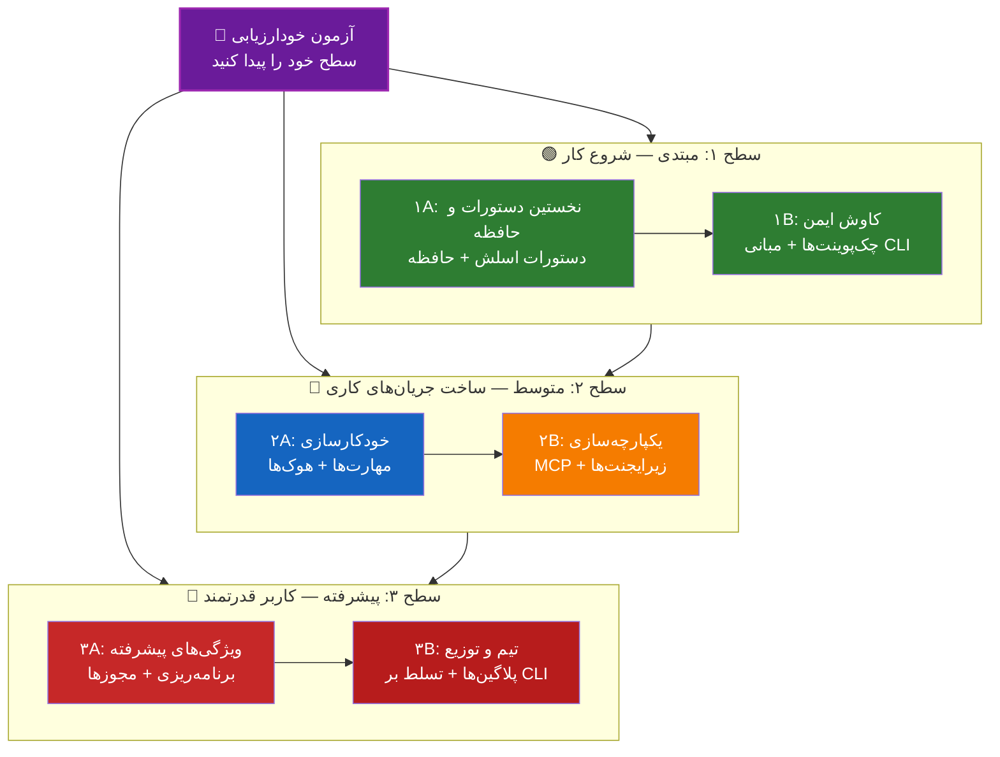

<picture>
  <source media="(prefers-color-scheme: dark)" srcset="../resources/logos/claude-howto-logo-dark.svg">
  
</picture>

# 📚 نقشه راه یادگیری Claude Code

**با Claude Code آشنایی ندارید؟** این راهنما به شما کمک می‌کند قابلیت‌های Claude Code را با سرعت خودتان بیاموزید. چه کاملاً تازه‌کار باشید و چه توسعه‌دهنده‌ای باتجربه، ابتدا با آزمون خودارزیابی زیر شروع کنید تا مسیر مناسب خود را پیدا کنید.

---

## 🧭 سطح خود را پیدا کنید

همه از یک نقطه شروع نمی‌کنند. این خودارزیابی سریع را انجام دهید تا نقطه ورود مناسب را پیدا کنید.

**به این پرسش‌ها صادقانه پاسخ دهید:**

- [ ] می‌توانم Claude Code را اجرا کنم و گفتگو کنم (`claude`)
- [ ] یک فایل CLAUDE.md ساخته یا ویرایش کرده‌ام
- [ ] حداقل از ۳ دستور اسلش داخلی استفاده کرده‌ام (مثلاً /help، /compact، /model)
- [ ] یک دستور اسلش یا مهارت سفارشی ساخته‌ام (SKILL.md)
- [ ] یک سرور MCP پیکربندی کرده‌ام (مثلاً GitHub، پایگاه داده)
- [ ] هوک‌ها را در ~/.claude/settings.json راه‌اندازی کرده‌ام
- [ ] زیرایجنت سفارشی ساخته یا استفاده کرده‌ام (.claude/agents/)
- [ ] از حالت چاپ (`claude -p`) برای اسکریپت‌نویسی یا CI/CD استفاده کرده‌ام

**سطح شما:**

| تعداد تیک | سطح | شروع از | زمان تکمیل |
|--------|-------|----------|------------------|
| ۰ تا ۲ | **سطح ۱: مبتدی** — شروع کار | [نقطه عطف ۱A](#نقطه-عطف-۱a-نخستین-دستورات-و-حافظه) | حدود ۳ ساعت |
| ۳ تا ۵ | **سطح ۲: متوسط** — ساخت جریان‌های کاری | [نقطه عطف ۲A](#نقطه-عطف-۲a-خودکارسازی-مهارت‌ها--هوک‌ها) | حدود ۵ ساعت |
| ۶ تا ۸ | **سطح ۳: پیشرفته** — کاربر قدرتمند و سرگروه تیم | [نقطه عطف ۳A](#نقطه-عطف-۳a-ویژگی‌های-پیشرفته) | حدود ۵ ساعت |

> **نکته**: اگر مطمئن نیستید، یک سطح پایین‌تر شروع کنید. مرور سریع مطالب آشنا بهتر از از دست دادن مفاهیم پایه است.

> **نسخه تعاملی**: در Claude Code دستور `/self-assessment` را اجرا کنید تا یک آزمون تعاملی راهنمایی‌شده دریافت کنید که تسلط شما را در همه ۱۰ حوزه ویژگی امتیاز می‌دهد و یک مسیر یادگیری شخصی‌سازی‌شده تولید می‌کند.

---

## 🎯 فلسفه یادگیری

پوشه‌های این مخزن بر اساس **ترتیب پیشنهادی یادگیری** و سه اصل کلیدی شماره‌گذاری شده‌اند:

1. **وابستگی‌ها** - مفاهیم پایه اول می‌آیند
2. **پیچیدگی** - ویژگی‌های آسان‌تر پیش از پیشرفته‌ها
3. **تکرار استفاده** - رایج‌ترین ویژگی‌ها زودتر آموزش داده می‌شوند

این رویکرد تضمین می‌کند که پایه محکمی بسازید و در همان حال از بهره‌وری فوری بهره‌مند شوید.

---

## 🗺️ مسیر یادگیری شما



**راهنمای رنگ‌ها:**
- 💜 بنفش: آزمون خودارزیابی
- 🟢 سبز: سطح ۱ — مسیر مبتدی
- 🔵 آبی / 🟡 طلایی: سطح ۲ — مسیر متوسط
- 🔴 قرمز: سطح ۳ — مسیر پیشرفته

---

## 📊 جدول کامل نقشه راه

| گام | ویژگی | پیچیدگی | زمان | سطح | وابستگی‌ها | چرا این را یاد بگیریم | مزایای کلیدی |
|------|---------|-----------|------|-------|--------------|----------------|--------------|
| **۱** | [دستورات اسلش](01-slash-commands/) | ⭐ مبتدی | ۳۰ دقیقه | سطح ۱ | هیچ | بردهای سریع بهره‌وری (بیش از ۶۰ دستور داخلی + مهارت‌های بسته‌بندی‌شده) | خودکارسازی فوری، استانداردهای تیمی |
| **۲** | [حافظه](02-memory/) | ⭐⭐ مبتدی+ | ۴۵ دقیقه | سطح ۱ | هیچ | ضروری برای همه ویژگی‌ها | زمینه پایدار، ترجیحات |
| **۳** | [چک‌پوینت‌ها](08-checkpoints/) | ⭐⭐ متوسط | ۴۵ دقیقه | سطح ۱ | مدیریت نشست | کاوش ایمن | آزمایش، بازیابی |
| **۴** | [مبانی CLI](10-cli/) | ⭐⭐ مبتدی+ | ۳۰ دقیقه | سطح ۱ | هیچ | استفاده اصلی از CLI | حالت تعاملی و چاپ |
| **۵** | [مهارت‌ها](03-skills/) | ⭐⭐ متوسط | ۱ ساعت | سطح ۲ | دستورات اسلش | تخصص خودکار | قابلیت‌های قابل استفاده مجدد، یکسانی |
| **۶** | [هوک‌ها](06-hooks/) | ⭐⭐ متوسط | ۱ ساعت | سطح ۲ | ابزارها، دستورات | خودکارسازی جریان کاری (۳۳ رویداد، ۵ نوع) | اعتبارسنجی، دروازه‌های کیفیت |
| **۷** | [MCP](05-mcp/) | ⭐⭐⭐ متوسط+ | ۱ ساعت | سطح ۲ | پیکربندی | دسترسی به داده زنده | یکپارچه‌سازی لحظه‌ای، APIها |
| **۸** | [زیرایجنت‌ها](04-subagents/) | ⭐⭐⭐ متوسط+ | ۱.۵ ساعت | سطح ۲ | حافظه، دستورات | مدیریت وظایف پیچیده (۶ داخلی، شامل Explore و Plan) | واگذاری، تخصص ویژه |
| **۹** | [ویژگی‌های پیشرفته](09-advanced-features/) | ⭐⭐⭐⭐⭐ پیشرفته | ۲ تا ۳ ساعت | سطح ۳ | همه موارد قبلی | ابزارهای کاربر قدرتمند | برنامه‌ریزی، حالت خودکار، کانال‌ها، دیکته صوتی، مجوزها |
| **۱۰** | [پلاگین‌ها](07-plugins/) | ⭐⭐⭐⭐ پیشرفته | ۲ ساعت | سطح ۳ | همه موارد قبلی | راه‌حل‌های کامل | آشناسازی تیم، توزیع |
| **۱۱** | [تسلط بر CLI](10-cli/) | ⭐⭐⭐ پیشرفته | ۱ ساعت | سطح ۳ | توصیه‌شده: همه | تسلط بر استفاده از خط فرمان | اسکریپت‌نویسی، CI/CD، خودکارسازی |

**زمان کل یادگیری**: حدود ۱۱ تا ۱۳ ساعت (یا به سطح خود بپرید و در زمان صرفه‌جویی کنید)

---

## 🟢 سطح ۱: مبتدی — شروع کار

**برای**: کاربران با ۰ تا ۲ تیک در آزمون
**زمان**: حدود ۳ ساعت
**تمرکز**: بهره‌وری فوری، درک مبانی
**نتیجه**: کاربر روزمره راحت، آماده برای سطح ۲

### نقطه عطف ۱A: نخستین دستورات و حافظه

**موضوعات**: دستورات اسلش + حافظه
**زمان**: ۱ تا ۲ ساعت
**پیچیدگی**: ⭐ مبتدی
**هدف**: افزایش فوری بهره‌وری با دستورات سفارشی و زمینه پایدار

#### چه چیزی به دست می‌آورید
✅ ساخت دستورات اسلش سفارشی برای کارهای تکراری
✅ راه‌اندازی حافظه پروژه برای استانداردهای تیمی
✅ پیکربندی ترجیحات شخصی
✅ درک نحوه بارگذاری خودکار زمینه توسط Claude

#### تمرین‌های عملی

```bash
# تمرین ۱: نخستین دستور اسلش خود را نصب کنید
mkdir -p .claude/commands
cp 01-slash-commands/optimize.md .claude/commands/

# تمرین ۲: حافظه پروژه بسازید
cp 02-memory/project-CLAUDE.md ./CLAUDE.md

# تمرین ۳: امتحان کنید
# در Claude Code تایپ کنید: /optimize
```

#### معیارهای موفقیت
- [ ] دستور `/optimize` را با موفقیت فراخوانی کردم
- [ ] Claude استانداردهای پروژه من را از CLAUDE.md به یاد می‌آورد
- [ ] می‌دانم چه زمانی از دستورات اسلش و چه زمانی از حافظه استفاده کنم

#### گام‌های بعدی
وقتی راحت شدید، بخوانید:
- [01-slash-commands/README.md](01-slash-commands/README.md)
- [02-memory/README.md](02-memory/README.md)

> **درک خود را بررسی کنید**: در Claude Code دستور `/lesson-quiz slash-commands` یا `/lesson-quiz memory` را اجرا کنید تا آموخته‌های خود را بسنجید.

---

### نقطه عطف ۱B: کاوش ایمن

**موضوعات**: چک‌پوینت‌ها + مبانی CLI
**زمان**: ۱ ساعت
**پیچیدگی**: ⭐⭐ مبتدی+
**هدف**: یادگیری آزمایش ایمن و استفاده از دستورات اصلی CLI

#### چه چیزی به دست می‌آورید
✅ ساخت و بازیابی چک‌پوینت برای آزمایش ایمن
✅ درک تفاوت حالت تعاملی و حالت چاپ
✅ استفاده از پرچم‌ها و گزینه‌های پایه CLI
✅ پردازش فایل‌ها از طریق pipe

#### تمرین‌های عملی

```bash
# تمرین ۱: جریان کاری چک‌پوینت را امتحان کنید
# در Claude Code:
# چند تغییر آزمایشی انجام دهید، سپس Esc+Esc بزنید یا از /rewind استفاده کنید
# چک‌پوینت پیش از آزمایش خود را انتخاب کنید
# گزینه "Restore code and conversation" را برای بازگشت انتخاب کنید

# تمرین ۲: حالت تعاملی در برابر حالت چاپ
claude "explain this project"           # حالت تعاملی
claude -p "explain this function"       # حالت چاپ (غیرتعاملی)

# تمرین ۳: پردازش محتوای فایل از طریق pipe
cat error.log | claude -p "explain this error"
```

#### معیارهای موفقیت
- [ ] یک چک‌پوینت ساختم و به آن بازگشتم
- [ ] از هر دو حالت تعاملی و چاپ استفاده کردم
- [ ] یک فایل را برای تحلیل به Claude pipe کردم
- [ ] می‌دانم چه زمانی از چک‌پوینت برای آزمایش ایمن استفاده کنم

#### گام‌های بعدی
- بخوانید: [08-checkpoints/README.md](08-checkpoints/README.md)
- بخوانید: [10-cli/README.md](10-cli/README.md)
- **آماده سطح ۲ هستید!** به [نقطه عطف ۲A](#نقطه-عطف-۲a-خودکارسازی-مهارت‌ها--هوک‌ها) بروید

> **درک خود را بررسی کنید**: دستور `/lesson-quiz checkpoints` یا `/lesson-quiz cli` را اجرا کنید تا مطمئن شوید آماده سطح ۲ هستید.

---

## 🔵 سطح ۲: متوسط — ساخت جریان‌های کاری

**برای**: کاربران با ۳ تا ۵ تیک در آزمون
**زمان**: حدود ۵ ساعت
**تمرکز**: خودکارسازی، یکپارچه‌سازی، واگذاری وظایف
**نتیجه**: جریان‌های کاری خودکار، یکپارچه‌سازی‌های خارجی، آماده برای سطح ۳

### بررسی پیش‌نیازها

پیش از شروع سطح ۲، مطمئن شوید با این مفاهیم سطح ۱ راحت هستید:

- [ ] می‌توانم دستورات اسلش بسازم و استفاده کنم ([01-slash-commands/](01-slash-commands/))
- [ ] حافظه پروژه را از طریق CLAUDE.md راه‌اندازی کرده‌ام ([02-memory/](02-memory/))
- [ ] می‌دانم چگونه چک‌پوینت بسازم و بازیابی کنم ([08-checkpoints/](08-checkpoints/))
- [ ] می‌توانم از `claude` و `claude -p` در خط فرمان استفاده کنم ([10-cli/](10-cli/))

> **شکاف دارید؟** پیش از ادامه، آموزش‌های لینک‌شده بالا را مرور کنید.

---

### نقطه عطف ۲A: خودکارسازی (مهارت‌ها + هوک‌ها)

**موضوعات**: مهارت‌ها + هوک‌ها
**زمان**: ۲ تا ۳ ساعت
**پیچیدگی**: ⭐⭐ متوسط
**هدف**: خودکارسازی جریان‌های کاری رایج و بررسی‌های کیفیت

#### چه چیزی به دست می‌آورید
✅ فراخوانی خودکار قابلیت‌های تخصصی با YAML frontmatter (شامل فیلدهای `effort` و `shell`)
✅ راه‌اندازی خودکارسازی رویدادمحور در ۳۳ رویداد هوک
✅ استفاده از هر ۵ نوع هوک (command، http، mcp_tool، prompt، agent)
✅ اعمال استانداردهای کیفیت کد
✅ ساخت هوک‌های سفارشی برای جریان کاری خود

#### تمرین‌های عملی

```bash
# تمرین ۱: نصب یک مهارت
cp -r 03-skills/code-review-specialist ~/.claude/skills/

# تمرین ۲: راه‌اندازی هوک‌ها
mkdir -p ~/.claude/hooks
cp 06-hooks/pre-tool-check.sh ~/.claude/hooks/
chmod +x ~/.claude/hooks/pre-tool-check.sh

# تمرین ۳: پیکربندی هوک‌ها در تنظیمات
# به ~/.claude/settings.json اضافه کنید:
{
  "hooks": {
    "PreToolUse": [
      {
        "matcher": "Bash",
        "hooks": [
          {
            "type": "command",
            "command": "~/.claude/hooks/pre-tool-check.sh"
          }
        ]
      }
    ]
  }
}
```

#### معیارهای موفقیت
- [ ] مهارت بازبینی کد هنگام لزوم به‌طور خودکار فراخوانی می‌شود
- [ ] هوک PreToolUse پیش از اجرای ابزار اجرا می‌شود
- [ ] تفاوت فراخوانی خودکار مهارت و فعال‌سازی رویداد هوک را می‌دانم

#### گام‌های بعدی
- مهارت سفارشی خودتان را بسازید
- هوک‌های بیشتری برای جریان کاری خود راه‌اندازی کنید
- بخوانید: [03-skills/README.md](03-skills/README.md)
- بخوانید: [06-hooks/README.md](06-hooks/README.md)

> **درک خود را بررسی کنید**: پیش از ادامه، `/lesson-quiz skills` یا `/lesson-quiz hooks` را اجرا کنید.

---

### نقطه عطف ۲B: یکپارچه‌سازی (MCP + زیرایجنت‌ها)

**موضوعات**: MCP + زیرایجنت‌ها
**زمان**: ۲ تا ۳ ساعت
**پیچیدگی**: ⭐⭐⭐ متوسط+
**هدف**: یکپارچه‌سازی سرویس‌های خارجی و واگذاری وظایف پیچیده

#### چه چیزی به دست می‌آورید
✅ دسترسی به داده زنده از GitHub، پایگاه‌های داده و غیره
✅ واگذاری کار به ایجنت‌های هوش مصنوعی تخصصی
✅ درک اینکه چه زمانی از MCP و چه زمانی از زیرایجنت استفاده کنیم
✅ ساخت جریان‌های کاری یکپارچه

#### تمرین‌های عملی

```bash
# تمرین ۱: راه‌اندازی GitHub MCP
claude mcp add --transport http github https://api.githubcopilot.com/mcp/ --header "Authorization: Bearer YOUR_GITHUB_PAT"

# تمرین ۲: تست یکپارچه‌سازی MCP
# در Claude Code: /mcp__github__list_prs

# تمرین ۳: نصب زیرایجنت‌ها
mkdir -p .claude/agents
cp 04-subagents/*.md .claude/agents/
```

#### تمرین یکپارچه‌سازی
این جریان کاری کامل را امتحان کنید:
1. از MCP برای دریافت یک PR گیت‌هاب استفاده کنید
2. بگذارید Claude بازبینی را به زیرایجنت code-reviewer واگذار کند
3. از هوک‌ها برای اجرای خودکار تست‌ها استفاده کنید

#### معیارهای موفقیت
- [ ] با موفقیت داده GitHub را از طریق MCP پرس‌وجو کردم
- [ ] Claude وظایف پیچیده را به زیرایجنت‌ها واگذار می‌کند
- [ ] تفاوت MCP و زیرایجنت‌ها را می‌دانم
- [ ] MCP + زیرایجنت‌ها + هوک‌ها را در یک جریان کاری ترکیب کردم

#### گام‌های بعدی
- سرورهای MCP بیشتری راه‌اندازی کنید (پایگاه داده، Slack و غیره)
- زیرایجنت‌های سفارشی برای حوزه خود بسازید
- بخوانید: [05-mcp/README.md](05-mcp/README.md)
- بخوانید: [04-subagents/README.md](04-subagents/README.md)
- **آماده سطح ۳ هستید!** به [نقطه عطف ۳A](#نقطه-عطف-۳a-ویژگی‌های-پیشرفته) بروید

> **درک خود را بررسی کنید**: دستور `/lesson-quiz mcp` یا `/lesson-quiz subagents` را اجرا کنید تا مطمئن شوید آماده سطح ۳ هستید.

---

## 🔴 سطح ۳: پیشرفته — کاربر قدرتمند و سرگروه تیم

**برای**: کاربران با ۶ تا ۸ تیک در آزمون
**زمان**: حدود ۵ ساعت
**تمرکز**: ابزارهای تیمی، CI/CD، ویژگی‌های سازمانی، توسعه پلاگین
**نتیجه**: کاربر قدرتمند، قادر به راه‌اندازی جریان‌های کاری تیمی و CI/CD

### بررسی پیش‌نیازها

پیش از شروع سطح ۳، مطمئن شوید با این مفاهیم سطح ۲ راحت هستید:

- [ ] می‌توانم مهارت‌ها را با فراخوانی خودکار بسازم و استفاده کنم ([03-skills/](03-skills/))
- [ ] هوک‌ها را برای خودکارسازی رویدادمحور راه‌اندازی کرده‌ام ([06-hooks/](06-hooks/))
- [ ] می‌توانم سرورهای MCP را برای داده خارجی پیکربندی کنم ([05-mcp/](05-mcp/))
- [ ] می‌دانم چگونه از زیرایجنت‌ها برای واگذاری وظایف استفاده کنم ([04-subagents/](04-subagents/))

> **شکاف دارید؟** پیش از ادامه، آموزش‌های لینک‌شده بالا را مرور کنید.

---

### نقطه عطف ۳A: ویژگی‌های پیشرفته

**موضوعات**: ویژگی‌های پیشرفته (برنامه‌ریزی، مجوزها، تفکر گسترده، حالت خودکار، کانال‌ها، دیکته صوتی، از راه دور/دسکتاپ/وب)
**زمان**: ۲ تا ۳ ساعت
**پیچیدگی**: ⭐⭐⭐⭐⭐ پیشرفته
**هدف**: تسلط بر جریان‌های کاری پیشرفته و ابزارهای کاربر قدرتمند

#### چه چیزی به دست می‌آورید
✅ حالت برنامه‌ریزی برای ویژگی‌های پیچیده
✅ کنترل دقیق مجوز با ۶ حالت (manual — که قبلاً default بود، acceptEdits، plan، auto، dontAsk، bypassPermissions)
✅ تفکر گسترده از طریق کلید Alt+T / Option+T
✅ مدیریت وظایف پس‌زمینه
✅ حافظه خودکار برای ترجیحات آموخته‌شده
✅ حالت خودکار با طبقه‌بند ایمنی پس‌زمینه
✅ کانال‌هایی که رویدادها (نتایج CI، پیام‌های چت، webhookها) را به یک نشست در حال اجرا می‌فرستند
✅ دیکته صوتی برای تعامل بدون استفاده از دست
✅ کنترل از راه دور (به‌طور عمومی در دسترس — ماشین شما به‌عنوان کارت دستگاه در اپلیکیشن Claude ظاهر می‌شود)، اپلیکیشن دسکتاپ و نشست‌های وب
✅ تیم‌های ایجنت برای همکاری چند‌ایجنت

#### تمرین‌های عملی

```bash
# تمرین ۱: استفاده از حالت برنامه‌ریزی
/plan Implement user authentication system

# تمرین ۲: امتحان حالت‌های مجوز (۶ حالت موجود: manual [که قبلاً default بود]، acceptEdits، plan، auto، dontAsk، bypassPermissions)
claude --permission-mode plan "analyze this codebase"
claude --permission-mode acceptEdits "refactor the auth module"
claude --permission-mode auto "implement the feature"

# تمرین ۳: فعال‌سازی تفکر گسترده
# در حین یک نشست Alt+T (در macOS: Option+T) بزنید

# تمرین ۴: جریان کاری پیشرفته چک‌پوینت
# ۱. ایجاد چک‌پوینت "Clean state"
# ۲. استفاده از حالت برنامه‌ریزی برای طراحی یک ویژگی
# ۳. پیاده‌سازی با واگذاری به زیرایجنت
# ۴. اجرای تست‌ها در پس‌زمینه
# ۵. در صورت شکست تست‌ها، بازگردانی به چک‌پوینت
# ۶. امتحان رویکرد جایگزین

# تمرین ۵: امتحان حالت خودکار (طبقه‌بند ایمنی پس‌زمینه)
claude --permission-mode auto "implement user settings page"

# تمرین ۶: فعال‌سازی تیم‌های ایجنت
export CLAUDE_CODE_EXPERIMENTAL_AGENT_TEAMS=1
# از Claude بخواهید: "Implement feature X using a team approach"

# تمرین ۷: وظایف زمان‌بندی‌شده
/loop 5m /check-status
# وظایف در محدوده نشست هستند؛ برای زمان‌بندی پایدار از وظایف زمان‌بندی‌شدهٔ ابری (سابقاً routines، با /schedule) یا وظایف زمان‌بندی‌شده دسکتاپ استفاده کنید

# تمرین ۸: کانال‌ها (پیش‌نمایش پژوهشی)
# کانال یک سرور MCP است که رویدادها را به نشست در حال اجرای شما می‌فرستد

# تمرین ۹: دیکته صوتی
# از ورودی صوتی برای تعامل بدون استفاده از دست با Claude Code استفاده کنید
```

#### معیارهای موفقیت
- [ ] از حالت برنامه‌ریزی برای یک ویژگی پیچیده استفاده کردم
- [ ] حالت‌های مجوز را پیکربندی کردم (plan، acceptEdits، auto، dontAsk)
- [ ] تفکر گسترده را با Alt+T / Option+T فعال و غیرفعال کردم
- [ ] از حالت خودکار با طبقه‌بند ایمنی پس‌زمینه استفاده کردم
- [ ] از وظایف پس‌زمینه برای عملیات طولانی استفاده کردم
- [ ] کانال‌هایی را که رویدادهای خارجی را به نشست می‌فرستند بررسی کردم
- [ ] دیکته صوتی را برای ورودی بدون استفاده از دست امتحان کردم
- [ ] کنترل از راه دور، اپلیکیشن دسکتاپ و نشست‌های وب را می‌فهمم
- [ ] از `notify_when_idle` روی یک `SendMessage` بین‌نشستی استفاده کردم تا وقتی نشست دیگری بی‌کار شد مطلع شوم
- [ ] تیم‌های ایجنت را فعال کردم و برای وظایف مشارکتی استفاده کردم
- [ ] از `/loop` برای وظایف تکرارشونده یا پایش زمان‌بندی‌شده استفاده کردم

#### گام‌های بعدی
- بخوانید: [09-advanced-features/README.md](09-advanced-features/README.md)

> **درک خود را بررسی کنید**: دستور `/lesson-quiz advanced` را اجرا کنید تا تسلط خود بر ویژگی‌های کاربر قدرتمند را بسنجید.

---

### نقطه عطف ۳B: تیم و توزیع (پلاگین‌ها + تسلط بر CLI)

**موضوعات**: پلاگین‌ها + تسلط بر CLI + CI/CD
**زمان**: ۲ تا ۳ ساعت
**پیچیدگی**: ⭐⭐⭐⭐ پیشرفته
**هدف**: ساخت ابزارهای تیمی، ایجاد پلاگین، تسلط بر یکپارچه‌سازی CI/CD

#### چه چیزی به دست می‌آورید
✅ نصب و ساخت پلاگین‌های کامل بسته‌بندی‌شده
✅ تسلط بر CLI برای اسکریپت‌نویسی و خودکارسازی
✅ راه‌اندازی یکپارچه‌سازی CI/CD با `claude -p`
✅ خروجی JSON برای خطوط لوله خودکار
✅ مدیریت نشست و پردازش دسته‌ای

#### تمرین‌های عملی

```bash
# تمرین ۱: نصب یک پلاگین کامل
claude --plugin-dir ./07-plugins/pr-review  # از ریشه مخزن

# تمرین ۲: حالت چاپ برای CI/CD
claude -p "Run all tests and generate report" --permission-mode auto

# تمرین ۳: خروجی JSON برای اسکریپت‌ها
claude -p --output-format json "list all functions"

# تمرین ۴: مدیریت و از سرگیری نشست
claude -r "feature-auth" "continue implementation"

# تمرین ۵: یکپارچه‌سازی CI/CD با محدودیت‌ها
claude -p --max-turns 3 --output-format json "review code"

# تمرین ۶: پردازش دسته‌ای
for file in *.md; do
  claude -p --output-format json "summarize this: $(cat $file)" > ${file%.md}.summary.json
done
```

#### تمرین یکپارچه‌سازی CI/CD
یک اسکریپت ساده CI/CD بسازید:
1. از `claude -p` برای بازبینی فایل‌های تغییرکرده استفاده کنید
2. نتایج را به‌صورت JSON خروجی بگیرید
3. با `jq` برای مسائل مشخص پردازش کنید
4. در جریان کاری GitHub Actions ادغام کنید

#### معیارهای موفقیت
- [ ] یک پلاگین نصب و استفاده کردم
- [ ] یک پلاگین برای تیم خود ساختم یا تغییر دادم
- [ ] از حالت چاپ (`claude -p`) در CI/CD استفاده کردم
- [ ] خروجی JSON برای اسکریپت‌نویسی تولید کردم
- [ ] یک نشست قبلی را با موفقیت از سر گرفتم
- [ ] یک اسکریپت پردازش دسته‌ای ساختم
- [ ] Claude را در یک جریان کاری CI/CD ادغام کردم

#### موارد استفاده واقعی CLI
- **خودکارسازی بازبینی کد**: اجرای بازبینی کد در خطوط لوله CI/CD
- **تحلیل لاگ**: تحلیل لاگ‌های خطا و خروجی‌های سیستم
- **تولید مستندات**: تولید دسته‌ای مستندات
- **بینش تست**: تحلیل شکست‌های تست
- **تحلیل کارایی**: بازبینی معیارهای کارایی
- **پردازش داده**: تبدیل و تحلیل فایل‌های داده

#### گام‌های بعدی
- بخوانید: [07-plugins/README.md](07-plugins/README.md)
- بخوانید: [10-cli/README.md](10-cli/README.md)
- میان‌برهای CLI و پلاگین‌های سراسر تیم بسازید
- اسکریپت‌های پردازش دسته‌ای راه‌اندازی کنید

> **درک خود را بررسی کنید**: دستور `/lesson-quiz plugins` یا `/lesson-quiz cli` را اجرا کنید تا تسلط خود را تأیید کنید.

---

## 🧪 دانش خود را بسنجید

این مخزن دو مهارت تعاملی دارد که می‌توانید هر زمان در Claude Code برای ارزیابی درک خود استفاده کنید:

| مهارت | دستور | هدف |
|-------|---------|---------|
| **خودارزیابی** | `/self-assessment` | ارزیابی تسلط کلی شما در همه ۱۰ ویژگی. حالت سریع (۲ دقیقه) یا عمیق (۵ دقیقه) را انتخاب کنید تا یک نمایه مهارت و مسیر یادگیری شخصی‌سازی‌شده بگیرید. |
| **آزمون درس** | `/lesson-quiz [lesson]` | سنجش درک شما از یک درس مشخص با ۱۰ پرسش. پیش از درس (پیش‌آزمون)، در حین درس (بررسی پیشرفت)، یا پس از آن (تأیید تسلط) استفاده کنید. |

**مثال‌ها:**
```
/self-assessment                  # سطح کلی خود را پیدا کنید
/lesson-quiz hooks                # آزمون درس ۰۶: هوک‌ها
/lesson-quiz 03                   # آزمون درس ۰۳: مهارت‌ها
/lesson-quiz advanced-features    # آزمون درس ۰۹
```

---

## ⚡ مسیرهای شروع سریع

### اگر فقط ۱۵ دقیقه وقت دارید
**هدف**: نخستین برد خود را بگیرید

1. یک دستور اسلش کپی کنید: `cp 01-slash-commands/optimize.md .claude/commands/`
2. در Claude Code امتحان کنید: `/optimize`
3. بخوانید: [01-slash-commands/README.md](01-slash-commands/README.md)

**نتیجه**: یک دستور اسلش کارآمد خواهید داشت و مبانی را می‌فهمید

---

### اگر ۱ ساعت وقت دارید
**هدف**: راه‌اندازی ابزارهای ضروری بهره‌وری

1. **دستورات اسلش** (۱۵ دقیقه): `/optimize` و `/pr` را کپی و تست کنید
2. **حافظه پروژه** (۱۵ دقیقه): CLAUDE.md را با استانداردهای پروژه خود بسازید
3. **نصب یک مهارت** (۱۵ دقیقه): مهارت code-review-specialist را راه‌اندازی کنید
4. **آن‌ها را با هم امتحان کنید** (۱۵ دقیقه): ببینید چگونه هماهنگ کار می‌کنند

**نتیجه**: افزایش پایه بهره‌وری با دستورات، حافظه و مهارت‌های خودکار

---

### اگر یک آخر هفته وقت دارید
**هدف**: تسلط بر بیشتر ویژگی‌ها

**صبح شنبه** (۳ ساعت):
- تکمیل نقطه عطف ۱A: دستورات اسلش + حافظه
- تکمیل نقطه عطف ۱B: چک‌پوینت‌ها + مبانی CLI

**بعدازظهر شنبه** (۳ ساعت):
- تکمیل نقطه عطف ۲A: مهارت‌ها + هوک‌ها
- تکمیل نقطه عطف ۲B: MCP + زیرایجنت‌ها

**یکشنبه** (۴ ساعت):
- تکمیل نقطه عطف ۳A: ویژگی‌های پیشرفته
- تکمیل نقطه عطف ۳B: پلاگین‌ها + تسلط بر CLI + CI/CD
- ساخت یک پلاگین سفارشی برای تیم خود

**نتیجه**: یک کاربر قدرتمند Claude Code خواهید بود که آماده آموزش دیگران و خودکارسازی جریان‌های کاری پیچیده است

---

## 💡 نکات یادگیری

### ✅ انجام دهید

- **ابتدا آزمون را بدهید** تا نقطه شروع خود را پیدا کنید
- **تمرین‌های عملی** هر نقطه عطف را کامل کنید
- **ساده شروع کنید** و به‌تدریج پیچیدگی بیفزایید
- **هر ویژگی را تست کنید** پیش از رفتن به بعدی
- **یادداشت بردارید** از چیزهایی که برای جریان کاری شما مفید است
- **به مفاهیم قبلی مراجعه کنید** هنگام یادگیری مباحث پیشرفته
- **ایمن آزمایش کنید** با استفاده از چک‌پوینت‌ها
- **دانش را با تیم خود به اشتراک بگذارید**

### ❌ انجام ندهید

- **بررسی پیش‌نیازها را رد نکنید** وقتی به سطح بالاتر می‌پرید
- **سعی نکنید همه چیز را یک‌جا یاد بگیرید** - طاقت‌فرساست
- **پیکربندی‌ها را بدون درک کپی نکنید** - نمی‌دانید چگونه اشکال‌زدایی کنید
- **تست را فراموش نکنید** - همیشه تأیید کنید ویژگی‌ها کار می‌کنند
- **در نقاط عطف عجله نکنید** - برای درک وقت بگذارید
- **مستندات را نادیده نگیرید** - هر README جزئیات ارزشمندی دارد
- **منزوی کار نکنید** - با هم‌تیمی‌ها گفتگو کنید

---

## 🎓 سبک‌های یادگیری

### یادگیرندگان بصری
- نمودارهای mermaid هر README را مطالعه کنید
- جریان اجرای دستورات را تماشا کنید
- نمودارهای جریان کاری خودتان را بکشید
- از مسیر یادگیری بصری بالا استفاده کنید

### یادگیرندگان عملی
- هر تمرین عملی را کامل کنید
- با تغییرات آزمایش کنید
- چیزها را خراب کنید و درستشان کنید (از چک‌پوینت‌ها استفاده کنید!)
- مثال‌های خودتان را بسازید

### یادگیرندگان از طریق خواندن
- هر README را کامل بخوانید
- مثال‌های کد را مطالعه کنید
- جداول مقایسه را مرور کنید
- پست‌های وبلاگ لینک‌شده در منابع را بخوانید

### یادگیرندگان اجتماعی
- جلسات برنامه‌نویسی جفتی راه‌اندازی کنید
- مفاهیم را به هم‌تیمی‌ها آموزش دهید
- به بحث‌های انجمن Claude Code بپیوندید
- پیکربندی‌های سفارشی خود را به اشتراک بگذارید

---

## 📈 پیگیری پیشرفت

از این چک‌لیست‌ها برای پیگیری پیشرفت خود بر اساس سطح استفاده کنید. هر زمان دستور `/self-assessment` را اجرا کنید تا نمایه مهارت به‌روزشده بگیرید، یا پس از هر آموزش `/lesson-quiz [lesson]` را برای تأیید درک خود اجرا کنید.

### 🟢 سطح ۱: مبتدی
- [ ] [01-slash-commands](01-slash-commands/) را تکمیل کردم
- [ ] [02-memory](02-memory/) را تکمیل کردم
- [ ] نخستین دستور اسلش سفارشی را ساختم
- [ ] حافظه پروژه را راه‌اندازی کردم
- [ ] **نقطه عطف ۱A محقق شد**
- [ ] [08-checkpoints](08-checkpoints/) را تکمیل کردم
- [ ] مبانی [10-cli](10-cli/) را تکمیل کردم
- [ ] چک‌پوینت ساختم و به آن بازگشتم
- [ ] از حالت تعاملی و چاپ استفاده کردم
- [ ] **نقطه عطف ۱B محقق شد**

### 🔵 سطح ۲: متوسط
- [ ] [03-skills](03-skills/) را تکمیل کردم
- [ ] [06-hooks](06-hooks/) را تکمیل کردم
- [ ] نخستین مهارت را نصب کردم
- [ ] هوک PreToolUse را راه‌اندازی کردم
- [ ] **نقطه عطف ۲A محقق شد**
- [ ] [05-mcp](05-mcp/) را تکمیل کردم
- [ ] [04-subagents](04-subagents/) را تکمیل کردم
- [ ] GitHub MCP را متصل کردم
- [ ] زیرایجنت سفارشی ساختم
- [ ] یکپارچه‌سازی‌ها را در یک جریان کاری ترکیب کردم
- [ ] **نقطه عطف ۲B محقق شد**

### 🔴 سطح ۳: پیشرفته
- [ ] [09-advanced-features](09-advanced-features/) را تکمیل کردم
- [ ] با موفقیت از حالت برنامه‌ریزی استفاده کردم
- [ ] حالت‌های مجوز را پیکربندی کردم (۶ حالت شامل auto)
- [ ] از حالت خودکار با طبقه‌بند ایمنی استفاده کردم
- [ ] از کلید تفکر گسترده استفاده کردم
- [ ] کانال‌ها و دیکته صوتی را بررسی کردم
- [ ] **نقطه عطف ۳A محقق شد**
- [ ] [07-plugins](07-plugins/) را تکمیل کردم
- [ ] استفاده پیشرفته از [10-cli](10-cli/) را تکمیل کردم
- [ ] حالت چاپ (`claude -p`) را برای CI/CD راه‌اندازی کردم
- [ ] خروجی JSON برای خودکارسازی تولید کردم
- [ ] Claude را در خط لوله CI/CD ادغام کردم
- [ ] پلاگین تیمی ساختم
- [ ] **نقطه عطف ۳B محقق شد**

---

## 🆘 چالش‌های رایج یادگیری

### چالش ۱: «مفاهیم زیادی یک‌جا»
**راه‌حل**: هر بار روی یک نقطه عطف تمرکز کنید. پیش از رفتن به بعد، همه تمرین‌ها را کامل کنید.

### چالش ۲: «نمی‌دانم چه زمانی از کدام ویژگی استفاده کنم»
**راه‌حل**: به [ماتریس موارد استفاده](README.md#مطمئن-نیستید-از-کجا-شروع-کنید) در README اصلی مراجعه کنید.

### چالش ۳: «پیکربندی کار نمی‌کند»
**راه‌حل**: بخش [عیب‌یابی](README.md#سوالات-متداول) را بررسی کنید و مکان فایل‌ها را تأیید کنید.

### چالش ۴: «مفاهیم به نظر هم‌پوشانی دارند»
**راه‌حل**: جدول [مقایسه ویژگی‌ها](README.md#با-این-چه-چیزی-می‌توانید-بسازید) را برای درک تفاوت‌ها مرور کنید.

### چالش ۵: «به‌خاطر سپردن همه چیز سخت است»
**راه‌حل**: برگه تقلب خودتان را بسازید. از چک‌پوینت‌ها برای آزمایش ایمن استفاده کنید.

### چالش ۶: «باتجربه هستم اما مطمئن نیستم از کجا شروع کنم»
**راه‌حل**: [آزمون خودارزیابی](#-سطح-خود-را-پیدا-کنید) بالا را بدهید. به سطح خود بپرید و از بررسی پیش‌نیازها برای یافتن شکاف‌ها استفاده کنید.

---

## 🎯 پس از تکمیل چه کاری انجام دهیم؟

وقتی همه نقاط عطف را تکمیل کردید:

1. **مستندات تیمی بسازید** - راه‌اندازی Claude Code تیم خود را مستند کنید
2. **پلاگین‌های سفارشی بسازید** - جریان‌های کاری تیم خود را بسته‌بندی کنید، شامل فیلدهای جدیدتر مانیفست (`workflows`، `channels`، `dependencies`)
3. **`/design` را امتحان کنید** - یک ماکاپ رابط کاربری، جریان صفحات یا صفحه فرود را روی یک بوم طراحی ترسیم کنید به‌جای نوشتن دستی HTML (نسخه 2.1.265 به بعد)
4. **کنترل از راه دور را بررسی کنید** - یک نشست محلی Claude Code را از گوشی، مرورگر یا اپلیکیشن Claude ادامه دهید، یا از گوشی از طریق کارت دستگاه آن در اپلیکیشن Claude یکی شروع کنید
5. **نشست‌های وب را امتحان کنید** - از Claude Code از طریق رابط‌های مبتنی بر مرورگر برای توسعه از راه دور استفاده کنید
6. **از اپلیکیشن دسکتاپ استفاده کنید** - به ویژگی‌های Claude Code از طریق اپلیکیشن بومی دسکتاپ دسترسی پیدا کنید
7. **از حالت خودکار استفاده کنید** - بگذارید Claude با یک طبقه‌بند ایمنی پس‌زمینه خودمختار کار کند
8. **از حافظه خودکار بهره بگیرید** - بگذارید Claude ترجیحات شما را به‌تدریج و به‌طور خودکار یاد بگیرد
9. **تیم‌های ایجنت را راه‌اندازی کنید** - چندین ایجنت را روی وظایف پیچیده و چندوجهی هماهنگ کنید
10. **از کانال‌ها استفاده کنید** - یک سرور MCP متصل کنید که رویدادها (نتایج CI، پیام‌های چت، webhookها) را به نشست در حال اجرای شما می‌فرستد
11. **دیکته صوتی را امتحان کنید** - از ورودی صوتی بدون استفاده از دست برای تعامل با Claude Code استفاده کنید
12. **از وظایف زمان‌بندی‌شده استفاده کنید** - بررسی‌های تکرارشونده را با `/loop` و ابزارهای cron خودکار کنید (محدود به نشست)، یا وظایف زمان‌بندی‌شدهٔ ابری را با `/schedule`
13. **مثال مشارکت دهید** - با انجمن به اشتراک بگذارید
14. **به دیگران آموزش دهید** - به هم‌تیمی‌ها در یادگیری کمک کنید
15. **جریان‌های کاری را بهینه کنید** - بر اساس استفاده به‌طور مستمر بهبود دهید
16. **به‌روز بمانید** - انتشارها و ویژگی‌های جدید Claude Code را دنبال کنید

---

## 📚 منابع بیشتر

### مستندات رسمی
- [مستندات Claude Code](https://code.claude.com/docs/en/overview)
- [مستندات Anthropic](https://docs.anthropic.com)
- [مشخصات پروتکل MCP](https://modelcontextprotocol.io)

### پست‌های وبلاگ
- [کشف دستورات اسلش Claude Code](https://medium.com/@luongnv89/discovering-claude-code-slash-commands-cdc17f0dfb29)

### انجمن
- [کتاب آشپزی Anthropic](https://github.com/anthropics/anthropic-cookbook)
- [مخزن سرورهای MCP](https://github.com/modelcontextprotocol/servers)

---

## 💬 بازخورد و پشتیبانی

- **مشکلی پیدا کردید؟** یک issue در مخزن ایجاد کنید
- **پیشنهادی دارید؟** یک pull request ارسال کنید
- **کمک لازم دارید؟** مستندات را بررسی کنید یا از انجمن بپرسید

---

**آخرین به‌روزرسانی**: ۲۶ اکتبر ۲۰۲۶
**نسخه Claude Code**: 2.1.310
**منابع**:
- https://code.claude.com/docs/en/overview
- https://code.claude.com/docs/en/hooks
- https://code.claude.com/docs/en/permission-modes
- https://github.com/anthropics/claude-code/releases/tag/v2.1.144
- https://github.com/anthropics/claude-code/releases/tag/v2.1.145
- https://code.claude.com/docs/en/model-config
- https://code.claude.com/docs/en/agent-teams
- https://code.claude.com/docs/en/mcp
- https://code.claude.com/docs/en/plugins/install
- https://code.claude.com/docs/en/channels
- https://code.claude.com/docs/en/remote-control
- https://code.claude.com/docs/en/scheduled-tasks
- https://code.claude.com/docs/en/commands
- https://code.claude.com/docs/en/sub-agents
- https://code.claude.com/docs/en/routines#where-the-name-routines-still-appears
- https://code.claude.com/docs/en/headless#auto-approve-tools
- https://code.claude.com/docs/en/permission-modes#which-mode-a-non-interactive-run-starts-in
**مدل‌های سازگار**: Claude Fable 5.1، Claude Fable 5، Claude Opus 5، Claude Sonnet 5، Claude Sonnet 4.6، Claude Opus 4.8، Claude Haiku 4.5
**نگهداری توسط**: مشارکت‌کنندگان Claude How-To
**مجوز**: اهداف آموزشی، استفاده و اقتباس آزاد

---

[← بازگشت به README اصلی](README.md)
