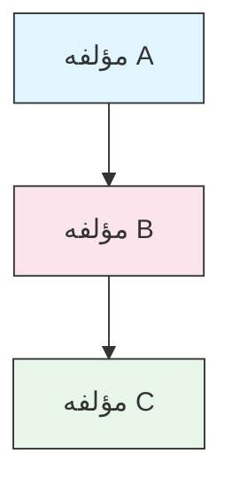

<picture>
  <source media="(prefers-color-scheme: dark)" srcset="../resources/logos/claude-howto-logo-dark.svg">
  
</picture>

# راهنمای سبک

> قواعد و قوانین قالب‌بندی برای مشارکت در Claude How To. این راهنما را دنبال کنید تا محتوا یکدست، حرفه‌ای و آسان برای نگهداری بماند.

---

## فهرست مطالب

- [نام‌گذاری فایل و پوشه](#نام‌گذاری-فایل-و-پوشه)
- [ساختار سند](#ساختار-سند)
- [سرفصل‌ها](#سرفصل‌ها)
- [قالب‌بندی متن](#قالب‌بندی-متن)
- [فهرست‌ها](#فهرست‌ها)
- [جدول‌ها](#جدول‌ها)
- [بلوک‌های کد](#بلوک‌های-کد)
- [پیوندها و ارجاعات متقابل](#پیوندها-و-ارجاعات-متقابل)
- [نمودارها](#نمودارها)
- [استفاده از ایموجی](#استفاده-از-ایموجی)
- [فرانت‌متر YAML](#فراداده-yaml)
- [تصاویر و رسانه](#تصاویر-و-رسانه)
- [لحن و بیان](#لحن-و-بیان)
- [پیام‌های کامیت](#پیام‌های-کامیت)
- [چک‌لیست برای نویسندگان](#چک‌لیست-نویسندگان)

---

## نام‌گذاری فایل و پوشه

### پوشه‌های درس

پوشه‌های درس از یک **پیشوند شماره‌ای دو رقمی** و سپس یک توصیف‌گر **kebab-case** استفاده می‌کنند:

```
01-slash-commands/
02-memory/
03-skills/
04-subagents/
05-mcp/
```

این شماره ترتیب مسیر یادگیری از مبتدی تا پیشرفته را نشان می‌دهد.

### نام فایل‌ها

| نوع | قرارداد | نمونه‌ها |
|------|-----------|----------|
| **README درس** | `README.md` | `01-slash-commands/README.md` |
| **فایل ویژگی** | Kebab-case `.md` | `code-reviewer.md`، `generate-api-docs.md` |
| **اسکریپت شل** | Kebab-case `.sh` | `format-code.sh`، `validate-input.sh` |
| **فایل پیکربندی** | نام‌های استاندارد | `.mcp.json`، `settings.json` |
| **فایل حافظه** | با پیشوند دامنه | `project-CLAUDE.md`، `personal-CLAUDE.md` |
| **اسناد سطح بالا** | UPPER_CASE `.md` | `CATALOG.md`، `QUICK_REFERENCE.md`، `CONTRIBUTING.md` |
| **دارایی‌های تصویری** | Kebab-case | `pr-slash-command.png`، `claude-howto-logo.svg` |

### قواعد

- برای همه نام‌های فایل و پوشه از **حروف کوچک** استفاده کنید (به‌جز اسناد سطح بالا مانند `README.md` و `CATALOG.md`)
- از **خط تیره** (`-`) به‌عنوان جداکننده کلمات استفاده کنید، هرگز از زیرخط یا فاصله
- نام‌ها را توصیفی اما مختصر نگه دارید

---

## ساختار سند

### README اصلی

فایل `README.md` ریشه این ترتیب را دنبال می‌کند:

1. لوگو (عنصر `<picture>` با گونه‌های تیره/روشن)
2. عنوان H1
3. نقل‌قول آغازین (ارزش پیشنهادی یک‌خطی)
4. بخش «چرا این راهنما؟» همراه با جدول مقایسه
5. خط افقی (`---`)
6. فهرست مطالب
7. کاتالوگ ویژگی‌ها
8. پیمایش سریع
9. مسیر یادگیری
10. بخش‌های ویژگی
11. شروع به کار
12. بهترین شیوه‌ها / عیب‌یابی
13. مشارکت / مجوز

### README درس

هر `README.md` درس این ترتیب را دنبال می‌کند:

1. عنوان H1 (مثلاً `# Slash Commands`)
2. پاراگراف مرور مختصر
3. جدول مرجع سریع (اختیاری)
4. نمودار معماری (Mermaid)
5. بخش‌های تفصیلی (H2)
6. نمونه‌های کاربردی (شماره‌دار، ۴ تا ۶ نمونه)
7. بهترین شیوه‌ها (جدول‌های بایدها و نبایدها)
8. عیب‌یابی
9. راهنماهای مرتبط / مستندات رسمی
10. پانوشت فراداده سند

### فایل ویژگی/نمونه

فایل‌های ویژگی مستقل (مثلاً `optimize.md`، `pr.md`):

1. فرانت‌متر YAML (در صورت وجود)
2. عنوان H1
3. هدف / توضیح
4. دستورالعمل‌های استفاده
5. نمونه‌های کد
6. نکات سفارشی‌سازی

### جداکننده‌های بخش

از خطوط افقی (`---`) برای جدا کردن نواحی اصلی سند استفاده کنید:

```markdown
---

## بخش اصلی جدید
```

آن‌ها را پس از نقل‌قول آغازین و بین بخش‌های منطقاً متمایز سند قرار دهید.

---

## سرفصل‌ها

### سلسله‌مراتب

| سطح | کاربرد | نمونه |
|-------|-----|---------|
| `#` H1 | عنوان صفحه (یکی در هر سند) | `# Slash Commands` |
| `##` H2 | بخش‌های اصلی | `## Best Practices` |
| `###` H3 | زیربخش‌ها | `### Adding a Skill` |
| `####` H4 | زیرزیربخش‌ها (نادر) | `#### Configuration Options` |

### قواعد

- **یک H1 در هر سند** — فقط عنوان صفحه
- **هرگز سطوح را رد نکنید** — از H2 به H4 نپرید
- **سرفصل‌ها را مختصر نگه دارید** — هدف ۲ تا ۵ کلمه
- **از sentence case استفاده کنید** — فقط کلمه اول و اسم‌های خاص را با حرف بزرگ بنویسید (استثنا: نام ویژگی‌ها همان‌طور که هست بماند)
- **پیشوند ایموجی فقط روی سرصفحه‌های بخش README اصلی** اضافه کنید (به [استفاده از ایموجی](#استفاده-از-ایموجی) مراجعه کنید)

---

## قالب‌بندی متن

### تأکید

| سبک | زمان استفاده | نمونه |
|-------|------------|---------|
| **پررنگ** (`**text**`) | اصطلاحات کلیدی، برچسب‌ها در جدول‌ها، مفاهیم مهم | `**Installation**:` |
| *مورب* (`*text*`) | نخستین کاربرد یک اصطلاح فنی، عناوین کتاب/سند | `*frontmatter*` |
| `Code` (`` `text` ``) | نام فایل‌ها، دستورها، مقادیر پیکربندی، ارجاعات کد | `` `CLAUDE.md` `` |

### نقل‌قول برای هشدارها

از نقل‌قول‌ها با پیشوند پررنگ برای نکات مهم استفاده کنید:

```markdown
> **توجه**: دستورهای اسلش سفارشی از نسخه v2.0 در مهارت‌ها ادغام شده‌اند.

> **مهم**: هرگز کلیدهای API یا اطلاعات احراز هویت را کامیت نکنید.

> **نکته**: حافظه را با مهارت‌ها ترکیب کنید تا حداکثر اثربخشی را بگیرید.
```

انواع هشدار پشتیبانی‌شده: **توجه**، **مهم**، **نکته**، **هشدار**.

### پاراگراف‌ها

- پاراگراف‌ها را کوتاه نگه دارید (۲ تا ۴ جمله)
- بین پاراگراف‌ها یک خط خالی اضافه کنید
- با نکته کلیدی شروع کنید، سپس زمینه را ارائه دهید
- «چرا» را توضیح دهید، نه فقط «چه».

---

## فهرست‌ها

### فهرست‌های نامرتب

از خط تیره (`-`) با تورفتگی ۲ فاصله برای تودرتویی استفاده کنید:

```markdown
- آیتم اول
- آیتم دوم
  - آیتم تودرتو
  - آیتم تودرتوی دیگر
    - تودرتوی عمیق (از عمیق‌تر از ۳ سطح پرهیز کنید)
- آیتم سوم
```

### فهرست‌های مرتب

از فهرست‌های شماره‌دار برای مراحل متوالی، دستورالعمل‌ها و آیتم‌های رتبه‌بندی‌شده استفاده کنید:

```markdown
1. مرحله اول
2. مرحله دوم
   - جزئیات زیرنکته
   - زیرنکته دیگر
3. مرحله سوم
```

### فهرست‌های توصیفی

از برچسب‌های پررنگ برای فهرست‌های کلید-مقدار استفاده کنید:

```markdown
- **گلوگاه‌های عملکرد** - شناسایی عملیات O(n^2)، حلقه‌های ناکارآمد
- **نشت حافظه** - یافتن منابع آزادنشده، ارجاعات چرخه‌ای
- **بهبود الگوریتم** - پیشنهاد الگوریتم‌ها یا ساختارهای داده بهتر
```

### قواعد

- تورفتگی یکدست را حفظ کنید (۲ فاصله در هر سطح)
- قبل و بعد از فهرست یک خط خالی اضافه کنید
- آیتم‌های فهرست را از نظر ساختار موازی نگه دارید (همه با فعل شروع شوند، یا همه اسم باشند و غیره)
- از تودرتویی عمیق‌تر از ۳ سطح پرهیز کنید

---

## جدول‌ها

### قالب استاندارد

```markdown
| ستون ۱ | ستون ۲ | ستون ۳ |
|----------|----------|----------|
| داده     | داده     | داده     |
```

### الگوهای رایج جدول

**مقایسه ویژگی‌ها (۳ تا ۴ ستون):**

```markdown
| ویژگی | فراخوانی | ماندگاری | مناسب برای |
|---------|-----------|------------|----------|
| **دستورهای اسلش** | دستی (`/cmd`) | فقط نشست | میان‌برهای سریع |
| **حافظه** | بارگذاری خودکار | بین‌نشستی | یادگیری بلندمدت |
```

**بایدها و نبایدها:**

```markdown
| باید | نباید |
|----|-------|
| از نام‌های توصیفی استفاده کنید | از نام‌های مبهم استفاده کنید |
| فایل‌ها را متمرکز نگه دارید | یک فایل واحد را بیش از حد بار کنید |
```

**مرجع سریع:**

```markdown
| جنبه | جزئیات |
|--------|---------|
| **هدف** | تولید مستندات API |
| **دامنه** | سطح پروژه |
| **پیچیدگی** | متوسط |
```

### قواعد

- **سرصفحه‌های جدول را پررنگ کنید** وقتی برچسب سطر هستند (ستون اول)
- خطوط لوله را برای خوانایی در منبع تراز کنید (اختیاری اما ترجیح‌داده‌شده)
- محتوای خانه‌ها را مختصر نگه دارید؛ برای جزئیات از پیوند استفاده کنید
- از `code formatting` برای دستورها و مسیرهای فایل داخل خانه‌ها استفاده کنید

---

## بلوک‌های کد

### برچسب‌های زبان

همیشه یک برچسب زبان برای برجسته‌سازی نحوی مشخص کنید:

| زبان | برچسب | کاربرد |
|----------|-----|---------|
| Shell | `bash` | دستورهای CLI، اسکریپت‌ها |
| Python | `python` | کد پایتون |
| JavaScript | `javascript` | کد JS |
| TypeScript | `typescript` | کد TS |
| JSON | `json` | فایل‌های پیکربندی |
| YAML | `yaml` | فرانت‌متر، پیکربندی |
| Markdown | `markdown` | نمونه‌های Markdown |
| SQL | `sql` | کوئری‌های پایگاه داده |
| متن ساده | (بدون برچسب) | خروجی مورد انتظار، درخت پوشه |

### قراردادها

```bash
# توضیح اینکه دستور چه کاری انجام می‌دهد
claude mcp add notion --transport http https://mcp.notion.com/mcp
```

- پیش از دستورهای غیربدیهی یک **خط توضیح** اضافه کنید
- همه نمونه‌ها را **آماده کپی-پیست** کنید
- در صورت ارتباط، **هم نسخه ساده و هم پیشرفته** را نشان دهید
- وقتی به فهم کمک می‌کند **خروجی مورد انتظار** را بگنجانید (از بلوک کد بدون برچسب استفاده کنید)

### بلوک‌های نصب

از این الگو برای دستورالعمل‌های نصب استفاده کنید:

```bash
# کپی فایل‌ها به پروژه شما
cp 01-slash-commands/*.md .claude/commands/
```

### جریان‌های کاری چندمرحله‌ای

```bash
# مرحله ۱: پوشه را ایجاد کنید
mkdir -p .claude/commands

# مرحله ۲: قالب‌ها را کپی کنید
cp 01-slash-commands/*.md .claude/commands/

# مرحله ۳: نصب را تأیید کنید
ls .claude/commands/
```

---

## پیوندها و ارجاعات متقابل

### پیوندهای داخلی (نسبی)

برای همهٔ پیوندهای داخلی از مسیرهای نسبی استفاده کنید:

```markdown
[Slash Commands](01-slash-commands/)
[Skills Guide](03-skills/)
[Memory Architecture](02-memory/#memory-architecture)
```

از یک پوشهٔ درس به ریشه یا پوشهٔ هم‌سطح:

```markdown
[Back to main guide](../README.md)
[Related: Skills](../03-skills/)
```

### پیوندهای خارجی (مطلق)

از URLهای کامل با متن لنگر توصیفی استفاده کنید:

```markdown
[Anthropic's official documentation](https://code.claude.com/docs/en/overview)
```

- هرگز از «اینجا کلیک کنید» یا «این پیوند» به‌عنوان متن لنگر استفاده نکنید
- از متنی توصیفی استفاده کنید که بیرون از بافت هم معنادار باشد

### لنگرهای بخش

با استفاده از لنگرهای سبک GitHub به بخش‌های همان سند پیوند بدهید:

```markdown
[Feature Catalog](#-feature-catalog)
[Best Practices](#best-practices)
```

### الگوی راهنماهای مرتبط

درس‌ها را با بخشی از راهنماهای مرتبط به پایان ببرید:

```markdown
## Related Guides

- [Slash Commands](../01-slash-commands/) - Quick shortcuts
- [Memory](../02-memory/) - Persistent context
- [Skills](../03-skills/) - Reusable capabilities
```

---

## نمودارها

### Mermaid

برای همهٔ نمودارها از Mermaid استفاده کنید. انواع پشتیبانی‌شده:

- `graph TB` / `graph LR` — معماری، سلسله‌مراتب، جریان
- `sequenceDiagram` — جریان‌های تعامل
- `timeline` — توالی‌های زمانی

GitHub به‌صورت بومی Mermaid را رندر می‌کند. وب‌سایت و EPUB همان منبع را با [Pele](https://github.com/obsidianmd/pele) رندر می‌کنند که در `scripts/vendor_assets.py` پین شده است، و هوک پیش از کامیت `mermaid-syntax` هر بلوک را با همان بستهٔ کامل اعتبارسنجی می‌کند، بنابراین بلوکی که از هوک عبور کند همه‌جا رندر می‌شود.

### قراردادهای سبک

با استفاده از بلوک‌های style رنگ‌های یکدست اعمال کنید:



**پالت رنگ:**

| رنگ | هگز | کاربرد |
|-------|-----|---------|
| آبی روشن | `#e1f5fe` | مؤلفه‌های اصلی، ورودی‌ها |
| صورتی روشن | `#fce4ec` | پردازش، میان‌افزار |
| سبز روشن | `#e8f5e9` | خروجی‌ها، نتایج |
| زرد روشن | `#fff9c4` | پیکربندی، اختیاری |
| بنفش روشن | `#f3e5f5` | کاربرمحور، رابط کاربری |

### قواعد

- برای برچسب گره‌ها از `["Label text"]` استفاده کنید (نویسه‌های ویژه را ممکن می‌کند)
- برای شکستن خط درون برچسب‌ها از `<br/>` استفاده کنید
- برچسب‌ها را متن ساده نگه دارید و برچسب‌های شماره‌دار را همان‌گونه بنویسید (`["1. Load file"]`، بدون بک‌اسلش پیش از نقطه)
- به دستورهای `%%{init}%%` یا تم‌های Mermaid تکیه نکنید: وب‌سایت پالت روشن و تاریک خودش را اعمال می‌کند
- نمودارها را ساده نگه دارید (حداکثر ۱۰ تا ۱۲ گره)
- برای دسترس‌پذیری، توضیح متنی کوتاهی زیر نمودار بیفزایید
- برای سلسله‌مراتب از بالا به پایین (`TB`) و برای جریان‌های کاری از چپ به راست (`LR`) استفاده کنید

---

## استفاده از ایموجی

### ایموجی‌ها کجا استفاده می‌شوند

ایموجی‌ها **به‌ندرت و هدفمند** استفاده می‌شوند — فقط در بافت‌های مشخص:

| بافت | ایموجی‌ها | نمونه |
|---------|--------|---------|
| سرصفحه‌های بخش در README ریشه | آیکون‌های دسته | `## 📚 Learning Path` |
| نشانگرهای سطح مهارت | دایره‌های رنگی | 🟢 مبتدی، 🔵 متوسط، 🔴 پیشرفته |
| بایدها و نبایدها | علامت تأیید/ضربدر | ✅ این کار را بکنید، ❌ این کار را نکنید |
| امتیازهای پیچیدگی | ستاره‌ها | ⭐⭐⭐ |

### مجموعهٔ استاندارد ایموجی

| ایموجی | معنا |
|-------|---------|
| 📚 | یادگیری، راهنماها، مستندات |
| ⚡ | شروع به کار، مرجع سریع |
| 🎯 | قابلیت‌ها، مرجع سریع |
| 🎓 | مسیرهای یادگیری |
| 📊 | آمار، مقایسه‌ها |
| 🚀 | نصب، دستورهای سریع |
| 🟢 | سطح مبتدی |
| 🔵 | سطح متوسط |
| 🔴 | سطح پیشرفته |
| ✅ | رویهٔ توصیه‌شده |
| ❌ | پرهیز / الگوی نادرست |
| ⭐ | واحد امتیاز پیچیدگی |

### قواعد

- **هرگز در متن اصلی** یا پاراگراف‌ها از ایموجی استفاده نکنید
- **فقط در سرصفحه‌ها**ی README ریشه از ایموجی استفاده کنید (نه در README درس‌ها)
- **ایموجی تزئینی اضافه نکنید** — هر ایموجی باید معنایی را منتقل کند
- استفاده از ایموجی را با جدول بالا هم‌خوان نگه دارید

---

## فرادادهٔ YAML

### فایل‌های قابلیت (مهارت‌ها، دستورها، ایجنت‌ها)

```yaml
---
name: unique-identifier
description: What this feature does and when to use it
allowed-tools: Bash, Read, Grep
---
```

### فیلدهای اختیاری

```yaml
---
name: my-feature
description: Brief description
argument-hint: "[file-path] [options]"
allowed-tools: Bash, Read, Grep, Write, Edit
model: opus                        # opus، sonnet یا haiku
disable-model-invocation: true     # فراخوانی فقط توسط کاربر
user-invocable: false              # پنهان از منوی کاربر
context: fork                      # اجرا در زیرایجنت جداگانه
agent: Explore                     # نوع ایجنت برای context: fork
---
```

### قواعد

- فراداده را در ابتدای فایل قرار دهید
- برای فیلد `name` از **kebab-case** استفاده کنید
- `description` را در یک جمله نگه دارید
- فقط فیلدهایی را بگنجانید که لازم هستند

---

## تصاویر و رسانه

### الگوی لوگو

همهٔ اسنادی که با لوگو شروع می‌شوند برای پشتیبانی از حالت تاریک/روشن از عنصر `<picture>` استفاده می‌کنند:

```html
<picture>
  <source media="(prefers-color-scheme: dark)" srcset="../resources/logos/claude-howto-logo-dark.svg">
  
</picture>
```

### اسکرین‌شات‌ها

- در پوشهٔ درس مربوطه ذخیره کنید (مثلاً `01-slash-commands/pr-slash-command.png`)
- از نام فایل‌های kebab-case استفاده کنید
- متن جایگزین توصیفی را بگنجانید
- برای نمودارها SVG و برای اسکرین‌شات‌ها PNG را ترجیح دهید

### قواعد

- همیشه برای تصاویر متن جایگزین ارائه دهید
- حجم فایل تصاویر را معقول نگه دارید (کمتر از 500KB برای PNGها)
- برای ارجاع به تصاویر از مسیرهای نسبی استفاده کنید
- تصاویر را در همان پوشه‌ای ذخیره کنید که سند ارجاع‌دهنده در آن قرار دارد، یا برای تصاویر مشترک در `assets/`

---

## لحن و بیان

### سبک نوشتار

- **حرفه‌ای اما در دسترس** — دقت فنی بدون انبوهی از اصطلاحات تخصصی
- **جملات معلوم** — «یک فایل بسازید» نه «یک فایل باید ساخته شود»
- **دستورهای مستقیم** — «این دستور را اجرا کنید» نه «شاید بخواهید این دستور را اجرا کنید»
- **دوستدار تازه‌کاران** — فرض کنید خواننده در Claude Code تازه‌کار است، نه در برنامه‌نویسی

### اصول محتوا

| اصل | نمونه |
|-----------|---------|
| **نشان بده، نگو** | مثال‌های کارآمد ارائه دهید، نه توصیف‌های انتزاعی |
| **پیچیدگی تدریجی** | ساده شروع کنید و در بخش‌های بعدی عمق ببخشید |
| **«چرایی» را توضیح دهید** | «از حافظه استفاده کنید برای... چون...» نه فقط «از حافظه استفاده کنید برای...» |
| **آمادهٔ کپی-پیست** | هر بلوک کد باید با چسباندن مستقیم کار کند |
| **بافت دنیای واقعی** | از سناریوهای عملی استفاده کنید، نه مثال‌های ساختگی |

### واژگان

- از «Claude Code» استفاده کنید (نه «Claude CLI» یا «the tool»)
- از «skill» استفاده کنید (نه «custom command» — اصطلاحی منسوخ)
- برای بخش‌های شماره‌دار از «lesson» یا «guide» استفاده کنید
- برای فایل‌های تک‌قابلیت از «example» استفاده کنید

---

## پیام‌های کامیت

از [Conventional Commits](https://www.conventionalcommits.org/) پیروی کنید:

```
type(scope): description
```

### انواع

| نوع | کاربرد |
|------|---------|
| `feat` | قابلیت، مثال یا راهنمای جدید |
| `fix` | رفع باگ، اصلاح، پیوند شکسته |
| `docs` | بهبود مستندات |
| `refactor` | بازساختاردهی بدون تغییر رفتار |
| `style` | فقط تغییرات قالب‌بندی |
| `test` | افزودن یا تغییر تست‌ها |
| `chore` | ساخت، وابستگی‌ها، CI |

### دامنه‌ها

از نام درس یا ناحیهٔ فایل به‌عنوان دامنه استفاده کنید:

```
feat(slash-commands): Add API documentation generator
docs(memory): Improve personal preferences example
fix(README): Correct table of contents link
docs(skills): Add comprehensive code review skill
```

---

## پانوشت فرادادهٔ سند

README درس‌ها با یک بلوک فراداده به پایان می‌رسد:

```markdown
---
**Last Updated**: August 25, 2026
**Claude Code Version**: 2.1.245
**Compatible Models**: Claude Fable 5, Claude Opus 5, Claude Sonnet 5, Claude Sonnet 4.6, Claude Opus 4.8, Claude Haiku 4.5
```

- از نسخه‌ای استفاده کنید که در اجرای همگام‌سازی فعلی ثبت شده است، نه مقدار نشان‌داده‌شده در اینجا
- از قالب ماه + روز + سال استفاده کنید (مثلاً «۲۰ مه ۲۰۲۶»)
- هنگام تغییر قابلیت‌ها نسخه را به‌روزرسانی کنید
- همهٔ مدل‌های سازگار را فهرست کنید

---

## چک‌لیست نویسندگان

پیش از ارسال محتوا بررسی کنید:

- [ ] نام فایل/پوشه با kebab-case باشد
- [ ] سند با عنوان H1 شروع شود (یکی در هر فایل)
- [ ] سلسله‌مراتب عنوان‌ها درست باشد (سطحی جا نیفتاده باشد)
- [ ] همهٔ بلوک‌های کد برچسب زبان داشته باشند
- [ ] مثال‌های کد آمادهٔ کپی-پیست باشند
- [ ] پیوندهای داخلی از مسیرهای نسبی استفاده کنند
- [ ] پیوندهای خارجی متن لنگر توصیفی داشته باشند
- [ ] جدول‌ها درست قالب‌بندی شده باشند
- [ ] ایموجی‌ها از مجموعهٔ استاندارد پیروی کنند (اگر اصلاً استفاده شده‌اند)
- [ ] نمودارهای Mermaid از پالت رنگ استاندارد استفاده کنند
- [ ] هیچ اطلاعات حساسی نباشد (کلیدهای API، اعتبارنامه‌ها)
- [ ] فرادادهٔ YAML معتبر باشد (در صورت کاربرد)
- [ ] تصاویر متن جایگزین داشته باشند
- [ ] پاراگراف‌ها کوتاه و متمرکز باشند
- [ ] بخش راهنماهای مرتبط به درس‌های مربوطه پیوند بدهد
- [ ] پیام کامیت از قالب conventional commits پیروی کند

---

**آخرین به‌روزرسانی**: ۲۵ اوت ۲۰۲۶
**نسخهٔ Claude Code**: 2.1.245
**منابع**:
- https://code.claude.com/docs/en/overview
- https://code.claude.com/docs/en/changelog
- https://code.claude.com/docs/en/model-config
- https://github.com/anthropics/claude-code/releases/tag/v2.1.154
**مدل‌های سازگار**: Claude Fable 5, Claude Opus 5, Claude Sonnet 5, Claude Sonnet 4.6, Claude Opus 4.8, Claude Haiku 4.5
