<picture>
  <source media="(prefers-color-scheme: dark)" srcset="../resources/logos/claude-howto-logo-dark.svg">
  
</picture>

# راهنمای کامل مفاهیم Claude

مروری مفهومی بر این‌که قابلیت‌های Claude Code چگونه کار می‌کنند و چگونه در کنار هم قرار می‌گیرند — نمودارهای معماری، جدول‌های تصمیم و مقایسه‌هایی میان دستورات اسلش، زیرایجنت‌ها، حافظه، MCP، مهارت‌ها، پلاگین‌ها، هوک‌ها و موارد دیگر.

> **نحوه استفاده از این راهنما**: این صفحه *مفاهیم* را توضیح می‌دهد — این‌که هر قابلیت چیست، در درون چگونه کار می‌کند و چه زمانی باید سراغ آن رفت. **قالب‌های آماده کپی و مواد مرجع کامل در ماژول‌های شماره‌گذاری‌شده** (`01-` تا `10-`) قرار دارند که هر بخش به آن‌ها پیوند می‌دهد. از اینجا شروع کنید تا یک مدل ذهنی بسازید، سپس برای پیکربندی واقعی به ماژول مربوطه بروید.

---

## فهرست مطالب

1. [دستورات اسلش](#دستورات-اسلش) — [ماژول](01-slash-commands/)
2. [زیرایجنت‌ها](#زیرایجنت‌ها) — [ماژول](04-subagents/)
3. [حافظه](#حافظه) — [ماژول](02-memory/)
4. [پروتکل MCP](#پروتکل-mcp) — [ماژول](05-mcp/)
5. [مهارت‌های ایجنت](#مهارت‌های-ایجنت) — [ماژول](03-skills/)
6. [پلاگین‌ها](#پلاگین‌های-claude-code) — [ماژول](07-plugins/)
7. [مقایسه و یکپارچه‌سازی](#مقایسه-و-یکپارچه‌سازی)
8. [جدول خلاصه](#جدول-خلاصه)
9. [راهنمای شروع سریع](#راهنمای-شروع-سریع)
10. [هوک‌ها](#هوک‌ها) — [ماژول](06-hooks/)
11. [چک‌پوینت و بازگردانی](#چک‌پوینت‌ها-و-بازگردانی) — [ماژول](08-checkpoints/)
12. [قابلیت‌های پیشرفته](#قابلیت‌های-پیشرفته) — [ماژول](09-advanced-features/)
13. [مدل‌ها و میزان تلاش استدلال](#مدل‌ها-و-سطح-تلاش-استدلال) — [ماژول](10-cli/)
14. [منابع](#منابع)

---

## دستورات اسلش

### مرور کلی

دستورات اسلش میان‌برهایی هستند که کاربر فراخوانی می‌کند و به‌صورت فایل‌های Markdown ذخیره می‌شوند و Claude Code می‌تواند آن‌ها را اجرا کند. این دستورات به تیم‌ها امکان می‌دهند پرامپت‌ها و گردش‌کارهای پرکاربرد را استانداردسازی کنند.

### معماری

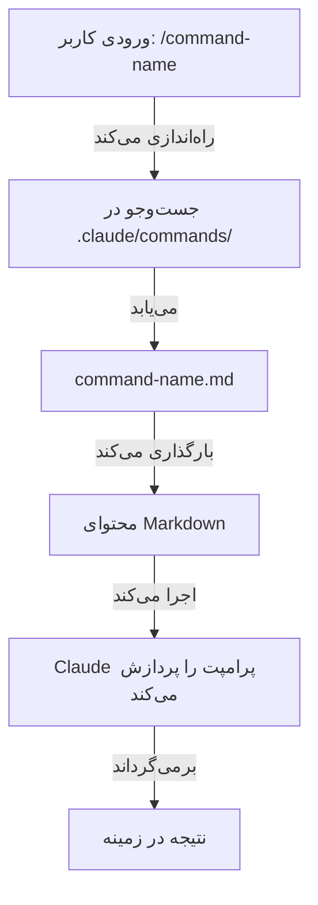

### ساختار فایل

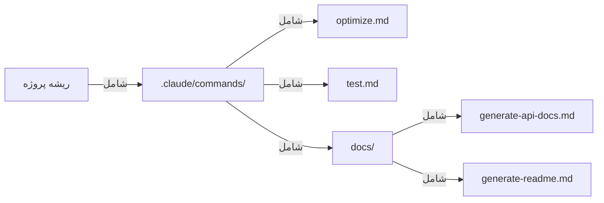

### جدول سازمان‌دهی دستورات

| مکان | دامنه | دسترس‌پذیری | مورد استفاده | ردیابی در Git |
|----------|-------|--------------|----------|-------------|
| `.claude/commands/` | مخصوص پروژه | اعضای تیم | گردش‌کارهای تیمی، استانداردهای مشترک | ✅ بله |
| `~/.claude/commands/` | شخصی | کاربر فردی | میان‌برهای شخصی در پروژه‌های مختلف | ❌ خیر |
| زیرپوشه‌ها | دارای فضای نام | بر اساس والد | سازمان‌دهی بر اساس دسته | ✅ بله |

### ویژگی‌ها و قابلیت‌ها

| ویژگی | مثال | پشتیبانی‌شده |
|---------|---------|-----------|
| اجرای اسکریپت شل | `bash scripts/deploy.sh` | ✅ بله |
| ارجاع به فایل | `@path/to/file.js` | ✅ بله |
| یکپارچه‌سازی Bash | `$(git log --oneline)` | ✅ بله |
| آرگومان‌ها | `/pr --verbose` | ✅ بله |
| دستورات MCP | `/mcp__github__list_prs` | ✅ بله |

### مثال‌های عملی

هشت قالب دستور آماده کپی در **[01-slash-commands/](01-slash-commands/)** قرار دارد — `/optimize`، `/pr`، `/commit`، `/push-all`، `/generate-api-docs`، `/doc-refactor`، `/setup-ci-cd` و `/unit-test-expand`.

**[01-slash-commands/README.md](01-slash-commands/README.md)** همچنین مرجع کامل دستورات داخلی (بیش از ۶۰ دستور) و جدول فیلدهای frontmatter را در خود دارد.

### نمودار چرخه حیات دستور

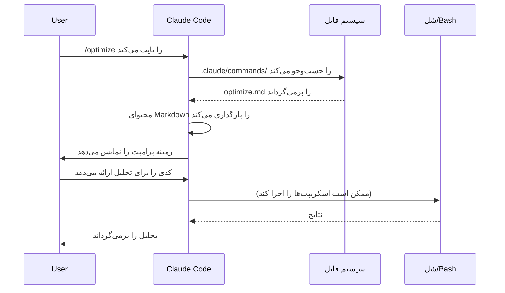

### بهترین شیوه‌ها

| ✅ انجام دهید | ❌ انجام ندهید |
|------|---------|
| از نام‌های روشن و کنش‌محور استفاده کنید | برای کارهای یک‌باره دستور بسازید |
| کلمات محرک را در description مستند کنید | منطق پیچیده را در دستورات بسازید |
| دستورات را متمرکز بر یک وظیفه نگه دارید | دستورات تکراری بسازید |
| دستورات پروژه را نسخه‌بندی کنید | اطلاعات حساس را به‌صورت سخت‌کد بنویسید |
| در زیرپوشه‌ها سازمان‌دهی کنید | فهرست‌های طولانی از دستورات بسازید |
| از پرامپت‌های ساده و خوانا استفاده کنید | از عبارت‌های مخفف یا مبهم استفاده کنید |

---

## زیرایجنت‌ها

### مرور کلی

زیرایجنت‌ها دستیارهای هوش مصنوعی تخصصی با پنجره‌های زمینه مجزا و پرامپت‌های سیستمی سفارشی‌شده هستند. آن‌ها اجرای واگذارشده وظایف را در عین حفظ تفکیک شفاف دغدغه‌ها ممکن می‌کنند.

زیرایجنت‌ها می‌توانند زیرایجنت‌های خودشان را ایجاد کنند، **که به‌صورت پیش‌فرض تا عمق ۳ (v2.1.219) تودرتو هستند** — بنابراین سلسله‌مراتب به همان یک لایه اصلی → زیرایجنت که در ادامه نشان داده شده محدود نیست. برای تغییر این حد، `CLAUDE_CODE_MAX_SUBAGENT_SPAWN_DEPTH` را تنظیم کنید، یا آن را روی `1` بگذارید تا تودرتویی خاموش شود. (تاریخچه: نسخه‌های v2.1.172–v2.1.216 به‌صورت پیش‌فرض تا ۵ لایه تودرتو بودند و راهی برای تغییرش نبود؛ v2.1.217 تودرتویی را به‌صورت اختیاری در عمق ۱ کرد؛ v2.1.219 پیش‌فرض را روی ۳ گذاشت.)

### نمودار معماری

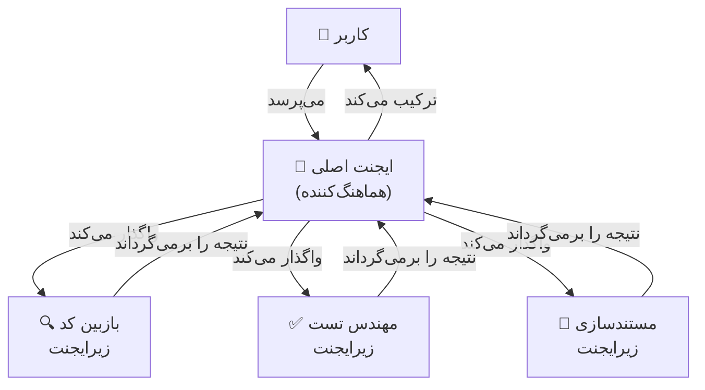

### چرخه حیات زیرایجنت

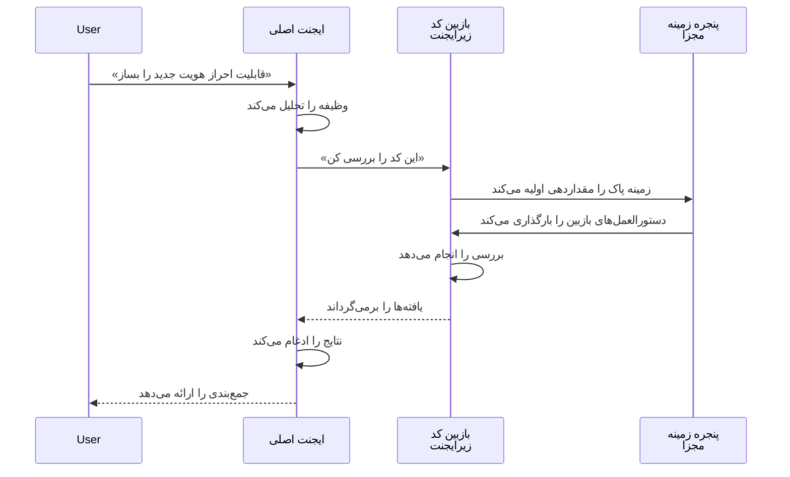

### جدول پیکربندی زیرایجنت

| پیکربندی | نوع | هدف | مثال |
|---------------|------|---------|---------|
| `name` | String | شناسه ایجنت | `code-reviewer` |
| `description` | String | هدف و واژه‌های محرک | `Comprehensive code quality analysis` |
| `tools` | List/String | ابزارهای مجاز | `Read, Grep, Glob, Bash` |
| *(بدنه markdown)* | Markdown | پرامپت سیستمی / دستورالعمل‌های رفتاری | دستورالعمل‌های سفارشی |

### سلسله‌مراتب دسترسی به ابزار

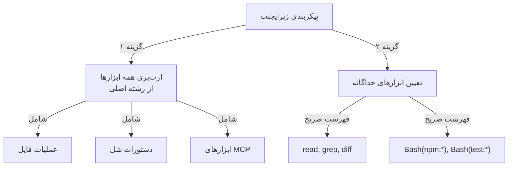

### مثال‌های عملی

نه تعریف آماده‌به‌استفاده زیرایجنت در **[04-subagents/](04-subagents/)** قرار دارد — `code-reviewer`، `clean-code-reviewer`، `secure-reviewer`، `test-engineer`، `documentation-writer`، `implementation-agent`، `performance-optimizer`، `debugger` و `data-scientist`.

**[04-subagents/README.md](04-subagents/README.md)** مرجع کامل frontmatter، قواعد دسترسی به ابزار، محدودیت‌های تودرتویی و تیم‌های ایجنت را مستند می‌کند.

### مدیریت زمینه زیرایجنت

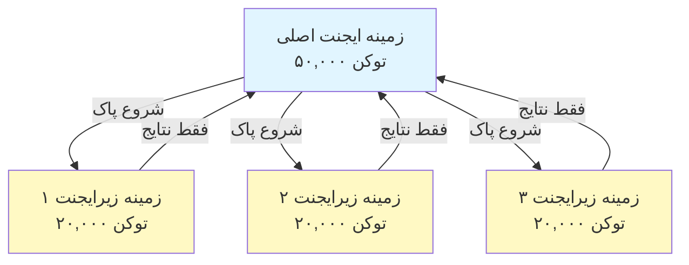

### چه زمانی از زیرایجنت‌ها استفاده کنیم

| سناریو | استفاده از زیرایجنت | چرا |
|----------|--------------|-----|
| قابلیت پیچیده با گام‌های زیاد | ✅ بله | تفکیک دغدغه‌ها، جلوگیری از آلودگی زمینه |
| بررسی سریع کد | ❌ خیر | سربار غیرضروری |
| اجرای موازی وظایف | ✅ بله | هر زیرایجنت زمینه خودش را دارد |
| نیاز به تخصص ویژه | ✅ بله | پرامپت‌های سیستمی سفارشی |
| تحلیل طولانی‌مدت | ✅ بله | از تهی‌شدن زمینه اصلی جلوگیری می‌کند |
| یک وظیفه واحد | ❌ خیر | بی‌دلیل تأخیر اضافه می‌کند |

### تیم‌های ایجنت

تیم‌های ایجنت چندین ایجنت را که روی وظایف مرتبط کار می‌کنند هماهنگ می‌کنند. به‌جای واگذاری به یک زیرایجنت در هر لحظه، تیم‌های ایجنت به ایجنت اصلی اجازه می‌دهند گروهی از ایجنت‌ها را رهبری کند که با هم همکاری می‌کنند، نتایج میانی را به اشتراک می‌گذارند و به‌سوی هدفی مشترک پیش می‌روند. این کار برای وظایف بزرگ‌مقیاس مانند توسعه فول‌استک قابلیت‌ها مفید است، جایی که ایجنت فرانت‌اند، ایجنت بک‌اند و ایجنت تست به‌صورت موازی کار می‌کنند.

---

## حافظه

### مرور کلی

حافظه به Claude امکان می‌دهد زمینه را در میان نشست‌ها و گفتگوها حفظ کند. حافظه دو شکل دارد: ترکیب خودکار در claude.ai، و CLAUDE.md مبتنی بر فایل‌سیستم در Claude Code.

### معماری حافظه

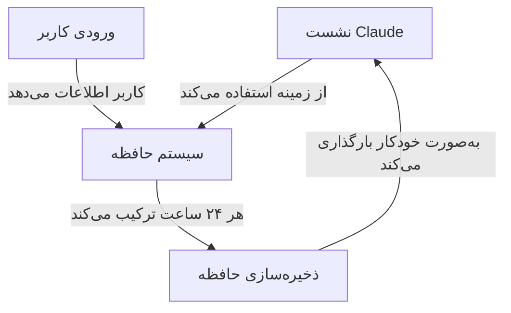

### سلسله‌مراتب حافظه در Claude Code (۷ لایه)

Claude Code حافظه را از ۷ لایه بارگذاری می‌کند. فایل‌های CLAUDE.md به‌جای بازنویسی یکدیگر، به زمینه الحاق می‌شوند و به ترتیب مدیریت‌شده → کاربر → پروژه → محلی بارگذاری می‌شوند (فایل‌های بعدی و مشخص‌تر آخر خوانده می‌شوند):

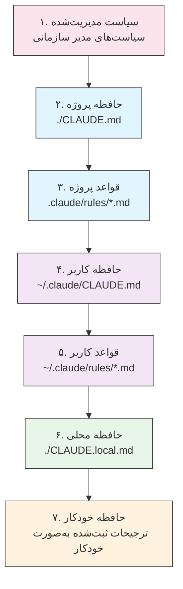

### جدول مکان‌های حافظه

| لایه | مکان | دامنه | اولویت | اشتراکی | بهترین کاربرد |
|------|----------|-------|----------|--------|----------|
| ۱. سیاست مدیریت‌شده | مدیر سازمانی | سازمان | بالاترین | همه کاربران سازمان | انطباق، سیاست‌های امنیتی |
| ۲. پروژه | `./CLAUDE.md` | پروژه | بالا | تیم (Git) | استانداردهای تیم، معماری |
| ۳. قواعد پروژه | `.claude/rules/*.md` | پروژه | بالا | تیم (Git) | قراردادهای ماژولار پروژه |
| ۴. کاربر | `~/.claude/CLAUDE.md` | شخصی | متوسط | فرد | ترجیحات شخصی |
| ۵. قواعد کاربر | `~/.claude/rules/*.md` | شخصی | متوسط | فرد | ماژول‌های قاعده شخصی |
| ۶. محلی | `./CLAUDE.local.md` | محلی | پایین | اشتراک نمی‌شود | تنظیمات مخصوص دستگاه |
| ۷. حافظه خودکار | خودکار | به‌ازای هر مخزن | پایین‌ترین | فرد | ترجیحات و الگوهای آموخته‌شده |

### حافظه خودکار

حافظه خودکار به‌صورت خودکار ترجیحات کاربر و الگوهای مشاهده‌شده در طول نشست‌ها را ثبت می‌کند. Claude از تعامل‌های شما می‌آموزد و به یاد می‌سپارد:

- ترجیحات سبک کدنویسی
- اصلاحات رایجی که انجام می‌دهید
- انتخاب فریم‌ورک و ابزار
- ترجیحات سبک ارتباط

حافظه خودکار در پس‌زمینه کار می‌کند و نیازی به پیکربندی دستی ندارد.

### چرخه حیات به‌روزرسانی حافظه

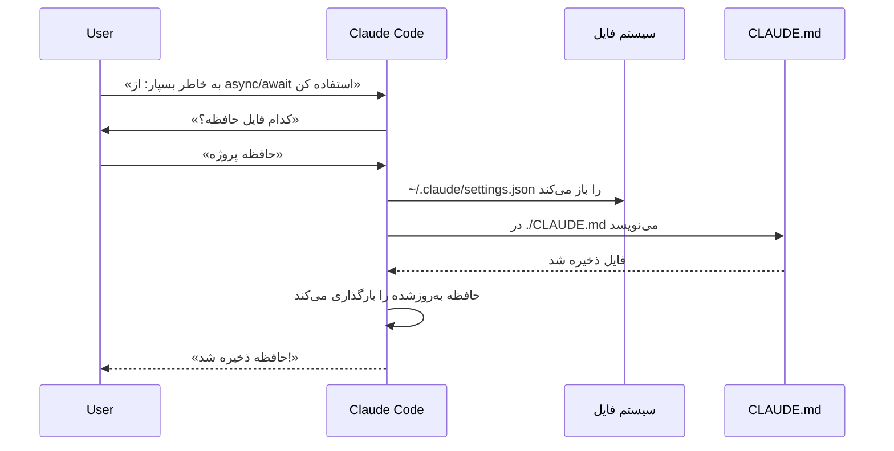

### مثال‌های عملی

قالب‌های آماده کپی حافظه در **[02-memory/](02-memory/)** قرار دارند:

- **`project-CLAUDE.md`** — استانداردهای پروژه در سطح تیم برای `./CLAUDE.md`
- **`personal-CLAUDE.md`** — ترجیحات فردی برای `~/.claude/CLAUDE.md`
- **`directory-api-CLAUDE.md`** — استانداردهای محدود به دایرکتوری برای یک زیردرخت

**[02-memory/README.md](02-memory/README.md)** کل سلسله‌مراتب، نحو import، `.claude/rules/`، حافظه خودکار و نحوه نگه‌داشتن CLAUDE.md زیر ۲۰۰ خط را پوشش می‌دهد.

### حافظه در Claude Web/Desktop

#### خط زمانی ترکیب حافظه


### محتوای حافظه خودکار

حافظه خودکار آنچه Claude در طول نشست‌ها درباره شما می‌آموزد را در `~/.claude/projects/<project>/memory/` ذخیره می‌کند و با `MEMORY.md` فهرست‌بندی می‌شود. برای چیدمان فایل‌ها، محدودیت‌های بارگذاری و نحوه فعال یا غیرفعال کردن آن، **[02-memory/README.md](02-memory/README.md)** را ببینید.

### مقایسه ویژگی‌های حافظه

| ویژگی | Claude Web/Desktop | Claude Code (CLAUDE.md) |
|---------|-------------------|------------------------|
| ترکیب خودکار | ✅ هر ۲۴ ساعت | ❌ دستی |
| بین‌پروژه‌ای | ✅ اشتراکی | ❌ مخصوص پروژه |
| دسترسی تیمی | ✅ پروژه‌های اشتراکی | ✅ ردیابی‌شده با Git |
| قابل جستجو | ✅ داخلی | ✅ از طریق `/memory` |
| قابل ویرایش | ✅ در چت | ✅ ویرایش مستقیم فایل |
| ورود/خروج | ✅ بله | ✅ کپی/پیست |
| پایدار | ✅ بیش از ۲۴ ساعت | ✅ نامحدود |

---

## پروتکل MCP

### مرور کلی

MCP (پروتکل زمینه مدل) روشی استاندارد برای دسترسی Claude به ابزارهای خارجی، APIها و منابع داده بلادرنگ است. برخلاف حافظه، MCP دسترسی زنده به داده‌های در حال تغییر را فراهم می‌کند.

### معماری MCP

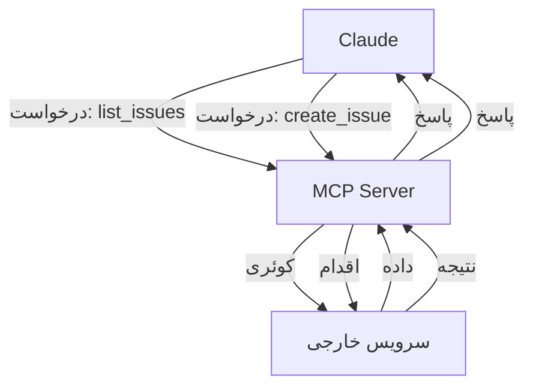

### اکوسیستم MCP

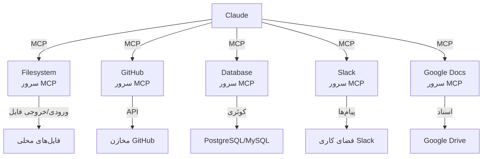

### فرآیند راه‌اندازی MCP

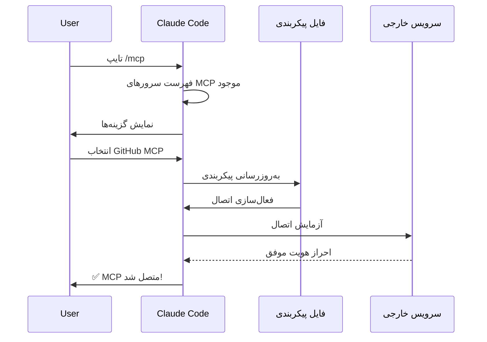

### جدول سرورهای MCP موجود

| سرور MCP | کاربرد | ابزارهای رایج | احراز هویت | بلادرنگ |
|------------|---------|--------------|------|-----------|
| **Filesystem** | عملیات فایل | read, write, delete | مجوزهای سیستم‌عامل | ✅ بله |
| **GitHub** | مدیریت مخزن | list_prs, create_issue, push | OAuth | ✅ بله |
| **Slack** | ارتباط تیمی | send_message, list_channels | توکن | ✅ بله |
| **Database** | کوئری‌های SQL | query, insert, update | اعتبارنامه | ✅ بله |
| **Google Docs** | دسترسی به سند | read, write, share | OAuth | ✅ بله |
| **Asana** | مدیریت پروژه | create_task, update_status | کلید API | ✅ بله |
| **Stripe** | داده‌های پرداخت | list_charges, create_invoice | کلید API | ✅ بله |
| **Memory** | حافظه پایدار | store, retrieve, delete | محلی | ❌ خیر |

### مثال‌های کاربردی

پیکربندی‌های آماده سرور MCP در **[05-mcp/](05-mcp/)** قرار دارند: `github-mcp.json`، `database-mcp.json`، `filesystem-mcp.json` و `multi-mcp.json` (چهار سرور در یک فایل).

**[05-mcp/README.md](05-mcp/README.md)** نحو کامل `claude mcp add`، ترابری‌ها، دامنه‌ها، OAuth و فهرست مجاز سازمانی را پوشش می‌دهد.

### MCP در برابر حافظه: ماتریس تصمیم

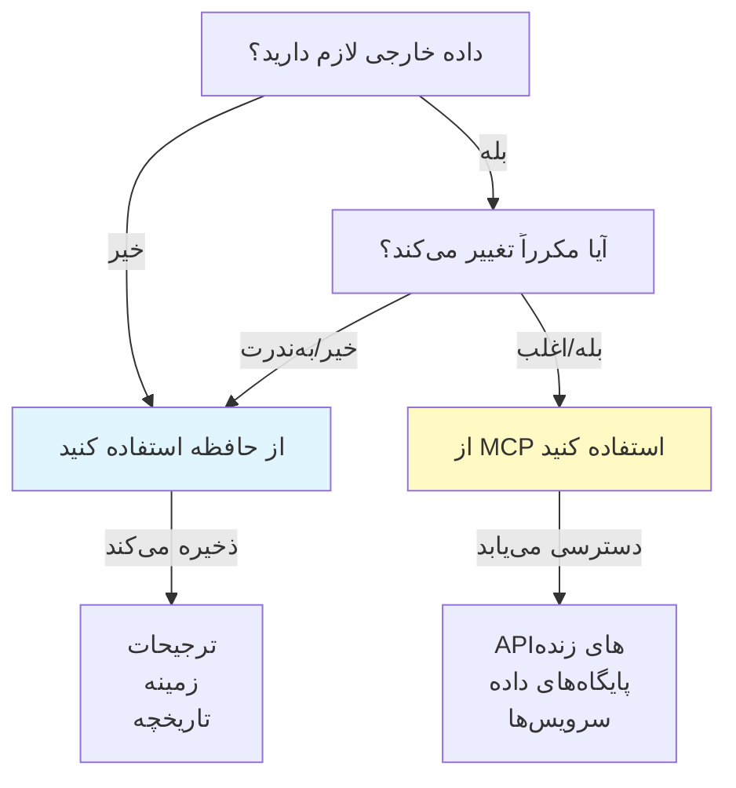

### الگوی درخواست/پاسخ

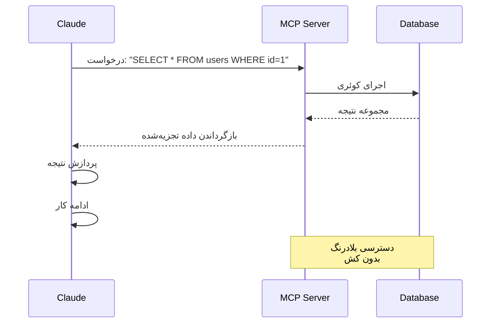

---

## مهارت‌های ایجنت

### مرور کلی

مهارت‌های ایجنت قابلیت‌های قابل استفاده مجدد و قابل فراخوانی توسط مدل هستند که به شکل پوشه‌هایی شامل دستورالعمل‌ها، اسکریپت‌ها و منابع بسته‌بندی می‌شوند. Claude مهارت‌های مرتبط را به‌طور خودکار تشخیص می‌دهد و به کار می‌گیرد.

### معماری مهارت

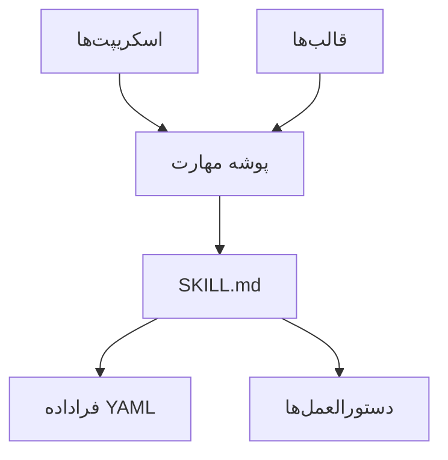

### فرآیند بارگذاری مهارت

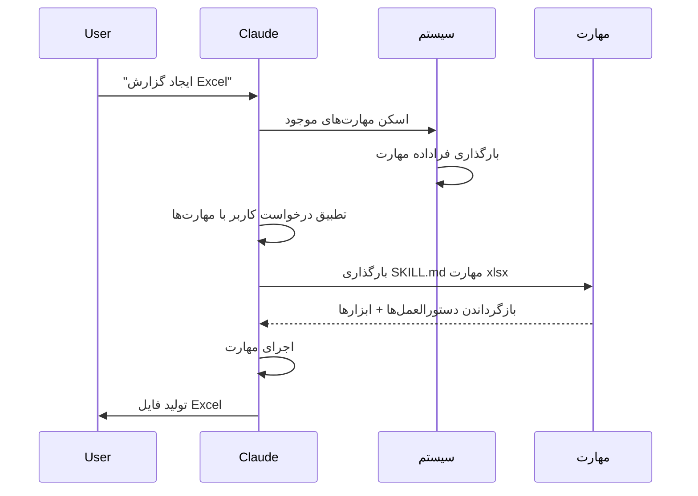

### جدول انواع و مکان‌های مهارت

| نوع | مکان | دامنه | اشتراکی | همگام‌سازی | بهترین کاربرد |
|------|----------|-------|--------|------|----------|
| پیش‌ساخته | داخلی | سراسری | همه کاربران | خودکار | تولید سند |
| شخصی | `~/.claude/skills/` | فردی | خیر | دستی | خودکارسازی شخصی |
| پروژه‌ای | `.claude/skills/` | تیمی | بله | Git | استانداردهای تیم |
| پلاگین | از طریق نصب پلاگین | متغیر | بستگی دارد | خودکار | ویژگی‌های یکپارچه |

### مهارت‌های پیش‌ساخته

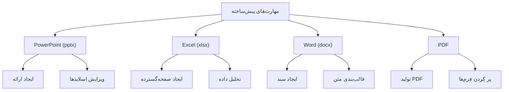

### مهارت‌های همراه

Claude Code مهارت‌های همراهی را شامل می‌شود که از همان ابتدا در دسترس هستند، از جمله:

| مهارت | دستور | کاربرد |
|-------|---------|---------|
| **Batch** | `/batch` | اجرای عملیات روی چندین فایل یا آیتم |
| **Claude API** | `/claude-api` | بارگذاری مواد مرجع Claude API و Managed Agents برای زبان پروژه شما؛ زمانی که کد شما `anthropic` یا `@anthropic-ai/sdk` را import کند به‌طور خودکار فعال می‌شود. زیردستورها شامل `api-version` (نسخه 2.1.307) و `managed-agents-secure` (نسخه 2.1.304) است |
| **Code Review** | `/code-review` | بررسی diff فعلی از نظر باگ‌های صحت در سطح تلاش انتخابی. مهارتی متمایز از `/simplify` (پاک‌سازی کیفیت/استفاده مجدد) که در v2.1.154 دوباره جدا شد. Claude از v2.1.246 در همه‌جا می‌تواند خودش آن را شروع کند |
| **Simplify** | `/simplify` | بررسی کیفیت، استفاده مجدد و پاک‌سازی — از v2.1.154 دوباره متمایز از `/code-review` |
| **Debug** | `/debug` | روشن کردن گزارش اشکال‌زدایی برای نشست فعلی و عیب‌یابی با خواندن گزارش اشکال‌زدایی نشست |
| **Fewer Permission Prompts** | `/fewer-permission-prompts` | اسکن رونوشت‌ها و پیشنهاد یک فهرست مجاز اولویت‌بندی‌شده برای ابزارهای فقط‌خواندنی رایج |
| **Loop** | `/loop` | زمان‌بندی کارهای تکرارشونده با یک تایمر |
| **Run** | `/run` | اجرا و هدایت اپلیکیشن پروژه برای تأیید یک تغییر (v2.1.145+) |
| **Run Skill Generator** | `/run-skill-generator` | نوشتن مهارتی مخصوص پروژه که به `/run` و `/verify` می‌آموزد چگونه اپلیکیشن شما را بسازند، اجرا کنند و هدایت کنند (v2.1.145+) |
| **Verify** | `/verify` | تأیید اینکه یک تغییر واقعاً کار می‌کند (v2.1.145+). از v2.1.215 فقط با فراخوانی صریح |

این مهارت‌های همراه همیشه در دسترس‌اند و نیازی به نصب یا پیکربندی ندارند.

### مثال‌های کاربردی

شش مهارت کامل — همراه با اسکریپت‌ها، قالب‌ها و فایل‌های مرجعشان — در **[03-skills/](03-skills/)** قرار دارند:

- **`code-review-specialist/`** — چک‌لیست بازبینی، قالب یافته‌ها و دو اسکریپت سنجه Python
- **`refactor/`** — فهرست بوی بد کد، فهرست ری‌فاکتور، قالب برنامه و دو اسکریپت تحلیل
- **`doc-generator/`** — تولید مستندات API از کد منبع
- **`blog-draft/`** — قالب‌های طرح کلی و پیش‌نویس با یک قرارداد خروجی نسخه‌بندی‌شده
- **`brand-voice/`** — قواعد لحن و قالب‌های پیام (نمایش `user-invocable: false`)
- **`claude-md/`** — ایجاد، به‌روزرسانی و ممیزی فایل‌های CLAUDE.md

برای مرجع کامل frontmatter و مدل افشای تدریجی، **[03-skills/README.md](03-skills/README.md)** را ببینید.

### کشف و فراخوانی مهارت

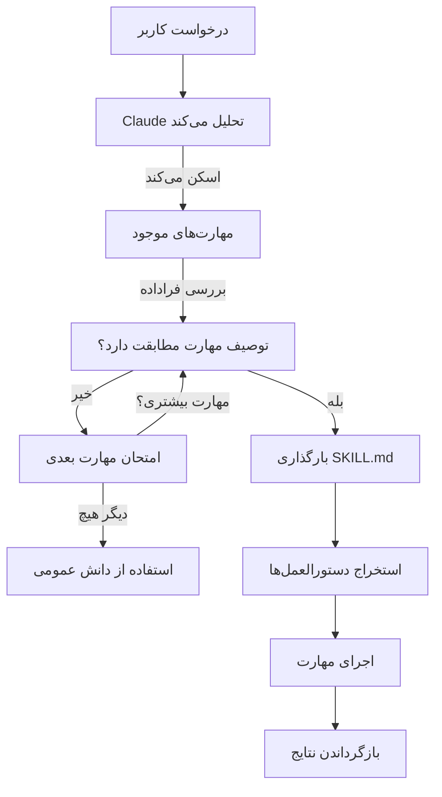

### مهارت در برابر سایر ویژگی‌ها

```mermaid
graph TB
    A["توسعه Claude"]
    B["دستورهای اسلش"]
    C["زیرایجنت‌ها"]
    D["حافظه"]
    E["MCP"]
    F["مهارت‌ها"]

    A --> B
    A --> C
    A --> D
    A --> E
    A --> F

    B -->|فراخوانی توسط کاربر| G["میان‌برهای سریع"]
    C -->|واگذاری خودکار| H["زمینه‌های جداشده"]
    D -->|پایدار| I["زمینه بین‌نشستی"]
    E -->|بلادرنگ| J["دسترسی به داده خارجی"]
    F -->|فراخوانی خودکار| K["اجرای خودمختار"]
```

---

## پلاگین‌های Claude Code

### مرور کلی

پلاگین‌های Claude Code مجموعه‌های بسته‌بندی‌شده‌ای از سفارشی‌سازی‌ها (دستورهای اسلش، زیرایجنت‌ها، سرورهای MCP و هوک‌ها) هستند که با یک دستور واحد نصب می‌شوند. آن‌ها بالاترین سطح سازوکار توسعه را نمایندگی می‌کنند—ترکیب چندین ویژگی در بسته‌هایی منسجم و قابل اشتراک.

### معماری

```mermaid
graph TB
    A["پلاگین"]
    B["دستورهای اسلش"]
    C["زیرایجنت‌ها"]
    D["سرورهای MCP"]
    E["هوک‌ها"]
    F["پیکربندی"]

    A -->|بسته‌بندی| B
    A -->|بسته‌بندی| C
    A -->|بسته‌بندی| D
    A -->|بسته‌بندی| E
    A -->|بسته‌بندی| F
```

### فرآیند بارگذاری پلاگین

```mermaid
sequenceDiagram
    participant User
    participant Claude as Claude Code
    participant Plugin as بازار پلاگین
    participant Install as نصب
    participant SlashCmds as دستورهای اسلش
    participant Subagents
    participant MCPServers as MCP Servers
    participant Hooks
    participant Tools as ابزارهای پیکربندی‌شده

    User->>Claude: claude --plugin-dir ./07-plugins/pr-review
    Claude->>Plugin: دانلود مانیفست پلاگین
    Plugin-->>Claude: بازگرداندن تعریف پلاگین
    Claude->>Install: استخراج اجزا
    Install->>SlashCmds: پیکربندی
    Install->>Subagents: پیکربندی
    Install->>MCPServers: پیکربندی
    Install->>Hooks: پیکربندی
    SlashCmds-->>Tools: آماده استفاده
    Subagents-->>Tools: آماده استفاده
    MCPServers-->>Tools: آماده استفاده
    Hooks-->>Tools: آماده استفاده
    Tools-->>Claude: پلاگین نصب شد ✅
```

### انواع پلاگین و توزیع آن

| نوع | دامنه | اشتراک | مرجع | نمونه‌ها |
|------|-------|--------|-----------|----------|
| رسمی | سراسری | همه کاربران | Anthropic | PR Review، Security Guidance |
| اجتماعی | عمومی | همه کاربران | جامعه کاربران | DevOps، Data Science |
| سازمانی | داخلی | اعضای تیم | شرکت | استانداردها و ابزارهای داخلی |
| شخصی | فردی | یک کاربر | توسعه‌دهنده | جریان‌های کاری سفارشی |

### ساختار تعریف پلاگین

مانیفست یک فایل JSON در `.claude-plugin/plugin.json` است. تنها `name` الزامی است و کلیدهای سطح‌بالای ناشناخته حذف می‌شوند:

```json
{
  "name": "plugin-name",
  "version": "1.0.0",
  "description": "این پلاگین چه کاری انجام می‌دهد"
}
```

### ساختار پلاگین

```
my-plugin/
├── .claude-plugin/
│   └── plugin.json
├── commands/
│   ├── task-1.md
│   ├── task-2.md
│   └── workflows/
├── agents/
│   ├── specialist-1.md
│   ├── specialist-2.md
│   └── configs/
├── skills/
│   └── skill-name/
│       └── SKILL.md
├── hooks/
│   └── hooks.json
├── .mcp.json
├── bin/
│   └── my-tool
├── .lsp.json
├── settings.json
├── templates/
│   └── issue-template.md
├── scripts/
│   ├── helper-1.sh
│   └── helper-2.py
├── docs/
│   ├── README.md
│   └── USAGE.md
└── tests/
    └── plugin.test.js
```

### نمونه‌های عملی

سه پلاگین کامل و قابل نصب در **[07-plugins/](07-plugins/)** قرار دارند:

- **`pr-review/`** — دستورهای بازبینی، سه ایجنت متخصص، GitHub MCP و یک هوک پیش از بازبینی
- **`documentation/`** — دستورهای تولید مستندات، سه ایجنت و قالب‌های قابل استفاده مجدد
- **`devops-automation/`** — دستورهای استقرار/بازگردانی/وضعیت/رخداد، سه ایجنت، Kubernetes MCP و اسکریپت‌های شل

هر کدام شامل مانیفست `.claude-plugin/plugin.json` و چیدمان دایرکتوری خود است.

### بازار پلاگین

```mermaid
graph TB
    A["بازار پلاگین"]
    B["رسمی<br/>Anthropic"]
    C["بازار<br/>جامعه کاربران"]
    D["رجیستری<br/>سازمانی"]

    A --> B
    A --> C
    A --> D

    B -->|دسته‌بندی‌ها| B1["توسعه"]
    B -->|دسته‌بندی‌ها| B2["DevOps"]
    B -->|دسته‌بندی‌ها| B3["مستندسازی"]

    C -->|جستجو| C1["اتوماسیون DevOps"]
    C -->|جستجو| C2["توسعه موبایل"]
    C -->|جستجو| C3["علم داده"]

    D -->|داخلی| D1["استانداردهای شرکت"]
    D -->|داخلی| D2["سیستم‌های قدیمی"]
    D -->|داخلی| D3["انطباق"]
```

### نصب و چرخه عمر پلاگین

```mermaid
graph LR
    A["کشف"] -->|مرور| B["بازار"]
    B -->|انتخاب| C["صفحه پلاگین"]
    C -->|مشاهده| D["اجزا"]
    D -->|نصب| E["/plugin install"]
    E -->|استخراج| F["پیکربندی"]
    F -->|فعال‌سازی| G["استفاده"]
    G -->|بررسی| H["به‌روزرسانی"]
    H -->|موجود| G
    G -->|پایان| I["غیرفعال‌سازی"]
    I -->|بعداً| J["فعال‌سازی"]
    J -->|بازگشت| G
```

### مقایسه ویژگی‌های پلاگین

| ویژگی | دستور اسلش | مهارت | زیرایجنت | پلاگین |
|---------|---------------|-------|----------|--------|
| **نصب** | کپی دستی | کپی دستی | پیکربندی دستی | یک دستور |
| **زمان راه‌اندازی** | ۵ دقیقه | ۱۰ دقیقه | ۱۵ دقیقه | ۲ دقیقه |
| **بسته‌بندی** | یک فایل | یک فایل | یک فایل | چندگانه |
| **نسخه‌بندی** | دستی | دستی | دستی | خودکار |
| **اشتراک تیمی** | کپی فایل | کپی فایل | کپی فایل | نصب با شناسه |
| **به‌روزرسانی‌ها** | دستی | دستی | دستی | خودکار در دسترس |
| **وابستگی‌ها** | ندارد | ندارد | ندارد | ممکن است داشته باشد |
| **بازار** | خیر | خیر | خیر | بله |
| **توزیع** | مخزن | مخزن | مخزن | بازار |

### موارد استفاده پلاگین

| مورد استفاده | توصیه | دلیل |
|----------|-----------------|-----|
| **آنبوردینگ تیم** | ✅ از پلاگین استفاده کنید | راه‌اندازی فوری، همه پیکربندی‌ها |
| **راه‌اندازی فریم‌ورک** | ✅ از پلاگین استفاده کنید | دستورهای مخصوص فریم‌ورک را بسته‌بندی می‌کند |
| **استانداردهای سازمانی** | ✅ از پلاگین استفاده کنید | توزیع متمرکز، کنترل نسخه |
| **اتوماسیون سریع کار** | ❌ از دستور استفاده کنید | پیچیدگی بیش از حد |
| **تخصص در یک حوزه** | ❌ از مهارت استفاده کنید | خیلی سنگین است، از مهارت استفاده کنید |
| **تحلیل تخصصی** | ❌ از زیرایجنت استفاده کنید | به‌صورت دستی بسازید یا از مهارت استفاده کنید |
| **دسترسی به داده زنده** | ❌ از MCP استفاده کنید | مستقل است، آن را بسته‌بندی نکنید |

### چه زمانی پلاگین بسازیم

```mermaid
graph TD
    A["آیا باید پلاگین بسازم؟"]
    A -->|نیاز به چند جزء| B{"چند دستور<br/>یا زیرایجنت<br/>یا MCP؟"}
    B -->|بله| C["✅ ساخت پلاگین"]
    B -->|خیر| D["استفاده از ویژگی به‌تنهایی"]
    A -->|جریان کاری تیمی| E{"اشتراک با<br/>تیم؟"}
    E -->|بله| C
    E -->|خیر| F["نگه‌داشتن به‌عنوان تنظیم محلی"]
    A -->|راه‌اندازی پیچیده| G{"نیاز به<br/>پیکربندی خودکار؟"}
    G -->|بله| C
    G -->|خیر| D
```

### انتشار یک پلاگین

**مراحل انتشار:**

1. ساختار پلاگین را با همه اجزا ایجاد کنید
2. مانیفست `.claude-plugin/plugin.json` را بنویسید
3. فایل `README.md` را همراه با مستندات بسازید
4. آن را به‌صورت محلی با `claude --plugin-dir ./my-plugin` آزمایش کنید
5. آن را به بازار پلاگین ارسال کنید
6. بازبینی و تأیید بگیرید
7. در بازار منتشر می‌شود
8. کاربران می‌توانند با یک دستور نصبش کنند

### نمونه README یک پلاگین

سه پلاگین کامل را در **[07-plugins/](07-plugins/)** ببینید — `pr-review/`، `documentation/` و `devops-automation/` هرکدام یک `README.md` کامل، مانیفست، دستورها، ایجنت‌ها و پیکربندی MCP ارائه می‌دهند که می‌توانید کاملاً کپی کنید.

### پلاگین در برابر پیکربندی دستی

**راه‌اندازی دستی (بیش از ۲ ساعت):**
- نصب دستورهای اسلش یکی‌یکی
- ساخت زیرایجنت‌ها به‌صورت جداگانه
- پیکربندی MCPها به‌صورت جدا
- راه‌اندازی دستی هوک‌ها
- مستندسازی همه چیز
- اشتراک با تیم (به امید اینکه درست پیکربندی کنند)

**با پلاگین (۲ دقیقه):**
```bash
claude --plugin-dir ./07-plugins/pr-review
# ✅ همه چیز نصب و پیکربندی شده است
# ✅ آماده استفاده فوری
# ✅ تیم می‌تواند دقیقاً همان راه‌اندازی را بازتولید کند
```

---

## مقایسه و یکپارچه‌سازی

### ماتریس مقایسه ویژگی‌ها

| ویژگی | فراخوانی | ماندگاری | دامنه | مورد استفاده |
|---------|-----------|------------|-------|----------|
| **دستورهای اسلش** | دستی (`/cmd`) | فقط نشست | یک دستور | میان‌برهای سریع |
| **زیرایجنت‌ها** | واگذاری خودکار | زمینه جدا | وظیفه تخصصی | توزیع کار |
| **حافظه** | بارگذاری خودکار | بین‌نشستی | زمینه کاربر/تیم | یادگیری بلندمدت |
| **پروتکل MCP** | پرس‌وجوی خودکار | خارجی در زمان واقعی | دسترسی به داده زنده | اطلاعات پویا |
| **مهارت‌ها** | فراخوانی خودکار | مبتنی بر فایل‌سیستم | تخصص قابل استفاده مجدد | جریان‌های کاری خودکار |

### خط زمانی تعامل

```mermaid
graph LR
    A["شروع نشست"] -->|بارگذاری| B["حافظه (CLAUDE.md)"]
    B -->|کشف| C["مهارت‌های موجود"]
    C -->|ثبت| D["دستورهای اسلش"]
    D -->|اتصال| E["سرورهای MCP"]
    E -->|آماده| F["تعامل کاربر"]

    F -->|تایپ /cmd| G["دستور اسلش"]
    F -->|درخواست| H["فراخوانی خودکار مهارت"]
    F -->|پرس‌وجو| I["داده MCP"]
    F -->|وظیفه پیچیده| J["واگذاری به زیرایجنت"]

    G -->|استفاده| B
    H -->|استفاده| B
    I -->|استفاده| B
    J -->|استفاده| B
```

### نمونه یکپارچه‌سازی عملی: اتوماسیون پشتیبانی مشتری

#### معماری

```mermaid
graph TB
    User["ایمیل مشتری"] -->|دریافت| Router["مسیریاب پشتیبانی"]

    Router -->|تحلیل| Memory["حافظه<br/>تاریخچه مشتری"]
    Router -->|جستجو| MCP1["MCP: پایگاه داده مشتری<br/>تیکت‌های قبلی"]
    Router -->|بررسی| MCP2["MCP: Slack<br/>وضعیت تیم"]

    Router -->|مسیر پیچیده| Sub1["زیرایجنت: پشتیبانی فنی<br/>زمینه: مسائل فنی"]
    Router -->|مسیر ساده| Sub2["زیرایجنت: صورت‌حساب<br/>زمینه: مسائل پرداخت"]
    Router -->|مسیر فوری| Sub3["زیرایجنت: ارجاع<br/>زمینه: رسیدگی اولویت‌دار"]

    Sub1 -->|قالب‌بندی| Skill1["مهارت: تولیدکننده پاسخ<br/>لحن برند حفظ می‌شود"]
    Sub2 -->|قالب‌بندی| Skill2["مهارت: تولیدکننده پاسخ"]
    Sub3 -->|قالب‌بندی| Skill3["مهارت: تولیدکننده پاسخ"]

    Skill1 -->|تولید| Output["پاسخ قالب‌بندی‌شده"]
    Skill2 -->|تولید| Output
    Skill3 -->|تولید| Output

    Output -->|ثبت| MCP3["MCP: Slack<br/>اطلاع به تیم"]
    Output -->|ارسال| Reply["پاسخ مشتری"]
```

#### جریان درخواست

```markdown
## جریان درخواست پشتیبانی مشتری

### ۱. ایمیل ورودی
"هنگام تلاش برای بارگذاری فایل‌ها خطای 500 می‌گیرم. این کار جریان کاری من را متوقف کرده است!"

### ۲. جستجو در حافظه
- فایل CLAUDE.md را با استانداردهای پشتیبانی بارگذاری می‌کند
- تاریخچه مشتری را بررسی می‌کند: مشتری VIP، سومین رخداد در این ماه

### ۳. پرس‌وجوهای MCP
- GitHub MCP: فهرست ایشوهای باز (گزارش باگ مرتبط را پیدا می‌کند)
- Database MCP: بررسی وضعیت سیستم (هیچ قطعی گزارش نشده)
- Slack MCP: بررسی اینکه آیا تیم مهندسی از آن اطلاع دارد

### ۴. تشخیص و بارگذاری مهارت
- درخواست با مهارت «پشتیبانی فنی» مطابقت دارد
- قالب پاسخ پشتیبانی را از مهارت بارگذاری می‌کند

### ۵. واگذاری به زیرایجنت
- به زیرایجنت پشتیبانی فنی مسیردهی می‌کند
- زمینه را فراهم می‌کند: تاریخچه مشتری، جزئیات خطا، مسائل شناخته‌شده
- زیرایجنت دسترسی کامل دارد به: ابزارهای read، bash، grep

### ۶. پردازش زیرایجنت
زیرایجنت پشتیبانی فنی:
- کدبیس را برای خطای 500 در بارگذاری فایل جستجو می‌کند
- تغییر اخیر در کامیت 8f4a2c را پیدا می‌کند
- مستندات راه‌حل موقت را ایجاد می‌کند

### ۷. اجرای مهارت
مهارت تولیدکننده پاسخ:
- از دستورالعمل‌های لحن برند استفاده می‌کند
- پاسخ را با همدلی قالب‌بندی می‌کند
- مراحل راه‌حل موقت را شامل می‌شود
- به مستندات مرتبط پیوند می‌دهد

### ۸. خروجی MCP
- به‌روزرسانی را در کانال #support اسلک منتشر می‌کند
- تیم مهندسی را تگ می‌کند
- تیکت را در Jira MCP به‌روزرسانی می‌کند

### ۹. پاسخ
مشتری دریافت می‌کند:
- تأیید همدلانه
- توضیح علت
- راه‌حل موقت فوری
- زمان‌بندی رفع دائمی
- پیوند به مسائل مرتبط
```

### هماهنگ‌سازی کامل ویژگی‌ها

```mermaid
sequenceDiagram
    participant User
    participant Claude as Claude Code
    participant Memory as Memory<br/>CLAUDE.md
    participant MCP as MCP Servers
    participant Skills as Skills
    participant SubAgent as Subagents

    User->>Claude: درخواست: «ساخت سیستم احراز هویت»
    Claude->>Memory: بارگذاری استانداردهای پروژه
    Memory-->>Claude: استانداردهای احراز هویت، رویه‌های تیم
    Claude->>MCP: پرس‌وجوی GitHub برای پیاده‌سازی‌های مشابه
    MCP-->>Claude: نمونه‌های کد، بهترین رویه‌ها
    Claude->>Skills: تشخیص مهارت‌های مطابق
    Skills-->>Claude: مهارت بازبینی امنیتی + مهارت تست
    Claude->>SubAgent: واگذاری پیاده‌سازی
    SubAgent->>SubAgent: ساخت ویژگی
    Claude->>Skills: اعمال مهارت بازبینی امنیتی
    Skills-->>Claude: نتایج چک‌لیست امنیتی
    Claude->>SubAgent: واگذاری تست
    SubAgent-->>Claude: نتایج تست
    Claude->>User: سیستم کامل تحویل داده شد
```

### چه زمانی از هر قابلیت استفاده کنیم

```mermaid
graph TD
    A["New Task"] --> B{نوع وظیفه؟}

    B -->|گردش‌کار تکراری| C["دستور اسلش"]
    B -->|نیاز به دادهٔ زمان‌واقعی| D["پروتکل MCP"]
    B -->|یادآوری برای بار بعد| E["حافظه"]
    B -->|زیروظیفهٔ تخصصی| F["زیرایجنت"]
    B -->|کار حوزه‌محور| G["مهارت"]

    C --> C1["✅ میان‌بر تیمی"]
    D --> D1["✅ دسترسی زنده به API"]
    E --> E1["✅ زمینهٔ ماندگار"]
    F --> F1["✅ اجرای موازی"]
    G --> G1["✅ تخصص با فراخوانی خودکار"]
```

### درخت تصمیم انتخاب

```mermaid
graph TD
    Start["نیاز به گسترش Claude دارید؟"]

    Start -->|وظیفهٔ تکراری سریع| A{"دستی یا خودکار؟"}
    A -->|دستی| B["دستور اسلش"]
    A -->|خودکار| C["مهارت"]

    Start -->|نیاز به دادهٔ خارجی| D{"زمان‌واقعی؟"}
    D -->|بله| E["پروتکل MCP"]
    D -->|خیر/بین‌نشستی| F["حافظه"]

    Start -->|پروژهٔ پیچیده| G{"نقش‌های متعدد؟"}
    G -->|بله| H["زیرایجنت‌ها"]
    G -->|خیر| I["مهارت‌ها + حافظه"]

    Start -->|زمینهٔ بلندمدت| J["حافظه"]
    Start -->|گردش‌کار تیمی| K["دستور اسلش +<br/>حافظه"]
    Start -->|اتوماسیون کامل| L["مهارت‌ها +<br/>زیرایجنت‌ها +<br/>MCP"]
```

---

## جدول خلاصه

| جنبه | دستورهای اسلش | زیرایجنت‌ها | حافظه | MCP | مهارت‌ها | پلاگین‌ها |
|--------|---|---|---|---|---|---|
| **دشواری راه‌اندازی** | آسان | متوسط | آسان | متوسط | متوسط | آسان |
| **منحنی یادگیری** | کم | متوسط | کم | متوسط | متوسط | کم |
| **سود تیمی** | زیاد | زیاد | متوسط | زیاد | زیاد | بسیار زیاد |
| **سطح اتوماسیون** | کم | زیاد | متوسط | زیاد | زیاد | بسیار زیاد |
| **مدیریت زمینه** | تک‌نشستی | جداشده | ماندگار | زمان‌واقعی | ماندگار | همهٔ قابلیت‌ها |
| **بار نگهداری** | کم | متوسط | کم | متوسط | متوسط | کم |
| **مقیاس‌پذیری** | خوب | عالی | خوب | عالی | عالی | عالی |
| **قابلیت اشتراک‌گذاری** | متوسط | متوسط | خوب | خوب | خوب | عالی |
| **نسخه‌بندی** | دستی | دستی | دستی | دستی | دستی | خودکار |
| **نصب** | کپی دستی | پیکربندی دستی | ناموجود | پیکربندی دستی | کپی دستی | یک دستور |

---

## راهنمای شروع سریع

### هفتهٔ ۱: ساده شروع کنید
- برای کارهای رایج ۲ تا ۳ دستور اسلش بسازید
- حافظه را در تنظیمات فعال کنید
- استانداردهای تیم را در CLAUDE.md مستند کنید

### هفتهٔ ۲: دسترسی زمان‌واقعی را اضافه کنید
- یک MCP راه‌اندازی کنید (GitHub یا پایگاه داده)
- برای پیکربندی از `/mcp` استفاده کنید
- داده‌های زنده را در گردش‌کارهای خود پرس‌وجو کنید

### هفتهٔ ۳: کار را توزیع کنید
- نخستین زیرایجنت را برای یک نقش مشخص بسازید
- از Claude بخواهید آن را بسازد، یا فایل `.claude/agents/<name>.md` را اضافه کنید (جادوگر `/agents` حذف شده است)
- واگذاری را با یک وظیفهٔ ساده بیازمایید

### هفتهٔ ۴: همه‌چیز را خودکار کنید
- نخستین مهارت را برای اتوماسیون تکراری بسازید
- از بازار مهارت‌ها استفاده کنید یا مهارت سفارشی بسازید
- برای گردش‌کار کامل همهٔ قابلیت‌ها را ترکیب کنید

### مستمر
- حافظه را ماهانه بازبینی و به‌روزرسانی کنید
- هر زمان الگوهای تازه پدیدار شد، مهارت‌های جدید اضافه کنید
- پرس‌وجوهای MCP را بهینه کنید
- پرامپت‌های زیرایجنت را اصلاح کنید

---

## هوک‌ها

### مرور کلی

هوک‌ها دستورهای شل رویدادمحور هستند که در پاسخ به رویدادهای Claude Code به‌طور خودکار اجرا می‌شوند. آن‌ها اتوماسیون، اعتبارسنجی و گردش‌کارهای سفارشی را بدون مداخلهٔ دستی ممکن می‌سازند.

### رویدادهای هوک

Claude Code از **۳۳ رویداد هوک** در پنج نوع هوک (command، http، mcp_tool، prompt، agent) پشتیبانی می‌کند:

| رویداد هوک | محرک | موارد استفاده |
|------------|---------|-----------|
| **SessionStart** | آغاز/ازسرگیری/پاک‌سازی/فشرده‌سازی نشست | راه‌اندازی محیط، مقداردهی اولیه |
| **Setup** | اجرا با `--init-only`، یا `-p` همراه با `--init` / `--maintenance` (نه در راه‌اندازی عادی) | تأمین ابزارها، نصب وابستگی‌ها |
| **InstructionsLoaded** | بارگذاری CLAUDE.md یا فایل قواعد | اعتبارسنجی، تبدیل، غنی‌سازی |
| **UserPromptSubmit** | ارسال پرامپت توسط کاربر | اعتبارسنجی ورودی، فیلترکردن پرامپت |
| **UserPromptExpansion** | دستور اسلش تایپ‌شده (مهارت، دستور سفارشی، پرامپت MCP) به پرامپت گسترش می‌یابد؛ می‌تواند آن را مسدود کند | مسدودکردن یا ثبت استفادهٔ مستقیم از `/command`، افزودن زمینهٔ مخصوص هر مهارت |
| **PreToolUse** | پیش از اجرای هر ابزار | اعتبارسنجی، دروازه‌های تأیید، ثبت لاگ |
| **PermissionRequest** | نمایش گفت‌وگوی مجوز | جریان‌های تأیید/رد خودکار |
| **PermissionDenied** | رد فراخوانی ابزار در حالت خودکار (هرگز در ردهای دستی) | ثبت لاگ، تحلیل، اجرای سیاست |
| **PostToolUse** | پس از موفقیت ابزار | قالب‌بندی خودکار، اعلان‌ها، پاک‌سازی |
| **PostToolUseFailure** | شکست در اجرای ابزار | مدیریت خطا، ثبت لاگ |
| **PostToolBatch** | پس از تکمیل دسته‌ای از استفاده‌های ابزار | گزارش‌دهی تجمیعی، اعتبارسنجی دسته‌ای |
| **Notification** | ارسال اعلان | هشداردهی، یکپارچه‌سازی‌های خارجی |
| **MessageDisplay** | هنگام نمایش متن پیام دستیار | تبدیل یا پنهان‌کردن متن پیام نمایش‌داده‌شده |
| **SubagentStart** | ایجاد زیرایجنت | تزریق زمینه، مقداردهی اولیه |
| **SubagentStop** | پایان کار زیرایجنت | اعتبارسنجی نتیجه، ثبت لاگ |
| **Stop** | پایان پاسخ‌دهی Claude | تولید خلاصه، وظایف پاک‌سازی |
| **StopFailure** | پایان نوبت با خطای API | بازیابی از خطا، ثبت لاگ |
| **TeammateIdle** | بی‌کار ماندن هم‌تیمی در تیم ایجنت | توزیع کار، هماهنگی |
| **TaskCompleted** | علامت‌گذاری وظیفه به‌عنوان تکمیل‌شده. فقط زمانی فعال می‌شود که ابزارهای todo فعال باشند — به‌طور پیش‌فرض فقط روی مدل‌های Claude 3.x، Opus 4 تا 4.7، Sonnet 4 تا 4.6 و Haiku 4.5 در دسترس است؛ `CLAUDE_CODE_ENABLE_TODO_TOOLS=1` آن‌ها را بازمی‌گرداند (v2.1.233) | پردازش پس از وظیفه |
| **TaskCreated** | ایجاد وظیفه از طریق TaskCreate. فقط زمانی فعال می‌شود که ابزارهای todo فعال باشند — به‌طور پیش‌فرض فقط روی مدل‌های Claude 3.x، Opus 4 تا 4.7، Sonnet 4 تا 4.6 و Haiku 4.5 در دسترس است؛ `CLAUDE_CODE_ENABLE_TODO_TOOLS=1` آن‌ها را بازمی‌گرداند (v2.1.233) | پیگیری وظایف، ثبت لاگ |
| **ConfigChange** | تغییر فایل پیکربندی | اعتبارسنجی، انتشار |
| **CwdChanged** | تغییر پوشهٔ کاری | راه‌اندازی مخصوص هر پوشه |
| **DirectoryAdded** | ثبت پوشهٔ کاری جدید در میانهٔ نشست از طریق `/add-dir` یا درخواست کنترلی `register_repo_root` در SDK | راه‌اندازی ابزارها برای پوشهٔ تازه‌افزوده‌شده |
| **FileChanged** | تغییر فایل تحت نظارت | پایش فایل، محرک‌های بازساخت |
| **PreCompact** | پیش از فشرده‌سازی زمینه | حفظ وضعیت |
| **PostCompact** | پس از تکمیل فشرده‌سازی | اقدامات پس از فشرده‌سازی |
| **PreModelSwitch** | پیش از اعمال تغییر مدل درخواستی | دروازه‌بانی یا وتوی تغییرات مدل |
| **PostModelSwitch** | پس از تغییر مدل نشست | ثبت یا واکنش به تغییرات مدل |
| **WorktreeCreate** | ایجاد درخت کاری | جایگزینی ایجاد پیش‌فرض درخت کاری git؛ باید مسیر درخت کاری را چاپ کند |
| **WorktreeRemove** | حذف درخت کاری | پاک‌سازی، آزادسازی منابع |
| **Elicitation** | درخواست ورودی کاربر از سوی سرور MCP | اعتبارسنجی ورودی |
| **ElicitationResult** | پاسخ کاربر به درخواست ورودی | پردازش پاسخ |
| **SessionEnd** | خاتمهٔ نشست | پاک‌سازی، ثبت لاگ نهایی |

### هوک‌های رایج

هوک‌ها در `~/.claude/settings.json` (سطح کاربر) یا `.claude/settings.json` (سطح پروژه) پیکربندی می‌شوند:

```json
{
  "hooks": {
    "PostToolUse": [
      {
        "matcher": "Write",
        "hooks": [
          {
            "type": "command",
            "command": "jq -r '.tool_input.file_path' | xargs npx prettier --write"
          }
        ]
      }
    ],
    "PreToolUse": [
      {
        "matcher": "Edit",
        "hooks": [
          {
            "type": "command",
            "command": "jq -r '.tool_input.file_path' | xargs npx eslint"
          }
        ]
      }
    ]
  }
}
```

### متغیرهای محیطی هوک

- ورودی هوک به‌صورت JSON روی stdin می‌رسد (`session_id`، `tool_name`، `tool_input.file_path`، …) — آن را با `jq` بخوانید
- `$CLAUDE_CODE_SESSION_ID` - شناسهٔ نشست جاری
- `$CLAUDE_PROJECT_DIR` - مسیر پوشهٔ پروژه

### بهترین شیوه‌ها

✅ **بایدها:**
- هوک‌ها را سریع نگه دارید (کمتر از ۱ ثانیه)
- از هوک‌ها برای اعتبارسنجی و اتوماسیون استفاده کنید
- خطاها را به‌شکلی تمیز مدیریت کنید
- از مسیرهای مطلق استفاده کنید

❌ **نبایدها:**
- هوک‌ها را تعاملی نکنید
- از هوک‌ها برای وظایف طولانی‌مدت استفاده نکنید
- اعتبارنامه‌ها را سخت‌کد نکنید

**ببینید**: [06-hooks/](06-hooks/) برای مثال‌های تفصیلی

---

## چک‌پوینت‌ها و بازگردانی

### مرور کلی

چک‌پوینت‌ها به شما امکان می‌دهند وضعیت گفتگو را ذخیره کنید و به نقاط پیشین بازگردید، که آزمایش ایمن و کاوش چند رویکرد را ممکن می‌سازد.

### مفاهیم کلیدی

| مفهوم | توضیح |
|---------|-------------|
| **چک‌پوینت** | تصویری از وضعیت گفتگو شامل پیام‌ها، فایل‌ها و زمینه |
| **بازگردانی** | بازگشت به یک چک‌پوینت پیشین و کنارگذاشتن تغییرات بعدی |
| **نقطهٔ انشعاب** | چک‌پوینتی که چند رویکرد از آن کاوش می‌شود |

### دسترسی به چک‌پوینت‌ها

چک‌پوینت‌ها به‌طور خودکار با هر پرامپت کاربر ساخته می‌شوند. برای بازگردانی:

```bash
# دو بار Esc را بزنید تا مرورگر چک‌پوینت باز شود
Esc + Esc

# یا از دستور /rewind استفاده کنید
/rewind
```

وقتی چک‌پوینتی را انتخاب می‌کنید، از میان شش گزینه یکی را برمی‌گزینید:
1. **بازیابی کد و گفتگو** -- بازگرداندن هر دو به آن نقطه
2. **بازیابی گفتگو** -- بازگرداندن پیام‌ها و نگه‌داشتن کد فعلی
3. **بازیابی کد** -- بازگرداندن فایل‌ها و نگه‌داشتن گفتگو
4. **خلاصه‌سازی از اینجا** -- فشرده‌کردن گفتگو در یک خلاصه
5. **خلاصه‌سازی تا اینجا** -- فشرده‌کردن همهٔ پیش از این نقطه در یک خلاصه
6. **بی‌خیال** -- انصراف

### موارد استفاده

| سناریو | گردش‌کار |
|----------|----------|
| **کاوش رویکردها** | ذخیره → آزمودن A → ذخیره → بازگردانی → آزمودن B → مقایسه |
| **ری‌فاکتور ایمن** | ذخیره → ری‌فاکتور → آزمون → در صورت شکست: بازگردانی |
| **آزمون A/B** | ذخیره → طراحی A → ذخیره → بازگردانی → طراحی B → مقایسه |
| **بازیابی از اشتباه** | تشخیص مشکل → بازگردانی به آخرین وضعیت سالم |

### پیکربندی

چک‌پوینت‌گیری به‌طور پیش‌فرض فعال است؛ `fileCheckpointingEnabled` آن را کنترل می‌کند:

```json
{
  "fileCheckpointingEnabled": true
}
```

**ببینید**: [08-checkpoints/](08-checkpoints/) برای مثال‌های تفصیلی

---

## قابلیت‌های پیشرفته

### حالت برنامه‌ریزی

پیش از کدنویسی، برنامه‌های پیاده‌سازی تفصیلی بسازید.

**فعال‌سازی:**
```bash
/plan Implement user authentication system
```

**مزایا:**
- نقشهٔ راه روشن همراه با برآورد زمان
- ارزیابی ریسک
- شکست سیستماتیک وظایف
- فرصت بازبینی و اصلاح

### تفکر گسترده

استدلال عمیق برای مسائل پیچیده.

**فعال‌سازی:**
- در طول نشست با `Alt+T` (یا `Option+T` در macOS) وضعیت را تغییر دهید
- مدل‌های Opus 4.7+، Sonnet 5+، Haiku 5.5 و Fable همیشه از استدلال تطبیقی استفاده می‌کنند، بنابراین بودجهٔ ثابت `MAX_THINKING_TOKENS` اعمال نمی‌شود؛ عمق را با `/effort` کنترل کنید

```bash
# عمق استدلال را با سطح تلاش کنترل کنید
/effort high
```

**مزایا:**
- تحلیل کامل بده‌بستان‌ها
- تصمیم‌های معماری بهتر
- در نظر گرفتن حالت‌های مرزی
- ارزیابی سیستماتیک

### وظایف پس‌زمینه

عملیات طولانی را بدون مسدودکردن گفتگو اجرا کنید.

**استفاده:**
```bash
User: Run tests in background

Claude: Started task bg-1234

/tasks               # مشاهده و مدیریت کارهای پس‌زمینه (نام مستعار: /bashes)
```

### حالت‌های مجوز

کنترل کنید که Claude چه کارهایی می‌تواند انجام دهد.

| حالت | توضیح | مورد استفاده |
|------|-------------|----------|
| **manual** | مجوزهای استاندارد همراه با پرامپت برای اقدامات حساس (از v2.1.200 به‌صورت Manual نمایش داده می‌شود؛ مقدار پیکربندی همچنان `default` است که هوک‌ها و SDK گزارش می‌کنند) | توسعهٔ عمومی |
| **acceptEdits** | پذیرش خودکار ویرایش‌های فایل بدون تأیید | گردش‌کارهای ویرایش مورد اعتماد |
| **plan** | فقط تحلیل و برنامه‌ریزی، بدون تغییر فایل | بازبینی کد، برنامه‌ریزی معماری |
| **auto** | یک طبقه‌بند اقدامات ایمن را تأیید و اقدامات پرخطر را مسدود می‌کند؛ پرامپت‌ها فقط پس از ۳ مسدودی پیاپی یا ۲۰ مسدودی در مجموع بازمی‌گردند | خودمختاری متوازن همراه با ایمنی |
| **dontAsk** | رد خودکار هر چیزی که نیازمند پرامپت باشد؛ فقط ابزارهای پیش‌تأییدشده و خواندن‌ها اجرا می‌شوند | CI و اسکریپت‌های قفل‌شده |
| **bypassPermissions** | دسترسی کامل و بدون محدودیت، بدون بررسی‌های ایمنی | خطوط لولهٔ CI/CD، اسکریپت‌های مورد اعتماد |

**استفاده:**
```bash
claude --permission-mode plan          # تحلیل فقط‌خواندنی
claude --permission-mode acceptEdits   # پذیرش خودکار ویرایش‌ها
claude --permission-mode auto          # تأیید خودکار اقدامات ایمن
claude --permission-mode dontAsk       # فقط ابزارهای پیش‌تأییدشده؛ رد بقیه
```

### حالت بدون رابط (حالت چاپ)

Claude Code را با استفاده از پرچم `-p` (چاپ) و بدون ورودی تعاملی، برای اتوماسیون و CI/CD اجرا کنید.

**استفاده:**
```bash
# اجرای وظیفهٔ مشخص
claude -p "Run all tests" --permission-mode auto

# انتقال ورودی برای تحلیل
cat error.log | claude -p "explain this error"

# یکپارچه‌سازی CI/CD (GitHub Actions)
- name: AI Code Review
  run: claude -p "Review PR changes and report issues"

# خروجی JSON برای اسکریپت‌نویسی
claude -p --output-format json "list all functions in src/"
```

### وظایف زمان‌بندی‌شده

وظایف محدود به نشست را با استفاده از دستور `/loop` طبق یک زمان‌بندی تکرارشونده اجرا کنید. برای زمان‌بندی‌هایی که از نشست فراتر می‌روند، از وظایف زمان‌بندی‌شدهٔ ابری (سابقاً routines) با `/schedule` یا وظایف زمان‌بندی‌شدهٔ دسکتاپ استفاده کنید.

**کاربرد:**
```bash
/loop every 30m "Run tests and report failures"
/loop every 2h "Check for dependency updates"
/loop every 1d "Generate daily summary of code changes"
```

وظایف زمان‌بندی‌شده در پس‌زمینه اجرا می‌شوند و پس از تکمیل، نتایج را گزارش می‌کنند. این وظایف برای پایش پیوسته، بررسی‌های دوره‌ای و گردش‌کارهای نگهداری خودکار مفید هستند.

### یکپارچه‌سازی با کروم

Claude Code می‌تواند برای وظایف خودکارسازی وب با مرورگر کروم یکپارچه شود. این امکان قابلیت‌هایی مانند پیمایش در صفحات وب، پر کردن فرم‌ها، گرفتن اسکرین‌شات و استخراج داده از وب‌سایت‌ها را مستقیماً درون گردش‌کار توسعه شما فراهم می‌کند.

### مدیریت نشست

چندین نشست کاری را مدیریت کنید.

**دستورها:**
```bash
/resume                # ادامه یک گفتگوی قبلی
/rename "Feature"      # نام‌گذاری نشست فعلی
/fork                  # انشعاب به یک نشست جدید
claude -c              # ادامه آخرین گفتگو
claude -r "Feature"    # ادامه نشست بر اساس نام/شناسه
```

### ویژگی‌های تعاملی

**میان‌برهای صفحه‌کلید:**
- `Ctrl + R` - جستجوی تاریخچه دستورها
- `Tab` - تکمیل خودکار
- `↑ / ↓` - تاریخچه دستورها
- `Ctrl + L` - پاک کردن صفحه

**ورودی چندخطی:** برای شروع خط جدید `\` + Enter، Option+Enter (macOS)، Shift+Enter یا Ctrl+J را فشار دهید. هیچ پایانه‌ی `\end` وجود ندارد.

### پیکربندی

نمونه پیکربندی کامل:

```json
{
  "alwaysThinkingEnabled": true,
  "showThinkingSummaries": true,
  "permissions": {
    "defaultMode": "manual"
  }
}
```

هیچ بلوک `settings.json` برای وظایف پس‌زمینه وجود ندارد — این قابلیت با متغیر محیطی `CLAUDE_CODE_DISABLE_BACKGROUND_TASKS` کنترل می‌شود و هم‌زمانی با `CLAUDE_CODE_MAX_CONCURRENT_SUBAGENTS` (پیش‌فرض `20`).

**ببینید**: [09-advanced-features/](09-advanced-features/) برای راهنمای جامع

---

## مدل‌ها و سطح تلاش استدلال

Claude Code از مدل‌های زیر با تلاش استدلال تطبیقی پشتیبانی می‌کند:

| مدل | پنجره زمینه | سطوح تلاش | تلاش پیش‌فرض (Claude Code) |
|-------|----------------|---------------|------------------------------|
| Claude Opus 5.5 | ۱ میلیون توکن (بومی) | `low`, `medium`, `high`, `xhigh`, `max` | `medium` — مدل پیش‌فرض و مدل پیش‌فرض Opus از نسخه v2.1.280 (نیازمند Claude Code v2.1.280+) |
| Claude Sonnet 5.5 | ۱ میلیون توکن (بومی) | `low`, `medium`, `high`, `xhigh`, `max` | `medium` — مدل پیش‌فرض Sonnet در API آنتروپیک از نسخه v2.1.284 (نیازمند Claude Code v2.1.284+) |
| Claude Haiku 5.5 | ۱ میلیون توکن (بومی) | `low`, `medium`, `high`, `xhigh`, `max` | `medium` — مدل پیش‌فرض Haiku در API آنتروپیک از نسخه v2.1.293 (نیازمند Claude Code v2.1.293+) |
| Claude Opus 5 | ۱ میلیون توکن (بومی) | `low`, `medium`, `high`, `xhigh`, `max` | `high` — مدل پیش‌فرض Opus از v2.1.219 تا v2.1.280 (نیازمند Claude Code v2.1.219+) |
| Claude Sonnet 5 | ۱ میلیون توکن (بومی) | `low`, `medium`, `high`, `xhigh`, `max` | `high` — مدل پیش‌فرض برای Pro/Team Standard از v2.1.197 تا v2.1.280 (اکنون Opus 5.5) |
| Claude Opus 4.8 | ۱ میلیون توکن (بومی) | `low`, `medium`, `high`, `xhigh`, `max` | `high` (از v2.1.154) |
| Claude Opus 4.7 (قدیمی) | ۱ میلیون توکن (بومی) | `low`, `medium`, `high`, `xhigh`, `max` | `xhigh` (از زمان عرضه Opus 4.7، 2026-04-16) |
| Claude Sonnet 4.6 | ۱ میلیون توکن | `low`, `medium`, `high`, `max` | `high` برای مشترکان Pro/Max (در v2.1.117 از `medium` افزایش یافت) |
| Claude Haiku 4.5 | ۲۰۰ هزار توکن | — (بدون پشتیبانی از سطح تلاش) | — |

> **توجه**: `xhigh` روی Opus 5.5، Sonnet 5.5، Haiku 5.5، Opus 5، Sonnet 5، Opus 4.8 و Opus 4.7 در دسترس است؛ `max` روی Opus 5.5، Sonnet 5.5، Haiku 5.5، Opus 5، Sonnet 5، Opus 4.8/4.7/4.6 و Sonnet 4.6 کار می‌کند (فقط در محدوده نشست). Haiku 4.5 از سطوح تلاش پشتیبانی نمی‌کند.

> **توجه**: نسخه v2.1.117 باگی را برطرف کرد که در آن نشست‌های Opus 4.7 مقدار `/context` را بر مبنای ۲۰۰ هزار توکن به‌جای پنجره بومی ۱ میلیون توکن محاسبه می‌کردند — برای اینکه واقعاً زمینه ۱ میلیونی را روی Opus 4.7 دریافت کنید، به v2.1.117 یا بالاتر ارتقا دهید. Opus 5 و Opus 4.8 نیز پنجره بومی ۱ میلیون توکنی دارند.

> **توجه**: `/cost` و `/stats` در v2.1.118 در `/usage` ادغام شدند. اکنون `/usage` دستور متعارف با زبانه‌هایی برای هزینه/آمار و غیره است؛ `/cost` و `/stats` به‌عنوان نام‌های میان‌بر باقی می‌مانند که زبانه مربوطه را باز می‌کنند. از v2.1.149، نمای هزینه مخارج را بر اساس دسته‌بندی نیز تفکیک می‌کند (مهارت‌ها، زیرایجنت‌ها، پلاگین‌ها و هزینه‌های هر سرور MCP).

## منابع

- [مستندات Claude Code](https://code.claude.com/docs/en/overview)
- [تغییرات نسخه‌های Claude Code](https://code.claude.com/docs/en/changelog)
- [سرورهای MCP گیت‌هاب](https://github.com/modelcontextprotocol/servers)
- [کتاب آشپزی آنتروپیک](https://github.com/anthropics/anthropic-cookbook)

---
**آخرین به‌روزرسانی**: ۲۶ اکتبر ۲۰۲۶
**نسخه Claude Code**: 2.1.310
**منابع**:
- https://code.claude.com/docs/en/plugins/manifest-reference
- https://code.claude.com/docs/en/plugins/create
- https://code.claude.com/docs/en/plugins/install
- https://code.claude.com/docs/en/settings-reference
- https://code.claude.com/docs/en/interactive-mode
- https://code.claude.com/docs/en/checkpointing
- https://code.claude.com/docs/en/memory
- https://code.claude.com/docs/en/skills
- https://code.claude.com/docs/en/tools-reference#task-tool-availability
- https://www.anthropic.com/news/claude-sonnet-5
- https://code.claude.com/docs/en/cli-reference
- https://code.claude.com/docs/en/model-config
- https://github.com/anthropics/claude-code/blob/main/CHANGELOG.md
- https://code.claude.com/docs/en/hooks
- https://code.claude.com/docs/en/sub-agents
- https://code.claude.com/docs/en/permission-modes
- https://code.claude.com/docs/en/commands
- https://code.claude.com/docs/en/remote-control
- https://code.claude.com/docs/en/hooks#userpromptexpansion
- https://code.claude.com/docs/en/headless#auto-approve-tools
- https://code.claude.com/docs/en/permission-modes#which-mode-a-non-interactive-run-starts-in
- https://code.claude.com/docs/en/routines
- https://code.claude.com/docs/en/scheduled-tasks
- https://code.claude.com/docs/en/changelog#2-1-307
- https://code.claude.com/docs/en/skills#work-on-claude-api-projects
**مدل‌های سازگار**: Claude Fable 5.1، Claude Fable 5، Claude Opus 5، Claude Sonnet 5، Claude Sonnet 4.6، Claude Opus 4.8، Claude Haiku 4.5
