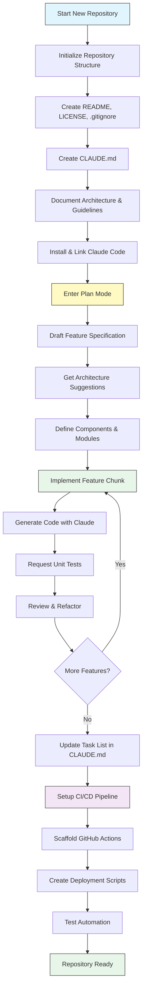
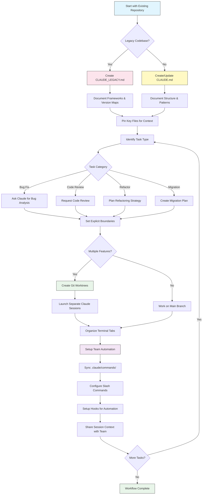

<picture>
  <source media="(prefers-color-scheme: dark)" srcset="../resources/logos/claude-howto-logo-dark.svg">
  
</picture>

# فهرست منابع خوب

## مستندات رسمی

| منبع | توضیح | لینک |
|----------|-------------|------|
| مستندات Claude Code | مستندات رسمی Claude Code | [code.claude.com/docs/en/overview](https://code.claude.com/docs/en/overview) |
| مستندات Anthropic | مستندات کامل Anthropic | [docs.anthropic.com](https://docs.anthropic.com) |
| پروتکل MCP | مشخصات پروتکل Model Context | [modelcontextprotocol.io](https://modelcontextprotocol.io) |
| سرورهای MCP | پیاده‌سازی‌های رسمی سرور MCP | [github.com/modelcontextprotocol/servers](https://github.com/modelcontextprotocol/servers) |
| کتاب آشپزی Anthropic | نمونه‌های کد و آموزش‌ها | [github.com/anthropics/anthropic-cookbook](https://github.com/anthropics/anthropic-cookbook) |
| مهارت‌های Claude Code | مخزن مهارت‌های جامعه | [github.com/anthropics/skills](https://github.com/anthropics/skills) |
| تیم‌های ایجنت | هماهنگی و همکاری چندایجنتی | [code.claude.com/docs/en/agent-teams](https://code.claude.com/docs/en/agent-teams) |
| وظایف زمان‌بندی‌شده | وظایف تکراری با /loop و cron | [code.claude.com/docs/en/scheduled-tasks](https://code.claude.com/docs/en/scheduled-tasks) |
| یکپارچگی Chrome | خودکارسازی مرورگر | [code.claude.com/docs/en/chrome](https://code.claude.com/docs/en/chrome) |
| کلیدبایندها | سفارشی‌سازی میان‌برهای صفحه‌کلید | [code.claude.com/docs/en/keybindings](https://code.claude.com/docs/en/keybindings) |
| برنامه دسکتاپ | برنامه دسکتاپ بومی | [code.claude.com/docs/en/desktop](https://code.claude.com/docs/en/desktop) |
| کنترل از راه دور | کنترل جلسه از راه دور | [code.claude.com/docs/en/remote-control](https://code.claude.com/docs/en/remote-control) |
| حالت خودکار | مدیریت خودکار اجازه | [code.claude.com/docs/en/permissions](https://code.claude.com/docs/en/permissions) |
| کانال‌ها | ارتباط چندکاناله | [code.claude.com/docs/en/channels](https://code.claude.com/docs/en/channels) |
| دیکته صوتی | ورودی صوتی برای Claude Code | [code.claude.com/docs/en/voice-dictation](https://code.claude.com/docs/en/voice-dictation) |
| بازبینی کد | بازبینی‌های درخواست pull مدیریت‌شده از طریق Claude GitHub App (Team و Enterprise) | [code.claude.com/docs/en/code-review](https://code.claude.com/docs/en/code-review) |

## بلاگ مهندسی Anthropic

| مقاله | توضیح | لینک |
|---------|-------------|------|
| اجرای کد با MCP | چگونه با استفاده از اجرای کد، اضافه‌بار زمینه MCP را حل کنیم — کاهش ۹۸.۷ درصدی توکن | [anthropic.com/engineering/code-execution-with-mcp](https://www.anthropic.com/engineering/code-execution-with-mcp) |

---

## تسلط بر Claude Code در ۳۰ دقیقه

_ویدیو_: https://www.youtube.com/watch?v=6eBSHbLKuN0

_**همه نکات**_
- **کاوش ویژگی‌های پیشرفته و میان‌برها**
  - به‌طور منظم ویژگی‌های جدید ویرایش کد و زمینه Claude را در یادداشت‌های انتشار آن‌ها بررسی کنید.
  - میان‌برهای صفحه‌کلید را یاد بگیرید تا سریع بین نمای چت، فایل و ویرایشگر جابه‌جا شوید.

- **راه‌اندازی کارآمد**
  - جلسات خاص پروژه با نام‌ها/توضیحات واضح برای بازیابی آسان ایجاد کنید.
  - فایل‌ها یا پوشه‌های پراستفاده را پین کنید تا Claude هر زمان به آن‌ها دسترسی داشته باشد.
  - یکپارچگی‌های Claude (مثلاً GitHub، IDEهای محبوب) را برای تسریع فرآیند کدنویسی تنظیم کنید.

- **پرس‌وپاسخ کارآمد پایگاه کد**
  - از Claude سوالات دقیق درباره معماری، الگوهای طراحی و ماژول‌های خاص بپرسید.
  - از ارجاعات فایل و خط در سوالات خود استفاده کنید (مثلاً "منطق در `app/models/user.py` چه کاری انجام می‌دهد؟").
  - برای پایگاه‌های کد بزرگ، یک خلاصه یا manifest ارائه دهید تا Claude تمرکز کند.
  - **نمونه پرامپت**: _"می‌توانی جریان احراز هویت پیاده‌سازی‌شده در src/auth/AuthService.ts:45-120 را توضیح دهی؟ چگونه با middleware در src/middleware/auth.ts یکپارچه می‌شود؟"_

- **ویرایش و بازطراحی کد**
  - از کامنت‌های درون‌خطی یا درخواست‌ها در بلوک‌های کد برای دریافت ویرایش‌های متمرکز استفاده کنید ("این تابع را برای وضوح بازطراحی کن").
  - مقایسه side-by-side قبل/بعد درخواست کنید.
  - اجازه دهید Claude پس از ویرایش‌های بزرگ، تست یا مستندات تولید کند برای اطمینان از کیفیت.
  - **نمونه پرامپت**: _"تابع getUserData در api/users.js را بازطراحی کن تا به جای promises از async/await استفاده کند. مقایسه قبل/بعد به من نشان بده و تست‌های واحد برای نسخه بازطراحی‌شده تولید کن."_

- **مدیریت زمینه**
  - کد/زمینه جای‌گذاری‌شده خود را فقط به موارد مرتبط برای وظیفه فعلی محدود کنید.
  - از پرامپت‌های ساختاریافته ("این فایل A است، این تابع B است، سوال من X است") برای بهترین عملکرد استفاده کنید.
  - فایل‌های بزرگ را در پنجره پرامپت حذف یا جمع کنید تا از عبور از محدودیت‌های زمینه جلوگیری شود.
  - **نمونه پرامپت**: _"این مدل User از models/User.js و تابع validateUser از utils/validation.js است. سوال من: چگونه می‌توانم اعتبارسنجی ایمیل را اضافه کنم و سازگاری با نسخه قبلی را حفظ کنم؟"_

- **یکپارچه‌سازی ابزارهای تیم**
  - جلسات Claude را به مخازن و مستندات تیم خود متصل کنید.
  - از قالب‌های داخلی استفاده کنید یا قالب‌های سفارشی برای وظایف مهندسی تکراری ایجاد کنید.
  - با به اشتراک‌گذاری رونوشت‌های جلسه و پرامپت‌ها با هم‌تیمی‌ها همکاری کنید.

- **افزایش عملکرد**
  - دستورالعمل‌های واضح و هدف‌محور به Claude بدهید (مثلاً "این کلاس را در پنج نکته خلاصه کن").
  - کامنت‌ها و کدهای تکراری غیرضروری را از پنجره‌های زمینه حذف کنید.
  - اگر خروجی Claude از مسیر خارج شد، زمینه را بازنشانی کنید یا سوالات را بازنویسی کنید برای هم‌راستایی بهتر.
  - **نمونه پرامپت**: _"کلاس DatabaseManager در src/db/Manager.ts را در پنج نکته خلاصه کن، با تمرکز بر مسئولیت‌های اصلی و متدهای کلیدی."_

- **نمونه‌های استفاده عملی**
  - اشکال‌زدایی: خطاها و stack trace را جای‌گذاری کنید، سپس علل و راه‌حل‌های ممکن را درخواست کنید.
  - تولید تست: تست‌های property-based، واحد یا یکپارچگی برای منطق پیچیده درخواست کنید.
  - بازبینی‌های کد: از Claude بخواهید تغییرات پرخطر، موارد لبه یا code smell را شناسایی کند.
  - **نمونه پرامپت‌ها**:
    - _"این خطا را دریافت می‌کنم: 'TypeError: Cannot read property 'map' of undefined at line 42 in components/UserList.jsx'. stack trace و کد مرتبط اینجاست. چه چیزی باعث این می‌شود و چگونه می‌توانم آن را اصلاح کنم؟"_
    - _"تست‌های واحد جامع برای کلاس PaymentProcessor تولید کن، شامل موارد لبه برای تراکنش‌های ناموفق، timeout و ورودی‌های نامعتبر."_
    - _"این diff درخواست pull را بازبینی کن و مسائل امنیتی بالقوه، گلوگاه‌های عملکرد و code smell را شناسایی کن."_

- **خودکارسازی خط لوله کاری**
  - وظایف تکراری (مثل قالب‌بندی، پاکسازی و تغییر نام تکراری) را با استفاده از پرامپت‌های Claude اسکریپت کنید.
  - از Claude برای پیش‌نویس توضیحات PR، یادداشت‌های انتشار یا مستندات بر اساس diff کد استفاده کنید.
  - **نمونه پرامپت**: _"بر اساس git diff، یک توضیحات PR دقیق با خلاصه تغییرات، فهرست فایل‌های تغییریافته، مراحل تست و تأثیرات احتمالی ایجاد کن. همچنین یادداشت‌های انتشار برای نسخه 2.3.0 تولید کن."_

**نکته**: برای بهترین نتایج، چندین مورد از این شیوه‌ها را ترکیب کنید — با پین کردن فایل‌های حیاتی و خلاصه کردن اهداف خود شروع کنید، سپس از پرامپت‌های متمرکز و ابزارهای بازطراحی Claude برای بهبود تدریجی پایگاه کد و خودکارسازی خود استفاده کنید.

**خط لوله کاری پیشنهادی با Claude Code**

### خط لوله کاری پیشنهادی با Claude Code

#### برای یک مخزن جدید

1. **راه‌اندازی مخزن و یکپارچگی Claude**
   - مخزن جدید خود را با ساختار ضروری راه‌اندازی کنید: README، LICENSE، .gitignore، کانفیگ‌های ریشه.
   - یک فایل `CLAUDE.md` ایجاد کنید که معماری، اهداف سطح بالا و راهنمایی‌های کدنویسی را توصیف کند.
   - Claude Code را نصب کرده و به مخزن خود لینک کنید برای پیشنهادهای کد، ساختار تست و خودکارسازی خط لوله کاری.

2. **استفاده از حالت Plan و مشخصات**
   - از حالت plan (`shift-tab` یا `/plan`) برای پیش‌نویس یک مشخصات دقیق قبل از پیاده‌سازی ویژگی‌ها استفاده کنید.
   - از Claude پیشنهادهای معماری و چیدمان اولیه پروژه بخواهید.
   - یک توالی پرامپت واضح و هدف‌محور داشته باشید — برای طرح‌های کامپوننت، ماژول‌های اصلی و مسئولیت‌ها سوال کنید.

3. **توسعه تکراری و بازبینی**
   - ویژگی‌های اصلی را در قطعات کوچک پیاده‌سازی کنید، و از Claude برای تولید کد، بازطراحی و مستندسازی پرامپت بگیرید.
   - پس از هر افزایش، تست‌های واحد و مثال‌ها درخواست کنید.
   - یک فهرست وظایف در حال اجرا در CLAUDE.md نگه دارید.

4. **خودکارسازی CI/CD و استقرار**
   - از Claude برای ساخت GitHub Actions، اسکریپت‌های npm/yarn یا خط لوله‌های استقرار استفاده کنید.
   - خط لوله‌ها را با به‌روزرسانی CLAUDE.md و درخواست کامندها/اسکریپت‌های مربوطه به‌راحتی تطبیق دهید.

#### برای یک مخزن موجود

1. **راه‌اندازی مخزن و زمینه**
   - `CLAUDE.md` را اضافه یا به‌روزرسانی کنید تا ساختار مخزن، الگوهای کدنویسی و فایل‌های کلیدی را مستند کنید. برای مخازن legacy، از `CLAUDE_LEGACY.md` استفاده کنید که فریمورک‌ها، نقشه نسخه‌ها، دستورالعمل‌ها، اشکال‌ها و یادداشت‌های ارتقا را پوشش می‌دهد.
   - فایل‌های اصلی که Claude باید برای زمینه استفاده کند را پین یا برجسته کنید.

2. **پرس‌وپاسوهای زمینه‌ای کد**
   - از Claude برای بازبینی‌های کد، توضیحات اشکال، بازطراحی یا برنامه‌های مهاجرت با ارجاع به فایل‌ها/توابع خاص بخواهید.
   - مرزهای صریح به Claude بدهید (مثلاً "فقط این فایل‌ها را تغییر بده" یا "بدون وابستگی جدید").

3. **مدیریت Branch، Worktree و چندجلسه‌ای**
   - از چندین git worktree برای ویژگی‌ها یا رفع اشکال ایزوله استفاده کنید و جلسات جداگانه Claude برای هر worktree راه‌اندازی کنید.
   - تب‌ها/پنجره‌های ترمینال را بر اساس شاخه یا ویژگی سازماندهی کنید برای خط لوله‌های کاری موازی.

4. **ابزارهای تیم و خودکارسازی**
   - کامندهای سفارشی را از طریق `.claude/commands/` برای یکپارچگی بین‌تیمی همگام کنید.
   - وظایف تکراری، ایجاد PR و قالب‌بندی کد را از طریق دستورهای اسلش یا هوک‌های Claude خودکارسازی کنید.
   - جلسات و زمینه را با اعضای تیم به اشتراک بگذارید برای عیب‌یابی و بازبینی مشترک.

**نکات**:
- هر ویژگی یا رفع جدید را با یک مشخصات و پرامپت حالت plan شروع کنید.
- برای مخازن legacy و پیچیده، راهنمایی‌های دقیق را در CLAUDE.md/CLAUDE_LEGACY.md ذخیره کنید.
- دستورالعمل‌های واضح و متمرکز بدهید و کار پیچیده را به برنامه‌های چندمرحله‌ای تقسیم کنید.
- به‌طور منظم جلسات را پاک کنید، زمینه را هرس کنید و worktree‌های تکمیل‌شده را حذف کنید تا از شلوغی جلوگیری شود.

این مراحل توصیه‌های اصلی برای خط لوله‌های کاری روان با Claude Code در پایگاه‌های کد جدید و موجود را نشان می‌دهد.

---

## ویژگی‌ها و قابلیت‌های جدید

### منابع ویژگی‌های کلیدی

| ویژگی | توضیح | بیشتر بدانید |
|---------|-------------|------------|
| **حافظه خودکار** | Claude به‌طور خودکار ترجیحات شما را بین جلسه‌ها یاد می‌گیرد و به یاد می‌سپارد | [راهنمای حافظه](02-memory/) |
| **کنترل از راه دور** | یک جلسه محلی Claude Code را از تلفن، مرورگر یا برنامه Claude ادامه دهید | [ویژگی‌های پیشرفته](09-advanced-features/) |
| **جلسات وب** | به Claude Code از طریق رابط‌های مبتنی بر مرورگر برای توسعه از راه دور دسترسی پیدا کنید | [مرجع CLI](10-cli/) |
| **برنامه دسکتاپ** | برنامه دسکتاپ بومی برای Claude Code با رابط کاربری بهبودیافته | [مستندات Claude Code](https://code.claude.com/docs/en/desktop) |
| **تفکر گسترش‌یافته** | تغییر استدلال عمیق از طریق `Alt+T`/`Option+T`؛ Opus 4.7+، Sonnet 5+، Haiku 5.5 و Fable همیشه از استدلال تطبیقی استفاده می‌کنند، بنابراین یک بودجه ثابت `MAX_THINKING_TOKENS` اعمال نمی‌شود (عمق را با `/effort` کنترل کنید) | [ویژگی‌های پیشرفته](09-advanced-features/) |
| **حالت‌های اجازه** | کنترل دقیق: manual (قبلاً default)، acceptEdits، plan، auto، dontAsk، bypassPermissions | [ویژگی‌های پیشرفته](09-advanced-features/) |
| **حافظه ۷ سطحی** | Managed Policy، Project، Project Rules، User، User Rules، Local، Auto Memory | [راهنمای حافظه](02-memory/) |
| **رویدادهای هوک** | ۳۳ رویداد: PreToolUse، PostToolUse، PostToolUseFailure، Stop، StopFailure، SubagentStart، SubagentStop، Notification، Elicitation و بیشتر | [راهنمای هوک‌ها](06-hooks/) |
| **تیم‌های ایجنت** | هماهنگی چندین ایجنت که روی وظایف پیچیده با هم کار می‌کنند | [راهنمای زیرایجنت‌ها](04-subagents/) |
| **وظایف زمان‌بندی‌شده** | وظایف تکراری را با `/loop` و ابزارهای cron تنظیم کنید | [ویژگی‌های پیشرفته](09-advanced-features/) |
| **یکپارچگی Chrome** | خودکارسازی مرورگر در Chrome خود از طریق افزونه Claude in Chrome | [ویژگی‌های پیشرفته](09-advanced-features/) |
| **سفارشی‌سازی صفحه‌کلید** | سفارشی‌سازی کلیدبایندها شامل توالی chord | [ویژگی‌های پیشرفته](09-advanced-features/) |
| **ابزار Monitor** | تماشای جریان stdout یک کامند پس‌زمینه و واکنش به رویدادها به جای polling (v2.1.98+) | [ویژگی‌های پیشرفته](09-advanced-features/) |
| **حالت /goal** | ثبت یک شرط تکمیل سطح جلسه؛ Claude تا برآورده شدن آن به کار ادامه می‌دهد (v2.1.139+) | [دستورهای اسلش](01-slash-commands/) |
| **claude agents (نمای ایجنت)** | فهرست‌بندی، بررسی و از سرگیری ایجنت‌های پس‌زمینه از ترمینال؛ `--json` برای خروجی قابل‌خواندن توسط ماشین (v2.1.139+، `--json` در v2.1.145 اضافه شد) | [code.claude.com/docs/en/agent-view](https://code.claude.com/docs/en/agent-view) |
| **/run, /verify, /run-skill-generator** | مهارت‌های بسته‌بندی‌شده برای راه‌اندازی پروژه، تأیید کارکرد رفع و تولید مهارت‌های run/verify خاص پروژه (v2.1.145+) | [راهنمای مهارت‌ها](03-skills/) |

---
**آخرین به‌روزرسانی**: ۲۶ اکتبر ۲۰۲۶
**نسخه Claude Code**: 2.1.310
**منابع**:
- https://code.claude.com/docs/en/overview
- https://code.claude.com/docs/en/changelog
- https://code.claude.com/docs/en/agent-view
- https://code.claude.com/docs/en/permission-modes
- https://github.com/anthropics/claude-code/releases/tag/v2.1.144
- https://github.com/anthropics/claude-code/releases/tag/v2.1.145
- https://code.claude.com/docs/en/model-config
- https://code.claude.com/docs/en/chrome
- https://code.claude.com/docs/en/remote-control
- https://code.claude.com/docs/en/code-review
- https://code.claude.com/docs/en/scheduled-tasks
- https://code.claude.com/docs/en/permission-modes#available-modes
**مدل‌های سازگار**: Claude Fable 5, Claude Opus 5, Claude Sonnet 5, Claude Sonnet 4.6, Claude Opus 4.8, Claude Haiku 4.5
