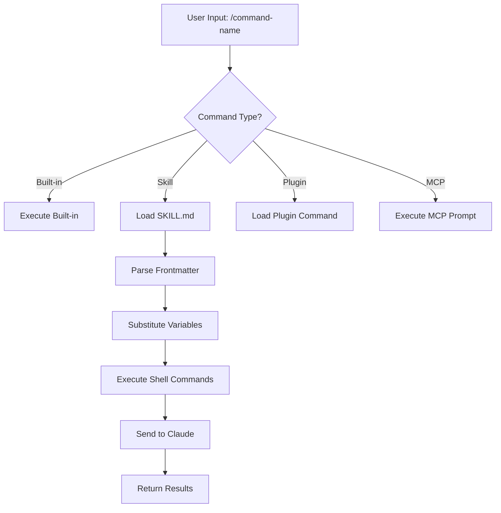
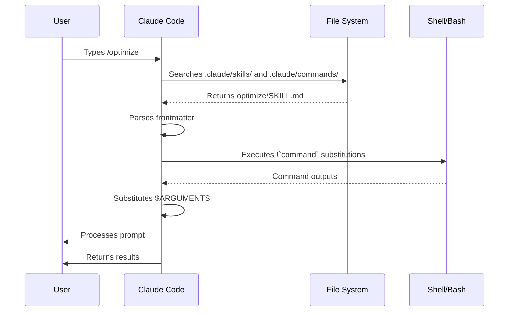

<!-- i18n-source: 01-slash-commands/README.md -->
<!-- i18n-source-sha: b968f42 -->
<!-- i18n-date: 2026-10-31 -->

<picture>
  <source media="(prefers-color-scheme: dark)" srcset="../../resources/logos/claude-howto-logo-dark.svg">
  
</picture>

# 슬래시 명령어

## 개요

슬래시 명령어는 대화형 세션 동안 Claude의 동작을 제어하는 단축키입니다. 여러 유형이 있습니다:

- **내장 명령어**: Claude Code에서 제공합니다 (`/help`, `/clear`, `/model`)
- **스킬**: `SKILL.md` 파일로 생성된 사용자 정의 명령어입니다 (`/optimize`, `/pr`)
- **플러그인 명령어**: 설치된 플러그인에서 제공하는 명령어입니다 (`/frontend-design:frontend-design`)
- **MCP 프롬프트**: MCP 서버에서 제공하는 명령어입니다 (`/mcp__github__list_prs`)

> **참고**: 사용자 정의 슬래시 명령어는 스킬로 통합되었습니다. `.claude/commands/`에 있는 파일은 여전히 작동하지만, 스킬(`.claude/skills/`)이 이제 권장되는 방식입니다. 두 가지 모두 `/command-name` 단축키를 생성합니다. 전체 참조는 [스킬 가이드](../03-skills/)를 참조하십시오.

## 내장 명령어 참조

내장 명령어는 일반적인 작업을 위한 단축키입니다. **60개 이상의 내장 명령어**와 **약 20개의 번들 스킬**(일부는 기능 플래그로 제한됨)이 제공됩니다. Claude Code에서 `/`를 입력하여 전체 목록을 보거나, `/` 뒤에 글자를 입력하여 필터링할 수 있습니다.

> **참고**: v2.1.236부터 잘못 입력한 슬래시 명령어나 현재 세션에서 사용할 수 없는 명령어에서 Enter를 누르면, 가장 가까운 퍼지 매치를 조용히 실행하는 대신 오류를 보고합니다. 모호하지 않은 접두사와 정의된 별칭은 이전처럼 실행됩니다.

| Command | 목적 |
|---------|---------|
| `/add-dir <path>` | 작업 디렉터리 추가 |
| `/advisor [model\|off]` | 어드바이저를 구성합니다. 대화형 대화 상자로 열리며, 데스크톱 앱, 원격 제어, 헤드리스(`-p` / Agent SDK) 세션에서는 텍스트 형식을 사용합니다 — 인자 없는 `/advisor`, `/advisor <model>`, 또는 `/advisor off` (v2.1.260+) |
| `/agents` | 더 이상 작동하는 명령어가 아닙니다: 대화형 마법사는 v2.1.198에서 제거되었고, v2.1.281부터 `/agents`는 `/` 메뉴나 `/help`에 나타나지 않습니다 — 입력하면 마법사가 어디로 갔는지만 설명합니다. Claude에게 서브에이전트 생성·관리를 요청하거나 `.claude/agents/` 파일을 직접 편집하십시오 |
| `/artifacts` | 내가 소유하거나 나와 공유된 아티팩트를 나열한 다음, 세션에 첨부하거나 브라우저에서 열거나 링크를 복사합니다 (v2.1.208+). `d`로 삭제하면 확인을 요청합니다: 1 또는 Enter는 유지, 2는 삭제, Esc는 취소 (v2.1.305) |
| `/auto-mode-setup` | 프로젝트와 최근 세션에서 `autoMode.environment` 항목 초안을 작성하고, 초안을 검토한 뒤 사용자 설정에 저장합니다. Pro/Max/Team: v2.1.228+ (네이티브 Windows는 v2.1.233+); Enterprise 또는 Console API 키: v2.1.283+. v2.1.304부터 Bedrock, Vertex, Foundry, Claude 앱 게이트웨이, 텔레메트리 꺼짐 세션에서도 사용할 수 있습니다 |
| `/branch [name]` | 현재 시점의 대화 사본으로 전환하며 원본은 보존합니다 (`/resume`으로 원본으로 돌아갈 수 있음) |
| `/fork [prompt]` | 현재 대화를 새 **백그라운드 세션**으로 복사하고 여기서 계속 작업합니다. 그 시점부터 두 세션은 독립적이며, 사본은 `claude agents`에 자체 행을 갖습니다 (v2.1.212+). 사본이 제자리에서 편집하는 경우를 제외하고, Claude Code는 코드를 변경하기 전에 자체 워크트리를 만들도록 지시합니다 (격리 지시는 v2.1.221+ 필요) |
| `/subtask <task>` | 전체 대화를 상속하는 **포크된 서브에이전트**를 생성하여, 사용자가 계속 작업하는 동안 해당 작업을 수행합니다. 완료되면 결과가 이 대화로 돌아옵니다 (v2.1.212+) |
| `/btw [question]` | Claude가 주 작업을 수행하는 동안 임시 보조 질문을 합니다. 주 대화 컨텍스트를 오염시키지 않습니다. 인자 없는 `/btw`는 마지막 보조 질문을 다시 엽니다 (v2.1.212+) |
| `/cd <path>` | 프롬프트 캐시를 깨뜨리지 않고 세션을 새 작업 디렉터리로 이동합니다 (v2.1.169에 추가) |
| `/chrome` | Chrome 브라우저 통합 구성 |
| `/clear` | 대화 지우기 (별칭: `/reset`, `/new`) |
| `/color [color\|default]` | 프롬프트 바 색상을 설정합니다. 인자 없이 `/color`를 사용하면 임의의 세션 색상을 선택합니다 (v2.1.128+). 색상 이름 또는 16진수를 전달하여 명시적으로 설정합니다. |
| `/compact [instructions]` | 선택적 포커스 지침을 사용하여 대화를 압축합니다. 압축에 실패하면 이제 아무 일도 없이 넘어가지 않고 UI에 오류로 표시됩니다 (v2.1.216) |
| `/config` | 설정 열기 (별칭: `/settings`) |
| `/context` | 컨텍스트 사용량을 컬러 그리드로 시각화합니다. 사용량이 컨텍스트 창 한도를 넘으면 명시적인 경고를 표시합니다 (v2.1.216) |
| `/copy [N]` | 어시스턴트 응답을 클립보드에 복사합니다. `w`는 파일에 씁니다 |
| `/cost` | `/usage`의 타이핑 단축 별칭 — 비용 탭을 엽니다 (v2.1.118+) |
| `/desktop` | 데스크톱 앱에서 계속 (별칭: `/app`) |
| `/diff` | 커밋되지 않은 변경 사항에 대한 대화형 Diff 뷰어. 전체 화면 렌더링에서는 대신 대화 옆에 Diff 패널을 열어 작업을 계속하는 동안 열린 상태로 유지합니다 — 추가/삭제된 줄 수와 함께 변경된 파일을 나열하며, Claude가 파일을 편집하거나 셸 명령을 실행할 때마다 새로 고칩니다. `/diff`를 다시 실행하거나 `✕`를 클릭하면 닫힙니다 (v2.1.260+). 클래식 렌더러는 프롬프트 자리에 뷰어를 엽니다 |
| `/doctor` | 설치 상태를 진단합니다 — Claude가 응답 중일 때도 열 수 있습니다. 번들 스킬로서 Claude가 설정을 점검하고 수정 사항을 제안하며, 사용자가 확인하면 적용합니다(`claude doctor`는 읽기 전용 진단을 실행). Pro, Max, Team, Enterprise 플랜에서는 점검 시 `/usage`가 권장하는 변경 사항도 제안합니다 (v2.1.305, 원격 제어가 연결된 동안에는 건너뜀). `/doctor prompt-audit`(또는 `/checkup prompt-audit`)는 CLAUDE.md 파일, 스킬, 에이전트, 명령어에서 이전 모델용으로 작성된 프롬프트 패턴을 점검합니다 (v2.1.283) |
| `/effort [low\|medium\|high\|xhigh\|max\|auto\|ultracode [on\|off]]` | 대화형 화살표 키 슬라이더로 노력 수준을 설정합니다. 수준: `low` → `medium` → `high` → `xhigh` (v2.1.111에 새로 추가) → `max`. 기본값은 Opus 5.5(v2.1.280부터 기본 모델), Sonnet 5.5, Haiku 5.5에서 `medium`, Opus 5, Sonnet 5, Opus 4.8에서 `high`, Opus 4.7에서 `xhigh`입니다. `xhigh`는 Fable 5.1, Fable 5, Opus 5.5, Sonnet 5.5, Haiku 5.5, Opus 5, Sonnet 5, Opus 4.8 또는 Opus 4.7이 필요합니다. `max`는 Fable 5.1, Fable 5, Opus 5.5, Sonnet 5.5, Haiku 5.5, Opus 5, Sonnet 5, Opus 4.8/4.7/4.6 및 Sonnet 4.6에서 작동합니다. `/effort`가 모델별 설정이 되기 전에 저장된 수준은 Opus 5.5처럼 새로 출시된 모델에는 적용되지 않습니다 (v2.1.280). 슬라이더에는 **Ultracode** 토글(Tab 또는 `/effort ultracode [on\|off]`)도 있습니다 — 모델 노력 수준이 아니며, 세션이 실행 중인 노력 수준에서 Claude가 동적 워크플로를 조율하게 합니다. v2.1.284부터 더 이상 `xhigh`를 강제하지 않으며 수준을 바꿔도 켜진 상태로 유지됩니다. `/effort ultracode`는 세션 동안 유지되며, `ultracode` 설정을 사용하면 영구적으로 유지됩니다 |
| `/exit` | REPL 종료 (별칭: `/quit`) |
| `/export [filename]` | 현재 대화를 파일 또는 클립보드로 내보냅니다 |
| `/usage-credits` | 속도 제한을 위한 추가 사용량 구성 (v2.1.144에서 `/extra-usage`에서 이름 변경, `/extra-usage`는 여전히 별칭으로 작동) |
| `/fast [on\|off]` | 빠른 모드 전환. Opus 5.5(v2.1.280부터 빠른 모드 기본값), Opus 5, Opus 4.8에 적용됩니다 |
| `/feedback` | 피드백 제출. v2.1.141부터 최근 세션(지난 24시간 또는 7일)을 첨부할 수 있어 여러 세션에 걸친 보고서에 컨텍스트가 포함됩니다. v2.1.178부터 `/bug`는 제출 전에 설명이 필요합니다. |
| `/focus` | 포커스 뷰 전환 (v2.1.110에 추가, 포커스 토글용 `Ctrl+O`를 대체) |
| `/goal <statement>` | 세션 수준 완료 조건을 등록합니다. Claude는 목표가 달성될 때까지 계속 작업합니다. `/goal clear`는 이를 제거합니다. 활성 목표는 상태 표시줄에 나타나며, 경과 시간, 턴 수, 토큰 사용량을 보여주는 라이브 오버레이 패널이 함께 표시됩니다 (v2.1.139에 추가). |
| `/help` | 도움말 표시 |
| `/hooks` | 훅 구성 보기 |
| `/ide` | IDE 통합 관리 |
| `/init` | `CLAUDE.md` 초기화. 대화형 흐름을 위해 `CLAUDE_CODE_NEW_INIT=1` 설정 |
| `/insights` | 세션 분석 보고서 생성 |
| `/install-github-app` | GitHub Actions 앱 설정 |
| `/install-slack-app` | Slack 앱 설치 |
| `/keybindings` | 키 바인딩 구성 열기 |
| `/fewer-permission-prompts` | 최근 Bash/MCP 도구 호출을 분석하고 권한 프롬프트를 줄이기 위해 `.claude/settings.json`에 우선순위가 지정된 허용 목록을 추가합니다 (v2.1.111에 추가) |
| `/login` | Anthropic 계정 전환 |
| `/logout` | Anthropic 계정에서 로그아웃 |
| `/mcp` | MCP 서버 및 OAuth 관리 |
| `/memory` | `CLAUDE.md` 편집, 자동 메모리 전환 |
| `/mobile` | 모바일 앱용 QR 코드 (별칭: `/ios`, `/android`) |
| `/model [model]` | 모델을 선택하고 왼쪽/오른쪽 화살표로 노력 수준을 조정합니다. v2.1.153부터 선택은 새 세션의 **기본값으로 저장됩니다** (IDE와 동일). 선택 후 `s`를 누르면 현재 세션에만 적용합니다. (`modelPicker:setAsDefault` 키 바인딩이 `modelPicker:thisSessionOnly`로 이름이 변경되었고, 이전 `d` 동작은 이제 `s`입니다.) v2.1.219부터 선택기는 병합된 Opus 행을 "Opus (1M context)"로 표시했으며, v2.1.283은 Opus가 이미 1M 창을 가진 Opus 및 Default 행에서 해당 레이블을 제거합니다 (창 크기는 변하지 않음). |
| `/output-style [name]` | 출력 스타일을 나열하고 전환합니다 (v2.1.91에서 제거된 후 v2.1.269에서 다시 추가). 인자가 없으면 스타일 목록을 보여주고 현재 스타일을 표시합니다. 헤드리스 및 원격 제어 세션에서도 작동하며, 선택은 `.claude/settings.local.json`에 저장됩니다 |
| `/passes` | Claude Code 무료 주간 이용권 공유 |
| `/permissions` | 권한 보기/업데이트 (별칭: `/allowed-tools`) |
| `/plan [description]` | 계획 모드 진입 |
| `/plugin` | 플러그인 관리 |
| `/proactive` | `/loop`의 별칭 (v2.1.105에 추가) |
| `/powerup` | 애니메이션 데모가 있는 대화형 레슨을 통해 기능 발견 |
| `/privacy-settings` | 개인 정보 설정 (Pro/Max 전용) |
| `/release-notes` | 변경 로그 보기 |
| `/recap` | 세션으로 돌아올 때 세션 요약 표시 (v2.1.108에 추가) |
| `/reload-plugins` | 활성 플러그인 다시 로드. v2.1.221부터 대부분의 설치가 즉시 활성화되므로, 설치 요약에 `Run /reload-plugins to activate.`가 표시될 때만 필요합니다. v2.1.260부터 헤드리스 세션에서도 사용할 수 있어 Claude Code Desktop 및 SDK 명령어 목록에도 나타납니다 |
| `/reload-skills` | 세션을 다시 시작하지 않고 스킬 디렉터리를 다시 스캔합니다 (v2.1.152에 추가). v2.1.304부터 새로 추가되거나 변경된 스킬만 Claude에 보냅니다. 이제 압축 시 스킬 목록을 자동으로 다시 보내므로, 압축 후에 `/reload-skills`를 실행할 필요가 없습니다 |
| `/remote-control` | claude.ai에서 원격 제어 (별칭: `/rc`) |
| `/remote-env` | 기본 원격 환경 구성 |
| `/rename [name]` | 세션 이름 변경 |
| `/resume [session]` | 대화 재개 (별칭: `/continue`) |
| `/review [low\|medium\|high\|xhigh\|max\|ultra] [--fix] [--comment] [pr#\|branch\|path]` | `/code-review`의 별칭 (v2.1.223): 현재 Diff 또는 전달한 PR 번호, 브랜치, 경로를 검토합니다 — 예: `/review 1234`. 동일한 노력 수준과 플래그를 사용합니다. 수준을 지정하지 않으면 마지막으로 입력한 `low`–`max` 수준을 재사용합니다 |
| `/rewind` | 대화 및/또는 코드 되감기 (별칭: `/checkpoint`, `/undo`) |
| `/sandbox` | 샌드박스 모드 전환 |
| `/schedule [description]` | 클라우드 예약 작업(이전 명칭: 루틴)을 생성, 업데이트, 나열 또는 실행합니다. 별칭: `/routines` |
| `/scroll-speed` | 전체 화면 모드에서 마우스 휠 스크롤 속도를 조정하는 대화형 대화 상자를 엽니다: ←/→로 조정, `r`로 초기화, Enter로 저장. `~/.claude/settings.json`에 저장됩니다 (v2.1.139에 추가). |
| `/security-review` | 브랜치의 보안 취약점 분석 |
| `/skill-doctor` | 로드된 스킬 중 사용되지 않는 스킬과 각 스킬이 컨텍스트에서 차지하는 비용을 보여주어, 어떤 스킬을 끌지 결정할 수 있게 합니다. 보고서는 `/plugin` 관리자의 **Stats** 탭에서 열리며, 비대화형 `-p` 모드에서는 텍스트로 출력됩니다. 원격 제어에서는 `Skill usage reports are not available on this connection.`이라고 응답하므로, 세션을 호스팅하는 머신의 터미널에서 실행하십시오 (v2.1.252+ 필요) |
| `/skills` | 사용 가능한 스킬 나열 |
| `/stats` | `/usage`의 타이핑 단축 별칭 — 통계 탭(일일 사용량, 세션, 연속 기록)을 엽니다 (v2.1.118+) |
| `/stickers` | Claude Code 스티커 주문 |
| `/status` | 버전, 모델, 계정, 그리고 `background job · attached`, `background job · unattended` 또는 `interactive`를 표시하는 `Session kind` 행을 보여줍니다 (행은 v2.1.221에 추가). Claude가 응답 중일 때도 열 수 있습니다 |
| `/statusline` | 상태 표시줄 구성 |
| `/tasks` | 백그라운드 작업 나열/관리 |
| `/team-onboarding` | 지난 30일간의 Claude Code 세션, 명령어, MCP 사용량으로 팀원 온보딩 가이드를 생성합니다. Team 및 Enterprise 플랜에서는 공유 링크도 반환합니다 (v2.1.101에 새로 추가) |
| `/teleport` | 웹의 Claude Code 세션을 이 터미널에서 재개합니다. 웹 세션 선택기를 엽니다 (별칭: `/tp`). claude.ai 구독이 필요합니다 |
| `/terminal-setup` | 터미널 키 바인딩 구성 |
| `/theme` | 테마 선택기 열기 / 사용자 정의 테마 관리 (v2.1.118). `~/.claude/themes/<name>.json`의 JSON으로 사용자 정의 테마 정의 |
| `/tui [default\|fullscreen]` | 터미널 UI 렌더러를 설정하고(`fullscreen`은 깜박임 없는 렌더링 제공) 해당 렌더러로 다시 실행합니다. 인자 없는 `/tui`는 현재 렌더러를 출력합니다 (v2.1.110에 추가) |
| `/ultrareview` | 포괄적인 클라우드 기반 다중 에이전트 코드 리뷰 (v2.1.111에 추가). 이제 권장 호출 방식은 `/code-review ultra`이며, `/ultrareview`는 별칭으로 남아 있습니다. Pro 및 Max에서 무료 실행 3회가 포함되며, 이후에는 사용량 크레딧이 필요합니다 |
| `/upgrade` | 상위 플랜 티어 업그레이드 페이지 열기 |
| `/usage` | 표준 사용량 대시보드 (v2.1.118) — 플랜 사용량 제한, 속도 제한, 비용, 일일 세션 통계를 결합합니다. `/cost`와 `/stats`는 특정 탭을 여는 타이핑 단축 별칭입니다. max 노력 수준, 워크플로, 상시 로드 컨텍스트, 큰 도구 결과에 대해 경고합니다 (v2.1.299). v2.1.305부터 각 경고는 한 줄짜리 수정 사항이며, `f`를 누르면 Claude Code가 적용할 수 있는 수정을 적용합니다 |
| `/voice` | 눌러서 말하기 음성 받아쓰기 전환 |
| `/workflows` | 실행 중이거나 완료된 동적 워크플로 실행 보기 (v2.1.154에 추가). [동적 워크플로](../09-advanced-features/README.md#동적-워크플로) 참조 |

> **`/cd`가 중요한 이유:** 예전에는 디렉터리를 변경하면 캐시 워밍이 손실되어 다음 턴이 느려지고 비용이 늘었습니다. `/cd`는 전환 후에도 프롬프트 캐시를 보존합니다.

### 번들 스킬

이러한 스킬은 Claude Code와 함께 제공되며 슬래시 명령어처럼 호출됩니다:

| Skill | 목적 |
|-------|---------|
| `/batch <instruction>` | 워크트리를 사용하여 대규모 병렬 변경을 조율합니다 |
| `/claude-api` | 프로젝트 언어에 맞는 Claude API 참조를 로드합니다. 하위 명령어로 `api-version`(코드를 최신 API 버전으로 이전, v2.1.307+)과 `managed-agents-secure`(Managed Agent의 설정 점검, v2.1.304+)가 있습니다 |
| `/dataviz` | 실행 가능한 색상 팔레트 검증기를 포함한 차트 및 대시보드 디자인 가이드 (v2.1.198) |
| `/debug [description]` | 디버그 로깅 활성화 |
| `/design [description]` | **디자인 캔버스**를 만듭니다 — 아티팩트로 게시되고 코드가 아닌 시각적으로 다듬는 다중 아트보드 비주얼 디자인(UI 목업, 화면 흐름, 랜딩 페이지, 포스터)입니다. 레이아웃 자체를 반복 개선하고 싶을 때 HTML을 직접 작성하는 대신 사용하십시오. v2.1.265+, 아티팩트를 사용할 수 있는 세션, Design 템플릿이 있는 계정이 필요하며, Bedrock, Vertex, Foundry, Claude Platform on AWS에서는 사용할 수 없습니다. 독립형 Claude Design(claude.ai/design)은 2026년 12월 14일까지 종료됩니다. `/design consent`와 `/design revoke`는 Claude Design에 대한 Claude의 접근 권한을 부여하거나 철회합니다. Claude가 `/design consent` 실행을 요청하면 프롬프트에 직접 입력하십시오. |
| `/loop [interval] [prompt]` | 지정된 간격으로 프롬프트를 반복 실행합니다 |
| `/code-review [low\|medium\|high\|xhigh\|max\|ultra] [--fix] [--comment] [--max-findings n\|all\|default] [pr#\|branch\|path]` | 현재 Diff 또는 전달한 PR 번호, 브랜치, 경로에서 정확성 버그를 검토합니다. `--fix`를 전달하면 발견 사항을 적용하고, `--comment`는 GitHub PR 인라인 댓글로 게시하며, `ultra`는 심층 클라우드 리뷰를 실행합니다. `github.com` PR 대상에 `ultra`를 사용할 때 `--post`는 발견 사항을 PR에 게시하도록 미리 선택합니다. 노력 수준을 지정하지 않으면 마지막으로 입력한 수준을 재사용합니다 (v2.1.223). 원래 v2.1.147에서 `/simplify`를 흡수했지만, v2.1.154에서 `/simplify`는 별도 명령어로 돌아왔습니다. `--max-findings <n>\|all`을 전달하면 일반적인 한도보다 많거나 적은 발견 사항을 보고하며, `--max-findings default`를 전달할 때까지 이 선택이 재사용됩니다 (v2.1.288) |
| `/simplify` | 정리 전용 검토(재사용 / 단순화 / 효율성 / 추상화 수준)를 실행하고 수정 사항을 적용합니다. 버그를 찾지 **않습니다** — 버그를 찾으려면 `/code-review`를 사용하십시오. 잠시 `/code-review --fix`의 별칭이었다가 (v2.1.152), v2.1.154에서 정리 전용이 되었습니다 |

### 지원 중단된 명령어

| Command | 상태 |
|---------|--------|
| `/pr-comments` | v2.1.91에서 제거됨 — PR 댓글을 보려면 Claude에게 직접 요청하십시오 |
| `/vim` | v2.1.92에서 제거됨 — `/config` → 편집기 모드를 사용하십시오 |

### 최근 변경 사항

- `/fork`와 `/subtask`의 역할이 **v2.1.212**에서 서로 바뀌었습니다. `/fork`는 이제 대화를 독립적인 새 백그라운드 세션으로 복사하며, 기존의 포크된 서브에이전트 동작은 새 `/subtask` 명령어로 옮겨졌습니다. 이력: `/fork`는 v2.1.77부터 v2.1.161까지 `/branch`의 별칭이었고, v2.1.161부터 v2.1.211까지는 포크된 서브에이전트를 시작했습니다(현재 `/subtask`의 동작). 에이전트 뷰가 꺼져 있으면 `/subtask`를 사용할 수 없으며 `/fork`가 포크된 서브에이전트 동작을 유지합니다
- 인자 없는 `/resume`은 지난 세션 선택기를 열고 — 표시 목록에서 제거된 세션 포함 — 선택한 세션을 백그라운드 세션으로 재개합니다 (v2.1.212)
- 백그라운드에서 실행 중인 세션에 `/resume`이나 `claude --resume`을 사용하면 거부하지 않고 해당 세션을 열며, `claude --resume <id> "prompt"`는 프롬프트를 다음 턴으로 보냅니다 (v2.1.285)
- `/output-style`은 지원 중단(v2.1.73)되고 제거(v2.1.91)되었다가 **v2.1.269에서 다시 추가**되었습니다 — v2.1.278에서 다시 사용 가능한 명령어이며, 헤드리스 및 원격 제어 세션에서도 작동합니다. 출력 스타일은 `/config` → Output style 또는 `outputStyle` 설정으로도 사용할 수 있으며, 내장 스타일은 Default, Proactive, Explanatory, Learning, Concise입니다 (v2.1.237에 추가)
- `/review`가 `/code-review`의 완전한 별칭이 되었습니다 — 동일한 대상, 노력 수준, 플래그 (v2.1.223). 이력: v2.1.186에서 처음 `/code-review medium` 엔진으로 옮겨졌으나 PR 전용으로 유지되었습니다
- `/effort` 명령어가 추가되었습니다. `max` 수준은 Opus 4.6+에서 사용할 수 있습니다 (원래 Opus 4.6 전용)
- 눌러서 말하기 음성 받아쓰기를 위한 `/voice` 명령어가 추가되었습니다
- 예약 작업 생성/관리를 위한 `/schedule` 명령어가 추가되었습니다
- 프롬프트 바 사용자 정의를 위한 `/color` 명령어가 추가되었습니다
- `/pr-comments`가 v2.1.91에서 제거됨 — PR 댓글을 보려면 Claude에게 직접 요청하십시오
- `/vim`이 v2.1.92에서 제거됨 — 대신 `/config` → 편집기 모드를 사용하십시오
- `/ultraplan`이 v2.1.222에서 제거되었습니다 — 대신 계획 모드를 사용하십시오
- 대화형 기능 레슨을 위한 `/powerup`이 추가되었습니다
- 샌드박스 모드 전환을 위한 `/sandbox`가 추가되었습니다
- `/model` 선택기는 이제 원시 모델 ID 대신 사람이 읽을 수 있는 레이블(예: "Sonnet 4.6")을 표시합니다
- `/resume`은 `/continue` 별칭을 지원합니다
- MCP 프롬프트는 `/mcp__<server>__<prompt>` 명령어로 사용할 수 있습니다 ([MCP 프롬프트를 명령어로](#mcp-프롬프트를-명령어로) 참조)
- 팀원 온보딩 가이드를 자동 생성하는 `/team-onboarding`이 추가되었습니다 (v2.1.101)
- 깜박임 없는 전체 화면 TUI 렌더링을 위한 `/tui` 명령어가 추가되었습니다 (v2.1.110)
- 포커스 뷰 전환을 위한 `/focus` 명령어가 추가되었습니다. `Ctrl+O`는 이제 자세한 대화록만 전환합니다 (v2.1.110)
- 세션 컨텍스트 요약을 수동으로 트리거하는 `/recap` 명령어가 추가되었습니다 (v2.1.108)
- `/undo`가 `/rewind`의 별칭으로 추가되었습니다 (v2.1.108). `/checkpoint`와 함께 여전히 `/rewind`의 별칭입니다
- `/proactive`가 `/loop`의 별칭으로 추가되었습니다 (v2.1.105)
- `/effort`에 대화형 화살표 키 슬라이더와 `high`와 `max` 사이의 새 `xhigh` 수준이 추가되었습니다. Opus 4.7 플랜의 기본 노력 수준은 `xhigh`로 상향되었습니다 (v2.1.111). Opus 4.8의 기본값은 `high`이며 (v2.1.154), Opus 5도 기본값이 `high`입니다 (v2.1.219)
- 포괄적인 클라우드 기반 다중 에이전트 코드 리뷰를 위한 `/ultrareview`가 추가되었습니다 (v2.1.111)
- Bash/MCP 도구 호출을 분석하고 `.claude/settings.json`의 허용 목록으로 권한 프롬프트를 줄이는 `/fewer-permission-prompts`가 추가되었습니다 (v2.1.111)
- Opus 4.7의 Max 구독자는 자동 모드에 더 이상 `--enable-auto-mode` 플래그가 필요하지 않습니다 (v2.1.112)
- `/goal` 추가 — Claude가 여러 턴에 걸쳐 달성하려는 세션 수준 완료 조건. 라이브 오버레이에 경과 시간, 턴 수, 토큰 사용량이 표시됩니다 (v2.1.139)
- `/scroll-speed` 추가 — TUI 라이브 미리보기 창의 마우스 휠 스크롤 속도를 조정하며, 머신별로 유지됩니다 (v2.1.139)
- `/reload-skills` 추가 — 세션을 다시 시작하지 않고 스킬 디렉터리를 다시 스캔합니다 (v2.1.152)
- `/model`은 이제 선택한 모델을 새 세션의 기본값으로 저장합니다. 세션 전용으로 적용하려면 `s`를 누르십시오 (키 바인딩 `modelPicker:setAsDefault` → `modelPicker:thisSessionOnly`) (v2.1.153)
- `/workflows` 추가 — 실행 중이거나 완료된 동적 워크플로 실행을 봅니다 (v2.1.154)
- `/simplify`가 `/code-review`의 버그 찾기와 별개인 정리 전용 검토 명령어(재사용 / 단순화 / 효율성 / 추상화 수준)로 돌아왔습니다 (v2.1.154)
- `/status`에 연결된(attached) 백그라운드 작업, 무인(unattended) 백그라운드 작업, 대화형 세션을 구분하는 `Session kind` 행이 추가되었습니다 (v2.1.221)
- 플러그인 설치가 안전한 경우 즉시 활성화됩니다. `/reload-plugins`는 설치 요약에서 요청할 때만 필요합니다 (v2.1.221)
- `/ultraplan` 제거 — 계획 모드를 사용하십시오 (v2.1.222)
- `/code-review`와 `/review`는 노력 수준을 생략하면 마지막으로 입력한 수준을 기억합니다 (v2.1.223)
- `/code-review ultra`가 클라우드 다중 에이전트 리뷰의 권장 진입점이 되었으며, `/ultrareview`는 별칭으로 유지됩니다 (v2.1.223)
- `high`, `xhigh`, `max` 노력 수준의 `/code-review`도 이제 다른 수준처럼 백그라운드 에이전트에서 실행됩니다 (v2.1.232)
- 사용자 정의 서브에이전트 생성을 제안하던 시작 팁과 `/powerup` 투어의 해당 안내가 제거되었습니다 (v2.1.232)
- `/permissions`를 이제 Claude가 작업 중일 때도 열 수 있으며, 규칙 변경은 현재 턴의 나머지 부분에 적용됩니다 (v2.1.234)
- `/add-dir <path>`를 이제 Claude가 작업 중일 때도 사용할 수 있습니다. `/add-dir`, `/autocompact`, `/theme`, `/help`, `/config`, `/advisor` 대화 상자는 **전체 화면 TUI에서** Claude가 응답을 마칠 때까지 대기하지 않고 턴 도중에 열립니다 (`/bug`는 v2.1.232부터 이미 즉시 열렸음) (v2.1.234)

### `/goal` — 세션 수준 완료 조건

> **v2.1.139에 새로 추가**

`/goal`을 사용하여 현재 세션의 완료 조건을 등록하십시오. Claude는 여러 턴에 걸쳐 이를 달성하기 위해 작업하며, 오버레이 패널에 경과 시간, 턴 수, 사용된 토큰이 표시됩니다. `/goal clear`로 지울 수 있습니다. 대화형 모드, `claude -p`, 원격 제어에서 작동합니다.

```
User: /goal Migrate the payments service from REST to gRPC and get the integration tests passing.
Claude: Goal registered. I'll work toward this until you clear it.
[Goal panel: ⏱ 0s · turns 0 · tokens 0]

User: start by listing the REST endpoints
Claude: [does the work, panel updates]
```

**정체된 백그라운드 작업 확인 (v2.1.234):** 목표가 활성화된 동안 백그라운드 작업이 30분 이상 진행되지 않으면, Claude는 조용히 계속하는 대신 상태 업데이트로 확인합니다. 임계값(분 단위)은 `CLAUDE_CODE_GOAL_CHECKIN_MINUTES` 환경 변수로 조정하거나, `0`으로 설정하여 확인을 완전히 비활성화할 수 있습니다.

### `/team-onboarding` — 팀원 온보딩 가이드

> **v2.1.101에 새로 추가**

`/team-onboarding`을 사용하여 프로젝트의 로컬 Claude Code 사용량에서 팀원 온보딩 가이드를 생성하십시오. Claude는 지난 30일간의 세션, 명령어, MCP 서버 사용량을 분석한 다음, 신규 개발자가 빠르게 생산성을 높일 수 있도록 돕는 온보딩 가이드를 생성합니다. Team 및 Enterprise 플랜의 claude.ai 구독자에게는 팀원이 Claude Code에서 바로 열 수 있는 공유 링크도 반환합니다.

이것은 내장 명령어이므로 설치할 필요가 없습니다.

**사용법:**

```bash
claude /team-onboarding
```

생성된 가이드는 다음을 바탕으로 합니다:

- 최근 세션에서 반복되는 워크플로
- 가장 자주 실행하는 명령어
- 사용하는 [MCP 서버](../05-mcp/README.md)

**가용성:** Claude Code v2.1.101 (2026년 4월 11일)에 출시되었습니다.

## 사용자 정의 명령어 (이제 스킬)

사용자 정의 슬래시 명령어는 **스킬로 통합**되었습니다. 두 가지 접근 방식 모두 `/command-name`으로 호출할 수 있는 명령어를 생성합니다:

| 접근 방식 | 위치 | 상태 |
|----------|----------|--------|
| **스킬 (권장)** | `.claude/skills/<name>/SKILL.md` | 현재 표준 |
| **레거시 명령어** | `.claude/commands/<name>.md` | 여전히 작동 |

스킬과 명령어가 같은 이름을 공유하는 경우, **스킬이 우선합니다**. 예를 들어, `.claude/commands/review.md`와 `.claude/skills/review/SKILL.md`가 모두 존재하는 경우, 스킬 버전이 사용됩니다.

### 마이그레이션 경로

기존 `.claude/commands/` 파일은 변경 없이 계속 작동합니다. 스킬로 마이그레이션하려면:

**이전 (명령어):**
```
.claude/commands/optimize.md
```

**이후 (스킬):**
```
.claude/skills/optimize/SKILL.md
```

### 왜 스킬인가?

스킬은 레거시 명령어에 비해 추가 기능을 제공합니다:

- **디렉터리 구조**: 스크립트, 템플릿 및 참조 파일 번들
- **자동 호출**: Claude는 관련성이 있을 때 스킬을 자동으로 트리거할 수 있습니다
- **호출 제어**: 사용자, Claude 또는 둘 다 호출할 수 있는지 선택
- **서브에이전트 실행**: `context: fork`로 격리된 컨텍스트에서 스킬 실행
- **점진적 공개**: 필요할 때만 추가 파일 로드

### 스킬로 사용자 정의 명령어 생성하기

`SKILL.md` 파일이 있는 디렉터리를 생성하십시오:

```bash
mkdir -p .claude/skills/my-command
```

**파일:** `.claude/skills/my-command/SKILL.md`

```yaml
---
name: my-command
description: What this command does and when to use it
---

# My Command

Instructions for Claude to follow when this command is invoked.

1. First step
2. Second step
3. Third step
```

### 프런트매터 참조

| 필드 | 목적 | 기본값 |
|-------|---------|---------|
| `name` | 명령어 이름 ( `/name`이 됨) | 디렉터리 이름 |
| `description` | 간략한 설명 (Claude가 언제 사용해야 할지 아는 데 도움이 됨) | 비어 있지 않은 첫 줄 |
| `argument-hint` | 자동 완성을 위한 예상 인수 | 없음 |
| `allowed-tools` | 명령어가 권한 없이 사용할 수 있는 도구 | 상속됨 |
| `model` | 사용할 특정 모델 | 상속됨 |
| `disable-model-invocation` | `true`인 경우, 사용자만 호출할 수 있습니다 (Claude는 아님) | `false` |
| `user-invocable` | `false`인 경우, `/` 메뉴에서 숨깁니다 | `true` |
| `context` | `fork`로 설정하면 격리된 서브에이전트에서 실행됩니다 | 없음 |
| `agent` | `context: fork`를 사용할 때의 에이전트 유형 | `general-purpose` |
| `hooks` | 스킬이 실행될 때 등록되는 훅 (모든 훅 이벤트 사용 가능, 세션의 나머지 동안 활성 상태 유지) | 없음 |

### 인수

명령어는 인수를 받을 수 있습니다:

**`$ARGUMENTS`를 사용한 모든 인수:**

```yaml
---
name: fix-issue
description: Fix a GitHub issue by number
---

Fix issue #$ARGUMENTS following our coding standards
```

사용법: `/fix-issue 123` → `$ARGUMENTS`가 "123"이 됩니다

**`$0`, `$1` 등을 사용한 개별 인수:**

```yaml
---
name: review-pr
description: Review a PR with priority
---

Review PR #$0 with priority $1
```

사용법: `/review-pr 456 high` → `$0`="456", `$1`="high"

`${CLAUDE_PROJECT_DIR}`는 프로젝트 루트의 절대 경로로 해석됩니다 (v2.1.196).

### 셸 명령어를 통한 동적 컨텍스트

`` !`command` ``를 사용하여 프롬프트 전에 bash 명령어를 실행하십시오:

> **참고 (v2.1.299)**: `UserPromptSubmit` 훅은 명령어가 확장되기 전에 실행되므로, 프롬프트를 차단하는 훅은 이러한 `!` 명령어의 실행도 막습니다.

```yaml
---
name: commit
description: Create a git commit with context
allowed-tools: Bash(git *)
---

## Context

- Current git status: !`git status`
- Current git diff: !`git diff HEAD`
- Current branch: !`git branch --show-current`
- Recent commits: !`git log --oneline -5`

## Your task

Based on the above changes, create a single git commit.
```

### 파일 참조

`@`를 사용하여 파일 내용을 포함하십시오:

```markdown
Review the implementation in @src/utils/helpers.js
Compare @src/old-version.js with @src/new-version.js
```

## 플러그인 명령어

플러그인은 사용자 정의 명령어를 제공할 수 있습니다:

```
/plugin-name:command-name
```

또는 이름 충돌이 없는 경우 단순히 `/command-name`입니다.

**예시:**
```bash
/frontend-design:frontend-design
/commit-commands:commit
```

## MCP 프롬프트를 명령어로

MCP 서버는 프롬프트를 슬래시 명령어로 노출할 수 있습니다:

```
/mcp__<server-name>__<prompt-name> [arguments]
```

**예시:**
```bash
/mcp__github__list_prs
/mcp__github__pr_review 456
/mcp__jira__create_issue "Bug title" high
```

### MCP 권한 구문

권한에서 MCP 서버 액세스를 제어합니다:

- `mcp__github` - 전체 GitHub MCP 서버 액세스
- `mcp__github__*` - 모든 도구에 대한 와일드카드 액세스
- `mcp__github__get_issue` - 특정 도구 액세스

> **v2.1.299+:** 규칙은 이름을 지정한 서버에만 적용됩니다 — `mcp__github`는 더 이상 `github__x`나 `github_`라는 이름의 서버와 일치하지 않습니다. 정규화된 이름에 `__`가 포함된 서버는 `mcp__<정규화된 전체 이름>__*`으로 작성하십시오 (서브에이전트 `tools:` 목록에도 동일하게 적용됩니다).

## 명령어 아키텍처



## 명령어 수명 주기



## 이 폴더에서 사용 가능한 명령어

이 예시 명령어는 스킬 또는 레거시 명령어로 설치할 수 있습니다.

### 1. `/optimize` - 코드 최적화

성능 문제, 메모리 누수 및 최적화 기회를 위해 코드를 분석합니다.

**사용법:**
```
/optimize
[Paste your code]
```

### 2. `/pr` - Pull Request 준비

린팅, 테스트, 커밋 형식 지정을 포함한 PR 준비 체크리스트를 안내합니다.

**사용법:**
```
/pr
```

**스크린샷:**


### 3. `/generate-api-docs` - API 문서 생성기

소스 코드에서 포괄적인 API 문서를 생성합니다.

**사용법:**
```
/generate-api-docs
```

### 4. `/commit` - 컨텍스트가 있는 Git 커밋

저장소의 동적 컨텍스트를 사용하여 Git 커밋을 생성합니다.

**사용법:**
```
/commit [optional message]
```

### 5. `/push-all` - 스테이지, 커밋 및 푸시

모든 변경 사항을 스테이징하고, 커밋을 생성하며, 안전 검사를 통해 원격으로 푸시합니다.

**사용법:**
```
/push-all
```

**안전 검사:**
- 시크릿: `.env*`, `*.key`, `*.pem`, `credentials.json`
- API 키: 실제 키와 플레이스홀더 감지
- 대용량 파일: Git LFS 없이 `>10MB`
- 빌드 아티팩트: `node_modules/`, `dist/`, `__pycache__/`

### 6. `/doc-refactor` - 문서 재구성

명확성과 접근성을 위해 프로젝트 문서를 재구성합니다.

**사용법:**
```
/doc-refactor
```

### 7. `/setup-ci-cd` - CI/CD 파이프라인 설정

품질 보증을 위해 Pre-commit Hook 및 GitHub Actions를 구현합니다.

**사용법:**
```
/setup-ci-cd
```

### 8. `/unit-test-expand` - 테스트 커버리지 확장

테스트되지 않은 분기 및 엣지 케이스를 대상으로 하여 테스트 커버리지를 증가시킵니다.

**사용법:**
```
/unit-test-expand
```

## 설치

### 스킬로 (권장)

스킬 디렉터리에 복사합니다:

```bash
# Create skills directory
mkdir -p .claude/skills

# For each command file, create a skill directory
for cmd in optimize pr commit; do
  mkdir -p .claude/skills/$cmd
  cp 01-slash-commands/$cmd.md .claude/skills/$cmd/SKILL.md
done
```

### 레거시 명령어로

명령어 디렉터리에 복사합니다:

```bash
# Project-wide (team)
mkdir -p .claude/commands
cp 01-slash-commands/*.md .claude/commands/ && rm .claude/commands/README.md

# Personal use
mkdir -p ~/.claude/commands
cp 01-slash-commands/*.md ~/.claude/commands/ && rm ~/.claude/commands/README.md
```

## 나만의 명령어 생성

### 스킬 템플릿 (권장)

`.claude/skills/my-command/SKILL.md`를 생성하십시오:

```yaml
---
name: my-command
description: What this command does. Use when [trigger conditions].
argument-hint: [optional-args]
allowed-tools: Bash(npm *), Read, Grep
---

# Command Title

## Context

- Current branch: !`git branch --show-current`
- Related files: @package.json

## Instructions

1. First step
2. Second step with argument: $ARGUMENTS
3. Third step

## Output Format

- How to format the response
- What to include
```

### 사용자 전용 명령어 (자동 호출 없음)

Claude가 자동으로 트리거해서는 안 되는 부작용이 있는 명령어의 경우:

```yaml
---
name: deploy
description: Deploy to production
disable-model-invocation: true
allowed-tools: Bash(npm *), Bash(git *)
---

Deploy the application to production:

1. Run tests
2. Build application
3. Push to deployment target
4. Verify deployment
```

## 모범 사례

| 권장 사항 | 비권장 사항 |
|------|---------|
| 명확하고 행동 지향적인 이름을 사용하십시오 | 일회성 작업을 위한 명령어를 생성하십시오 |
| 트리거 조건이 있는 `description`을 포함하십시오 | 명령어에 복잡한 논리를 구축하십시오 |
| 명령어를 단일 작업에 집중하십시오 | 민감한 정보를 하드코딩하십시오 |
| 부작용이 있는 경우 `disable-model-invocation`을 사용하십시오 | 설명 필드를 건너뛰십시오 |
| 동적 컨텍스트에 `!` 접두사를 사용하십시오 | Claude가 현재 상태를 안다고 가정하십시오 |
| 관련 파일을 스킬 디렉터리에 정리하십시오 | 모든 것을 하나의 파일에 넣으십시오 |

## 문제 해결

### 명령어를 찾을 수 없음

**해결책:**
- 파일이 `.claude/skills/<name>/SKILL.md` 또는 `.claude/commands/<name>.md`에 있는지 확인하십시오
- 프런트매터의 `name` 필드가 예상 명령어 이름과 일치하는지 확인하십시오
- Claude Code 세션을 다시 시작하십시오
- `/help`를 실행하여 사용 가능한 명령어를 확인하십시오

### 명령어가 예상대로 실행되지 않음

**해결책:**
- 더 구체적인 지침을 추가하십시오
- 스킬 파일에 예시를 포함하십시오
- bash 명령어를 사용하는 경우 `allowed-tools`를 확인하십시오
- 먼저 간단한 입력으로 테스트하십시오

### 스킬과 명령어 충돌

같은 이름의 스킬과 명령어가 모두 존재하는 경우, **스킬이 우선합니다**. 둘 중 하나를 제거하거나 이름을 변경하십시오.

## 관련 가이드

- **[스킬](../03-skills/)** - 스킬(자동 호출 가능한 기능)에 대한 전체 참조
- **[메모리](../02-memory/)** - CLAUDE.md를 사용한 영구 컨텍스트
- **[서브에이전트](../04-subagents/)** - 위임된 AI 에이전트
- **[플러그인](../07-plugins/)** - 번들 명령어 컬렉션
- **[훅](../06-hooks/)** - 이벤트 기반 자동화

## 추가 자료

- [공식 대화형 모드 문서](https://code.claude.com/docs/en/interactive-mode) - 내장 명령어 참조
- [공식 스킬 문서](https://code.claude.com/docs/en/skills) - 완전한 스킬 참조
- [CLI 참조](https://code.claude.com/docs/en/cli-reference) - 명령줄 옵션

---

**최종 업데이트**: 2026년 10월 26일
**Claude Code 버전**: 2.1.310
**출처**:
- https://code.claude.com/docs/en/output-styles
- https://code.claude.com/docs/en/skills
- https://code.claude.com/docs/en/slash-commands
- https://code.claude.com/docs/en/interactive-mode
- https://code.claude.com/docs/en/interactive-mode#review-changes-with-diff
- https://code.claude.com/docs/en/changelog
- https://code.claude.com/docs/en/commands
- https://code.claude.com/docs/en/whats-new/2026-w34
- https://code.claude.com/docs/en/model-config
- https://github.com/anthropics/claude-code/blob/main/CHANGELOG.md
- https://github.com/anthropics/claude-code/releases/tag/v2.1.139
- https://github.com/anthropics/claude-code/releases/tag/v2.1.144
- https://github.com/anthropics/claude-code/releases/tag/v2.1.152
- https://github.com/anthropics/claude-code/releases/tag/v2.1.153
- https://github.com/anthropics/claude-code/releases/tag/v2.1.154
- https://github.com/anthropics/claude-code/releases/tag/v2.1.281
- https://code.claude.com/docs/en/fast-mode
- https://github.com/anthropics/claude-code/releases/tag/v2.1.283
- https://code.claude.com/docs/en/workflows#let-claude-decide-with-ultracode
- https://github.com/anthropics/claude-code/releases/tag/v2.1.285
- https://code.claude.com/docs/en/hooks#hooks-in-skills-and-agents
- https://code.claude.com/docs/en/permissions#mcp
- https://code.claude.com/docs/en/changelog#2-1-299
- https://code.claude.com/docs/en/hooks#hook-lifecycle
- https://code.claude.com/docs/en/fullscreen
- https://support.claude.com/en/articles/17440474-migrate-from-standalone-claude-design-to-claude
- https://code.claude.com/docs/en/changelog#2-1-304
- https://code.claude.com/docs/en/commands#all-commands
- https://code.claude.com/docs/en/context-window#what-survives-compaction
- https://code.claude.com/docs/en/changelog#2-1-305
- https://code.claude.com/docs/en/changelog#2-1-307
- https://code.claude.com/docs/en/skills#work-on-claude-api-projects
- https://code.claude.com/docs/en/costs#apply-recommendations-with-the-fix-shortcut
- https://code.claude.com/docs/en/skills#check-your-setup-with-/doctor
- https://code.claude.com/docs/en/routines#where-the-name-routines-still-appears
- https://code.claude.com/docs/en/artifacts#find-an-artifact-again
- https://code.claude.com/docs/en/auto-mode-config#generate-environment-entries-with-auto-mode-setup
**호환 모델**: Claude Fable 5, Claude Opus 5, Claude Sonnet 5, Claude Sonnet 4.6, Claude Opus 4.8, Claude Haiku 4.5

*[Claude How To](../) 가이드 시리즈의 일부입니다*
