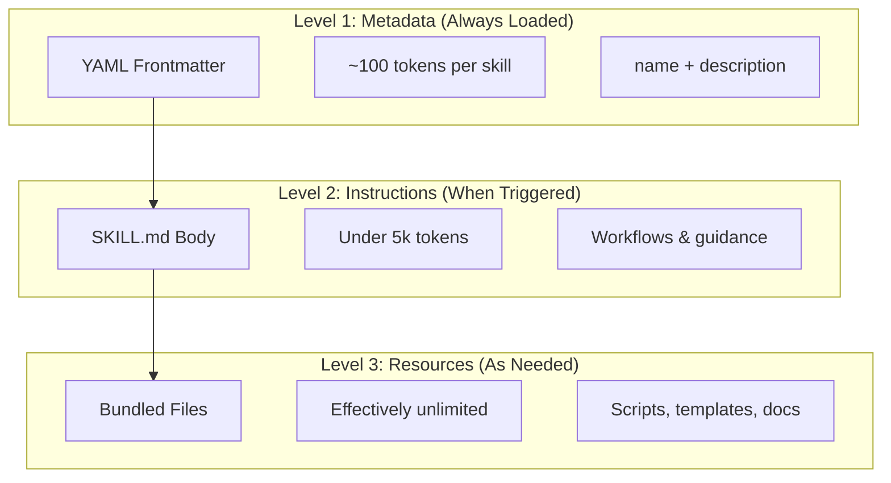
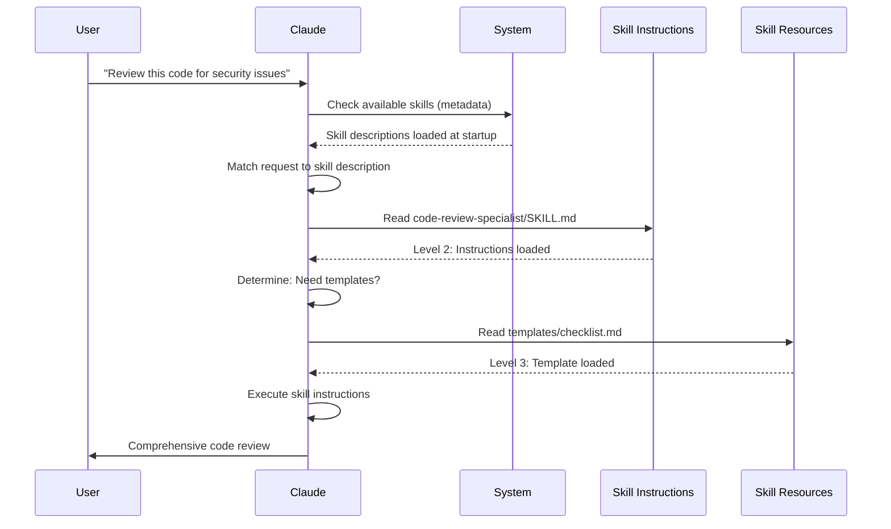

<picture>
  <source media="(prefers-color-scheme: dark)" srcset="../../resources/logos/claude-howto-logo-dark.svg">
  
</picture>

# 에이전트 스킬 가이드

에이전트 스킬은 Claude의 기능을 확장하는 재사용 가능한 파일 시스템 기반의 기능입니다. 이 기능은 도메인별 전문 지식, 워크플로 및 모범 사례를 Claude가 관련성이 있을 때 자동으로 사용하는 발견 가능한 구성 요소로 패키징합니다.

## 개요

**에이전트 스킬**은 범용 에이전트를 전문가로 변화시키는 모듈식 기능입니다. 프롬프트(일회성 작업을 위한 대화 수준의 지침)와 달리, 스킬은 온디맨드로 로드되며 여러 대화에 걸쳐 동일한 지침을 반복적으로 제공할 필요가 없습니다.

### 주요 이점

-   **Claude 전문화**: 도메인별 작업에 맞춰 기능 조정
-   **반복 감소**: 한 번 생성하면 여러 대화에서 자동으로 사용
-   **기능 구성**: 스킬을 결합하여 복잡한 워크플로 구축
-   **워크플로 확장**: 여러 프로젝트 및 팀에서 스킬 재사용
-   **품질 유지**: 모범 사례를 워크플로에 직접 내장

스킬은 여러 AI 도구에서 작동하는 [Agent Skills](https://agentskills.io) 공개 표준을 따릅니다. Claude Code는 호출 제어, 서브에이전트 실행 및 동적 컨텍스트 주입과 같은 추가 기능으로 표준을 확장합니다.

> **참고**: 사용자 지정 슬래시 명령은 스킬에 병합되었습니다. `.claude/commands/` 파일은 여전히 작동하며 동일한 프런트매터 필드를 지원합니다. 새로운 개발에는 스킬 사용을 권장합니다. 두 가지가 동일한 경로에 존재하는 경우(예: `.claude/commands/review.md` 및 `.claude/skills/review/SKILL.md`), 스킬이 우선합니다.

## 스킬 작동 방식: 점진적 공개

스킬은 **점진적 공개** 아키텍처를 활용합니다. Claude는 컨텍스트를 미리 소비하는 대신 필요할 때 단계적으로 정보를 로드합니다. 이를 통해 무제한 확장성을 유지하면서 효율적인 컨텍스트 관리가 가능합니다.

### 세 가지 로딩 수준



| Level | When Loaded | Token Cost | Content |
|-------|------------|------------|---------|
| **Level 1: Metadata** | 항상 (시작 시) | 스킬당 ~100 토큰 | YAML 프런트매터의 `name` 및 `description` |
| **Level 2: Instructions** | 스킬이 트리거될 때 | 5k 토큰 미만 | 지침 및 가이드를 포함하는 SKILL.md 본문 |
| **Level 3+: Resources** | 필요에 따라 | 사실상 무제한 | 내용을 컨텍스트에 로드하지 않고 bash를 통해 실행되는 번들 파일 |

이 덕분에 스킬은 가볍게 유지됩니다. Claude는 실제로 트리거될 때까지 각 스킬이 존재한다는 것과 언제 사용해야 하는지만 알고 있습니다. 다만 비용이 전혀 없는 것은 아닙니다. 목록에 오른 모든 스킬은 매 턴마다 설명을 컨텍스트에 추가합니다.

## 스킬 로딩 프로세스



## 스킬 유형 및 위치

| Type | Location | Scope | Shared | Best For |
|------|----------|-------|--------|----------|
| **Enterprise** | 관리 설정 | 모든 조직 사용자 | 예 | 조직 전체 표준 |
| **Personal** | `~/.claude/skills/<skill-name>/SKILL.md` | 개별 | 아니요 | 개인 워크플로 |
| **Project** | `.claude/skills/<skill-name>/SKILL.md` | 팀 | 예 (git을 통해) | 팀 표준 |
| **Plugin** | `<plugin>/skills/<skill-name>/SKILL.md` | 활성화된 경우 | 다름 | 플러그인과 번들됨 |

스킬이 여러 수준에서 동일한 이름을 공유하는 경우, 우선순위가 높은 위치가 이깁니다: **엔터프라이즈 > 개인 > 프로젝트**. `~/.claude/skills/`와 `.claude/skills/`에 같은 이름의 스킬이 있으면 개인 스킬이 실행됩니다. 스킬의 우선순위가 아니라 표시 여부를 바꾸려면 `skillOverrides` 설정(v2.1.129+)을 사용합니다. [스킬 재정의 동작 제어](#스킬-재정의-동작-제어-skilloverrides)를 참조하세요. 플러그인 스킬은 `plugin-name:skill-name` 네임스페이스를 사용하므로 충돌하지 않습니다.

> **서브에이전트 스킬 검색 (v2.1.133+)**: 서브에이전트는 이제 주요 세션과 동일한 방식으로 Skill 도구를 통해 프로젝트, 사용자 및 플러그인 스킬을 검색합니다. 이전 버전은 서브에이전트를 자체 내장된 세트로 제한하여 스킬+서브에이전트 워크플로가 조용히 저하되었지만, v2.1.133부터는 동일한 스킬 카탈로그가 둘 다에게 표시됩니다.

### 자동 검색

**중첩 디렉터리**: 하위 디렉터리에서 파일 작업을 할 때, Claude Code는 중첩된 `.claude/skills/` 디렉터리에서 스킬을 자동으로 검색합니다. 예를 들어, `packages/frontend/`의 파일을 편집하는 경우, Claude Code는 `packages/frontend/.claude/skills/`에서도 스킬을 찾습니다. 이는 패키지마다 자체 스킬을 갖는 모노레포 설정에 유용합니다. 중첩된 스킬이 저장소 루트 스킬과 이름이 같으면 **둘 다 로드됩니다**. 예를 들어 루트와 `apps/web/.claude/skills/`에 모두 `deploy` 스킬이 있으면 `/deploy`는 루트 스킬을, `/apps/web:deploy`는 중첩된 스킬을 실행합니다.

**`--add-dir` 디렉터리**: `--add-dir`을 통해 추가된 디렉터리의 스킬은 라이브 변경 감지와 함께 자동으로 로드됩니다. 해당 디렉터리의 스킬 파일에 대한 모든 편집 내용은 Claude Code를 다시 시작할 필요 없이 즉시 적용됩니다. 추가된 디렉터리의 스킬이 엔터프라이즈, 개인, 프로젝트 스킬 또는 먼저 추가된 디렉터리의 스킬과 이름이 같으면 접두사가 붙은 이름으로 실행됩니다. 예를 들어 `--add-dir ../cli`를 사용하고 두 곳 모두에 `verify` 스킬이 있으면 `/verify`는 프로젝트의 스킬을, `/cli:verify`는 `../cli`의 스킬을 실행합니다(v2.1.309+).

**스킬 재로드**: `/reload-skills` 명령(v2.1.152에 추가됨)은 세션을 다시 시작하지 않고 모든 스킬 디렉터리를 다시 스캔합니다. 이는 라이브 감지로 감지되지 않은 스킬을 추가하거나 편집한 후에 유용합니다. `SessionStart` 훅은 `reloadSkills: true`를 반환하여 동일한 재스캔을 트리거할 수 있습니다([Hooks](../06-hooks/README.md) 참조).

**설명 예산**: 스킬 설명(레벨 1 메타데이터)은 **컨텍스트 창의 1%**(대체: **8,000자**)로 제한됩니다. 많은 스킬이 설치된 경우 설명이 단축될 수 있습니다. 모든 스킬 이름은 항상 포함되지만, 설명은 예산에 맞게 잘립니다. 설명에서 핵심 사용 사례를 전면에 배치하십시오. `SLASH_COMMAND_TOOL_CHAR_BUDGET` 환경 변수를 사용하여 예산을 재정의할 수 있습니다.

## 사용자 지정 스킬 생성

### 기본 디렉터리 구조

```
my-skill/
├── SKILL.md           # Main instructions (required)
├── template.md        # Template for Claude to fill in
├── examples/
│   └── sample.md      # Example output showing expected format
└── scripts/
    └── validate.sh    # Script Claude can execute
```

### SKILL.md 형식

```yaml
---
name: your-skill-name
description: 이 스킬이 무엇을 하고 언제 사용해야 하는지에 대한 간략한 설명
---

# Your Skill Name

## Instructions
Provide clear, step-by-step guidance for Claude.

## Examples
Show concrete examples of using this Skill.
```

### 권장 필드

-   **description** (권장): 스킬이 무엇을 하는지 그리고 언제 사용해야 하는지. 생략하면 Claude Code는 마크다운 본문의 비어 있지 않은 첫 줄을 사용합니다. `description`과 `when_to_use`를 합친 텍스트는 스킬 목록에서 **1,536자**에서 잘립니다(`skillListingMaxDescChars`로 설정 가능). Claude는 이 내용을 기준으로 스킬 활성화 여부를 결정합니다.
-   **name** (선택): 기본값은 스킬의 **디렉터리 이름**입니다. 지정하면 표시 이름이 됩니다. 소문자, 숫자, 하이픈만 사용(최대 64자)하는 것이 권장되는 이식성 있는 형식입니다(claude.ai 및 Skills API에서는 필수). Claude Code 자체(v2.1.299+)는 이름에 숨겨진 문자, 방향을 바꾸는 문자, 공백처럼 보이는 문자, `<` 또는 `>`가 포함되거나 256자를 넘는 스킬이나 명령어를 이름을 바꿀 때까지 건너뜁니다. Claude Code에서 `anthropic-skills`와 `synced`는 예약어이므로 플러그인 밖에서는 로드되지 않습니다. "anthropic"이나 "claude"를 금지하는 더 엄격한 규칙은 claude.ai 또는 Skills API에 업로드하는 스킬에 적용됩니다. 플러그인 스킬의 경우 `name`은 명령어의 마지막 세그먼트도 결정합니다.

SKILL.md의 모든 프런트매터 필드는 선택 사항이며, 권장되는 필드는 `description` 하나뿐입니다.

### 선택적 프런트매터 필드

```yaml
---
name: my-skill
description: 이 스킬이 무엇을 하고 언제 사용해야 하는지
argument-hint: "[filename] [format]"        # 자동 완성 힌트
disable-model-invocation: true              # 사용자만 호출 가능
user-invocable: false                       # 슬래시 메뉴에서 숨김
allowed-tools: Read, Grep, Glob             # 스킬 실행 중 이 도구들을 사전 승인(권한 프롬프트 없음)
disallowed-tools: Write, Edit               # 활성 상태일 때 특정 도구 제거 (v2.1.152)
model: opus                                 # 사용할 특정 모델
effort: high                                # 노력 수준 재정의 (low, medium, high, xhigh, max)
context: fork                               # 격리된 서브에이전트에서 실행
agent: Explore                              # 컨텍스트가 fork일 때 에이전트 유형
background: false                           # fork 스킬은 백그라운드에서 실행(기본값 true); false = 포그라운드
shell: bash                                 # 명령을 위한 셸: bash (기본값) 또는 powershell
hooks:                                      # 스킬이 호출될 때 등록되는 훅
  PreToolUse:
    - matcher: "Bash"
      hooks:
        - type: command
          command: "./scripts/validate.sh"
paths: "src/api/**/*.ts"               # 스킬 활성화 시기를 제한하는 전역 패턴
---
```

| Field | Description |
|-------|-------------|
| `name` | 권장(이식성): 소문자, 숫자, 하이픈만 사용 (최대 64자). Claude Code에서 `anthropic-skills`와 `synced`는 예약어입니다. |
| `description` | 스킬이 무엇을 하고 언제 사용해야 하는지. `description`과 `when_to_use`를 합친 텍스트는 스킬 목록에서 1,536자에서 잘립니다(`skillListingMaxDescChars`로 설정 가능). 자동 호출 매칭에 중요합니다. |
| `when_to_use` | Claude가 스킬을 호출해야 하는 시점에 대한 추가 컨텍스트. 스킬 목록에서 `description` 뒤에 덧붙으며 1,536자 제한에 포함됩니다. |
| `argument-hint` | `/` 자동 완성 메뉴에 표시되는 힌트 (예: `"[filename] [format]"`). |
| `disable-model-invocation` | `true` = 사용자만 `/name`을 통해 호출할 수 있습니다. Claude는 자동 호출하지 않습니다. |
| `user-invocable` | `false` = `/` 메뉴에서 숨겨집니다. Claude만 자동으로 호출할 수 있습니다. |
| `allowed-tools` | 스킬이 권한 프롬프트 없이 사용할 수 있는 도구들의 쉼표로 구분된 목록. 관리형 설정의 `strictPluginOnlyCustomization`에 `hooks`가 포함되어 있으면, 프런트매터에 `hooks`를 선언한 개인 또는 프로젝트 스킬은 이 사전 승인을 잃습니다(v2.1.304). 해당 `hooks`를 제거하거나 스킬을 플러그인으로 옮기세요. |
| `disallowed-tools` | 스킬이 활성 상태일 때 제거할 도구들의 쉼표로 구분된 목록 (`allowed-tools`를 보완합니다). v2.1.152에 추가됨. |
| `model` | 스킬이 활성 상태일 때 모델 재정의 (예: `opus`, `sonnet`). |
| `effort` | 스킬이 활성 상태일 때 노력 수준 재정의: `low`, `medium`, `high`, `xhigh` 또는 `max`. 다섯 가지 모두 Fable 5.1, Fable 5, Opus 5.5, Sonnet 5.5, Haiku 5.5, Opus 5, Sonnet 5, Opus 4.8, Opus 4.7에서 지원됩니다. 기본 노력 수준은 노력 설정을 지원하는 모든 모델에서 `high`이며, 예외로 Opus 5.5, Sonnet 5.5, Haiku 5.5는 `medium`, Opus 4.7은 `xhigh`가 기본값입니다. |
| `context` | `fork`는 스킬을 자체 컨텍스트 창을 가진 포크된 서브에이전트 컨텍스트에서 실행합니다. |
| `agent` | `context: fork`일 때 서브에이전트 유형 (예: `Explore`, `Plan`, `general-purpose`). |
| `background` | `context: fork`와 함께 쓸 때만 의미가 있습니다. `context: fork` 스킬의 기본값은 `true`이므로 백그라운드에서 실행됩니다. 포그라운드에서 실행하려면 `false`로 설정합니다. v2.1.218에 추가됨. |
| `shell` | `` !`command` `` 대체 및 스크립트에 사용되는 셸: `bash` (기본값) 또는 `powershell`. |
| `hooks` | 스킬이 호출될 때 등록되는 훅 (설정 훅과 동일한 형식, 모든 이벤트 사용 가능). 등록된 훅은 세션이 끝날 때까지 활성 상태로 유지됩니다. v2.1.304부터 하나의 소스(프로젝트, 개인 스킬 폴더 또는 플러그인)의 스킬은 세션당 최대 1,024개의 훅과 16,384자의 matcher 문자를 등록할 수 있으며, 이를 넘으면 스킬은 프런트매터 훅 없이 실행됩니다(`/hooks`로 확인). |
| `paths` | 스킬이 자동으로 활성화되는 시기를 제한하는 glob 패턴. 쉼표로 구분된 문자열 또는 YAML 목록. 패턴은 Claude의 현재 작업 디렉터리 기준 상대 경로이며, `/add-dir`로 추가한 형제 워크트리처럼 그 밖에 있는 파일은 일치하지 않습니다(해당 위치에서 Claude Code를 시작하거나 `/cd`를 사용하세요). 경로별 규칙과 동일한 형식. |
| `arguments` | 자동 완성과 인수 대체를 위해 스킬이 받는 인수를 선언합니다. 처음 64개 이름(각 최대 64자)만 채워집니다(v2.1.301). |
| `metadata` | 자체 관리용 자유 형식 키/값 맵(예: `version`, `author`). Claude Code는 이를 그대로 전달합니다. |
| `license` | 스킬의 라이선스 식별자(예: `MIT`). |
| `compatibility` | 최대 500자의 자유 텍스트 호환성 설명. Claude Code는 이를 허용하지만 동작에 반영하지는 않습니다. |

> **참고**: claude.ai에 업로드하거나 Skills API로 만드는 스킬에서는 `name`, `description`, `license`, `compatibility`, `metadata`, `allowed-tools`만 유효합니다. 이 표의 나머지 필드는 Claude Code 전용입니다.

v2.1.218부터 불리언 프런트매터 필드는 `true`/`false` 외에 `yes`/`no`, `on`/`off`, `1`/`0`(대소문자 구분 없음)도 허용합니다.

## 스킬 콘텐츠 유형

스킬은 두 가지 유형의 콘텐츠를 포함할 수 있으며, 각 유형은 다른 목적에 적합합니다.

### 참조 콘텐츠

Claude가 현재 작업에 적용하는 지식(규약, 패턴, 스타일 가이드, 도메인 지식)을 추가합니다. 대화 컨텍스트와 함께 인라인으로 실행됩니다.

```yaml
---
name: api-conventions
description: 이 코드베이스를 위한 API 디자인 패턴
---

When writing API endpoints:
- Use RESTful naming conventions
- Return consistent error formats
- Include request validation
```

### 작업 콘텐츠

특정 작업에 대한 단계별 지침. 종종 `/skill-name`으로 직접 호출됩니다.

```yaml
---
name: deploy
description: 애플리케이션을 프로덕션에 배포합니다.
context: fork
disable-model-invocation: true
---

Deploy the application:
1. Run the test suite
2. Build the application
3. Push to the deployment target
```

## 스킬 호출 제어

기본적으로 사용자(당신)와 Claude 모두 모든 스킬을 호출할 수 있습니다. 두 가지 프런트매터 필드가 세 가지 호출 모드를 제어합니다.

| Frontmatter | 당신은 호출할 수 있습니다 | Claude는 호출할 수 있습니다 |
|---|---|---|
| (기본값) | 예 | 예 |
| `disable-model-invocation: true` | 예 | 아니요 |
| `user-invocable: false` | 아니요 | 예 |

**부작용이 있는 워크플로에는 `disable-model-invocation: true`를 사용하세요**: `/commit`, `/deploy`, `/send-slack-message`. Claude가 코드가 준비된 것처럼 보여서 배포를 결정하는 것을 원치 않을 것입니다.

**명령으로 실행할 수 없는 배경 지식에는 `user-invocable: false`를 사용하세요**. `legacy-system-context` 스킬은 이전 시스템이 어떻게 작동하는지 설명합니다. 이는 Claude에게는 유용하지만 사용자에게는 의미 있는 작업이 아닙니다.

## 문자열 대체

스킬은 스킬 콘텐츠가 Claude에 도달하기 전에 해결되는 동적 값을 지원합니다.

| Variable | Description |
|----------|-------------|
| `$ARGUMENTS` | 스킬 호출 시 전달된 모든 인수 |
| `$ARGUMENTS[N]` 또는 `$N` | 인덱스(0부터 시작)로 특정 인수에 접근 |
| `${CLAUDE_SESSION_ID}` | 현재 세션 ID |
| `${CLAUDE_SKILL_DIR}` | 스킬의 SKILL.md 파일이 포함된 디렉터리 |
| `${CLAUDE_PROJECT_DIR}` | 프로젝트 루트의 절대 경로. 스킬 본문과 `allowed-tools`에서 사용할 수 있습니다 (v2.1.196) |
| `${CLAUDE_EFFORT}` | 현재 노력 수준 (`low`, `medium`, `high`, `xhigh` 또는 `max`). 스킬 동작 분기에 유용합니다: 예: `[ "${CLAUDE_EFFORT}" = "max" ] && deep_analysis` (v2.1.120+) |
| `` !`command` `` | 동적 컨텍스트 주입 — 셸 명령을 실행하고 출력을 인라인합니다. |

**예시:**

```yaml
---
name: fix-issue
description: GitHub 이슈 수정
---

Fix GitHub issue $ARGUMENTS following our coding standards.
1. Read the issue description
2. Implement the fix
3. Write tests
4. Create a commit
```

`/fix-issue 123`을 실행하면 `$ARGUMENTS`가 `123`으로 대체됩니다.

### 스킬 쌓기

터미널 프롬프트에서 `/write-tests /fix-issue 123`처럼 한 번의 호출에 여러 슬래시 스킬을 쌓을 수 있습니다. v2.1.199부터는 앞에 오는 스킬을 모두(첫 번째 스킬과 최대 5개 추가) 로드하고, 뒤에 오는 인수(`123`)를 각 스킬에 전달합니다. 이전에는 첫 번째 스킬만 로드되었습니다. `/code-review`처럼 포크된 서브에이전트로 실행되는 스킬을 만나면 확장이 멈추며, Agent SDK나 `claude -p`에서는 첫 번째 스킬만 로드됩니다. 같은 스킬을 여러 번 호출하면 동일한 내용이 두 번 덧붙지 않고 중복 제거됩니다(v2.1.202).

## 동적 컨텍스트 주입

`` !`command` `` 구문은 스킬 콘텐츠가 Claude로 전송되기 전에 셸 명령을 실행합니다.

> **참고 (v2.1.299)**: `UserPromptSubmit` 훅은 명령이 확장되기 전에 실행되므로, 프롬프트를 차단하는 훅은 이 `!` 명령의 실행도 막습니다.

```yaml
---
name: pr-summary
description: 풀 리퀘스트의 변경 사항 요약
context: fork
agent: Explore
---

## Pull request context
- PR diff: !`gh pr diff`
- PR comments: !`gh pr view --comments`
- Changed files: !`gh pr diff --name-only`

## Your task
Summarize this pull request...
```

명령은 즉시 실행되며, Claude는 최종 출력만 봅니다. 기본적으로 명령은 `bash`에서 실행됩니다. `shell: powershell`을 프런트매터에 설정하여 대신 PowerShell을 사용할 수 있습니다.

## 서브에이전트에서 스킬 실행

스킬을 격리된 서브에이전트 컨텍스트에서 실행하려면 `context: fork`를 추가합니다. 스킬 콘텐츠는 전용 서브에이전트의 작업이 되며, 자체 컨텍스트 창을 가져 메인 대화를 깔끔하게 유지합니다. v2.1.218부터 `context: fork` 스킬의 `background` 기본값이 `true`이므로 백그라운드에서 실행됩니다. 포크 스킬을 포그라운드에서 실행하려면 프런트매터에 `background: false`를 설정하세요.

> **v2.1.145 수정**: `context: fork`를 사용하는 스킬은 이전에 드문 경우에 무한 재호출 루프를 유발할 수 있었습니다. 포킹 스킬을 작성하거나 의존하는 경우 v2.1.145 이상으로 업그레이드하십시오.

`agent` 필드는 사용할 에이전트 유형을 지정합니다.

| Agent Type | Best For |
|---|---|
| `Explore` | 읽기 전용 연구, 코드베이스 분석 |
| `Plan` | 구현 계획 생성 |
| `general-purpose` | 모든 도구가 필요한 광범위한 작업 |
| Custom agents | 구성에 정의된 전문 에이전트 |

**예시 프런트매터:**

```yaml
---
context: fork
agent: Explore
---
```

**전체 스킬 예시:**

```yaml
---
name: topic-research
description: 주제를 철저히 연구합니다.
context: fork
agent: Explore
---

Research $ARGUMENTS thoroughly:
1. Find relevant files using Glob and Grep
2. Read and analyze the code
3. Summarize findings with specific file references
```

## 실제 예시

### 예시 1: 코드 검토 스킬

**디렉터리 구조:**

```
~/.claude/skills/code-review-specialist/
├── SKILL.md
├── templates/
│   ├── review-checklist.md
│   └── finding-template.md
└── scripts/
    ├── analyze-metrics.py
    └── compare-complexity.py
```

**파일:** `~/.claude/skills/code-review-specialist/SKILL.md`

```yaml
---
name: code-review-specialist
description: 보안, 성능, 품질 분석을 포함하는 종합 코드 검토. 사용자가 코드 검토, 코드 품질 분석, 풀 리퀘스트 평가를 요청하거나 코드 검토, 보안 분석, 성능 최적화를 언급할 때 사용합니다.
---

# Code Review Skill

This skill provides comprehensive code review capabilities focusing on:

1. **Security Analysis**
   - Authentication/authorization issues
   - Data exposure risks
   - Injection vulnerabilities
   - Cryptographic weaknesses

2. **Performance Review**
   - Algorithm efficiency (Big O analysis)
   - Memory optimization
   - Database query optimization
   - Caching opportunities

3. **Code Quality**
   - SOLID principles
   - Design patterns
   - Naming conventions
   - Test coverage

4. **Maintainability**
   - Code readability
   - Function size (should be < 50 lines)
   - Cyclomatic complexity
   - Type safety

## Review Template

For each piece of code reviewed, provide:

### Summary
- Overall quality assessment (1-5)
- Key findings count
- Recommended priority areas

### Critical Issues (if any)
- **Issue**: Clear description
- **Location**: File and line number
- **Impact**: Why this matters
- **Severity**: Critical/High/Medium
- **Fix**: Code example

For detailed checklists, see [templates/review-checklist.md](templates/review-checklist.md).
```

### 예시 2: 코드베이스 시각화 스킬

대화형 HTML 시각화를 생성하는 스킬입니다.

**디렉터리 구조:**

```
~/.claude/skills/codebase-visualizer/
├── SKILL.md
└── scripts/
    └── visualize.py
```

**파일:** `~/.claude/skills/codebase-visualizer/SKILL.md`

````yaml
---
name: codebase-visualizer
description: 코드베이스의 대화형 접이식 트리 시각화를 생성합니다. 새로운 저장소를 탐색하거나, 프로젝트 구조를 이해하거나, 큰 파일을 식별할 때 사용합니다.
allowed-tools: Bash(python *)
---

# Codebase Visualizer

Generate an interactive HTML tree view showing your project's file structure.

## Usage

Run the visualization script from your project root:

```bash
python ~/.claude/skills/codebase-visualizer/scripts/visualize.py .
```

이렇게 하면 `codebase-map.html`이 생성되고 기본 브라우저에서 열립니다.

## 시각화가 보여주는 것

- **접이식 디렉터리**: 폴더를 클릭하여 확장/축소
- **파일 크기**: 각 파일 옆에 표시됨
- **색상**: 다른 파일 유형에 대한 다른 색상
- **디렉터리 총계**: 각 폴더의 총 크기를 표시
````

번들로 제공되는 Python 스크립트가 대부분의 작업을 수행하고 Claude는 오케스트레이션을 처리합니다.

### 예시 3: 배포 스킬 (사용자 호출 전용)

```yaml
---
name: deploy
description: 애플리케이션을 프로덕션에 배포합니다.
disable-model-invocation: true
allowed-tools: Bash(npm *), Bash(git *)
---

Deploy $ARGUMENTS to production:

1. Run the test suite: `npm test`
2. Build the application: `npm run build`
3. Push to the deployment target
4. Verify the deployment succeeded
5. Report deployment status
```

### 예시 4: 브랜드 보이스 스킬 (배경 지식)

```yaml
---
name: brand-voice
description: 모든 커뮤니케이션이 브랜드 보이스 및 톤 가이드라인과 일치하도록 보장합니다. 마케팅 자료, 고객 커뮤니케이션 또는 대중 공개 콘텐츠를 작성할 때 사용합니다.
user-invocable: false
---

## Tone of Voice
- **Friendly but professional** - approachable without being casual
- **Clear and concise** - avoid jargon
- **Confident** - we know what we're doing
- **Empathetic** - understand user needs

## Writing Guidelines
- Use "you" when addressing readers
- Use active voice
- Keep sentences under 20 words
- Start with value proposition

For templates, see [templates/](templates/).
```

### 예시 5: CLAUDE.md 생성기 스킬

```yaml
---
name: claude-md
description: 최적의 AI 에이전트 온보딩을 위한 모범 사례에 따라 CLAUDE.md 파일을 생성하거나 업데이트합니다. 사용자가 CLAUDE.md, 프로젝트 문서 또는 AI 온보딩을 언급할 때 사용합니다.
---

## Core Principles

**LLMs are stateless**: CLAUDE.md is the main project file loaded into every conversation (alongside auto memory and unscoped rules).

### The Golden Rules

1. **Less is More**: Keep each CLAUDE.md under 200 lines
2. **Universal Applicability**: Only include information relevant to EVERY session
3. **Don't Use Claude as a Linter**: Use deterministic tools instead
4. **Never Auto-Generate**: Craft it manually with careful consideration

## Essential Sections

- **Project Name**: Brief one-line description
- **Tech Stack**: Primary language, frameworks, database
- **Development Commands**: Install, test, build commands
- **Critical Conventions**: Only non-obvious, high-impact conventions
- **Known Issues / Gotchas**: Things that trip up developers
```

### 예시 6: 스크립트가 있는 리팩터링 스킬

**디렉터리 구조:**

```
refactor/
├── SKILL.md
├── references/
│   ├── code-smells.md
│   └── refactoring-catalog.md
├── templates/
│   └── refactoring-plan.md
└── scripts/
    ├── analyze-complexity.py
    └── detect-smells.py
```

**파일:** `refactor/SKILL.md`

```yaml
---
name: refactor
description: 마틴 파울러의 방법론에 기반한 체계적인 코드 리팩터링. 사용자가 코드 리팩터링, 코드 구조 개선, 기술 부채 감소 또는 코드 스멜 제거를 요청할 때 사용합니다.
---

# Code Refactoring Skill

A phased approach emphasizing safe, incremental changes backed by tests.

## Workflow

Phase 1: Research & Analysis → Phase 2: Test Coverage Assessment →
Phase 3: Code Smell Identification → Phase 4: Refactoring Plan Creation →
Phase 5: Incremental Implementation → Phase 6: Review & Iteration

## Core Principles

1. **Behavior Preservation**: External behavior must remain unchanged
2. **Small Steps**: Make tiny, testable changes
3. **Test-Driven**: Tests are the safety net
4. **Continuous**: Refactoring is ongoing, not a one-time event

For code smell catalog, see [references/code-smells.md](references/code-smells.md).
For refactoring techniques, see [references/refactoring-catalog.md](references/refactoring-catalog.md).
```

## 보조 파일

스킬은 `SKILL.md` 외에도 디렉터리에 여러 파일을 포함할 수 있습니다. 이러한 보조 파일(템플릿, 예제, 스크립트, 참조 문서)을 통해 주요 스킬 파일에 집중하면서 Claude가 필요할 때 로드할 추가 리소스를 제공할 수 있습니다.

```
my-skill/
├── SKILL.md              # 주요 지침 (필수, 500줄 미만으로 유지)
├── templates/            # Claude가 채울 템플릿
│   └── output-format.md
├── examples/             # 예상 형식을 보여주는 예시 출력
│   └── sample-output.md
├── references/           # 도메인 지식 및 사양
│   └── api-spec.md
└── scripts/              # Claude가 실행할 수 있는 스크립트
    └── validate.sh
```

보조 파일에 대한 지침:

-   `SKILL.md`는 **500줄** 미만으로 유지하십시오. 상세한 참조 자료, 큰 예시 및 사양은 별도의 파일로 이동시키십시오.
-   **상대 경로**를 사용하여 `SKILL.md`에서 추가 파일을 참조하십시오 (예: `[API reference](references/api-spec.md)`).
-   보조 파일은 레벨 3(필요할 때)에서 로드되므로 Claude가 실제로 읽을 때까지 컨텍스트를 소비하지 않습니다.

## 스킬 관리

### 사용 가능한 스킬 보기

Claude에게 직접 물어보세요:
```
What Skills are available?
```

또는 파일 시스템에서 확인하세요:
```bash
# 개인 스킬 나열
ls ~/.claude/skills/

# 프로젝트 스킬 나열
ls .claude/skills/
```

> **팁 (v2.1.121+)**: 많은 스킬이 설치된 경우 `/skills` 대화형 메뉴에서 필터링하려면 입력하세요.

### 스킬 테스트

두 가지 테스트 방법:

**Claude가 자동으로 호출하도록 허용**하여 설명과 일치하는 내용을 요청하세요:
```
Can you help me review this code for security issues?
```

**또는 스킬 이름으로 직접 호출하세요**:
```
/code-review-specialist src/auth/login.ts
```

> **참고**: 이 로컬 스킬은 `code-review-specialist`로 설치되어 번들 `/code-review` 스킬(버그 중심 리뷰, 별칭 `/review`)과 충돌하지 **않습니다**. 대신 `~/.claude/skills/code-review/`에 복사하면 번들 `/code-review`를 대체하게 되므로(`/review`는 여전히 번들 스킬을 실행합니다), 충돌을 피하려면 `-specialist` 접미사를 유지하십시오.

### 스킬 업데이트

`SKILL.md` 파일을 직접 편집한 다음 `/reload-skills`(v2.1.152+)를 실행해 스킬 디렉터리를 다시 스캔하세요. Claude Code를 다시 시작해도 되지만 필수는 아닙니다. `--add-dir` 디렉터리의 스킬은 실시간으로 반영되며, `reloadSkills: true`를 반환하는 `SessionStart` 훅도 같은 재스캔을 트리거합니다.

```bash
# 개인 스킬
code ~/.claude/skills/my-skill/SKILL.md

# 프로젝트 스킬
code .claude/skills/my-skill/SKILL.md
```

### Claude의 스킬 접근 제한

Claude가 호출할 수 있는 스킬을 제어하는 세 가지 방법:

`/permissions`에서 **모든 스킬 비활성화**:
```
# 거부 규칙에 추가:
Skill
```

**특정 스킬 허용 또는 거부**:
```
# 특정 스킬만 허용
Skill(commit)
Skill(review-pr *)

# 특정 스킬 거부
Skill(deploy *)
```

개별 스킬의 프런트매터에 `disable-model-invocation: true`를 추가하여 **개별 스킬 숨기기**.

### 스킬 재정의 동작 제어 (`skillOverrides`)

`skillOverrides`(v2.1.129+)는 우선순위 스위치가 아니라 스킬별 표시 여부 맵입니다. SKILL.md를 편집하지 않고 설정에서 각 스킬이 어떻게 표시될지 지정합니다. 각 키는 스킬 이름이며, `/skills` 메뉴가 이 값을 대신 기록해 줍니다(`.claude/settings.local.json`에 저장). 우선순위는 바뀌지 않습니다. 같은 이름이면 여전히 개인 스킬이 프로젝트 스킬보다 우선합니다. `~/.claude/settings.json` 또는 프로젝트 `.claude/settings.json`에 추가하세요:

```json
{
  "skillOverrides": {
    "deploy": "off",
    "legacy-helper": "name-only"
  }
}
```

허용되는 값:

| Value | Behavior |
|-------|----------|
| `"on"` (기본값) | 이름과 설명이 Claude에게 제공되고, `/` 메뉴에 표시됩니다. |
| `"name-only"` | 이름만 Claude에게 제공되고, `/` 메뉴에 표시됩니다. |
| `"user-invocable-only"` | Claude에게는 숨겨지고, `/` 메뉴에는 계속 표시됩니다. |
| `"off"` | Claude와 `/` 메뉴 모두에서 숨겨집니다. |

플러그인 스킬은 `skillOverrides`의 영향을 받지 않습니다. 플러그인 스킬은 `/plugin`에서 관리하세요.

## 모범 사례

### 1. 설명을 구체적으로 작성하기

-   **나쁜 예 (모호함)**: "문서 작성에 도움이 됩니다."
-   **좋은 예 (구체적)**: "PDF 파일에서 텍스트와 테이블을 추출하고, 양식을 채우고, 문서를 병합합니다. PDF 파일 작업 시 또는 사용자가 PDF, 양식 또는 문서 추출을 언급할 때 사용합니다."

### 2. 스킬의 초점 유지

-   하나의 스킬 = 하나의 기능
-   ✅ "PDF 양식 채우기"
-   ❌ "문서 처리" (너무 광범위함)

### 3. 트리거 용어 포함

사용자 요청과 일치하는 키워드를 설명에 추가하세요:
```yaml
description: Excel 스프레드시트를 분석하고, 피벗 테이블을 생성하고, 차트를 만듭니다. Excel 파일, 스프레드시트 또는 .xlsx 파일로 작업할 때 사용합니다.
```

### 4. SKILL.md를 500줄 미만으로 유지

자세한 참조 자료는 Claude가 필요할 때 로드하는 별도의 파일로 이동시키십시오.

### 5. 보조 파일 참조

```markdown
## 추가 자료

- 전체 API 세부 정보는 [reference.md](reference.md)를 참조하세요.
- 사용 예시는 [examples.md](examples.md)를 참조하세요.
```

### 해야 할 일

-   명확하고 설명적인 이름 사용
-   포괄적인 지침 포함
-   구체적인 예시 추가
-   관련 스크립트 및 템플릿 패키징
-   실제 시나리오로 테스트
-   의존성 문서화

### 하지 말아야 할 일

-   일회성 작업을 위한 스킬 생성 금지
-   기존 기능 중복 금지
-   스킬을 너무 광범위하게 만들지 말 것
-   설명 필드를 건너뛰지 말 것
-   감사 없이 신뢰할 수 없는 출처의 스킬 설치 금지

## 문제 해결

### 빠른 참조

| Issue | Solution |
|-------|----------|
| Claude가 스킬을 사용하지 않습니다. | 트리거 용어를 포함하여 설명을 더 구체적으로 만드세요. |
| 스킬 파일을 찾을 수 없습니다. | 경로 확인: `~/.claude/skills/name/SKILL.md` |
| YAML 오류 | `---` 마커, 들여쓰기, 탭 없음 확인 |
| 스킬 충돌 | 설명에 명확히 다른 트리거 용어 사용 |
| 스크립트가 실행되지 않습니다. | 권한 확인: `chmod +x scripts/*.py` |
| Claude가 모든 스킬을 인식하지 못합니다. | 스킬이 너무 많습니다. `/context`에서 경고를 확인한 다음 `/skill-doctor`(v2.1.252+)를 실행해 사용되지 않는 스킬과 그 비용을 확인하세요. |

### 스킬이 트리거되지 않음

Claude가 예상대로 스킬을 사용하지 않는 경우:

1.  설명에 사용자가 자연스럽게 말할 키워드가 포함되어 있는지 확인하세요.
2.  "What skills are available?"이라고 물었을 때 스킬이 나타나는지 확인하세요.
3.  설명과 일치하도록 요청을 다시 작성해 보세요.
4.  `/skill-name`으로 직접 호출하여 테스트하세요.

### 스킬이 너무 자주 트리거됨

Claude가 원하지 않을 때 스킬을 사용하는 경우:

1.  설명을 더 구체적으로 만드세요.
2.  수동 호출 전용으로 `disable-model-invocation: true`를 추가하세요.

### Claude가 모든 스킬을 인식하지 못함

스킬 설명은 **컨텍스트 창의 1%**(대체: **8,000자**)로 로드됩니다. 각 항목의 `description` + `when_to_use`는 기본적으로 1,536자로 제한됩니다(`skillListingMaxDescChars`). 제외된 스킬에 대한 경고는 `/context`를 실행하여 확인하세요. `SLASH_COMMAND_TOOL_CHAR_BUDGET` 환경 변수를 사용하여 예산을 재정의할 수 있습니다.

## 보안 고려 사항

**신뢰할 수 있는 소스의 스킬만 사용하세요.** 스킬은 지침과 코드를 통해 Claude에 기능을 제공합니다. 악의적인 스킬은 Claude에게 도구를 호출하거나 코드를 해로운 방식으로 실행하도록 지시할 수 있습니다.

**주요 보안 고려 사항:**

-   **철저히 감사**: 스킬 디렉터리의 모든 파일을 검토하세요.
-   **외부 소스는 위험**: 외부 URL에서 가져오는 스킬은 손상될 수 있습니다.
-   **도구 오용**: 악의적인 스킬은 도구를 해로운 방식으로 호출할 수 있습니다.
-   **소프트웨어 설치처럼 취급**: 신뢰할 수 있는 출처의 스킬만 사용하세요.

### 스킬에서 셸 대체 비활성화

스킬은 `` !`command` `` 구문을 지원하여 Claude가 이를 보기 전에 셸 명령의 출력을 프롬프트에 주입합니다. 보안에 민감한 환경(공유 엔터프라이즈 배포, 잠긴 CI 러너)에서는 `disableSkillShellExecution` 설정을 통해 이 대체를 완전히 비활성화할 수 있습니다(**v2.1.91**에 추가됨).

```jsonc
// ~/.claude/settings.json 또는 관리 정책
{
  "disableSkillShellExecution": true
}
```

`disableSkillShellExecution`이 `true`인 경우, 스킬의 각 `` !`command` `` 마커는 실행되지 않고 `[shell command execution disabled by policy]`로 대체됩니다. 이는 스킬 자체를 비활성화하지 않고 스킬 수준 셸 주입 공격 표면을 제거합니다. 심층 방어를 위해 `allowedTools` 허용 목록과 함께 사용하는 것을 고려해 보세요.

### 번들 스킬 숨기기 (`disableBundledSkills`)

`disableBundledSkills` 설정(**v2.1.169**에 추가됨)은 Claude Code와 함께 제공되는 번들 스킬, 워크플로 및 명령을 모델에서 숨깁니다. 특정 프로젝트에 내장 스킬이 불필요하거나 모델의 스킬 표면을 줄이고 싶을 때 사용하세요.

```jsonc
// ~/.claude/settings.json 또는 프로젝트 .claude/settings.json
{
  "disableBundledSkills": true
}
```

동등한 환경 변수 형식은 다음과 같습니다:

```bash
export CLAUDE_CODE_DISABLE_BUNDLED_SKILLS=1
```

## 스킬 대 다른 기능

| Feature | Invocation | Best For |
|---------|------------|----------|
| **Skills** | 자동 또는 `/name` | 재사용 가능한 전문 지식, 워크플로 |
| **Slash Commands** | 사용자 시작 `/name` | 빠른 단축키 (스킬에 병합됨) |
| **Subagents** | 자동 위임 | 격리된 작업 실행 |
| **Memory (CLAUDE.md)** | 항상 로드됨 | 지속적인 프로젝트 컨텍스트 |
| **MCP** | 실시간 | 외부 데이터/서비스 접근 |
| **Hooks** | 이벤트 기반 | 자동화된 부작용 |

## 번들 스킬

Claude Code는 설치 없이 항상 사용할 수 있는 내장 스킬 세트와 함께 제공됩니다(가장 유용한 스킬을 아래에 정리했습니다. 전체 목록은 [명령어 레퍼런스](https://code.claude.com/docs/en/commands)를 참조하세요).

| Skill | Description |
|-------|-------------|
| `/batch <instruction>` | git 작업 트리를 사용하여 코드베이스 전반에 걸쳐 대규모 병렬 변경을 조율합니다. |
| `/claude-api` | Claude API/SDK 참조를 로드합니다. `anthropic`/`@anthropic-ai/sdk` 가져오기 시 자동 활성화됩니다. `/claude-api api-version`은 코드를 `2026-10-21` 같은 최신 API 버전으로 업데이트합니다(v2.1.307+). `/claude-api managed-agents-secure [<agent-id>]`는 Managed Agent의 설정을 Anthropic 보안 가이드와 비교해 점검하며, 아무것도 변경하지 않습니다(`ant` CLI 필요, v2.1.304+). |
| `/dataviz` | 실행 가능한 색상 팔레트 검증기를 포함한 차트 및 대시보드 디자인 가이드 (v2.1.198) |
| `/debug [description]` | 디버그 로그를 읽어 현재 세션을 문제 해결합니다. |
| `/deep-research <question>` | 스킬이 아닌 번들 **워크플로**입니다. 웹 검색을 병렬로 수행하고 출처가 달린 보고서로 종합합니다(v2.1.218부터 명시적 호출 전용 — Claude가 스스로 트리거하지 않음). |
| `/fewer-permission-prompts` | 대화 기록(transcript)을 스캔하고 일반적인 읽기 전용 도구에 대한 우선순위 지정된 허용 목록을 제안합니다. |
| `/loop [interval] [prompt]` | 지정된 간격으로 프롬프트를 반복 실행합니다 (예: `/loop 5m check the deploy`). |
| `/run` *(v2.1.145+)* | 이 프로젝트의 앱을 실행하여 변경 사항이 실행되는지 확인합니다. 프로젝트 스킬을 찾고, 그렇지 않으면 프로젝트 유형별 내장 패턴으로 폴백합니다. |
| `/run-skill-generator` *(v2.1.145+)* | 프로젝트별 스킬을 생성하여 `/run`/`/verify`가 특정 프로젝트를 처리하는 방법을 학습시킵니다. |
| `/code-review [effort]` | 선택한 노력 수준에서 현재 diff의 정확성 버그를 검토합니다 (예: `/code-review high`). `--comment`를 전달하여 발견 사항을 인라인 PR 댓글로 게시합니다. `/simplify`(품질/재사용 정리)와는 별개의 스킬이며, `/simplify`는 v2.1.154에서 다시 분리되었습니다. v2.1.246부터는 모든 환경에서 Claude가 스스로 시작할 수도 있습니다. v2.1.218부터 백그라운드 서브에이전트로 실행되므로 리뷰 작업이 대화를 채우지 않으며, 쌓인 슬래시 명령어도 계속 리뷰 대상으로 유지됩니다. |
| `/simplify` | 정리 전용 리뷰(재사용, 단순화, 효율성, 추상화 수준)를 수행하고 수정 사항을 적용합니다. v2.1.154에서 `/code-review`로부터 다시 분리됨 |
| `/verify` *(v2.1.145+)* | 앱을 빌드, 실행 및 관찰하여 수정 사항이 (테스트 통과뿐만 아니라) 작동하는지 확인합니다(v2.1.215부터 명시적 호출 전용 — Claude가 스스로 트리거하지 않음). |

GitHub 풀 리퀘스트에 대한 자동 리뷰가 필요하면 Team 및 Enterprise 조직은 [관리형 Code Review](https://code.claude.com/docs/en/code-review)를 켤 수 있습니다.

> **참고**: 프로젝트 또는 사용자 스킬에 `verify`라는 이름의 스킬이 있으면, Claude는 문서 전용 및 테스트 전용 커밋을 제외하고 커밋 직전에 이를 실행합니다(v2.1.286).

이 스킬들은 즉시 사용할 수 있으며 설치하거나 구성할 필요가 없습니다. 이 스킬들도 사용자 지정 스킬과 동일한 SKILL.md 형식을 따릅니다.

## 스킬 공유

### 프로젝트 스킬 (팀 공유)

1.  `.claude/skills/`에 스킬 생성
2.  git에 커밋
3.  팀원들이 변경 사항 풀 — 스킬 즉시 사용 가능

### 개인 스킬

```bash
# 개인 디렉터리로 복사
cp -r my-skill ~/.claude/skills/

# 스크립트 실행 가능하게 만들기
chmod +x ~/.claude/skills/my-skill/scripts/*.py
```

### 플러그인 배포

더 넓은 배포를 위해 플러그인의 `skills/` 디렉터리에 스킬을 패키징하세요.

## 더 나아가기: 스킬 컬렉션 및 스킬 관리자

스킬을 진지하게 구축하기 시작하면 두 가지가 필수적이 됩니다: 검증된 스킬 라이브러리와 이를 관리하는 도구입니다.

**[luongnv89/skills](https://github.com/luongnv89/skills)** — 거의 모든 프로젝트에서 매일 사용하는 스킬 컬렉션입니다. `logo-designer` (온더플라이 프로젝트 로고 생성) 및 `ollama-optimizer` (하드웨어에 맞게 로컬 LLM 성능 튜닝)가 주요 특징입니다. 즉시 사용 가능한 스킬을 원한다면 훌륭한 시작점입니다.

**[luongnv89/asm](https://github.com/luongnv89/asm)** — 에이전트 스킬 관리자입니다. 스킬 개발, 중복 감지 및 테스트를 처리합니다. `asm link` 명령을 사용하면 파일을 복사할 필요 없이 어떤 프로젝트에서든 스킬을 테스트할 수 있습니다. 이는 여러 스킬을 가질 때 필수적입니다.

## 추가 자료

-   [공식 스킬 문서](https://code.claude.com/docs/en/skills)
-   [에이전트 스킬 아키텍처 블로그](https://claude.com/blog/equipping-agents-for-the-real-world-with-agent-skills)
-   [스킬 저장소](https://github.com/luongnv89/skills) - 즉시 사용 가능한 스킬 컬렉션
-   [슬래시 명령어 가이드](../01-slash-commands/) - 사용자 시작 단축키
-   [서브에이전트 가이드](../04-subagents/) - 위임된 AI 에이전트
-   [메모리 가이드](../02-memory/) - 지속적인 컨텍스트
-   [MCP (모델 컨텍스트 프로토콜)](../05-mcp/) - 실시간 외부 데이터
-   [훅 가이드](../06-hooks/) - 이벤트 기반 자동화

---

**최종 업데이트**: 2026년 10월 26일
**Claude Code 버전**: 2.1.310
**출처**:
- https://code.claude.com/docs/en/skills
- https://code.claude.com/docs/en/slash-commands
- https://github.com/anthropics/claude-code/blob/main/CHANGELOG.md
- https://code.claude.com/docs/en/model-config
- https://code.claude.com/docs/en/model-config#adjust-effort-level
- https://code.claude.com/docs/en/settings-reference
- https://github.com/anthropics/claude-code/releases/tag/v2.1.286
- https://code.claude.com/docs/en/hooks#hooks-in-skills-and-agents
- https://code.claude.com/docs/en/skills#characters-a-skill-name-cant-hold
- https://code.claude.com/docs/en/hooks#hook-lifecycle
- https://code.claude.com/docs/en/changelog#2-1-299
- https://code.claude.com/docs/en/skills#pre-approve-tools-for-a-skill
- https://code.claude.com/docs/en/commands
- https://code.claude.com/docs/en/memory#write-effective-instructions
- https://code.claude.com/docs/en/memory
- https://code.claude.com/docs/en/changelog#2-1-301
- https://code.claude.com/docs/en/code-review
- https://code.claude.com/docs/en/changelog#2-1-304
- https://code.claude.com/docs/en/changelog#2-1-307
- https://code.claude.com/docs/en/changelog#2-1-309
- https://code.claude.com/docs/en/commands#all-commands
- https://code.claude.com/docs/en/hooks#limits-on-skill-hooks
- https://code.claude.com/docs/en/skills#how-a-skill-gets-its-command-name
- https://code.claude.com/docs/en/skills#run-a-same-named-skill-from-an-added-directory
- https://code.claude.com/docs/en/skills#when-managed-settings-lock-hooks-to-plugins
- https://code.claude.com/docs/en/skills#frontmatter-reference
- https://code.claude.com/docs/en/skills#skill-not-triggering
- https://code.claude.com/docs/en/skills#work-on-claude-api-projects
**호환 모델**: Claude Fable 5, Claude Opus 5, Claude Sonnet 5, Claude Sonnet 4.6, Claude Opus 4.8, Claude Haiku 4.5
