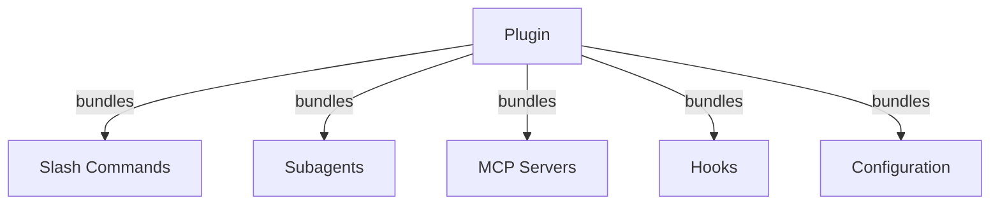
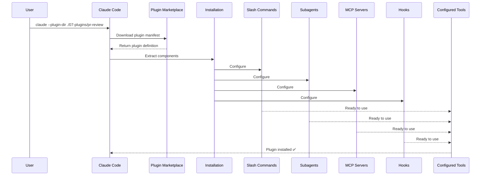
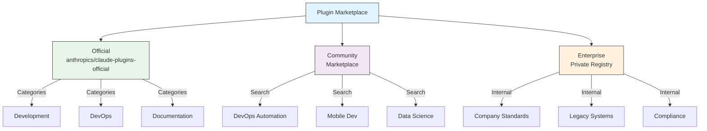
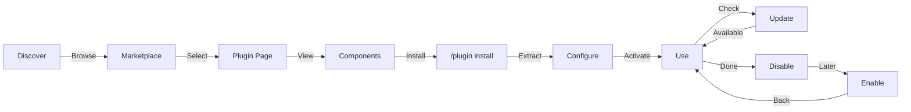
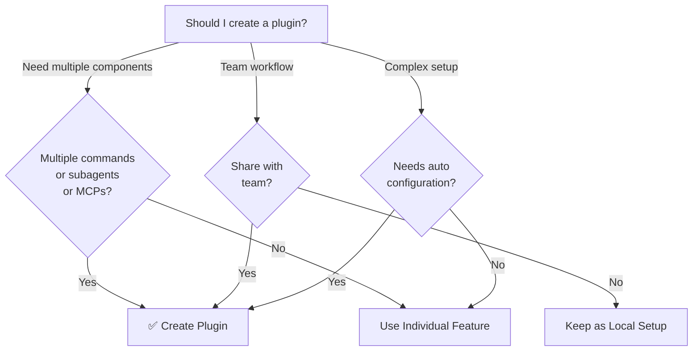

<!-- i18n-source: 07-plugins/README.md -->
<!-- i18n-source-sha: b968f42 -->
<!-- i18n-date: 2026-10-31 -->

<picture>
  <source media="(prefers-color-scheme: dark)" srcset="../../resources/logos/claude-howto-logo-dark.svg">
  
</picture>

# Claude Code 플러그인

이 폴더에는 여러 Claude Code 기능을 하나의 일관되고 설치 가능한 패키지로 묶은 완전한 플러그인 예제가 포함되어 있습니다.

## 개요

Claude Code 플러그인은 하나의 명령으로 설치할 수 있는 사용자 정의 기능(슬래시 명령어, 서브에이전트, MCP 서버, 훅)을 묶어 제공하는 패키지입니다. 이는 여러 기능을 하나의 일관되고 공유 가능한 패키지로 결합하는 가장 상위 수준의 확장 메커니즘입니다.

## 플러그인 아키텍처



## 플러그인 로딩 과정



> **마켓플레이스 불필요(v2.1.157+)**: 이제 `.claude/skills` 디렉터리에 배치된 플러그인은 마켓플레이스 없이 자동으로 로드됩니다. `claude plugin init <name>` 명령으로 새 플러그인을 생성하면 `~/.claude/skills/<name>/`(사용자 전역)에 만들어지고, 다음 세션에서 `<name>@skills-dir`로 자동 로드됩니다. 관리 설정으로 skills 디렉터리 플러그인을 차단할 수 있습니다. `strictPluginOnlyCustomization`은 허용 목록에 `{ "source": "skills-dir" }` 항목이 있어도 이를 차단하며, 해당 항목이 없는 마켓플레이스 허용 목록도 이를 차단합니다. 차단된 폴더는 `/plugin`이나 `claude plugin list`에 플러그인도 오류도 표시되지 않습니다.

## 플러그인 유형 및 배포

| 유형 | 범위 | 공유 대상 | 관리 주체 | 예시 |
|------|-------|--------|-----------|----------|
| 공식 | 전역 | 모든 사용자 | Anthropic | PR Review, Security Guidance |
| 커뮤니티 | 공개 | 모든 사용자 | 커뮤니티 | DevOps, Data Science |
| 조직 | 내부 | 팀원 | 회사 | 내부 표준, 도구 |
| 개인 | 개인 | 단일 사용자 | 개발자 | 사용자 정의 워크플로 |

## 플러그인 정의 구조

플러그인 매니페스트는 `.claude-plugin/plugin.json`에 JSON 형식으로 정의됩니다.

```json
{
  "name": "my-first-plugin",
  "description": "A greeting plugin",
  "version": "1.0.0",
  "author": {
    "name": "Your Name"
  },
  "homepage": "https://example.com",
  "repository": "https://github.com/user/repo",
  "license": "MIT"
}
```

이러한 식별 필드 외에도, 매니페스트는 기본 폴더가 아닌 다른 위치에 있는 구성 요소를 Claude Code에 알려 주고 검색·의존성 메타데이터를 담을 수 있습니다.

| 필드 | 타입 | 설명 |
|-------|------|-------------|
| `workflows` | string \| array | 사용자 정의 [워크플로](https://code.claude.com/docs/en/workflows) 스크립트 파일 또는 디렉터리(기본 `workflows/`를 대체) |
| `outputStyles` | string \| array | 사용자 정의 출력 스타일 파일 또는 디렉터리(기본 `output-styles/`를 대체) |
| `lspServers` | string \| array \| object | 코드 인텔리전스(정의로 이동, 참조 찾기, 진단)를 위한 LSP 서버. 보통 `"./.lsp.json"`입니다. [LSP 서버 구성](#lsp-서버-구성) 참고 |
| `channels` | array | 메시지 주입을 위한 채널 선언(Telegram, Slack, Discord 방식) |
| `dependencies` | array | 이 플러그인이 필요로 하는 다른 플러그인. 선택적으로 semver 버전 제약 지정 가능 |
| `keywords` | array | 마켓플레이스를 탐색·검색할 때 사용하는 검색 태그 |
| `metadata` | object | 사용 권한(entitlement)이나 카탈로그 필드 등 자체 데이터를 위한 자유 형식 객체 |
| `experimental.themes` | string \| array | 색상 테마 파일 또는 디렉터리(기본 `themes/`를 대체) |
| `experimental.monitors` | string \| array | 플러그인이 활성화되면 자동으로 시작되는 [백그라운드 모니터](#백그라운드-모니터-v21105) 구성 |

## 플러그인 구조 예시

```
my-plugin/
├── .claude-plugin/
│   └── plugin.json       # 매니페스트(name, description, version, author)
├── commands/             # Markdown 파일 형태의 스킬
│   ├── task-1.md
│   ├── task-2.md
│   └── workflows/
├── agents/               # 사용자 정의 에이전트 정의
│   ├── specialist-1.md
│   ├── specialist-2.md
│   └── configs/
├── skills/               # SKILL.md 파일을 포함한 에이전트 스킬
│   ├── skill-1/
│   │   └── SKILL.md
│   └── skill-2/
│       └── SKILL.md
├── hooks/                # hooks.json의 이벤트 핸들러
│   └── hooks.json
├── .mcp.json             # MCP 서버 구성
├── .lsp.json             # 코드 인텔리전스를 위한 LSP 서버 구성
├── bin/                  # 플러그인 활성화 중 Bash 도구의 PATH에 추가되는 실행 파일(샌드박스 밖의 PowerShell 명령어도 찾음, v2.1.302)
├── settings.json         # 플러그인 활성화 시 적용되는 기본 설정(`agent`와 `subagentStatusLine` 키만 적용됨)
├── themes/               # 선택 사항: 사용자 정의 Claude Code 테마 제공(v2.1.118+)
├── templates/
│   └── issue-template.md
├── scripts/
│   ├── helper-1.sh
│   └── helper-2.py
├── docs/
│   ├── README.md
│   └── USAGE.md
└── tests/
    └── plugin.test.js
```

> **참고**: `commands/`는 **레거시**입니다. 공식 안내는 *"새 플러그인에는 `skills/`를 사용하십시오."*입니다. 기존 `commands/` 디렉터리는 계속 동작하며 이 모듈의 예제 플러그인 3개도 이를 포함하고 있지만, 새 플러그인은 평면 Markdown 명령어 파일 대신 `skills/` 아래에 `SKILL.md` 디렉터리 형태로 기능을 두어야 합니다.

### LSP 서버 구성

플러그인은 실시간 코드 인텔리전스를 위한 Language Server Protocol(LSP) 지원을 포함할 수 있습니다. LSP 서버는 작업 중 진단, 코드 탐색, 심볼 정보를 제공합니다.

**구성 위치**:

- 플러그인 루트 디렉터리의 `.lsp.json` 파일
- `plugin.json`의 `lspServers` 키 — 공식 매니페스트 필드 이름입니다. 문자열, 배열, 객체를 받을 수 있습니다. 문자열이나 배열은 LSP 구성 파일 또는 디렉터리를 가리키고(예: `"./.lsp.json"`), 객체는 서버를 인라인으로 선언합니다.

#### 필드 참조

| Field | Required | Description |
|-------|----------|-------------|
| `command` | Yes | LSP 서버 실행 파일(PATH에 있어야 함) |
| `extensionToLanguage` | Yes | 파일 확장자를 언어 ID에 매핑 |
| `args` | No | 서버 실행 시 사용할 명령줄 인수 |
| `transport` | No | 통신 방식: `stdio`(기본값) 또는 `socket` |
| `env` | No | 서버 프로세스에 전달할 환경 변수 |
| `initializationOptions` | No | LSP 초기화 시 전달되는 옵션 |
| `settings` | No | 서버에 전달되는 워크스페이스 구성 |
| `workspaceFolder` | No | 워크스페이스 폴더 경로 재정의 |
| `startupTimeout` | No | 서버 시작을 기다리는 최대 시간(ms) |
| `shutdownTimeout` | No | 정상 종료를 기다리는 최대 시간(ms) |
| `restartOnCrash` | No | 서버가 비정상 종료되면 자동 재시작 |
| `maxRestarts` | No | 포기하기 전 최대 재시작 횟수 |

#### 구성 예시

**Go (gopls)**:

```json
{
  "go": {
    "command": "gopls",
    "args": ["serve"],
    "extensionToLanguage": {
      ".go": "go"
    }
  }
}
```

**Python (pyright)**:

```json
{
  "python": {
    "command": "pyright-langserver",
    "args": ["--stdio"],
    "extensionToLanguage": {
      ".py": "python",
      ".pyi": "python"
    }
  }
}
```

**TypeScript**:

```json
{
  "typescript": {
    "command": "typescript-language-server",
    "args": ["--stdio"],
    "extensionToLanguage": {
      ".ts": "typescript",
      ".tsx": "typescriptreact",
      ".js": "javascript",
      ".jsx": "javascriptreact"
    }
  }
}
```

#### 사용 가능한 LSP 플러그인

공식 마켓플레이스에는 미리 구성된 LSP 플러그인이 포함되어 있습니다.

| Plugin | Language | Server Binary | Install Command |
|--------|----------|---------------|----------------|
| `pyright-lsp` | Python | `pyright-langserver` | `pip install pyright` |
| `typescript-lsp` | TypeScript/JavaScript | `typescript-language-server` | `npm install -g typescript-language-server typescript` |
| `rust-analyzer-lsp` | Rust | `rust-analyzer` | `rustup component add rust-analyzer`로 설치 |

#### LSP 기능

구성이 완료되면 LSP 서버는 다음 기능을 제공합니다.

- **즉각적인 진단** — 편집 후 오류와 경고가 즉시 표시됩니다.
- **코드 탐색** — 정의로 이동, 참조 찾기, 구현 찾기
- **호버 정보** — 마우스를 올리면 타입 시그니처와 문서를 표시
- **심볼 목록** — 현재 파일 또는 워크스페이스의 심볼 탐색

### `bin/` 디렉터리를 `PATH`에 추가

플러그인이 활성화되면 해당 플러그인의 `bin/` 디렉터리가 세션의 `PATH`에 사용자 자신의 `PATH` 항목 **뒤에** 추가되므로, 플러그인이 `git`, `ls` 같은 시스템 명령어를 가릴 수 없습니다. 이 디렉터리에 포함된 실행 파일은 경로를 지정하지 않고도 Bash 도구에서 이름만으로 직접 실행할 수 있습니다(샌드박스 밖의 PowerShell 도구 명령어도 이를 찾을 수 있으며(v2.1.302), 샌드박스 안의 명령어는 찾지 못합니다).

```bash
# 플러그인 레이아웃 예:
my-plugin/
├── .claude-plugin/
│   └── plugin.json
└── bin/
    └── my-tool          # 실행 파일(chmod +x)

# 플러그인이 활성화된 Claude Code 세션 안에서:
$ my-tool --help
```

동일한 플러그인 내부의 훅, 스킬 또는 명령어에서 호출할 CLI 보조 도구를 제공할 때 이 기능을 활용하십시오. 플러그인 저장소에서 파일에 실행 권한(`chmod +x`)을 부여하면 Git이 해당 권한 비트를 유지합니다.

## 플러그인 옵션 (v2.1.83+)

플러그인은 매니페스트의 `userConfig`를 통해 사용자 설정 옵션을 선언할 수 있습니다. `sensitive: true`로 표시된 값은 일반 텍스트 설정 파일이 아니라 시스템 키체인에 저장됩니다.

```json
{
  "name": "my-plugin",
  "version": "1.0.0",
  "userConfig": {
    "apiKey": {
      "type": "string",
      "title": "API key",
      "description": "API key for the service",
      "sensitive": true
    },
    "region": {
      "type": "string",
      "title": "Region",
      "description": "Deployment region",
      "default": "us-east-1"
    }
  }
}
```

## 영구 플러그인 데이터 (`${CLAUDE_PLUGIN_DATA}`) (v2.1.78+)

플러그인은 `${CLAUDE_PLUGIN_DATA}` 환경 변수를 통해 영구 상태 디렉터리에 접근할 수 있습니다. 이 디렉터리는 플러그인마다 고유하며 세션이 종료되어도 유지되므로 캐시, 데이터베이스 및 기타 영구 상태 데이터를 저장하는 데 적합합니다.

```json
{
  "hooks": {
    "PostToolUse": [
      {
        "matcher": "*",
        "hooks": [
          {
            "type": "command",
            "command": "node \"${CLAUDE_PLUGIN_ROOT}\"/scripts/track-usage.js \"${CLAUDE_PLUGIN_DATA}\"/usage.json"
          }
        ]
      }
    ]
  }
}
```

이 디렉터리(`~/.claude/plugins/data/<id>/`)는 처음 참조될 때 생성되며 플러그인을 업데이트해도 유지됩니다. 플러그인이 설치된 마지막 위치에서 플러그인을 제거하면 삭제됩니다(`--keep-data`를 전달하지 않은 경우).

### 백그라운드 모니터 (v2.1.105)

플러그인은 세션이 시작될 때 또는 플러그인의 스킬 중 하나가 처음 실행될 때 시작되는 백그라운드 모니터를 등록할 수 있습니다. `plugin.json`의 `experimental.monitors`(또는 `monitors/monitors.json`)에 선언하십시오.

```json
{
  "name": "my-plugin",
  "version": "1.0.0",
  "experimental": {
    "monitors": [
      {
        "name": "app-log",
        "command": "tail -f /var/log/app.log",
        "description": "Application log errors",
        "when": "always"
      }
    ]
  }
}
```

`name`, `command`, `description`은 필수입니다. `when`은 다음 값을 사용할 수 있습니다.

- `"always"`(기본값) — 세션 시작 시와 플러그인을 다시 로드할 때 시작
- `"on-skill-invoke:<skill>"` — 해당 스킬이 처음 실행될 때 시작

알 수 없는 키가 있으면 거부되고 플러그인이 로드되지 않습니다. 최상위 `monitors` 키는 여전히 로드되지만 `claude plugin validate`가 경고를 표시합니다.

모니터는 내부적으로 동일한 Monitor 도구를 사용하며, stdout 줄을 이벤트로 스트리밍하여 Claude가 이에 반응할 수 있도록 합니다.

플러그인 모니터는 비대화형 `-p` 실행에서는 시작되지 않습니다. Amazon Bedrock, Claude Platform on AWS, Google Cloud의 Agent Platform, Microsoft Foundry에서 실행하거나 `DISABLE_TELEMETRY` 또는 `CLAUDE_CODE_DISABLE_NONESSENTIAL_TRAFFIC`이 설정된 경우에는 v2.1.310+가 필요합니다(이전 버전은 이러한 환경에서 모니터를 시작하지 않았습니다). 관리 설정에서 `allowManagedHooksOnly`를 설정하면 관리 설정이 강제로 활성화한 플러그인의 모니터만 시작됩니다(v2.1.310+).

## 설정 파일에서 인라인 플러그인 사용 (`source: 'settings'`) (v2.1.80+)

플러그인은 설정 파일에서 `source: 'settings'` 필드를 사용하여 마켓플레이스 항목으로 인라인 정의할 수 있습니다. 이를 통해 별도의 저장소나 마켓플레이스 없이 플러그인 정의를 직접 포함할 수 있습니다. `extraKnownMarketplaces.<name>.source` 아래에 선언하며, `name`은 마켓플레이스 키와 일치해야 하고, 포함된 플러그인은 GitHub나 npm 같은 외부 소스를 참조해야 합니다(상대 경로는 거부됩니다).

```json
{
  "extraKnownMarketplaces": {
    "inline-tools": {
      "source": {
        "source": "settings",
        "name": "inline-tools",
        "plugins": [
          {
            "name": "quick-lint",
            "source": {
              "source": "github",
              "repo": "my-org/quick-lint"
            }
          }
        ]
      }
    }
  }
}
```

## 모드 (v2.1.287+)

모드(mod)는 Claude Code의 모양과 동작을 바꾸는 플러그인입니다. 모드의 코드는 JavaScript 또는 TypeScript 훅 모듈로, 도구 호출, 프롬프트 제출, 인터페이스 일부의 렌더링 같은 일이 발생할 때 Claude Code가 호출하는 이벤트 핸들러입니다. 각 핸들러는 이벤트를 관찰하거나, 다시 쓰거나, 직접 응답할 수 있습니다. 모드는 다른 플러그인과 똑같이 설치하며(`/plugin install <plugin>@<marketplace>`), 스킬·MCP 서버와 같은 플러그인에 함께 담을 수 있고, 사용자의 권한으로 실행되므로 신뢰할 수 있는 작성자와 마켓플레이스의 모드만 설치하십시오. 모드는 Claude Code CLI(v2.1.287+), Claude Desktop 앱의 Code 탭, VS Code 확장에서 동작합니다.

| 모드로 할 수 있는 일 | 예시 |
|-------------------|---------|
| 패널과 프롬프트 위 띠(band) 그리기 | 탭, 버튼, 텍스트 필드가 있는 대화 기록 옆 패널 또는 프롬프트 위 띠 |
| 명령어 추가 | Claude 턴 없이, Claude가 작업 중일 때도 함수를 즉시 실행하는 `/command` |
| 도구 호출 보호 또는 변경 | 사용자에게 질문하는 동안 도구 호출을 보류하거나, 거부하거나, 도구를 실행하지 않고 응답 |
| 이벤트에 반응 | 도구 호출, 프롬프트, 턴을 추적. 모드의 훅은 변수를 공유하므로 한 훅이 도구 호출 수를 세고 다른 훅이 스피너 옆에 그 수를 표시할 수 있음 |
| 모드 API 호출 | 모델 호출, 파일 읽기·쓰기, 프로세스 시작, 네트워크 요청(훅은 모드 API를 통해서만 이를 수행할 수 있음) |

모드를 만들려면 Claude Code 세션에서 원하는 내용을 설명하십시오. Claude가 내장 `plugin-authoring` 스킬을 바탕으로(또는 직접 `/plugin-authoring` 실행) 모드를 작성하며, 세션에서 핫 리로드를 활성화하면 모드를 변경한 각 턴이 끝날 때마다 다시 로드합니다. `claude plugin validate`는 모드를 실행하지 않고 검사합니다. 관리자는 관리 설정을 통해 모드의 실행 여부와 실행할 모드를 결정합니다. 예를 들어 `allowManagedModsOnly`는 조직의 모드와 Claude Code에 내장된 모드만 훅을 실행하도록 합니다. 관리 설정이 있거나 Team 또는 Enterprise `/login`이 세션의 자격 증명인 경우, 내장 보호 장치가 `deny` 또는 `ask` 규칙이나 `PreToolUse` 훅이 막을 호출을 사용자의 모드가 승인하지 못하도록 막습니다. 둘 다 없으면 모드가 그러한 호출을 승인할 수 있습니다.

> **참고**: v2.1.299–2.1.300에서는 `Text` 속성 `size`, `weight`, `mono`, `tabular`, `dir`(RTL)이 추가되었고(`bold`는 지원 중단(deprecated)되어 `weight`로 대체), `Box` 간격 단계 `xs`–`xl`, 프롬프트 `virtualText`, `$.ui.view({ agentId })`, `prompt.change` 훅이 추가되었습니다. v2.1.301에서는 여러 줄 입력을 위한 `Input` `rows`가 추가되었습니다(Enter로 제출, Shift+Enter로 줄 추가). v2.1.304에서는 `tool.check`의 `e.isReadOnly`(및 `isReadOnly: true` 매처), Claude Code 자체의 설정 읽기에서 각 설정 계층(`e.layers`)을 볼 수 있는 `settings.read` 훅(관리 모드가 조직 설정의 상한을 정할 수 있음), `$.settings.read()`의 `key` 인수가 추가되었습니다. v2.1.305에서는 고정된 패널이 터미널 너비의 45% 이내로 유지되고 iTerm2 3.5+에서 `Image`를 그립니다(전체 화면 렌더링). v2.1.310에서는 `allow-passthrough`와 `focus-events`가 켜진 tmux 3.3+ 안에서 `Image`를 그립니다.

> **참고**: 공식 [Mods overview](https://code.claude.com/docs/en/plugins/mods/overview), [Create a mod](https://code.claude.com/docs/en/plugins/mods/create), [Mods reference](https://code.claude.com/docs/en/plugins/mods/reference)를 참고하십시오.

## 플러그인 설정

플러그인은 기본 구성을 제공하기 위해 `settings.json` 파일을 포함할 수 있습니다. 적용되는 키는 `agent`와 `subagentStatusLine` 두 가지이며, 그 외의 키는 모두 무시됩니다. `agent`는 플러그인 에이전트 중 하나의 이름을 받아 이를 메인 스레드로 실행합니다.

```json
{
  "agent": "specialist-1"
}
```

플러그인에 `settings.json`이 포함되어 있으면 설치 시 해당 기본 설정이 적용됩니다. 사용자는 프로젝트 또는 사용자 설정에서 이를 재정의할 수 있습니다.

## 독립형과 플러그인 방식 비교

| Approach | Command Names | Configuration | Best For |
|----------|---------------|---|---|
| **Standalone** | `/hello` | CLAUDE.md에서 수동 설정 | 개인용, 프로젝트별 사용 |
| **Plugins** | `/plugin-name:hello` | plugin.json을 통한 자동 구성 | 공유, 배포, 팀 사용 |

빠른 개인 워크플로에는 **독립형 슬래시 명령어**를 사용하는 것이 좋습니다. 여러 기능을 하나로 묶거나, 팀과 공유하거나, 배포하려는 경우에는 **플러그인**을 사용하는 것이 적합합니다.

> **공백 구분 호출(v2.1.136+)**: 플러그인 슬래시 명령어는 공백을 사용한 형식도 지원합니다. `/myplugin review`는 정식 형식인 `/myplugin:review`로 해석됩니다. 두 형식 모두 사용할 수 있지만, 스크립트에서는 콜론(`:`) 형식을 권장합니다.

> **`skills/` 자동 검색(v2.1.136+)**: `plugin.json`에 `skills` 항목을 정의해도 플러그인의 기본 `skills/` 디렉터리는 더 이상 숨겨지지 않습니다. 두 위치에 선언된 스킬은 병합되므로, `plugin.json`에는 주요 스킬만 나열하고 나머지는 `skills/` 디렉터리에 그대로 둘 수 있습니다.

> **루트 수준 `SKILL.md` 플러그인(v2.1.142+)**: 최상위에 `SKILL.md`가 있고 **`skills/` 하위 디렉터리가 없는** 플러그인은 하나의 스킬로 노출됩니다. 즉, 플러그인 자체가 하나의 스킬이 됩니다. 이는 `skills/` 디렉터리나 `plugin.json`의 `skills` 항목을 대체하는 것이 아니라 추가적인 패턴이며, 디렉터리 구조가 불필요한 단일 스킬 플러그인에 적합합니다.

## 실용적인 예제

### 예제 1: PR Review 플러그인

**파일:** `.claude-plugin/plugin.json`

```json
{
  "name": "pr-review",
  "version": "1.0.0",
  "description": "Complete PR review workflow with security, testing, and docs",
  "author": {
    "name": "Anthropic"
  },
  "repository": "https://github.com/your-org/pr-review",
  "license": "MIT"
}
```

**파일:** `commands/review-pr.md`

```markdown
---
name: Review PR
description: 보안 및 테스트 검증을 포함한 종합적인 PR 리뷰 시작
---

# PR Review

이 명령어는 다음을 포함한 전체 풀 리퀘스트 리뷰를 시작합니다.

1. 보안 분석
2. 테스트 커버리지 검증
3. 문서 업데이트
4. 코드 품질 점검
5. 성능 영향 평가
```

**파일:** `agents/security-reviewer.md`

```yaml
---
name: security-reviewer
description: 보안 중심 코드 리뷰
tools: Read, Grep, Bash
---

# Security Reviewer

Specializes in finding security vulnerabilities:
- Authentication/authorization issues
- Data exposure
- Injection attacks
- Secure configuration
```

**설치:**

```bash
claude --plugin-dir ./07-plugins/pr-review

# Result:
# ✅ 3 slash commands installed
# ✅ 3 subagents configured
# ✅ 2 MCP servers connected
# ✅ 4 hooks registered
# ✅ Ready to use!
```

### 예제 2: DevOps 플러그인

**구성 요소:**

```
devops-automation/
├── commands/
│   ├── deploy.md
│   ├── rollback.md
│   ├── status.md
│   └── incident.md
├── agents/
│   ├── deployment-specialist.md
│   ├── incident-commander.md
│   └── alert-analyzer.md
├── mcp/
│   └── kubernetes-config.json
├── hooks/
│   ├── pre-deploy.js
│   └── post-deploy.js
└── scripts/
    ├── deploy.sh
    ├── rollback.sh
    └── health-check.sh
```

### 예제 3: Documentation 플러그인

**포함된 구성 요소:**

```
documentation/
├── commands/
│   ├── generate-api-docs.md
│   ├── generate-readme.md
│   ├── sync-docs.md
│   └── validate-docs.md
├── agents/
│   ├── api-documenter.md
│   ├── code-commentator.md
│   └── example-generator.md
├── mcp/
│   └── github-docs-config.json
└── templates/
    ├── api-endpoint.md
    ├── function-docs.md
    └── adr-template.md
```

## 플러그인 마켓플레이스

공식 Anthropic 관리 플러그인 디렉터리는 `anthropics/claude-plugins-official`이며, 처음 대화형으로 실행할 때 자동 등록됩니다. Enterprise 관리자는 내부 배포를 위한 전용 플러그인 마켓플레이스를 생성할 수도 있습니다.

**커뮤니티 마켓플레이스**인 `anthropics/claude-plugins-community`도 있습니다. 이곳은 Anthropic의 자동 검증과 안전성 심사를 통과한 서드파티 플러그인을 호스팅하며, 각 플러그인은 카탈로그에서 특정 커밋 SHA에 고정되어 있습니다. 공식 마켓플레이스와 달리 직접 추가해야 합니다.

```bash
/plugin marketplace add anthropics/claude-plugins-community

# 그런 다음 claude-community 마켓플레이스 이름으로 설치합니다
/plugin install <plugin-name>@claude-community
```



### 마켓플레이스 구성

Enterprise 사용자와 고급 사용자는 설정을 통해 마켓플레이스 동작을 제어할 수 있습니다.

| Setting | Description |
|---------|-------------|
| `extraKnownMarketplaces` | 기본값 외에 추가 마켓플레이스 소스를 등록 |
| `strictKnownMarketplaces` | 사용자가 추가할 수 있는 마켓플레이스를 제한(관리 설정 전용) |
| `blockedMarketplaces` | 관리자가 차단한 마켓플레이스 목록(v2.1.119부터 `hostPattern` / `pathPattern` 정규식 지원) |
| `enabledPlugins`(`false`로 설정) | 특정 플러그인 차단: 관리 설정의 `"enabledPlugins": { "<plugin>@<marketplace>": false }`는 모든 범위에서 설치를 차단하고 마켓플레이스에서 숨김 |

> **더 친숙한 별칭(v2.1.232)**: `additionalMarketplaces`는 `extraKnownMarketplaces`의 별칭으로,
> `allowedMarketplaces`는 `strictKnownMarketplaces`의 별칭으로 허용됩니다.
> 공식 설정 참조 문서의
> [Marketplace key aliases](https://code.claude.com/docs/en/settings-reference#marketplace-key-aliases)에 두 별칭이 나와 있습니다.
> 이전 버전은 별칭을 무시하므로 정식 키를 계속 사용해도 안전합니다.

> **소유자 와일드카드(v2.1.223+)**: `"owner/*"` 항목은 하나의 GitHub 소유자 아래 모든 마켓플레이스
> 저장소를 허용하거나 차단합니다. **`strictKnownMarketplaces`와
> `blockedMarketplaces`에서만 허용됩니다.** 그 밖에 `github` 소스가 등장하는 모든 곳
> (`extraKnownMarketplaces`와 `/plugin marketplace add` 포함)에서는 `repo` 값이
> 단일 저장소를 지정해야 합니다.

> **적용 범위** (v2.1.117+): `blockedMarketplaces`와 `strictKnownMarketplaces`는 최초 추가 시뿐만 아니라 설치, 업데이트, 새로 고침, 자동 업데이트 등 모든 플러그인 수명 주기 이벤트에 적용됩니다. `strictKnownMarketplaces`는 관리 설정 전용입니다.

호스트/경로 정규식을 사용하는 `blockedMarketplaces` 예시(v2.1.119):

```json
{
  "blockedMarketplaces": [
    { "source": "hostPattern", "hostPattern": "^evil\\.example\\.com$" },
    { "source": "pathPattern", "pathPattern": "^/opt/approved/" }
  ]
}
```

#### 마켓플레이스 `headersHelper` (v2.1.238)

`url` 마켓플레이스 또는 개별 카탈로그 항목은 카탈로그와 동일 출처(same-origin) 아카이브를 가져올 때 사용할 HTTP 헤더를 발급하는 `headersHelper` 명령어를 지정할 수 있습니다. 토큰 발급 서비스 뒤에 있는 비공개 마켓플레이스는 이 방식으로 구성 파일에 정적 비밀 값을 두지 않고 인증합니다.

**카탈로그 항목의** 헬퍼는 설치 또는 업데이트 시에만, 그리고 해당 명령어가 사용자에게 표시된 후에만 실행됩니다. `claude plugin install`과 `claude plugin update`는 실행 전에 `[y/N]` 확인을 요청합니다. 자동화 환경에서 확인 없이 수락하려면 `-y`를 전달하십시오.

### 추가 마켓플레이스 기능

- **마켓플레이스 검색창(v2.1.172)**: `/plugin`에서 마켓플레이스의 플러그인을 탐색할 때 이름이나 키워드로 플러그인을 걸러 낼 수 있는 검색창이 제공됩니다. 전체 목록을 스크롤하기 번거로운 대규모 마켓플레이스에서 특히 유용합니다.
- **기본 Git 타임아웃**: 대규모 플러그인 저장소를 위해 기본 타임아웃이 30초에서 120초로 증가했습니다.
- **사용자 지정 npm 레지스트리**: 플러그인은 의존성 해결을 위해 사용자 지정 npm 레지스트리 URL을 지정할 수 있습니다.
- **버전 고정(Version pinning)**: 재현 가능한 환경을 위해 특정 플러그인 버전에 고정할 수 있습니다.
- **탐색 화면의 예상 컨텍스트 비용(v2.1.143)**: `/plugin` 마켓플레이스 브라우저는 각 플러그인의 턴당 예상 컨텍스트 토큰 비용을 표시합니다. 이는 항상 로드되는 스킬, 훅, MCP 서버 설명자의 합계입니다. 설치 전에 플러그인 도입 비용을 예측하는 데 활용할 수 있으며, 설치 후에는 [`claude plugin details <name>`](#claude-plugin-details-name-v21139)에서도 동일한 정보를 확인할 수 있습니다.
- **플러그인 서브모듈만 복제(v2.1.295)**: Claude Code가 마켓플레이스 저장소를 복제할 때 플러그인 파일이 들어 있는 git 서브모듈만 가져옵니다(`"source": "./"`인 루트 플러그인은 전부 또는 하나도 가져오지 않으며, `--sparse`/`sparsePaths`는 하나도 가져오지 않습니다). 이전 버전은 모든 서브모듈을 가져와 복제 타임아웃을 초과할 수 있었습니다.

비용 열이 포함된 탐색 화면 예시:

```text
NAME              VERSION   AUTHOR     CTX/TURN   DESCRIPTION
code-reviewer     1.2.0     anthropic  +1,420     Multi-agent PR review
devops-toolkit    0.4.1     acme       +3,180     SRE playbooks, on-call helpers
docs-helper       0.9.0     community  +610       Doc-style guide enforcement
```

### 마켓플레이스 정의 스키마

플러그인 마켓플레이스는 `.claude-plugin/marketplace.json`에 정의됩니다.

```json
{
  "name": "my-team-plugins",
  "owner": { "name": "my-org" },
  "plugins": [
    {
      "name": "code-standards",
      "source": "./plugins/code-standards",
      "description": "Enforce team coding standards",
      "version": "1.2.0",
      "author": { "name": "platform-team" }
    },
    {
      "name": "deploy-helper",
      "source": {
        "source": "github",
        "repo": "my-org/deploy-helper",
        "ref": "v2.0.0"
      },
      "description": "Deployment automation workflows"
    }
  ]
}
```

| Field | Required | Description |
|-------|----------|-------------|
| `name` | Yes | kebab-case 형식의 마켓플레이스 이름 |
| `owner` | Yes | 마켓플레이스를 유지 관리하는 조직 또는 사용자: 필수 `name`(선택 `email`, `url`)을 가진 객체 |
| `plugins` | Yes | 플러그인 항목 배열 |
| `plugins[].name` | Yes | 플러그인 이름(kebab-case) |
| `plugins[].source` | Yes | 플러그인 소스(경로 문자열 또는 소스 객체) |
| `plugins[].description` | No | 플러그인에 대한 간단한 설명 |
| `plugins[].version` | No | 시맨틱 버전 문자열 |
| `plugins[].author` | No | 플러그인 작성자: 필수 `name`(선택 `email`, `url`)을 가진 객체 |
| `renames` | No | 최상위 마켓플레이스 필드(항목별 아님): 이전 플러그인 `name`을 현재 이름(제거된 경우 `null`)에 매핑하여 사용자가 자동으로 이전되도록 함(v2.1.193) |
| `plugins[].displayName` | No | UI에 표시되는 사람이 읽기 쉬운 이름. 조회에는 사용되지 않음(v2.1.143) |
| `plugins[].defaultEnabled` | No | `false`이면 사용자가 직접 활성화할 때까지 비활성화 상태로 설치됨(v2.1.154) |

### 플러그인 소스 유형

플러그인은 여러 위치에서 가져올 수 있습니다.

| 소스 | 문법 | 예시 |
|--------|--------|---------|
| **상대 경로** | 문자열 경로 | `"./plugins/my-plugin"` |
| **GitHub** | `{ "source": "github", "repo": "owner/repo" }` | `{ "source": "github", "repo": "acme/lint-plugin", "ref": "v1.0" }` |
| **Git URL** | `{ "source": "url", "url": "..." }` | `{ "source": "url", "url": "https://git.internal/plugin.git" }` |
| **Git 하위 디렉터리** | `{ "source": "git-subdir", "url": "...", "path": "..." }` | `{ "source": "git-subdir", "url": "https://github.com/org/monorepo.git", "path": "packages/plugin" }` |
| **npm** | `{ "source": "npm", "package": "..." }` | `{ "source": "npm", "package": "@acme/claude-plugin", "version": "^2.0" }` |
| **아카이브** (v2.1.224+) | `{ "source": "archive", "url": "..." }` | `{ "source": "archive", "url": "https://cdn.example.com/lint-plugin-1.2.0.zip", "sha256": "…" }` |
| **명령어** (v2.1.229+) | `{ "source": "command", "command": "..." }` | `{ "source": "command", "command": "acme-plugin-resolver --print-dir" }` |

GitHub 및 git 소스는 버전 고정을 위해 선택적으로 `ref`(브랜치/태그) 및 `sha`(커밋 해시) 필드를 지원합니다.

**소스 이름만 쓰기와 `metadata.pluginRoot`(v2.1.239)**: 이제 마켓플레이스의 `metadata.pluginRoot`가 적용됩니다. 카탈로그에서 플러그인 소스 이름만 쓰면 해당 루트 아래의 디렉터리로 해석되므로, 모든 항목에 전체 상대 경로를 적을 필요가 없습니다.

**claude.ai에서 동기화된 스킬(v2.1.239)**: claude.ai에서 동기화된 플러그인은 `name@synced`로 표시됩니다. `claude plugin enable <name>@synced`와 `claude plugin disable <name>@synced`처럼 이 이름으로 지정하십시오. 동기화된 플러그인은 같은 이름의 설치된 플러그인을 절대 덮어쓰지 않으며, 두 플러그인은 `@synced` 접미사로 구분되어 공존합니다.

#### `archive` 소스 (v2.1.224+)

git 복제나 npm 설치 없이 HTTPS로 zip 파일에서 플러그인을 설치합니다.

```json
{
  "source": "archive",
  "url": "https://cdn.example.com/lint-plugin-1.2.0.zip",
  "sha256": "3b1f0c2e9a7d4f5b8c6e1a2d3f4b5c6d7e8f9a0b1c2d3e4f5a6b7c8d9e0f1a2b"
}
```

| 필드 | 필수 | 비고 |
|-------|----------|-------|
| `url` | 예 | **HTTPS만 허용.** `http://`, 루프백, 링크 로컬, 클라우드 메타데이터 호스트는 거부되며 **모든 리디렉션 단계마다** 다시 검사하므로, 리디렉션으로 차단된 호스트에 우회 접근할 수 없음 |
| `sha256` | 아니요 | 16진수 64자. 불일치하면 `Plugin archive integrity check failed`로 설치 실패 |

아카이브는 최대 **256 MiB**로 제한됩니다. 직접 빌드하지 않은 것에는 반드시 `sha256`을 고정하십시오. 그렇지 않으면 URL을 통제하는 사람이 세션에서 실행되는 코드를 통제하게 됩니다.

#### `command` 소스 (v2.1.229+)

로컬에 설치된 도구가 플러그인의 위치를 결정하도록 합니다. 내부 패키지 관리자가
플러그인을 가져오고 배치하는 방법을 이미 알고 있을 때 유용합니다.

```json
{
  "source": "command",
  "command": "acme-plugin-resolver --print-dir",
  "timeout": 60,
  "mode": "copy"
}
```

규약은 엄격합니다. **명령어는 stdout에 정확히 한 줄을 출력하고 종료 코드 0으로
종료해야 합니다.** 그 줄은 완전한 플러그인이 들어 있는 디렉터리의 절대 경로입니다.

| 필드 | 필수 | 기본값 | 비고 |
|-------|----------|---------|-------|
| `command` | 예 | — | 실행할 명령어 |
| `timeout` | 아니요 | `60`(초) | 최대 600 |
| `mode` | 아니요 | `"copy"` | `"copy"`는 디렉터리의 스냅숏을 만들고, `"link"`는 심볼릭 링크를 만들어 수정 사항이 즉시 반영됨 |

명령어는 세션마다 다시 해석되며 결과는 재시작 없이 적용됩니다.
조직은 `disableCommandPluginSources`로 이 소스 유형을 완전히 차단할 수 있습니다.

예약된 마켓플레이스 이름에 이제 `first-party-plugins`와 `healthcare`가 포함됩니다(v2.1.205). 이 이름은 공식 용도로 예약되어 있어 사용자 정의 마켓플레이스가 사용할 수 없습니다.

### 배포 방법

**GitHub(권장)**:
```bash
# 사용자가 마켓플레이스를 추가합니다
/plugin marketplace add owner/repo-name
```

**기타 git 서비스**(전체 URL 필요):
```bash
/plugin marketplace add https://gitlab.com/org/marketplace-repo.git
```

중첩 하위 그룹을 포함한 `gitlab.com` 저장소 URL은 `github.com` URL과 같은 방식으로
복제됩니다(v2.1.232). **스킴은 필수입니다**: v2.1.196부터 스킴 없는
`gitlab.example.com/team/plugins`는 잘못된 `owner/repo` 축약형으로 거부되므로
전체 `https://gitlab.com/company/plugins.git` 형식을 사용하십시오. v2.1.232에서는 GitLab
토큰 계열 비밀 값 마스킹도 추가되었고, `glab` CLI에도 `gh`가 이미 갖고 있던 샌드박스 및
자격 증명 경로 보호가 적용되었습니다.

**비공개 저장소**: git 자격 증명 도우미(git credential helpers) 또는 환경 변수 토큰을 통해 지원됩니다. 사용자는 저장소에 대한 읽기 권한을 가지고 있어야 합니다. HTTPS에서는 Claude Code가 git의 프롬프트와 askpass 프로그램(`GIT_ASKPASS` 포함)을 끄므로, 자격 증명이 미리 저장되어 있어야 합니다(예: `gh auth login`과 `gh auth setup-git`).

**디렉터리 제출**: 더 넓은 배포를 위해 개발자 포털 [claude.ai/directory/manage](https://claude.ai/directory/manage)에서 Anthropic 디렉터리에 플러그인을 제출하십시오. Anthropic의 공식 마켓플레이스인 `claude-plugins-official`은 디렉터리 포털을 통한 제출을 받지 않습니다.

### 마켓플레이스 관리

```bash
# 마켓플레이스 CLI 명령어
claude plugin marketplace add <source>       # 마켓플레이스 추가(GitHub, URL, 로컬)
claude plugin marketplace update [name]      # 카탈로그 인덱스 새로 고침
claude plugin marketplace remove <name>      # 마켓플레이스 제거
claude plugin marketplace list               # 구성된 마켓플레이스 목록
```

> **중요**: `marketplace update`는 플러그인 카탈로그(설치 가능한 플러그인 목록)만 새로 고칩니다. 설치된 플러그인은 업데이트하지 않습니다. 설치된 특정 플러그인을 업데이트하려면 `plugin update <name>`을 사용하십시오.

### Strict 모드

마켓플레이스 정의가 로컬 `plugin.json` 파일과 상호 작용하는 방식을 제어합니다.

| 설정 | 동작 |
|---------|----------|
| `strict: true` (default) | 로컬 `plugin.json`이 기준이 되며, 마켓플레이스 항목은 이를 보완합니다. |
| `strict: false` | 마켓플레이스 항목이 전체 플러그인 정의가 됩니다. |

**`strictKnownMarketplaces`를 사용한 조직 제한**:

| 값 | 효과 |
|-------|--------|
| 설정되지 않음 | 제한 없음 — 사용자는 어떤 마켓플레이스든 추가할 수 있습니다. |
| 빈 배열 `[]` | 완전 제한 — 어떤 마켓플레이스도 허용되지 않습니다. |
| 소스 객체 배열 | 허용 목록 — 일치하는 마켓플레이스만 추가할 수 있습니다. |

```json
{
  "strictKnownMarketplaces": [
    { "source": "github", "repo": "my-org/*" },
    { "source": "github", "repo": "trusted-vendor/*" }
  ]
}
```

> **경고**: `strictKnownMarketplaces`가 적용된 strict 모드에서는 사용자가 허용 목록에 포함된 마켓플레이스의 플러그인만 설치할 수 있습니다. 이는 플러그인 배포를 통제해야 하는 엔터프라이즈 환경에 유용합니다.

## 플러그인 설치 및 수명 주기



## 플러그인 기능 비교

| 기능 | Slash Command | Skill | Subagent | Plugin |
|---------|---------------|-------|----------|--------|
| **Installation** | 수동 복사 | 수동 복사 | 수동 설정 | 명령 한 번 |
| **Setup Time** | 5분 | 10분 | 15분 | 2분 |
| **Bundling** | 단일 파일 | 단일 파일 | 단일 파일 | 여러 파일 |
| **Versioning** | 수동 | 수동 | 수동 | 자동 |
| **Team Sharing** | 파일 복사 | 파일 복사 | 파일 복사 | 설치 ID |
| **Updates** | 수동 | 수동 | 수동 | 자동 제공 |
| **Dependencies** | 없음 | 없음 | 없음 | 포함될 수 있음 |
| **Marketplace** | 아니요 | 아니요 | 아니요 | 예 |
| **Distribution** | 저장소 | 저장소 | 저장소 | 마켓플레이스 |

## 플러그인 CLI 명령어

모든 플러그인 작업은 CLI 명령어로 사용할 수 있습니다.

```bash
claude plugin install <name>@<marketplace>   # 마켓플레이스에서 설치
claude plugin uninstall <name>               # 플러그인 제거
claude plugin update <name>                  # 설치된 플러그인을 최신 버전으로 업데이트
claude plugin list                           # 설치된 플러그인 목록
claude plugin enable <name>                  # 비활성화된 플러그인 활성화
claude plugin disable <name>                 # 플러그인 비활성화
claude plugin validate <path>                # <path>의 플러그인 구조 검증
claude plugin tag [path]                     # {name}--v{version} 릴리스 git 태그 생성(v2.1.118+)
claude plugin prune                          # 고아 상태의 자동 설치 의존성 제거(v2.1.121+)
claude plugin uninstall <name> --prune       # 제거 후 고아 의존성까지 연쇄 정리(v2.1.121+)
claude plugin details <name>                 # 구성 요소 목록 + 턴당 예상 토큰 비용 표시(v2.1.139+)
claude plugin configure <name>@<marketplace> # 플러그인 옵션과 미설정 항목 표시. --values-stdin으로 stdin에서 값 저장(v2.1.285+)
claude plugin init <name>                    # 새 플러그인 스캐폴드 생성(별칭: claude plugin new)
```

**별칭**: `init`은 `claude plugin new`, `uninstall`은 `remove` / `rm`, `list`는 `ls`, `prune`은 `autoremove`입니다.

**알아 두면 좋은 플래그:**

| 명령어 | 플래그 | 용도 |
|---------|------|---------|
| `plugin init` | `--with <components...>` | 특정 구성 요소 폴더 생성: `skills`, `agents`, `hooks`, `mcp`, `lsp`, `output-style`, `channel` |
| `plugin init` | `-f`, `--force` | 기존 `.claude-plugin/` 디렉터리 덮어쓰기 |
| `plugin install` | `--config <key=value>` | 설치 시 `userConfig` 옵션 설정. v2.1.285부터 `<server>.<key>=<value>`로 번들된 `.mcpb` MCP 서버 자체 설정을 지정하여 `/plugin` → Configure를 거치지 않고 시작 가능 |
| `plugin install` | `-y`, `--yes` | 확인 프롬프트 없이 명령어 수락 |
| `plugin list` | `--available` | 마켓플레이스에서 사용 가능한 플러그인도 함께 표시(`--json` 필요) |
| `plugin tag` | `--push` | 태그 생성 후 원격 저장소로 푸시 |
| `plugin tag` | `--dry-run` | 태그를 만들지 않고 태그 대상만 출력 |
| `plugin validate` | `--strict` | 경고를 오류로 처리 |
| `plugin validate` | `--json` | 기계가 읽을 수 있는 검증 보고서 출력(v2.1.259+) |

`claude plugin validate`는 `.mcp.json` 항목도 검사하며(v2.1.281+), `outputStyles`, `themes`, `monitors`, `lspServers` 경로가 없거나 플러그인 디렉터리 밖을 가리키면 실패합니다(v2.1.283+).

예시: `claude plugin tag ./my-plugin`은 버전 문자열이 아니라 플러그인 **경로**를 받습니다. `plugin.json`에서 도출한 `{name}--v{version}` git 태그를 생성하며, `plugin.json`과 이를 감싸는 마켓플레이스 항목이 일치하는지 검증합니다. 배포를 위한 플러그인 릴리스를 만드는 권장 방법입니다.

`claude plugin prune`은 자체 의존성을 함께 설치한 마켓플레이스 플러그인을 설치하거나 제거한 후 유용합니다. 상위 플러그인이 제거되어 더 이상 필요하지 않은 자동 설치 플러그인을 삭제합니다. `plugin uninstall --prune`은 동일한 정리 작업을 한 번에 수행합니다.

> **의존성 적용(v2.1.143)**: `claude plugin disable <name>`은 다른 활성화된 플러그인이 대상 플러그인에 여전히 의존하고 있는 경우(의존성 그래프가 깨지는 경우) **실행이 거부됩니다**. `claude plugin enable <name>`은 각 의존성을 개별적으로 활성화할 필요 없이 한 번의 확인만으로 **전이 의존성을 모두 강제로 활성화합니다**. 이후 종속 플러그인이 제거되어 더 이상 필요하지 않은 의존성을 정리하려면 `claude plugin prune`을 사용하십시오.

### `claude plugin details <name>` (v2.1.139+)

`claude plugin details <name>`은 플러그인의 전체 구성 요소 목록(스킬, 훅, MCP 서버, LSP 서버, 백그라운드 모니터, 슬래시 명령어)과 **턴당(및 호출당) 예상 토큰 비용**을 출력합니다. 특히 컨텍스트가 제한된 모델에서 플러그인을 도입하기 전에 규모를 파악하는 데 유용합니다.

예시 출력(일부 생략):

```text
plugin: code-reviewer (1.2.0)
skills:        3      hooks: 2      mcp: 1      lsp: 0      monitors: 0
commands:      /review, /security-review
projected ctx: +1,420 tokens per turn  ·  +9,800 tokens per /review invocation
```

LSP 서버는 v2.1.142에서 세부 정보 화면에 추가되었습니다. 또한 [플러그인 마켓플레이스](#플러그인-마켓플레이스)에서 설명하는 마켓플레이스 탐색 화면의 예상 컨텍스트 비용(v2.1.143)도 참고하십시오.

### `claude plugin eval` (v2.1.269+)

`claude plugin eval`은 플러그인의 평가(eval) 스위트를 실행하고 점수화된 재현 가능한 결과를 보고하므로, 스킬이나 에이전트에 대한 변경이 실제로 개선되었는지 판단할 수 있습니다. 결과는 JSON과 HTML 보고서로 제공됩니다. v2.1.283부터 git이 설치되어 있으면 git 2.31 이상이 필요합니다.

```bash
claude plugin eval            # 플러그인의 eval 스위트 실행
claude plugin eval --help     # 전체 옵션 목록
```

`--disallow-tools <tools…>`와 케이스별 `disallowed_tools` 필드로 Agent 같은 내장 도구를 eval 실행에서 제외할 수 있습니다(v2.1.299).

### `--json`으로 기계가 읽을 수 있는 출력 (v2.1.268+)

`--json`은 `install`, `uninstall`, `update`, `enable`, `disable`에서 사용할 수 있어 CI에서 플러그인 관리를 스크립트로 처리할 수 있습니다. `claude plugin list --json`의 각 행에는 `errorDetails`와 `noteDetails`도 포함되므로, 실패한 플러그인의 원인을 별도 명령어 없이 확인할 수 있습니다.

```bash
claude plugin install my-plugin@my-marketplace --json
claude plugin list --json
```

### `--accept-command`로 정확한 명령어 수락 (v2.1.271+)

`install`과 `update`의 `--accept-command <sha256>`은 일괄 수락하는 `-y` 대신, 이전 `--json` 실행에서 표시된 명령어만 정확히 수락합니다.

```bash
claude plugin install my-plugin@my-marketplace --accept-command <sha256>
```

### 추가하지 않은 마켓플레이스에서 설치 (v2.1.275+)

세션에서 `/plugin install <plugin> --marketplace <source>`는 마켓플레이스를 인라인으로 지정하고 설치 전에 추가를 제안하므로, 마켓플레이스를 찾고 추가하는 과정이 더 이상 별도 단계가 아닙니다. 셸에서도 `claude plugin install <plugin> --marketplace <source>`가 같은 동작을 합니다(v2.1.292+). 필요하면 `claude plugin marketplace add`와 동일한 정책 검사를 거쳐 마켓플레이스를 추가한 뒤 플러그인을 설치합니다.

```bash
/plugin install code-review --marketplace anthropics/claude-code
claude plugin install code-review --marketplace anthropics/claude-code   # 셸에서 동일하게 실행(v2.1.292+)
```

## 설치 방법

### 마켓플레이스에서 설치

```bash
/plugin install plugin-name
# 또는 CLI에서:
claude plugin install plugin-name@marketplace-name
```

**바로 적용되나요?** **v2.1.221**부터는 대개 그렇습니다. 설치 요약의 마지막 줄을
확인하십시오.

| 설치 요약 메시지 | 의미 |
|---|---|
| `Plugin is now active.` | Claude Code가 설치 과정에서 플러그인을 활성화했습니다. 추가 작업이 필요 없습니다. |
| `Run /reload-plugins to activate.` | 플러그인이 설치되었지만 아직 적용되지 않았습니다. 활성화하면 프롬프트 캐시가 무효화되었거나 활성화 시도가 실패한 경우입니다. |

v2.1.221 이전에는 `/reload-plugins`를 실행하거나 재시작하기 전까지 현재 세션에서
설치가 적용되지 않았으므로, 오래된 가이드는 이 단계를 무조건 필요한 것으로 설명합니다.

### 활성화 / 비활성화(범위 자동 감지)
```bash
/plugin enable plugin-name
/plugin disable plugin-name
```

`/plugin` 인터페이스는 사용하지 않는 플러그인을 표시하여 정리할 수 있도록 지원합니다(v2.1.187+). 또한 플러그인의 `plugin.json`에 있는 `name`이 마켓플레이스 항목 이름과 다른 경우에도 활성화/비활성화가 가능합니다(v2.1.195+).

### 설치된 플러그인 목록 보기(v2.1.163)
현재 세션에서 어떤 플러그인이 활성화되어 있는지 확인합니다.
```bash
/plugin list             # 설치된 모든 플러그인
/plugin list --enabled   # 활성화된 플러그인만
/plugin list --disabled  # 비활성화된 플러그인만
```

### 로컬 플러그인(개발용)
```bash
# 로컬 테스트용 CLI 플래그(여러 플러그인을 위해 반복 지정 가능)
claude --plugin-dir ./path/to/plugin
claude --plugin-dir ./plugin-a --plugin-dir ./plugin-b

# --plugin-dir은 .zip 아카이브 경로도 받습니다(v2.1.128+)
claude --plugin-dir ./my-plugin.zip

# 현재 세션용으로 URL에서 플러그인 .zip 아카이브를 가져옵니다(v2.1.129+, 반복 지정 가능)
claude --plugin-url https://example.com/releases/my-plugin-0.3.0.zip
```

### Git 저장소에서 설치
```bash
/plugin marketplace add username/repo                    # GitHub 저장소를 마켓플레이스로 추가
/plugin install plugin-name@marketplace-name             # 그런 다음 해당 마켓플레이스에서 플러그인 설치
/plugin install plugin-name --marketplace username/repo  # 또는 한 단계로 두 작업 수행(v2.1.275+)
```

## 자동 업데이트

Claude Code는 시작 시 마켓플레이스와 설치된 플러그인을 자동으로 업데이트할 수 있습니다.

| 마켓플레이스 유형 | 기본 자동 업데이트 | 변경 방법 |
|------------------|---------------------|---------------|
| 공식 (`claude-plugins-official`) | ✅ 활성화 | `/plugin` → Marketplaces → 선택 |
| 서드파티 / 로컬 | ❌ 비활성화 | 동일한 UI 경로 |

자동 업데이트가 실행되면 Claude Code는 다음 작업을 수행합니다.

1. 마켓플레이스 카탈로그를 새로 고칩니다.
2. 설치된 플러그인을 최신 버전으로 업데이트합니다.
3. 플러그인별 결과를 보고합니다. 업데이트 과정에서 활성화했으면 `Plugin is now active.`, 그렇지 않으면 `Run /reload-plugins to activate.`를 표시합니다.

### 환경 변수

| 변수 | 효과 |
|----------|--------|
| `DISABLE_AUTOUPDATER=1` | 모든 자동 업데이트 비활성화(Claude Code + 플러그인) |
| `DISABLE_AUTOUPDATER=1` + `FORCE_AUTOUPDATE_PLUGINS=1` | Claude Code 업데이트는 비활성화하고 플러그인 업데이트는 유지 |
| `CLAUDE_CODE_PLUGIN_PREFER_HTTPS=1` | (v2.1.141+) SSH 원격 저장소가 있어도 `claude plugin install`이 GitHub 플러그인 소스를 SSH 대신 HTTPS로 복제하도록 강제합니다. SSH 키가 없는 CI 실행기나 컨테이너에서 사용하십시오. |

```bash
# 모든 자동 업데이트 비활성화
export DISABLE_AUTOUPDATER=1

# 플러그인 자동 업데이트만 유지
export DISABLE_AUTOUPDATER=1
export FORCE_AUTOUPDATE_PLUGINS=1

# SSH 키가 없는 CI 실행기 — 플러그인 설치 시 HTTPS 강제
export CLAUDE_CODE_PLUGIN_PREFER_HTTPS=1
claude plugin install code-review@claude-code-plugins
```

> **원격 세션 플러그인 로딩(v2.1.179)**: v2.1.179에서는 원격 세션의 플러그인 로딩 성능이 개선되어 원격 세션에 연결하면 플러그인을 더 빠르게 사용할 수 있습니다.

## 플러그인을 만들어야 하는 경우



### 플러그인 사용 사례

| 사용 사례 | 권장 | 이유 |
|----------|-----------------|-----|
| **팀 온보딩** | ✅ 플러그인 사용 | 모든 구성을 즉시 설정 |
| **프레임워크 설정** | ✅ 플러그인 사용 | 프레임워크별 명령어를 묶어 제공 |
| **엔터프라이즈 표준** | ✅ 플러그인 사용 | 중앙 배포, 버전 관리 |
| **간단한 작업 자동화** | ❌ 명령어 사용 | 과도하게 복잡함 |
| **단일 도메인 전문성** | ❌ 스킬 사용 | 너무 무거우므로 스킬 사용 |
| **특화된 분석** | ❌ 서브에이전트 사용 | 직접 만들거나 스킬 사용 |
| **실시간 데이터 접근** | ❌ MCP 사용 | 독립적으로 사용하고 묶지 않음 |

## 플러그인 테스트

게시하기 전에 `--plugin-dir` CLI 플래그(여러 플러그인 지정 가능)를 사용하여 로컬에서 플러그인을 테스트하십시오.

```bash
claude --plugin-dir ./my-plugin
claude --plugin-dir ./my-plugin --plugin-dir ./another-plugin

# --plugin-dir은 디렉터리 외에 .zip 아카이브도 받습니다(v2.1.128+)
claude --plugin-dir ./my-plugin.zip

# --plugin-url은 이 세션용으로 URL에서 플러그인 .zip을 가져옵니다(v2.1.129+, 반복 지정 가능)
claude --plugin-url https://example.com/releases/my-plugin-0.3.0.zip
```

이렇게 하면 플러그인이 로드된 상태로 Claude Code가 실행되며 다음 사항을 확인할 수 있습니다.

- 모든 슬래시 명령어가 사용 가능한지 확인
- 서브에이전트 및 에이전트가 정상적으로 동작하는지 테스트
- MCP 서버가 정상적으로 연결되는지 확인
- 훅 실행 검증
- LSP 서버 구성 확인
- 구성 오류 여부 확인

## 핫 리로드

플러그인은 개발 중 핫 리로드(hot-reload)를 지원합니다. 플러그인 파일을 수정하면 Claude Code가 변경 사항을 자동으로 감지할 수 있습니다. 다음 명령어로 강제로 다시 로드할 수도 있습니다.

```bash
/reload-plugins
```

이 명령어는 세션을 재시작하지 않고 모든 플러그인 매니페스트, 명령어, 에이전트, 스킬, 훅, MCP/LSP 구성을 다시 읽습니다.

## 플러그인 관리 설정

관리자는 관리 설정을 사용하여 조직 전체에서 플러그인 동작을 제어할 수 있습니다.

| 설정 | 설명 |
|---------|-------------|
| `enabledPlugins` | 기본적으로 활성화할 플러그인 허용 목록 |
| `enabledPlugins`(`false`로 설정) | 플러그인 차단: 관리 설정의 `"enabledPlugins": { "<plugin>@<marketplace>": false }`는 모든 범위에서 설치를 차단하고 마켓플레이스에서 숨김 |
| `extraKnownMarketplaces` | 기본값 외에 추가 마켓플레이스 소스를 등록 |
| `strictKnownMarketplaces` | 사용자가 추가할 수 있는 마켓플레이스를 제한(관리 설정 전용, v2.1.117부터 모든 플러그인 수명 주기 이벤트에서 적용) |
| `blockedMarketplaces` | 마켓플레이스 차단 목록(v2.1.117부터 모든 플러그인 수명 주기 이벤트에서 적용, v2.1.119부터 `hostPattern` / `pathPattern` 정규식 필드 지원) |
| `allowedChannelPlugins` | 세션에 메시지를 보낼 수 있는 [채널](https://code.claude.com/docs/en/channels) 플러그인 허용 목록(각 항목은 `marketplace`와 `plugin`을 지정) |
| `disableCommandPluginSources` | 조직 전체에서 `command` 플러그인 소스 유형 차단(v2.1.229+) |

> **더 친숙한 별칭(v2.1.232)**: `additionalMarketplaces`는 `extraKnownMarketplaces`의 별칭으로,
> `allowedMarketplaces`는 `strictKnownMarketplaces`의 별칭으로 허용됩니다.
> 공식 설정 참조 문서의
> [Marketplace key aliases](https://code.claude.com/docs/en/settings-reference#marketplace-key-aliases)에 두 별칭이 나와 있습니다.
> 이전 버전은 별칭을 무시하므로 정식 키를 계속 사용해도 안전합니다.

> **소유자 와일드카드(v2.1.223+)**: `"owner/*"` 항목은 하나의 GitHub 소유자 아래 모든 마켓플레이스
> 저장소를 허용하거나 차단합니다. **`strictKnownMarketplaces`와
> `blockedMarketplaces`에서만 허용됩니다.** 그 밖에 `github` 소스가 등장하는 모든 곳
> (`extraKnownMarketplaces`와 `/plugin marketplace add` 포함)에서는 `repo` 값이
> 단일 저장소를 지정해야 합니다.

이 설정은 관리 구성 파일을 통해 조직 수준에서 적용할 수 있으며 사용자 수준 설정보다 우선합니다.

## 플러그인 보안

플러그인 서브에이전트는 다음 프런트매터 키를 **무시합니다**(에이전트는 그대로 로드되지만 해당 키는 효과가 없습니다).

- `hooks` -- 서브에이전트는 이벤트 핸들러를 등록할 수 없습니다.
- `mcpServers` -- 서브에이전트는 MCP 서버를 구성할 수 없습니다.
- `permissionMode` -- 서브에이전트는 권한 모델을 재정의할 수 없습니다.
- `initialPrompt` -- 플러그인 에이전트는 첫 프롬프트를 자동 제출할 수 없습니다.

에이전트 파일은 자체적으로 훅이나 MCP 서버를 추가할 수 없으므로, 대신 플러그인 수준의 훅과 MCP 서버로 제공하십시오. 256자를 넘는 프런트매터 `name`도 무시되며, 이 경우 에이전트 이름은 파일 이름을 따릅니다.

## 플러그인 게시

**게시 절차:**

1. 모든 구성 요소를 포함한 플러그인 구조 생성
2. `.claude-plugin/plugin.json` 매니페스트 작성
3. 문서가 포함된 `README.md` 작성
4. `claude --plugin-dir ./my-plugin`으로 로컬 테스트
5. `claude plugin tag ./my-plugin`으로 릴리스 태그 생성(v2.1.118+) — 플러그인 **경로**를 받아 `plugin.json`에서 도출한 `{name}--v{version}` git 태그 생성
6. 플러그인 마켓플레이스에 제출
7. 검토 및 승인
8. 마켓플레이스에 게시
9. 사용자는 명령 한 번으로 설치 가능

**제출 예시:**

````markdown
# PR Review 플러그인

## 설명
보안, 테스트 및 문서 검사를 포함하는 완전한 PR 리뷰 워크플로입니다.

## 포함 항목
- 다양한 리뷰 유형을 위한 슬래시 명령어 3개
- 특화된 서브에이전트 3개
- GitHub 및 CodeQL MCP 통합
- 자동화된 보안 스캔 훅

## 설치
```bash
claude --plugin-dir ./07-plugins/pr-review
```

## 기능
✅ 보안 분석
✅ 테스트 커버리지 확인
✅ 문서 검증
✅ 코드 품질 평가
✅ 성능 영향 분석

## 사용 방법
```bash
/review-pr
/check-security
/check-tests
```

## 요구 사항
- Claude Code 2.1+
- GitHub 접근 권한
- CodeQL(선택 사항)
````

## 플러그인과 수동 구성 비교

**수동 설정(2시간 이상):**

- 슬래시 명령어를 하나씩 설치
- 서브에이전트를 개별적으로 생성
- MCP를 각각 구성
- 훅을 수동으로 설정
- 모든 내용을 문서화
- 팀과 공유(올바르게 구성되기를 기대)

**플러그인 사용(2분):**

```bash
claude --plugin-dir ./07-plugins/pr-review
# ✅ Everything installed and configured
# ✅ Ready to use immediately
# ✅ Team can reproduce exact setup
```

## 모범 사례

### 권장 사항 ✅

- 명확하고 설명적인 플러그인 이름 사용
- 포괄적인 README 포함
- 시맨틱 버전(semver)을 사용하여 버전 관리
- 모든 구성 요소를 함께 테스트
- 요구 사항을 명확하게 문서화
- 사용 예제 제공
- 오류 처리 포함
- 검색이 쉽도록 적절한 태그 사용
- 이전 버전과의 호환성 유지
- 플러그인의 목적을 명확하고 일관되게 유지
- 충분한 테스트 포함
- 모든 의존성 문서화

### 피해야 할 사항 ❌

- 관련 없는 기능을 하나의 플러그인에 묶지 마십시오.
- 자격 증명을 코드에 하드코딩하지 마십시오.
- 테스트를 생략하지 마십시오.
- 문서 작성을 잊지 마십시오.
- 중복되는 플러그인을 만들지 마십시오.
- 버전 관리를 무시하지 마십시오.
- 구성 요소 간 의존성을 불필요하게 복잡하게 만들지 마십시오.
- 오류를 적절하게 처리하는 것을 잊지 마십시오.

## 설치 안내

### 마켓플레이스에서 설치

1. **사용 가능한 플러그인 둘러보기**(**Discover** 탭에는 마켓플레이스의 플러그인이 표시되며, `/plugin list`는 설치된 플러그인만 표시합니다):

   ```bash
   /plugin
   ```

2. **플러그인 상세 정보 확인:** **Discover** 탭에서 플러그인을 선택하면 상세 정보가 열립니다. (`claude plugin details plugin-name`은 플러그인이 설치되었거나 `--plugin-dir`로 전달되어 로드된 경우에만 동작합니다.)

3. **플러그인 설치**

   ```bash
   /plugin install plugin-name
   ```

### 로컬 경로에서 설치

```bash
# /plugin install은 name@marketplace가 필요하며, 경로를 지정하면 "marketplace not found"가 표시됩니다
claude --plugin-dir ./path/to/plugin-directory
```

### GitHub에서 설치

```bash
/plugin marketplace add username/repo                    # GitHub 저장소를 마켓플레이스로 추가
/plugin install plugin-name@marketplace-name             # 그런 다음 해당 마켓플레이스에서 플러그인 설치
/plugin install plugin-name --marketplace username/repo  # 또는 한 단계로 두 작업 수행(v2.1.275+)
```

### 설치된 플러그인 목록 보기

```bash
/plugin list             # 설치된 모든 플러그인
/plugin list --enabled   # 활성화된 플러그인만
/plugin list --disabled  # 비활성화된 플러그인만
```

### 플러그인 업데이트

CLI 형식을 사용하십시오. [`plugin update`](https://code.claude.com/docs/en/plugins-reference)에 문서화된 형식이며, 업데이트가 있을 때 Claude Code가 직접 안내하는 형식이기도 합니다.

```bash
claude plugin update plugin-name
```

### 플러그인 비활성화/활성화

```bash
# 일시적으로 비활성화
/plugin disable plugin-name

# 다시 활성화
/plugin enable plugin-name
```

### 플러그인 제거

```bash
/plugin uninstall plugin-name
```

## 관련 개념

다음 Claude Code 기능은 플러그인과 함께 사용할 수 있습니다.

- **[슬래시 명령어](../01-slash-commands/)** - 플러그인에 포함되는 개별 명령어
- **[메모리](../02-memory/)** - 플러그인을 위한 영구 컨텍스트
- **[스킬](../03-skills/)** - 플러그인으로 패키징할 수 있는 도메인 전문성
- **[서브에이전트](../04-subagents/)** - 플러그인 구성 요소로 포함되는 특화된 에이전트
- **[MCP 서버](../05-mcp/)** - 플러그인에 포함되는 Model Context Protocol 통합
- **[훅](../06-hooks/)** - 플러그인 워크플로를 실행하는 이벤트 핸들러

## 전체 예제 워크플로

### PR Review 플러그인 전체 워크플로

```
1. 사용자: /review-pr

2. 플러그인 실행:
   ├── pre-review.js 훅이 Git 저장소를 검증
   ├── GitHub MCP가 PR 데이터를 가져옴
   ├── security-reviewer 서브에이전트가 보안을 분석
   ├── test-checker 서브에이전트가 테스트 커버리지를 검증
   └── performance-analyzer 서브에이전트가 성능을 확인

3. 결과를 종합하여 표시:
   ✅ 보안: 심각한 문제 없음
   ⚠️  테스트: 커버리지 65% (80% 이상 권장)
   ✅ 성능: 유의미한 영향 없음
   📝 12개의 권장 사항 제공
```

## 문제 해결

### 플러그인이 설치되지 않는 경우

- Claude Code 버전 호환성 확인: `claude --version`
- JSON 검증 도구를 사용하여 `plugin.json` 문법 확인
- 인터넷 연결 확인(원격 플러그인인 경우)
- 권한 확인: `ls -la plugin/`

### 구성 요소가 로드되지 않는 경우

- `plugin.json`의 경로가 실제 디렉터리 구조와 일치하는지 확인
- 파일 권한 확인: `chmod +x scripts/`
- 구성 요소 파일의 문법 확인
- 구성 요소 목록 확인: `claude plugin details plugin-name`

### MCP 연결 실패

- 환경 변수가 올바르게 설정되었는지 확인
- MCP 서버가 정상적으로 설치 및 실행 중인지 확인
- `/mcp`로 MCP 서버 상태 확인
- `mcp/` 디렉터리의 MCP 구성 확인

### 설치 후 명령어를 사용할 수 없는 경우

- 플러그인이 정상적으로 설치되었는지 확인: `/plugin list`
- 플러그인이 활성화되어 있는지 확인: `/plugin list --enabled`
- 아직 적용되지 않았는지 확인 — [설치 방법](#설치-방법)의 설치 요약 안내를 참고하십시오. `Plugin is now active.`이면 추가 작업이 필요 없고, `Run /reload-plugins to activate.`이면 해당 명령어를 실행하십시오(재시작은 필요 없음).
- 기존 명령어와 이름이 충돌하는지 확인

### 플러그인 버전이 `unknown`으로 표시되는 경우

git 소스 플러그인에 대해 `claude plugin list`가 `Version: unknown`을 표시하면 Claude Code를 v2.1.302+로 업데이트(`claude update`)한 다음 `claude plugin marketplace update <marketplace>`와 `claude plugin update <plugin>@<marketplace>`를 실행하십시오. `plugin update`는 실행할 때마다 하나의 범위만 다시 쓰므로, 여전히 `unknown`으로 표시되는 블록이 있으면 `--scope project`(또는 해당 블록의 다른 `Scope:` 값)로 다시 실행하십시오.

### 훅 실행 문제

- 훅 파일의 권한이 올바른지 확인
- 훅 문법과 이벤트 이름 확인
- 훅 로그에서 오류 세부 정보 확인
- 가능하면 훅을 수동으로 테스트

## 추가 자료

- [Official Plugins Documentation](https://code.claude.com/docs/en/plugins)
- [Discover Plugins](https://code.claude.com/docs/en/discover-plugins)
- [Plugin Marketplaces](https://code.claude.com/docs/en/plugin-marketplaces)
- [Plugins Reference](https://code.claude.com/docs/en/plugins-reference)
- [MCP Server Reference](https://modelcontextprotocol.io/)
- [서브에이전트 구성 가이드](../04-subagents/README.md)
- [훅 시스템 참조](../06-hooks/README.md)

---

**최종 업데이트**: 2026년 10월 26일
**Claude Code 버전**: 2.1.310
**출처**:
- https://code.claude.com/docs/en/plugins
- https://code.claude.com/docs/en/plugins-reference
- https://code.claude.com/docs/en/changelog#2-1-172
- https://code.claude.com/docs/en/changelog
- https://code.claude.com/docs/en/commands
- https://code.claude.com/docs/en/plugin-marketplaces
- https://code.claude.com/docs/en/discover-plugins.md
- https://github.com/anthropics/claude-code/releases/tag/v2.1.117
- https://github.com/anthropics/claude-code/releases/tag/v2.1.118
- https://github.com/anthropics/claude-code/releases/tag/v2.1.131
- https://github.com/anthropics/claude-code/releases/tag/v2.1.138
- https://github.com/anthropics/claude-code/releases/tag/v2.1.139
- https://github.com/anthropics/claude-code/releases/tag/v2.1.141
- https://github.com/anthropics/claude-code/releases/tag/v2.1.142
- https://github.com/anthropics/claude-code/releases/tag/v2.1.143
- https://code.claude.com/docs/en/cli-reference
- https://code.claude.com/docs/en/model-config
- https://github.com/anthropics/claude-code/blob/main/CHANGELOG.md
- https://code.claude.com/docs/en/plugins/cli-reference
- https://code.claude.com/docs/en/plugin-evals
- https://github.com/anthropics/claude-code/releases/tag/v2.1.281
- https://github.com/anthropics/claude-code/releases/tag/v2.1.283
- https://code.claude.com/docs/en/plugins/install
- https://github.com/anthropics/claude-code/releases/tag/v2.1.285
- https://code.claude.com/docs/en/plugins/mods/overview
- https://code.claude.com/docs/en/plugins/mods/create
- https://code.claude.com/docs/en/plugins/mods/reference
- https://github.com/anthropics/claude-code/releases/tag/v2.1.287
- https://github.com/anthropics/claude-code/releases/tag/v2.1.292
- https://code.claude.com/docs/en/plugins-reference#monitors
- https://code.claude.com/docs/en/changelog#2-1-299
- https://code.claude.com/docs/en/changelog#2-1-300
- https://code.claude.com/docs/en/plugins/manifest-reference
- https://code.claude.com/docs/en/plugins/marketplace-reference
- https://code.claude.com/docs/en/settings-reference
- https://code.claude.com/docs/en/plugins/components
- https://code.claude.com/docs/en/plugins/publish
- https://code.claude.com/docs/en/plugins/overview
- https://code.claude.com/docs/en/changelog#2-1-301
- https://code.claude.com/docs/en/changelog#2-1-302
- https://code.claude.com/docs/en/plugins/components#executables
- https://code.claude.com/docs/en/plugins/security
- https://code.claude.com/docs/en/changelog#2-1-310
- https://code.claude.com/docs/en/plugins/components#monitors
- https://code.claude.com/docs/en/plugins/manifest-reference#monitors
- https://code.claude.com/docs/en/settings-reference#what-runs-under-allowmanagedhooksonly
- https://code.claude.com/docs/en/plugins/loading#skills-directory-plugins-blocked-by-managed-settings
- https://code.claude.com/docs/en/plugins/org#keep-skills-directory-plugins-loading
- https://code.claude.com/docs/en/changelog#2-1-304
- https://code.claude.com/docs/en/plugins/mods/events#change-or-refuse-a-settings-read
- https://code.claude.com/docs/en/plugins/mods/events#check-whether-a-tool-call-is-read-only
- https://code.claude.com/docs/en/plugins/mods/gallery#draw-an-image-inside-tmux
- https://code.claude.com/docs/en/plugins/mods/admin#know-what-happens-by-default
- https://code.claude.com/docs/en/plugins/create-marketplace#keep-unused-submodules-out-of-the-clone
- https://code.claude.com/docs/en/plugins/marketplace-reference#git-submodules-in-the-marketplace-repository
- https://code.claude.com/docs/en/plugins/troubleshooting#a-plugin-installed-from-a-git-repository-shows-version-unknown
- https://code.claude.com/docs/en/plugins/host-marketplace
- https://code.claude.com/docs/en/plugins/components#frontmatter-fields-in-plugin-agents
**호환 모델**: Claude Fable 5, Claude Opus 5, Claude Sonnet 5, Claude Sonnet 4.6, Claude Opus 4.8, Claude Haiku 4.5
