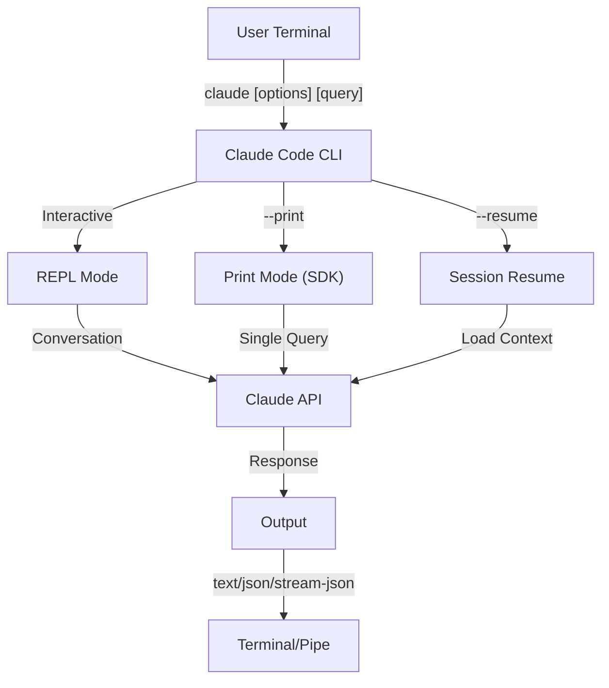
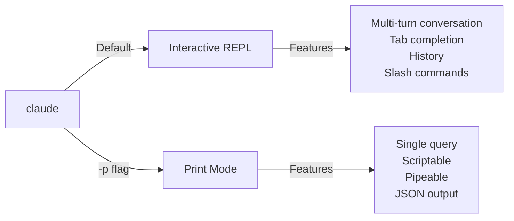

<picture>
  <source media="(prefers-color-scheme: dark)" srcset="../../resources/logos/claude-howto-logo-dark.svg">
  
</picture>

# CLI 참조

## 개요

Claude Code CLI(명령줄 인터페이스)는 Claude Code와 상호 작용하는 주요 방법입니다. 이 CLI는 쿼리를 실행하고, 세션을 관리하며, 모델을 구성하고, Claude를 개발 워크플로에 통합하기 위한 강력한 옵션을 제공합니다.

## 아키텍처



## 런타임 및 패키징

**v2.1.113**부터 Claude Code CLI는 선택적 npm 종속성을 통해 **플랫폼별 네이티브 바이너리**(macOS, Linux, Windows)를 시작합니다. 이 바이너리는 설치 시 운영체제 및 아키텍처에 맞춰지며, 이전 번들 JavaScript 런타임은 더 이상 macOS 또는 Linux의 기본값이 아닙니다.

**권장 설치 방법**은 네이티브 설치 프로그램입니다(`curl -fsSL https://claude.ai/install.sh | bash`, Windows에서는 `irm https://claude.ai/install.ps1 | iex`). 공식 README에서 npm 설치는 지원 중단(deprecated)되었으므로 네이티브 설치 프로그램, Homebrew(`brew install --cask claude-code`) 또는 WinGet(`winget install Anthropic.ClaudeCode`)을 사용하십시오. 참고로 `npm install -g @anthropic-ai/claude-code`(Node.js 22+)는 플랫폼별 선택적 종속성을 통해 동일한 네이티브 바이너리를 설치합니다.

**다운로드 호스트** (v2.1.116+): 네이티브 바이너리 아티팩트는 `https://downloads.claude.ai/claude-code-releases`에서 제공됩니다.

> **기업 / 프록시 사용자**: 네트워크에서 명시적인 허용 목록이 필요한 경우, `downloads.claude.ai` (및 `https://downloads.claude.ai/claude-code-releases`)를 프록시 egress 규칙에 추가하십시오. 이전에 `storage.googleapis.com` 또는 npm 레지스트리만 허용 목록에 추가했던 환경은 업데이트해야 하며, 그렇지 않으면 `claude update` 및 초기 설치가 실패합니다.

이전 JavaScript 번들은 Windows 및 해당 번들에 고정된 환경을 위해 여전히 생성됩니다. 이러한 설치는 Glob 및 Grep을 일등 도구로 계속 제공합니다([도구 및 권한 관리](#도구-및-권한-관리) 섹션의 Glob/Grep 각주 참조).

## CLI 명령

| Command | Description | Example |
|---------|-------------|---------|
| `claude` | 대화형 REPL을 시작합니다 | `claude` |
| `claude "query"` | 초기 프롬프트로 REPL을 시작합니다 | `claude "explain this project"` |
| `claude -p "query"` | 인쇄 모드 - 쿼리 후 종료합니다 | `claude -p "explain this function"` |
| `cat file \| claude -p "query"` | 파이프된 콘텐츠를 처리합니다 | `cat logs.txt \| claude -p "explain"` |
| `claude -c` | 가장 최근 대화를 계속합니다 | `claude -c` |
| `claude -c -p "query"` | 인쇄 모드에서 계속합니다 | `claude -c -p "check for type errors"` |
| `claude -r "<session>" "query"` | ID 또는 이름으로 세션을 재개합니다 | `claude -r "auth-refactor" "finish this PR"` |
| `claude update` | 최신 버전으로 업데이트합니다 | `claude update` |
| `/doctor` (slash command) | 설치, 구성 및 플러그인 상태를 진단합니다. v2.1.116부터 Claude가 응답 중일 때도 열 수 있으며, 상태 아이콘을 인라인으로 표시하고, 감지된 문제를 자동으로 해결하기 위해 `f` 키 입력을 받습니다. v2.1.178에서는 레이아웃이 더 명확한 상태 아이콘과 강조된 명령이 있는 평면 트리로 새로 고쳐졌습니다 | REPL 내에서 `/doctor`를 실행합니다 |
| `claude mcp` | MCP 서버를 구성합니다 (인증을 위한 `login`/`logout` 포함, v2.1.186+). | [MCP 문서](../05-mcp/)를 참조하십시오 |
| `claude mcp serve` | Claude Code를 MCP 서버로 실행합니다 | `claude mcp serve` |
| `claude agents` | **에이전트 뷰**를 엽니다 (연구 미리보기, v2.1.139+) — 모든 Claude Code 세션을 상태와 함께 나열하는 다중 세션 관리자입니다. 아래 [에이전트 뷰](#에이전트-뷰-claude-agents-v21139)를 참조하십시오. | `claude agents` |
| `claude auto-mode defaults` | 자동 모드 기본 규칙을 JSON으로 출력합니다 | `claude auto-mode defaults` |
| `claude auto-mode reset` | 확인 프롬프트와 함께 기본 자동 모드 구성을 복원합니다 (`--yes`로 건너뛰기) (v2.1.212) | `claude auto-mode reset --yes` |
| `claude remote-control` | 원격 제어 서버를 시작합니다 (서버 모드, 로컬 대화형 세션 없음; 여러 세션 제공, `--capacity` 기본값 32) | `claude remote-control --name "My Project"` |
| `claude --remote-control [name]` | 원격 제어가 활성화된 대화형 세션을 시작합니다 (별칭 `--rc`) | `claude --rc` |
| `claude plugin` | 플러그인을 관리합니다 (설치, 활성화, 비활성화) | `claude plugin install my-plugin` |
| `claude plugin init <name>` | `~/.claude/skills/<name>/`(사용자 전역)에 새 플러그인을 스캐폴딩합니다 — 다음 세션에서 `<name>@skills-dir`로 자동 로드되며 마켓플레이스가 필요 없습니다 (v2.1.157+) | `claude plugin init my-plugin` |
| `claude plugin tag [path]` | `[path]`의 플러그인에 대해 `{name}--v{version}` 릴리스 git 태그를 생성하며, `plugin.json`과 이를 포함하는 마켓플레이스 항목이 일치하는지 검증합니다 (v2.1.118+) | `claude plugin tag ./my-plugin` |
| `claude install [version]` | 특정 네이티브 바이너리 버전을 설치합니다. `stable`, `latest` 또는 명시적인 버전 문자열을 받습니다 | `claude install 2.1.131` |
| `claude purge [path]` | 프로젝트의 모든 로컬 Claude Code 상태를 삭제합니다 (대화 기록, 작업, 디버그 로그, 파일 편집 기록, 프롬프트 기록 및 `~/.claude.json` 항목). 대화형 선택기를 사용하려면 `[path]`를 생략하십시오. 플래그: `--dry-run`으로 미리보기, `-y/--yes`로 확인 건너뛰기, `-i/--interactive`로 각 항목 확인, `--all`로 모든 프로젝트 (v2.1.126+) — v2.1.288에서 `claude project purge`에서 이름이 바뀌었으며, 이전 이름도 여전히 작동하고 안내 메시지를 출력합니다 | `claude purge ~/work/repo --dry-run` |
| `claude plugin prune` | 고아 상태의 자동 설치 플러그인 종속성을 제거합니다 (부모 플러그인 없음). `plugin uninstall --prune`은 대상 제거 후 동일한 연쇄 제거를 수행합니다 (v2.1.121+) | `claude plugin prune` |
| `claude ultrareview [target]` | `/ultrareview`를 비대화형으로 실행합니다. 결과를 표준 출력으로 출력하고, 성공 시 0, 실패 시 1, Ctrl-C로 중단 시 130을 반환합니다. 원시 페이로드를 위해서는 `--json`을, 45분 기본값(v2.1.260부터)을 재정의하려면 `--timeout <minutes>`를, 발견 사항을 PR에 게시할지 제어하려면 `--post` / `--no-post`를 사용하십시오. 신뢰하지 않은 폴더에서는 터미널이면 묻고, 그렇지 않으면 1로 종료합니다. 스크립트와 CI에서는 대상 뒤에 `--trust-workspace`를 덧붙이십시오 (v2.1.309+). **Claude Code v2.1.227 이상 필요** | `claude ultrareview 1234 --json --no-post` |
| `claude self-hosted-runner [setup\|doctor\|orchestrator]` | 자신의 머신이나 컨테이너에서 Claude Code 클라우드 세션을 호스팅하는 러너를 시작합니다. `setup`은 운영자용 안내 절차, `doctor`는 배포된 러너 진단, `orchestrator`는 필요 시 러너를 생성합니다(`--shutdown-drain-sec`, v2.1.299는 SIGTERM 시 진행 중인 폴링과 생성 훅이 끝나도록 합니다). **Team 및 Enterprise 플랜, Claude Code v2.1.224 이상 필요.** Windows에서는 시작 시 명시적인 `--base-dir`이 필요합니다 (v2.1.229). v2.1.307부터 체크아웃 훅은 기본적으로 30분 후 중지되어 세션 설정이 실패하므로, `--checkout-hook-timeout-min`을 늘리거나 `0`으로 설정하십시오 | `claude self-hosted-runner setup` |
| `claude auth login` | 로그인합니다 (`--email`, `--sso` 지원). v2.1.126부터 브라우저 콜백이 로컬호스트에 도달할 수 없을 때 (WSL2, SSH, 컨테이너) 터미널에 붙여넣은 OAuth 코드를 폴백으로 받습니다 | `claude auth login --email user@example.com` |
| `claude auth logout` | 현재 계정에서 로그아웃합니다 | `claude auth logout` |
| `claude auth status` | 인증 상태를 확인합니다 (로그인되어 있으면 0, 아니면 1을 반환) | `claude auth status` |

## 핵심 플래그

| Flag | Description | Example |
|------|-------------|---------|
| `-p, --print` | 대화형 모드 없이 응답을 출력합니다 | `claude -p "query"` |
| `-c, --continue` | 가장 최근 대화를 로드합니다 | `claude --continue` |
| `-r, --resume` | ID 또는 이름으로 특정 세션을 재개합니다 | `claude --resume auth-refactor` |
| `-v, --version` | 버전 번호를 출력합니다 | `claude -v` |
| `--system-prompt-snapshot off` | 대화와 함께 기록된 프롬프트를 재사용하지 않고 매 요청마다 시스템 프롬프트를 새로 렌더링합니다. 프롬프트 텍스트를 반복 수정할 때 유용합니다 (v2.1.257+) | `claude --system-prompt-snapshot off` |
| `-w, --worktree` | 격리된 git 워크트리에서 시작합니다. v2.1.233부터 GitHub PR URL뿐 아니라 GitLab 머지 리퀘스트 URL도 받습니다 | `claude -w` |
| `-n, --name` | 세션 표시 이름 | `claude -n "auth-refactor"` |
| `--from-pr <url-or-number>` | 풀/머지 요청에 연결된 세션을 재개합니다. v2.1.119부터 GitHub (클라우드 + 엔터프라이즈), GitLab MR, Bitbucket PR URL을 받습니다; 이전에는 GitHub.com만 가능했습니다 | `claude --from-pr 42` or `claude --from-pr https://gitlab.example.com/org/repo/-/merge_requests/17` |
| `--cloud [description\|session_id\|url]` | 주어진 설명으로 claude.ai에 클라우드 세션을 생성하거나, 세션 ID 또는 claude.ai/code URL로 기존 세션에 연결합니다 | `claude --cloud "implement API"` |
| `--remote "task"` | **`--cloud`의 지원 중단된 별칭**(기존 세션 형식 포함). 대신 `--cloud`를 사용하십시오 | `claude --remote "implement API"` |
| `--remote-control, --rc` | 원격 제어를 통한 대화형 세션 | `claude --rc` |
| `--teleport [session]` | 웹 세션을 로컬에서 재개합니다. 인수 없이 쓰면 웹 세션 선택기가 열리고, 세션 ID를 전달하면 해당 세션을 바로 재개합니다. claude.ai 구독이 필요합니다 | `claude --teleport` |
| `--teammate-mode` | 에이전트 팀 표시 모드 | `claude --teammate-mode tmux` |
| `--bare` | 최소 모드 (훅, 스킬, 플러그인, MCP, 자동 메모리, CLAUDE.md 건너뛰기) | `claude --bare` |
| `--safe-mode` | 모든 사용자 정의를 비활성화한 상태로 시작하여 (CLAUDE.md, 플러그인, 스킬, 훅, MCP) 구성 문제를 격리합니다; `CLAUDE_CODE_SAFE_MODE=1`도 가능합니다 (v2.1.169) | `claude --safe-mode` |
| `--restricted` | 신뢰할 수 없거나 공유된 용도로 세션을 잠급니다: 내장 명령·코드 실행 도구와 WebFetch를 제거하고, 사용자/프로젝트/로컬 설정을 무시하며, 파일 도구를 작업 디렉터리로 제한하고, `bypassPermissions`와 클라우드 세션을 거부합니다. `CLAUDE_CODE_RESTRICTED=1`도 가능합니다 (v2.1.248+) | `claude --restricted -p "summarize this repo"` |
| `--permission-mode auto` | 자동 권한 모드로 시작합니다 (v2.1.111부터 제거된 `--enable-auto-mode` 플래그를 대체) | `claude --permission-mode auto` |
| `--channels` | MCP 채널 플러그인을 구독합니다. 항목은 `plugin:<name>@<marketplace>` 형식으로 지정해야 하며, 이름만 쓰면 거부됩니다 | `claude --channels plugin:discord@my-marketplace` |
| `--chrome` / `--no-chrome` | Chrome 브라우저 통합을 활성화/비활성화합니다 | `claude --chrome` |
| `--effort` | 사고 노력 수준을 설정합니다 | `claude --effort high` |
| `--desktop` | 현재 디렉터리에서 Claude 데스크톱 앱으로 세션을 엽니다. 세션을 고르려면 `--continue` 또는 `--resume <id>`를 추가합니다 (v2.1.285) | `claude --desktop --continue` |
| `--init` / `--init-only` | `--init`은 세션 전에 초기화(Setup) 훅을 실행하며 인쇄 모드 전용입니다. `--init-only`는 Setup 및 `SessionStart` 훅을 실행한 뒤 종료합니다 | `claude -p --init "query"` |
| `--maintenance` | 세션 전에 유지보수(Setup) 훅을 실행합니다 (인쇄 모드 전용) | `claude -p --maintenance "query"` |
| `--disable-slash-commands` | 모든 스킬과 슬래시 명령을 비활성화합니다 | `claude --disable-slash-commands` |
| `--no-session-persistence` | 세션 저장을 비활성화합니다 (인쇄 모드) | `claude -p --no-session-persistence "query"` |
| `--exclude-dynamic-system-prompt-sections` | 더 나은 프롬프트 캐시 적중률을 위해 시스템 프롬프트에서 동적 섹션을 제외합니다 | `claude -p --exclude-dynamic-system-prompt-sections "query"` |

### 제한 모드 (`--restricted`, v2.1.248+)

`--restricted`(또는 `CLAUDE_CODE_RESTRICTED=1`)는 입력을 통제할 수 없는 사람을 대신해 `claude`를 실행할 때 사용합니다. 예를 들어 공유 머신의 평가 하네스, 외부 기여자가 트리거하는 CI 작업, 데모용 머신 등입니다. 다음을 모두 적용합니다.

- **명령이나 코드를 실행하는 도구를 제거합니다** — Bash, PowerShell, REPL과 WebFetch. 단, `--tools`에 명시적으로 지정하면 제외됩니다.
- **사용자, 프로젝트, 로컬 설정 파일을 무시합니다.** 관리형 설정과 명시적인 `--settings` 파일은 계속 적용되므로, 관리자는 통제권을 유지하고 저장소에 체크인된 `.claude/settings.json`은 샌드박스를 넓힐 수 없습니다.
- **파일 도구를 작업 디렉터리로 제한하므로**, 읽기와 쓰기가 시작한 경로를 벗어날 수 없습니다.
- **`bypassPermissions`를 거부합니다**(어떤 방식으로 요청하든).
- **클라우드 세션 생성을 거부하므로**, 제한된 실행이 작업을 머신 밖으로 보낼 수 없습니다.

```bash
# 평가 하네스: 셸 없음, 네트워크 가져오기 없음, 설정 상속 없음
claude --restricted -p "summarize the architecture of this repo"

# 같은 잠금 상태에서 도구 하나만 의도적으로 다시 활성화
claude --restricted --tools WebFetch -p "check the linked RFC"
```

> **참고**: `--restricted`는 `--permission-mode`보다 더 거친 잠금입니다. 도구에 대해 프롬프트를 띄우는 대신 도구를 아예 제거하므로, 제한된 세션은 세션 내부에서 넓힐 수 없습니다.

### 대화형 모드 vs 인쇄 모드



**대화형 모드** (기본값):
```bash
# 대화형 세션을 시작합니다
claude

# 초기 프롬프트로 시작합니다
claude "explain the authentication flow"
```

**인쇄 모드** (비대화형):
```bash
# 단일 쿼리 후 종료합니다
claude -p "what does this function do?"

# 파일 콘텐츠를 처리합니다
cat error.log | claude -p "explain this error"

# 다른 도구와 연결합니다
claude -p "list todos" | grep "URGENT"
```

## 모델 및 구성

| Flag | Description | Example |
|------|-------------|---------|
| `--model` | 모델을 설정합니다 (sonnet, opus, haiku 또는 전체 이름) | `claude --model opus` |
| `--fallback-model` | 기본 모델이 과부하되거나 사용 불가능할 때 자동 모델 폴백; `fallbackModel` 설정을 통해 최대 3개까지 구성할 수 있습니다. v2.1.166부터 대화형 세션에도 적용됩니다 (이전에는 인쇄 모드 전용) | `claude -p --fallback-model sonnet "query"` |
| `--agent` | 세션에 사용할 에이전트를 지정합니다 | `claude --agent my-custom-agent` |
| `--agents` | JSON을 통해 사용자 정의 서브에이전트를 정의합니다 | [에이전트 구성](#에이전트-구성) 참조 |
| `--effort` | 노력 수준을 설정합니다 (low, medium, high, xhigh, max) | `claude --effort xhigh` |

### 모델 선택 예시

```bash
# 복잡한 작업을 위해 Opus 5.5를 사용합니다
claude --model opus "design a caching strategy"

# 빠른 작업을 위해 Haiku를 사용합니다 (Anthropic API에서는 v2.1.293부터 Haiku 5.5, Bedrock·Vertex·Foundry에서는 Haiku 4.5)
claude --model haiku -p "format this JSON"

# 전체 모델 이름
claude --model claude-sonnet-4-6 "review this code"

# 안정성을 위한 폴백 사용
claude -p --model opus --fallback-model sonnet "analyze architecture"

# opusplan 사용 (Opus가 계획하고 Sonnet이 실행합니다)
claude --model opusplan "design and implement the caching layer"
```

> **게이트웨이 모델 탐색 (v2.1.129+, 선택 사항)**: `ANTHROPIC_BASE_URL`이 Anthropic 호환 게이트웨이를 가리킬 때, `CLAUDE_CODE_ENABLE_GATEWAY_MODEL_DISCOVERY=1`을 설정하여 게이트웨이의 `/v1/models` 엔드포인트에서 `/model`을 채웁니다. 환경 변수가 없으면 `/model`은 내장된 정적 목록으로 폴백합니다. 이 플래그는 사용자가 사용할 권한이 없는 모델을 발견할 수 있기 때문에 선택 사항입니다 (v2.1.129에서 변경됨). v2.1.126에서는 암묵적이었으며 해당 동작은 되돌려졌습니다.

> **사용자 지정 base URL 뒤의 1M 컨텍스트 (v2.1.285)**: `ANTHROPIC_BASE_URL`이 사용자 지정 엔드포인트를 가리키는 세션은 이제 1M 컨텍스트 창을 가진 모델(Opus 4.7+, Sonnet 5+, Fable)에서 이를 사용합니다. 게이트웨이가 200K까지만 지원한다면 `/autocompact 200k`를 실행하십시오.

> **서드파티 제공자에서 기본 1M 컨텍스트 (v2.1.287)**: Opus 4.7+와 Fable은 이제 Amazon Bedrock, Google Vertex AI, Microsoft Foundry, Claude apps 게이트웨이에서 `[1m]` 접미사 없이 기본적으로 1M 컨텍스트 창을 사용합니다. 200K로 유지하려면 `CLAUDE_CODE_DISABLE_1M_CONTEXT=1`을 설정하십시오.

> **조직 기본 모델 (v2.1.196)**: 조직 관리자가 기본 모델을 설정하면 `/model`에 "Org default"(또는 "Role default")로 표시됩니다.

## 시스템 프롬프트 사용자 정의

| Flag | Description | Example |
|------|-------------|---------|
| `--system-prompt` | 전체 기본 프롬프트를 대체합니다 | `claude --system-prompt "You are a Python expert"` |
| `--system-prompt-file` | 파일에서 프롬프트를 로드하여 기본 프롬프트를 대체합니다 | `claude -p --system-prompt-file ./prompt.txt "query"` |
| `--append-system-prompt` | 기본 프롬프트에 추가합니다 | `claude --append-system-prompt "Always use TypeScript"` |
| `--append-subagent-system-prompt` | 모든 서브에이전트의 시스템 프롬프트에 텍스트를 추가합니다 (비대화형) | `claude -p --append-subagent-system-prompt "Cite sources" "query"` |
| `--append-subagent-system-prompt-file` | (v2.1.261) 명령줄로 전달하기에 너무 긴 프롬프트를 위해 추가할 텍스트를 파일에서 로드합니다. 비대화형 전용이며 `--append-subagent-system-prompt`와 **함께 사용할 수 없습니다** | `claude -p --append-subagent-system-prompt-file ./subagent-rules.txt "query"` |

### 시스템 프롬프트 예시

```bash
# 완전한 사용자 정의 페르소나
claude --system-prompt "You are a senior security engineer. Focus on vulnerabilities."

# 특정 지시사항 추가
claude --append-system-prompt "Always include unit tests with code examples"

# 파일에서 복잡한 프롬프트 로드
claude -p --system-prompt-file ./prompts/code-reviewer.txt "review main.py"
```

### 시스템 프롬프트 플래그 비교

| Flag | Behavior | Interactive | Print |
|------|----------|-------------|-------|
| `--system-prompt` | 전체 기본 시스템 프롬프트를 대체합니다 | ✅ | ✅ |
| `--system-prompt-file` | 파일의 프롬프트로 대체합니다 | ✅ | ✅ |
| `--append-system-prompt` | 기본 시스템 프롬프트에 추가합니다 | ✅ | ✅ |

**모든 시스템 프롬프트 플래그는 대화형 모드와 인쇄 모드 모두에서 작동합니다(파일 형식은 v2.1.69부터). `--system-prompt`와 `--system-prompt-file`은 기본 프롬프트를 대체하고, append 플래그는 기본 프롬프트에 추가합니다.**

## 도구 및 권한 관리

| Flag | Description | Example |
|------|-------------|---------|
| `--tools` | 사용 가능한 내장 도구를 제한합니다 | `claude -p --tools "Bash,Edit,Read" "query"` |
| `--allowedTools` | 프롬프트 없이 실행되는 도구 | `"Bash(git log:*)" "Read"` |
| `--disallowedTools` | 컨텍스트에서 제거된 도구 | `"Bash(rm:*)" "Edit"` |
| `--dangerously-skip-permissions` | 모든 권한 프롬프트를 건너뜁니다 | `claude --dangerously-skip-permissions` |
| `--permission-mode` | 지정된 권한 모드에서 시작합니다 | `claude --permission-mode auto` |
| `--permission-prompt-tool` | 인쇄 모드에서 권한 프롬프트에 응답하는 MCP 도구. 실행에서 로드하는 서버의 전체 `mcp__<server>__<tool>` 이름을 전달합니다 | `claude -p --mcp-config ./mcp.json --permission-prompt-tool mcp__permissions__approve "query"` |
| `--permission-prompts` | (v2.1.259) 인쇄 모드에서 권한 프롬프트에 누가 응답할지 지정합니다. 기본값 `host`는 Agent SDK 호스트 또는 `--permission-prompt-tool` 도구로 보냅니다. 응답할 주체가 없으면 `none`을 전달하며, 이 경우 Claude Code가 프롬프트를 거부합니다 | `claude -p --permission-prompts none "query"` |

> **v2.1.111 업데이트**: `--enable-auto-mode`는 제거되었습니다. 이제 자동 모드는 기본적으로 `Shift+Tab` 순환에 포함되며, 바로 자동 모드로 시작하려면 `--permission-mode auto`를 사용하십시오.

> **Glob / Grep 각주 (v2.1.113+)**: 네이티브 macOS/Linux 빌드에서는 `Glob` 및 `Grep`이 별도의 일등 도구가 아닌 Bash 도구를 통해 호출되는 내장 `bfs` 및 `ugrep` 바이너리로 제공됩니다. Windows 및 npm 번들(JS) 설치는 여전히 이를 독립형 도구로 노출합니다. 서브에이전트 `allowedTools` / `disallowedTools` 목록의 경우 백엔드 대체는 투명합니다. 모든 플랫폼에서 `Glob` / `Grep`을 구성에서 계속 참조할 수 있습니다.

> **PowerShell 자동 승인 (v2.1.119)**: PowerShell 도구 명령은 Bash 명령과 동일한 방식으로 권한 모드에서 자동 승인될 수 있습니다. `Bash(...)` 규칙에 이미 사용하고 있는 것과 동일한 매처 구문을 사용하여 PowerShell 권한의 범위를 지정하십시오. 예를 들어, `PowerShell(Get-ChildItem:*)`과 같습니다.

> **재개 시 `--permission-mode` 적용 (v2.1.132+)**: `claude -p --continue --permission-mode plan` (및 `--resume`)은 이제 이 플래그를 존중합니다. 이전 버전에서는 세션을 재개할 때 `--permission-mode`를 자동으로 삭제하여, 플래그를 다시 전달하지 않고 재개된 계획 모드 세션이 자동으로 다운그레이드되는 문제가 있었는데, 이는 해결되었습니다.

> **권한 강화 (v2.1.214)**: 데몬 리디렉션 플래그(예: `--url`, `--connection`, `--identity`)를 사용하는 Docker/Podman 명령은 이제 자동으로 실행되지 않고 권한 프롬프트가 필요합니다. `-m`/`--magic-file` 또는 `-f`/`--files-from`을 사용하는 `file` 명령도 권한이 필요합니다. 10,000자를 넘는 Bash 명령은 허용 규칙과 관계없이 항상 권한을 요청합니다.

### 권한 예시

```bash
# 코드 검토를 위한 읽기 전용 모드
claude --permission-mode plan "review this codebase"

# 안전한 도구로만 제한
claude --tools "Read,Grep,Glob" -p "find all TODO comments"

# 프롬프트 없이 특정 git 명령 허용
claude --allowedTools "Bash(git status:*)" "Bash(git log:*)"

# 위험한 작업 차단
claude --disallowedTools "Bash(rm -rf:*)" "Bash(git push --force:*)"
```

> **매개변수 일치 `Tool(param:value)` (v2.1.178)**: 권한 규칙은 `Tool` (모든 사용) 또는 `Tool(specifier)` 형식을 따릅니다. v2.1.178부터 지정자는 명령 또는 경로 패턴뿐만 아니라 와일드카드 지원을 통해 도구의 입력 **매개변수**와도 일치할 수 있습니다(`Tool(param:value)` 형식 사용). 이는 `Bash(...)` 명령 접두사(예: `Bash(npm run test *)`) 및 `Read(...)` 경로 glob(예: `Read(./.env.*)`)에 이미 사용하는 일치 방식을 일반화하여 다른 도구도 인수에 따라 범위가 지정될 수 있도록 합니다. 규칙을 작성하기 전에 도구별 예시 문자열은 정확한 매개변수 이름이 도구마다 다르므로 [권한 참조](https://code.claude.com/docs/en/settings)를 확인하십시오.

## 출력 및 형식

| Flag | Description | Options | Example |
|------|-------------|---------|---------|
| `--output-format` | 출력 형식을 지정합니다 (인쇄 모드) | `text`, `json`, `stream-json` | `claude -p --output-format json "query"` |
| `--input-format` | 입력 형식을 지정합니다 (인쇄 모드) | `text`, `stream-json` | `claude -p --input-format stream-json` |
| `--verbose` | 상세 로깅을 활성화합니다 | | `claude --verbose` |
| `--include-partial-messages` | 스트리밍 이벤트를 포함합니다 | `stream-json` 필요 | `claude -p --output-format stream-json --include-partial-messages "query"` |
| `--forward-subagent-text` | 서브에이전트 텍스트 출력을 스트림으로 전달합니다. v2.1.219부터 깊이 2 이상에서 생성된 서브에이전트도 이를 생성한 `Agent` `tool_use` id를 키로 전달됩니다(`CLAUDE_CODE_MAX_SUBAGENT_SPAWN_DEPTH`로 기본 활성화된 중첩을 관찰하는 방법입니다) | `stream-json` 필요 | `claude -p --output-format stream-json --forward-subagent-text "query"` |
| `--json-schema` | 스키마와 일치하는 유효성 검사된 JSON을 가져옵니다 | | `claude -p --json-schema '{"type":"object"}' "query"` |
| `--max-budget-usd` | 인쇄 모드에 대한 최대 지출. v2.1.217부터 한도에 도달하면 실행 중인 백그라운드 서브에이전트도 중지하고 새 생성을 거부합니다 (이전에는 백그라운드 에이전트가 한도를 넘어서도 계속 실행됨) | | `claude -p --max-budget-usd 5.00 "query"` |

### 출력 형식 예시

```bash
# 일반 텍스트 (기본값)
claude -p "explain this code"

# 프로그래밍 사용을 위한 JSON
claude -p --output-format json "list all functions in main.py"

# 실시간 처리를 위한 스트리밍 JSON
claude -p --output-format stream-json "generate a long report"

# 스키마 유효성 검사를 통한 구조화된 출력
claude -p --json-schema '{"type":"object","properties":{"bugs":{"type":"array"}}}' \
  "find bugs in this code and return as JSON"
```

## 작업 공간 및 디렉터리

| Flag | Description | Example |
|------|-------------|---------|
| `--add-dir` | 추가 작업 디렉터리를 추가합니다 | `claude --add-dir ../apps ../lib` |
| `--setting-sources` | 쉼표로 구분된 설정 소스 | `claude --setting-sources user,project` |

> **`/config` 영속성 (v2.1.119)**: `/config` 명령을 통해 대화형으로 변경된 사항은 이제 `~/.claude/settings.json`에 기록되며 일반적인 우선 순위 체인(정책 → 로컬 → 프로젝트 → 사용자)에 참여합니다. v2.1.119 이전에는 일부 `/config` 변경 사항이 세션 전용이었습니다. 전체 우선 순위 순서는 [메모리 및 설정](../02-memory/README.md)을 참조하십시오.
| `--settings` | 파일 또는 JSON에서 설정을 로드합니다. 파일은 2 MiB 이하여야 합니다 (v2.1.214) | `claude --settings ./settings.json` |
| `--plugin-dir` | 디렉터리에서 플러그인을 로드합니다 (반복 가능). v2.1.265부터 **플러그인 폴더**도 받습니다 — 매니페스트가 있는 모든 하위 폴더가 로드되며, 세션 중 추가되거나 제거된 하위 폴더도 반영됩니다 | `claude --plugin-dir ./my-plugin` |

### 다중 디렉터리 예시

```bash
# 여러 프로젝트 디렉터리에서 작업합니다
claude --add-dir ../frontend ../backend ../shared "find all API endpoints"

# 사용자 정의 설정 로드
claude --settings '{"model":"opus","verbose":true}' "complex task"
```

## MCP 구성

| Flag | Description | Example |
|------|-------------|---------|
| `--mcp-config` | JSON에서 MCP 서버를 로드합니다 | `claude --mcp-config ./mcp.json` |
| `--strict-mcp-config` | 지정된 MCP 구성만 사용합니다 | `claude --strict-mcp-config --mcp-config ./mcp.json` |
| `--channels` | MCP 채널 플러그인을 구독합니다. 항목은 `plugin:<name>@<marketplace>` 형식으로 지정해야 하며, 이름만 쓰면 거부됩니다 | `claude --channels plugin:discord@my-marketplace` |

### MCP 예시

```bash
# GitHub MCP 서버 로드
claude --mcp-config ./github-mcp.json "list open PRs"

# 엄격 모드 - 지정된 서버만 사용
claude --strict-mcp-config --mcp-config ./production-mcp.json "deploy to staging"
```

## 세션 관리

| Flag | Description | Example |
|------|-------------|---------|
| `--session-id` | 특정 세션 ID (UUID)를 사용합니다 | `claude --session-id "550e8400-..."` |
| `--fork-session` | 재개 시 새 세션을 생성합니다 | `claude --resume abc123 --fork-session` |

### 세션 예시

```bash
# 마지막 대화를 계속합니다
claude -c

# 이름이 지정된 세션을 재개합니다
claude -r "feature-auth" "continue implementing login"

# 실험을 위해 세션을 포크합니다
claude --resume feature-auth --fork-session "try alternative approach"

# 특정 세션 ID 사용
claude --session-id "550e8400-e29b-41d4-a716-446655440000" "continue"
```

> **v2.1.299**: 종료 시 출력되는 재개 명령은 세션을 ID로 지정합니다.

### 세션 포크

기존 세션에서 브랜치를 생성하여 실험합니다:

```bash
# 다른 접근 방식을 시도하기 위해 세션을 포크합니다
claude --resume abc123 --fork-session "try alternative implementation"

# 사용자 정의 메시지로 포크합니다
claude -r "feature-auth" --fork-session "test with different architecture"
```

**사용 사례:**
- 원본 세션을 잃지 않고 다른 구현을 시도합니다
- 다른 접근 방식을 병렬로 실험합니다
- 성공적인 작업에서 브랜치를 생성하여 변형을 만듭니다
- 주요 세션에 영향을 주지 않고 변경 사항을 테스트합니다

원본 세션은 변경되지 않고, 포크는 새로운 독립적인 세션이 됩니다.

### 프로젝트 상태 정리 (v2.1.126+)

`claude purge`는 프로젝트의 모든 로컬 Claude Code 상태를 삭제합니다 — 대화 기록, 작업 목록, 디버그 로그, 파일 편집 기록, 프롬프트 기록 줄, 그리고 프로젝트의 `~/.claude.json` 항목. v2.1.288 이전에는 `claude project purge`라는 이름이었으며, 이 이름도 여전히 작동하고 안내 메시지를 출력합니다. 삭제를 미리 보려면 먼저 `--dry-run`을 사용하십시오. `--all`은 시스템의 모든 프로젝트를 탐색합니다.

```bash
# 삭제될 내용을 미리 봅니다 (안전)
claude purge ~/work/repo --dry-run

# 특정 프로젝트의 상태를 프롬프트 없이 삭제합니다
claude purge ~/work/repo --yes

# 모든 프로젝트를 대화형으로 탐색합니다
claude purge --all --interactive
```

## 고급 기능

| Flag | Description | Example |
|------|-------------|---------|
| `--chrome` | Chrome 브라우저 통합을 활성화합니다 | `claude --chrome` |
| `--no-chrome` | Chrome 브라우저 통합을 비활성화합니다 | `claude --no-chrome` |
| `--ide` | 사용 가능한 경우 IDE에 자동 연결합니다 | `claude --ide` |
| `--max-turns` | 에이전트 턴을 제한합니다 (비대화형) | `claude -p --max-turns 3 "query"` |
| `--debug` | 필터링으로 디버그 모드를 활성화합니다 (필터는 `=` 형식에서만 적용됨) | `claude --debug=api,mcp` |
| `--enable-lsp-logging` | 상세 LSP 로깅을 활성화합니다 | `claude --enable-lsp-logging` |
| `--betas` | API 요청을 위한 베타 헤더 | `claude --betas interleaved-thinking` |
| `--plugin-dir` | 디렉터리에서 플러그인을 로드합니다 (반복 가능). v2.1.265부터 **플러그인 폴더**도 받습니다 — 매니페스트가 있는 모든 하위 폴더가 로드되며, 세션 중 추가되거나 제거된 하위 폴더도 반영됩니다 | `claude --plugin-dir ./my-plugin` |
| `--effort` | 사고 노력 수준을 설정합니다 | `claude --effort high` |
| `--bare` | 최소 모드 (훅, 스킬, 플러그인, MCP, 자동 메모리, CLAUDE.md 건너뛰기) | `claude --bare` |
| `--channels` | MCP 채널 플러그인을 구독합니다 (`plugin:<name>@<marketplace>` 형식) | `claude --channels plugin:discord@my-marketplace` |
| `--tmux` | 워크트리를 위한 tmux 세션을 생성합니다 (`--worktree` 필요) | `claude --worktree feature-x --tmux` |
| `--fork-session` | 재개 시 새 세션 ID를 생성합니다 | `claude --resume abc --fork-session` |
| `--max-budget-usd` | 최대 지출 (인쇄 모드). 한도에 도달하면 백그라운드 서브에이전트도 중지합니다 (v2.1.217) | `claude -p --max-budget-usd 5.00 "query"` |
| `--json-schema` | 유효성 검사된 JSON 출력 | `claude -p --json-schema '{"type":"object"}' "q"` |
| `--ax-screen-reader` | 스크린 리더용 일반 텍스트 렌더링 모드 (v2.1.208) | `claude --ax-screen-reader` |

### 플랫폼 및 테마 참고 사항 (v2.1.112)

- **Windows의 PowerShell 도구**: Windows에 전용 PowerShell 도구가 출시되고 있으며 환경 변수를 통해 제어할 수 있습니다.
- **자동 (터미널 일치) 테마**: 새로운 "자동 (터미널 일치)" 테마는 Claude Code의 밝기/어둡기 외관을 터미널과 동기화합니다.
- **더 조용한 권한 프롬프트**: 읽기 전용 `Bash` 호출 및 `Glob` 패턴은 더 이상 권한 프롬프트를 트리거하지 않습니다.

### 고급 예시

```bash
# 자율 행동을 제한합니다
claude -p --max-turns 5 "refactor this module"

# API 호출 디버그
claude --debug=api "test query"

# IDE 통합 활성화
claude --ide "help me with this file"
```

## 에이전트 구성

`--agents` 플래그는 세션을 위한 사용자 정의 서브에이전트를 정의하는 JSON 객체를 받습니다.

**v2.1.243**부터 `--agents`는 잘못된 JSON이나 잘못된 에이전트 정의를 조용히 무시하지 않고, `--mcp-config`와 마찬가지로 명확한 오류와 함께 종료합니다.

### 에이전트 JSON 형식

```json
{
  "agent-name": {
    "description": "Required: when to invoke this agent",
    "prompt": "Required: system prompt for the agent",
    "tools": ["Optional", "array", "of", "tools"],
    "model": "optional: sonnet|opus|haiku"
  }
}
```

**필수 필드:**
- `description` - 이 에이전트를 언제 호출할지 설명하는 자연어 설명
- `prompt` - 에이전트의 역할과 동작을 정의하는 시스템 프롬프트

**선택 필드:**
- `tools` - 사용 가능한 도구 배열 (생략 시 모든 도구 상속)
  - 형식: `["Read", "Grep", "Glob", "Bash"]`
- `model` - 사용할 모델: `sonnet`, `opus`, 또는 `haiku`

### 완전한 에이전트 예시

```json
{
  "code-reviewer": {
    "description": "Expert code reviewer. Use proactively after code changes.",
    "prompt": "You are a senior code reviewer. Focus on code quality, security, and best practices.",
    "tools": ["Read", "Grep", "Glob", "Bash"],
    "model": "sonnet"
  },
  "debugger": {
    "description": "Debugging specialist for errors and test failures.",
    "prompt": "You are an expert debugger. Analyze errors, identify root causes, and provide fixes.",
    "tools": ["Read", "Edit", "Bash", "Grep"],
    "model": "opus"
  },
  "documenter": {
    "description": "Documentation specialist for generating guides.",
    "prompt": "You are a technical writer. Create clear, comprehensive documentation.",
    "tools": ["Read", "Write"],
    "model": "haiku"
  }
}
```

### 에이전트 명령 예시

```bash
# 인라인으로 사용자 정의 에이전트 정의
claude --agents '{
  "security-auditor": {
    "description": "Security specialist for vulnerability analysis",
    "prompt": "You are a security expert. Find vulnerabilities and suggest fixes.",
    "tools": ["Read", "Grep", "Glob"],
    "model": "opus"
  }
}' "audit this codebase for security issues"

# 파일에서 에이전트 로드
claude --agents "$(cat ~/.claude/agents.json)" "review the auth module"

# 다른 플래그와 결합
claude -p --agents "$(cat agents.json)" --model sonnet "analyze performance"
```

### 에이전트 우선순위

여러 에이전트 정의가 존재하는 경우 다음 우선순위 순서로 로드됩니다:
1. **CLI 정의** (`--agents` 플래그) - 세션별
2. **프로젝트 수준** (`.claude/agents/`) - 현재 프로젝트
3. **사용자 수준** (`~/.claude/agents/`) - 모든 프로젝트

CLI 정의 에이전트는 세션에 대해 프로젝트 및 사용자 에이전트 모두를 재정의합니다. 프로젝트 수준 에이전트는 이름이 충돌할 때 사용자 수준 에이전트를 재정의합니다. 플러그인 수준 에이전트를 포함한 전체 우선순위 표는 [레슨 04 — 서브에이전트](../04-subagents/README.md#file-locations)를 참조하십시오.

### 에이전트 뷰 (`claude agents`, v2.1.139+)

> **연구 미리보기** — 기능은 일상적인 사용에 충분히 안정적이지만 변경될 수 있습니다.

`claude agents`는 **에이전트 뷰**를 엽니다. 이 뷰는 현재 상태(`running`, `blocked on you`, `done`)와 함께 시스템의 모든 Claude Code 세션 목록을 한눈에 볼 수 있도록 합니다. 이는 백그라운드 에이전트, 예약된 작업 또는 `--bg`로 시작된 세션을 실행할 때 여러 터미널 탭을 관리하는 번거로움을 대체합니다.

```bash
# 에이전트 뷰를 엽니다
claude agents
```

뷰에서 세션을 디스패치할 때 (또는 `claude --bg <prompt>`를 통해) `claude` 자체에 전달하는 것과 동일한 구성 플래그를 전달할 수 있습니다. 에이전트 뷰 디스패스 경로를 위해 도입된 플래그:

| Flag | Since | Description |
|------|-------|-------------|
| `--cwd <path>` | v2.1.141 | 세션 목록 (또는 새 세션)의 범위를 특정 작업 디렉터리로 지정합니다 |
| `--add-dir <path>` | v2.1.142 | 디스패치된 세션의 작업 공간에 디렉터리를 추가합니다 |
| `--settings <path>` | v2.1.142 | 디스패치된 세션에 특정 `settings.json`을 사용합니다 |
| `--mcp-config <path>` | v2.1.142 | 디스패치된 세션에 특정 MCP 구성을 사용합니다 |
| `--plugin-dir <path>` | v2.1.142 | 디스패치된 세션에 특정 플러그인 디렉터리를 사용합니다 |
| `--permission-mode <mode>` | v2.1.142 | 디스패치된 세션에 권한 모드 (`plan`, `acceptEdits`, `auto` 등)를 설정합니다 |
| `--model <model>` | v2.1.142 | 디스패치된 세션에 모델을 고정합니다 |
| `--effort <level>` | v2.1.142 | 노력 수준 (`low`/`medium`/`high`/`xhigh`/`max`)을 고정합니다 |
| `--dangerously-skip-permissions` | v2.1.142 | 권한 프롬프트 없이 디스패치된 세션을 실행합니다 (샌드박스에서만 사용) |
| `--json` | v2.1.145 | 스크립트 작성 (상태 표시줄, 세션 선택기, tmux-resurrect 통합)을 위해 에이전트 목록을 기계가 읽을 수 있는 JSON으로 출력합니다 |

작업을 완료했지만 백그라운드 쉘을 열어둔 세션은 "Working"에서 "Completed"로 이동합니다 (v2.1.141 수정). 연결된 에이전트 세션 내에서 `Shift+Tab`은 자동 모드를 포함한 권한 모드를 순환합니다 (v2.1.143).

**GitLab 머지 리퀘스트 (v2.1.233)** — 에이전트 뷰는 GitHub PR URL과 함께 GitLab MR URL도 인식하며, 머지 리퀘스트를 `!N`으로 표시합니다(GitHub 풀 리퀘스트는 `#N` 유지). 같은 릴리스에서 `--worktree`도 GitLab MR URL을 받도록 바뀌었습니다.

**세션 고정** — `claude agents`의 세션에서 `Ctrl+T`를 눌러 세션을 고정합니다 (v2.1.147). 고정된 백그라운드 세션은 유휴 상태일 때도 활성 상태를 유지하고, Claude Code 업데이트를 적용하기 위해 제자리에서 다시 시작되며, 고정되지 않은 세션 이후에만 메모리 부족 시 해제됩니다. (이 `Ctrl+T`는 에이전트 뷰에 범위가 지정됩니다; 주 세션에서는 작업 목록 뷰를 전환합니다.)

**새 세션의 기본값 (v2.1.299)** — 에이전트 뷰에서 `/effort`와 `/fast`는 새 세션이 시작할 때의 값을 설정합니다. 인수 없이 `/model`, `/effort`, `/fast`를 입력하면 선택기가 열립니다.

---

## 고가치 사용 사례

### 1. CI/CD 통합

CI/CD 파이프라인에서 Claude Code를 사용하여 자동화된 코드 검토, 테스트 및 문서화를 수행합니다.

**GitHub Actions 예시:**

```yaml
name: AI Code Review

on: [pull_request]

jobs:
  review:
    runs-on: ubuntu-latest
    steps:
      - uses: actions/checkout@v4

      - name: Install Claude Code
        run: npm install -g @anthropic-ai/claude-code

      - name: Run Code Review
        env:
          ANTHROPIC_API_KEY: ${{ secrets.ANTHROPIC_API_KEY }}
        run: |
          claude -p --output-format json \
            --max-turns 1 \
            "Review the changes in this PR for:
            - Security vulnerabilities
            - Performance issues
            - Code quality
            Output as JSON with 'issues' array" > review.json

      - name: Post Review Comment
        uses: actions/github-script@v7
        with:
          script: |
            const fs = require('fs');
            const review = JSON.parse(fs.readFileSync('review.json', 'utf8'));
            // Process and post review comments
```

**Jenkins 파이프라인:**

```groovy
pipeline {
    agent any
    stages {
        stage('AI Review') {
            steps {
                sh '''
                    claude -p --output-format json \
                      --max-turns 3 \
                      "Analyze test coverage and suggest missing tests" \
                      > coverage-analysis.json
                '''
            }
        }
    }
}
```

**헤드리스 `ultrareview` (v2.1.227+ 필요, `--trust-workspace`는 v2.1.309+ 필요):**

```yaml
# .github/workflows/ultrareview.yml
# 신뢰할 수 있는 브랜치를 체크아웃하십시오. 예: `ref: ${{ github.base_ref }}`를 지정한 actions/checkout
# ultrareview는 풀 리퀘스트 자체를 클라우드에서 클론합니다.
- name: Claude ultrareview
  run: claude ultrareview ${{ github.event.pull_request.number }} --trust-workspace --json --no-post > review.json
```

`claude ultrareview`는 발견 사항 유무와 관계없이 검토가 완료되면 0을 반환하고, 시작 실패·오류·시간 초과·폴더 미신뢰 시 1을 반환하며, 검토 시작 중이나 발견 사항 대기 중, 또는 `--post` 댓글 게시 중에 Ctrl-C를 누르면 130을 반환합니다. 따라서 PR 게이트는 종료 코드가 아니라 `review.json`의 발견 사항을 기준으로 판단하십시오. CI에서는 체크아웃을 신뢰하는지 물을 수 없으므로, v2.1.309부터는 PR 번호나 기준 브랜치 뒤에 `--trust-workspace`(값 없음)를 전달하거나 작업 환경에 `CLAUDE_CODE_DISABLE_ULTRAREVIEW_TRUST_CHECK=1`을 설정하지 않으면 `Error: Workspace not trusted`와 함께 1로 종료합니다. 둘 다 신뢰할 수 있는 체크아웃에서만 사용하십시오. 45분 기본값(v2.1.260부터)을 재정의하려면 `--timeout <minutes>`를 사용하십시오. `--post`는 완료된 발견 사항을 풀 리퀘스트에 게시하고, `--no-post`는 표준 출력에만 남깁니다. 이후 CI 단계에서 보고서를 직접 포맷할 때 `--no-post`를 사용하십시오.

### 2. 스크립트 파이프라인

분석을 위해 파일, 로그 및 데이터를 Claude를 통해 처리합니다.

**로그 분석:**

```bash
# 오류 로그 분석
tail -1000 /var/log/app/error.log | claude -p "summarize these errors and suggest fixes"

# 액세스 로그에서 패턴 찾기
cat access.log | claude -p "identify suspicious access patterns"

# Git 기록 분석
git log --oneline -50 | claude -p "summarize recent development activity"
```

**코드 처리:**

```bash
# 특정 파일 검토
cat src/auth.ts | claude -p "review this authentication code for security issues"

# 문서 생성
cat src/api/*.ts | claude -p "generate API documentation in markdown"

# TODO 찾기 및 우선순위 지정
grep -r "TODO" src/ | claude -p "prioritize these TODOs by importance"
```

### 3. 다중 세션 워크플로

여러 대화 스레드로 복잡한 프로젝트를 관리합니다.

```bash
# 기능 브랜치 세션 시작
claude -r "feature-auth" "let's implement user authentication"

# 나중에 세션 계속
claude -r "feature-auth" "add password reset functionality"

# 다른 접근 방식을 시도하기 위해 포크
claude --resume feature-auth --fork-session "try OAuth instead"

# 다른 기능 세션 간 전환
claude -r "feature-payments" "continue with Stripe integration"
```

### 4. 사용자 정의 에이전트 구성

팀의 워크플로에 맞는 전문 에이전트를 정의합니다.

```bash
# 에이전트 구성을 파일에 저장
cat > ~/.claude/agents.json << 'EOF'
{
  "reviewer": {
    "description": "Code reviewer for PR reviews",
    "prompt": "Review code for quality, security, and maintainability.",
    "model": "opus"
  },
  "documenter": {
    "description": "Documentation specialist",
    "prompt": "Generate clear, comprehensive documentation.",
    "model": "sonnet"
  },
  "refactorer": {
    "description": "Code refactoring expert",
    "prompt": "Suggest and implement clean code refactoring.",
    "tools": ["Read", "Edit", "Glob"]
  }
}
EOF

# 세션에서 에이전트 사용
claude --agents "$(cat ~/.claude/agents.json)" "review the auth module"
```

### 5. 배치 처리

일관된 설정으로 여러 쿼리를 처리합니다.

```bash
# 여러 파일 처리
for file in src/*.ts; do
  echo "Processing $file..."
  claude -p --model haiku "summarize this file: $(cat $file)" >> summaries.md
done

# 배치 코드 검토
find src -name "*.py" -exec sh -c '
  echo "## $1" >> review.md
  cat "$1" | claude -p "brief code review" >> review.md
' _ {} \;

# 모든 모듈에 대한 테스트 생성
for module in $(ls src/modules/); do
  claude -p "generate unit tests for src/modules/$module" > "tests/$module.test.ts"
done
```

### 6. 보안 인식 개발

안전한 작업을 위해 권한 제어를 사용합니다.

```bash
# 읽기 전용 보안 감사
claude --permission-mode plan \
  --tools "Read,Grep,Glob" \
  "audit this codebase for security vulnerabilities"

# 위험한 명령 차단
claude --disallowedTools "Bash(rm:*)" "Bash(curl:*)" "Bash(wget:*)" \
  "help me clean up this project"

# 제한된 자동화
claude -p --max-turns 2 \
  --allowedTools "Read" "Glob" \
  "find all hardcoded credentials"
```

### 7. JSON API 통합

`jq` 파싱을 사용하여 Claude를 도구용 프로그래밍 가능 API로 사용합니다.

```bash
# 구조화된 분석 가져오기
claude -p --output-format json \
  --json-schema '{"type":"object","properties":{"functions":{"type":"array"},"complexity":{"type":"string"}}}' \
  "analyze main.py and return function list with complexity rating"

# 처리를 위해 jq와 통합 (스키마 출력은 .structured_output에 들어갑니다)
claude -p --output-format json \
  --json-schema '{"type":"object","properties":{"endpoints":{"type":"array"}}}' \
  "list all API endpoints" | jq '.structured_output.endpoints[]'

# 스크립트에서 사용
RESULT=$(claude -p --output-format json \
  --json-schema '{"type":"object","properties":{"secure":{"type":"boolean"},"issues":{"type":"array"}},"required":["secure","issues"]}' \
  "is this code secure?" < code.py)
if echo "$RESULT" | jq -e '.structured_output.secure == false' > /dev/null; then
  echo "Security issues found!"
  echo "$RESULT" | jq '.structured_output.issues[]'
fi
```

### jq 파싱 예시

`jq`를 사용하여 Claude의 JSON 출력을 파싱하고 처리합니다. 응답 텍스트는 `.result`에 있으며, `--json-schema`를 사용하면 검증된 객체는 `.structured_output`에 있습니다(아래의 `$SCHEMA`는 각 필터가 읽는 필드를 정의한 스키마를 뜻합니다):

```bash
# 응답 텍스트 추출
claude -p --output-format json "analyze this code" | jq -r '.result'

# 배열 요소 필터링
claude -p --output-format json --json-schema "$SCHEMA" "list issues" | jq -r '.structured_output.issues[] | select(.severity=="high")'

# 여러 필드 추출
claude -p --output-format json --json-schema "$SCHEMA" "describe the project" | jq -r '.structured_output | {name, version, description}'

# CSV로 변환
claude -p --output-format json --json-schema "$SCHEMA" "list functions" | jq -r '.structured_output.functions[] | [.name, .lineCount] | @csv'

# 조건부 처리
claude -p --output-format json --json-schema "$SCHEMA" "check security" | jq 'if (.structured_output.vulnerabilities | length) > 0 then "UNSAFE" else "SAFE" end'

# 중첩 값 추출
claude -p --output-format json --json-schema "$SCHEMA" "analyze performance" | jq '.structured_output.metrics.cpu.usage'

# 전체 배열 처리
claude -p --output-format json --json-schema "$SCHEMA" "find todos" | jq '.structured_output.todos | length'

# 출력 변환
claude -p --output-format json --json-schema "$SCHEMA" "list improvements" | jq '.structured_output.improvements | map({title: .title, priority: .priority})'
```

---

## 모델

Claude Code는 다양한 기능을 가진 여러 모델을 지원합니다:

| Model | ID | Context Window | Notes |
|-------|-----|----------------|-------|
| Opus 5.5 | `claude-opus-5-5` | 1M 토큰 | v2.1.280부터 Pro, Max, Team, Enterprise, Anthropic API, Claude Platform on AWS, Amazon Bedrock, Google Cloud's Agent Platform에서 기본 모델이자 기본 Opus 모델 (Pro와 Team Standard는 이전에 Sonnet 5가 기본값); Microsoft Foundry는 여전히 `opus`를 Opus 4.6으로, `default`를 Sonnet 4.5로 해석합니다. 적응형 노력 수준 `low → max`, 기본 노력 `medium`; 사고를 끌 수 없음. v2.1.280+ 필요 |
| Sonnet 5.5 | `claude-sonnet-5-5` | 1M 토큰 | v2.1.284부터 Anthropic API의 기본 Sonnet 모델 (그곳에서 `sonnet` 별칭이 이 모델로 해석됨); 적응형 노력 수준 `low → max`, 기본 노력 `medium`; 사고를 끌 수 없음; 빠른 모드에서 사용 불가. v2.1.284+ 필요 |
| Haiku 5.5 | `claude-haiku-5-5` | 1M 토큰 | v2.1.293부터 Anthropic API의 기본 Haiku 모델 (그곳에서 `haiku` 별칭이 이 모델로 해석됨. Bedrock, Vertex, Foundry, Claude Platform on AWS는 여전히 `haiku`를 Haiku 4.5로 해석); 적응형 노력 수준 `low → max`, 기본 노력 `medium`; 사고를 끌 수 없음. v2.1.293+ 필요 |
| Sonnet 5 | `claude-sonnet-5` | 1M 토큰 | v2.1.197부터 v2.1.280까지 Pro / Team Standard 시트의 기본값이었으며, 이후 해당 플랜은 Opus 5.5로 이동; 네이티브 1M 토큰 컨텍스트 창 |
| Opus 5 | `claude-opus-5` | 1M 토큰 | v2.1.219부터 v2.1.280까지 기본 Opus 모델 (현재는 Opus 5.5); 여전히 선택 가능; 적응형 노력 수준 `low → max`, 기본 노력 `high` |
| Opus 4.8 | `claude-opus-4-8` | 1M 토큰 | 이전 플래그십 Opus, 여전히 선택 가능; 적응형 노력 수준 `low → max`; 기본 노력 `high` (v2.1.154) |
| Sonnet 4.6 | `claude-sonnet-4-6` | 1M 토큰 | 균형 잡힌 속도와 기능; Pro/Max 구독자의 기본 노력은 v2.1.117에서 `medium`에서 `high`로 상향 조정됨 |
| Haiku 4.5 | `claude-haiku-4-5` | 200K 토큰 | 이전 Haiku, Bedrock, Vertex, Foundry, Claude Platform on AWS에서는 여전히 `haiku` 별칭; 노력 수준 없음 |
| Fable 5.1 | `claude-fable-5-1` | — | 현재 Fable 모델; `fable` 별칭이 이 모델로 해석됨 (v2.1.257) |
| Fable 5 | `claude-fable-5` | — | Mythos 등급 모델, 일반적인 사용에 안전하게 만들어짐 (v2.1.170) |

> **참고**: Sonnet 4.5는 Claude API, Claude Platform on AWS, Claude Models on Google Cloud(Anthropic 관리), Microsoft Foundry에서 2026년 11월 30일에 서비스 종료됩니다. Amazon Bedrock과 Google Cloud's Agent Platform은 자체 일정을 정합니다. `default`와 `sonnet`이 여전히 Sonnet 4.5로 해석되는 Foundry에서는 더 새로운 모델을 명시적으로 설정하십시오.

### 모델 선택

```bash
# 짧은 이름 사용
claude --model opus "complex architectural review"
claude --model sonnet "implement this feature"
claude --model haiku -p "format this JSON"

# opusplan 별칭 사용 (Opus가 계획하고 Sonnet이 실행합니다)
claude --model opusplan "design and implement the API"

# 세션 중 빠른 모드 전환
/fast
```

> **Fable 5.1과 `fable` 별칭 (v2.1.257)**: Fable 5.1(`claude-fable-5-1`)은 **v2.1.257**에 포함되었으며, `fable` 별칭은 이제 Fable 5가 아닌 이 모델로 해석됩니다. 공식 model-config 페이지에는 Fable 5.1이 "Claude Code v2.1.255 이상이 필요하다"고 되어 있지만 2.1.255는 공개되지 않았으므로, 실제로 설치할 수 있는 첫 릴리스는 v2.1.257입니다. Claude apps 게이트웨이에서는 `fable`과 `best`가 여전히 **Fable 5**로 해석되므로, 그곳에서는 `/model`에서 5.1을 명시적으로 선택하십시오. 조직에서 최신 Fable 모델을 사용할 수 없으면 `fable`과 `best`는 이전 Fable 모델로 한 번 재시도합니다 (v2.1.301).

> **빠른 모드는 Opus 5.5, Opus 5, Opus 4.8에서 실행됩니다 (v2.1.280)**: v2.1.219부터 `/fast`는 **Opus 5와 Opus 4.8**에 적용되며, Opus 4.7은 빠른 모드에서 제외되었습니다. Opus 5의 빠른 모드는 Mtok당 $10/$50로 청구됩니다. 빠른 모드는 v2.1.154에서 처음 Opus 4.8로 이동했으며(표준 요금의 약 2배로 출력 속도 약 2.5배), 그 전에는 v2.1.142에서 Opus 4.6에서 Opus 4.7로 전환되었습니다. `CLAUDE_CODE_OPUS_4_6_FAST_MODE_OVERRIDE` 환경 변수는 **v2.1.154에서 지원 중단되었고 2026-06-01에 제거되었습니다**. Opus 4.6에서는 더 이상 빠른 모드를 사용할 수 없으므로 Opus 5 또는 Opus 4.8을 선택하십시오. **v2.1.280부터 빠른 모드의 기본값은 Opus 5.5입니다**(Mtok당 $8/$40). Opus 5와 Opus 4.8은 $10/$50로 계속 지원됩니다. 빠른 모드와 표준 속도는 별도의 프롬프트 캐시를 사용합니다. 처음 빠른 모드로 전환하면 대화를 캐시 없이 빠른 모드 요금으로 다시 읽고, 이후 전환할 때마다(속도 제한 후 자동 폴백 포함) 해당 속도에서 캐시되지 않은 부분을 다시 읽으므로 세션 시작 시에 켜십시오.

### 노력 수준 (Opus 5 / Sonnet 5 / Opus 4.8 / Opus 4.7)

Opus 5, Sonnet 5, Opus 4.8, Opus 4.7은 가장 가벼운 것부터 가장 무거운 것까지 `low` (○), `medium` (◐), `high` (●), `xhigh`, `max` 순서로 노력 수준을 가진 적응형 추론을 지원합니다. Opus 5.5, Sonnet 5.5, Haiku 5.5도 다섯 가지 수준을 모두 지원합니다. **기본값**은 Opus 5.5(v2.1.280부터 기본 모델), Sonnet 5.5, Haiku 5.5에서는 `medium`, Opus 5, Sonnet 5, Opus 4.8(v2.1.154부터), Opus 4.6, Sonnet 4.6에서는 `high`, Opus 4.7에서는 `xhigh`입니다. `xhigh`는 Opus 5.5, Sonnet 5.5, Haiku 5.5, Opus 5, Sonnet 5, Opus 4.8, Opus 4.7에서 사용할 수 있습니다. `max`는 Opus 5.5, Sonnet 5.5, Haiku 5.5, Opus 5, Sonnet 5, Opus 4.8/4.7/4.6 및 Sonnet 4.6 (세션 전용)에서 작동합니다. Haiku 4.5에는 노력 수준이 없습니다. Opus 4.6 / Sonnet 4.6의 경우 Pro/Max 구독자의 기본 노력은 v2.1.117에서 `medium`에서 `high`로 상향 조정되었습니다.

```bash
# CLI 플래그를 통해 노력 수준 설정
claude --effort high "complex review"

# 슬래시 명령을 통해 노력 수준 설정
/effort high

# 환경 변수를 통해 노력 수준 설정
export CLAUDE_CODE_EFFORT_LEVEL=high   # low, medium, high, xhigh (Opus 5.5, Sonnet 5.5, Haiku 5.5, Opus 5, Sonnet 5, Opus 4.8/4.7), 또는 max — 기본값은 Opus 5에서 high
```

프롬프트의 "ultrathink" 키워드는 깊은 추론을 활성화합니다. `/effort` 슬라이더에는 **Ultracode** 토글(Tab 또는 `/effort ultracode [on|off]`)도 있는데, 이는 모델 노력 수준이 **아니며** 세션의 노력 수준과 관계없이 Claude가 동적 워크플로를 오케스트레이션하도록 합니다. v2.1.284부터 더 이상 `xhigh`를 강제하지 않으며 수준을 바꿔도 켜진 상태로 유지됩니다. `--effort ultracode`와 Agent SDK의 `effortLevel: "ultracode"`는 여전히 `xhigh`를 설정합니다.

---

## 주요 환경 변수

| Variable | Description |
|----------|-------------|
| `ANTHROPIC_API_KEY` | 인증을 위한 API 키 |
| `ANTHROPIC_MODEL` | 기본 모델 재정의 |
| `ANTHROPIC_DEFAULT_MODEL` | (v2.1.236) 새 세션이 시작할 모델을 설정합니다. 모델을 고정하는 `ANTHROPIC_MODEL`과 달리, `/model`에서 선택한 값이 이 값을 재정의하며 **재시작 후에도 유지됩니다** — 이 차이가 이 변수의 핵심입니다. |
| `ANTHROPIC_CUSTOM_MODEL_OPTION` | API를 위한 사용자 정의 모델 옵션 |
| `ANTHROPIC_DEFAULT_OPUS_MODEL` | 기본 Opus 모델 ID 재정의 |
| `ANTHROPIC_DEFAULT_SONNET_MODEL` | 기본 Sonnet 모델 ID 재정의 |
| `ANTHROPIC_DEFAULT_HAIKU_MODEL` | 기본 Haiku 모델 ID 재정의 |
| `MAX_THINKING_TOKENS` | 확장된 사고 토큰 예산 설정 |
| `CLAUDE_CODE_EFFORT_LEVEL` | 노력 수준 설정 (`low`/`medium`/`high`/`xhigh`/`max`) — 기본값은 Opus 5.5, Sonnet 5.5, Haiku 5.5에서 `medium`, Opus 5, Sonnet 5, Opus 4.8에서 `high` (Opus 4.7에서 `xhigh`); `xhigh`는 Opus 5.5, Sonnet 5.5, Haiku 5.5, Opus 5, Sonnet 5 또는 Opus 4.8/4.7 필요; `max`는 Opus 5.5, Sonnet 5.5, Haiku 5.5, Opus 5, Sonnet 5, Opus 4.8/4.7/4.6 및 Sonnet 4.6에서 작동 |
| `CLAUDE_CODE_SIMPLE` | `--bare` 플래그로 설정되는 최소 모드 |
| `CLAUDE_CODE_SAFE_MODE` | 모든 사용자 정의를 비활성화한 상태로 시작하려면 `1`로 설정합니다 (CLAUDE.md, 플러그인, 스킬, 훅, MCP) — 구성 문제 격리를 위한 `--safe-mode`의 환경 변수 형식 (v2.1.169) |
| `CLAUDE_CODE_DISABLE_BUNDLED_SKILLS` | 모델에서 번들된 스킬, 워크플로, 명령을 숨기려면 `1`로 설정합니다 (v2.1.169) |
| `CLAUDE_CODE_DISABLE_AUTO_MEMORY` | `1`로 설정하면 자동 메모리를 비활성화합니다 (자동 메모리 파일을 생성하거나 로드하지 않음) |
| `CLAUDE_CODE_DISABLE_BACKGROUND_TASKS` | 백그라운드 작업 실행을 비활성화합니다 |
| `CLAUDE_CODE_DISABLE_CRON` | 세션 범위 예약 작업(`/loop`, cron 도구)을 비활성화합니다. 클라우드 예약 작업에는 영향이 없습니다 |
| `CLAUDE_CODE_DISABLE_GIT_INSTRUCTIONS` | Git 관련 지침을 비활성화합니다 |
| `CLAUDE_CODE_DISABLE_TERMINAL_TITLE` | 터미널 제목 업데이트를 비활성화합니다 |
| `CLAUDE_CODE_DISABLE_1M_CONTEXT` | 1M 토큰 컨텍스트 창을 비활성화합니다 |
| `CLAUDE_CODE_DISABLE_MOUSE_CLICKS` | 전체 화면 모드에서 마우스 클릭/드래그/호버를 비활성화합니다; 휠 스크롤은 여전히 작동합니다 (v2.1.195+) |
| `CLAUDE_CODE_DISABLE_NONSTREAMING_FALLBACK` | 비스트리밍 폴백을 비활성화합니다 |
| `CLAUDE_CODE_ENABLE_TASKS` | 작업 도구가 기본값입니다. 레거시 `TodoWrite` 도구로 되돌리려면 `0`으로 설정합니다 |
| `CLAUDE_CODE_TASK_LIST_ID` | 세션 간에 공유되는 이름 지정된 작업 디렉터리 |
| `CLAUDE_CODE_ENABLE_PROMPT_SUGGESTION` | 프롬프트 제안을 전환합니다 (`true`/`false`) |
| `CLAUDE_CODE_EXPERIMENTAL_AGENT_TEAMS` | 실험적인 에이전트 팀을 활성화합니다 |
| `CLAUDE_CODE_NEW_INIT` | 새로운 초기화 흐름을 사용합니다 |
| `CLAUDE_CODE_SUBAGENT_MODEL` | 서브에이전트 실행을 위한 모델 |
| `CLAUDE_CODE_PLUGIN_SEED_DIR` | 플러그인 시드 파일 디렉터리 |
| `CLAUDE_CODE_SUBPROCESS_ENV_SCRUB` | 서브프로세스에서 제거할 환경 변수 |
| `CLAUDE_AUTOCOMPACT_PCT_OVERRIDE` | 자동 압축 백분율을 재정의합니다 |
| `CLAUDE_CODE_AUTO_COMPACT_WINDOW` | 자동 압축 창, `100000`부터 `1000000` 토큰까지. v2.1.304부터 `200k`처럼 `k`/`M` 접미사를 받으며(이전 버전은 `200k`를 200으로 읽고 100K로 고정), 범위를 벗어난 값에 경고합니다 |
| `CLAUDE_STREAM_IDLE_TIMEOUT_MS` | 스트림 유휴 시간 초과 (밀리초) |
| `API_TIMEOUT_MS` | 각 API 요청 시도가 응답 헤더를 받을 때까지의 시간 (기본값 600000). v2.1.305부터 `0`은 제한을 없애지만, 비스트리밍 시도는 여전히 로컬에서 300초 후 중지됩니다 |
| `CLAUDE_CODE_WARN_DISK_FREE_GIB` / `CLAUDE_CODE_WARN_MEMORY_FREE_GIB` | 작업 디렉터리 파일 시스템의 여유 디스크 공간 / 사용 가능한 메모리(메모리: Linux 및 WSL)가 이 값(정수 GiB) 아래로 떨어지면 Claude에게 경고합니다. 실행 환경에서만 적용됩니다 (v2.1.304) |
| `SLASH_COMMAND_TOOL_CHAR_BUDGET` | 슬래시 명령어 도구의 문자 예산 |
| `ENABLE_TOOL_SEARCH` | 도구 검색 기능을 활성화합니다 |
| `MAX_MCP_OUTPUT_TOKENS` | MCP 도구 출력의 최대 토큰 |
| `CLAUDE_CODE_PERFORCE_MODE` | Perforce 모드를 활성화하려면 `1`로 설정합니다 — 파일을 기본적으로 읽기 전용으로 처리합니다 (Perforce/P4 버전 제어 워크플로용) (v2.1.98에 추가됨) |
| `DISABLE_UPDATES` | 수동 `claude update`를 포함한 모든 업데이트 경로를 차단합니다. 백그라운드 자동 업데이트만 차단하는 `DISABLE_AUTOUPDATER`보다 엄격합니다 (v2.1.118+) |
| `CLAUDE_CODE_HIDE_CWD` | `1`로 설정하면 시작 로고에 현재 작업 디렉터리를 숨깁니다 (개인 정보 보호 / 화면 공유 사용) (v2.1.119+) |
| `CLAUDE_CODE_FORK_SUBAGENT` | 포크 서브에이전트를 끄려면 `0`으로 설정합니다. v2.1.302부터 터미널, `claude -p`, Agent SDK, 데스크톱 앱, VS Code에서 기본적으로 켜져 있습니다. v2.1.302 이전에는 `claude -p`와 Agent SDK에서 켜려면 `1`로 설정했습니다. |
| `CLAUDE_CODE_DISABLE_ALTERNATE_SCREEN` | 전체 화면 대체 화면 렌더러를 사용하지 않으려면 `1`로 설정합니다. 세션은 일반 터미널 스크롤백에 유지됩니다. 대본을 로그로 파이프하거나 `script(1)`와 페어링할 때 유용합니다 (v2.1.132+). |
| `CLAUDE_CODE_SESSION_ID` | Claude Code가 시작한 모든 Bash 도구 서브프로세스에 설정됩니다. 훅 입력 JSON의 `session_id`와 같습니다. Bash 로그를 훅 원격 측정과 연관시키는 데 사용합니다 (v2.1.132+). |
| `CLAUDE_CODE_ENABLE_FEEDBACK_SURVEY_FOR_OTEL` | OpenTelemetry 데이터를 캡처하는 조직을 위해 Anthropic의 세션 품질 설문조사를 다시 활성화하려면 `1`로 설정합니다. OTEL 배포에서는 기본적으로 꺼져 있습니다 (v2.1.136+). |
| `OTEL_LOG_TOOL_DETAILS` | OpenTelemetry 이벤트에서 사용자 정의 및 MCP 명령 이름을 비표시 처리 해제하려면 `1`로 설정합니다 (v2.1.117+). 비표시 처리는 기본값으로 유지됩니다. `tool_decision` 이벤트에 `classifier_category`도 추가합니다 (v2.1.301). |
| `CLAUDE_CODE_OTEL_CONTENT_MAX_LENGTH` | OpenTelemetry 콘텐츠 속성에 적용되는 잘림 한도(기본값 60 KB)를 구성합니다 (v2.1.214) |
| `FORCE_HYPERLINK` | 바닥글의 클릭 가능한 PR 배지 하이퍼링크(이제 터미널 지원을 자동 감지하지 못해도 렌더링됨)를 사용하지 않으려면 `0`으로 설정합니다 (v2.1.217) |
| `ANTHROPIC_BEDROCK_SERVICE_TIER` | Bedrock 서비스 티어를 선택합니다: `default`, `flex`, 또는 `priority` (v2.1.122+) |
| `AI_AGENT` | 서브프로세스에 자동으로 설정되므로 외부 CLI (예: `gh`)가 트래픽을 Claude Code에 귀속시킬 수 있습니다 (v2.1.120+) |
| `CLAUDE_CODE_FORCE_SYNC_OUTPUT` | 자동 감지가 실패하는 터미널 (예: Emacs `eat`)의 동기 출력을 강제하려면 `1`로 설정합니다 (v2.1.129+) |
| `CLAUDE_CODE_PACKAGE_MANAGER_AUTO_UPDATE` | Homebrew/WinGet 설치 (일반적으로 자동 업데이트되지 않음)의 백그라운드 업그레이드를 활성화하려면 `1`로 설정합니다 (v2.1.129+) |
| `CLAUDE_CODE_ENABLE_GATEWAY_MODEL_DISCOVERY` | `ANTHROPIC_BASE_URL`이 설정되어 있을 때 게이트웨이 `/v1/models` 검색을 선택하려면 `1`로 설정합니다. 없으면 `/model`은 내장된 정적 목록을 보여줍니다 (v2.1.129+) |
| `CLAUDE_CODE_DISABLE_STRUCTURED_OUTPUTS` | 업스트림이 구조화된 출력 `output_config.format` 필드와 그에 짝지어진 `anthropic-beta` 값을 거부하는 LLM 게이트웨이를 위해, 이를 보내지 않으려면 `1`로 설정합니다. `CLAUDE_CODE_DISABLE_EXPERIMENTAL_BETAS`가 끄는 나머지 사전 출시 기능은 그대로 둡니다 (v2.1.288) |
| `CLAUDE_CODE_ENABLE_AUTO_MODE` | Bedrock, Vertex, Foundry에서 자동 모드를 켜는 레거시 옵트인 (v2.1.158–v2.1.206). v2.1.207부터 해당 제공자에서 Sonnet 5, Opus 4.7/4.8, Fable 5(v2.1.219에 Opus 5 추가)에 대해 자동 모드를 기본으로 사용할 수 있습니다 — 이 변수는 호환성을 위해 허용되지만 효과는 없습니다 |
| `CLAUDE_CODE_MAX_WEB_SEARCHES_PER_SESSION` | 폭주하는 검색 루프를 막기 위한 세션당 WebSearch 도구 호출 상한. 기본값 200 (v2.1.212). v2.1.290부터 대화형 세션에서는 예산이 시간이 지나면 다시 채워집니다 — `CLAUDE_CODE_WEB_SEARCH_REFILLS_PER_HOUR` 참조 |
| `CLAUDE_CODE_WEB_SEARCH_REFILLS_PER_HOUR` | 세션의 WebSearch 예산이 다시 채워지는 속도(시간당 호출 수). 대화형 세션의 기본값은 `100`, 비대화형(`-p`) 세션은 `0`(채우지 않음). 숫자만 사용 (v2.1.290) |
| `CLAUDE_CODE_MAX_CONCURRENT_SUBAGENTS` | 동시에 실행되는 서브에이전트 상한. 기본값 20 (v2.1.217) |
| `CLAUDE_CODE_MAX_SUBAGENT_SPAWN_DEPTH` | 중첩된 서브에이전트 생성이 얼마나 깊이 갈 수 있는지 제어합니다. v2.1.219부터 기본값은 **3단계**(이전 1)이며, 중첩을 완전히 비활성화하려면 `1`로 설정합니다 |
| `CLAUDE_CODE_MCP_AUTO_BACKGROUND_MS` | 오래 실행되는 MCP 도구 호출이 자동으로 백그라운드로 전환되기 전까지의 임계값(밀리초). 기본값 120000(2분) (v2.1.212) |
| `CLAUDE_CODE_DISABLE_MCP_TASK_BACKGROUND` | 대화형 세션에서 Claude가 MCP 작업의 결과를 기다리게 하려면 `1`로 설정합니다. 2분 후 자동 백그라운드 전환은 여전히 적용됩니다 (v2.1.304) |
| `CLAUDE_AX_SCREEN_READER` | 일반 텍스트 스크린 리더 렌더링 모드를 켜려면 `1`, 강제로 끄려면 `0`으로 설정합니다. `--ax-screen-reader` 또는 사용자/관리형 설정의 `"axScreenReader": true`와 같은 효과입니다 (v2.1.208). v2.1.305부터 프로젝트 및 로컬 설정에서는 이 키와, 설정 `env` 블록의 이 변수가 무시됩니다 |
| `CLAUDE_CLIENT_PRESENCE_FILE` | 기계에 있을 때 모바일 푸시 알림을 억제하는 마커 파일을 가리킵니다 (v2.1.181+). 참고: 이름은 `CLAUDE_CLIENT_PRESENCE_FILE`이며 `CLAUDE_CODE_CLIENT_PRESENCE_FILE`이 아닙니다. |
| `CLAUDE_CODE_MAX_RETRIES` | API 재시도 최대 횟수. v2.1.186부터 15회로 제한됩니다. |
| `CLAUDE_CODE_RETRY_WATCHDOG` | `CLAUDE_CODE_MAX_RETRIES`를 올리는 대안으로, 무인 세션에 권장되는 재시도 제어입니다 (v2.1.186+). |
| `CLAUDE_CODE_RETRY_WATCHDOG_MAX_WAIT_MS` | `CLAUDE_CODE_RETRY_WATCHDOG`가 설정되었을 때 각 API 요청이 `429` 및 `529` 오류를 기다리며 보내는 최대 시간(밀리초). 이를 다 쓰면 다음 오류에서 요청이 종료됩니다. 숫자만 쓴 양의 정수(예: 30분은 `1800000`); 설정하지 않으면 제한 없음 (v2.1.295) |
| `CLAUDE_CODE_RETRY_WATCHDOG_MAX_USAGE_LIMIT_WAIT_MS` | 무인 재시도 모드(`CLAUDE_CODE_RETRY_WATCHDOG`)가 기다리는 가장 긴 사용량 한도 재설정 시간. 이보다 늦게 재설정되는 한도에 걸린 요청은 기다리지 않고 종료됩니다 (v2.1.301) |
| `CLAUDE_CODE_RETRY_WATCHDOG_USAGE_LIMIT_RECHECK_MS` | `CLAUDE_CODE_RETRY_WATCHDOG`가 재설정을 기다리는 동안 claude.ai 사용량 한도가 일찍 풀렸는지 확인하는 최소 간격. `60000`부터 `10800000`까지 숫자만 사용. 설정하지 않으면 확인하지 않음 (v2.1.305) |
| `CLAUDE_CODE_OVERLOADED_RETRY_BASE_DELAY_MS` | `529` 과부하 오류로 거부된 요청의 자동 재시도 사이 지수 백오프의 시작 지연(밀리초, 기본값 500 대신). 500부터 32000까지 숫자만 쓴 정수 밀리초; `CLAUDE_CODE_RETRY_WATCHDOG=1`이거나 빠른 모드에서는 효과 없음 (v2.1.292) |
| `CLAUDE_ENABLE_STREAM_WATCHDOG` | 스트리밍 유휴 워치독(스트림 이벤트가 5분간 없으면 중단/재시도)은 모든 제공자에서 기본적으로 켜져 있습니다. 비활성화하려면 `0`으로 설정합니다 (v2.1.196). |
| `CLAUDE_CODE_MCP_TOOL_IDLE_TIMEOUT` | 응답 없이 지연되는 원격 MCP 도구 호출의 5분 유휴 중단 시간을 재정의합니다 (v2.1.187+). |
| `CLAUDE_CODE_OPUS_4_6_FAST_MODE_OVERRIDE` | **제거됨 (v2.1.160부터 작동 안 함).** 이전에는 빠른 모드 (`/fast`)를 Opus 4.6에 고정했습니다. `/fast`는 **Opus 5.5(v2.1.280부터 기본값), Opus 5, Opus 4.8**에만 적용되며, Opus 4.6과 Opus 4.7은 더 이상 빠른 모드 대상이 아닙니다. |
| `CLAUDE_CODE_MCP_STARTUP_WAIT_MS` | 첫 비대화형 턴이 아직 연결 중인 MCP 서버를 기다리는 시간의 상한. 기다리지 않으려면 `0`으로 설정합니다 (v2.1.274). 단, v2.1.284부터 첫 턴은 `--allowedTools` 또는 `mcp_tool` 훅에 지정된 서버를 최대 2초까지 계속 기다립니다 |
| `MCP_PROTOCOL_NEGOTIATION` | v2 MCP 클라이언트 런타임에서만, Claude Code가 서버에 MCP 프로토콜 리비전 2026-07-28을 탐색할지 여부: `auto`는 HTTP, claude.ai 커넥터, stdio 서버를 탐색하고, `legacy`는 아무것도 탐색하지 않습니다. 다른 값은 디버그 로그에 경고를 남기고 무시됩니다 (v2.1.221) |
| `CLAUDE_CODE_DISABLE_WEB_FETCH` | WebFetch 도구를 끕니다 (v2.1.285) |
| `CLAUDE_CODE_NONSTREAMING_TIMEOUT_RETRIES` | 시간 초과된 비스트리밍 폴백 요청을 다시 보내는 횟수의 상한 (v2.1.285) |
| `CLAUDE_CODE_WEBFETCH_DEADLINE_MS` | v2.1.268에 도입된 WebFetch의 300초 마감 시간을 재정의합니다. 마감 시간을 없애려면 `0`으로 설정합니다 (v2.1.268) |
| `CLAUDE_CODE_WORKFLOW_MAX_CONCURRENT_AGENTS` | Workflow 도구의 실행당 동시 에이전트 한도를 높입니다. 1–256 허용 (v2.1.269) |
| `CLAUDE_CODE_AUTO_MODE_SERVER` | 서버 측 검토 대신 Claude Code 자체의 자동 모드 분류기 요청을 사용하려면 `0`으로 설정합니다 — Bedrock, Vertex, Foundry, 게이트웨이에서는 v2.1.278부터, 직접 Anthropic API 연결에서는 v2.1.281부터 (후자에서는 로컬 분류기가 사용량에 포함되며 `1`로 옵트인) |
| `CLAUDE_CODE_AUTO_MODE_MODEL` | 클라이언트 측 자동 모드 분류기에 사용할 전체 모델 ID(예: `claude-sonnet-4-6`). 지정하지 않으면 Sonnet 5를 사용하며, 서버 측 자동 모드의 모델은 바꾸지 않습니다. Opus 5, Sonnet 5.5, Opus 5.5 또는 조직 정책에서 제외한 모델이면 무시됩니다 (v2.1.302) |
| `CLAUDE_CODE_DISABLE_DANGEROUS_RM_TIMEOUT` | `--dangerously-skip-permissions` 및 자동 모드에서 위험한 `rm` 프롬프트의 2분 시간 제한을 끄려면 `1`로 설정합니다. 이 제한은 무인 세션이 계속 진행되도록 다시 작성 힌트와 함께 명령을 거부합니다 (v2.1.281) |
| `CLAUDE_CODE_DISABLE_MOUNTED_DRIVE_RM_PROMPT` | `/Volumes/USB`나 WSL의 `/mnt/c` 같은 마운트된 드라이브 경로에 대한 재귀 `rm` 프롬프트를 끄려면 실행 환경에서 `1`로 설정합니다(설정 `env` 블록에서는 무시됨) (v2.1.304) |
| `CLAUDE_CODE_DISABLE_ULTRAREVIEW_TRUST_CHECK` | CI처럼 신뢰 여부를 물을 수 없는 폴더에서 `claude ultrareview`가 `Error: Workspace not trusted`로 종료하지 않도록 실행 환경에서 `1`로 설정합니다. 모든 실행이 신뢰할 수 있는 폴더에서 시작되는 경우에만 사용하십시오 (v2.1.309) |
| `CLAUDE_CODE_DISABLE_FILE_MENTIONS` | 파일과 디렉터리의 `@` 멘션 확장을 중지하려면 `1`로 설정합니다. Claude는 멘션된 경로와 함께 파일 도구로 읽으라는 안내를 받습니다. 프로젝트 및 로컬 설정에서는 무시됩니다 (v2.1.299) |
| `CLAUDE_CODE_IDLE_COMPACT_MIN_TOKENS` | 유휴 압축이 적용되는 컨텍스트 크기(토큰) (기본값 `200000`, `100000` 미만 값은 `100000`으로 올림). 유휴 압축은 `"idleCompaction": false`로 끄거나 `/config`의 `Idle compaction` 행에서 끌 수 있습니다 (v2.1.302). v2.1.299에 추가됨, v2.1.290+ 필요 |
| `CLAUDE_CODE_GZIP_REQUEST_BODIES` | `api.anthropic.com`으로 보내는 큰 API, 원격 측정, 아티팩트 게시 요청 본문의 gzip 압축을 끄려면 `0`으로 설정합니다. 프록시 뒤, 클라이언트 인증서 사용 시, `NODE_EXTRA_CA_CERTS` 사용 시에는 압축이 자동으로 생략됩니다. Claude Code가 감지하지 못하는 TLS 검사 프록시가 압축된 요청을 잘못 처리하면 `0`을 사용하십시오. v2.1.300부터 원격 측정이 비활성화되어도 압축이 적용됩니다 (v2.1.300) |
| `CLAUDE_CODE_ARTIFACT_PUBLISH_EDITS` | Claude가 아티팩트 게시 과정에서 아티팩트 파일에 작은 변경을 적용하지 않도록 하려면 `0`으로 설정합니다. 그러면 Claude는 파일 도구로 파일을 편집한 뒤 별도 단계로 게시합니다 (v2.1.300) |
| `CLAUDE_CODE_ENABLE_TODO_TOOLS` | 할 일/작업 추적 도구(`TaskCreate`/`Get`/`Update`/`List`, `TodoWrite`)를 복원하려면 `1`로 설정합니다. 이 도구는 기본적으로 Claude 3.x 모델, Opus 4~4.7, Sonnet 4~4.6, Haiku 4.5에서만 사용할 수 있습니다 (v2.1.268) |
| `CLAUDE_CODE_WEBFETCH_CACHE_TTL_MS` | WebFetch가 가져온 URL을 캐시하는 기간. 기본값 15분 (v2.1.233) |
| `CLAUDE_CODE_TOOL_MEMORY_LIMIT` | Linux 전용: Bash 명령에 메모리 cgroup을 적용하도록 옵트인합니다 (v2.1.233) |
| `ANTHROPIC_BEDROCK_REGION_PREFIX` | 특정 Bedrock 교차 리전 추론 프로필을 우선 사용합니다 (v2.1.224) |
| `CLAUDE_CODE_DISABLE_UNKNOWN_MODEL_WINDOW_ENFORCEMENT` | 인식되지 않는 모델 ID에서 v2.1.223 이전의 자동 압축 동작을 복원하려면 `1`로 설정합니다 (v2.1.223) |
| `CLAUDE_CODE_WORKFLOW_PREFIX_STAGGER_MS` | 동적 워크플로 팬아웃에서 접두사 스태거링을 비활성화하려면 `0`으로 설정합니다 (v2.1.229) |
| `CLAUDE_CODE_USER_DIALOG_TIMEOUT_MS` | `dialogExpiry` 설정을 재정의합니다 (v2.1.224) |
| `CLAUDE_CODE_PROJECT_DIR_NAME` | Claude Code가 프로젝트 경로에서 파생하는 프로젝트별 대화 기록 디렉터리 이름을 재정의합니다 (v2.1.234) |

> **이 여덟 행은 변경 로그를 출처로 합니다.** CLI 참조 페이지에는 별도의
> 환경 변수 섹션이 없으므로, 이 행들은 참조 페이지가 아니라 v2.1.221–v2.1.234
> 변경 로그 항목을 기준으로 문서화했습니다.

> **v2.1.223에서 범위가 넓어진 `CLAUDE_CODE_DISABLE_1M_CONTEXT`**: 이제 고정된 모델 ID 목록뿐 아니라 네이티브 1M 토큰 창을 가진 **모든** Claude 모델을 자동 압축으로 200K에 묶어 둡니다.

> **Agent Platform(Vertex AI) 및 게이트웨이의 `ENABLE_TOOL_SEARCH`**: v2.1.221 이전에는 `ENABLE_TOOL_SEARCH=true`를 설정하지 않으면 Google Cloud's Agent Platform에서 도구 검색이 꺼져 있었습니다. 이제 그곳에서도 Claude Opus 4.5, Sonnet 4.5, Haiku 4.5 이후 모델에 대해 켜져 있습니다(이전 모델은 모든 MCP 도구를 미리 로드하며, `true`로도 바뀌지 않습니다). 도구 검색은 기본적으로 켜져 있으며, v2.1.304부터 사용자 지정 `ANTHROPIC_BASE_URL` 게이트웨이 뒤에서도 마찬가지입니다(v2.1.305부터 400 또는 422로 거부하는 게이트웨이는 도구 검색 없이 재시도). 모든 도구를 미리 로드하려면 `ENABLE_TOOL_SEARCH=false`로 설정하십시오.

> **프로젝트 설정의 OpenTelemetry 변수 (v2.1.282)**: 프로젝트 및 로컬 설정은 내보내기를 켜거나, 엔드포인트를 설정하거나, 콘텐츠를 캡처하는 OpenTelemetry 변수(예: `CLAUDE_CODE_ENABLE_TELEMETRY`, `OTEL_LOG_*`)를 무시합니다.

---

## Settings.json 키

이러한 키는 플래그나 환경 변수로 전달되는 대신 `settings.json` 파일 (사용자 범위의 경우 `~/.claude/settings.json`, 프로젝트 범위의 경우 `.claude/settings.json`)에 있습니다. 아래 표는 최근 추가된 몇 가지 UI/UX 키를 다루며, 관리되는 `enforceAvailableModels` 키에 대해서는 [고급 기능 → 관리되는 설정](../09-advanced-features/README.md#available-managed-settings)을 참조하십시오.

| Key | Description |
|-----|-------------|
| `respondToBashCommands` | (v2.1.186) `!` bash 명령의 출력에 자동으로 응답합니다. 기본값은 `true`입니다. 컨텍스트 전용 (v2.1.186 이전) 동작을 위해서는 `false`로 설정하십시오. [고급 기능 → Bash 모드](../09-advanced-features/README.md#bash-mode)를 참조하십시오. |
| `wheelScrollAccelerationEnabled` | (v2.1.174) 전체 화면 렌더러에서 마우스 휠 스크롤 가속을 비활성화하려면 `false`로 설정하십시오. 빠른 휠 움직임이 너무 많이 지나칠 때 유용합니다. |
| `footerLinksRegexes` | (v2.1.176) 일치하는 링크를 바닥글 행에 배지로 렌더링하는 정규식 배열입니다. 사용자 또는 관리 설정에서 구성 가능합니다. |
| `language` | Claude의 선호 응답 언어와 음성 받아쓰기 언어를 설정합니다 (예: `"french"`, `"japanese"`). **v2.1.176**부터 자동 생성되는 세션 제목에 사용되는 언어도 고정합니다. |
| `sandbox.filesystem.disabled` | (v2.1.216) 네트워크 egress 제어는 유지하면서 파일 시스템 샌드박싱을 건너뜁니다. 파일 샌드박싱이 도구를 깨뜨리지만 네트워크 정책은 계속 적용해야 하는 워크플로용입니다. |
| `emojiCompletionEnabled` | (v2.1.217) 프롬프트 입력에서 이모지 단축 코드 자동 완성을 활성화합니다 (예: `:heart:`를 입력하면 ❤️ 삽입). 비활성화하려면 `false`로 설정합니다. |
| `workflowSizeGuideline` | (v2.1.219) 어느 설정 파일에서든 권장 Dynamic workflow 크기 가이드라인을 설정합니다. 이 가이드라인은 강제 상한이 아니라 Claude가 목표로 삼는 지침입니다. 기본값은 medium(에이전트 10개 미만 목표)이며, Pro 플랜으로 로그인한 경우 small입니다 (v2.1.271+). 다른 크기나 무제한을 선택할 수도 있습니다. 이 키가 설정되어 있으면 `/config`에서 "Dynamic workflow size" 행이 숨겨집니다. 강제 동시성 한도인 `CLAUDE_CODE_MAX_CONCURRENT_SUBAGENTS`와는 다릅니다. |
| `spellcheck` | (v2.1.235) `PATH`에 있는 `aspell`, `hunspell`, `ispell` 중 하나(이 순서로 시도)를 사용해 프롬프트 입력의 철자 오류에 밑줄을 표시합니다. 객체 값 — `{"enabled": true, "language": "en_GB"}` — 이며 기본적으로 꺼져 있습니다. **사용자 설정, `--settings` 플래그, 관리형 설정에서만 읽습니다**: 프로젝트 `.claude/settings.json` 또는 `.claude/settings.local.json`의 `spellcheck` 블록은 무시됩니다. [고급 기능 → 추가 사용자별 설정](../09-advanced-features/README.md#additional-per-user-settings)도 참조하십시오. |
| `modelPicker` | (v2.1.243) `/model` 선택기에 표시할 모델을 원하는 순서와 레이블로 고릅니다. 설정 계층 간에 **병합되지 않고 대체되는** 몇 안 되는 설정 중 하나입니다. |
| `promptCacheTtl` | (v2.1.243) 메인 대화의 프롬프트 캐시 수명을 선택합니다. |
| `subagentPromptCacheTtl` | (v2.1.243) 서브에이전트 및 메인 대화 외부의 다른 요청에 대해 같은 선택을 합니다. |
| `modelPricing` | (v2.1.243) **관리형 설정.** 조직의 계약 요금을 제공하여 `/cost`, 상태 표시줄, 원격 측정이 정가 대신 그 요금을 보고하도록 합니다. |
| `availableModelsMatch` | (v2.1.283) **관리형 설정.** `"exact"`로 설정하면 `availableModels` 항목은 지정한 모델 버전만 허용하므로, 새 릴리스는 목록에 추가될 때까지 차단됩니다. |
| `deniedModels` | (v2.1.283) **관리형 설정.** `availableModels`가 허용하더라도 특정 모델을 차단합니다. |
| `keybindingFlavor` | **v2.1.261부터 지원 중단되었으며 효과가 없습니다.** 프롬프트의 단어 편집 키는 Bash처럼 항상 readline 규칙을 따릅니다: `Ctrl+W`는 공백까지 뒤로 삭제하고, `Alt+F`와 `Alt+D`는 단어 끝에서 멈추며, 구두점이 단어를 구분합니다. Claude Code는 여전히 이 키를 허용하므로 이를 설정한 설정 파일도 유효합니다. (v2.1.238–v2.1.260에서는 `"classic"`과 `"readline"` 중에서 선택했습니다.) |
| `bashOutputMaxChars` | (v2.1.261) **성공한** Bash 또는 PowerShell 명령 출력 중 Claude가 인라인으로 받는 문자 수 (최대 128K). 한도를 넘으면 Claude Code가 출력을 파일로 저장하고 Claude는 짧은 미리보기와 경로를 받습니다. 이 값을 설정하면 Claude Code는 `BASH_MAX_OUTPUT_LENGTH`를 무시합니다. |
| `taskOutputMaxChars` | (v2.1.261) **v2.1.278에서 대체되어 효과가 없습니다.** 이전에는 `TaskOutput` 도구로 **백그라운드 작업** 출력을 읽을 때 Claude가 인라인으로 받는 문자 수를 제한했습니다. v2.1.278에서 `TaskOutput` 도구가 제거되어 이제 Claude는 백그라운드 작업의 출력 파일을 `Read`로 읽으므로, 이 키와 `TASK_MAX_OUTPUT_LENGTH`는 모두 효과가 없습니다. Claude Code는 여전히 이 키를 허용하므로 이를 설정한 설정 파일도 유효합니다. |
| `maxEffortLevel` | (v2.1.267) Bedrock, Vertex, Foundry를 포함한 모든 제공자에서 Claude Code가 사용할 수 있는 노력 수준의 상한을 정합니다. 최상위 또는 `modelSettings` 아래 모델별로 설정합니다. 사용자는 여전히 더 낮은 수준을 선택할 수 있습니다. |
| `bashEditDiffEnabled` | (v2.1.269) Bash 도구 결과에 명령이 변경한 파일의 diff를 포함합니다. |
| `syncClaudeAiSkills` / `syncClaudeAiPlugins` | (v2.1.275) claude.ai 계정에서 활성화한 스킬이나 플러그인을 터미널 세션에 동기화하지 않으려면 둘 중 하나를 `false`로 설정합니다. |
| `attribution` | (v2.1.281) 모든 커밋 및 PR 기여 표시를 숨기려면 `"attribution": false`로 설정합니다. 이전 CLI 버전은 이 값을 담은 설정 파일을 건너뛰므로, 여러 버전에서 공유하는 파일에는 객체 형식을 유지하십시오. |
| `maxProseWidth` | (v2.1.282) 넓은 터미널에서 Claude 산문의 너비를 제한합니다. 표와 코드 블록은 전체 너비를 유지합니다. |
| `idleCompaction` | (v2.1.290) 자리를 비운 긴 대화를 프롬프트 캐시가 만료되기 직전에 압축하여, 다음 메시지가 전체 대화 대신 요약을 보내도록 합니다. 1시간 캐시 TTL을 쓰는 대화형 세션에서 컨텍스트가 200K 토큰(`CLAUDE_CODE_IDLE_COMPACT_MIN_TOKENS`)에 도달하고 약 54분이 지나면 기본적으로 켜집니다. 끄려면 `false`로 설정하거나 `/config`의 `Idle compaction` 행에서 끕니다 (v2.1.302). `DISABLE_AUTO_COMPACT`도 이를 끕니다. |

```json
{
  "wheelScrollAccelerationEnabled": false,
  "language": "french",
  "footerLinksRegexes": ["https://jira\\.example\\.com/.*"]
}
```

---

## 빠른 참조

### 가장 일반적인 명령

```bash
# 대화형 세션
claude

# 간단한 질문
claude -p "how do I..."

# 대화 계속
claude -c

# 파일 처리
cat file.py | claude -p "review this"

# 스크립트용 JSON 출력
claude -p --output-format json "query"
```

### 플래그 조합

| Use Case | Command |
|----------|---------|
| 빠른 코드 검토 | `cat file \| claude -p "review"` |
| 구조화된 출력 | `claude -p --output-format json "query"` |
| 안전한 탐색 | `claude --permission-mode plan` |
| 안전한 자율 모드 | `claude --permission-mode auto` |
| CI/CD 통합 | `claude -p --max-turns 3 --output-format json` |
| 작업 재개 | `claude -r "session-name"` |
| 사용자 정의 모델 | `claude --model opus "complex task"` |
| 최소 모드 | `claude --bare "quick query"` |
| 예산 제한 실행 | `claude -p --max-budget-usd 2.00 "analyze code"` |

---

## 문제 해결

### 명령을 찾을 수 없음

**문제:** `claude: command not found`

**해결책:**
- Claude Code 설치: `curl -fsSL https://claude.ai/install.sh | bash`(네이티브, 권장) 또는 `npm install -g @anthropic-ai/claude-code`
- PATH에 `~/.local/bin`(네이티브 설치) 또는 npm 전역 bin 디렉터리가 포함되어 있는지 확인
- `claude doctor` 실행

### API 키 문제

**문제:** 인증 실패

**해결책:**
- API 키 설정: `export ANTHROPIC_API_KEY=your-key`
- 키가 유효하고 충분한 크레딧이 있는지 확인
- 요청된 모델에 대한 키 권한 확인

### 세션을 찾을 수 없음

**문제:** 세션을 재개할 수 없음

**해결책:**
- 사용 가능한 세션 목록을 확인하여 올바른 이름/ID 찾기
- 세션은 비활동 기간 후 만료될 수 있음
- `-c`를 사용하여 가장 최근 세션 계속

### 출력 형식 문제

**문제:** JSON 출력이 잘못됨

**해결책:**
- `--json-schema`를 사용하여 구조 강제 적용
- 프롬프트에 명시적인 JSON 지침 추가
- `--output-format json` 사용 (프롬프트에서 JSON을 요청하는 것만으로는 부족)

### 권한 거부

**문제:** 도구 실행이 차단됨

**해결책:**
- `--permission-mode` 설정 확인
- v2.1.302부터 권한 모드를 지정하지 않은 `claude -p` 또는 Agent SDK 실행은 Manual 모드(구성 값 `default`)로 시작하며 승인이 필요한 도구 호출을 거부합니다. `--permission-mode`(예: `auto` 또는 `acceptEdits`)나 `--allowedTools`를 전달하십시오.
- `--allowedTools` 및 `--disallowedTools` 플래그 검토
- 자동화를 위해 `--dangerously-skip-permissions` 사용 (주의 요망)

---

## 추가 자료

- **[공식 CLI 참조](https://code.claude.com/docs/en/cli-reference)** - 전체 명령 참조
- **[헤드리스 모드 문서](https://code.claude.com/docs/en/headless)** - 자동화된 실행
- **[슬래시 명령어](../01-slash-commands/)** - Claude 내의 사용자 정의 단축키
- **[메모리 가이드](../02-memory/)** - CLAUDE.md를 통한 영구 컨텍스트
- **[MCP 프로토콜](../05-mcp/)** - 외부 도구 통합
- **[고급 기능](../09-advanced-features/)** - 계획 모드, 확장된 사고
- **[서브에이전트 가이드](../04-subagents/)** - 위임된 작업 실행

---

* [Claude 사용법](../) 가이드 시리즈의 일부입니다 *

---

**최종 업데이트**: 2026년 10월 26일
**Claude Code 버전**: 2.1.310
**출처**:
- https://raw.githubusercontent.com/anthropics/claude-code/main/CHANGELOG.md
- https://code.claude.com/docs/en/workflows#set-a-size-guideline
- https://code.claude.com/docs/en/tools-reference#task-tool-availability
- https://code.claude.com/docs/en/cli-reference
- https://code.claude.com/docs/en/env-vars
- https://code.claude.com/docs/en/changelog#2-1-174
- https://code.claude.com/docs/en/changelog#2-1-176
- https://code.claude.com/docs/en/changelog
- https://code.claude.com/docs/en/settings
- https://github.com/anthropics/claude-code/blob/main/CHANGELOG.md
- https://code.claude.com/docs/en/troubleshooting
- https://code.claude.com/docs/en/commands
- https://code.claude.com/docs/en/model-config
- https://platform.claude.com/docs/en/about-claude/models/overview
- https://www.anthropic.com/news/claude-opus-4-8
- https://github.com/anthropics/claude-code/releases/tag/v2.1.117
- https://github.com/anthropics/claude-code/releases/tag/v2.1.139
- https://github.com/anthropics/claude-code/releases/tag/v2.1.142
- https://github.com/anthropics/claude-code/releases/tag/v2.1.154
- https://code.claude.com/docs/en/plugins
- https://code.claude.com/docs/en/overview
- https://code.claude.com/docs/en/sub-agents
- https://code.claude.com/docs/en/headless
- https://code.claude.com/docs/en/cli-reference.md
- https://code.claude.com/docs/en/settings.md
- https://code.claude.com/docs/en/settings-reference
- https://code.claude.com/docs/en/fast-mode
- https://github.com/anthropics/claude-code/releases/tag/v2.1.281
- https://github.com/anthropics/claude-code/releases/tag/v2.1.282
- https://github.com/anthropics/claude-code/releases/tag/v2.1.283
- https://code.claude.com/docs/en/settings-reference#ultracode
- https://github.com/anthropics/claude-code/releases/tag/v2.1.284
- https://github.com/anthropics/claude-code/releases/tag/v2.1.285
- https://code.claude.com/docs/en/permission-modes
- https://github.com/anthropics/claude-code/releases/tag/v2.1.287
- https://github.com/anthropics/claude-code/releases/tag/v2.1.288
- https://github.com/anthropics/claude-code/releases/tag/v2.1.290
- https://github.com/anthropics/claude-code/releases/tag/v2.1.293
- https://code.claude.com/docs/en/cli-reference#cli-commands
- https://code.claude.com/docs/en/remote-control
- https://code.claude.com/docs/en/setup
- https://code.claude.com/docs/en/troubleshoot-install#command-not-found-claude-after-installation
- https://code.claude.com/docs/en/self-hosted-environments-reference
- https://code.claude.com/docs/en/settings-reference#idlecompaction
- https://code.claude.com/docs/en/prompt-caching#compacting-the-conversation
- https://code.claude.com/docs/en/agent-view
- https://code.claude.com/docs/en/changelog#2-1-299
- https://code.claude.com/docs/en/changelog#2-1-300
- https://code.claude.com/docs/en/changelog#2-1-301
- https://code.claude.com/docs/en/changelog#2-1-302
- https://github.com/anthropics/claude-code
- https://platform.claude.com/docs/en/about-claude/model-deprecations
- https://code.claude.com/docs/en/changelog#2-1-309
- https://code.claude.com/docs/en/errors#workspace-not-trusted-when-running-claude-ultrareview
- https://code.claude.com/docs/en/ultrareview#trust-the-folder-before-the-review-runs
- https://code.claude.com/docs/en/env-vars#variables
- https://code.claude.com/docs/en/ultrareview#run-ultrareview-non-interactively
- https://code.claude.com/docs/en/settings-reference#axscreenreader
- https://code.claude.com/docs/en/cli-reference#cli-flags
- https://code.claude.com/docs/en/changelog#2-1-304
- https://code.claude.com/docs/en/mcp#configure-tool-search
- https://code.claude.com/docs/en/mcp#tool-search-through-a-gateway
- https://code.claude.com/docs/en/permission-modes#default-classifier-model
- https://code.claude.com/docs/en/permission-modes#which-mode-a-non-interactive-run-starts-in
- https://code.claude.com/docs/en/prompt-caching#turning-on-fast-mode
- https://code.claude.com/docs/en/changelog#2-1-307
- https://code.claude.com/docs/en/scheduled-tasks
**호환 모델**: Claude Fable 5, Claude Opus 5, Claude Sonnet 5, Claude Sonnet 4.6, Claude Opus 4.8, Claude Haiku 4.5
