<!-- i18n-source: claude_concepts_guide.md -->
<!-- i18n-source-sha: b968f42 -->
<!-- i18n-date: 2026-10-31 -->

<picture>
  <source media="(prefers-color-scheme: dark)" srcset="../resources/logos/claude-howto-logo-dark.svg">
  
</picture>

# Claude 개념 완벽 가이드

Claude Code의 기능이 어떻게 동작하고 서로 어떻게 맞물리는지에 대한 개념 개요입니다. 슬래시 명령어, 서브에이전트, 메모리, MCP, 스킬, 플러그인, 훅 등을 아키텍처 다이어그램, 의사결정 표, 비교 자료로 정리합니다.

> **이 가이드 사용법**: 이 페이지는 *개념*을 설명합니다. 각 기능이 무엇인지, 내부적으로 어떻게 동작하는지, 언제 사용해야 하는지를 다룹니다. **복사해서 바로 쓸 수 있는 템플릿과 전체 참조 자료는 번호가 붙은 모듈**(`01-`부터 `10-`까지)에 있으며, 각 섹션에서 해당 모듈로 연결됩니다. 여기서 전체적인 그림을 먼저 잡은 뒤, 실제 설정은 모듈로 가서 진행하세요.

---

## 목차

1. [슬래시 명령어](#슬래시-명령어) — [모듈](01-slash-commands/)
2. [서브에이전트](#서브에이전트) — [모듈](04-subagents/)
3. [메모리](#메모리) — [모듈](02-memory/)
4. [MCP 프로토콜](#mcp-프로토콜) — [모듈](05-mcp/)
5. [에이전트 스킬](#에이전트-스킬) — [모듈](03-skills/)
6. [플러그인](#claude-code-플러그인) — [모듈](07-plugins/)
7. [비교 및 통합](#비교-및-통합)
8. [요약 표](#요약-표)
9. [빠른 시작 가이드](#빠른-시작-가이드)
10. [훅](#훅) — [모듈](06-hooks/)
11. [체크포인트와 되감기](#체크포인트와-되감기) — [모듈](08-checkpoints/)
12. [고급 기능](#고급-기능) — [모듈](09-advanced-features/)
13. [모델과 추론 노력](#모델과-추론-노력) — [모듈](10-cli/)
14. [참고 자료](#참고-자료)

---

## 슬래시 명령어

### 개요

슬래시 명령어는 Markdown 파일로 저장되어 Claude Code가 실행할 수 있는, 사용자가 직접 호출하는 단축 명령입니다. 팀이 자주 쓰는 프롬프트와 워크플로를 표준화할 수 있게 해 줍니다.

### 아키텍처

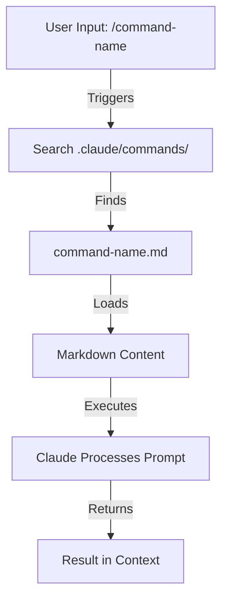

### 파일 구조

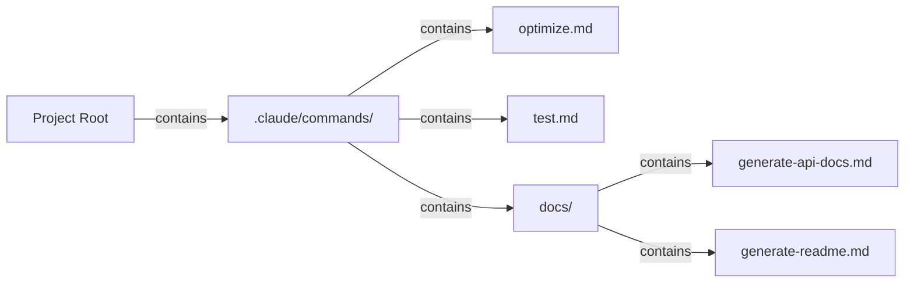

### 명령어 구성 표

| 위치 | 범위 | 사용 가능 대상 | 사용 사례 | Git 추적 |
|----------|-------|--------------|----------|-------------|
| `.claude/commands/` | 프로젝트 전용 | 팀원 | 팀 워크플로, 공유 표준 | ✅ 예 |
| `~/.claude/commands/` | 개인 | 개별 사용자 | 여러 프로젝트에 걸친 개인 단축 명령 | ❌ 아니요 |
| 하위 디렉터리 | 네임스페이스 | 상위 디렉터리 기준 | 카테고리별 정리 | ✅ 예 |

### 기능 및 역량

| 기능 | 예시 | 지원 |
|---------|---------|-----------|
| 셸 스크립트 실행 | `bash scripts/deploy.sh` | ✅ 예 |
| 파일 참조 | `@path/to/file.js` | ✅ 예 |
| Bash 통합 | `$(git log --oneline)` | ✅ 예 |
| 인수 | `/pr --verbose` | ✅ 예 |
| MCP 명령어 | `/mcp__github__list_prs` | ✅ 예 |

### 실전 예제

복사해서 바로 쓸 수 있는 명령어 템플릿 8종이 **[01-slash-commands/](01-slash-commands/)** 에 있습니다. `/optimize`, `/pr`, `/commit`, `/push-all`, `/generate-api-docs`, `/doc-refactor`, `/setup-ci-cd`, `/unit-test-expand`입니다.

**[01-slash-commands/README.md](01-slash-commands/README.md)** 에는 전체 내장 명령어 참조(60개 이상)와 프런트매터 필드 표도 들어 있습니다.

### 명령어 수명 주기 다이어그램

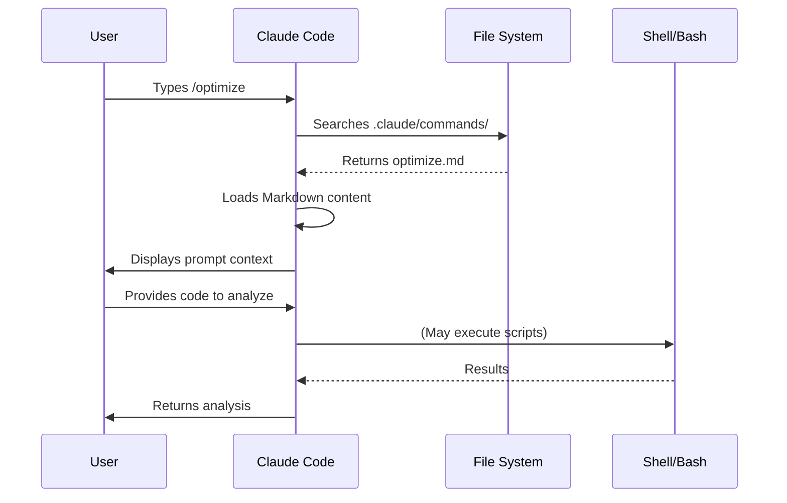

### 모범 사례

| ✅ 권장 | ❌ 비권장 |
|------|---------|
| 명확하고 동작 중심적인 이름 사용 | 일회성 작업용 명령어 만들기 |
| description에 트리거 단어 문서화 | 명령어 안에 복잡한 로직 구현 |
| 명령어는 단일 작업에 집중 | 중복 명령어 만들기 |
| 프로젝트 명령어는 버전 관리 | 민감한 정보 하드코딩 |
| 하위 디렉터리로 정리 | 명령어를 길게 나열 |
| 단순하고 읽기 쉬운 프롬프트 사용 | 축약되거나 모호한 표현 사용 |

---

## 서브에이전트

### 개요

서브에이전트는 격리된 컨텍스트 창과 맞춤형 시스템 프롬프트를 가진 전문 AI 어시스턴트입니다. 관심사를 깔끔하게 분리하면서 작업을 위임해 실행할 수 있게 해 줍니다.

서브에이전트는 자신의 서브에이전트를 생성할 수 있으며, **기본적으로 깊이 3까지 중첩됩니다(v2.1.219)**. 따라서 계층 구조가 아래 그림처럼 메인 → 서브에이전트 한 단계로 제한되지 않습니다. 한도를 바꾸려면 `CLAUDE_CODE_MAX_SUBAGENT_SPAWN_DEPTH`를 설정하고, 중첩을 끄려면 `1`로 설정하세요. (변경 이력: v2.1.172–v2.1.216에서는 기본적으로 최대 5단계까지 중첩되었고 변경할 방법이 없었습니다. v2.1.217에서는 깊이 1의 옵트인 방식으로 바뀌었고, v2.1.219에서 기본값이 3이 되었습니다.)

### 아키텍처 다이어그램

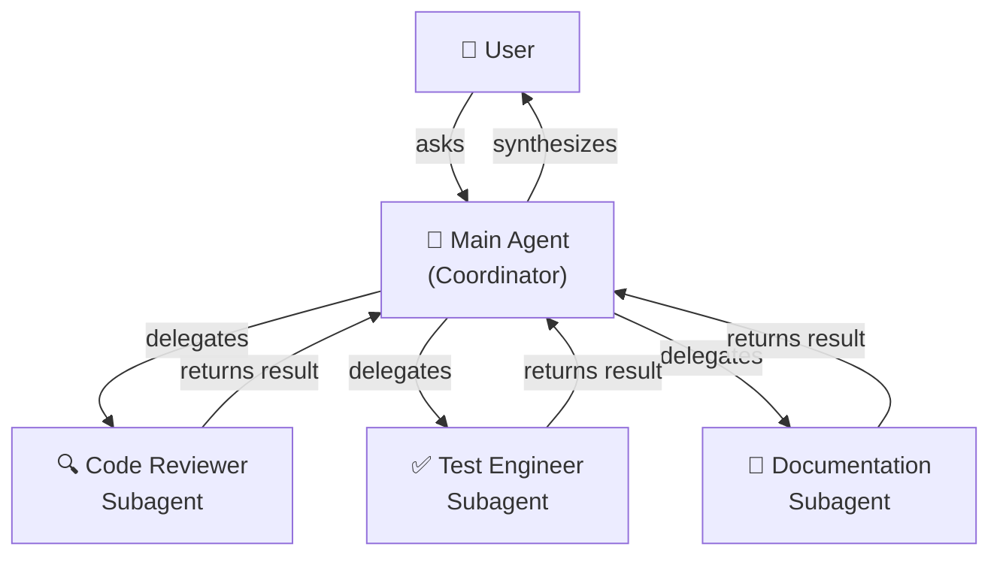

### 서브에이전트 수명 주기

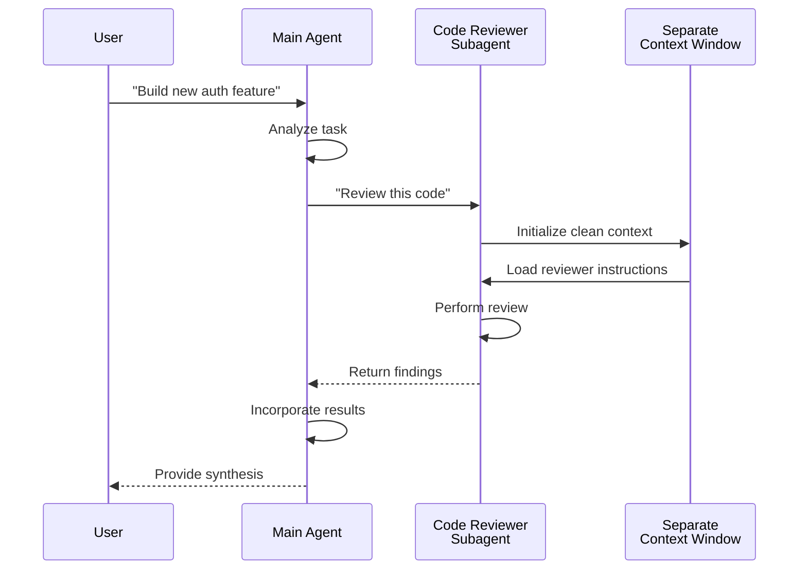

### 서브에이전트 구성 표

| 구성 항목 | 타입 | 목적 | 예시 |
|---------------|------|---------|---------|
| `name` | String | 에이전트 식별자 | `code-reviewer` |
| `description` | String | 목적 및 트리거 용어 | `Comprehensive code quality analysis` |
| `tools` | List/String | 허용된 도구 | `Read, Grep, Glob, Bash` |
| *(Markdown 본문)* | Markdown | 시스템 프롬프트 / 행동 지침 | 맞춤 가이드라인 |

### 도구 접근 계층

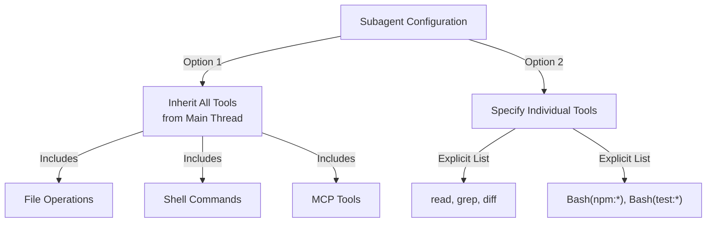

### 실전 예제

바로 사용할 수 있는 서브에이전트 정의 9종이 **[04-subagents/](04-subagents/)** 에 있습니다. `code-reviewer`, `clean-code-reviewer`, `secure-reviewer`, `test-engineer`, `documentation-writer`, `implementation-agent`, `performance-optimizer`, `debugger`, `data-scientist`입니다.

**[04-subagents/README.md](04-subagents/README.md)** 에는 전체 프런트매터 참조, 도구 접근 규칙, 중첩 한도, 에이전트 팀이 정리되어 있습니다.

### 서브에이전트 컨텍스트 관리

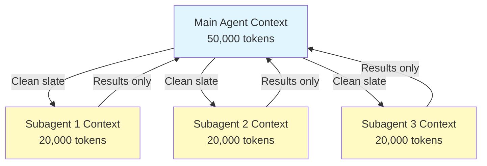

### 서브에이전트를 사용해야 할 때

| 시나리오 | 서브에이전트 사용 | 이유 |
|----------|--------------|-----|
| 여러 단계로 이루어진 복잡한 기능 | ✅ 예 | 관심사 분리, 컨텍스트 오염 방지 |
| 간단한 코드 리뷰 | ❌ 아니요 | 불필요한 오버헤드 |
| 병렬 작업 실행 | ✅ 예 | 서브에이전트마다 자체 컨텍스트 보유 |
| 전문 지식이 필요한 경우 | ✅ 예 | 맞춤 시스템 프롬프트 |
| 오래 걸리는 분석 | ✅ 예 | 메인 컨텍스트 고갈 방지 |
| 단일 작업 | ❌ 아니요 | 불필요하게 지연 시간 증가 |

### 에이전트 팀

에이전트 팀은 관련 작업을 수행하는 여러 에이전트를 조율합니다. 한 번에 하나의 서브에이전트에게 위임하는 대신, 메인 에이전트가 협업하고 중간 결과를 공유하며 공동 목표를 향해 일하는 에이전트 그룹을 오케스트레이션할 수 있습니다. 프런트엔드 에이전트, 백엔드 에이전트, 테스트 에이전트가 병렬로 작업하는 풀스택 기능 개발 같은 대규모 작업에 유용합니다.

---

## 메모리

### 개요

메모리는 Claude가 세션과 대화를 넘어 컨텍스트를 유지할 수 있게 해 줍니다. 메모리는 두 가지 형태로 존재합니다. claude.ai의 자동 종합(synthesis)과 Claude Code의 파일 시스템 기반 CLAUDE.md입니다.

### 메모리 아키텍처

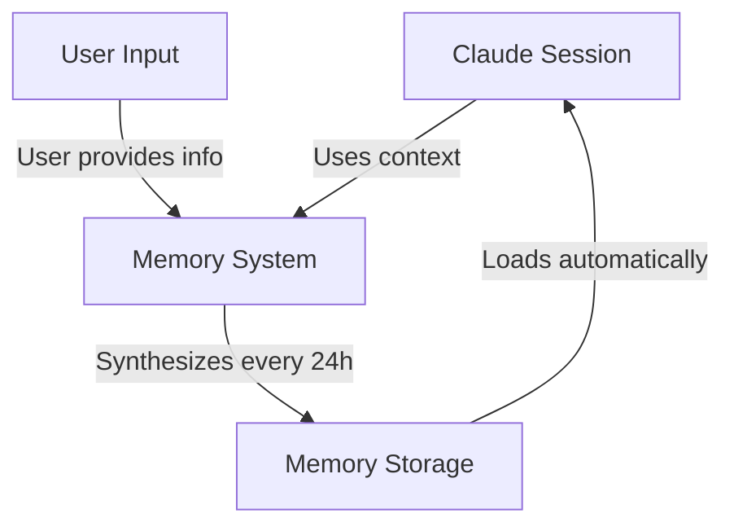

### Claude Code의 메모리 계층(7단계)

Claude Code는 7단계 계층에서 메모리를 로드합니다. CLAUDE.md 파일들은 서로를 덮어쓰지 않고 컨텍스트에 이어 붙여지며, managed → user → project → local 순서로 로드됩니다(나중에 로드되는, 더 구체적인 파일이 마지막에 읽힙니다).

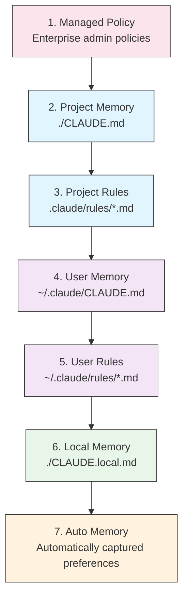

### 메모리 위치 표

| 단계 | 위치 | 범위 | 우선순위 | 공유 | 적합한 용도 |
|------|----------|-------|----------|--------|----------|
| 1. Managed Policy | 엔터프라이즈 관리자 | 조직 | 최상 | 조직 전체 사용자 | 컴플라이언스, 보안 정책 |
| 2. Project | `./CLAUDE.md` | 프로젝트 | 높음 | 팀(Git) | 팀 표준, 아키텍처 |
| 3. Project Rules | `.claude/rules/*.md` | 프로젝트 | 높음 | 팀(Git) | 모듈화된 프로젝트 규칙 |
| 4. User | `~/.claude/CLAUDE.md` | 개인 | 중간 | 개인 | 개인 선호 |
| 5. User Rules | `~/.claude/rules/*.md` | 개인 | 중간 | 개인 | 개인 규칙 모듈 |
| 6. Local | `./CLAUDE.local.md` | 로컬 | 낮음 | 공유 안 함 | 머신별 설정 |
| 7. Auto Memory | 자동 | 저장소별 | 최하 | 개인 | 학습된 선호, 패턴 |

### 자동 메모리

자동 메모리(Auto Memory)는 세션 중에 관찰된 사용자 선호와 패턴을 자동으로 기록합니다. Claude는 사용자와의 상호작용에서 학습하여 다음을 기억합니다.

- 코딩 스타일 선호
- 자주 하는 수정 사항
- 프레임워크 및 도구 선택
- 커뮤니케이션 스타일 선호

자동 메모리는 백그라운드에서 동작하며 수동 설정이 필요하지 않습니다.

### 메모리 업데이트 수명 주기

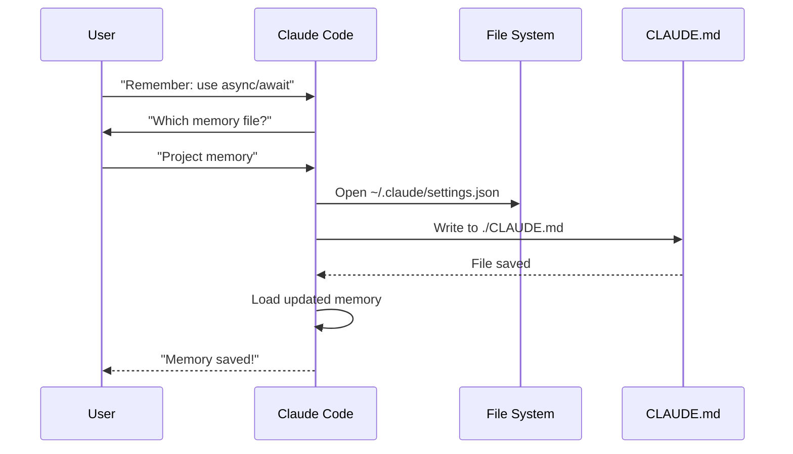

### 실전 예제

복사해서 바로 쓸 수 있는 메모리 템플릿이 **[02-memory/](02-memory/)** 에 있습니다.

- **`project-CLAUDE.md`** — `./CLAUDE.md`용 팀 전체 프로젝트 표준
- **`personal-CLAUDE.md`** — `~/.claude/CLAUDE.md`용 개인 선호
- **`directory-api-CLAUDE.md`** — 하위 트리에 적용되는 디렉터리 범위 표준

**[02-memory/README.md](02-memory/README.md)** 에서 전체 계층, import 문법, `.claude/rules/`, 자동 메모리, CLAUDE.md를 200줄 이내로 유지하는 방법을 다룹니다.

### Claude Web/Desktop의 메모리

#### 메모리 종합 타임라인


### 자동 메모리 내용

자동 메모리는 Claude가 세션을 거치며 사용자에 대해 학습한 내용을 `~/.claude/projects/<project>/memory/`에 저장하며, `MEMORY.md`로 색인합니다. 파일 구성, 로딩 한도, 활성화·비활성화 방법은 **[02-memory/README.md](02-memory/README.md)** 를 참고하세요.

### 메모리 기능 비교

| 기능 | Claude Web/Desktop | Claude Code (CLAUDE.md) |
|---------|-------------------|------------------------|
| 자동 종합 | ✅ 24시간마다 | ❌ 수동 |
| 프로젝트 간 공유 | ✅ 공유됨 | ❌ 프로젝트별 |
| 팀 접근 | ✅ 공유 프로젝트 | ✅ Git 추적 |
| 검색 가능 | ✅ 내장 | ✅ `/memory`로 |
| 편집 가능 | ✅ 채팅 내 | ✅ 파일 직접 편집 |
| 가져오기/내보내기 | ✅ 예 | ✅ 복사/붙여넣기 |
| 영속성 | ✅ 24시간 이상 | ✅ 무기한 |

---

## MCP 프로토콜

### 개요

MCP(Model Context Protocol)는 Claude가 외부 도구, API, 실시간 데이터 소스에 접근하기 위한 표준화된 방법입니다. 메모리와 달리 MCP는 변화하는 데이터에 실시간으로 접근할 수 있게 해 줍니다.

### MCP 아키텍처

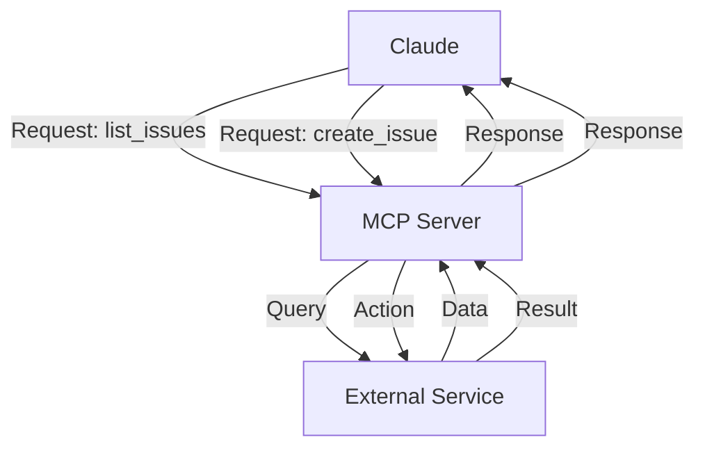

### MCP 생태계

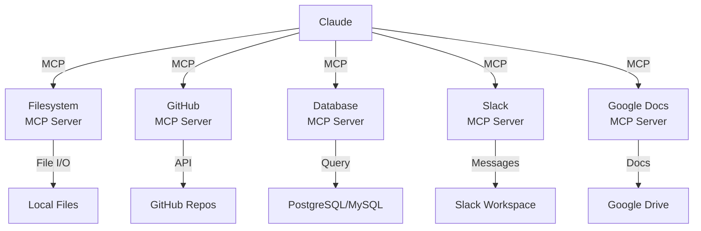

### MCP 설정 과정

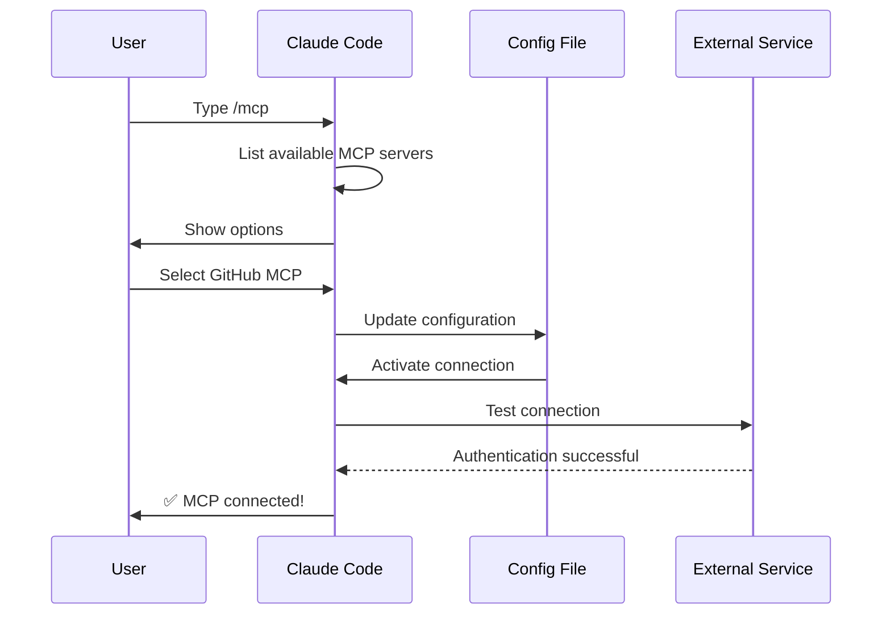

### 사용 가능한 MCP 서버 표

| MCP 서버 | 목적 | 주요 도구 | 인증 | 실시간 |
|------------|---------|--------------|------|-----------|
| **Filesystem** | 파일 작업 | read, write, delete | OS 권한 | ✅ 예 |
| **GitHub** | 저장소 관리 | list_prs, create_issue, push | OAuth | ✅ 예 |
| **Slack** | 팀 커뮤니케이션 | send_message, list_channels | 토큰 | ✅ 예 |
| **Database** | SQL 쿼리 | query, insert, update | 자격 증명 | ✅ 예 |
| **Google Docs** | 문서 접근 | read, write, share | OAuth | ✅ 예 |
| **Asana** | 프로젝트 관리 | create_task, update_status | API 키 | ✅ 예 |
| **Stripe** | 결제 데이터 | list_charges, create_invoice | API 키 | ✅ 예 |
| **Memory** | 영속 메모리 | store, retrieve, delete | 로컬 | ❌ 아니요 |

### 실전 예제

바로 사용할 수 있는 MCP 서버 구성이 **[05-mcp/](05-mcp/)** 에 있습니다. `github-mcp.json`, `database-mcp.json`, `filesystem-mcp.json`, `multi-mcp.json`(한 파일에 서버 4개)입니다.

**[05-mcp/README.md](05-mcp/README.md)** 에서 전체 `claude mcp add` 문법, 전송 방식(transport), 범위(scope), OAuth, 엔터프라이즈 허용 목록(allowlist)을 다룹니다.

### MCP와 메모리: 의사결정 매트릭스

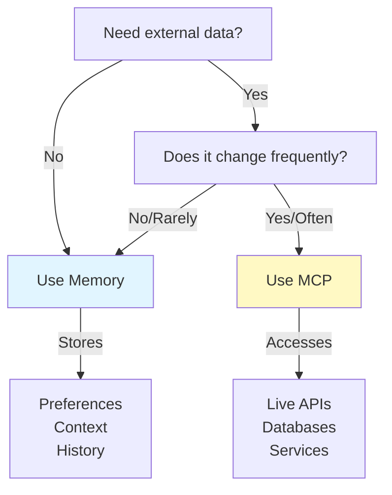

### 요청/응답 패턴

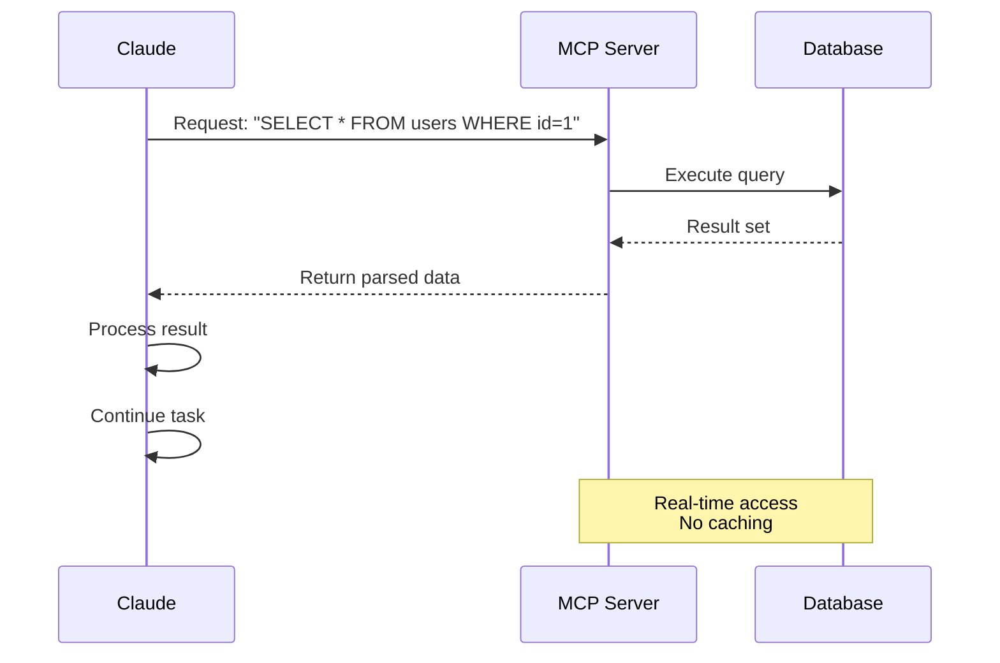

---

## 에이전트 스킬

### 개요

에이전트 스킬은 지침, 스크립트, 리소스를 담은 폴더로 패키징된, 모델이 호출하는 재사용 가능한 기능입니다. Claude는 관련 스킬을 자동으로 감지하고 사용합니다.

### 스킬 아키텍처

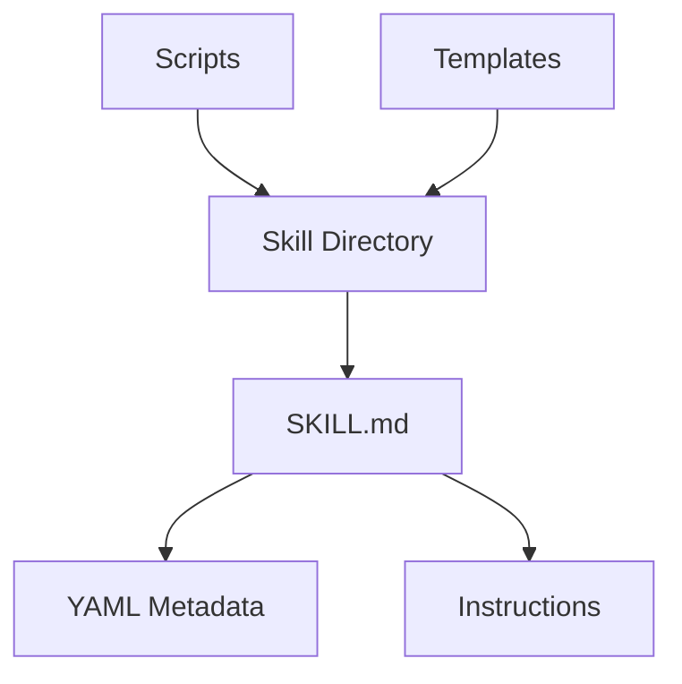

### 스킬 로딩 과정

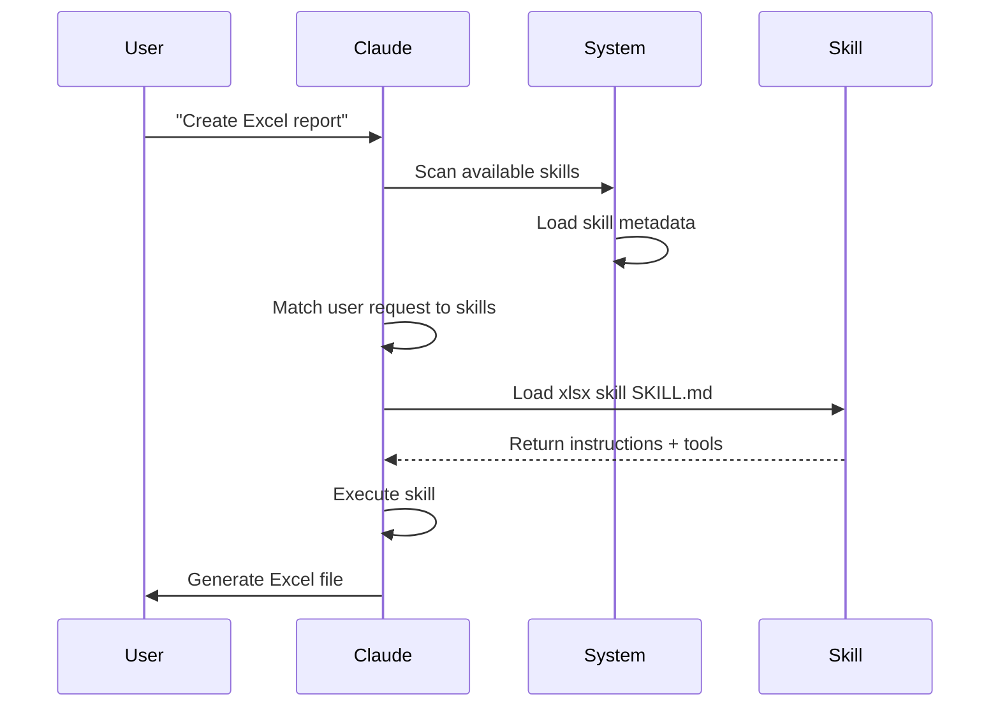

### 스킬 유형 및 위치 표

| 유형 | 위치 | 범위 | 공유 | 동기화 | 적합한 용도 |
|------|----------|-------|--------|------|----------|
| 사전 구축 | 내장 | 전역 | 모든 사용자 | 자동 | 문서 생성 |
| 개인 | `~/.claude/skills/` | 개인 | 아니요 | 수동 | 개인 자동화 |
| 프로젝트 | `.claude/skills/` | 팀 | 예 | Git | 팀 표준 |
| 플러그인 | 플러그인 설치로 | 경우에 따라 다름 | 경우에 따라 다름 | 자동 | 통합 기능 |

### 사전 구축 스킬

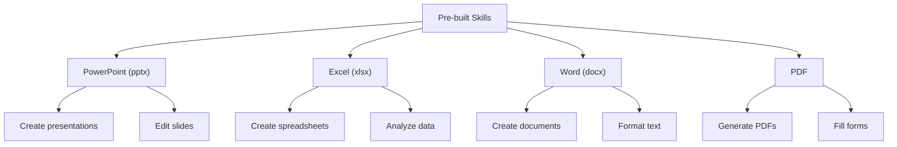

### 번들 스킬

Claude Code에는 설치 없이 바로 쓸 수 있는 번들 스킬이 포함되어 있습니다. 예를 들면 다음과 같습니다.

| 스킬 | 명령어 | 목적 |
|-------|---------|---------|
| **Batch** | `/batch` | 여러 파일 또는 항목에 걸쳐 작업 실행 |
| **Claude API** | `/claude-api` | 프로젝트 언어에 맞는 Claude API 및 Managed Agents 참조 자료를 로드합니다. 코드가 `anthropic` 또는 `@anthropic-ai/sdk`를 import하면 자동으로 활성화됩니다. 하위 명령어로 `api-version`(v2.1.307), `managed-agents-secure`(v2.1.304) 등이 있습니다 |
| **Code Review** | `/code-review` | 선택한 노력 수준으로 현재 diff의 정확성 버그를 리뷰합니다. 품질/재사용 정리를 담당하는 `/simplify`와는 별개의 스킬이며, v2.1.154에서 다시 분리되었습니다. v2.1.246부터는 모든 환경에서 Claude가 스스로 시작할 수도 있습니다 |
| **Simplify** | `/simplify` | 품질, 재사용, 정리 리뷰 — v2.1.154부터 다시 `/code-review`와 별개 |
| **Debug** | `/debug` | 현재 세션의 디버그 로깅을 켜고 세션 디버그 로그를 읽어 문제를 해결 |
| **Fewer Permission Prompts** | `/fewer-permission-prompts` | 트랜스크립트를 스캔해 자주 쓰는 읽기 전용 도구에 대한 우선순위별 허용 목록을 제안 |
| **Loop** | `/loop` | 타이머로 반복 작업 예약 |
| **Run** | `/run` | 프로젝트 앱을 실행·조작해 변경 사항을 검증(v2.1.145+) |
| **Run Skill Generator** | `/run-skill-generator` | `/run`과 `/verify`에 앱 빌드·실행·조작 방법을 알려 주는 프로젝트별 스킬을 작성(v2.1.145+) |
| **Verify** | `/verify` | 변경 사항이 실제로 동작하는지 검증(v2.1.145+). v2.1.215부터 명시적 호출로만 실행 |

이 번들 스킬들은 항상 사용할 수 있으며 설치나 설정이 필요하지 않습니다.

### 실전 예제

스크립트, 템플릿, 참조 파일을 모두 갖춘 완전한 스킬 6종이 **[03-skills/](03-skills/)** 에 있습니다.

- **`code-review-specialist/`** — 리뷰 체크리스트, 발견 사항 템플릿, Python 지표 스크립트 2개
- **`refactor/`** — 코드 스멜 카탈로그, 리팩터링 카탈로그, 계획 템플릿, 분석 스크립트 2개
- **`doc-generator/`** — 소스 코드에서 API 문서 생성
- **`blog-draft/`** — 버전 관리되는 출력 규칙을 갖춘 개요·초안 템플릿
- **`brand-voice/`** — 어조 규칙과 메시지 템플릿(`user-invocable: false` 사용 예시)
- **`claude-md/`** — CLAUDE.md 파일 생성, 업데이트, 점검

전체 프런트매터 참조와 점진적 공개(progressive disclosure) 모델은 **[03-skills/README.md](03-skills/README.md)** 를 참고하세요.

### 스킬 탐색 및 호출

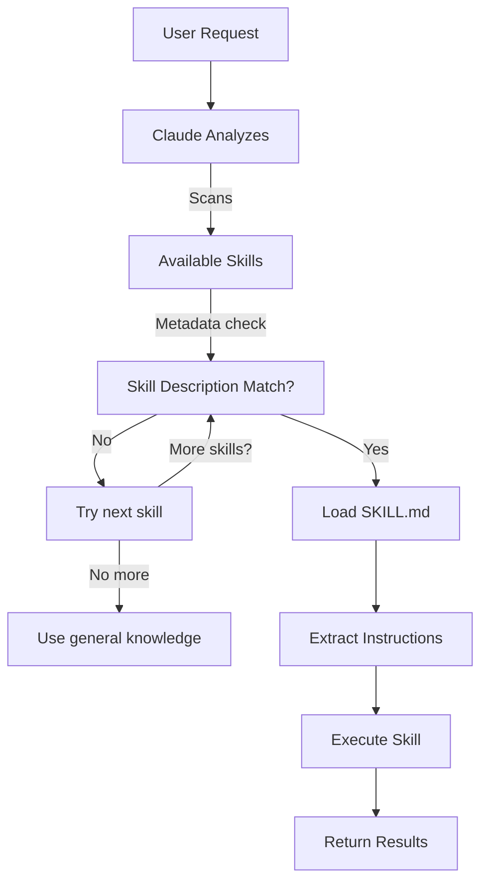

### 스킬과 다른 기능 비교

```mermaid
graph TB
    A["Extending Claude"]
    B["Slash Commands"]
    C["Subagents"]
    D["Memory"]
    E["MCP"]
    F["Skills"]

    A --> B
    A --> C
    A --> D
    A --> E
    A --> F

    B -->|User-invoked| G["Quick shortcuts"]
    C -->|Auto-delegated| H["Isolated contexts"]
    D -->|Persistent| I["Cross-session context"]
    E -->|Real-time| J["External data access"]
    F -->|Auto-invoked| K["Autonomous execution"]
```

---

## Claude Code 플러그인

### 개요

Claude Code 플러그인은 명령 한 번으로 설치되는 맞춤 설정(슬래시 명령어, 서브에이전트, MCP 서버, 훅)의 묶음입니다. 여러 기능을 하나의 응집력 있고 공유 가능한 패키지로 결합하는, 가장 상위 수준의 확장 메커니즘입니다.

### 아키텍처

```mermaid
graph TB
    A["Plugin"]
    B["Slash Commands"]
    C["Subagents"]
    D["MCP Servers"]
    E["Hooks"]
    F["Configuration"]

    A -->|bundles| B
    A -->|bundles| C
    A -->|bundles| D
    A -->|bundles| E
    A -->|bundles| F
```

### 플러그인 로딩 과정

```mermaid
sequenceDiagram
    participant User
    participant Claude as Claude Code
    participant Plugin as Plugin Marketplace
    participant Install as Installation
    participant SlashCmds as Slash Commands
    participant Subagents
    participant MCPServers as MCP Servers
    participant Hooks
    participant Tools as Configured Tools

    User->>Claude: claude --plugin-dir ./07-plugins/pr-review
    Claude->>Plugin: Download plugin manifest
    Plugin-->>Claude: Return plugin definition
    Claude->>Install: Extract components
    Install->>SlashCmds: Configure
    Install->>Subagents: Configure
    Install->>MCPServers: Configure
    Install->>Hooks: Configure
    SlashCmds-->>Tools: Ready to use
    Subagents-->>Tools: Ready to use
    MCPServers-->>Tools: Ready to use
    Hooks-->>Tools: Ready to use
    Tools-->>Claude: Plugin installed ✅
```

### 플러그인 유형 및 배포

| 유형 | 범위 | 공유 | 주체 | 예시 |
|------|-------|--------|-----------|----------|
| 공식 | 전역 | 모든 사용자 | Anthropic | PR Review, Security Guidance |
| 커뮤니티 | 공개 | 모든 사용자 | 커뮤니티 | DevOps, Data Science |
| 조직 | 내부 | 팀원 | 회사 | 사내 표준, 도구 |
| 개인 | 개인 | 단일 사용자 | 개발자 | 맞춤 워크플로 |

### 플러그인 정의 구조

매니페스트는 `.claude-plugin/plugin.json`에 있는 JSON 파일입니다. 필수 항목은 `name`뿐이며, 인식되지 않는 최상위 키는 제거됩니다.

```json
{
  "name": "plugin-name",
  "version": "1.0.0",
  "description": "What this plugin does"
}
```

### 플러그인 구조

```
my-plugin/
├── .claude-plugin/
│   └── plugin.json
├── commands/
│   ├── task-1.md
│   ├── task-2.md
│   └── workflows/
├── agents/
│   ├── specialist-1.md
│   ├── specialist-2.md
│   └── configs/
├── skills/
│   └── skill-name/
│       └── SKILL.md
├── hooks/
│   └── hooks.json
├── .mcp.json
├── bin/
│   └── my-tool
├── .lsp.json
├── settings.json
├── templates/
│   └── issue-template.md
├── scripts/
│   ├── helper-1.sh
│   └── helper-2.py
├── docs/
│   ├── README.md
│   └── USAGE.md
└── tests/
    └── plugin.test.js
```

### 실전 예제

설치 가능한 완전한 플러그인 3종이 **[07-plugins/](07-plugins/)** 에 있습니다.

- **`pr-review/`** — 리뷰 명령어, 전문 에이전트 3개, GitHub MCP, 리뷰 전 훅
- **`documentation/`** — 문서 생성 명령어, 에이전트 3개, 재사용 가능한 템플릿
- **`devops-automation/`** — deploy/rollback/status/incident 명령어, 에이전트 3개, Kubernetes MCP, 셸 스크립트

각 플러그인에는 `.claude-plugin/plugin.json` 매니페스트와 디렉터리 구성이 포함되어 있습니다.

### 플러그인 마켓플레이스

```mermaid
graph TB
    A["Plugin Marketplace"]
    B["Official<br/>Anthropic"]
    C["Community<br/>Marketplace"]
    D["Enterprise<br/>Registry"]

    A --> B
    A --> C
    A --> D

    B -->|Categories| B1["Development"]
    B -->|Categories| B2["DevOps"]
    B -->|Categories| B3["Documentation"]

    C -->|Search| C1["DevOps Automation"]
    C -->|Search| C2["Mobile Dev"]
    C -->|Search| C3["Data Science"]

    D -->|Internal| D1["Company Standards"]
    D -->|Internal| D2["Legacy Systems"]
    D -->|Internal| D3["Compliance"]
```

### 플러그인 설치 및 수명 주기

```mermaid
graph LR
    A["Discover"] -->|Browse| B["Marketplace"]
    B -->|Select| C["Plugin Page"]
    C -->|View| D["Components"]
    D -->|Install| E["/plugin install"]
    E -->|Extract| F["Configure"]
    F -->|Activate| G["Use"]
    G -->|Check| H["Update"]
    H -->|Available| G
    G -->|Done| I["Disable"]
    I -->|Later| J["Enable"]
    J -->|Back| G
```

### 플러그인 기능 비교

| 기능 | 슬래시 명령어 | 스킬 | 서브에이전트 | 플러그인 |
|---------|---------------|-------|----------|--------|
| **설치** | 수동 복사 | 수동 복사 | 수동 설정 | 명령 한 번 |
| **설정 시간** | 5분 | 10분 | 15분 | 2분 |
| **번들링** | 단일 파일 | 단일 파일 | 단일 파일 | 여러 개 |
| **버전 관리** | 수동 | 수동 | 수동 | 자동 |
| **팀 공유** | 파일 복사 | 파일 복사 | 파일 복사 | 설치 ID |
| **업데이트** | 수동 | 수동 | 수동 | 자동 제공 |
| **의존성** | 없음 | 없음 | 없음 | 포함 가능 |
| **마켓플레이스** | 아니요 | 아니요 | 아니요 | 예 |
| **배포** | 저장소 | 저장소 | 저장소 | 마켓플레이스 |

### 플러그인 사용 사례

| 사용 사례 | 권장 사항 | 이유 |
|----------|-----------------|-----|
| **팀 온보딩** | ✅ 플러그인 사용 | 즉시 설정, 모든 구성 포함 |
| **프레임워크 설정** | ✅ 플러그인 사용 | 프레임워크별 명령어를 묶어 제공 |
| **엔터프라이즈 표준** | ✅ 플러그인 사용 | 중앙 배포, 버전 관리 |
| **간단한 작업 자동화** | ❌ 명령어 사용 | 지나치게 복잡함 |
| **단일 도메인 전문성** | ❌ 스킬 사용 | 너무 무거우므로 스킬 사용 |
| **전문 분석** | ❌ 서브에이전트 사용 | 직접 만들거나 스킬 사용 |
| **실시간 데이터 접근** | ❌ MCP 사용 | 독립적으로 사용하고 번들하지 않음 |

### 플러그인을 만들어야 할 때

```mermaid
graph TD
    A["Should I create a plugin?"]
    A -->|Need multiple components| B{"Multiple commands<br/>or subagents<br/>or MCPs?"}
    B -->|Yes| C["✅ Create Plugin"]
    B -->|No| D["Use Individual Feature"]
    A -->|Team workflow| E{"Share with<br/>team?"}
    E -->|Yes| C
    E -->|No| F["Keep as Local Setup"]
    A -->|Complex setup| G{"Needs auto<br/>configuration?"}
    G -->|Yes| C
    G -->|No| D
```

### 플러그인 게시

**게시 단계:**

1. 모든 구성 요소를 갖춘 플러그인 구조 만들기
2. `.claude-plugin/plugin.json` 매니페스트 작성
3. 문서가 담긴 `README.md` 작성
4. `claude --plugin-dir ./my-plugin`으로 로컬 테스트
5. 플러그인 마켓플레이스에 제출
6. 리뷰 및 승인 받기
7. 마켓플레이스에 게시
8. 사용자는 명령 한 번으로 설치 가능

### 플러그인 README 예시

**[07-plugins/](07-plugins/)** 의 완전한 플러그인 3종을 참고하세요. `pr-review/`, `documentation/`, `devops-automation/` 각각에 그대로 복사해 쓸 수 있는 전체 `README.md`, 매니페스트, 명령어, 에이전트, MCP 구성이 들어 있습니다.

### 플러그인과 수동 구성 비교

**수동 설정(2시간 이상):**
- 슬래시 명령어를 하나씩 설치
- 서브에이전트를 개별적으로 생성
- MCP를 따로따로 구성
- 훅을 수동으로 설정
- 모든 것을 문서화
- 팀과 공유(팀원이 올바르게 구성하기를 기대)

**플러그인 사용 시(2분):**
```bash
claude --plugin-dir ./07-plugins/pr-review
# ✅ 모든 것이 설치 및 구성됨
# ✅ 즉시 사용 가능
# ✅ 팀이 동일한 설정을 정확히 재현 가능
```

---

## 비교 및 통합

### 기능 비교 매트릭스

| 기능 | 호출 방식 | 지속성 | 범위 | 사용 사례 |
|---------|-----------|------------|-------|----------|
| **슬래시 명령어** | 수동(`/cmd`) | 세션 내에서만 | 단일 명령어 | 빠른 단축 명령 |
| **서브에이전트** | 자동 위임 | 격리된 컨텍스트 | 전문 작업 | 작업 분산 |
| **메모리** | 자동 로드 | 세션 간 유지 | 사용자/팀 컨텍스트 | 장기 학습 |
| **MCP 프로토콜** | 자동 조회 | 실시간 외부 | 실시간 데이터 접근 | 동적 정보 |
| **스킬** | 자동 호출 | 파일 시스템 기반 | 재사용 가능한 전문성 | 자동화된 워크플로 |

### 상호작용 타임라인

```mermaid
graph LR
    A["Session Start"] -->|Load| B["Memory (CLAUDE.md)"]
    B -->|Discover| C["Available Skills"]
    C -->|Register| D["Slash Commands"]
    D -->|Connect| E["MCP Servers"]
    E -->|Ready| F["User Interaction"]

    F -->|Type /cmd| G["Slash Command"]
    F -->|Request| H["Skill Auto-Invoke"]
    F -->|Query| I["MCP Data"]
    F -->|Complex task| J["Delegate to Subagent"]

    G -->|Uses| B
    H -->|Uses| B
    I -->|Uses| B
    J -->|Uses| B
```

### 실전 통합 예제: 고객 지원 자동화

#### 아키텍처

```mermaid
graph TB
    User["Customer Email"] -->|Receives| Router["Support Router"]

    Router -->|Analyze| Memory["Memory<br/>Customer history"]
    Router -->|Lookup| MCP1["MCP: Customer DB<br/>Previous tickets"]
    Router -->|Check| MCP2["MCP: Slack<br/>Team status"]

    Router -->|Route Complex| Sub1["Subagent: Tech Support<br/>Context: Technical issues"]
    Router -->|Route Simple| Sub2["Subagent: Billing<br/>Context: Payment issues"]
    Router -->|Route Urgent| Sub3["Subagent: Escalation<br/>Context: Priority handling"]

    Sub1 -->|Format| Skill1["Skill: Response Generator<br/>Brand voice maintained"]
    Sub2 -->|Format| Skill2["Skill: Response Generator"]
    Sub3 -->|Format| Skill3["Skill: Response Generator"]

    Skill1 -->|Generate| Output["Formatted Response"]
    Skill2 -->|Generate| Output
    Skill3 -->|Generate| Output

    Output -->|Post| MCP3["MCP: Slack<br/>Notify team"]
    Output -->|Send| Reply["Customer Reply"]
```

#### 요청 흐름

```markdown
## 고객 지원 요청 흐름

### 1. 수신 이메일
"파일을 업로드하려고 하면 500 오류가 발생합니다. 작업이 완전히 막혔어요!"

### 2. 메모리 조회
- 지원 표준이 담긴 CLAUDE.md 로드
- 고객 이력 확인: VIP 고객, 이번 달 3번째 장애

### 3. MCP 쿼리
- GitHub MCP: 열린 이슈 목록 조회(관련 버그 리포트 발견)
- Database MCP: 시스템 상태 확인(보고된 장애 없음)
- Slack MCP: 엔지니어링 팀이 인지하고 있는지 확인

### 4. 스킬 감지 및 로딩
- 요청이 "Technical Support" 스킬과 일치
- 스킬에서 지원 응답 템플릿 로드

### 5. 서브에이전트 위임
- Tech Support 서브에이전트로 라우팅
- 컨텍스트 제공: 고객 이력, 오류 상세, 알려진 이슈
- 서브에이전트는 read, bash, grep 도구에 대한 전체 접근 권한 보유

### 6. 서브에이전트 처리
Tech Support 서브에이전트:
- 코드베이스에서 파일 업로드 시 발생하는 500 오류 검색
- 커밋 8f4a2c의 최근 변경 사항 발견
- 임시 해결책 문서 작성

### 7. 스킬 실행
Response Generator 스킬:
- Brand Voice 가이드라인 적용
- 공감하는 어조로 응답 형식 구성
- 임시 해결 단계 포함
- 관련 문서 링크 추가

### 8. MCP 출력
- #support Slack 채널에 업데이트 게시
- 엔지니어링 팀 태그
- Jira MCP에서 티켓 업데이트

### 9. 응답
고객이 받는 내용:
- 공감하는 확인 메시지
- 원인 설명
- 즉시 적용 가능한 임시 해결책
- 영구 수정 일정
- 관련 이슈 링크
```

### 전체 기능 오케스트레이션

```mermaid
sequenceDiagram
    participant User
    participant Claude as Claude Code
    participant Memory as Memory<br/>CLAUDE.md
    participant MCP as MCP Servers
    participant Skills as Skills
    participant SubAgent as Subagents

    User->>Claude: Request: "Build auth system"
    Claude->>Memory: Load project standards
    Memory-->>Claude: Auth standards, team practices
    Claude->>MCP: Query GitHub for similar implementations
    MCP-->>Claude: Code examples, best practices
    Claude->>Skills: Detect matching Skills
    Skills-->>Claude: Security Review Skill + Testing Skill
    Claude->>SubAgent: Delegate implementation
    SubAgent->>SubAgent: Build feature
    Claude->>Skills: Apply Security Review Skill
    Skills-->>Claude: Security checklist results
    Claude->>SubAgent: Delegate testing
    SubAgent-->>Claude: Test results
    Claude->>User: Complete system delivered
```

### 각 기능을 사용해야 할 때

```mermaid
graph TD
    A["New Task"] --> B{Type of Task?}

    B -->|Repeated workflow| C["Slash Command"]
    B -->|Need real-time data| D["MCP Protocol"]
    B -->|Remember for next time| E["Memory"]
    B -->|Specialized subtask| F["Subagent"]
    B -->|Domain-specific work| G["Skill"]

    C --> C1["✅ Team shortcut"]
    D --> D1["✅ Live API access"]
    E --> E1["✅ Persistent context"]
    F --> F1["✅ Parallel execution"]
    G --> G1["✅ Auto-invoked expertise"]
```

### 선택 의사결정 트리

```mermaid
graph TD
    Start["Need to extend Claude?"]

    Start -->|Quick repeated task| A{"Manual or Auto?"}
    A -->|Manual| B["Slash Command"]
    A -->|Auto| C["Skill"]

    Start -->|Need external data| D{"Real-time?"}
    D -->|Yes| E["MCP Protocol"]
    D -->|No/Cross-session| F["Memory"]

    Start -->|Complex project| G{"Multiple roles?"}
    G -->|Yes| H["Subagents"]
    G -->|No| I["Skills + Memory"]

    Start -->|Long-term context| J["Memory"]
    Start -->|Team workflow| K["Slash Command +<br/>Memory"]
    Start -->|Full automation| L["Skills +<br/>Subagents +<br/>MCP"]
```

---

## 요약 표

| 항목 | 슬래시 명령어 | 서브에이전트 | 메모리 | MCP | 스킬 | 플러그인 |
|--------|---|---|---|---|---|---|
| **설정 난이도** | 쉬움 | 보통 | 쉬움 | 보통 | 보통 | 쉬움 |
| **학습 곡선** | 낮음 | 보통 | 낮음 | 보통 | 보통 | 낮음 |
| **팀 이점** | 높음 | 높음 | 보통 | 높음 | 높음 | 매우 높음 |
| **자동화 수준** | 낮음 | 높음 | 보통 | 높음 | 높음 | 매우 높음 |
| **컨텍스트 관리** | 단일 세션 | 격리 | 영속 | 실시간 | 영속 | 모든 기능 |
| **유지 관리 부담** | 낮음 | 보통 | 낮음 | 보통 | 보통 | 낮음 |
| **확장성** | 좋음 | 우수 | 좋음 | 우수 | 우수 | 우수 |
| **공유 용이성** | 보통 | 보통 | 좋음 | 좋음 | 좋음 | 우수 |
| **버전 관리** | 수동 | 수동 | 수동 | 수동 | 수동 | 자동 |
| **설치** | 수동 복사 | 수동 설정 | 해당 없음 | 수동 설정 | 수동 복사 | 명령 한 번 |

---

## 빠른 시작 가이드

### 1주 차: 간단하게 시작하기
- 자주 하는 작업용 슬래시 명령어 2~3개 만들기
- 설정에서 메모리 활성화
- CLAUDE.md에 팀 표준 문서화

### 2주 차: 실시간 접근 추가하기
- MCP 1개 설정(GitHub 또는 Database)
- `/mcp`로 구성
- 워크플로에서 실시간 데이터 조회

### 3주 차: 작업 분산하기
- 특정 역할을 위한 첫 서브에이전트 만들기
- Claude에게 만들어 달라고 요청하거나 `.claude/agents/<name>.md` 파일 추가(`/agents` 마법사는 제거됨)
- 간단한 작업으로 위임 테스트

### 4주 차: 모든 것을 자동화하기
- 반복 자동화를 위한 첫 스킬 만들기
- 스킬 마켓플레이스를 이용하거나 직접 제작
- 모든 기능을 결합해 완전한 워크플로 구성

### 지속적으로
- 매달 메모리 검토 및 업데이트
- 패턴이 생기면 새 스킬 추가
- MCP 쿼리 최적화
- 서브에이전트 프롬프트 개선

---

## 훅

### 개요

훅은 Claude Code 이벤트에 반응하여 자동으로 실행되는 이벤트 기반 셸 명령어입니다. 수동 개입 없이 자동화, 검증, 맞춤 워크플로를 구현할 수 있게 해 줍니다.

### 훅 이벤트

Claude Code는 다섯 가지 훅 타입(command, http, mcp_tool, prompt, agent)에 걸쳐 **33개의 훅 이벤트**를 지원합니다.

| 훅 이벤트 | 트리거 | 사용 사례 |
|------------|---------|-----------|
| **SessionStart** | 세션 시작/재개/clear/compact | 환경 설정, 초기화 |
| **Setup** | `--init-only`로 실행하거나, `-p`와 `--init` / `--maintenance`를 함께 사용할 때(일반 시작 시에는 실행되지 않음) | 도구 프로비저닝, 의존성 설치 |
| **InstructionsLoaded** | CLAUDE.md 또는 규칙 파일 로드 | 검증, 변환, 보강 |
| **UserPromptSubmit** | 사용자가 프롬프트 제출 | 입력 검증, 프롬프트 필터링 |
| **UserPromptExpansion** | 입력한 슬래시 명령어(스킬, 사용자 정의 명령어, MCP 프롬프트)가 프롬프트로 확장될 때. 확장을 차단할 수 있음 | 직접 `/command` 사용 차단 또는 기록, 스킬별 컨텍스트 추가 |
| **PreToolUse** | 도구 실행 전 | 검증, 승인 게이트, 로깅 |
| **PermissionRequest** | 권한 대화 상자 표시 | 자동 승인/거부 흐름 |
| **PermissionDenied** | 자동 모드가 도구 호출을 거부(수동 거부 시에는 실행되지 않음) | 로깅, 분석, 정책 적용 |
| **PostToolUse** | 도구 실행 성공 후 | 자동 포매팅, 알림, 정리 |
| **PostToolUseFailure** | 도구 실행 실패 | 오류 처리, 로깅 |
| **PostToolBatch** | 도구 사용 배치 완료 후 | 집계 보고, 일괄 검증 |
| **Notification** | 알림 전송 | 경보, 외부 연동 |
| **MessageDisplay** | 어시스턴트 메시지 텍스트가 표시되는 동안 | 표시되는 메시지 텍스트 변환 또는 숨기기 |
| **SubagentStart** | 서브에이전트 생성 | 컨텍스트 주입, 초기화 |
| **SubagentStop** | 서브에이전트 종료 | 결과 검증, 로깅 |
| **Stop** | Claude가 응답 완료 | 요약 생성, 정리 작업 |
| **StopFailure** | API 오류로 턴 종료 | 오류 복구, 로깅 |
| **TeammateIdle** | 에이전트 팀의 팀원이 유휴 상태 | 작업 분배, 조율 |
| **TaskCompleted** | 작업이 완료로 표시됨. todo 도구가 활성화된 경우에만 실행되며, todo 도구는 Claude 3.x 모델, Opus 4~4.7, Sonnet 4~4.6, Haiku 4.5에서만 기본 제공됩니다. `CLAUDE_CODE_ENABLE_TODO_TOOLS=1`로 다시 켤 수 있습니다(v2.1.233) | 작업 후 처리 |
| **TaskCreated** | TaskCreate로 작업 생성. todo 도구가 활성화된 경우에만 실행되며, todo 도구는 Claude 3.x 모델, Opus 4~4.7, Sonnet 4~4.6, Haiku 4.5에서만 기본 제공됩니다. `CLAUDE_CODE_ENABLE_TODO_TOOLS=1`로 다시 켤 수 있습니다(v2.1.233) | 작업 추적, 로깅 |
| **ConfigChange** | 설정 파일 변경 | 검증, 전파 |
| **CwdChanged** | 작업 디렉터리 변경 | 디렉터리별 설정 |
| **DirectoryAdded** | 세션 도중 `/add-dir` 또는 SDK `register_repo_root` 제어 요청으로 새 작업 디렉터리 등록 | 새로 추가된 디렉터리용 도구 설정 |
| **FileChanged** | 감시 중인 파일 변경 | 파일 모니터링, 재빌드 트리거 |
| **PreCompact** | 컨텍스트 압축 전 | 상태 보존 |
| **PostCompact** | 압축 완료 후 | 압축 후 작업 |
| **PreModelSwitch** | 요청된 모델 전환이 적용되기 전 | 모델 변경 제어 또는 거부 |
| **PostModelSwitch** | 세션 모델 변경 후 | 모델 변경 기록 또는 대응 |
| **WorktreeCreate** | 워크트리 생성 중 | 기본 git 워크트리 생성 대체. 워크트리 경로를 출력해야 함 |
| **WorktreeRemove** | 워크트리 제거 중 | 정리, 리소스 해제 |
| **Elicitation** | MCP 서버가 사용자 입력 요청 | 입력 검증 |
| **ElicitationResult** | 사용자가 elicitation에 응답 | 응답 처리 |
| **SessionEnd** | 세션 종료 | 정리, 최종 로깅 |

### 자주 쓰는 훅

훅은 `~/.claude/settings.json`(사용자 수준) 또는 `.claude/settings.json`(프로젝트 수준)에서 구성합니다.

```json
{
  "hooks": {
    "PostToolUse": [
      {
        "matcher": "Write",
        "hooks": [
          {
            "type": "command",
            "command": "jq -r '.tool_input.file_path' | xargs npx prettier --write"
          }
        ]
      }
    ],
    "PreToolUse": [
      {
        "matcher": "Edit",
        "hooks": [
          {
            "type": "command",
            "command": "jq -r '.tool_input.file_path' | xargs npx eslint"
          }
        ]
      }
    ]
  }
}
```

### 훅 환경 변수

- 훅 입력은 stdin으로 JSON 형태로 전달됩니다(`session_id`, `tool_name`, `tool_input.file_path`, …). `jq`로 읽으세요
- `$CLAUDE_CODE_SESSION_ID` - 현재 세션 식별자
- `$CLAUDE_PROJECT_DIR` - 프로젝트 디렉터리 경로

### 모범 사례

✅ **권장:**
- 훅은 빠르게 유지(1초 미만)
- 검증과 자동화에 훅 사용
- 오류를 우아하게 처리
- 절대 경로 사용

❌ **비권장:**
- 대화형 훅 만들기
- 오래 걸리는 작업에 훅 사용
- 자격 증명 하드코딩

**참고**: 자세한 예제는 [06-hooks/](06-hooks/)를 참고하세요

---

## 체크포인트와 되감기

### 개요

체크포인트를 사용하면 대화 상태를 저장하고 이전 시점으로 되감을 수 있어, 안전하게 실험하고 여러 접근 방식을 탐색할 수 있습니다.

### 핵심 개념

| 개념 | 설명 |
|---------|-------------|
| **체크포인트** | 메시지, 파일, 컨텍스트를 포함한 대화 상태의 스냅샷 |
| **되감기** | 이전 체크포인트로 돌아가 이후 변경 사항을 버림 |
| **분기점** | 여러 접근 방식을 탐색하는 출발점이 되는 체크포인트 |

### 체크포인트 접근

체크포인트는 사용자 프롬프트마다 자동으로 생성됩니다. 되감으려면 다음과 같이 합니다.

```bash
# Esc를 두 번 눌러 체크포인트 브라우저 열기
Esc + Esc

# 또는 /rewind 명령어 사용
/rewind
```

체크포인트를 선택하면 다음 여섯 가지 옵션 중에서 고를 수 있습니다.
1. **Restore code and conversation** -- 코드와 대화를 모두 해당 시점으로 되돌림
2. **Restore conversation** -- 메시지만 되감고 현재 코드는 유지
3. **Restore code** -- 파일만 되돌리고 대화는 유지
4. **Summarize from here** -- 이 지점부터의 대화를 요약으로 압축
5. **Summarize up to here** -- 이 지점 이전의 모든 내용을 요약으로 압축
6. **Never mind** -- 취소

### 사용 사례

| 시나리오 | 워크플로 |
|----------|----------|
| **접근 방식 탐색** | 저장 → A 시도 → 저장 → 되감기 → B 시도 → 비교 |
| **안전한 리팩터링** | 저장 → 리팩터링 → 테스트 → 실패 시: 되감기 |
| **A/B 테스트** | 저장 → 디자인 A → 저장 → 되감기 → 디자인 B → 비교 |
| **실수 복구** | 문제 발견 → 마지막 정상 상태로 되감기 |

### 구성

체크포인트는 기본적으로 켜져 있으며, `fileCheckpointingEnabled`로 제어합니다.

```json
{
  "fileCheckpointingEnabled": true
}
```

**참고**: 자세한 예제는 [08-checkpoints/](08-checkpoints/)를 참고하세요

---

## 고급 기능

### 계획 모드

코딩 전에 상세한 구현 계획을 세웁니다.

**활성화:**
```bash
/plan Implement user authentication system
```

**이점:**
- 시간 추정이 포함된 명확한 로드맵
- 위험 평가
- 체계적인 작업 분해
- 검토 및 수정 기회

### 확장 사고

복잡한 문제를 위한 깊은 추론입니다.

**활성화:**
- 세션 중 `Alt+T`(macOS에서는 `Option+T`)로 전환
- Opus 4.7+, Sonnet 5+, Haiku 5.5, Fable은 항상 적응형 추론(adaptive reasoning)을 사용하므로 고정 `MAX_THINKING_TOKENS` 예산이 적용되지 않습니다. 깊이는 `/effort`로 제어하세요

```bash
# 노력 수준으로 추론 깊이 제어
/effort high
```

**이점:**
- 트레이드오프에 대한 철저한 분석
- 더 나은 아키텍처 결정
- 엣지 케이스 고려
- 체계적인 평가

### 백그라운드 작업

대화를 막지 않고 오래 걸리는 작업을 실행합니다.

**사용법:**
```bash
User: Run tests in background

Claude: Started task bg-1234

/tasks               # 백그라운드 작업 보기 및 관리(별칭: /bashes)
```

### 권한 모드

Claude가 할 수 있는 일을 제어합니다.

| 모드 | 설명 | 사용 사례 |
|------|-------------|----------|
| **manual** | 민감한 작업에 대해 확인을 요청하는 표준 권한(v2.1.200부터 Manual로 표시. 설정 값은 여전히 `default`이며 훅과 SDK도 이 값을 보고함) | 일반 개발 |
| **acceptEdits** | 파일 편집을 확인 없이 자동 수락 | 신뢰할 수 있는 편집 워크플로 |
| **plan** | 분석과 계획만 수행, 파일 수정 없음 | 코드 리뷰, 아키텍처 계획 |
| **auto** | 분류기가 안전한 작업은 승인하고 위험한 작업은 차단. 연속 3회 또는 총 20회 차단된 후에만 다시 확인 요청 | 안전성과 자율성의 균형 |
| **dontAsk** | 확인이 필요한 작업은 모두 자동 거부. 사전 승인된 도구와 읽기만 실행 | 잠금된 CI 및 스크립트 |
| **bypassPermissions** | 제한 없는 전체 접근, 안전 검사 없음 | CI/CD 파이프라인, 신뢰할 수 있는 스크립트 |

**사용법:**
```bash
claude --permission-mode plan          # 읽기 전용 분석
claude --permission-mode acceptEdits   # 편집 자동 수락
claude --permission-mode auto          # 안전한 작업 자동 승인
claude --permission-mode dontAsk       # 사전 승인된 도구만 실행, 나머지는 거부
```

### 헤드리스 모드(Print 모드)

`-p`(print) 플래그를 사용해 대화형 입력 없이 Claude Code를 실행하여 자동화와 CI/CD에 활용합니다.

**사용법:**
```bash
# 특정 작업 실행(v2.1.302부터 -p는 Manual 모드로 시작하므로 권한 모드나 --allowedTools를 지정)
claude -p "Run all tests" --permission-mode auto

# 분석을 위해 입력을 파이프로 전달
cat error.log | claude -p "explain this error"

# CI/CD 통합(GitHub Actions)
- name: AI Code Review
  run: claude -p "Review PR changes and report issues"

# 스크립트용 JSON 출력
claude -p --output-format json "list all functions in src/"
```

### 예약 작업

`/loop` 명령어로 세션 범위의 작업을 반복 일정에 따라 실행합니다. 세션이 끝난 뒤에도 유지되어야 하는 일정에는 `/schedule`을 사용하는 클라우드 예약 작업(이전 명칭: 루틴) 또는 Desktop 예약 작업을 사용하세요.

**사용법:**
```bash
/loop every 30m "Run tests and report failures"
/loop every 2h "Check for dependency updates"
/loop every 1d "Generate daily summary of code changes"
```

예약 작업은 백그라운드에서 실행되며 완료되면 결과를 보고합니다. 지속적인 모니터링, 주기적 점검, 자동화된 유지 관리 워크플로에 유용합니다.

### Chrome 통합

Claude Code는 웹 자동화 작업을 위해 Chrome 브라우저와 통합할 수 있습니다. 개발 워크플로 안에서 바로 웹 페이지 탐색, 양식 작성, 스크린샷 촬영, 웹사이트 데이터 추출 같은 기능을 사용할 수 있습니다.

### 세션 관리

여러 작업 세션을 관리합니다.

**명령어:**
```bash
/resume                # 이전 대화 재개
/rename "Feature"      # 현재 세션 이름 지정
/fork                  # 새 세션으로 분기
claude -c              # 가장 최근 대화 이어 가기
claude -r "Feature"    # 이름/ID로 세션 재개
```

### 대화형 기능

**키보드 단축키:**
- `Ctrl + R` - 명령어 기록 검색
- `Tab` - 자동 완성
- `↑ / ↓` - 명령어 기록
- `Ctrl + L` - 화면 지우기

**여러 줄 입력:** `\` + Enter, Option+Enter(macOS), Shift+Enter 또는 Ctrl+J를 눌러 새 줄을 시작합니다. `\end` 종료자는 없습니다.

### 구성

전체 구성 예시입니다.

```json
{
  "alwaysThinkingEnabled": true,
  "showThinkingSummaries": true,
  "permissions": {
    "defaultMode": "manual"
  }
}
```

백그라운드 작업을 위한 `settings.json` 블록은 없습니다. 이 기능은 `CLAUDE_CODE_DISABLE_BACKGROUND_TASKS` 환경 변수로 제어하며, 동시 실행 수는 `CLAUDE_CODE_MAX_CONCURRENT_SUBAGENTS`(기본값 `20`)로 제어합니다.

**참고**: 종합 가이드는 [09-advanced-features/](09-advanced-features/)를 참고하세요

---

## 모델과 추론 노력

Claude Code는 적응형 추론 노력(reasoning effort)을 지원하는 다음 모델을 지원합니다.

| 모델 | 컨텍스트 창 | 노력 수준 | 기본 노력 수준(Claude Code) |
|-------|----------------|---------------|------------------------------|
| Claude Opus 5.5 | 1M 토큰(네이티브) | `low`, `medium`, `high`, `xhigh`, `max` | `medium` — v2.1.280부터 기본 모델이자 기본 Opus 모델(Claude Code v2.1.280+ 필요) |
| Claude Sonnet 5.5 | 1M 토큰(네이티브) | `low`, `medium`, `high`, `xhigh`, `max` | `medium` — v2.1.284부터 Anthropic API의 기본 Sonnet 모델(Claude Code v2.1.284+ 필요) |
| Claude Haiku 5.5 | 1M 토큰(네이티브) | `low`, `medium`, `high`, `xhigh`, `max` | `medium` — v2.1.293부터 Anthropic API의 기본 Haiku 모델(Claude Code v2.1.293+ 필요) |
| Claude Opus 5 | 1M 토큰(네이티브) | `low`, `medium`, `high`, `xhigh`, `max` | `high` — v2.1.219부터 v2.1.280 전까지 기본 Opus 모델(Claude Code v2.1.219+ 필요) |
| Claude Sonnet 5 | 1M 토큰(네이티브) | `low`, `medium`, `high`, `xhigh`, `max` | `high` — v2.1.197부터 v2.1.280 전까지 Pro/Team Standard의 기본 모델(현재는 Opus 5.5) |
| Claude Opus 4.8 | 1M 토큰(네이티브) | `low`, `medium`, `high`, `xhigh`, `max` | `high`(v2.1.154부터) |
| Claude Opus 4.7 (legacy) | 1M 토큰(네이티브) | `low`, `medium`, `high`, `xhigh`, `max` | `xhigh`(Opus 4.7 출시일인 2026-04-16부터) |
| Claude Sonnet 4.6 | 1M 토큰 | `low`, `medium`, `high`, `max` | Pro/Max 구독자는 `high`(v2.1.117에서 `medium`에서 상향) |
| Claude Haiku 4.5 | 200K 토큰 | — (노력 수준 미지원) | — |

> **참고**: `xhigh`는 Opus 5.5, Sonnet 5.5, Haiku 5.5, Opus 5, Sonnet 5, Opus 4.8, Opus 4.7에서 사용할 수 있습니다. `max`는 Opus 5.5, Sonnet 5.5, Haiku 5.5, Opus 5, Sonnet 5, Opus 4.8/4.7/4.6, Sonnet 4.6에서 동작합니다(세션 한정). Haiku 4.5는 노력 수준을 지원하지 않습니다.

> **참고**: v2.1.117에서 Opus 4.7 세션이 네이티브 1M 창 대신 200K 기준으로 `/context`를 계산하던 버그가 수정되었습니다. Opus 4.7에서 실제로 1M 컨텍스트를 사용하려면 v2.1.117 이상으로 업그레이드하세요. Opus 5와 Opus 4.8도 네이티브 1M 토큰 창을 제공합니다.

> **참고**: v2.1.118에서 `/cost`와 `/stats`가 `/usage`로 통합되었습니다. 이제 `/usage`가 비용/통계 등의 탭을 갖춘 표준 명령어이며, `/cost`와 `/stats`는 해당 탭을 여는 단축 별칭으로 남아 있습니다. v2.1.149부터 비용 보기에서 카테고리별(스킬, 서브에이전트, 플러그인, MCP 서버별) 지출 내역도 확인할 수 있습니다.

## 참고 자료

- [Claude Code 문서](https://code.claude.com/docs/en/overview)
- [Claude Code 변경 로그](https://code.claude.com/docs/en/changelog)
- [MCP GitHub 서버](https://github.com/modelcontextprotocol/servers)
- [Anthropic Cookbook](https://github.com/anthropics/anthropic-cookbook)

---
**최종 업데이트**: 2026년 10월 26일
**Claude Code 버전**: 2.1.310
**출처**:
- https://code.claude.com/docs/en/plugins/manifest-reference
- https://code.claude.com/docs/en/plugins/create
- https://code.claude.com/docs/en/plugins/install
- https://code.claude.com/docs/en/settings-reference
- https://code.claude.com/docs/en/interactive-mode
- https://code.claude.com/docs/en/checkpointing
- https://code.claude.com/docs/en/memory
- https://code.claude.com/docs/en/skills
- https://code.claude.com/docs/en/tools-reference#task-tool-availability
- https://www.anthropic.com/news/claude-sonnet-5
- https://code.claude.com/docs/en/cli-reference
- https://code.claude.com/docs/en/model-config
- https://github.com/anthropics/claude-code/blob/main/CHANGELOG.md
- https://code.claude.com/docs/en/hooks
- https://code.claude.com/docs/en/sub-agents
- https://code.claude.com/docs/en/permission-modes
- https://code.claude.com/docs/en/commands
- https://code.claude.com/docs/en/remote-control
- https://code.claude.com/docs/en/hooks#userpromptexpansion
- https://code.claude.com/docs/en/headless#auto-approve-tools
- https://code.claude.com/docs/en/permission-modes#which-mode-a-non-interactive-run-starts-in
- https://code.claude.com/docs/en/routines
- https://code.claude.com/docs/en/scheduled-tasks
- https://code.claude.com/docs/en/changelog#2-1-307
- https://code.claude.com/docs/en/skills#work-on-claude-api-projects
**호환 모델**: Claude Fable 5.1, Claude Fable 5, Claude Opus 5, Claude Sonnet 5, Claude Sonnet 4.6, Claude Opus 4.8, Claude Haiku 4.5
