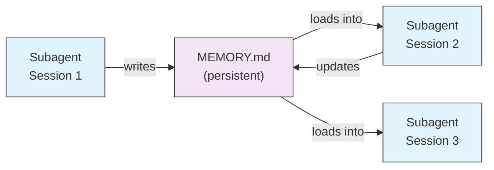
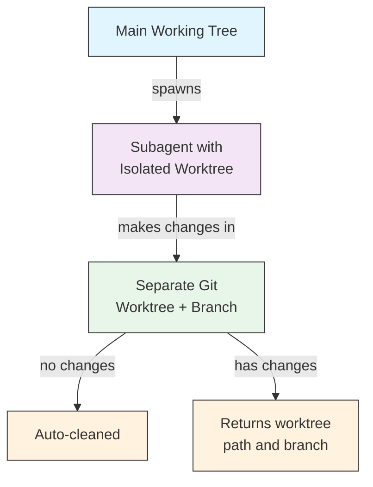
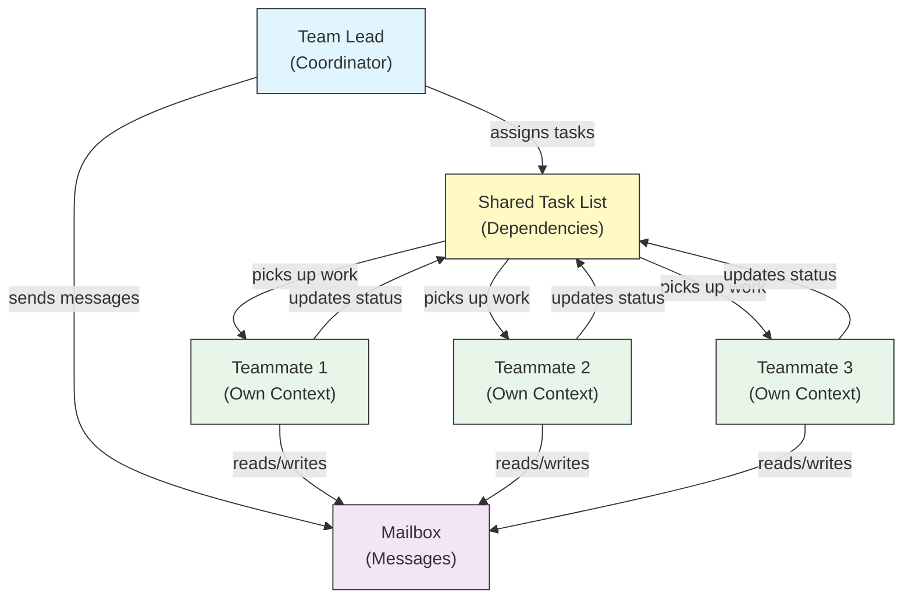
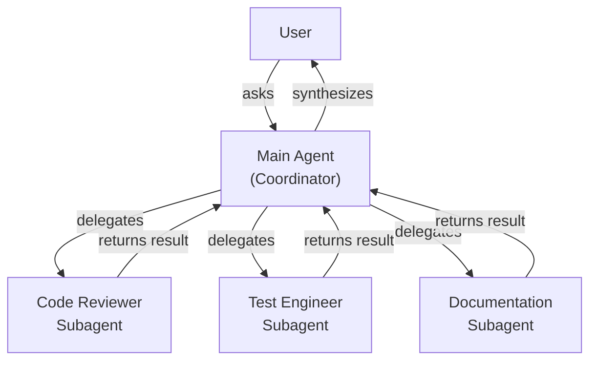
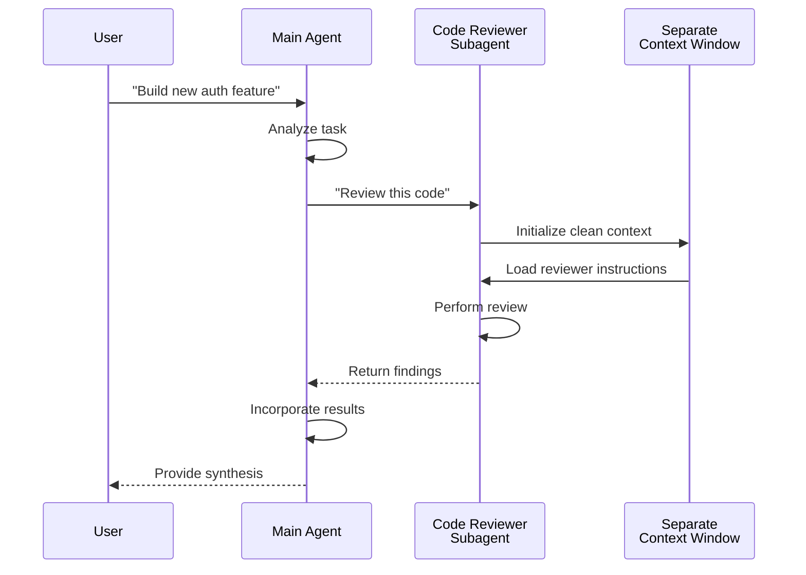
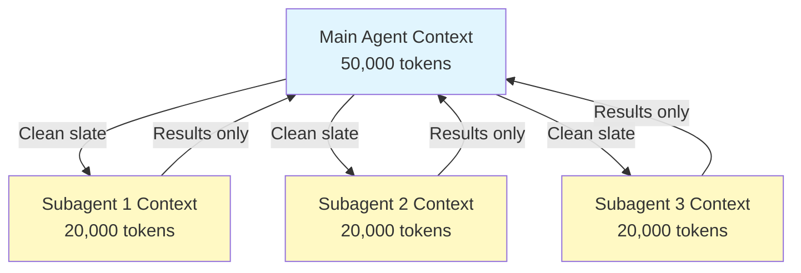
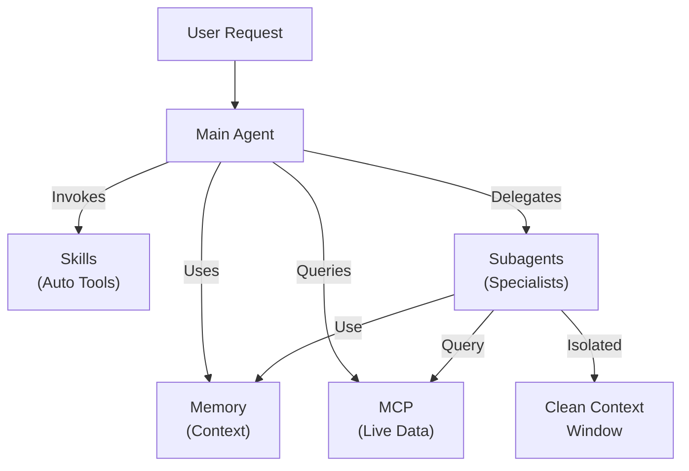

<picture>
  <source media="(prefers-color-scheme: dark)" srcset="../../resources/logos/claude-howto-logo-dark.svg">
  
</picture>

# Tác Nhân Con - Hướng Dẫn Tham Khảo Hoàn Chỉnh

Tác nhân con là các trợ lý AI chuyên biệt mà Claude Code có thể ủy quyền tác vụ. Mỗi tác nhân con có mục đích cụ thể, sử dụng cửa sổ bối cảnh riêng tách biệt với cuộc hội thoại chính, và có thể được cấu hình với các công cụ cụ thể và prompt hệ thống tùy chỉnh.

## Mục Lục

1. [Tổng Quan](#tổng-quan)
2. [Lợi Ích Chính](#lợi-ích-chính)
3. [Vị Trí File](#vị-trí-file)
4. [Cấu Hình](#cấu-hình)
5. [Tác Nhân Con Tích Hợp Sẵn](#tác-nhân-con-tích-hợp-sẵn)
6. [Quản Lý Tác Nhân Con](#quản-lý-tác-nhân-con)
7. [Sử Dụng Tác Nhân Con](#sử-dụng-tác-nhân-con)
8. [Tác Nhân Có Thể Tiếp Tục](#tác-nhân-có-thể-tiếp-tục)
9. [Chuỗi Tác Nhân Con](#chuỗi-tác-nhân-con)
10. [Bộ Nhớ Liên Tục Cho Tác Nhân Con](#bộ-nhớ-liên-tục-cho-tác-nhân-con)
11. [Tác Nhân Con Nền](#tác-nhân-con-nền)
12. [Cô Lập Worktree](#cô-lập-worktree)
13. [Tác Nhân Con Fork](#tác-nhân-con-fork)
14. [Hạn Chế Tác Nhân Con Có Thể Tạo](#hạn-chế-tác-nhân-con-có-thể-tạo)
15. [Lệnh CLI `claude agents`](#lệnh-cli-claude-agents)
16. [Đội Tác Nhân (Thử Nghiệm)](#đội-tác-nhân-thử-nghiệm)
17. [Bảo Mật Tác Nhân Con Plugin](#bảo-mật-tác-nhân-con-plugin)
18. [Kiến Trúc](#kiến-trúc)
19. [Quản Lý Bối Cảnh](#quản-lý-bối-cảnh)
20. [Khi Nào Sử Dụng Tác Nhân Con](#khi-nào-sử-dụng-tác-nhân-con)
21. [Thực Hành Tốt Nhất](#thực-hành-tốt-nhất)
22. [Ví Dụ Tác Nhân Con Trong Thư Mục Này](#ví-dụ-tác-nhân-con-trong-thư-mục-này)
23. [Hướng Dẫn Cài Đặt](#hướng-dẫn-cài-đặt)
24. [Cấu Trúc File](#cấu-trúc-file)
25. [Khái Niệm Liên Quan](#khái-niệm-liên-quan)
26. [Khả Năng Quan Sát](#khả-năng-quan-sát)
27. [Tài Nguyên Thêm](#tài-nguyên-thêm)

---

## Tổng Quan

Tác nhân con cho phép thực thi tác vụ được ủy quyền trong Claude Code bằng cách:

- Tạo **các trợ lý AI cô lập** với các cửa sổ bối cảnh riêng
- Cung cấp **các prompt hệ thống tùy chỉnh** cho chuyên môn chuyên biệt
- Thực thi **kiểm soát truy cập công cụ** để giới hạn khả năng
- Ngăn **ô nhiễm bối cảnh** từ các tác vụ phức tạp
- Cho phép **thực thi song song** của nhiều tác vụ chuyên biệt

Mỗi tác nhân con hoạt động độc lập với một trang sạch, chỉ nhận bối cảnh cụ thể cần thiết cho tác vụ của nó, sau đó trả về kết quả cho tác nhân chính để tổng hợp.

**Bắt Đầu Nhanh**: Hãy yêu cầu Claude tạo tác nhân con cho bạn ("tạo một tác nhân con để review bảo mật"), hoặc thêm trực tiếp một file `.claude/agents/<name>.md` — xem [Quản Lý Tác Nhân Con](#quản-lý-tác-nhân-con) bên dưới.

> **Lưu ý**: Từ v2.1.198, lệnh `/agents` không còn mở trình hướng dẫn tạo tương tác. Hãy tạo và quản lý tác nhân con bằng cách yêu cầu Claude hoặc chỉnh sửa trực tiếp các file trong `.claude/agents/`.

---

## Lợi Ích Chính

| Lợi Ích | Mô Tả |
|---------|-------------|
| **Bảo tồn bối cảnh** | Hoạt động trong bối cảnh riêng, ngăn chặn ô nhiễm cuộc hội thoại chính |
| **Chuyên môn hóa** | Điều chỉnh tốt cho các lĩnh vực cụ thể với tỷ lệ thành công cao hơn |
| **Khả năng tái sử dụng** | Sử dụng qua các dự án khác và chia sẻ với các đội |
| **Quyền linh hoạt** | Các mức truy cập công cụ khác nhau cho các loại tác nhân con khác |
| **Khả năng mở rộng** | Nhiều tác nhân hoạt động trên các khía cạnh khác nhau đồng thời |

---

## Vị Trí File

Files tác nhân con có thể được lưu trữ ở nhiều vị trí với các phạm vi khác nhau:

| Ưu Tiên | Loại | Vị Trí | Phạm Vi |
|----------|------|----------|-------|
| 1 (cao nhất) | **Được quản lý (managed)** | Managed settings | Toàn tổ chức |
| 2 | **Được định nghĩa qua CLI** | Qua cờ `--agents` (JSON) | Chỉ phiên |
| 3 | **Tác nhân dự án** | `.claude/agents/` | Dự án hiện tại |
| 4 | **Tác nhân người dùng** | `~/.claude/agents/` | Tất cả dự án |
| 5 (thấp nhất) | **Tác nhân plugin** | Thư mục `agents/` của plugin | Qua plugins |

Khi tên trùng lặp tồn tại, nguồn ưu tiên cao hơn sẽ được ưu tiên.

> **Thứ tự ưu tiên của `.claude/` lồng nhau (v2.1.178)**: Khi cùng một tên tác nhân được định nghĩa trong nhiều thư mục `.claude/agents/` lồng nhau (ví dụ: một monorepo có các thư mục `.claude/` ở cấp package), định nghĩa **gần thư mục làm việc hiện tại của bạn nhất sẽ thắng**. Quy tắc "gần nhất thắng" này cũng áp dụng cho các định nghĩa workflow và output-style lồng nhau.

---

## Cấu Hình

### Định Dạng File

Tác nhân con được định nghĩa trong YAML frontmatter theo sau là prompt hệ thống trong markdown:

```yaml
---
name: your-sub-agent-name
description: Mô tả khi nào tác nhân con này nên được gọi
tools: tool1, tool2, tool3  # Tùy chọn - kế thừa tất cả công cụ nếu bỏ qua
disallowedTools: tool4  # Tùy chọn - công cụ rõ ràng không được phép
model: sonnet  # Tùy chọn - sonnet, opus, haiku, hoặc inherit
permissionMode: default  # Tùy chọn - chế độ quyền
maxTurns: 20  # Tùy chọn - giới hạn lượt tác nhân
skills: skill1, skill2  # Tùy chọn - skills để tải trước vào bối cảnh
mcpServers: server1  # Tùy chọn - MCP servers để cung cấp
memory: user  # Tùy chọn - phạm vi bộ nhớ liên tục (user, project, local)
background: false  # Tùy chọn - chạy như tác vụ nền
effort: high  # Tùy chọn - nỗ lực lý luận (low, medium, high, xhigh, max)
isolation: worktree  # Tùy chọn - cô lập git worktree
initialPrompt: "Bắt đầu bằng cách phân tích codebase"  # Tùy chọn - lượt đầu tự động gửi
experimental:  # Tùy chọn - khối cài đặt thử nghiệm
  cacheTtl: "1h"  # Cache TTL cho tác nhân con này: "5m" hoặc "1h" (v2.1.248+)
hooks:  # Tùy chọn - hooks theo phạm vi component
  PreToolUse:
    - matcher: "Bash"
      hooks:
        - type: command
          command: "./scripts/security-check.sh"
---

Prompt hệ thống của tác nhân con của bạn đặt ở đây. Phần này có thể gồm nhiều đoạn
và nên xác định rõ vai trò, khả năng, và cách tiếp cận
của tác nhân con để giải quyết vấn đề.
```

### Các Trường Cấu Hình

| Trường | Bắt Buộc | Mô Tả |
|-------|----------|-------------|
| `name` | Có | Định danh duy nhất (chữ thường và dấu gạch ngang). Việc tra cứu được chuẩn hóa (không phân biệt hoa thường và kiểu dấu phân cách — xem bên dưới), nhưng tên chứa `:` bị **từ chối** kể từ v2.1.218: `:` được dành riêng cho namespace của plugin |
| `description` | Có | Mô tả bằng ngôn ngữ tự nhiên về mục đích. Bao gồm "use PROACTIVELY" để khuyến khích gọi tự động |
| `tools` | Không | Danh sách phân tách bằng dấu phẩy của các công cụ cụ thể. Bỏ qua để kế thừa tất cả công cụ. Hỗ trợ cú pháp `Agent(agent_name)` để hạn chế tác nhân con có thể tạo khi tác nhân chạy như luồng chính với `claude --agent`; bên trong một tác nhân con, danh sách loại bị bỏ qua. MCP: `mcp__<server>__*` cấp quyền cho toàn bộ một server (v2.1.299+: chỉ khớp đúng tên server đó). |
| `disallowedTools` | Không | Danh sách phân tách bằng dấu phẩy của các công cụ mà tác nhân con không được sử dụng. Với các MCP server có tên chứa `__`: `mcp__reports__*` ở đây cũng chặn luôn mọi công cụ của `reports__v2`, vì vậy hãy liệt kê từng công cụ của `reports`; trong `tools`, cấp quyền cho server như vậy bằng `mcp__reports__v2__*` |
| `model` | Không | Mô hình để sử dụng: `sonnet`, `opus`, `haiku`, ID mô hình đầy đủ, hoặc `inherit`. Mặc định là mô hình tác nhân con được cấu hình. Claude cũng có thể truyền `model` khi gọi công cụ Agent, nhưng chỉ dưới dạng bí danh (`sonnet`, `opus`, `haiku`, hoặc `fable`), không phải ID mô hình đầy đủ hay `inherit` |
| `permissionMode` | Không | `default` (chế độ Manual; `manual` được chấp nhận như bí danh từ v2.1.200), `acceptEdits`, `dontAsk`, `bypassPermissions`, `plan`, `auto`. Kể từ v2.1.212, tham số gọi `mode` của công cụ Task bị deprecated và bị bỏ qua — tác nhân con mặc định kế thừa chế độ quyền của phiên cha trừ khi được ghi đè ở đây. Khi tác nhân cha chạy ở `bypassPermissions`, `acceptEdits` hoặc `auto`, `permissionMode` của tác nhân con bị bỏ qua. Khi tác nhân cha ở chế độ `plan`, tác nhân con vẫn ở chế độ lập kế hoạch bất kể `permissionMode` là gì (trừ khi nó chạy như một đồng nghiệp trong Agent Teams); nếu bạn đặt `dontAsk`, những hành động mà chế độ lập kế hoạch lẽ ra sẽ hỏi sẽ bị từ chối |
| `maxTurns` | Không | Số lượng lượt tác nhân tối đa mà tác nhân con có thể thực hiện |
| `skills` | Không | Danh sách phân tách bằng dấu phẩy của các skills để tải trước. Tiêm toàn bộ nội dung skill vào bối cảnh của tác nhân con khi khởi động. **v2.1.133+:** tác nhân con cũng khám phá các skill của dự án, người dùng và plugin qua công cụ Skill — cùng danh mục với phiên chính, không còn giới hạn ở tập skill nhúng của riêng nó. Tối đa 32 skill được tải trước, mỗi skill một lần; tác nhân con có công cụ Skill vẫn có thể gọi các skill còn lại (v2.1.295). |
| `mcpServers` | Không | MCP servers để cung cấp cho tác nhân con |
| `hooks` | Không | Hooks chỉ chạy khi tác nhân con này đang hoạt động. Hỗ trợ mọi sự kiện hook; phổ biến nhất là `PreToolUse`, `PostToolUse`, `Stop` (chạy dưới dạng `SubagentStop`) |
| `memory` | Không | Phạm vi thư mục bộ nhớ liên tục: `user`, `project`, hoặc `local` |
| `background` | Không | Tác nhân con vốn đã chạy nền theo mặc định (v2.1.198). Từ v2.1.302, các tác nhân con của cuộc hội thoại chính trong ứng dụng desktop và VS Code cũng khởi động ở chế độ nền. Khi chế độ fork đang bật (mặc định), Claude không thể chờ chúng. Các lời gọi Agent của chính tác nhân con trong `claude -p`, Agent SDK, ứng dụng desktop và VS Code mặc định chạy ở foreground. Đặt thành `true` để *buộc* luôn chạy nền và ngăn thực thi nội tuyến |
| `effort` | Không | Mức độ nỗ lực lý luận: `low`, `medium`, `high`, `xhigh`, hoặc `max`. Ghi đè mức nỗ lực của phiên; các mức khả dụng phụ thuộc vào mô hình. Claude cũng có thể truyền giá trị `effort` khi gọi công cụ Agent (v2.1.292). Khi không có gì chỉ định mức, `CLAUDE_CODE_SUBAGENT_EFFORT` đặt mức mà tác nhân con chạy thay cho mức của phiên (v2.1.316). Tác nhân con chạy trên mô hình khác với cuộc hội thoại chính không dùng mức của phiên: nó chạy ở mức nỗ lực đã lưu của mô hình đó hoặc mức mặc định của mô hình (v2.1.317), vì vậy hãy đặt `effort` ở đây để tự chọn. |
| `isolation` | Không | Đặt thành `worktree` để cung cấp cho tác nhân con git worktree riêng |
| `initialPrompt` | Không | Lượt đầu tự động gửi khi tác nhân con chạy như tác nhân chính |
| `color` | Không | Màu hiển thị của tác nhân con trong danh sách tác vụ và transcript. Chấp nhận `red`, `blue`, `green`, `yellow`, `purple`, `orange`, `pink`, hoặc `cyan` |
| `experimental` | Không | Khối cài đặt thử nghiệm (v2.1.248+). `experimental.cacheTtl` đặt cache TTL cho tác nhân con này — `"5m"` hoặc `"1h"` |
| `omitClaudeMd` | Không | Đặt thành `true` để khởi chạy tác nhân con mà không có các file CLAUDE.md của người dùng, dự án và local (v2.1.271+). Các file chính sách được quản lý vẫn được tải, ngoại trừ với tác nhân con được quản lý. Bị bỏ qua khi tác nhân chạy như tác nhân của phiên chính qua `--agent` hoặc cài đặt `agent`. Cũng được chấp nhận trong JSON của `--agents` |
| `autoCompactWindow` | Không | Tự động nén (auto-compact) bối cảnh của tác nhân con này sớm hơn so với cửa sổ của cuộc hội thoại chính (v2.1.296+; cũng được chấp nhận trong JSON của `--agents`). Từ v2.1.312, nó cũng hạ cửa sổ được đặt bởi `CLAUDE_CODE_AUTO_COMPACT_WINDOW`, điều mà trước đây nó không ghi đè được; nó không bao giờ nâng cửa sổ đó |

#### Biến Môi Trường Cho Mô Hình Tác Nhân Con

Hai biến môi trường ảnh hưởng đến mô hình mà tác nhân con chạy:

| Biến | Phiên Bản | Mô Tả |
|----------|---------|-------------|
| `CLAUDE_CODE_SUBAGENT_MODEL` | — | Đặt mô hình dùng cho tác nhân con |
| `CLAUDE_CODE_SUBAGENT_MODEL_FORCE` | v2.1.257+ | Đặt thành `1` để buộc dùng mô hình tác nhân con thay cho `model:` trong frontmatter của tác nhân con |

> **Thứ tự ưu tiên thay đổi trong v2.1.251**: trước bản này, `CLAUDE_CODE_SUBAGENT_MODEL` được ưu tiên và ghi đè frontmatter của tác nhân — kể cả `model: inherit`. Từ v2.1.251 trở đi, `model:` trong frontmatter của chính tác nhân con sẽ thắng. Đặt `CLAUDE_CODE_SUBAGENT_MODEL_FORCE=1` (v2.1.257+) khi bạn muốn biến môi trường ghi đè frontmatter trở lại, ví dụ để cố định toàn bộ một lượt đánh giá vào một mô hình.

### Tôn Trọng Frontmatter Của Tác Nhân Luồng Chính (v2.1.117+/v2.1.119+)

Khi một tác nhân được gọi làm tác nhân luồng chính (qua `claude --agent <name>` hoặc chế độ `--print`), các trường frontmatter sau được tôn trọng:

| Trường | Phiên Bản | Ghi Chú |
|-------|---------|-------|
| `mcpServers` | v2.1.117+ | Được tải khi tác nhân được gọi làm tác nhân luồng chính qua `claude --agent <name>` |
| `permissionMode` | v2.1.119+ | Được tôn trọng cho các tác nhân tích hợp sẵn qua `--agent <name>` |
| `tools` / `disallowedTools` | v2.1.119+ | Được tôn trọng trong chế độ `--print` (sử dụng không tương tác/qua script) |

**Ví dụ — tác nhân với `mcpServers` và `permissionMode`:**

```yaml
---
name: secure-researcher
description: Research agent with scoped MCP access and restricted permissions
permissionMode: acceptEdits
mcpServers:
  notion:
    type: http
    url: https://mcp.notion.com/mcp
  github:
    type: http
    url: https://api.githubcopilot.com/mcp/
    headers:
      Authorization: "Bearer ${GITHUB_PERSONAL_ACCESS_TOKEN}"
tools: Read, Grep, Glob
---

You are a research agent. You may query Notion and GitHub through the
configured MCP servers, and read local files, but you cannot write or
execute commands outside of accepted edits.
```

Chạy với:

```bash
claude --agent secure-researcher
```

### Tùy Chọn Cấu Hình Công Cụ

**Tùy Chọn 1: Kế Thừa Tất Cả Công Cụ (bỏ qua trường)**
```yaml
---
name: full-access-agent
description: Agent với tất cả các công cụ có sẵn
---
```

**Tùy Chọn 2: Chỉ Định Các Công Cụ Cụ Thể**
```yaml
---
name: limited-agent
description: Agent chỉ với các công cụ cụ thể
tools: Read, Grep, Glob, Bash
---
```

> **Lưu ý về Glob/Grep (v2.1.113+):** Trên các bản build native cho macOS/Linux, Glob và Grep được cung cấp dưới dạng `bfs`/`ugrep` thông qua công cụ Bash thay vì là các công cụ riêng. Các bản build Windows và npm-JS vẫn cung cấp chúng như công cụ độc lập. Tác giả vẫn có thể tham chiếu Glob/Grep trong `allowedTools`; việc thay thế ở backend là trong suốt.

**Tùy Chọn 3: Truy Cập Công Cụ Có Điều Kiện**
```yaml
---
name: conditional-agent
description: Agent với truy cập công cụ được lọc
tools: Read, Bash(npm:*), Bash(test:*)
---
```

### Cấu Hình Dựa Trên CLI

Định nghĩa tác nhân con cho một phiên duy nhất sử dụng cờ `--agents` với định dạng JSON:

```bash
claude --agents '{
  "code-reviewer": {
    "description": "Expert code reviewer. Use proactively after code changes.",
    "prompt": "You are a senior code reviewer. Focus on code quality, security, and best practices.",
    "tools": ["Read", "Grep", "Glob", "Bash"],
    "model": "sonnet"
  }
}'
```

**Định Dạng JSON cho cờ `--agents`:**

```json
{
  "agent-name": {
    "description": "Required: khi nào gọi agent này",
    "prompt": "Required: prompt hệ thống cho agent",
    "tools": ["Optional", "array", "of", "tools"],
    "model": "optional: sonnet|opus|haiku"
  }
}
```

> **Lưu ý**: Từ v2.1.243, `--agents` không còn âm thầm bỏ qua JSON không hợp lệ hoặc định nghĩa tác nhân không hợp lệ — Claude Code thoát với thông báo lỗi rõ ràng, giống hành vi của `--mcp-config`.

**Ưu Tiên Định Nghĩa Tác Nhân:**

Các định nghĩa tác nhân được tải với thứ tự ưu tiên này (khớp đầu tiên thắng):
1. **Được quản lý (managed)** - managed settings (toàn tổ chức)
2. **Được định nghĩa qua CLI** - cờ `--agents` (chỉ phiên, JSON)
3. **Cấp dự án** - `.claude/agents/` (dự án hiện tại)
4. **Cấp người dùng** - `~/.claude/agents/` (tất cả dự án)
5. **Cấp plugin** - Thư mục `agents/` của plugin

Điều này cho phép định nghĩa CLI ghi đè các định nghĩa cấp dự án, người dùng và plugin cho một phiên duy nhất; định nghĩa được quản lý (managed) vẫn được ưu tiên hơn.

---

## Tác Nhân Con Tích Hợp Sẵn

Claude Code bao gồm một số tác nhân con được tích hợp sẵn luôn có sẵn:

| Tác Nhân | Mô Hình | Mục Đích |
|-------|-------|---------|
| **general-purpose** | Kế thừa | Tác vụ đa bước phức tạp |
| **Plan** | Kế thừa | Nghiên cứu cho chế độ lập kế hoạch |
| **Explore** | Kế thừa (giới hạn ở Opus) | Khám phá codebase chỉ đọc (nhanh/trung bình/rất kỹ) |
| **claude** | Kế thừa | Tác nhân dự phòng cho các tác vụ không khớp tác nhân chuyên biệt nào; có mọi công cụ khả dụng cho tác nhân con. Cũng là tác nhân mặc định cho phiên nền được điều phối |
| **statusline-setup** | Sonnet | Chạy khi bạn dùng `/statusline` để cấu hình dòng trạng thái |
| **claude-code-guide** | Haiku | Trả lời câu hỏi về tính năng Claude Code |

### Tác Nhân Con General-Purpose

| Thuộc Tính | Giá Trị |
|----------|-------|
| **Mô Hình** | Kế thừa từ cha |
| **Công Cụ** | Tất cả công cụ |
| **Mục Đích** | Nhiệm vụ nghiên cứu phức tạp, hoạt động đa bước, chỉnh sửa code |

**Khi sử dụng**: Tác vụ yêu cầu cả khám phá và sửa đổi với lý luận phức tạp.

### Tác Nhân Con Plan

| Thuộc Tính | Giá Trị |
|----------|-------|
| **Mô Hình** | Kế thừa từ cha |
| **Công Cụ** | Read, Glob, Grep, Bash |
| **Mục Đích** | Được sử dụng tự động trong chế độ lập kế hoạch để nghiên cứu codebase |

**Khi sử dụng**: Khi Claude cần hiểu codebase trước khi trình bày kế hoạch.

### Tác Nhân Con Explore

| Thuộc Tính | Giá Trị |
|----------|-------|
| **Mô Hình** | Kế thừa mô hình của phiên, giới hạn ở Opus (v2.1.198). Đặt `model: haiku` để giữ nó nhanh và rẻ |
| **Chế Độ** | Chỉ đọc nghiêm ngặt |
| **Công Cụ** | Glob, Grep, Read, Bash (chỉ lệnh đọc) |
| **Mục Đích** | Tìm kiếm và phân tích codebase nhanh |

**Khi sử dụng**: Khi tìm kiếm/hiểu code mà không thực hiện thay đổi.

**Mức Độ Chuyên Sâu** - Chỉ định độ sâu của khám phá:
- **"quick"** - Tìm kiếm nhanh với khám phá tối thiểu, tốt để tìm các mẫu cụ thể
- **"medium"** - Khám phá vừa phải, cân bằng tốc độ và sự kỹ lưỡng, cách tiếp cận mặc định
- **"very thorough"** - Phân tích toàn diện qua nhiều vị trí và quy ước đặt tên, có thể mất nhiều thời gian hơn

### Tác Nhân Con Claude

| Thuộc Tính | Giá Trị |
|----------|-------|
| **Mô Hình** | Kế thừa từ cha |
| **Công Cụ** | Mọi công cụ khả dụng cho tác nhân con |
| **Mục Đích** | Tác nhân dự phòng cho các tác vụ không khớp tác nhân chuyên biệt nào |

**Khi sử dụng**: Khi tác vụ không khớp với một tác nhân dựng sẵn chuyên biệt hơn. Đây cũng là tác nhân mặc định cho một phiên nền được điều phối; chế độ quyền mà nó khởi động phụ thuộc vào cách phiên đó được bắt đầu.

### Tác Nhân Con Cấu Hình Dòng Trạng Thái

| Thuộc Tính | Giá Trị |
|----------|-------|
| **Mô Hình** | Sonnet |
| **Công Cụ** | Read, Write, Bash |
| **Mục Đích** | Cấu hình hiển thị dòng trạng thái Claude Code |

**Khi sử dụng**: Khi thiết lập hoặc tùy chỉnh dòng trạng thái.

### Tác Nhân Con Hướng Dẫn Claude Code (`claude-code-guide`)

| Thuộc Tính | Giá Trị |
|----------|-------|
| **Mô Hình** | Haiku (nhanh, độ trễ thấp) |
| **Công Cụ** | Chỉ đọc |
| **Mục Đích** | Trả lời câu hỏi về tính năng và cách sử dụng Claude Code |

**Khi sử dụng**: Khi người dùng hỏi về cách Claude Code hoạt động hoặc cách sử dụng các tính năng cụ thể.

---

## Quản Lý Tác Nhân Con

### Yêu Cầu Claude (Khuyến Nghị)

Cách đơn giản nhất để tạo hoặc quản lý một tác nhân con là yêu cầu Claude trực tiếp:

```text
Create a subagent that reviews code for security vulnerabilities.
```

Claude sẽ viết file `.claude/agents/<name>.md` cho bạn, chọn frontmatter hợp lý (công cụ, mô hình, mô tả). Sau đó bạn có thể chỉnh sửa file thủ công hoặc yêu cầu Claude điều chỉnh.

> **Lưu ý**: Lệnh `/agents` không còn mở trình hướng dẫn tạo tương tác (đã bị gỡ bỏ trong v2.1.198). Giờ đây lệnh này hướng bạn tới việc yêu cầu Claude hoặc chỉnh sửa trực tiếp các file trong `.claude/agents/`.

### Quản Lý File Trực Tiếp

```bash
# Tạo một tác nhân con dự án
mkdir -p .claude/agents
cat > .claude/agents/test-runner.md << 'EOF'
---
name: test-runner
description: Use proactively to run tests and fix failures
---

You are a test automation expert. When you see code changes, proactively
run the appropriate tests. If tests fail, analyze the failures and fix
them while preserving the original test intent.
EOF

# Tạo một tác nhân con người dùng (có sẵn trong tất cả dự án)
mkdir -p ~/.claude/agents
```

---

## Sử Dụng Tác Nhân Con

### Ủy Quyền Tự Động

Claude chủ động ủy quyền các tác vụ dựa trên:
- Mô tả tác vụ trong yêu cầu của bạn
- Trường `description` trong cấu hình tác nhân con
- Bối cảnh hiện tại và các công cụ có sẵn

Để khuyến khích sử dụng chủ động, bao gồm "use PROACTIVELY" hoặc "MUST BE USED" trong trường `description` của bạn:

```yaml
---
name: code-reviewer
description: Expert code review specialist. Use PROACTIVELY after writing or modifying code.
---
```

### Gọi Rõ Ràng

Bạn có thể yêu cầu một tác nhân con cụ thể một cách rõ ràng:

```
> Use the test-runner subagent to fix failing tests
> Have the code-reviewer subagent look at my recent changes
> Ask the debugger subagent to investigate this error
```

> **Khớp `subagent_type` không phân biệt hoa thường và dấu phân cách (v2.1.140)**: `subagent_type` (trong các lời gọi công cụ `Agent` hoặc cờ `--agent`) được khớp không phân biệt hoa thường và bỏ qua kiểu dấu phân cách — `code-reviewer`, `Code Reviewer`, và `code_reviewer` đều trỏ tới cùng một tác nhân. Điều này loại bỏ một cái bẫy tồn tại lâu nay, khi khác biệt nhỏ về chữ hoa khiến hệ thống âm thầm quay về tác nhân mặc định.

### Gọi Với @-Mention

Sử dụng tiền tố `@` để đảm bảo một tác nhân con cụ thể được gọi (bỏ qua các heuristic ủy quyền tự động):

```
> @"code-reviewer (agent)" review the auth module
```

### Tác Nhân Toàn Phiên

Chạy toàn bộ phiên sử dụng một tác nhân cụ thể như tác nhân chính:

```bash
# Qua cờ CLI
claude --agent code-reviewer

# Qua settings.json
{
  "agent": "code-reviewer"
}
```

### Liệt Kê Các Tác Nhân Có Sẵn

Để xem các tác nhân con đã được cấu hình, hãy hỏi Claude hoặc duyệt `.claude/agents/` và `~/.claude/agents/`. (`claude agents` không liên quan: lệnh này mở agent view cho các phiên chạy nền — xem [CLI](../10-cli/README.md#agent-view-claude-agents-v21139).)

---

## Tác Nhân Có Thể Tiếp Tục

Tác nhân con có thể tiếp tục các cuộc hội thoại trước đó với toàn bộ bối cảnh được bảo tồn:

```bash
# Lời gọi ban đầu
> Use the code-analyzer agent to start reviewing the authentication module
# Trả về agentId: "abc123"

# Tiếp tục tác nhân sau đó
> Resume agent abc123 and now analyze the authorization logic as well
```

**Trường hợp sử dụng**:
- Nghiên cứu dài hạn qua nhiều phiên
- Tinh chỉnh lặp lại mà không mất bối cảnh
- Workflow đa bước duy trì bối cảnh

---

## Chuỗi Tác Nhân Con

Thực hiện nhiều tác nhân con theo trình tự:

```bash
> First use the code-analyzer subagent to find performance issues,
  then use the optimizer subagent to fix them
```

Điều này cho phép các workflow phức tạp nơi đầu ra của một tác nhân con được truyền vào tác nhân khác.

---

## Bộ Nhớ Liên Tục Cho Tác Nhân Con

Trường `memory` cung cấp cho tác nhân con một thư mục liên tục tồn tại qua các cuộc hội thoại. Điều này cho phép tác nhân con xây dựng kiến thức theo thời gian, lưu trữ ghi chú, phát hiện, và bối cảnh tồn tại giữa các phiên.

### Các Phạm Vi Bộ Nhớ

| Phạm Vi | Thư Mục | Trường Hợp Dùng |
|-------|-----------|----------|
| `user` | `~/.claude/agent-memory/<name>/` | Ghi chú và tùy thích cá nhân qua tất cả dự án |
| `project` | `.claude/agent-memory/<name>/` | Kiến thức cụ thể dự án được chia sẻ với đội |
| `local` | `.claude/agent-memory-local/<name>/` | Kiến thức dự án cục bộ không được commit vào kiểm soát phiên bản |

### Cách Hoạt Động

- 200 dòng đầu tiên của `MEMORY.md` trong thư mục bộ nhớ được tự động tải vào prompt hệ thống của tác nhân con
- Các công cụ `Read`, `Write`, và `Edit` được tự động bật cho tác nhân con để quản lý các file bộ nhớ của nó
- Tác nhân con có thể tạo các file bổ sung trong thư mục bộ nhớ của mình khi cần

### Ví Dụ Cấu Hình

```yaml
---
name: researcher
description: Research assistant that keeps findings in persistent memory across sessions
memory: user
---

You are a research assistant. Use your memory directory to store findings,
track progress across sessions, and build up knowledge over time.

Check your MEMORY.md file at the start of each session to recall previous context.
```



---

## Tác Nhân Con Nền

Tác nhân con chạy nền theo mặc định (v2.1.198). Từ v2.1.302, các tác nhân con của cuộc hội thoại chính trong ứng dụng desktop và VS Code cũng khởi động ở chế độ nền. Khi chế độ fork đang bật (mặc định), Claude không thể chờ chúng. Các lời gọi Agent của chính tác nhân con trong `claude -p`, Agent SDK, ứng dụng desktop và VS Code mặc định chạy ở foreground. Claude tiếp tục làm việc trên cuộc hội thoại chính trong khi tác nhân con chạy và được thông báo khi nó hoàn tất, vì vậy bạn không còn phải chờ tác nhân con trả kết quả rồi mới tiếp tục. Trong VS Code (v2.1.304+), một tác nhân con nền hiển thị dưới dạng một dòng trạng thái bên dưới thẻ Agent của nó thay vì stream từng bước vào khung chat; mở `/tasks` và nhấp vào nó để xem các lời gọi công cụ và transcript.

### Cấu Hình

Vì chạy nền đã là mặc định, `background: true` trong frontmatter sẽ *buộc* tác nhân con luôn chạy nền và ngăn nó chạy nội tuyến:

```yaml
---
name: long-runner
background: true
description: Performs long-running analysis tasks in the background
---
```

### Phím Tắt Nhanh

| Phím Tắt | Hành Động |
|----------|--------|
| `Ctrl+B` | Chạy nền một tác vụ tác nhân con đang chạy |
| `Ctrl+X` `Ctrl+K` | Dừng tất cả các tác nhân con nền đang chạy (nhấn hai lần trong vòng 3 giây để xác nhận; tổ hợp này thay thế `Ctrl+F`) |

### Vô Hiệu Hóa Tác Vụ Nền

Đặt biến môi trường để vô hiệu hóa hỗ trợ tác vụ nền hoàn toàn:

```bash
export CLAUDE_CODE_DISABLE_BACKGROUND_TASKS=1
```

### Để Claude Chờ Một Tác Nhân Con

Khi không cấu hình gì, một tác nhân con mà Claude tạo từ cuộc hội thoại chính sẽ khởi động ở chế độ nền. Trong `claude -p` và Agent SDK, Claude vẫn có thể tự quyết định chờ một tác nhân con hoặc chờ khi bạn yêu cầu. Trong phiên terminal tương tác, VS Code hoặc desktop, Claude chỉ có thể chờ sau khi bạn tắt chế độ fork (v2.1.302+):

```json
{
  "env": {
    "CLAUDE_CODE_FORK_SUBAGENT": "0"
  }
}
```

Khởi động lại `claude` (hoặc mở một cuộc hội thoại VS Code mới), rồi yêu cầu, ví dụ "run the reviewer subagent and wait for its report". `Ctrl+B` vẫn chuyển một lần chờ sang chạy nền. Thay vào đó, đặt `CLAUDE_CODE_DISABLE_BACKGROUND_TASKS=1` sẽ khiến Claude chờ mọi tác nhân con, đồng thời tắt luôn các lệnh chạy nền.

---

## Cô Lập Worktree

Thiết lập `isolation: worktree` cung cấp cho tác nhân con git worktree riêng, cho phép nó thực hiện các thay đổi một cách độc lập mà không ảnh hưởng đến cây làm việc chính.

### Cấu Hình

```yaml
---
name: feature-builder
isolation: worktree
description: Implements features in an isolated git worktree
tools: Read, Write, Edit, Bash, Grep, Glob
---
```

### Cách Hoạt Động



- Tác nhân con hoạt động trong git worktree của nó trên một branch riêng
- Nếu tác nhân con không thực hiện thay đổi, worktree được tự động dọn dẹp
- Nếu có thay đổi, đường dẫn worktree và tên branch được trả về cho tác nhân chính để xem xét hoặc merge

---

## Tác Nhân Con Fork

Một tác nhân con fork kế thừa toàn bộ cuộc hội thoại của tác nhân cha tại thời điểm fork — prompt hệ thống, công cụ, mô hình, lịch sử tin nhắn và prompt cache — thay vì bắt đầu với một trang sạch. Điều này hữu ích để khám phá các hướng đi thay thế mà không mất công việc đã làm.

> **Tính khả dụng**: GA trong v2.1.117. **Từ v2.1.232, chế độ fork được bật mặc định trong các phiên tương tác** — trên mọi bản build, dù là first-party hay không. Từ v2.1.302, nó cũng được bật mặc định trong chế độ không tương tác (`claude -p`), Agent SDK, ứng dụng desktop và VS Code; `claude mcp serve` không bao giờ cung cấp tác nhân con fork. Trên Claude Code cũ hơn v2.1.232, đặt `CLAUDE_CODE_FORK_SUBAGENT=1` để bật.

> **Tác nhân con ở chế độ fork chạy nền.** Ở nơi chế độ fork đang bật — như mặc định ở mọi nơi từ v2.1.302 — Claude Code chạy tác nhân con ở chế độ nền, dù là tác nhân con fork hay không. Trong phiên terminal tương tác, VS Code hoặc desktop, Claude khi đó không thể chờ tác nhân con; để cho phép nó chờ, hãy tắt chế độ fork (xem [Để Claude Chờ Một Tác Nhân Con](#để-claude-chờ-một-tác-nhân-con)).

### Cấu Hình

Bạn không định nghĩa fork trong file tác nhân. Claude khởi động fork thông qua công cụ Agent với `subagent_type: "fork"`, hoặc bạn tự khởi động bằng `/subtask <task>` (v2.1.212+):

```text
/subtask Explore an alternative implementation path and report the trade-offs
```

Một fork không thể tạo thêm fork. Để chặn fork, thêm quy tắc deny `Agent(fork)`:

```json
{
  "permissions": {
    "deny": ["Agent(fork)"]
  }
}
```

> **Lưu ý**: `context: fork` là một trường frontmatter của **skill** (xem [Skills](../03-skills/README.md)), không phải trường của tác nhân con. Claude Code âm thầm bỏ qua các trường nó không nhận ra trong định nghĩa tác nhân.

### Bật Chế Độ Fork Một Cách Tường Minh

Đặt `CLAUDE_CODE_FORK_SUBAGENT=0` để tắt chế độ fork ở mọi nơi. Trên các phiên bản trước v2.1.302, đặt thành `1` để bật fork trong `claude -p` và Agent SDK.

```bash
export CLAUDE_CODE_FORK_SUBAGENT=0
claude
```

### Khi Nào Dùng Fork So Với Bối Cảnh Sạch

| Kịch Bản | Fork (`subagent_type: "fork"`) | Bối cảnh sạch (mặc định) |
|----------|-----------------|-------------------------|
| Khám phá các cách triển khai thay thế | Có | Không (sẽ mất bối cảnh) |
| Nghiên cứu dài với bối cảnh hiện có | Có | Không |
| Tác vụ chuyên biệt độc lập | Không | Có |
| Tránh ô nhiễm bối cảnh | Không | Có |

---

## Hạn Chế Tác Nhân Con Có Thể Tạo

Bạn có thể kiểm soát các tác nhân con mà một tác nhân chạy như luồng chính với `claude --agent` được phép tạo bằng cách sử dụng cú pháp `Agent(agent_type)` trong trường `tools`. Điều này cung cấp một cách để cho phép danh sách các tác nhân con cụ thể cho ủy quyền. Trong định nghĩa tác nhân con, mọi danh sách loại trong dấu ngoặc đều bị bỏ qua.

> **Lưu ý**: Trong v2.1.63, công cụ `Task` đã được đổi tên thành `Agent`. Các tham chiếu `Task(...)` hiện có vẫn hoạt động như bí danh.

### Ví Dụ

```yaml
---
name: coordinator
description: Coordinates work between specialized agents
tools: Agent(worker, researcher), Read, Bash
---

You are a coordinator agent. You can delegate work to the "worker" and
"researcher" subagents only. Use Read and Bash for your own exploration.
```

Trong ví dụ này, khi bạn chạy `claude --agent coordinator`, luồng chính chỉ có thể tạo các tác nhân con `worker` và `researcher`. Nó không thể tạo bất kỳ tác nhân con nào khác, ngay cả khi chúng được định nghĩa ở nơi khác. Nếu `coordinator` chạy như một tác nhân con, danh sách loại bị bỏ qua.

---

## Lệnh CLI `claude agents`

`claude agents` mở **agent view** (v2.1.139+): danh sách toàn màn hình các phiên chạy nền của bạn, nhóm theo trạng thái. Lệnh này không liệt kê các định nghĩa tác nhân con đã cấu hình; dùng `claude agents --json` để viết script dựa trên trạng thái phiên.

```bash
claude agents
claude agents --json
```

Các tác nhân con đã cấu hình nằm trong `.claude/agents/` (dự án) và `~/.claude/agents/` (người dùng).

---

## Đội Tác Nhân (Thử Nghiệm)

Agent Teams điều phối nhiều phiên Claude Code cùng làm việc trên các tác vụ phức tạp. Không giống tác nhân con (là các subtask được ủy quyền và trả về kết quả), các đồng nghiệp làm việc độc lập với cửa sổ bối cảnh riêng và có thể nhắn tin trực tiếp cho nhau qua hệ thống mailbox chia sẻ.

> **Tài Liệu Chính Thức**: [code.claude.com/docs/en/agent-teams](https://code.claude.com/docs/en/agent-teams)

> **Lưu ý**: Agent Teams là thử nghiệm và bị tắt theo mặc định. Yêu cầu Claude Code v2.1.32+. Bật trước khi sử dụng.

### Tác Nhân Con So Với Agent Teams

| Khía Cạnh | Tác Nhân Con | Agent Teams |
|--------|-----------|-------------|
| **Mô hình ủy quyền** | Cha ủy quyền subtask, đợi kết quả | Trưởng đội điều phối công việc, đồng nghiệp thực thi độc lập |
| **Bối cảnh** | Bối cảnh mới cho mỗi subtask, kết quả được chắt lọc trả về | Mỗi đồng nghiệp duy trì cửa sổ bối cảnh liên tục riêng |
| **Sự điều phối** | Tuần tự hoặc song song, được quản lý bởi cha | Danh sách tác vụ chia sẻ với quản lý dependency tự động |
| **Giao tiếp** | Kết quả chỉ trả về cho cha (không nhắn tin giữa các tác nhân) | Đồng nghiệp có thể nhắn tin trực tiếp cho nhau qua mailbox |
| **Tiếp tục phiên** | Được hỗ trợ | Không được hỗ trợ với đồng nghiệp in-process |
| **Tốt nhất cho** | Subtask tập trung, được xác định rõ | Công việc phức tạp cần giao tiếp giữa các tác nhân và thực thi song song |

### Bật Agent Teams

Đặt biến môi trường hoặc thêm vào `settings.json` của bạn:

```bash
export CLAUDE_CODE_EXPERIMENTAL_AGENT_TEAMS=1
```

Hoặc trong `settings.json`:

```json
{
  "env": {
    "CLAUDE_CODE_EXPERIMENTAL_AGENT_TEAMS": "1"
  }
}
```

### Bắt đầu một đội

Sau khi bật, yêu cầu Claude làm việc với đồng nghiệp trong prompt của bạn:

```
User: Build the authentication module. Use a team — one teammate for the API endpoints,
      one for the database schema, and one for the test suite.
```

Claude sẽ tạo đội, chỉ định tác vụ, và điều phối công việc tự động.

### Chế độ hiển thị

Kiểm soát cách hiển thị hoạt động của đồng nghiệp:

| Chế Độ | Cờ | Mô Tả |
|------|------|-------------|
| **Auto** | `--teammate-mode auto` | Tự động chọn chế độ hiển thị tốt nhất cho terminal của bạn |
| **In-process** (mặc định) | `--teammate-mode in-process` | Hiển thị đầu ra đồng nghiệp nội tuyến trong terminal hiện tại |
| **Split-panes** | `--teammate-mode tmux` | Mở mỗi đồng nghiệp trong một pane tmux hoặc iTerm2 riêng |
| **iTerm2** | `--teammate-mode iterm2` | (v2.1.186+) Tạo đồng nghiệp trong các pane iTerm2 riêng. Yêu cầu CLI `it2`; chế độ auto sẽ cảnh báo khi không tìm thấy nó |

```bash
claude --teammate-mode tmux
```

Bạn cũng có thể đặt chế độ hiển thị trong `settings.json`:

```json
{
  "teammateMode": "tmux"
}
```

> **Lưu ý**: Chế độ split-pane yêu cầu tmux hoặc iTerm2. Nó không có sẵn trong terminal VS Code, Windows Terminal, hoặc Ghostty.

> **Lưu ý (v2.1.325)**: Các đồng nghiệp trong tmux và iTerm2 giờ khởi động trong thư mục của phiên thay vì ở nơi shell chạy `cd` lần cuối. Một giá trị `teammateMode` không được nhận diện vẫn không được áp dụng, nhưng giờ `claude -p`, cảnh báo khi khởi động và `claude doctor` liệt kê nó là một mục bị bỏ qua. Cả hai đều lấy từ changelog; tài liệu Agent Teams chưa liệt kê chúng.

### Điều hướng

Để di chuyển giữa các đồng nghiệp, dùng phím mũi tên lên/xuống trong bảng agent rồi nhấn Enter (chế độ in-process), hoặc nhấp vào pane của đồng nghiệp (chế độ split-pane).

### Cấu Hình Đội

Cấu hình đội được lưu trữ tại `~/.claude/teams/{team-name}/config.json`.

### Chọn Mô Hình Cho Đồng Nghiệp

Từ v2.1.234, cài đặt `/config` "Default teammate model" đã bị gỡ bỏ. Giờ đây đồng nghiệp mặc định kế thừa mô hình của trưởng đội, trừ khi lời gọi tạo đồng nghiệp chỉ định rõ một mô hình khác. Từ v2.1.317, đồng nghiệp chạy trên mô hình khác với trưởng đội sẽ chạy ở mức nỗ lực đã lưu của mô hình đó hoặc mức mặc định của mô hình, chứ không theo mức của phiên trưởng đội.

### Kiến Trúc Đội



**Thành phần chính**:

- **Team Lead**: Phiên Claude Code chính tạo đội, chỉ định tác vụ, và điều phối
- **Shared Task List**: Danh sách tác vụ được đồng bộ hóa với theo dõi dependency tự động
- **Mailbox**: Hệ thống nhắn tin giữa các tác nhân để đồng nghiệp trao đổi trạng thái và điều phối
- **Teammates**: Các phiên Claude Code độc lập, mỗi phiên với cửa sổ bối cảnh riêng

### Giao việc và nhắn tin

Trưởng đội chia nhỏ công việc thành các tác vụ và chỉ định chúng cho đồng nghiệp. Danh sách tác vụ chia sẻ xử lý:

- **Quản lý dependency tự động** — một tác vụ phụ thuộc vào các tác vụ khác hiển thị là bị chặn cho đến khi chúng hoàn thành; đồng nghiệp không tự nhận tác vụ bị chặn, nhưng bạn hoặc trưởng đội vẫn có thể chỉ định nó
- **Theo dõi trạng thái** — đồng nghiệp cập nhật trạng thái tác vụ khi họ làm việc
- **Nhắn tin giữa các tác nhân** — đồng nghiệp gửi tin qua mailbox để điều phối (ví dụ: "Database schema is ready, you can start writing queries")

### Quy trình phê duyệt kế hoạch

Đối với các tác vụ phức tạp hoặc rủi ro, hãy chuyển trưởng đội sang chế độ lập kế hoạch trước khi yêu cầu một đồng nghiệp: đồng nghiệp được tạo khi trưởng đội đang ở chế độ lập kế hoạch sẽ làm việc ở chế độ chỉ đọc cho đến khi kế hoạch của nó sẵn sàng, rồi gửi yêu cầu phê duyệt kế hoạch tới trưởng đội. Nếu bạn chưa thay đổi chế độ quyền của đồng nghiệp đó kể từ khi nó được tạo, Claude Code phê duyệt kế hoạch ngay khi yêu cầu đến (bạn không được hỏi), và các chỉnh sửa cũng như lệnh của đồng nghiệp vẫn đi qua các lời nhắc cấp quyền thông thường. Nếu bạn chuyển một đồng nghiệp in-process đang chạy sang chế độ lập kế hoạch bằng `Shift+Tab`, thì thay vào đó trưởng đội sẽ xem xét kế hoạch.

### Sự kiện hook cho đội

Agent Teams giới thiệu hai [sự kiện hook](../06-hooks/) bổ sung:

| Sự Kiện | Kích Hoạt Khi | Trường Hợp Dùng |
|-------|-----------|----------|
| `TeammateIdle` | Một đồng nghiệp hoàn thành tác vụ hiện tại và không có công việc đang chờ | Kích hoạt thông báo, chỉ định tác vụ tiếp theo |
| `TaskCompleted` | Một tác vụ trong danh sách tác vụ chia sẻ được đánh dấu hoàn thành | Chạy xác thực, cập nhật dashboard, nối chuỗi công việc phụ thuộc |

### Thực hành tốt nhất

- **Kích thước đội**: Giữ đội ở mức 3-5 đồng nghiệp để điều phối tối ưu
- **Kích thước tác vụ**: Chia việc thành các tác vụ mất 5-15 phút mỗi tác vụ — đủ nhỏ để song song hóa, đủ lớn để có ý nghĩa
- **Tránh xung đột file**: Gán các file hoặc thư mục khác nhau cho các đồng nghiệp khác nhau để ngăn xung đột merge
- **Bắt đầu đơn giản**: Sử dụng chế độ in-process cho đội đầu tiên của bạn; chuyển sang split-panes khi đã quen
- **Mô tả tác vụ rõ ràng**: Cung cấp mô tả tác vụ cụ thể, có thể hành động để đồng nghiệp có thể làm việc độc lập

### Hạn Chế

- **Thử nghiệm**: Hành vi tính năng có thể thay đổi trong các phiên bản tương lai
- **Không tiếp tục phiên**: Đồng nghiệp in-process không thể được tiếp tục sau khi phiên kết thúc
- **Một đội mỗi phiên**: Không thể tạo các đội lồng nhau hoặc nhiều đội trong một phiên
- **Lãnh đạo cố định**: Vai trò trưởng đội không thể chuyển cho đồng nghiệp
- **Hạn chế split-pane**: Yêu cầu tmux/iTerm2; không có sẵn trong terminal VS Code, Windows Terminal, hoặc Ghostty
- **Quyền trong split-pane**: một đồng nghiệp split-pane khởi động với `--disallowedTools` và `--tools` của trưởng đội (v2.1.309+) nhưng không có `--allowedTools`; để phê duyệt trước các hành động ở đó, hãy khởi động trưởng đội bằng `claude --settings '{"permissions":{"allow":["Bash(npm *)"]}}'`. Đồng nghiệp in-process dùng các quy tắc đang áp dụng của trưởng đội. Nếu một quy tắc deny trên dòng lệnh không thể được chuyển nguyên vẹn cho đồng nghiệp, việc tạo đồng nghiệp sẽ bị hủy ("cannot be handed to a teammate intact"); hãy đặt **Teammate mode** thành `in-process` trong `/config`
- **Không có đội xuyên phiên**: Đồng nghiệp chỉ tồn tại trong phiên hiện tại

> **Cảnh báo**: Agent Teams là thử nghiệm. Hãy thử với công việc không quan trọng trước và theo dõi sự điều phối của đồng nghiệp để phát hiện hành vi bất ngờ.

---

## Bảo Mật Tác Nhân Con Plugin

Tác nhân con do plugin cung cấp có các khả năng frontmatter bị hạn chế để bảo mật. Các trường sau **không được phép** trong định nghĩa tác nhân con plugin:

- `hooks` - Không thể định nghĩa lifecycle hooks
- `mcpServers` - Không thể cấu hình MCP servers
- `permissionMode` - Không thể ghi đè cài đặt quyền

Điều này ngăn chặn plugins nâng cao đặc quyền hoặc thực thi các lệnh tùy ý qua hooks tác nhân con.

### Quét Đầu Ra Của Tác Nhân Con (v2.1.210+)

Từ v2.1.210, Claude Code quét báo cáo cuối cùng của mỗi tác nhân con để tìm văn bản bắt chước định dạng đầu ra của chính harness — các thẻ giả kiểu `<system-reminder>`, các lượt `Human:`/`Assistant:` bịa đặt, hoặc việc nhắc đến các cờ bỏ qua quyền và đường dẫn file cài đặt. Điều này phòng vệ trước prompt injection nằm trong đầu ra của tác nhân con, chẳng hạn một tác nhân con đã tải về một trang web độc hại chứa các control token giả được thiết kế để thao túng phiên cha.

Khi quá trình quét gắn cờ một nội dung, Claude Code vô hiệu hóa nó — chèn một dấu gạch chéo ngược hoặc một marker nội tuyến như `[harness: subagent output matched instruction-shaped pattern(s): ...]` nêu tên thứ đã kích hoạt việc quét — và phiên cha được kỳ vọng sẽ coi văn bản bị gắn cờ là một phát hiện cần chuyển tiếp, không phải một chỉ thị cần làm theo. Việc quét được bật mặc định và không có cách tắt nào được tài liệu hóa. Nó nghiêng về phía gắn cờ: một báo cáo hợp lệ của tác nhân con trích nguyên văn tên một cờ thật (ví dụ `--dangerously-skip-permissions`) có thể kích hoạt marker dù không có gì độc hại xảy ra — một cảnh báo nhầm vẫn tốt hơn là bỏ sót một lần injection.

### Giới Hạn Đồng Thời Và Độ Sâu Của Tác Nhân Con

> **Giới hạn số lần tạo mỗi phiên đã bị gỡ bỏ.** Claude Code từng giới hạn 200 lần tạo tác nhân con mỗi phiên từ v2.1.212, nhưng **v2.1.224 đã gỡ bỏ giới hạn đó** — các phiên chạy dài không còn từ chối tác nhân mới, và tài liệu tham khảo chính thức về tác nhân con giờ nêu rõ rằng không có giới hạn tổng số tác nhân con mà Claude có thể tạo trong một phiên. Biến `CLAUDE_CODE_MAX_SUBAGENTS_PER_SESSION` dùng để ghi đè giới hạn đó cũng đã bị gỡ bỏ theo.

Hai giới hạn về mức độ phân nhánh của tác nhân con vẫn áp dụng, cả hai đều được đặt qua biến môi trường:

- `CLAUDE_CODE_MAX_CONCURRENT_SUBAGENTS` (v2.1.217) - Số lượng tối đa tác nhân con chạy **đồng thời** cùng lúc. Mặc định: 20.
- `CLAUDE_CODE_MAX_SUBAGENT_SPAWN_DEPTH` (v2.1.217) - **Độ sâu lồng nhau** tối đa khi tác nhân con tạo tác nhân con của riêng chúng. **Mặc định: 3 kể từ v2.1.219** (là 1 trong v2.1.217–v2.1.218). Đặt thành `1` để tắt lồng nhau (xem [Hành Vi Chính](#hành-vi-chính)).

```bash
export CLAUDE_CODE_MAX_CONCURRENT_SUBAGENTS=20
export CLAUDE_CODE_MAX_SUBAGENT_SPAWN_DEPTH=5
```

---

## Kiến Trúc

### Kiến Trúc Cấp Cao



### Vòng Đời Tác Nhân Con



---

## Quản Lý Bối Cảnh



### Điểm Chính

- Mỗi tác nhân con nhận một **cửa sổ bối cảnh mới** mà không có lịch sử hội thoại chính
- Chỉ **bối cảnh liên quan** được truyền cho tác nhân con cho tác vụ cụ thể của nó
- Kết quả được **chắt lọc** trở lại tác nhân chính
- Điều này ngăn **cạn kiệt token bối cảnh** trên các dự án dài

### Cân Nhắc Hiệu Suất

- **Hiệu quả bối cảnh** - Tác nhân bảo toàn bối cảnh chính, cho phép các phiên dài hơn
- **Độ trễ** - Tác nhân con bắt đầu với trang sạch và có thể thêm độ trễ khi thu thập bối cảnh ban đầu
- **Chi phí token** - Mỗi tác nhân con gửi các yêu cầu riêng của nó, và chúng được tính vào cùng hạn mức sử dụng với cuộc hội thoại chính của bạn. Ủy thác mang lại tính song song, một người review với góc nhìn mới, hoặc giữ đầu ra ồn ào khỏi bối cảnh của bạn — chứ không mang lại câu trả lời thông minh hơn. Dùng `model: haiku` cho các việc đơn giản và yêu cầu tác nhân con trả về bản tóm tắt ngắn

### Hành Vi Chính

- **Tạo lồng nhau được bật mặc định, độ sâu 3 (v2.1.219)** - Tác nhân con có thể tạo tác nhân con của riêng chúng, sâu tối đa ba tầng bên dưới cuộc hội thoại chính. Đặt `CLAUDE_CODE_MAX_SUBAGENT_SPAWN_DEPTH` để thay đổi giới hạn, hoặc `1` để tắt lồng nhau. Ở giới hạn độ sâu, Claude Code giữ lại công cụ `Agent` khỏi mọi tác nhân con ngoại trừ fork. (Lịch sử: v2.1.172–v2.1.216 lồng nhau mặc định tối đa 5 tầng và không thể thay đổi; v2.1.217 chuyển lồng nhau thành tùy chọn bật với độ sâu 1; v2.1.219 đặt mặc định là 3.) Dùng cú pháp hạn chế `Agent(agent_type)` (xem [Hạn Chế Tác Nhân Con Có Thể Tạo](#hạn-chế-tác-nhân-con-có-thể-tạo)) để kiểm soát những tác nhân con mà một tác nhân luồng chính (`claude --agent`) được phép tạo; bên trong một tác nhân con, danh sách loại bị bỏ qua
- **Quyền nền** - Khi tác nhân con nền cần một quyền chưa được phê duyệt trước, lời nhắc xuất hiện trong phiên chính và nêu tên tác nhân con đang yêu cầu
- **Chạy nền** - Nhấn `Ctrl+B` để chạy nền một tác vụ đang chạy
- **Transcript** - Transcript của tác nhân con được lưu tại `~/.claude/projects/{project}/{sessionId}/subagents/agent-{agentId}.jsonl`
- **Tự động nén** - Bối cảnh tác nhân con tự động nén ở ~95% dung lượng (ghi đè qua biến môi trường `CLAUDE_AUTOCOMPACT_PCT_OVERRIDE`)
- **Kế thừa extended thinking (v2.1.198)** - Tác nhân con và quá trình nén bối cảnh giờ kế thừa cấu hình extended thinking của phiên (trước đây luôn bị tắt). Không có trường thinking riêng cho từng tác nhân con

### Các Điều Khiển Bổ Sung

- **Tắt các tác nhân Explore/Plan tích hợp sẵn** - Đặt `CLAUDE_CODE_DISABLE_EXPLORE_PLAN_AGENTS=1` để gỡ bỏ các tác nhân Explore và Plan tích hợp sẵn (v2.1.198)
- **Nối thêm vào prompt của mọi tác nhân con** - Trong chế độ không tương tác / `--print`, `--append-subagent-system-prompt "<text>"` nối thêm văn bản vào prompt hệ thống của mọi tác nhân con (v2.1.205)
- **Nối thêm từ một file** - `--append-subagent-system-prompt-file ./subagent-rules.txt` đọc cùng phần văn bản nối thêm từ một file, dành cho các prompt quá dài để truyền qua dòng lệnh. Cũng chỉ dùng với `-p`, và không thể kết hợp với `--append-subagent-system-prompt` (v2.1.261)

---

## Khi Nào Sử Dụng Tác Nhân Con

| Tình Huống | Sử Dụng Tác Nhân Con | Tại Sao |
|----------|--------------|-----|
| Tính năng phức tạp với nhiều bước | Có | Tách biệt mối quan tâm, ngăn ô nhiễm bối cảnh |
| Review code nhanh | Không | Chi phí không cần thiết |
| Thực thi tác vụ song song | Có | Mỗi tác nhân con có bối cảnh riêng |
| Cần chuyên môn hóa | Có | Prompt hệ thống tùy chỉnh |
| Phân tích chạy dài | Có | Ngăn cạn kiệt bối cảnh chính |
| Tác vụ đơn | Không | Thêm độ trễ không cần thiết |

---

## Thực Hành Tốt Nhất

### Nguyên Tắc Thiết Kế

**Nên Làm:**
- Bắt đầu với tác nhân do Claude tạo - Tạo tác nhân con ban đầu với Claude, sau đó lặp lại để tùy chỉnh
- Thiết kế tác nhân con tập trung - Một trách nhiệm rõ ràng thay vì một tác nhân làm mọi thứ
- Viết prompt chi tiết - Bao gồm hướng dẫn cụ thể, ví dụ, và ràng buộc
- Giới hạn truy cập công cụ - Chỉ cấp các công cụ cần thiết cho mục đích của tác nhân con
- Kiểm soát phiên bản - Đưa các tác nhân con của dự án vào kiểm soát phiên bản để cộng tác trong đội

**Không Nên:**
- Tạo các tác nhân con chồng lấp với cùng vai trò
- Cung cấp cho tác nhân con quyền truy cập công cụ không cần thiết
- Sử dụng tác nhân con cho các tác vụ đơn giản, một bước
- Trộn lẫn mối quan tâm trong prompt của một tác nhân con
- Quên chuyển bối cảnh cần thiết

### Thực Hành Prompt Hệ Thống Tốt Nhất

1. **Cụ Thể Về Vai Trò**
   ```
   Bạn là một chuyên gia review code chuyên về [các lĩnh vực cụ thể]
   ```

2. **Xác Định Ưu Tiên Rõ Ràng**
   ```
   Review ưu tiên (theo thứ tự):
   1. Vấn Đề Bảo Mật
   2. Vấn Đề Hiệu Suất
   3. Chất Lượng Code
   ```

3. **Chỉ Định Định Dạng Đầu Ra**
   ```
   Với mỗi vấn đề cung cấp: Mức Độ, Danh Mục, Vị Trí, Mô Tả, Sửa, Tác Động
   ```

4. **Bao Gồm Các Bước Hành Động**
   ```
   Khi được gọi:
   1. Chạy git diff để xem các thay đổi gần đây
   2. Tập trung vào các file đã sửa đổi
   3. Bắt đầu review ngay lập tức
   ```

### Chiến Lược Truy Cập Công Cụ

1. **Bắt Đầu Hạn Chế**: Bắt đầu chỉ với các công cụ thiết yếu
2. **Mở Rộng Chỉ Khi Cần**: Thêm công cụ khi yêu cầu đòi hỏi
3. **Chỉ Đọc Khi Có Thể**: Sử dụng Read/Grep cho các tác nhân phân tích
4. **Thực Thi Trong Sandbox**: Giới hạn các lệnh Bash cho các mẫu cụ thể

---

## Ví Dụ Tác Nhân Con Trong Thư Mục Này

Thư mục này chứa các ví dụ tác nhân con đã sẵn sàng sử dụng:

### 1. Code Reviewer (`code-reviewer.md`)

**Mục Đích**: Phân tích chất lượng và khả năng duy trì code toàn diện

**Công Cụ**: Read, Grep, Glob, Bash

**Chuyên Môn Hóa**:
- Phát hiện lỗ hổng bảo mật
- Xác định cơ hội tối ưu hóa hiệu suất
- Đánh giá khả năng duy trì
- Phân tích độ phủ test

**Sử Dụng Khi**: Bạn cần review code tự động với tập trung vào chất lượng và bảo mật

---

### 2. Test Engineer (`test-engineer.md`)

**Mục Đích**: Chiến lược test, phân tích độ phủ, và testing tự động

**Công Cụ**: Read, Write, Bash, Grep

**Chuyên Môn Hóa**:
- Tạo unit test
- Thiết kế test tích hợp
- Xác định các trường hợp biên
- Phân tích độ phủ (mục tiêu >80%)

**Sử Dụng Khi**: Bạn cần tạo bộ test toàn diện hoặc phân tích độ phủ

---

### 3. Documentation Writer (`documentation-writer.md`)

**Mục Đích**: Tài liệu kỹ thuật, tài liệu API, và hướng dẫn người dùng

**Công Cụ**: Read, Write, Grep

**Chuyên Môn Hóa**:
- Tài liệu hóa endpoint API
- Tạo hướng dẫn người dùng
- Tài liệu hóa kiến trúc
- Cải thiện chú thích code

**Sử Dụng Khi**: Bạn cần tạo hoặc cập nhật tài liệu dự án

---

### 4. Secure Reviewer (`secure-reviewer.md`)

**Mục Đích**: Review code tập trung vào bảo mật với quyền tối thiểu

**Công Cụ**: Read, Grep

**Chuyên Môn Hóa**:
- Phát hiện lỗ hổng bảo mật
- Vấn đề xác thực/ủy quyền
- Rủi ro lộ dữ liệu
- Xác định các cuộc tấn công injection

**Sử Dụng Khi**: Bạn cần audit bảo mật mà không có khả năng sửa đổi

---

### 5. Implementation Agent (`implementation-agent.md`)

**Mục Đích**: Khả năng triển khai đầy đủ cho phát triển tính năng

**Công Cụ**: Read, Write, Edit, Bash, Grep, Glob

**Chuyên Môn Hóa**:
- Triển khai tính năng
- Tạo code
- Thực thi build và test
- Sửa đổi codebase

**Sử Dụng Khi**: Bạn cần một tác nhân con để triển khai tính năng từ đầu đến cuối

---

### 6. Debugger (`debugger.md`)

**Mục Đích**: Chuyên gia debug cho lỗi, test thất bại, và hành vi bất ngờ

**Công Cụ**: Read, Edit, Bash, Grep, Glob

**Chuyên Môn Hóa**:
- Phân tích nguyên nhân gốc
- Điều tra lỗi
- Giải quyết test thất bại
- Triển khai bản sửa tối thiểu

**Sử Dụng Khi**: Bạn gặp bug, lỗi, hoặc hành vi bất ngờ

---

### 7. Data Scientist (`data-scientist.md`)

**Mục Đích**: Chuyên gia phân tích dữ liệu cho các truy vấn SQL và insight dữ liệu

**Công Cụ**: Bash, Read, Write

**Chuyên Môn Hóa**:
- Tối ưu hóa truy vấn SQL
- Thao tác BigQuery
- Phân tích và trực quan hóa dữ liệu
- Insight thống kê

**Sử Dụng Khi**: Bạn cần phân tích dữ liệu, truy vấn SQL, hoặc thao tác BigQuery

---

### 8. Clean Code Reviewer (`clean-code-reviewer.md`)

**Mục Đích**: Review khả năng đọc và khả năng duy trì theo các nguyên tắc clean code

**Công Cụ**: Read, Grep, Glob, Bash

**Chuyên Môn Hóa**:
- Đặt tên, độ dài hàm, và số lượng tham số
- Code trùng lặp và code chết
- Chất lượng và ý định của comment
- Ưu tiên cấu trúc rõ ràng hơn sự khéo léo

**Sử Dụng Khi**: Bạn muốn một lượt review về phong cách và khả năng duy trì, tách biệt với review tính đúng đắn

---

### 9. Performance Optimizer (`performance-optimizer.md`)

**Mục Đích**: Xác định và khắc phục các điểm nghẽn hiệu suất

**Công Cụ**: Read, Edit, Bash, Grep, Glob

**Chuyên Môn Hóa**:
- Độ phức tạp thuật toán và hot path
- Cấp phát bộ nhớ và rò rỉ bộ nhớ
- Caching và tối ưu hóa truy vấn
- Điểm nghẽn đồng thời và I/O

**Sử Dụng Khi**: Code chậm một cách đo lường được và bạn cần tối ưu hóa có mục tiêu

---

## Hướng Dẫn Cài Đặt

### Phương Pháp 1: Yêu Cầu Claude (Khuyến Nghị)

Mô tả tác nhân con bạn muốn và để Claude tạo file:

```text
Create a project-level subagent that runs tests and fixes failures.
Give it access to Bash, Read, Edit, and Grep.
```

Claude sẽ viết `.claude/agents/<name>.md` với frontmatter phù hợp. Hãy xem lại file được tạo, rồi sử dụng. (Trình hướng dẫn tạo tương tác `/agents` đã bị gỡ bỏ trong v2.1.198 — thay vào đó hãy yêu cầu Claude hoặc chỉnh sửa file trực tiếp.)

### Phương Pháp 2: Sao Chép Vào Dự Án

Sao chép các file tác nhân vào thư mục `.claude/agents/` của dự án của bạn:

```bash
# Điều hướng đến dự án của bạn
cd /path/to/your/project

# Tạo thư mục agents nếu chưa tồn tại
mkdir -p .claude/agents

# Sao chép tất cả file agent từ thư mục này
cp /path/to/04-subagents/*.md .claude/agents/

# Xóa README (không cần trong .claude/agents)
rm .claude/agents/README.md
```

### Phương Pháp 3: Sao Chép Vào Thư Mục Người Dùng

Đối với các tác nhân có sẵn trong tất cả các dự án của bạn:

```bash
# Tạo thư mục agents người dùng
mkdir -p ~/.claude/agents

# Sao chép các tác nhân
cp /path/to/04-subagents/code-reviewer.md ~/.claude/agents/
cp /path/to/04-subagents/debugger.md ~/.claude/agents/
# ... sao chép những cái khác khi cần
```

### Xác Minh

Sau khi cài đặt, xác minh các tác nhân được nhận diện bằng cách liệt kê thư mục:

```bash
ls .claude/agents/
```

Bạn cũng có thể hỏi Claude những tác nhân con nào có sẵn trong phiên hiện tại, và Claude sẽ báo cáo các tác nhân tích hợp sẵn và tùy chỉnh mà nó có thể ủy quyền.

---

## Cấu Trúc File

```
project/
├── .claude/
│   └── agents/
│       ├── code-reviewer.md
│       ├── test-engineer.md
│       ├── documentation-writer.md
│       ├── secure-reviewer.md
│       ├── implementation-agent.md
│       ├── debugger.md
│       ├── data-scientist.md
│       ├── clean-code-reviewer.md
│       └── performance-optimizer.md
└── ...
```

---

## Khái Niệm Liên Quan

### Tính Năng Liên Quan

- **[Lệnh Slash](../01-slash-commands/)** - Các lối tắt nhanh do người dùng gọi
- **[Bộ Nhớ](../02-memory/)** - Bối cảnh liên tục qua các phiên
- **[Skills](../03-skills/)** - Khả năng tự động có thể tái sử dụng
- **[Giao Thức MCP](../05-mcp/)** - Truy cập dữ liệu bên ngoài theo thời gian thực
- **[Hooks](../06-hooks/)** - Tự động hóa lệnh shell dựa trên sự kiện
- **[Plugins](../07-plugins/)** - Các gói tiện ích mở rộng

### So Sánh Với Tính Năng Khác

| Tính Năng | Do Người Dùng Gọi | Tự Động Gọi | Liên Tục | Truy Cập Bên Ngoài | Bối Cảnh Cô Lập |
|---------|--------------|--------------|-----------|------------------|------------------|
| **Lệnh Slash** | Có | Không | Không | Không | Không |
| **Tác Nhân Con** | Có | Có | Không | Không | Có |
| **Bộ Nhớ** | Tự động | Tự động | Có | Không | Không |
| **MCP** | Tự động | Có | Không | Có | Không |
| **Skills** | Có | Có | Không | Không | Không |

### Mẫu Tích Hợp



---

## Khả Năng Quan Sát

> **Được thêm trong v2.1.139.**

Các API request bắt nguồn từ một tác nhân con mang thêm hai HTTP header để trace và log có thể được liên kết ngược về phiên đã điều phối nó:

| Header | Mô Tả |
|--------|-------------|
| `x-claude-code-agent-id` | UUID của tác nhân con đang gửi request. |
| `x-claude-code-parent-agent-id` | UUID của tác nhân đã điều phối tác nhân con này (tác nhân chính, hoặc một tác nhân con cấp cao hơn trong chuỗi). |

Các định danh tương tự cũng được cung cấp trên các OpenTelemetry span `claude_code.llm_request` dưới dạng các thuộc tính `claude.code.agent.id` và `claude.code.agent.parent_id`. Hãy dùng chúng để:

- Quy chi phí API cho một loại tác nhân con cụ thể thay vì cho phiên cha
- Tái dựng chuỗi các lời gọi tác nhân sau khi sự việc đã xảy ra (parent_id tạo thành một cây)
- Cảnh báo về các tác nhân con mất kiểm soát (ví dụ: một `agent.id` chiếm >50% chi phí của phiên)

Xem phần OpenTelemetry trong [Tính Năng Nâng Cao → Telemetry](../09-advanced-features/README.md) để thiết lập exporter từ đầu đến cuối.

## Tài Nguyên Thêm

- [Tài Liệu Tác Nhân Con Chính Thức](https://code.claude.com/docs/en/sub-agents)
- [Tham Khảo CLI](https://code.claude.com/docs/en/cli-reference) - Cờ `--agents` và các tùy chọn CLI khác
- [Hướng Dẫn Plugins](../07-plugins/) - Để gói tác nhân với các tính năng khác
- [Hướng Dẫn Skills](../03-skills/) - Đối với các khả năng tự động gọi
- [Hướng Dẫn Bộ Nhớ](../02-memory/) - Đối với bối cảnh liên tục
- [Hướng Dẫn Hooks](../06-hooks/) - Đối với tự động hóa dựa trên sự kiện

---

**Cập Nhật Lần Cuối**: Ngày 14 tháng 11 năm 2026
**Phiên Bản Claude Code**: 2.1.325
**Nguồn**:
- https://code.claude.com/docs/en/sub-agents
- https://github.com/anthropics/claude-code/blob/main/CHANGELOG.md
- https://code.claude.com/docs/en/cli-reference
- https://code.claude.com/docs/en/agent-teams
- https://code.claude.com/docs/en/changelog#2-1-172
- https://code.claude.com/docs/en/changelog
- https://github.com/anthropics/claude-code/releases/tag/v2.1.117
- https://github.com/anthropics/claude-code/releases/tag/v2.1.131
- https://github.com/anthropics/claude-code/releases/tag/v2.1.138
- https://github.com/anthropics/claude-code/releases/tag/v2.1.139
- https://github.com/anthropics/claude-code/releases/tag/v2.1.140
- https://code.claude.com/docs/en/model-config
- https://code.claude.com/docs/en/interactive-mode
- https://github.com/anthropics/claude-code/releases/tag/v2.1.296
- https://code.claude.com/docs/en/hooks
- https://code.claude.com/docs/en/agent-view
- https://code.claude.com/docs/en/sub-agents#permission-modes
- https://code.claude.com/docs/en/sub-agents#available-tools
- https://code.claude.com/docs/en/mcp
- https://code.claude.com/docs/en/changelog#2-1-302
- https://code.claude.com/docs/en/sub-agents#turn-fork-mode-on-or-off
- https://code.claude.com/docs/en/sub-agents#which-subagents-run-in-the-background
- https://code.claude.com/docs/en/agent-teams#have-teammates-plan-before-implementing
- https://code.claude.com/docs/en/sub-agents#let-claude-wait-for-a-subagent
- https://code.claude.com/docs/en/sub-agents#mcp-server-names-that-contain-a-double-underscore
- https://code.claude.com/docs/en/agent-teams#permissions
- https://code.claude.com/docs/en/changelog#2-1-309
- https://code.claude.com/docs/en/changelog#2-1-304
- https://code.claude.com/docs/en/vs-code#see-a-background-subagents-tool-calls
- https://code.claude.com/docs/en/changelog#2-1-312
- https://code.claude.com/docs/en/agent-teams#assign-and-claim-tasks
- https://code.claude.com/docs/en/best-practices#know-what-subagents-cost
- https://code.claude.com/docs/en/changelog#2-1-316
- https://code.claude.com/docs/en/sub-agents#choose-a-model
- https://code.claude.com/docs/en/errors#a-command-line-deny-rule-cannot-be-handed-to-a-teammate-intact
- https://code.claude.com/docs/en/model-config#effort-level-of-subagents-and-teammates
- https://code.claude.com/docs/en/changelog#2-1-317
- https://code.claude.com/docs/en/changelog#2-1-325
**Các Mô Hình Tương Thích**: Claude Fable 5.2, Claude Fable 5.1, Claude Fable 5, Claude Opus 5.5, Claude Opus 5, Claude Sonnet 5.5, Claude Sonnet 5, Claude Sonnet 4.6, Claude Opus 4.8, Claude Haiku 5.5, Claude Haiku 4.5
