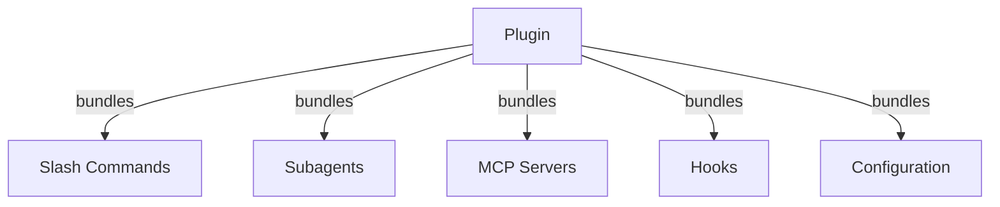
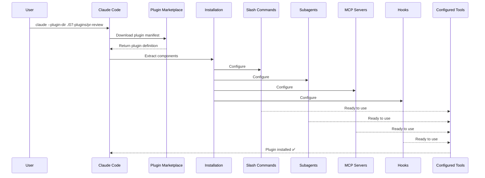
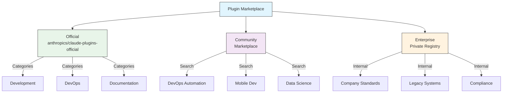
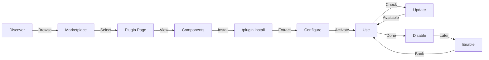
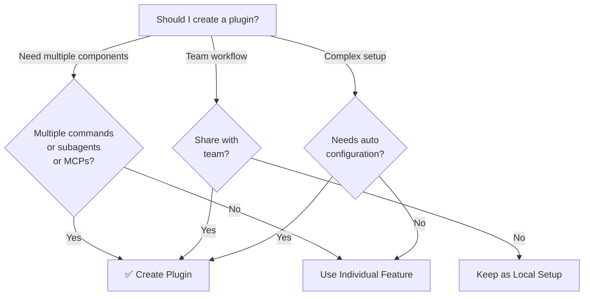

<picture>
  <source media="(prefers-color-scheme: dark)" srcset="../../resources/logos/claude-howto-logo-dark.svg">
  
</picture>

# Claude Code Plugins / Plugins Claude Code

Thư mục này chứa các ví dụ plugin hoàn chỉnh đóng gói nhiều tính năng Claude Code thành các gói có thể cài đặt liền mạch.

## Tổng Quan / Overview

Claude Code Plugins là các bộ sưu tập được đóng gói của các tùy chỉnh (lệnh slash, tác nhân con, MCP servers, và hooks) cài đặt với một lệnh duy nhất. Chúng đại diện cho cơ chế mở rộng cấp cao nhất—kết hợp nhiều tính năng thành các gói gắn kết, có thể chia sẻ.

## Kiến Trúc Plugin / Plugin Architecture



## Quy Trình Tải Plugin / Plugin Loading Process



> **Không cần marketplace (v2.1.157+)**: Các plugin đặt trong thư mục `.claude/skills` giờ tự động được tải mà không cần marketplace. Tạo khung một plugin mới bằng `claude plugin init <name>`, lệnh này tạo plugin tại `~/.claude/skills/<name>/` (toàn cục cho người dùng) và tự tải nó ở phiên tiếp theo dưới tên `<name>@skills-dir`. Managed settings có thể chặn các plugin trong thư mục skills: `strictPluginOnlyCustomization` chặn chúng ngay cả khi allowlist có mục `{ "source": "skills-dir" }`, và một allowlist marketplace không có mục đó cũng chặn chúng. Một thư mục bị chặn sẽ không hiện plugin nào và cũng không báo lỗi trong `/plugin` hay `claude plugin list`.

## Các Loại Plugin & Phân Phối / Plugin Types & Distribution

| Loại | Phạm Vi | Chia Sẻ | Quyền | Ví Dụ |
|------|-------|--------|-----------|----------|
| Chính Thức | Toàn cầu | Tất cả người dùng | Anthropic | PR Review, Security Guidance |
| Cộng Đồng | Công khai | Tất cả người dùng | Cộng Đồng | DevOps, Data Science |
| Tổ Chức | Nội bộ | Các thành viên nhóm | Công ty | Tiêu chuẩn nội bộ, công cụ |
| Cá Nhân | Cá nhân | Người dùng duy nhất | Nhà phát triển | Workflows tùy chỉnh |

## Cấu Trúc Định Nghĩa Plugin / Plugin Definition Structure

Plugin manifest sử dụng định dạng JSON trong `.claude-plugin/plugin.json`:

```json
{
  "name": "my-first-plugin",
  "description": "A greeting plugin",
  "version": "1.0.0",
  "author": {
    "name": "Your Name"
  },
  "homepage": "https://example.com",
  "repository": "https://github.com/user/repo",
  "license": "MIT"
}
```

Ngoài các trường định danh đó, manifest còn có thể chỉ cho Claude Code các thành phần nằm ở nơi khác ngoài các thư mục mặc định, và mang metadata phục vụ khám phá và dependency:

| Trường | Kiểu | Mô Tả |
|-------|------|-------------|
| `workflows` | string \| array | Các file hoặc thư mục script [workflow](https://code.claude.com/docs/en/workflows) tùy chỉnh (thay thế thư mục mặc định `workflows/`) |
| `outputStyles` | string \| array | Các file hoặc thư mục output style tùy chỉnh (thay thế thư mục mặc định `output-styles/`) |
| `lspServers` | string \| array \| object | LSP servers cho code intelligence — đi đến định nghĩa, tìm tham chiếu, chẩn đoán. Thường là `"./.lsp.json"`. Xem [Cấu hình LSP server](#cấu-hình-lsp-server--lsp-server-configuration) |
| `channels` | array | Khai báo channel để chèn tin nhắn (kiểu Telegram, Slack, Discord) |
| `dependencies` | array | Các plugin khác mà plugin này cần, có thể kèm ràng buộc phiên bản semver |
| `keywords` | array | Các tag khám phá dùng khi duyệt và tìm kiếm marketplace |
| `metadata` | object | Object tự do cho dữ liệu riêng của bạn, ví dụ các trường entitlement hoặc catalog |
| `experimental.themes` | string \| array | Các file hoặc thư mục theme màu (thay thế thư mục mặc định `themes/`) |
| `experimental.monitors` | string \| array | Các cấu hình [Monitor nền](#monitor-nền--background-monitors-v21105) tự khởi động khi plugin đang hoạt động |

## Ví Dụ Cấu Trúc Plugin / Plugin Structure Example

```
my-plugin/
├── .claude-plugin/
│   └── plugin.json       # Manifest (tên, mô tả, phiên bản, tác giả)
├── commands/             # Skills dưới dạng các file Markdown
│   ├── task-1.md
│   ├── task-2.md
│   └── workflows/
├── agents/               # Định nghĩa agent tùy chỉnh
│   ├── specialist-1.md
│   ├── specialist-2.md
│   └── configs/
├── skills/               # Agent Skills với các file SKILL.md
│   ├── skill-1/
│   │   └── SKILL.md
│   └── skill-2/
│       └── SKILL.md
├── hooks/                # Event handlers trong hooks.json
│   └── hooks.json
├── .mcp.json             # Cấu hình MCP server
├── .lsp.json             # Cấu hình LSP server cho code intelligence
├── bin/                  # Các file thực thi được thêm vào PATH của công cụ Bash khi plugin được bật (lệnh PowerShell không sandbox cũng tìm thấy, v2.1.302)
├── settings.json         # Cài đặt mặc định áp dụng khi plugin được bật (chỉ các key `agent` và `subagentStatusLine` có hiệu lực)
├── themes/               # Tùy chọn: kèm các theme Claude Code tùy chỉnh (v2.1.118+)
├── templates/
│   └── issue-template.md
├── scripts/
│   ├── helper-1.sh
│   └── helper-2.py
├── docs/
│   ├── README.md
│   └── USAGE.md
└── tests/
    └── plugin.test.js
```

> **Lưu ý**: `commands/` là **legacy**. Hướng dẫn chính thức là *"Use `skills/` for new plugins."* (Dùng `skills/` cho plugin mới). Các thư mục `commands/` hiện có vẫn hoạt động — ba plugin ví dụ trong module này đều có một thư mục như vậy — nhưng plugin mới nên đặt các khả năng của nó trong `skills/` dưới dạng các thư mục `SKILL.md` thay vì các file lệnh Markdown phẳng.

### Cấu hình LSP server / LSP server configuration

Plugins có thể bao gồm hỗ trợ Language Server Protocol (LSP) để có code intelligence thời gian thực. LSP servers cung cấp chẩn đoán, điều hướng code, và thông tin ký hiệu khi bạn làm việc.

**Vị trí cấu hình**:
- File `.lsp.json` trong thư mục gốc plugin
- Key `lspServers` trong `plugin.json` — tên trường manifest chính thức. Nó nhận một chuỗi, một mảng, hoặc một object: chuỗi hoặc mảng trỏ đến (các) file cấu hình LSP hoặc thư mục (ví dụ `"./.lsp.json"`), còn object khai báo các server inline.

#### Tham khảo trường / Field reference

| Trường | Bắt Buộc | Mô Tả |
|-------|----------|-------------|
| `command` | Có | Binary LSP server (phải trong PATH) |
| `extensionToLanguage` | Có | Ánh xạ các phần mở rộng file đến ID ngôn ngữ |
| `args` | Không | Các đối số dòng lệnh cho server |
| `transport` | Không | Phương thức giao tiếp: `stdio` (mặc định) hoặc `socket` |
| `env` | Không | Biến môi trường cho tiến trình server |
| `initializationOptions` | Không | Các tùy chọn được gửi trong quá trình khởi tạo LSP |
| `settings` | Không | Cấu hình workspace được chuyển đến server |
| `workspaceFolder` | Không | Ghi đè đường dẫn thư mục workspace |
| `startupTimeout` | Không | Thời gian tối đa (ms) để chờ khởi động server |
| `shutdownTimeout` | Không | Thời gian tối đa (ms) để tắt graceful |
| `restartOnCrash` | Không | Tự động khởi động lại nếu server bị lỗi |
| `maxRestarts` | Không | Số lần khởi động lại tối đa trước khi bỏ cuộc |

#### Các cấu hình ví dụ / Example configurations

**Go (gopls)**:

```json
{
  "go": {
    "command": "gopls",
    "args": ["serve"],
    "extensionToLanguage": {
      ".go": "go"
    }
  }
}
```

**Python (pyright)**:

```json
{
  "python": {
    "command": "pyright-langserver",
    "args": ["--stdio"],
    "extensionToLanguage": {
      ".py": "python",
      ".pyi": "python"
    }
  }
}
```

**TypeScript**:

```json
{
  "typescript": {
    "command": "typescript-language-server",
    "args": ["--stdio"],
    "extensionToLanguage": {
      ".ts": "typescript",
      ".tsx": "typescriptreact",
      ".js": "javascript",
      ".jsx": "javascriptreact"
    }
  }
}
```

#### Các plugin LSP có sẵn / Available LSP plugins

Marketplace chính thức bao gồm các plugin LSP được cấu hình sẵn:

| Plugin | Ngôn Ngữ | Server Binary | Lệnh Cài Đặt |
|--------|----------|---------------|----------------|
| `pyright-lsp` | Python | `pyright-langserver` | `pip install pyright` |
| `typescript-lsp` | TypeScript/JavaScript | `typescript-language-server` | `npm install -g typescript-language-server typescript` |
| `rust-analyzer-lsp` | Rust | `rust-analyzer` | Cài đặt qua `rustup component add rust-analyzer` |

#### Khả năng LSP / LSP capabilities

Khi được cấu hình, LSP servers cung cấp:

- **Chẩn đoán tức thì** — lỗi và cảnh báo xuất hiện ngay sau khi chỉnh sửa
- **Điều hướng code** — đi đến định nghĩa, tìm tham chiếu, implementations
- **Thông tin hover** — chữ ký kiểu và tài liệu khi hover
- **Liệt kê ký hiệu** — duyệt các ký hiệu trong file hoặc workspace hiện tại

### Thư mục `bin/` trên `PATH` / `bin/` directory on `PATH`

Khi một plugin được bật, thư mục `bin/` của nó được thêm vào `PATH` của phiên, sau các mục `PATH` của chính bạn, nên plugin không thể che khuất `git`, `ls`, hay lệnh hệ thống khác. Bất kỳ file thực thi nào đặt ở đó đều có thể được gọi trực tiếp theo tên từ công cụ Bash — không cần đường dẫn đầy đủ (lệnh của công cụ PowerShell chạy ngoài sandbox cũng tìm thấy chúng, v2.1.302; lệnh chạy trong sandbox thì không).

```bash
# Trong cấu trúc plugin:
my-plugin/
├── .claude-plugin/
│   └── plugin.json
└── bin/
    └── my-tool          # file thực thi (chmod +x)

# Bên trong một phiên Claude Code có bật plugin:
$ my-tool --help
```

Dùng cách này cho các CLI helper mà hooks, skills, hoặc commands trong cùng plugin sẽ gọi ra shell. Đánh dấu các file là thực thi được trong repo plugin (`chmod +x`) — git giữ nguyên bit này.

## Tùy Chọn Plugin (v2.1.83+) / Plugin Options

Plugins có thể khai báo các tùy chọn người dùng cấu hình được trong manifest qua `userConfig`. Các giá trị được đánh dấu `sensitive: true` được lưu trong system keychain thay vì các file settings dạng văn bản thuần:

```json
{
  "name": "my-plugin",
  "version": "1.0.0",
  "userConfig": {
    "apiKey": {
      "type": "string",
      "title": "API key",
      "description": "API key for the service",
      "sensitive": true
    },
    "region": {
      "type": "string",
      "title": "Region",
      "description": "Deployment region",
      "default": "us-east-1"
    }
  }
}
```

## Dữ Liệu Plugin Liên Tục (`${CLAUDE_PLUGIN_DATA}`) (v2.1.78+)

Plugins có quyền truy cập đến một thư mục trạng thái liên tục qua biến môi trường `${CLAUDE_PLUGIN_DATA}`. Thư mục này là duy nhất cho mỗi plugin và tồn tại qua các phiên, làm cho nó phù hợp cho caches, databases, và các trạng thái liên tục khác:

```json
{
  "hooks": {
    "PostToolUse": [
      {
        "matcher": "*",
        "hooks": [
          {
            "type": "command",
            "command": "node \"${CLAUDE_PLUGIN_ROOT}\"/scripts/track-usage.js \"${CLAUDE_PLUGIN_DATA}\"/usage.json"
          }
        ]
      }
    ]
  }
}
```

Thư mục (`~/.claude/plugins/data/<id>/`) được tạo lần đầu tiên khi nó được tham chiếu và được giữ lại qua các lần cập nhật plugin. Nó bị xóa khi bạn gỡ cài đặt plugin khỏi nơi cuối cùng mà plugin được cài đặt (trừ khi bạn truyền `--keep-data`).

### Monitor Nền / Background Monitors (v2.1.105)

Plugins có thể đăng ký các monitor nền khởi động khi một phiên bắt đầu hoặc lần đầu một skill của plugin chạy. Khai báo chúng trong `experimental.monitors` của `plugin.json` (hoặc trong `monitors/monitors.json`):

```json
{
  "name": "my-plugin",
  "version": "1.0.0",
  "experimental": {
    "monitors": [
      {
        "name": "app-log",
        "command": "tail -f /var/log/app.log",
        "description": "Application log errors",
        "when": "always"
      }
    ]
  }
}
```

`name`, `command`, và `description` là bắt buộc. `when` nhận các giá trị:
- `"always"` (mặc định) — khởi động khi phiên bắt đầu và khi plugin được reload
- `"on-skill-invoke:<skill>"` — khởi động lần đầu skill đó chạy

Các key không xác định bị từ chối và plugin sẽ không được tải. Key `monitors` ở cấp cao nhất vẫn được tải nhưng `claude plugin validate` sẽ cảnh báo.

Monitors dùng chính công cụ Monitor bên dưới, stream từng dòng stdout thành các sự kiện mà Claude có thể phản ứng.

Monitor của plugin không khởi động trong các lần chạy `-p` không tương tác. Trên Amazon Bedrock, Claude Platform on AWS, Agent Platform của Google Cloud, hoặc Microsoft Foundry, hoặc khi đặt `DISABLE_TELEMETRY` hay `CLAUDE_CODE_DISABLE_NONESSENTIAL_TRAFFIC`, chúng cần v2.1.310+ (các phiên bản trước không khởi động chúng ở đó). Khi managed settings đặt `allowManagedHooksOnly`, chỉ monitor từ các plugin mà managed settings của bạn bắt buộc bật mới khởi động (v2.1.310+).

## Plugin Inline qua Settings (`source: 'settings'`) (v2.1.80+)

Plugins có thể được định nghĩa inline trong các file settings như các mục marketplace sử dụng trường `source: 'settings'`. Điều này cho phép nhúng định nghĩa plugin trực tiếp mà không cần repository hoặc marketplace riêng. Khai báo nó trong `extraKnownMarketplaces.<name>.source`; `name` phải trùng với key của marketplace, và các plugin của nó phải tham chiếu nguồn bên ngoài như GitHub hoặc npm (đường dẫn tương đối bị từ chối):

```json
{
  "extraKnownMarketplaces": {
    "inline-tools": {
      "source": {
        "source": "settings",
        "name": "inline-tools",
        "plugins": [
          {
            "name": "quick-lint",
            "source": {
              "source": "github",
              "repo": "my-org/quick-lint"
            }
          }
        ]
      }
    }
  }
}
```

## Mods (v2.1.287+)

Mod là một plugin thay đổi giao diện và hành vi của Claude Code. Code của nó là một hooks module JavaScript hoặc TypeScript: các event handler mà Claude Code gọi khi có điều gì đó xảy ra, chẳng hạn một lần gọi công cụ, một prompt được gửi, hoặc một phần giao diện đang được vẽ. Mỗi handler có thể quan sát sự kiện, viết lại nó, hoặc tự trả lời nó. Mod được cài như mọi plugin khác (`/plugin install <plugin>@<marketplace>`), có thể nằm chung plugin với skills và MCP servers, và chạy với quyền của bạn, nên chỉ cài mod từ các tác giả và marketplace bạn tin tưởng. Mods hoạt động trong Claude Code CLI (v2.1.287+), trong tab Code của ứng dụng Claude Desktop, và trong extension VS Code.

| Mod có thể làm gì | Ví dụ |
|-------------------|---------|
| Vẽ các pane và một dải phía trên prompt | Một pane bên cạnh transcript hoặc một dải phía trên prompt, với tabs, nút bấm, và ô nhập văn bản |
| Thêm lệnh | Một `/command` chạy hàm của bạn ngay lập tức, không cần lượt của Claude, kể cả khi Claude đang làm việc |
| Chặn hoặc thay đổi lần gọi công cụ | Giữ một lần gọi công cụ trong lúc bạn hỏi người dùng, từ chối nó, hoặc trả lời nó mà không chạy công cụ |
| Phản ứng với sự kiện | Theo dõi các lần gọi công cụ, prompts, và lượt; các hooks của một mod dùng chung biến, nên một hook có thể đếm số lần gọi công cụ trong khi hook khác hiển thị con số đó cạnh spinner |
| Gọi mods API | Gọi một model, đọc và ghi file, khởi chạy tiến trình, hoặc gửi request mạng (một hook chỉ làm được những việc này qua mods API) |

Để tạo một mod, hãy mô tả điều bạn muốn trong một phiên Claude Code: Claude làm việc dựa trên skill tích hợp sẵn `plugin-authoring` (hoặc bạn tự chạy `/plugin-authoring`), viết mod và tải nó khi lượt kết thúc — trong chế độ `auto` và `bypassPermissions` thì không cần hỏi (v2.1.321+, kể cả khi managed settings đặt `allowUnsandboxedCommands: false` hoặc `allowManagedDomainsOnly`), còn lại thì sau khi bạn phê duyệt hot reloading cho phiên — rồi reload mod ở cuối mỗi lượt có thay đổi nó. Mod không được tải ở nơi không ai có thể phê duyệt nó: chế độ `dontAsk`, hoặc một lần chạy `claude -p` ngoài chế độ `auto` và `bypassPermissions`; `claude plugin validate` kiểm tra mod mà không chạy nó. Quản trị viên quyết định mod có được chạy hay không, và mod nào, thông qua managed settings — ví dụ, `allowManagedModsOnly` chỉ cho phép các mod của tổ chức bạn và các mod tích hợp sẵn trong Claude Code chạy hooks của chúng. Khi có managed settings, hoặc khi phiên dùng thông tin xác thực `/login` của gói Team hoặc Enterprise, một cơ chế bảo vệ tích hợp sẵn ngăn mod của người dùng phê duyệt một lần gọi mà quy tắc `deny` hoặc `ask` hay bất kỳ hook `PreToolUse` nào sẽ chặn; khi không có cả hai, mod có thể phê duyệt lần gọi như vậy.

> **Lưu ý**: v2.1.299–2.1.300 thêm các prop `Text` là `size`, `weight`, `mono`, `tabular`, `dir` (RTL) — `bold` bị deprecated, thay bằng `weight` — các bước khoảng cách `Box` từ `xs`–`xl`, `virtualText` cho prompt, `$.ui.view({ agentId })`, và hook `prompt.change`; v2.1.301 thêm `Input` `rows` cho ô nhập nhiều dòng (Enter để gửi, Shift+Enter để thêm dòng). v2.1.304 thêm `e.isReadOnly` trên `tool.check` (cùng matcher `isReadOnly: true`), các hook `settings.read` thấy được từng lớp settings (`e.layers`) khi chính Claude Code đọc settings — nhờ đó một managed mod có thể giới hạn một setting của tổ chức — và đối số `key` cho `$.settings.read()`; v2.1.305 giữ pane được neo trong phạm vi 45% chiều rộng terminal và vẽ `Image` trong iTerm2 3.5+ (render toàn màn hình); v2.1.310 vẽ `Image` bên trong tmux 3.3+ khi bật `allow-passthrough` và `focus-events`.

> **Lưu ý**: Xem tài liệu chính thức [Mods overview](https://code.claude.com/docs/en/plugins/mods/overview), [Create a mod](https://code.claude.com/docs/en/plugins/mods/create), và [Mods reference](https://code.claude.com/docs/en/plugins/mods/reference).

## Cài Đặt Plugin / Plugin Settings

Plugins có thể kèm một file `settings.json` để cung cấp cấu hình mặc định. Hai key có hiệu lực là `agent` và `subagentStatusLine`; mọi key khác bị bỏ qua. `agent` nhận tên của một agent trong plugin và chạy nó làm luồng chính:

```json
{
  "agent": "specialist-1"
}
```

Khi một plugin bao gồm `settings.json`, các mặc định của nó được áp dụng khi cài đặt. Người dùng có thể ghi đè các cài đặt này trong cấu hình project hoặc user của riêng họ.

## Cách Tiếp Cận Standalone vs Plugin / Standalone vs Plugin Approach

| Cách Tiếp Cận | Tên Lệnh | Cấu Hình | Tốt Nhất Cho |
|----------|---------------|---|---|
| **Standalone** | `/hello` | Thiết lập thủ công trong CLAUDE.md | Cá nhân, cụ thể project |
| **Plugins** | `/plugin-name:hello` | Tự động qua plugin.json | Chia sẻ, phân phối, sử dụng nhóm |

Sử dụng **lệnh slash standalone** cho workflows cá nhân nhanh. Sử dụng **plugins** khi bạn muốn đóng gói nhiều tính năng, chia sẻ với một nhóm, hoặc xuất bản để phân phối.

> **Gọi bằng dấu cách (v2.1.136+)**: Lệnh slash của plugin cũng hoạt động với dấu cách — `/myplugin review` được phân giải thành dạng chuẩn `/myplugin:review`. Dạng nào cũng được; dạng dấu hai chấm là dạng chuẩn và được khuyến nghị trong scripts.

> **Khám phá `skills/` (v2.1.136+)**: Mục `skills` trong `plugin.json` không còn che mất thư mục mặc định `skills/` của plugin. Skills được khai báo ở cả hai nơi sẽ được gộp lại, nên bạn có thể liệt kê vài skill nổi bật trong `plugin.json` mà không mất phần còn lại.

> **Plugin có `SKILL.md` ở gốc (v2.1.142+)**: Một plugin có `SKILL.md` ở cấp cao nhất và **không có thư mục con `skills/`** sẽ tự được hiển thị như một skill duy nhất — plugin *chính là* skill. Đây là một pattern bổ sung, không thay thế thư mục `skills/` hay mục `skills` trong `plugin.json`; hãy dùng nó cho các plugin nhỏ chỉ có một skill, nơi cấu trúc thư mục không mang lại giá trị gì.

## Ví Dụ Thực Tiễn / Practical Examples

### Ví Dụ 1: Plugin PR Review / Example 1: PR Review Plugin

**File:** `.claude-plugin/plugin.json`

```json
{
  "name": "pr-review",
  "version": "1.0.0",
  "description": "Complete PR review workflow with security, testing, and docs",
  "author": {
    "name": "Anthropic"
  },
  "repository": "https://github.com/your-org/pr-review",
  "license": "MIT"
}
```

**File:** `commands/review-pr.md`

```markdown
---
name: Review PR
description: Start comprehensive PR review with security and testing checks
---

# PR Review

Lệnh này khởi tạo một pull request review hoàn chỉnh bao gồm:

1. Phân tích bảo mật
2. Xác minh độ phủ test
3. Cập nhật tài liệu
4. Kiểm tra chất lượng code
5. Đánh giá tác động hiệu suất
```

**File:** `agents/security-reviewer.md`

```yaml
---
name: security-reviewer
description: Security-focused code review
tools: Read, Grep, Bash
---

# Security Reviewer

Chuyên tìm các lỗ hổng bảo mật:
- Vấn đề xác thực/phân quyền
- Lộ dữ liệu
- Các tấn công injection
- Cấu hình bảo mật
```

**Cài Đặt:**

```bash
claude --plugin-dir ./07-plugins/pr-review

# Kết quả:
# ✅ 3 slash commands installed
# ✅ 3 subagents configured
# ✅ 2 MCP servers connected
# ✅ 4 hooks registered
# ✅ Ready to use!
```

### Ví Dụ 2: Plugin DevOps / Example 2: DevOps Plugin

**Các Thành Phần:**

```
devops-automation/
├── commands/
│   ├── deploy.md
│   ├── rollback.md
│   ├── status.md
│   └── incident.md
├── agents/
│   ├── deployment-specialist.md
│   ├── incident-commander.md
│   └── alert-analyzer.md
├── mcp/
│   └── kubernetes-config.json
├── hooks/
│   ├── pre-deploy.js
│   └── post-deploy.js
└── scripts/
    ├── deploy.sh
    ├── rollback.sh
    └── health-check.sh
```

### Ví Dụ 3: Plugin Tài Liệu / Example 3: Documentation Plugin

**Các Thành Phần Được Đóng Gói:**

```
documentation/
├── commands/
│   ├── generate-api-docs.md
│   ├── generate-readme.md
│   ├── sync-docs.md
│   └── validate-docs.md
├── agents/
│   ├── api-documenter.md
│   ├── code-commentator.md
│   └── example-generator.md
├── mcp/
│   └── github-docs-config.json
└── templates/
    ├── api-endpoint.md
    ├── function-docs.md
    └── adr-template.md
```

## Marketplace Plugin / Plugin Marketplace

Thư mục plugin chính thức do Anthropic quản lý là `anthropics/claude-plugins-official`, được tự động đăng ký ở lần khởi chạy tương tác đầu tiên. Các quản trị viên enterprise cũng có thể tạo các plugin marketplace riêng để phân phối nội bộ.

Ngoài ra còn có một **marketplace cộng đồng**, `anthropics/claude-plugins-community`, chứa các plugin bên thứ ba đã vượt qua quy trình xác thực tự động và sàng lọc an toàn của Anthropic — mỗi plugin được ghim vào một commit SHA cụ thể trong catalog. Khác với marketplace chính thức, bạn phải tự thêm nó:

```bash
/plugin marketplace add anthropics/claude-plugins-community

# Sau đó cài đặt từ đó bằng tên marketplace claude-community
/plugin install <plugin-name>@claude-community
```

> **Deprecated**: Marketplace cũ `claude-code-plugins` trong `anthropics/claude-code` đã bị deprecated. Hãy cài các plugin của Anthropic bằng `claude plugin install <plugin>@claude-plugins-official`, và bỏ qua mọi bước hướng dẫn chạy `/plugin marketplace add anthropics/claude-code`. Các plugin bạn đã cài từ marketplace đó vẫn tiếp tục được cập nhật từ `claude-plugins-official`, ngoại trừ `ralph-wiggum` (nay là `ralph-loop`, lệnh `/ralph-loop:`) và `claude-opus-4-5-migration` (đã ngừng; hãy chạy `claude plugin uninstall claude-opus-4-5-migration@claude-code-plugins`).



### Cấu Hình Marketplace / Marketplace Configuration

Người dùng enterprise và nâng cao có thể kiểm soát hành vi marketplace qua các cài đặt:

| Cài Đặt | Mô Tả |
|---------|-------------|
| `extraKnownMarketplaces` | Thêm các nguồn marketplace bổ sung ngoài mặc định |
| `strictKnownMarketplaces` | Kiểm soát marketplace nào người dùng được phép thêm (chỉ managed) |
| `blockedMarketplaces` | Blocklist marketplace do quản trị viên quản lý (hỗ trợ các trường regex `hostPattern` / `pathPattern` từ v2.1.119) |
| `enabledPlugins` (đặt `false`) | Chặn một plugin cụ thể: `"enabledPlugins": { "<plugin>@<marketplace>": false }` trong managed settings chặn cài đặt ở mọi phạm vi và ẩn plugin khỏi marketplace |

> **Bí danh thân thiện hơn (v2.1.232)**: `additionalMarketplaces` được chấp nhận như bí danh của
> `extraKnownMarketplaces`, và `allowedMarketplaces` của `strictKnownMarketplaces`.
> Trang settings chính thức liệt kê cả hai tại
> [Marketplace key aliases](https://code.claude.com/docs/en/settings-reference#marketplace-key-aliases).
> Các phiên bản cũ hơn bỏ qua bí danh, nên các khóa chuẩn vẫn an toàn để tiếp tục dùng.

> **Ký tự đại diện theo owner (v2.1.223+)**: một mục `"owner/*"` cho phép hoặc chặn mọi repo
> marketplace thuộc một owner GitHub. **Chỉ được chấp nhận trong `strictKnownMarketplaces` và
> `blockedMarketplaces`.** Ở mọi nơi khác có nguồn `github` — kể cả
> `extraKnownMarketplaces` và `/plugin marketplace add` — giá trị `repo` phải chỉ đúng
> một repository.

> **Thực thi** (v2.1.117+): `blockedMarketplaces` và `strictKnownMarketplaces` được thực thi ở mọi sự kiện trong vòng đời plugin — cài đặt, cập nhật, làm mới, và tự động cập nhật — chứ không chỉ ở lần thêm đầu tiên. `strictKnownMarketplaces` chỉ dùng trong managed settings.

Ví dụ `blockedMarketplaces` với regex host/path (v2.1.119):

```json
{
  "blockedMarketplaces": [
    { "source": "hostPattern", "hostPattern": "^evil\\.example\\.com$" },
    { "source": "pathPattern", "pathPattern": "^/opt/approved/" }
  ]
}
```

#### `headersHelper` của marketplace / Marketplace `headersHelper` (v2.1.238)

Một marketplace dạng `url` — hoặc một mục catalog riêng lẻ — có thể chỉ định một lệnh `headersHelper` để tạo các HTTP header dùng khi tải catalog và mọi archive cùng origin. Đây là cách một marketplace riêng tư đứng sau một dịch vụ cấp token xác thực mà không cần secret tĩnh trong cấu hình.

Helper của một **mục catalog** chỉ chạy khi cài đặt hoặc cập nhật, và chỉ sau khi lệnh của nó đã được hiển thị cho bạn: `claude plugin install` và `claude plugin update` hỏi `[y/N]` trước khi chạy. Truyền `-y` để chấp nhận mà không cần hỏi trong tự động hóa.

### Các Tính Năng Marketplace Thêm / Additional Marketplace Features

- **Thanh tìm kiếm marketplace (v2.1.172)**: Khi duyệt các plugin của một marketplace trong `/plugin`, thanh tìm kiếm cho phép bạn lọc plugin theo tên hoặc từ khóa — tiện lợi với các marketplace lớn, nơi cuộn toàn bộ danh sách rất chậm.
- **Git timeout mặc định**: Tăng từ 30s lên 120s cho các repository plugin lớn
- **npm registries tùy chỉnh**: Plugins có thể chỉ định URL registry npm tùy chỉnh để phân giải dependency
- **Version pinning**: Khóa plugins vào các phiên bản cụ thể để môi trường có thể tái tạo
- **Chi phí ngữ cảnh dự kiến trong pane duyệt (v2.1.143)**: Trình duyệt marketplace `/plugin` hiển thị chi phí token ngữ cảnh dự kiến mỗi lượt của từng plugin — tổng của các skills luôn được tải, hooks, và mô tả MCP server. Dùng nó để cân nhắc trước khi cài đặt. Cùng con số dự kiến này có sẵn sau khi cài qua [`claude plugin details <name>`](#claude-plugin-details-name-v21139).
- **Chỉ clone các submodule của plugin (v2.1.295)**: khi Claude Code clone một repository marketplace, nó chỉ tải các git submodule chứa file plugin (một plugin gốc với `"source": "./"` nhận tất cả hoặc không gì cả, và `--sparse`/`sparsePaths` không tải submodule nào). Các phiên bản trước tải mọi submodule và có thể vượt quá clone timeout.

Ví dụ một dòng khi duyệt với cột chi phí:

```text
NAME              VERSION   AUTHOR     CTX/TURN   DESCRIPTION
code-reviewer     1.2.0     anthropic  +1,420     Multi-agent PR review
devops-toolkit    0.4.1     acme       +3,180     SRE playbooks, on-call helpers
docs-helper       0.9.0     community  +610       Doc-style guide enforcement
```

### Schema định nghĩa marketplace / Marketplace definition schema

Plugin marketplaces được định nghĩa trong `.claude-plugin/marketplace.json`:

```json
{
  "name": "my-team-plugins",
  "owner": { "name": "my-org" },
  "plugins": [
    {
      "name": "code-standards",
      "source": "./plugins/code-standards",
      "description": "Enforce team coding standards",
      "version": "1.2.0",
      "author": { "name": "platform-team" }
    },
    {
      "name": "deploy-helper",
      "source": {
        "source": "github",
        "repo": "my-org/deploy-helper",
        "ref": "v2.0.0"
      },
      "description": "Deployment automation workflows"
    }
  ]
}
```

| Trường | Bắt Buộc | Mô Tả |
|-------|----------|-------------|
| `name` | Có | Tên marketplace trong kebab-case; hãy chọn tên mà các tác giả khác khó dùng trùng, vì người dùng không thể thêm hai marketplace có cùng tên |
| `owner` | Có | Tổ chức hoặc người dùng duy trì marketplace: một object với `name` bắt buộc (`email`, `url` tùy chọn) |
| `plugins` | Có | Mảng các mục plugin |
| `plugins[].name` | Có | Tên plugin (kebab-case) |
| `plugins[].source` | Có | Nguồn plugin (chuỗi đường dẫn hoặc object nguồn) |
| `plugins[].description` | Không | Mô tả plugin ngắn |
| `plugins[].version` | Không | Chuỗi phiên bản semantic |
| `plugins[].author` | Không | Tác giả plugin: một object với `name` bắt buộc (`email`, `url` tùy chọn) |
| `renames` | Không | Trường cấp cao nhất của marketplace (không theo từng mục): ánh xạ `name` cũ của plugin sang tên hiện tại (hoặc `null` nếu đã gỡ) để người dùng được chuyển đổi tự động (v2.1.193) |
| `plugins[].displayName` | Không | Tên dễ đọc hiển thị trên UI; không dùng để tra cứu (v2.1.143) |
| `plugins[].defaultEnabled` | Không | Nếu là `false`, plugin được cài ở trạng thái tắt cho đến khi người dùng chủ động bật (v2.1.154) |

### Các loại nguồn plugin / Plugin source types

Plugins có thể được lấy từ nhiều vị trí:

| Nguồn | Cú Pháp | Ví Dụ |
|--------|--------|---------|
| **Đường dẫn tương đối** | Chuỗi đường dẫn | `"./plugins/my-plugin"` |
| **GitHub** | `{ "source": "github", "repo": "owner/repo" }` | `{ "source": "github", "repo": "acme/lint-plugin", "ref": "v1.0" }` |
| **Git URL** | `{ "source": "url", "url": "..." }` | `{ "source": "url", "url": "https://git.internal/plugin.git" }` |
| **Thư mục con Git** | `{ "source": "git-subdir", "url": "...", "path": "..." }` | `{ "source": "git-subdir", "url": "https://github.com/org/monorepo.git", "path": "packages/plugin" }` |
| **npm** | `{ "source": "npm", "package": "..." }` | `{ "source": "npm", "package": "@acme/claude-plugin", "version": "^2.0" }` |
| **Archive** (v2.1.224+) | `{ "source": "archive", "url": "..." }` | `{ "source": "archive", "url": "https://cdn.example.com/lint-plugin-1.2.0.zip", "sha256": "…" }` |
| **Command** (v2.1.229+) | `{ "source": "command", "command": "..." }` | `{ "source": "command", "command": "acme-plugin-resolver --print-dir" }` |

Các nguồn GitHub và git hỗ trợ các trường tùy chọn `ref` (nhánh/tag) và `sha` (hash commit) để version pinning.

**Tên nguồn rút gọn và `metadata.pluginRoot` (v2.1.239)**: `metadata.pluginRoot` của marketplace giờ đã có hiệu lực — một tên nguồn plugin rút gọn trong catalog được phân giải thành một thư mục nằm dưới root đó, thay vì phải viết đầy đủ đường dẫn tương đối ở mọi mục.

**Skills đồng bộ từ claude.ai (v2.1.239)**: các plugin được đồng bộ từ claude.ai xuất hiện dưới dạng `name@synced`. Hãy gọi chúng theo cách đó trong `claude plugin enable <name>@synced` và `claude plugin disable <name>@synced`. Một plugin đồng bộ không bao giờ ghi đè plugin đã cài có cùng tên — hai plugin cùng tồn tại, phân biệt bằng hậu tố `@synced`.

#### Nguồn `archive` / `archive` source (v2.1.224+)

Cài một plugin từ file zip qua HTTPS — không cần git clone, không cần npm install.

```json
{
  "source": "archive",
  "url": "https://cdn.example.com/lint-plugin-1.2.0.zip",
  "sha256": "3b1f0c2e9a7d4f5b8c6e1a2d3f4b5c6d7e8f9a0b1c2d3e4f5a6b7c8d9e0f1a2b"
}
```

| Trường | Bắt Buộc | Ghi Chú |
|-------|----------|-------|
| `url` | Có | **Chỉ HTTPS.** `http://`, loopback, link-local, và các host cloud-metadata bị từ chối — và được kiểm tra lại ở **mọi bước redirect**, nên một redirect không thể lén đưa bạn đến host bị chặn |
| `sha256` | Không | 64 ký tự hex. Khi không khớp, việc cài đặt thất bại với `Plugin archive integrity check failed` |

Archive bị giới hạn ở **256 MiB**. Hãy ghim `sha256` cho bất cứ thứ gì bạn không tự build — nếu không, ai kiểm soát URL sẽ kiểm soát code chạy trong phiên của bạn.

#### Nguồn `command` / `command` source (v2.1.229+)

Để một công cụ đã cài cục bộ quyết định plugin nằm ở đâu. Hữu ích khi một package manager
nội bộ đã biết cách tải và sắp xếp các plugin của bạn.

```json
{
  "source": "command",
  "command": "acme-plugin-resolver --print-dir",
  "timeout": 60,
  "mode": "copy"
}
```

Hợp đồng rất nghiêm ngặt: **lệnh phải in đúng một dòng ra stdout và thoát với
mã 0.** Dòng đó là đường dẫn tuyệt đối của một thư mục chứa plugin hoàn chỉnh.

| Trường | Bắt Buộc | Mặc Định | Ghi Chú |
|-------|----------|---------|-------|
| `command` | Có | — | Lệnh cần chạy |
| `timeout` | Không | `60` (giây) | Tối đa 600 |
| `mode` | Không | `"copy"` | `"copy"` chụp snapshot thư mục; `"link"` tạo symlink, nên các chỉnh sửa có hiệu lực ngay |

Lệnh được phân giải lại mỗi phiên và kết quả được áp dụng mà không cần khởi động lại.
Các tổ chức có thể chặn hoàn toàn loại nguồn này bằng `disableCommandPluginSources`.

Các tên marketplace dành riêng giờ bao gồm `first-party-plugins` và `healthcare` (v2.1.205) — chúng được giữ cho mục đích chính thức và không thể được dùng bởi marketplace tùy chỉnh.

### Các phương thức phân phối / Distribution methods

**GitHub (khuyến nghị)**:
```bash
# Người dùng thêm marketplace của bạn
/plugin marketplace add owner/repo-name
```

**Các dịch vụ git khác** (yêu cầu URL đầy đủ):
```bash
/plugin marketplace add https://gitlab.com/org/marketplace-repo.git
```

URL repo `gitlab.com` — kể cả các subgroup lồng nhau — được clone giống như URL `github.com`
(v2.1.232). **Scheme là bắt buộc**: từ v2.1.196, một URL trần
`gitlab.example.com/team/plugins` bị từ chối vì là dạng viết tắt `owner/repo` không hợp lệ, nên hãy dùng
dạng đầy đủ `https://gitlab.com/company/plugins.git`. v2.1.232 cũng thêm việc che giấu secret
thuộc họ token GitLab và cho CLI `glab` cùng mức bảo vệ sandbox và đường dẫn credential
mà `gh` đã có.

**Repository riêng tư**: Được hỗ trợ qua git credential helpers hoặc token môi trường. Người dùng phải có quyền đọc repository. Qua HTTPS, Claude Code tắt các prompt và chương trình askpass của git (kể cả `GIT_ASKPASS`), nên credential phải được lưu sẵn, ví dụ bằng `gh auth login` và `gh auth setup-git`.

**Nộp vào thư mục của Anthropic**: Gửi plugins đến thư mục (directory) của Anthropic để phân phối rộng hơn qua cổng nhà phát triển [claude.ai/directory/manage](https://claude.ai/directory/manage). Marketplace chính thức của Anthropic, `claude-plugins-official`, không nhận bài nộp qua cổng directory này.

### Quản Lý Marketplace / Managing Marketplaces

```bash
# Các lệnh CLI marketplace
claude plugin marketplace add <source>       # Thêm marketplace (GitHub, URL, cục bộ)
claude plugin marketplace update [name]      # Làm mới chỉ mục catalog
claude plugin marketplace remove <name>      # Gỡ marketplace
claude plugin marketplace list               # Liệt kê các marketplace đã cấu hình
```

> **Quan trọng**: `marketplace update` chỉ làm mới catalog plugin (những gì có sẵn để cài). Nó KHÔNG cập nhật các plugin đã cài. Dùng `plugin update <name>` để cập nhật các plugin đã cài cụ thể.

### Chế độ nghiêm ngặt / Strict mode

Kiểm soát cách các định nghĩa marketplace tương tác với các file `plugin.json` cục bộ:

| Cài Đặt | Hành Vi |
|---------|----------|
| `strict: true` (mặc định) | `plugin.json` cục bộ là nguồn có thẩm quyền; mục marketplace bổ sung cho nó |
| `strict: false` | Mục marketplace là toàn bộ định nghĩa plugin |

**Hạn chế tổ chức** với `strictKnownMarketplaces`:

| Giá Trị | Hiệu Ứng |
|-------|--------|
| Không được đặt | Không có hạn chế — người dùng có thể thêm bất kỳ marketplace nào |
| Mảng rỗng `[]` | Khóa — không cho phép marketplace nào |
| Mảng các object nguồn | Allowlist — chỉ các marketplace khớp mới có thể được thêm |

```json
{
  "strictKnownMarketplaces": [
    { "source": "github", "repo": "my-org/*" },
    { "source": "github", "repo": "trusted-vendor/*" }
  ]
}
```

> **Cảnh Báo**: Trong chế độ nghiêm ngặt với `strictKnownMarketplaces`, người dùng chỉ có thể cài đặt plugins từ các marketplace trong allowlist. Điều này hữu ích cho các môi trường doanh nghiệp yêu cầu phân phối plugin được kiểm soát.

## Vòng Đời & Cài Đặt Plugin / Plugin Installation & Lifecycle



## So Sánh Tính Năng Plugin / Plugin Features Comparison

| Tính Năng | Slash Command | Skill | Subagent | Plugin |
|---------|---------------|-------|----------|--------|
| **Cài Đặt** | Copy thủ công | Copy thủ công | Cấu hình thủ công | Một lệnh |
| **Thời Gian Thiết Lập** | 5 phút | 10 phút | 15 phút | 2 phút |
| **Đóng Gói** | File đơn | File đơn | File đơn | Nhiều |
| **Phiên Bản Hóa** | Thủ công | Thủ công | Thủ công | Tự động |
| **Chia Sẻ Nhóm** | Copy file | Copy file | Copy file | ID cài đặt |
| **Cập Nhật** | Thủ công | Thủ công | Thủ công | Tự động có sẵn |
| **Phụ Thuộc** | Không | Không | Không | Có thể bao gồm |
| **Marketplace** | Không | Không | Không | Có |
| **Phân Phối** | Repository | Repository | Repository | Marketplace |

## Các Lệnh CLI Plugin / Plugin CLI Commands

Tất cả các thao tác plugin có sẵn dưới dạng lệnh CLI:

```bash
claude plugin install <name>@<marketplace>   # Cài đặt từ marketplace
claude plugin uninstall <name>               # Gỡ bỏ plugin
claude plugin update <name>                  # Cập nhật plugin đã cài lên phiên bản mới nhất
claude plugin list                           # Liệt kê các plugin đã cài đặt
claude plugin enable <name>                  # Bật plugin đang bị tắt
claude plugin disable <name>                 # Tắt plugin
claude plugin validate <path>                # Xác thực cấu trúc plugin tại <path>
claude plugin tag [path]                     # Tạo git tag release {name}--v{version} (v2.1.118+)
claude plugin prune                          # Gỡ các dependency plugin tự cài đã mồ côi (v2.1.121+)
claude plugin uninstall <name> --prune       # Gỡ cài đặt và dọn dây chuyền các dependency mồ côi (v2.1.121+)
claude plugin details <name>                 # Hiển thị danh mục thành phần + chi phí token dự kiến mỗi lượt (v2.1.139+)
claude plugin configure <name>@<marketplace> # Hiển thị các tùy chọn của plugin và tùy chọn nào chưa đặt; lưu giá trị từ stdin với --values-stdin (v2.1.285+)
claude plugin init <name>                    # Tạo khung plugin mới (bí danh: claude plugin new)
```

**Bí danh**: `claude plugin new` cho `init`, `remove` / `rm` cho `uninstall`, `ls` cho `list`, và `autoremove` cho `prune`.

**Các cờ nên biết:**

| Lệnh | Cờ | Mục Đích |
|---------|------|---------|
| `plugin init` | `--with <components...>` | Tạo khung các thư mục thành phần cụ thể: `skills`, `agents`, `hooks`, `mcp`, `lsp`, `output-style`, `channel` |
| `plugin init` | `-f`, `--force` | Ghi đè thư mục `.claude-plugin/` đã tồn tại |
| `plugin install` | `--config <key=value>` | Đặt một tùy chọn `userConfig` lúc cài đặt; từ v2.1.285, `<server>.<key>=<value>` đặt setting riêng của một MCP server `.mcpb` đi kèm để nó khởi động mà không cần vào `/plugin` → Configure |
| `plugin install` | `-y`, `--yes` | Chấp nhận các lệnh mà không cần hỏi xác nhận |
| `plugin list` | `--available` | Liệt kê thêm các plugin có sẵn từ marketplace (cần `--json`) |
| `plugin tag` | `--push` | Đẩy tag lên remote sau khi tạo |
| `plugin tag` | `--dry-run` | In ra những gì sẽ được tag mà không tạo tag |
| `plugin validate` | `--strict` | Coi cảnh báo là lỗi |
| `plugin validate` | `--json` | Xuất báo cáo xác thực dạng máy đọc được (v2.1.259+) |

`claude plugin validate` cũng kiểm tra các mục `.mcp.json` (v2.1.281+) và báo lỗi khi các đường dẫn `outputStyles`, `themes`, `monitors`, hoặc `lspServers` bị thiếu hoặc trỏ ra ngoài thư mục plugin (v2.1.283+). Nó cũng in ra một khối `Advice`, kèm một dòng để dán vào, khi README của plugin không có dòng nào cài plugin đó từ một marketplace; lời khuyên này không thay đổi kết luận hay mã thoát, kể cả với `--strict` (v2.1.295+).

Ví dụ: `claude plugin tag ./my-plugin` nhận một **đường dẫn** đến plugin (không phải chuỗi phiên bản). Nó tạo git tag `{name}--v{version}` lấy từ `plugin.json`, kiểm tra rằng `plugin.json` và mục marketplace bao quanh (nếu có) khớp nhau, và là cách được khuyến nghị để cắt bản release plugin để phân phối.

`claude plugin prune` hữu ích sau khi cài hoặc gỡ các plugin marketplace có kéo theo dependency riêng — nó gỡ mọi plugin được tự động cài mà plugin cha đã bị gỡ. `plugin uninstall --prune` làm cùng việc dọn dây chuyền đó trong một bước.

> **Thực thi dependency (v2.1.143)**: `claude plugin disable <name>` **từ chối** nếu một plugin đang bật khác vẫn phụ thuộc vào plugin đích (đồ thị dependency sẽ bị hỏng). `claude plugin enable <name>` **bắt buộc bật các dependency bắc cầu** sau một lần hỏi xác nhận, thay vì yêu cầu bật riêng từng cái. Dùng `claude plugin prune` để dọn các dependency mà plugin phụ thuộc vào chúng đã bị gỡ.

### `claude plugin details <name>` (v2.1.139+)

`claude plugin details <name>` in ra toàn bộ danh mục thành phần của plugin — skills, hooks, MCP servers, LSP servers, monitor nền, lệnh slash — cùng **chi phí token dự kiến mỗi lượt (và mỗi lần gọi)**. Dùng nó để cân nhắc một plugin trước khi áp dụng, đặc biệt trên các model bị giới hạn ngữ cảnh.

Ví dụ output (rút gọn):

```text
plugin: code-reviewer (1.2.0)
skills:        3      hooks: 2      mcp: 1      lsp: 0      monitors: 0
commands:      /review, /security-review
projected ctx: +1,420 tokens per turn  ·  +9,800 tokens per /review invocation
```

LSP servers được thêm vào pane chi tiết ở v2.1.142. Xem thêm chi phí ngữ cảnh dự kiến trong pane duyệt marketplace (v2.1.143) ở phần [Marketplace Plugin](#marketplace-plugin--plugin-marketplace).

### `claude plugin eval` (v2.1.269+)

`claude plugin eval` chạy bộ eval của một plugin và báo cáo kết quả có chấm điểm, tái tạo được, để bạn biết một thay đổi ở skill hay agent có thực sự cải thiện nó không. Kết quả trả về dạng JSON cùng một báo cáo HTML. Từ v2.1.283, lệnh này yêu cầu git 2.31 trở lên khi git đã được cài.

```bash
claude plugin eval            # Chạy bộ eval của plugin
claude plugin eval --help     # Danh sách tùy chọn đầy đủ
```

`--disallow-tools <tools…>` và trường `disallowed_tools` theo từng case giữ các công cụ tích hợp như Agent ngoài các lần chạy eval (v2.1.299).

### Output dạng máy đọc với `--json` / Machine-readable output with `--json` (v2.1.268+)

`--json` được chấp nhận trên `install`, `uninstall`, `update`, `enable`, và `disable`, giúp việc quản lý plugin có thể viết script trong CI. Mỗi dòng của `claude plugin list --json` cũng mang `errorDetails` và `noteDetails`, nên một plugin bị lỗi tự giải thích mà không cần lệnh thứ hai.

```bash
claude plugin install my-plugin@my-marketplace --json
claude plugin list --json
```

### Chấp nhận đúng một lệnh với `--accept-command` / Accepting an exact command with `--accept-command` (v2.1.271+)

`--accept-command <sha256>` trên `install` và `update` chấp nhận chính xác lệnh mà một lần chạy `--json` trước đó đã hiển thị, thay cho `-y` chấp nhận tất cả.

```bash
claude plugin install my-plugin@my-marketplace --accept-command <sha256>
```

### Cài từ marketplace chưa thêm / Installing from a marketplace you haven't added (v2.1.275+)

Trong một phiên, `/plugin install <plugin> --marketplace <source>` chỉ định marketplace ngay trong lệnh và đề nghị thêm nó trước khi cài, nên việc khám phá và thêm marketplace không còn là một bước riêng. Từ shell, `claude plugin install <plugin> --marketplace <source>` làm điều tương tự (v2.1.292+): nó thêm marketplace nếu cần, theo cùng các kiểm tra chính sách như `claude plugin marketplace add`, rồi cài plugin.

```bash
/plugin install deploy-helper --marketplace your-org/plugins
claude plugin install deploy-helper --marketplace your-org/plugins   # tương tự, từ shell của bạn (v2.1.292+)
```

## Các Phương Thức Cài Đặt / Installation Methods

### Từ Marketplace / From Marketplace
```bash
/plugin install plugin-name
# hoặc từ CLI:
claude plugin install plugin-name@marketplace-name
```

**Có hiệu lực ngay không?** Từ **v2.1.221**, thường là có — hãy đọc dòng cuối của
bản tóm tắt cài đặt:

| Bản tóm tắt cài đặt hiển thị | Ý nghĩa |
|---|---|
| `Plugin is now active.` | Claude Code đã kích hoạt plugin ngay trong quá trình cài đặt. Không cần làm gì thêm. |
| `Run /reload-plugins to activate.` | Plugin đã được cài nhưng chưa hoạt động — hoặc vì việc kích hoạt sẽ làm mất hiệu lực prompt cache, hoặc vì lần kích hoạt đã thất bại. |

Trước v2.1.221, không lần cài đặt nào có hiệu lực trong phiên hiện tại cho đến khi bạn chạy
`/reload-plugins` hoặc khởi động lại, nên các hướng dẫn cũ mô tả bước đó như bắt buộc.

### Bật / Tắt (với phạm vi tự phát hiện) / Enable / Disable (with auto-detected scope)
```bash
/plugin enable plugin-name
/plugin disable plugin-name
```

Giao diện `/plugin` hiển thị các plugin không dùng đến để bạn dọn dẹp (v2.1.187+). Bật/tắt cũng hoạt động khi `name` trong `plugin.json` của plugin khác với tên mục marketplace của nó (v2.1.195+).

### Liệt kê plugin đã cài / Listing installed plugins (v2.1.163)
Xác nhận các plugin đang hoạt động trong phiên hiện tại:
```bash
/plugin list             # tất cả plugin đã cài đặt
/plugin list --enabled   # chỉ các plugin đang bật
/plugin list --disabled  # chỉ các plugin đang tắt
```

### Plugin Cục Bộ (cho phát triển) / Local Plugin (for development)
```bash
# Cờ CLI để test cục bộ (có thể lặp lại cho nhiều plugin)
claude --plugin-dir ./path/to/plugin
claude --plugin-dir ./plugin-a --plugin-dir ./plugin-b

# --plugin-dir cũng nhận đường dẫn archive .zip (v2.1.128+)
claude --plugin-dir ./my-plugin.zip

# Tải archive .zip của plugin từ URL cho phiên hiện tại (v2.1.129+, có thể lặp lại)
claude --plugin-url https://example.com/releases/my-plugin-0.3.0.zip
```

### Từ Git Repository / From Git Repository
```bash
/plugin marketplace add username/repo                    # Thêm repo GitHub làm marketplace
/plugin install plugin-name@marketplace-name             # Sau đó cài một plugin từ marketplace đó
/plugin install plugin-name --marketplace username/repo  # Hoặc làm cả hai trong một bước (v2.1.275+)
```

## Tự Động Cập Nhật / Auto-Update

Claude Code có thể tự động cập nhật các marketplace và các plugin đã cài của chúng khi khởi động.

| Loại Marketplace | Mặc Định Tự Cập Nhật | Cách Bật/Tắt |
|------------------|---------------------|---------------|
| Chính thức (`claude-plugins-official`) | ✅ Bật | `/plugin` → Marketplaces → Chọn |
| Bên thứ ba / Cục bộ | ❌ Tắt | Cùng đường dẫn UI |

Khi tự động cập nhật chạy, Claude Code:
1. Làm mới catalog marketplace
2. Cập nhật các plugin đã cài lên phiên bản mới nhất
3. Báo kết quả cho từng plugin: `Plugin is now active.` khi Claude Code đã kích hoạt nó trong quá trình cập nhật, hoặc `Run /reload-plugins to activate.` khi chưa

### Biến Môi Trường / Environment Variables

| Biến | Tác Dụng |
|----------|--------|
| `DISABLE_AUTOUPDATER=1` | Tắt mọi tự động cập nhật (Claude Code + plugins) |
| `DISABLE_AUTOUPDATER=1` + `FORCE_AUTOUPDATE_PLUGINS=1` | Giữ cập nhật plugin, tắt cập nhật Claude Code |
| `CLAUDE_CODE_PLUGIN_PREFER_HTTPS=1` | (v2.1.141+) Buộc `claude plugin install` clone nguồn plugin GitHub qua HTTPS thay vì SSH, kể cả khi có remote SSH. Dùng trong CI runner hoặc container không có SSH key. |

```bash
# Tắt mọi tự động cập nhật
export DISABLE_AUTOUPDATER=1

# Chỉ giữ tự động cập nhật plugin
export DISABLE_AUTOUPDATER=1
export FORCE_AUTOUPDATE_PLUGINS=1

# CI runner không có SSH key — buộc dùng HTTPS khi cài plugin
export CLAUDE_CODE_PLUGIN_PREFER_HTTPS=1
claude plugin install code-review@claude-plugins-official
```

> **Tải plugin trong phiên remote (v2.1.179)**: Hiệu năng tải plugin trong các phiên remote đã được cải thiện ở v2.1.179, nên plugin sẵn sàng nhanh hơn khi bạn kết nối vào một phiên remote.

## Khi Nào Tạo Một Plugin / When to Create a Plugin



### Các Trường Hợp Sử Dụng Plugin / Plugin Use Cases

| Trường Hợp Sử Dụng | Khuyến Nghị | Tại Sao |
|----------|-----------------|-----|
| **Onboarding nhóm** | ✅ Dùng Plugin | Thiết lập tức thì, đủ mọi cấu hình |
| **Thiết lập framework** | ✅ Dùng Plugin | Đóng gói các lệnh riêng cho framework |
| **Tiêu chuẩn doanh nghiệp** | ✅ Dùng Plugin | Phân phối tập trung, kiểm soát phiên bản |
| **Tự động hóa tác vụ nhanh** | ❌ Dùng Command | Phức tạp quá mức cần thiết |
| **Chuyên môn một lĩnh vực** | ❌ Dùng Skill | Quá nặng, hãy dùng skill thay thế |
| **Phân tích chuyên biệt** | ❌ Dùng Subagent | Tạo thủ công hoặc dùng skill |
| **Truy cập dữ liệu trực tiếp** | ❌ Dùng MCP | Dùng độc lập, đừng đóng gói |

## Kiểm Thử Một Plugin / Testing a Plugin

Trước khi xuất bản, hãy test plugin của bạn cục bộ bằng cờ CLI `--plugin-dir` (có thể lặp lại cho nhiều plugin):

```bash
claude --plugin-dir ./my-plugin
claude --plugin-dir ./my-plugin --plugin-dir ./another-plugin

# --plugin-dir nhận cả archive .zip ngoài thư mục (v2.1.128+)
claude --plugin-dir ./my-plugin.zip

# --plugin-url tải file .zip của plugin từ URL cho phiên này (v2.1.129+, có thể lặp lại)
claude --plugin-url https://example.com/releases/my-plugin-0.3.0.zip
```

Lệnh này khởi chạy Claude Code với plugin của bạn được tải, cho phép bạn:
- Xác minh tất cả các lệnh slash có sẵn
- Test tác nhân con và tác nhân hoạt động chính xác
- Xác nhận MCP servers kết nối đúng
- Xác thực việc thực thi hook
- Kiểm tra các cấu hình LSP server
- Kiểm tra mọi lỗi cấu hình

## Hot-Reload

Plugins hỗ trợ hot-reload trong quá trình phát triển. Khi bạn sửa đổi các file plugin, Claude Code có thể tự động phát hiện thay đổi. Bạn cũng có thể buộc reload với:

```bash
/reload-plugins
```

Lệnh này đọc lại tất cả plugin manifests, commands, agents, skills, hooks, và cấu hình MCP/LSP mà không cần khởi động lại phiên.

## Cài Đặt Được Quản Lý Cho Plugins / Managed Settings for Plugins

Các quản trị viên có thể kiểm soát hành vi plugin trên toàn tổ chức bằng managed settings:

| Cài Đặt | Mô Tả |
|---------|-------------|
| `enabledPlugins` | Allowlist các plugin được bật theo mặc định |
| `enabledPlugins` (đặt `false`) | Chặn một plugin: `"enabledPlugins": { "<plugin>@<marketplace>": false }` trong managed settings chặn cài đặt ở mọi phạm vi và ẩn plugin khỏi marketplace |
| `extraKnownMarketplaces` | Thêm các nguồn marketplace bổ sung ngoài mặc định |
| `strictKnownMarketplaces` | Hạn chế marketplace nào người dùng được phép thêm (chỉ managed; được thực thi ở mọi sự kiện vòng đời plugin từ v2.1.117) |
| `blockedMarketplaces` | Blocklist marketplace; được thực thi ở mọi sự kiện vòng đời plugin từ v2.1.117; hỗ trợ các trường regex `hostPattern` / `pathPattern` từ v2.1.119 |
| `allowedChannelPlugins` | Allowlist các plugin [channel](https://code.claude.com/docs/en/channels) được phép đẩy tin nhắn vào phiên (mỗi mục gồm `marketplace` và `plugin`) |
| `disableCommandPluginSources` | Chặn loại nguồn plugin `command` trên toàn tổ chức (v2.1.229+) |

> **Bí danh thân thiện hơn (v2.1.232)**: `additionalMarketplaces` được chấp nhận như bí danh của
> `extraKnownMarketplaces`, và `allowedMarketplaces` của `strictKnownMarketplaces`.
> Trang settings chính thức liệt kê cả hai tại
> [Marketplace key aliases](https://code.claude.com/docs/en/settings-reference#marketplace-key-aliases).
> Các phiên bản cũ hơn bỏ qua bí danh, nên các khóa chuẩn vẫn an toàn để tiếp tục dùng.

> **Ký tự đại diện theo owner (v2.1.223+)**: một mục `"owner/*"` cho phép hoặc chặn mọi repo
> marketplace thuộc một owner GitHub. **Chỉ được chấp nhận trong `strictKnownMarketplaces` và
> `blockedMarketplaces`.** Ở mọi nơi khác có nguồn `github` — kể cả
> `extraKnownMarketplaces` và `/plugin marketplace add` — giá trị `repo` phải chỉ đúng
> một repository.

Các cài đặt này có thể được áp dụng ở cấp tổ chức qua các file cấu hình được quản lý và được ưu tiên hơn các cài đặt cấp người dùng.

## Bảo Mật Plugin / Plugin Security

Các tác nhân con của plugin **bỏ qua** các key frontmatter sau (agent vẫn được tải; các key này không có tác dụng):

- `hooks` -- Tác nhân con không thể đăng ký event handlers
- `mcpServers` -- Tác nhân con không thể cấu hình MCP servers
- `permissionMode` -- Tác nhân con không thể ghi đè mô hình quyền
- `initialPrompt` -- Agent của plugin không thể tự động gửi prompt đầu tiên

Một file agent không thể tự thêm hooks hoặc MCP servers; hãy cung cấp chúng dưới dạng hooks và MCP servers cấp plugin. Một `name` trong frontmatter dài hơn 256 ký tự cũng bị bỏ qua, và agent được đặt tên theo file của nó.

## Xuất Bản Một Plugin / Publishing a Plugin

**Các bước để xuất bản:**

1. Tạo cấu trúc plugin với tất cả các thành phần
2. Viết manifest `.claude-plugin/plugin.json`
3. Tạo `README.md` với tài liệu
4. Test cục bộ với `claude --plugin-dir ./my-plugin`
5. Tag bản release với `claude plugin tag ./my-plugin` (v2.1.118+) — nhận **đường dẫn** plugin và tạo git tag `{name}--v{version}` lấy từ `plugin.json`
6. Gửi đến plugin marketplace
7. Được review và phê duyệt
8. Được xuất bản trên marketplace
9. Người dùng có thể cài đặt với một lệnh

**Ví dụ bài gửi:**

````markdown
# PR Review Plugin

## Mô Tả
Workflow PR review hoàn chỉnh với các kiểm tra bảo mật, testing, và tài liệu.

## Những Gì Được Bao Gồm
- 3 lệnh slash cho các loại review khác nhau
- 3 tác nhân con chuyên biệt
- Tích hợp GitHub và CodeQL MCP
- Các hook quét bảo mật tự động

## Cài Đặt
```bash
claude --plugin-dir ./07-plugins/pr-review
```

## Tính Năng
✅ Phân tích bảo mật
✅ Kiểm tra độ phủ test
✅ Xác minh tài liệu
✅ Đánh giá chất lượng code
✅ Phân tích tác động hiệu suất

## Sử Dụng
```bash
/review-pr
/check-security
/check-tests
```

## Yêu Cầu
- Claude Code 2.1+
- Truy cập GitHub
- CodeQL (tùy chọn)
````

## Plugin vs Cấu Hình Thủ Công / Plugin vs Manual Configuration

**Thiết Lập Thủ Công (2+ giờ):**
- Cài đặt các lệnh slash từng cái một
- Tạo từng tác nhân con riêng lẻ
- Cấu hình MCP riêng biệt
- Thiết lập hooks thủ công
- Tài liệu hóa mọi thứ
- Chia sẻ với nhóm (hy vọng họ cấu hình đúng)

**Với Plugin (2 phút):**
```bash
claude --plugin-dir ./07-plugins/pr-review
# ✅ Mọi thứ được cài đặt và cấu hình
# ✅ Sẵn sàng sử dụng ngay lập tức
# ✅ Nhóm có thể tái tạo chính xác thiết lập
```

## Thực Hành Tốt Nhất / Best Practices

### Nên Làm ✅ / Do's ✅
- Sử dụng tên plugin rõ ràng, mô tả
- Bao gồm README toàn diện
- Đánh phiên bản plugin của bạn đúng cách (semver)
- Test tất cả các thành phần cùng nhau
- Tài liệu hóa các yêu cầu rõ ràng
- Cung cấp các ví dụ sử dụng
- Bao gồm xử lý lỗi
- Gắn tag phù hợp để dễ khám phá
- Duy trì tương thích ngược
- Giữ các plugin tập trung và gắn kết
- Bao gồm các test toàn diện
- Tài liệu hóa tất cả các dependencies

### Không Nên Làm ❌ / Don'ts ❌
- Đừng đóng gói các tính năng không liên quan
- Đừng hardcode credentials
- Đừng bỏ qua testing
- Đừng quên tài liệu
- Đừng tạo các plugin dư thừa
- Đừng bỏ qua versioning
- Đừng làm phức tạp quá mức dependencies giữa các thành phần
- Đừng quên xử lý lỗi một cách graceful

## Hướng Dẫn Cài Đặt / Installation Instructions

### Cài Đặt Từ Marketplace / Installing from Marketplace

1. **Duyệt các plugin có sẵn** (tab **Discover** liệt kê plugin từ các marketplace của bạn; `/plugin list` chỉ hiển thị plugin đã cài):
   ```bash
   /plugin
   ```

2. **Xem chi tiết plugin:** chọn plugin trong tab **Discover** để mở chi tiết. (`claude plugin details plugin-name` chỉ hoạt động khi plugin đã được tải: đã cài, hoặc truyền qua `--plugin-dir`.)

3. **Cài đặt một plugin:**
   ```bash
   /plugin install plugin-name
   ```

### Cài Đặt Từ Đường Dẫn Cục Bộ / Installing from Local Path

```bash
# /plugin install cần name@marketplace; truyền đường dẫn sẽ báo lỗi "marketplace not found"
claude --plugin-dir ./path/to/plugin-directory
```

### Cài Đặt Từ GitHub / Installing from GitHub

```bash
/plugin marketplace add username/repo                    # Thêm repo GitHub làm marketplace
/plugin install plugin-name@marketplace-name             # Sau đó cài một plugin từ marketplace đó
/plugin install plugin-name --marketplace username/repo  # Hoặc làm cả hai trong một bước (v2.1.275+)
```

### Liệt Kê Các Plugin Đã Cài Đặt / Listing Installed Plugins

```bash
/plugin list             # tất cả plugin đã cài đặt
/plugin list --enabled   # chỉ các plugin đang bật
/plugin list --disabled  # chỉ các plugin đang tắt
```

### Cập Nhật Một Plugin / Updating a Plugin

Dùng dạng CLI — đây là dạng được ghi trong tài liệu tại [`plugin update`](https://code.claude.com/docs/en/plugins-reference) và cũng là dạng mà chính Claude Code hướng dẫn bạn khi có bản cập nhật:

```bash
claude plugin update plugin-name
```

### Tắt/Bật Một Plugin / Disabling/Enabling a Plugin

```bash
# Tắt tạm thời
/plugin disable plugin-name

# Bật lại
/plugin enable plugin-name
```

### Gỡ Cài Đặt Một Plugin / Uninstalling a Plugin

```bash
/plugin uninstall plugin-name
```

## Các Khái Niệm Liên Quan / Related Concepts

Các tính năng Claude Code sau hoạt động cùng với plugins:

- **[Lệnh Slash](../01-slash-commands/)** - Các lệnh riêng lẻ được đóng gói trong plugins
- **[Bộ Nhớ](../02-memory/)** - Ngữ cảnh liên tục cho plugins
- **[Skills](../03-skills/)** - Chuyên môn lĩnh vực có thể được bọc trong plugins
- **[Tác Nhân Con](../04-subagents/)** - Các tác nhân chuyên biệt được bao gồm như thành phần plugin
- **[MCP Servers](../05-mcp/)** - Các tích hợp Model Context Protocol được đóng gói trong plugins
- **[Hooks](../06-hooks/)** - Event handlers kích hoạt workflows của plugin

## Workflow Ví Dụ Hoàn Chỉnh / Complete Example Workflow

### Workflow Đầy Đủ Của Plugin PR Review / PR Review Plugin Full Workflow

```
1. User: /review-pr

2. Plugin executes:
   ├── pre-review.js hook validates git repo
   ├── GitHub MCP fetches PR data
   ├── security-reviewer subagent analyzes security
   ├── test-checker subagent verifies coverage
   └── performance-analyzer subagent checks performance

3. Results synthesized and presented:
   ✅ Security: No critical issues
   ⚠️  Testing: Coverage 65% (recommend 80%+)
   ✅ Performance: No significant impact
   📝 12 recommendations provided
```

## Xử Lý Sự Cố / Troubleshooting

### Plugin Không Cài Được / Plugin Won't Install
- Kiểm tra tính tương thích phiên bản Claude Code: `claude --version`
- Xác minh cú pháp `plugin.json` với một trình xác thực JSON
- Kiểm tra kết nối internet (với plugin từ xa)
- Kiểm tra quyền: `ls -la plugin/`

### Thành Phần Không Được Tải / Components Not Loading
- Xác minh các đường dẫn trong `plugin.json` khớp với cấu trúc thư mục thực tế
- Kiểm tra quyền file: `chmod +x scripts/`
- Kiểm tra cú pháp file thành phần
- Kiểm tra danh mục thành phần: `claude plugin details plugin-name`

### Kết Nối MCP Thất Bại / MCP Connection Failed
- Xác minh các biến môi trường được đặt đúng
- Kiểm tra cài đặt và tình trạng của MCP server
- Kiểm tra trạng thái MCP server bằng `/mcp`
- Kiểm tra cấu hình MCP trong thư mục `mcp/`

### Lệnh Không Có Sẵn Sau Khi Cài / Commands Not Available After Install
- Đảm bảo plugin được cài đặt thành công: `/plugin list`
- Kiểm tra plugin có đang bật không: `/plugin list --enabled`
- Kiểm tra xem plugin đã hoạt động chưa — xem hướng dẫn về bản tóm tắt cài đặt trong [Các Phương Thức Cài Đặt](#các-phương-thức-cài-đặt--installation-methods): `Plugin is now active.` không cần làm gì thêm, `Run /reload-plugins to activate.` nghĩa là chạy lệnh đó (không cần khởi động lại)
- Kiểm tra xung đột tên với các lệnh hiện có

### Plugin Hiển Thị Phiên Bản `unknown` / Plugin Shows Version `unknown`

Nếu `claude plugin list` hiển thị `Version: unknown` cho một plugin lấy từ git, hãy cập nhật Claude Code lên v2.1.302+ (`claude update`), sau đó chạy `claude plugin marketplace update <marketplace>` và `claude plugin update <plugin>@<marketplace>`. `plugin update` ghi lại một phạm vi mỗi lần chạy, nên hãy chạy lại với `--scope project` (hoặc giá trị `Scope:` còn lại của khối đó) cho mọi khối vẫn hiển thị `unknown`.

### Sự Cố Thực Thi Hook / Hook Execution Issues
- Xác minh các file hook có quyền đúng
- Kiểm tra cú pháp hook và tên sự kiện
- Xem logs hook để biết chi tiết lỗi
- Test hooks thủ công nếu có thể

## Tài Nguyên Thêm / Additional Resources

- [Tài Liệu Plugins Chính Thức](https://code.claude.com/docs/en/plugins)
- [Khám Phá Plugins](https://code.claude.com/docs/en/discover-plugins)
- [Plugin Marketplaces](https://code.claude.com/docs/en/plugin-marketplaces)
- [Tham Chiếu Plugins](https://code.claude.com/docs/en/plugins-reference)
- [Tham Chiếu MCP Server](https://modelcontextprotocol.io/)
- [Hướng Dẫn Cấu Hình Tác Nhân Con](../04-subagents/README.md)
- [Tham Chiếu Hệ Thống Hook](../06-hooks/README.md)

---

**Cập Nhật Lần Cuối**: Ngày 12 tháng 11 năm 2026
**Phiên Bản Claude Code**: 2.1.322
**Nguồn**:
- https://code.claude.com/docs/en/plugins
- https://code.claude.com/docs/en/plugins-reference
- https://code.claude.com/docs/en/changelog#2-1-172
- https://code.claude.com/docs/en/changelog
- https://code.claude.com/docs/en/commands
- https://code.claude.com/docs/en/plugin-marketplaces
- https://code.claude.com/docs/en/discover-plugins.md
- https://github.com/anthropics/claude-code/releases/tag/v2.1.117
- https://github.com/anthropics/claude-code/releases/tag/v2.1.118
- https://github.com/anthropics/claude-code/releases/tag/v2.1.131
- https://github.com/anthropics/claude-code/releases/tag/v2.1.138
- https://github.com/anthropics/claude-code/releases/tag/v2.1.139
- https://github.com/anthropics/claude-code/releases/tag/v2.1.141
- https://github.com/anthropics/claude-code/releases/tag/v2.1.142
- https://github.com/anthropics/claude-code/releases/tag/v2.1.143
- https://code.claude.com/docs/en/cli-reference
- https://code.claude.com/docs/en/model-config
- https://github.com/anthropics/claude-code/blob/main/CHANGELOG.md
- https://code.claude.com/docs/en/plugins/cli-reference
- https://code.claude.com/docs/en/plugin-evals
- https://github.com/anthropics/claude-code/releases/tag/v2.1.281
- https://github.com/anthropics/claude-code/releases/tag/v2.1.283
- https://code.claude.com/docs/en/plugins/install
- https://github.com/anthropics/claude-code/releases/tag/v2.1.285
- https://code.claude.com/docs/en/plugins/mods/overview
- https://code.claude.com/docs/en/plugins/mods/create
- https://code.claude.com/docs/en/plugins/mods/reference
- https://github.com/anthropics/claude-code/releases/tag/v2.1.287
- https://github.com/anthropics/claude-code/releases/tag/v2.1.292
- https://code.claude.com/docs/en/plugins-reference#monitors
- https://code.claude.com/docs/en/changelog#2-1-299
- https://code.claude.com/docs/en/changelog#2-1-300
- https://code.claude.com/docs/en/plugins/manifest-reference
- https://code.claude.com/docs/en/plugins/marketplace-reference
- https://code.claude.com/docs/en/settings-reference
- https://code.claude.com/docs/en/plugins/components
- https://code.claude.com/docs/en/plugins/publish
- https://code.claude.com/docs/en/plugins/overview
- https://code.claude.com/docs/en/changelog#2-1-301
- https://code.claude.com/docs/en/changelog#2-1-302
- https://code.claude.com/docs/en/plugins/components#executables
- https://code.claude.com/docs/en/plugins/security
- https://code.claude.com/docs/en/changelog#2-1-310
- https://code.claude.com/docs/en/plugins/components#monitors
- https://code.claude.com/docs/en/plugins/manifest-reference#monitors
- https://code.claude.com/docs/en/settings-reference#what-runs-under-allowmanagedhooksonly
- https://code.claude.com/docs/en/plugins/loading#skills-directory-plugins-blocked-by-managed-settings
- https://code.claude.com/docs/en/plugins/org#keep-skills-directory-plugins-loading
- https://code.claude.com/docs/en/changelog#2-1-304
- https://code.claude.com/docs/en/plugins/mods/events#change-or-refuse-a-settings-read
- https://code.claude.com/docs/en/plugins/mods/events#check-whether-a-tool-call-is-read-only
- https://code.claude.com/docs/en/plugins/mods/gallery#draw-an-image-inside-tmux
- https://code.claude.com/docs/en/plugins/mods/admin#know-what-happens-by-default
- https://code.claude.com/docs/en/plugins/create-marketplace#keep-unused-submodules-out-of-the-clone
- https://code.claude.com/docs/en/plugins/marketplace-reference#git-submodules-in-the-marketplace-repository
- https://code.claude.com/docs/en/plugins/troubleshooting#a-plugin-installed-from-a-git-repository-shows-version-unknown
- https://code.claude.com/docs/en/plugins/host-marketplace
- https://code.claude.com/docs/en/plugins/components#frontmatter-fields-in-plugin-agents
- https://code.claude.com/docs/en/plugins/anthropic-marketplaces#deprecated-claude-code-plugins-marketplace
- https://code.claude.com/docs/en/github-actions#run-a-skill
- https://code.claude.com/docs/en/plugins/cli-reference#advice-on-the-readme
- https://code.claude.com/docs/en/plugins/create-marketplace#host-your-marketplace
- https://code.claude.com/docs/en/plugins/mods/create#ask-claude-for-a-mod
- https://code.claude.com/docs/en/plugins/mods/create#sessions-where-a-mod-claude-writes-cant-load
- https://code.claude.com/docs/en/changelog#2-1-321
**Các Mô Hình Tương Thích**: Claude Fable 5, Claude Opus 5, Claude Sonnet 5, Claude Sonnet 4.6, Claude Opus 4.8, Claude Haiku 4.5
