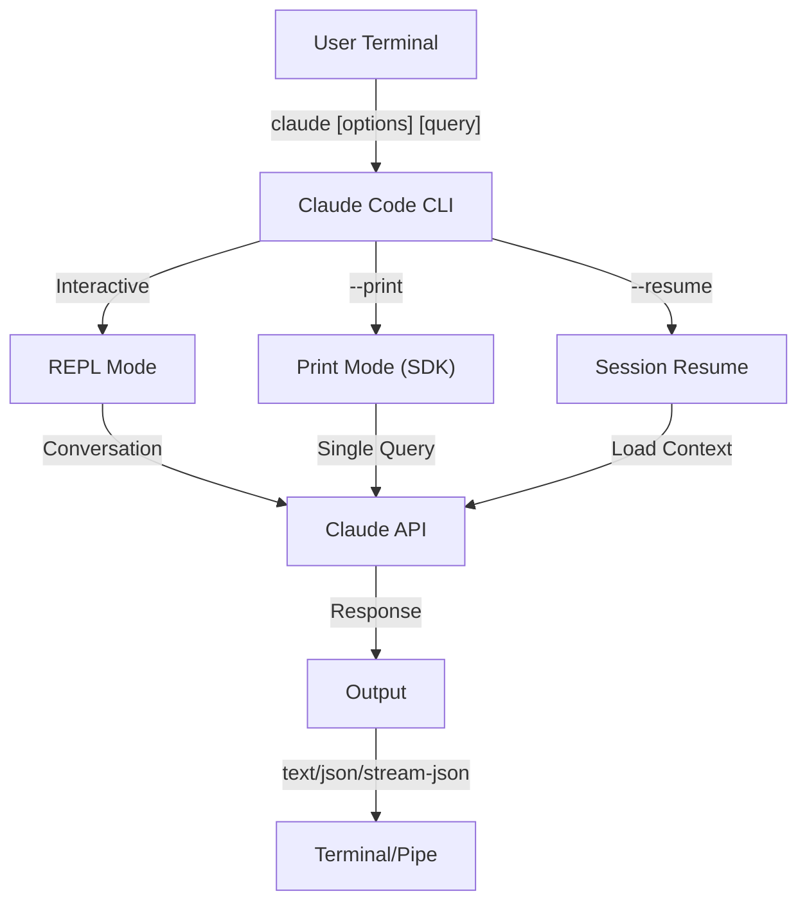
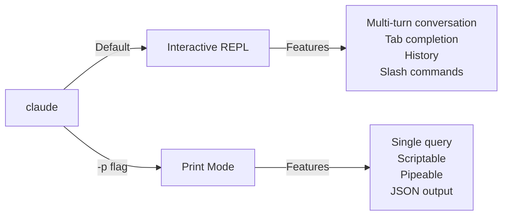

<picture>
  <source media="(prefers-color-scheme: dark)" srcset="../../resources/logos/claude-howto-logo-dark.svg">
  
</picture>

# Tham Chiếu CLI / CLI Reference

## Tổng Quan / Overview

CLI Claude Code (Command Line Interface) là cách chính để tương tác với Claude Code. Nó cung cấp các tùy chọn mạnh mẽ để chạy truy vấn, quản lý phiên, cấu hình mô hình, và tích hợp Claude vào workflow phát triển của bạn.

## Kiến Trúc / Architecture



## Runtime & Đóng Gói / Runtime & Packaging

Từ **v2.1.113**, CLI Claude Code khởi chạy một **binary native theo từng nền tảng** (macOS, Linux, Windows) thông qua các npm dependency tùy chọn. Binary được chọn khớp với hệ điều hành và kiến trúc của bạn lúc cài đặt — runtime JavaScript đóng gói cũ không còn là mặc định trên macOS hay Linux.

**Cách cài đặt khuyến nghị** là trình cài đặt native (`curl -fsSL https://claude.ai/install.sh | bash`; trên Windows `irm https://claude.ai/install.ps1 | iex`). Cài đặt qua npm đã bị đánh dấu deprecated trong README chính thức; hãy ưu tiên trình cài đặt native, Homebrew (`brew install --cask claude-code`) hoặc WinGet (`winget install Anthropic.ClaudeCode`). Để tham khảo, `npm install -g @anthropic-ai/claude-code` (Node.js 22+) cài cùng binary native đó thông qua một dependency tùy chọn theo từng nền tảng. Trên npm 12, vốn mặc định bỏ qua bước postinstall của Claude Code, lần cài đặt đó kết thúc với `Error: claude native binary not installed.` — hãy chuyển sang trình cài đặt native hoặc làm theo [Fix an npm 12 install](https://code.claude.com/docs/en/troubleshoot-install#fix-an-npm-12-install).

**Host tải xuống** (v2.1.116+): các artifact binary native được phục vụ từ `https://downloads.claude.ai/claude-code-releases`.

> **Người dùng doanh nghiệp / proxy**: Nếu mạng của bạn yêu cầu allowlist tường minh, hãy thêm `downloads.claude.ai` (và `https://downloads.claude.ai/claude-code-releases`) vào quy tắc egress của proxy. Các môi trường trước đây chỉ allowlist `storage.googleapis.com` hoặc npm registry cần được cập nhật, nếu không `claude update` và lần cài đặt đầu tiên sẽ thất bại. Trên Bedrock, Mantle, Vertex, và Foundry, Claude Code cũng tải cài đặt mô hình từ một file đã ký trên `downloads.claude.ai` (v2.1.311); đặt `CLAUDE_CODE_MODEL_CATALOG=off` để tắt việc đó.

Bundle JavaScript cũ vẫn được build cho Windows và cho các môi trường ghim vào nó; những bản cài đó tiếp tục cung cấp Glob và Grep như các công cụ hạng nhất (xem chú thích Glob/Grep trong mục [Công cụ](#công-cụ--quản-lý-quyền--tool--permission-management)).

## Các Lệnh CLI / CLI Commands

| Lệnh | Mô Tả | Ví Dụ |
|---------|-------------|---------|
| `claude` | Bắt đầu REPL tương tác | `claude` |
| `claude "query"` | Bắt đầu REPL với prompt ban đầu | `claude "explain this project"` |
| `claude -p "query"` | Chế độ print - truy vấn rồi thoát | `claude -p "explain this function"` |
| `cat file \| claude -p "query"` | Xử lý nội dung được pipe vào | `cat logs.txt \| claude -p "explain"` |
| `claude -c` | Tiếp tục hội thoại gần nhất | `claude -c` |
| `claude -c -p "query"` | Tiếp tục ở chế độ print | `claude -c -p "check for type errors"` |
| `claude -r "<session>" "query"` | Resume phiên theo ID hoặc tên | `claude -r "auth-refactor" "finish this PR"` |
| `claude update` | Cập nhật lên phiên bản mới nhất | `claude update` |
| `/restart` (lệnh slash, alias `/update`) | Khởi động lại Claude Code và tiếp tục phiên này để áp dụng bản cập nhật đã cài. Gói Pro, Max, và Ultra; cài đặt native trên macOS hoặc Linux, không phải WSL (v2.1.288+) | `/restart` |
| `/doctor` (lệnh slash) | Chẩn đoán tình trạng cài đặt, cấu hình, và plugin. Từ v2.1.116 có thể mở **trong khi Claude đang phản hồi**, hiển thị icon trạng thái ngay trong dòng, và nhận phím `f` để tự sửa các vấn đề phát hiện được. v2.1.178 làm mới bố cục thành dạng cây phẳng với icon trạng thái rõ hơn và các lệnh được tô sáng | chạy `/doctor` trong REPL |
| `claude mcp` | Cấu hình MCP servers (gồm `login`/`logout` để xác thực, v2.1.186+) | Xem [Tài liệu MCP](../05-mcp/) |
| `claude mcp serve` | Chạy Claude Code như một MCP server | `claude mcp serve` |
| `claude agents` | Mở **Agent View** (Research Preview, v2.1.139+) — trình quản lý đa phiên liệt kê mọi phiên Claude Code cùng trạng thái của chúng. Xem [Agent View](#agent-view-claude-agents-v21139) bên dưới. | `claude agents` |
| `claude auto-mode defaults` | In các quy tắc mặc định của chế độ auto dưới dạng JSON | `claude auto-mode defaults` |
| `claude auto-mode reset` | Khôi phục cấu hình mặc định của chế độ auto, có hỏi xác nhận (`--yes` để bỏ qua) (v2.1.212) | `claude auto-mode reset --yes` |
| `claude remote-control` | Khởi động một Remote Control server (chế độ server, không có phiên tương tác cục bộ; phục vụ nhiều phiên, `--capacity` mặc định 32) | `claude remote-control --name "My Project"` |
| `claude --remote-control [name]` | Khởi động phiên tương tác có bật Remote Control (bí danh `--rc`) | `claude --rc` |
| `claude plugin` | Quản lý plugins (cài đặt, bật, tắt) | `claude plugin install my-plugin` |
| `claude plugin init <name>` | Tạo khung plugin mới tại `~/.claude/skills/<name>/` (toàn cục cho người dùng) — tự tải ở phiên tiếp theo dưới tên `<name>@skills-dir`, không cần marketplace (v2.1.157+) | `claude plugin init my-plugin` |
| `claude plugin tag [path]` | Tạo git tag release `{name}--v{version}` cho plugin tại `[path]`, kiểm tra rằng `plugin.json` và mục marketplace bao quanh (nếu có) khớp nhau (v2.1.118+) | `claude plugin tag ./my-plugin` |
| `claude install [version]` | Cài một phiên bản binary native cụ thể. Nhận `stable`, `latest`, hoặc một chuỗi phiên bản cụ thể | `claude install 2.1.131` |
| `claude purge [path]` | Xóa toàn bộ trạng thái Claude Code cục bộ của một project (transcripts, tasks, debug logs, lịch sử chỉnh sửa file, lịch sử prompt, và mục trong `~/.claude.json`). Bỏ `[path]` để chọn tương tác. Cờ: `--dry-run` để xem trước, `-y/--yes` để bỏ qua xác nhận, `-i/--interactive` để xác nhận từng mục, `--all` cho mọi project (v2.1.126+) — đổi tên từ `claude project purge` ở v2.1.288; tên cũ vẫn hoạt động và in ra thông báo | `claude purge ~/work/repo --dry-run` |
| `claude plugin prune` | Gỡ các dependency plugin tự cài đã mồ côi (plugin cha không còn). `plugin uninstall --prune` làm cùng việc dọn dây chuyền này sau khi gỡ plugin đích (v2.1.121+) | `claude plugin prune` |
| `claude ultrareview [target]` | Chạy `/ultrareview` không tương tác. In kết quả ra stdout, thoát với mã 0 khi thành công / 1 khi thất bại / 130 nếu bị ngắt bằng Ctrl-C. Dùng `--json` để lấy payload thô, `--timeout <minutes>` để ghi đè mặc định 45 phút (từ v2.1.260), và `--post` / `--no-post` để quyết định có đăng kết quả lại lên PR hay không. Trong thư mục bạn chưa tin cậy, nó hỏi trên terminal và nếu không thì thoát với mã 1; trong scripts và CI, thêm `--trust-workspace` sau target (v2.1.309+). **Yêu cầu Claude Code v2.1.227 trở lên** | `claude ultrareview 1234 --json --no-post` |
| `claude self-hosted-runner [setup\|doctor\|orchestrator]` | Khởi động một runner để host các phiên cloud của Claude Code trên máy hoặc container của bạn. `setup` là hướng dẫn từng bước cho người vận hành, `doctor` chẩn đoán một runner đã triển khai, `orchestrator` tạo runner theo nhu cầu (cờ `--shutdown-drain-sec` của nó, v2.1.299, cho phép các hook poll và spawn đang chạy hoàn tất khi nhận SIGTERM). **Gói Team và Enterprise; yêu cầu Claude Code v2.1.224 trở lên.** Trên Windows, khởi động cần `--base-dir` tường minh (v2.1.229). Từ v2.1.307, checkout hooks bị dừng sau 30 phút theo mặc định, khiến bước thiết lập phiên thất bại; hãy tăng `--checkout-hook-timeout-min` hoặc đặt nó về `0`. Từ v2.1.311, `--hold-idle-file <path>` và `--max-hold-min <n>` (mặc định `1440`, `0` để tắt) giữ lại một phiên nhàn rỗi trong khi host của bạn báo cáo các tiến trình mà phiên đó để lại đang chạy | `claude self-hosted-runner setup` |
| `claude auth login` | Đăng nhập (hỗ trợ `--email`, `--sso`). Từ v2.1.126, chấp nhận mã OAuth dán vào terminal làm phương án dự phòng khi callback của trình duyệt không tới được localhost (WSL2, SSH, container) | `claude auth login --email user@example.com` |
| `claude auth logout` | Đăng xuất khỏi tài khoản hiện tại | `claude auth logout` |
| `claude auth status` | Kiểm tra trạng thái xác thực (thoát 0 nếu đã đăng nhập, 1 nếu chưa) | `claude auth status` |

## Các Cờ Chính / Core Flags

| Cờ | Mô Tả | Ví Dụ |
|------|-------------|---------|
| `-p, --print` | In phản hồi mà không vào chế độ tương tác | `claude -p "query"` |
| `-c, --continue` | Tải hội thoại gần nhất | `claude --continue` |
| `-r, --resume` | Resume phiên cụ thể theo ID hoặc tên | `claude --resume auth-refactor` |
| `-v, --version` | In số phiên bản | `claude -v` |
| `--system-prompt-snapshot off` | Render system prompt mới ở mỗi request thay vì dùng lại prompt đã ghi cùng hội thoại. Hữu ích khi đang chỉnh sửa nội dung prompt (v2.1.257+) | `claude --system-prompt-snapshot off` |
| `-w, --worktree` | Bắt đầu trong git worktree cô lập. Từ v2.1.233 nhận cả URL merge request GitLab lẫn URL PR GitHub | `claude -w` |
| `-n, --name` | Tên hiển thị của phiên | `claude -n "auth-refactor"` |
| `--from-pr <url-or-number>` | Resume các phiên liên kết với một pull/merge request. Từ v2.1.119 nhận URL GitHub (cloud + Enterprise), GitLab MR, và Bitbucket PR; trước đó chỉ GitHub.com | `claude --from-pr 42` hoặc `claude --from-pr https://gitlab.example.com/org/repo/-/merge_requests/17` |
| `--cloud [description\|session_id\|url]` | Tạo phiên cloud trên claude.ai với mô tả đã cho, hoặc gắn vào một phiên sẵn có bằng session ID hoặc URL claude.ai/code | `claude --cloud "implement API"` |
| `--remote "task"` | **Bí danh deprecated của `--cloud`**, bao gồm cả dạng gắn vào phiên sẵn có. Hãy dùng `--cloud` | `claude --remote "implement API"` |
| `--remote-control, --rc` | Phiên tương tác với Remote Control | `claude --rc` |
| `--teleport [session]` | Resume một phiên web trên máy cục bộ. Dạng không tham số mở trình chọn các phiên web của bạn; truyền session ID để resume trực tiếp phiên đó. Yêu cầu gói đăng ký claude.ai | `claude --teleport` |
| `--teammate-mode` | Chế độ hiển thị agent team | `claude --teammate-mode tmux` |
| `--bare` | Chế độ tối thiểu (bỏ qua hooks, skills, plugins, MCP, auto memory, CLAUDE.md) | `claude --bare` |
| `--safe-mode` | Khởi động với mọi tùy chỉnh bị tắt (CLAUDE.md, plugins, skills, hooks, MCP) để cô lập lỗi cấu hình; tương đương `CLAUDE_CODE_SAFE_MODE=1` (v2.1.169) | `claude --safe-mode` |
| `--restricted` | Khóa chặt phiên cho mục đích dùng chung hoặc không tin cậy: gỡ các công cụ tích hợp chạy lệnh và code cùng WebFetch, bỏ qua settings user/project/local, giới hạn công cụ file trong các thư mục làm việc, và từ chối `bypassPermissions` cũng như phiên cloud. Tương đương `CLAUDE_CODE_RESTRICTED=1` (v2.1.248+) | `claude --restricted -p "summarize this repo"` |
| `--permission-mode auto` | Khởi động ở chế độ quyền auto (thay thế cờ `--enable-auto-mode` đã bị gỡ từ v2.1.111) | `claude --permission-mode auto` |
| `--channels` | Đăng ký các plugin channel MCP. Mỗi mục phải được gắn thẻ `plugin:<name>@<marketplace>`; tên trần sẽ bị từ chối | `claude --channels plugin:discord@my-marketplace` |
| `--chrome` / `--no-chrome` | Bật/tắt tích hợp trình duyệt Chrome | `claude --chrome` |
| `--effort` | Đặt mức độ suy nghĩ | `claude --effort high` |
| `--desktop` | Mở phiên trong ứng dụng Claude desktop tại thư mục hiện tại; thêm `--continue` hoặc `--resume <id>` để chọn phiên (v2.1.285) | `claude --desktop --continue` |
| `--init` / `--init-only` | `--init` chạy các hook khởi tạo (Setup) trước phiên, chỉ ở chế độ print; `--init-only` chạy hook Setup và `SessionStart` rồi thoát | `claude -p --init "query"` |
| `--maintenance` | Chạy các hook bảo trì (Setup) trước phiên (chỉ ở chế độ print) | `claude -p --maintenance "query"` |
| `--disable-slash-commands` | Tắt tất cả skills và lệnh slash | `claude --disable-slash-commands` |
| `--no-session-persistence` | Tắt việc lưu phiên (chế độ print) | `claude -p --no-session-persistence "query"` |
| `--exclude-dynamic-system-prompt-sections` | Loại các phần động khỏi system prompt để tăng tỷ lệ trúng prompt cache | `claude -p --exclude-dynamic-system-prompt-sections "query"` |

### Chế Độ Hạn Chế / Restricted Mode (`--restricted`, v2.1.248+)

`--restricted` (hoặc `CLAUDE_CODE_RESTRICTED=1`) dùng khi chạy `claude` thay mặt cho một người mà bạn không kiểm soát được đầu vào — một evaluation harness trên máy dùng chung, một job CI do người đóng góp bên ngoài kích hoạt, một máy demo. Nó áp dụng tất cả những điều sau:

- **Gỡ các công cụ chạy lệnh hoặc code** — Bash, PowerShell, và REPL — cùng WebFetch, trừ khi `--tools` chỉ định tường minh chúng.
- **Bỏ qua các file settings user, project, và local.** Managed settings và file `--settings` tường minh vẫn được áp dụng, nên quản trị viên vẫn giữ quyền kiểm soát trong khi một `.claude/settings.json` được commit vào repo không thể nới rộng sandbox.
- **Giới hạn công cụ file trong các thư mục làm việc**, nên việc đọc và ghi không thể thoát ra ngoài các đường dẫn bạn bắt đầu.
- **Từ chối `bypassPermissions`**, bất kể được yêu cầu theo cách nào.
- **Từ chối tạo phiên cloud**, nên một lần chạy bị hạn chế không thể đẩy công việc ra khỏi máy.

```bash
# Evaluation harness: không shell, không fetch mạng, không kế thừa settings
claude --restricted -p "summarize the architecture of this repo"

# Cùng mức khóa, nhưng chủ động bật lại một công cụ
claude --restricted --tools WebFetch -p "check the linked RFC"
```

> **Lưu ý**: `--restricted` là cơ chế khóa thô hơn `--permission-mode`. Nó gỡ hẳn công cụ thay vì hỏi quyền, nên một phiên bị hạn chế không thể được nới rộng từ bên trong phiên.

### Tương Tác vs Chế Độ Print / Interactive vs Print Mode



**Chế Độ Tương Tác** (mặc định):
```bash
# Bắt đầu phiên tương tác
claude

# Bắt đầu với prompt ban đầu
claude "explain the authentication flow"
```

**Chế Độ Print** (không tương tác):
```bash
# Một truy vấn, rồi thoát
claude -p "what does this function do?"

# Xử lý nội dung file
cat error.log | claude -p "explain this error"

# Nối chuỗi với các công cụ khác
claude -p "list todos" | grep "URGENT"
```

## Mô Hình & Cấu Hình / Model & Configuration

| Cờ | Mô Tả | Ví Dụ |
|------|-------------|---------|
| `--model` | Đặt mô hình (sonnet, opus, haiku, hoặc tên đầy đủ) | `claude --model opus` |
| `--fallback-model` | Tự động chuyển sang mô hình dự phòng khi mô hình chính quá tải/không khả dụng; cấu hình tối đa ba mô hình qua setting `fallbackModel`. Từ v2.1.166 áp dụng cả cho phiên tương tác (trước đó chỉ chế độ print) | `claude -p --fallback-model sonnet "query"` |
| `--agent` | Chỉ định agent cho phiên | `claude --agent my-custom-agent` |
| `--agents` | Định nghĩa tác nhân con tùy chỉnh qua JSON | Xem [Cấu Hình Agents](#cấu-hình-agents--agents-configuration) |
| `--effort` | Đặt mức effort (low, medium, high, xhigh, max) | `claude --effort xhigh` |

### Ví Dụ Chọn Mô Hình / Model Selection Examples

```bash
# Sử dụng Opus 5.5 cho các tác vụ phức tạp
claude --model opus "design a caching strategy"

# Sử dụng Haiku cho các tác vụ nhanh (Haiku 5.5 trên Anthropic API từ v2.1.293; Haiku 4.5 trên Bedrock, Vertex và Foundry)
claude --model haiku -p "format this JSON"

# Tên mô hình đầy đủ
claude --model claude-sonnet-4-6 "review this code"

# Với fallback để đảm bảo độ tin cậy
claude -p --model opus --fallback-model sonnet "analyze architecture"

# Sử dụng opusplan (Opus lập kế hoạch, Sonnet thực thi)
claude --model opusplan "design and implement the caching layer"
```

> **Khám phá mô hình qua gateway (v2.1.129+, opt-in)**: Khi `ANTHROPIC_BASE_URL` trỏ đến một gateway tương thích Anthropic, đặt `CLAUDE_CODE_ENABLE_GATEWAY_MODEL_DISCOVERY=1` để điền danh sách `/model` từ endpoint `/v1/models` của gateway. Không có biến môi trường này, `/model` dùng danh sách tĩnh tích hợp sẵn. Cờ này là opt-in (thay đổi ở v2.1.129) vì lệnh gọi khám phá có thể hiện ra các mô hình mà người dùng không được phép dùng; v2.1.126 từng bật ngầm định và hành vi đó đã được hoàn tác.

> **Ngữ cảnh 1M sau base URL tùy chỉnh (v2.1.285)**: Các phiên có `ANTHROPIC_BASE_URL` trỏ đến endpoint tùy chỉnh giờ dùng cửa sổ ngữ cảnh 1M của các mô hình có hỗ trợ (Opus 4.7+, Sonnet 5+, Fable). Nếu gateway của bạn dừng ở 200K, hãy chạy `/autocompact 200k`.

> **Ngữ cảnh 1M mặc định trên nhà cung cấp bên thứ ba (v2.1.287)**: Opus 4.7+ và Fable giờ dùng cửa sổ ngữ cảnh 1M theo mặc định trên Amazon Bedrock, Google Vertex AI, Microsoft Foundry, và Claude apps gateway, không cần hậu tố `[1m]`. Đặt `CLAUDE_CODE_DISABLE_1M_CONTEXT=1` để giữ chúng ở 200K.

> **Mô hình mặc định của tổ chức (v2.1.196)**: Khi quản trị viên tổ chức đặt mô hình mặc định, `/model` gắn nhãn nó là "Org default" (hoặc "Role default").

## Tùy Chỉnh System Prompt / System Prompt Customization

| Cờ | Mô Tả | Ví Dụ |
|------|-------------|---------|
| `--system-prompt` | Thay thế toàn bộ prompt mặc định | `claude --system-prompt "You are a Python expert"` |
| `--system-prompt-file` | Tải prompt từ file, thay thế prompt mặc định | `claude -p --system-prompt-file ./prompt.txt "query"` |
| `--append-system-prompt` | Nối thêm vào prompt mặc định | `claude --append-system-prompt "Always use TypeScript"` |
| `--append-subagent-system-prompt` | Nối thêm văn bản vào system prompt của mọi tác nhân con (không tương tác) | `claude -p --append-subagent-system-prompt "Cite sources" "query"` |
| `--append-subagent-system-prompt-file` | (v2.1.261) Tải văn bản nối thêm đó từ file, dành cho prompt quá dài để truyền trên dòng lệnh. Chỉ dùng ở chế độ không tương tác, và **không thể kết hợp** với `--append-subagent-system-prompt` | `claude -p --append-subagent-system-prompt-file ./subagent-rules.txt "query"` |

### Ví Dụ System Prompt / System Prompt Examples

```bash
# Persona tùy chỉnh hoàn toàn
claude --system-prompt "You are a senior security engineer. Focus on vulnerabilities."

# Nối thêm hướng dẫn cụ thể
claude --append-system-prompt "Always include unit tests with code examples"

# Tải prompt phức tạp từ file
claude -p --system-prompt-file ./prompts/code-reviewer.txt "review main.py"
```

### So Sánh Các Cờ System Prompt / System Prompt Flags Comparison

| Cờ | Hành Vi | Tương tác | Print |
|------|----------|-------------|-------|
| `--system-prompt` | Thay thế toàn bộ system prompt mặc định | ✅ | ✅ |
| `--system-prompt-file` | Thay thế bằng prompt từ file | ✅ | ✅ |
| `--append-system-prompt` | Nối thêm vào system prompt mặc định | ✅ | ✅ |

**Tất cả các cờ system prompt đều hoạt động ở cả chế độ tương tác và chế độ print (các dạng file từ v2.1.69). `--system-prompt` và `--system-prompt-file` thay thế prompt mặc định; các cờ append thêm vào prompt đó.**

## Công Cụ & Quản Lý Quyền / Tool & Permission Management

| Cờ | Mô Tả | Ví Dụ |
|------|-------------|---------|
| `--tools` | Giới hạn các công cụ tích hợp sẵn có thể dùng | `claude -p --tools "Bash,Edit,Read" "query"` |
| `--allowedTools` | Các công cụ thực thi mà không cần hỏi | `"Bash(git log:*)" "Read"` |
| `--disallowedTools` | Các công cụ bị gỡ khỏi ngữ cảnh | `"Bash(rm:*)" "Edit"` |
| `--dangerously-skip-permissions` | Bỏ qua mọi lời hỏi quyền | `claude --dangerously-skip-permissions` |
| `--permission-mode` | Bắt đầu ở chế độ quyền được chỉ định | `claude --permission-mode auto` |
| `--permission-prompt-tool` | Công cụ MCP trả lời các lời hỏi quyền ở chế độ print; truyền tên đầy đủ `mcp__<server>__<tool>` của nó, từ một server mà lần chạy có tải | `claude -p --mcp-config ./mcp.json --permission-prompt-tool mcp__permissions__approve "query"` |
| `--permission-prompts` | (v2.1.259) Ai trả lời các lời hỏi quyền ở chế độ print. Mặc định `host` gửi chúng đến host Agent SDK hoặc công cụ `--permission-prompt-tool`; truyền `none` khi không ai có thể trả lời và Claude Code sẽ từ chối chúng | `claude -p --permission-prompts none "query"` |

> **Cập nhật v2.1.111**: `--enable-auto-mode` đã bị gỡ; chế độ auto giờ nằm trong vòng `Shift+Tab` theo mặc định — dùng `--permission-mode auto` để khởi động thẳng vào chế độ này.

> **Chú thích Glob / Grep (v2.1.113+)**: Trên các bản build native macOS/Linux, `Glob` và `Grep` được cung cấp dưới dạng các binary nhúng `bfs` và `ugrep` gọi qua công cụ Bash thay vì là các công cụ hạng nhất riêng biệt. Các bản cài Windows và bản đóng gói npm (JS) vẫn cung cấp chúng như công cụ độc lập. Với danh sách `allowedTools` / `disallowedTools` của tác nhân con, sự thay thế backend này là trong suốt — bạn vẫn có thể tham chiếu `Glob` / `Grep` trong cấu hình trên mọi nền tảng.

> **Tự động phê duyệt PowerShell (v2.1.119)**: Lệnh của công cụ PowerShell có thể được tự động phê duyệt trong chế độ quyền giống hệt lệnh Bash. Dùng cùng cú pháp matcher bạn đang dùng cho quy tắc `Bash(...)` để giới hạn quyền PowerShell — ví dụ, `PowerShell(Get-ChildItem:*)`.

> **`--permission-mode` được tôn trọng khi resume (v2.1.132+)**: `claude -p --continue --permission-mode plan` (và `--resume`) giờ tuân theo cờ này. Các phiên bản trước âm thầm bỏ `--permission-mode` khi resume phiên, nên một phiên plan mode được resume mà không truyền lại cờ sẽ âm thầm bị hạ cấp — lỗi này đã được sửa.

> **Siết chặt quyền (v2.1.214)**: Các lệnh Docker/Podman dùng cờ chuyển hướng daemon (ví dụ `--url`, `--connection`, `--identity`) giờ yêu cầu hỏi quyền thay vì chạy tự động. Các lệnh `file` dùng `-m`/`--magic-file` hoặc `-f`/`--files-from` cũng giờ yêu cầu quyền. Lệnh Bash dài hơn 10.000 ký tự luôn hỏi quyền, bất kể quy tắc allow.

> **Siết chặt quyền (v2.1.323)**: Claude Code cảnh báo khi khởi động về một quy tắc allow của Bash có `*` trong giá trị của biến, chẳng hạn `Bash(PORT=* npm run dev)`. Bản này sửa các quy tắc allow có wildcard gắn liền, chẳng hạn `Bash(ls*)`, từng bỏ qua lời nhắc quyền trong một số trường hợp; một quy tắc nêu tên biến, chẳng hạn `Bash(NODE_ENV*)`, giờ sẽ hỏi. Các quy tắc deny và ask của Bash không còn bỏ sót một số lệnh chạy qua `sudo`, `env` và các wrapper tương tự, và một trường hợp công cụ Write và Edit có thể ghi vào đường dẫn thuộc phạm vi một quy tắc deny `Read` đã được sửa. Khi đặt `plansDirectory`, một lần ghi tệp kế hoạch không thể chứng minh là nằm trong dự án sẽ bị từ chối. Lời nhắc Bash không còn đưa ra "don't ask again" cho các lệnh ghi vào đường dẫn nhạy cảm như `.git` hoặc `.claude`, nơi quy tắc đã lưu không ngăn được lời nhắc tiếp theo, và "don't ask again" trên một quy tắc allow trông như chứa bí mật, hoặc sẽ được lưu vào một `settings.local.json` mà git theo dõi, chỉ có hiệu lực trong phiên và không được lưu.

### Ví Dụ Quyền / Permission Examples

```bash
# Chế độ chỉ đọc để review code
claude --permission-mode plan "review this codebase"

# Chỉ giới hạn ở các công cụ an toàn
claude --tools "Read,Grep,Glob" -p "find all TODO comments"

# Cho phép các lệnh git cụ thể mà không cần hỏi
claude --allowedTools "Bash(git status:*)" "Bash(git log:*)"

# Chặn các thao tác nguy hiểm
claude --disallowedTools "Bash(rm -rf:*)" "Bash(git push --force:*)"
```

> **Khớp tham số `Tool(param:value)` (v2.1.178)**: Quy tắc quyền theo định dạng `Tool` (mọi lần dùng) hoặc `Tool(specifier)`. Từ v2.1.178, specifier có thể khớp với các **tham số** đầu vào của công cụ, không chỉ mẫu lệnh hay đường dẫn — dùng dạng `Tool(param:value)` có hỗ trợ wildcard. Điều này tổng quát hóa cách khớp bạn đã dùng cho tiền tố lệnh `Bash(...)` (ví dụ `Bash(npm run test *)`) và glob đường dẫn `Read(...)` (ví dụ `Read(./.env.*)`) để các công cụ khác cũng có thể được giới hạn theo đối số. Hãy xem [tham chiếu quyền](https://code.claude.com/docs/en/settings) để biết các chuỗi ví dụ hiện tại theo từng công cụ trước khi viết quy tắc, vì tên tham số cụ thể khác nhau giữa các công cụ.

## Đầu Ra & Định Dạng / Output & Format

| Cờ | Mô Tả | Tùy Chọn | Ví Dụ |
|------|-------------|---------|---------|
| `--output-format` | Chỉ định định dạng đầu ra (chế độ print) | `text`, `json`, `stream-json` | `claude -p --output-format json "query"` |
| `--input-format` | Chỉ định định dạng đầu vào (chế độ print) | `text`, `stream-json` | `claude -p --input-format stream-json` |
| `--verbose` | Bật ghi log chi tiết | | `claude --verbose` |
| `--include-partial-messages` | Bao gồm các sự kiện streaming | Yêu cầu `stream-json` | `claude -p --output-format stream-json --include-partial-messages "query"` |
| `--forward-subagent-text` | Chuyển tiếp văn bản đầu ra của tác nhân con vào stream. Từ v2.1.219, các tác nhân con được tạo ở độ sâu 2 trở lên cũng được chuyển tiếp, định danh theo id `tool_use` của `Agent` đã tạo ra chúng (đây là cách bạn quan sát việc lồng nhau được bật mặc định qua `CLAUDE_CODE_MAX_SUBAGENT_SPAWN_DEPTH`) | Yêu cầu `stream-json` | `claude -p --output-format stream-json --forward-subagent-text "query"` |
| `--json-schema` | Nhận JSON đã được xác thực theo schema | | `claude -p --json-schema '{"type":"object"}' "query"` |
| `--max-budget-usd` | Giới hạn chi phí tối đa cho chế độ print. Từ v2.1.217, khi chạm giới hạn, các tác nhân con chạy nền cũng bị dừng và các lần tạo mới bị từ chối (trước đây tác nhân chạy nền vẫn tiếp tục chạy sau khi vượt giới hạn) | | `claude -p --max-budget-usd 5.00 "query"` |

### Ví Dụ Định Dạng Đầu Ra / Output Format Examples

```bash
# Văn bản thuần (mặc định)
claude -p "explain this code"

# JSON để dùng trong lập trình
claude -p --output-format json "list all functions in main.py"

# Streaming JSON để xử lý thời gian thực
claude -p --output-format stream-json "generate a long report"

# Đầu ra có cấu trúc với xác thực schema
claude -p --json-schema '{"type":"object","properties":{"bugs":{"type":"array"}}}' \
  "find bugs in this code and return as JSON"
```

## Workspace & Thư Mục / Workspace & Directory

| Cờ | Mô Tả | Ví Dụ |
|------|-------------|---------|
| `--add-dir` | Thêm các thư mục làm việc bổ sung | `claude --add-dir ../apps ../lib` |
| `--setting-sources` | Các nguồn settings phân cách bằng dấu phẩy | `claude --setting-sources user,project` |

> **Lưu `/config` (v2.1.119)**: Các thay đổi thực hiện tương tác qua lệnh `/config` giờ được ghi vào `~/.claude/settings.json` và tham gia chuỗi ưu tiên thông thường (policy → local → project → user). Trước v2.1.119, một số thay đổi `/config` chỉ có hiệu lực trong phiên. Xem [Bộ Nhớ & Settings](../02-memory/README.md) để biết thứ tự ưu tiên đầy đủ.
| `--settings` | Tải settings từ file hoặc JSON. File không được lớn hơn 2 MiB (v2.1.214) | `claude --settings ./settings.json` |
| `--plugin-dir` | Tải plugins từ thư mục (có thể lặp lại). Từ v2.1.265 cũng nhận một **thư mục chứa nhiều plugin** — mọi thư mục con có manifest đều được tải, và các thư mục con được thêm hoặc gỡ trong lúc phiên chạy cũng được nhận biết | `claude --plugin-dir ./my-plugin` |

### Ví Dụ Đa Thư Mục / Multi-Directory Example

```bash
# Làm việc trên nhiều thư mục project
claude --add-dir ../frontend ../backend ../shared "find all API endpoints"

# Tải settings tùy chỉnh
claude --settings '{"model":"opus","verbose":true}' "complex task"
```

## Cấu Hình MCP / MCP Configuration

| Cờ | Mô Tả | Ví Dụ |
|------|-------------|---------|
| `--mcp-config` | Tải MCP servers từ JSON | `claude --mcp-config ./mcp.json` |
| `--strict-mcp-config` | Chỉ dùng cấu hình MCP được chỉ định | `claude --strict-mcp-config --mcp-config ./mcp.json` |
| `--channels` | Đăng ký các plugin channel MCP. Mỗi mục phải được gắn thẻ `plugin:<name>@<marketplace>`; tên trần sẽ bị từ chối | `claude --channels plugin:discord@my-marketplace` |

### Ví Dụ MCP / MCP Examples

```bash
# Tải GitHub MCP server
claude --mcp-config ./github-mcp.json "list open PRs"

# Chế độ strict - chỉ các server được chỉ định
claude --strict-mcp-config --mcp-config ./production-mcp.json "deploy to staging"
```

## Quản Lý Phiên / Session Management

| Cờ | Mô Tả | Ví Dụ |
|------|-------------|---------|
| `--session-id` | Dùng session ID cụ thể (UUID) | `claude --session-id "550e8400-..."` |
| `--fork-session` | Tạo phiên mới khi resume | `claude --resume abc123 --fork-session` |

### Ví Dụ Phiên / Session Examples

```bash
# Tiếp tục hội thoại cuối
claude -c

# Resume phiên đã đặt tên
claude -r "feature-auth" "continue implementing login"

# Fork phiên để thử nghiệm
claude --resume feature-auth --fork-session "try alternative approach"

# Dùng session ID cụ thể
claude --session-id "550e8400-e29b-41d4-a716-446655440000" "continue"
```

> **v2.1.299**: Lệnh resume được in ra khi thoát gọi tên phiên bằng ID của nó.

### Fork Phiên / Session Fork

Tạo một nhánh từ phiên hiện có để thử nghiệm:

```bash
# Fork một phiên để thử cách tiếp cận khác
claude --resume abc123 --fork-session "try alternative implementation"

# Fork với thông điệp tùy chỉnh
claude -r "feature-auth" --fork-session "test with different architecture"
```

**Trường Hợp Sử Dụng:**
- Thử các cách triển khai khác mà không mất phiên gốc
- Thử nghiệm song song các cách tiếp cận khác nhau
- Tạo nhánh từ công việc thành công để làm các biến thể
- Test các thay đổi breaking mà không ảnh hưởng phiên chính

Phiên gốc vẫn không thay đổi, và bản fork trở thành một phiên độc lập mới.

### Dọn Dẹp Trạng Thái Project / Project State Cleanup (v2.1.126+)

`claude purge` xóa toàn bộ trạng thái Claude Code cục bộ của một project — transcripts, danh sách task, debug logs, lịch sử chỉnh sửa file, các dòng lịch sử prompt, và mục của project trong `~/.claude.json`. Trước v2.1.288 lệnh này có tên `claude project purge`; tên đó vẫn hoạt động và in ra thông báo. Hãy dùng `--dry-run` trước để xem trước những gì sẽ bị xóa; `--all` duyệt qua mọi project trên máy.

```bash
# Xem trước những gì sẽ bị xóa (an toàn)
claude purge ~/work/repo --dry-run

# Xóa trạng thái của một project cụ thể, không hỏi
claude purge ~/work/repo --yes

# Duyệt tương tác qua mọi project
claude purge --all --interactive
```

## Tính Năng Nâng Cao / Advanced Features

| Cờ | Mô Tả | Ví Dụ |
|------|-------------|---------|
| `--chrome` | Bật tích hợp trình duyệt Chrome | `claude --chrome` |
| `--no-chrome` | Tắt tích hợp trình duyệt Chrome | `claude --no-chrome` |
| `--ide` | Tự động kết nối IDE nếu có | `claude --ide` |
| `--max-turns` | Giới hạn số lượt agentic (không tương tác) | `claude -p --max-turns 3 "query"` |
| `--debug` | Bật chế độ debug có lọc (bộ lọc chỉ áp dụng ở dạng `=`) | `claude --debug=api,mcp` |
| `--enable-lsp-logging` | Bật log LSP chi tiết | `claude --enable-lsp-logging` |
| `--betas` | Beta header cho các request API | `claude --betas interleaved-thinking` |
| `--plugin-dir` | Tải plugins từ thư mục (có thể lặp lại). Từ v2.1.265 cũng nhận một **thư mục chứa nhiều plugin** — mọi thư mục con có manifest đều được tải, và các thư mục con được thêm hoặc gỡ trong lúc phiên chạy cũng được nhận biết | `claude --plugin-dir ./my-plugin` |
| `--effort` | Đặt mức độ suy nghĩ | `claude --effort high` |
| `--bare` | Chế độ tối thiểu (bỏ qua hooks, skills, plugins, MCP, auto memory, CLAUDE.md) | `claude --bare` |
| `--channels` | Đăng ký các plugin channel MCP (gắn thẻ `plugin:<name>@<marketplace>`) | `claude --channels plugin:discord@my-marketplace` |
| `--tmux` | Tạo phiên tmux cho worktree (yêu cầu `--worktree`) | `claude --worktree feature-x --tmux` |
| `--fork-session` | Tạo session ID mới khi resume | `claude --resume abc --fork-session` |
| `--max-budget-usd` | Chi phí tối đa (chế độ print); cũng dừng các tác nhân con chạy nền khi chạm giới hạn (v2.1.217) | `claude -p --max-budget-usd 5.00 "query"` |
| `--json-schema` | Đầu ra JSON đã xác thực | `claude -p --json-schema '{"type":"object"}' "q"` |
| `--ax-screen-reader` | Chế độ render văn bản thuần cho trình đọc màn hình (v2.1.208) | `claude --ax-screen-reader` |

### Ghi Chú Nền Tảng & Theme / Platform & Theme Notes (v2.1.112)

- **Công cụ PowerShell trên Windows**: Một công cụ PowerShell chuyên dụng đang được triển khai dần trên Windows và có thể điều khiển qua biến môi trường.
- **Theme tự động (khớp terminal)**: Theme mới "Auto (match terminal)" đồng bộ giao diện sáng/tối của Claude Code với terminal của bạn.
- **Lời hỏi quyền ít hơn**: Các lệnh gọi `Bash` chỉ đọc và các mẫu `Glob` không còn kích hoạt lời hỏi quyền.

### Ví Dụ Nâng Cao / Advanced Examples

```bash
# Giới hạn các hành động tự động
claude -p --max-turns 5 "refactor this module"

# Debug các lệnh gọi API
claude --debug=api "test query"

# Bật tích hợp IDE
claude --ide "help me with this file"
```

## Cấu Hình Agents / Agents Configuration

Cờ `--agents` nhận một JSON object định nghĩa các tác nhân con tùy chỉnh cho một phiên.

Từ **v2.1.243**, `--agents` không còn âm thầm bỏ qua JSON không hợp lệ hoặc định nghĩa agent không hợp lệ — nó thoát với thông báo lỗi rõ ràng, giống cách `--mcp-config` vốn đã hoạt động.

### Định Dạng JSON Của Agents / Agents JSON Format

```json
{
  "agent-name": {
    "description": "Required: when to invoke this agent",
    "prompt": "Required: system prompt for the agent",
    "tools": ["Optional", "array", "of", "tools"],
    "model": "optional: sonnet|opus|haiku"
  }
}
```

**Các Trường Bắt Buộc:**
- `description` - Mô tả bằng ngôn ngữ tự nhiên về khi nào dùng agent này
- `prompt` - System prompt định nghĩa vai trò và hành vi của agent

**Các Trường Tùy Chọn:**
- `tools` - Mảng các công cụ có thể dùng (kế thừa tất cả nếu bỏ trống)
  - Định dạng: `["Read", "Grep", "Glob", "Bash"]`
- `model` - Mô hình sử dụng: `sonnet`, `opus`, hoặc `haiku`

### Ví Dụ Agents Đầy Đủ / Complete Agents Example

```json
{
  "code-reviewer": {
    "description": "Expert code reviewer. Use proactively after code changes.",
    "prompt": "You are a senior code reviewer. Focus on code quality, security, and best practices.",
    "tools": ["Read", "Grep", "Glob", "Bash"],
    "model": "sonnet"
  },
  "debugger": {
    "description": "Debugging specialist for errors and test failures.",
    "prompt": "You are an expert debugger. Analyze errors, identify root causes, and provide fixes.",
    "tools": ["Read", "Edit", "Bash", "Grep"],
    "model": "opus"
  },
  "documenter": {
    "description": "Documentation specialist for generating guides.",
    "prompt": "You are a technical writer. Create clear, comprehensive documentation.",
    "tools": ["Read", "Write"],
    "model": "haiku"
  }
}
```

### Ví Dụ Lệnh Agents / Agents Command Examples

```bash
# Định nghĩa agent tùy chỉnh inline
claude --agents '{
  "security-auditor": {
    "description": "Security specialist for vulnerability analysis",
    "prompt": "You are a security expert. Find vulnerabilities and suggest fixes.",
    "tools": ["Read", "Grep", "Glob"],
    "model": "opus"
  }
}' "audit this codebase for security issues"

# Tải agents từ file
claude --agents "$(cat ~/.claude/agents.json)" "review the auth module"

# Kết hợp với các cờ khác
claude -p --agents "$(cat agents.json)" --model sonnet "analyze performance"
```

### Thứ Tự Ưu Tiên Agent / Agent Priority

Khi có nhiều định nghĩa agent, chúng được tải theo thứ tự ưu tiên sau:
1. **Định nghĩa qua CLI** (cờ `--agents`) - Riêng cho phiên
2. **Cấp project** (`.claude/agents/`) - Project hiện tại
3. **Cấp user** (`~/.claude/agents/`) - Mọi project

Agent định nghĩa qua CLI ghi đè cả agent của project và user trong phiên đó. Agent cấp project ghi đè agent cấp user khi trùng tên. Xem [Bài 04 — Tác Nhân Con](../04-subagents/README.md#vị-trí-file) để có bảng ưu tiên đầy đủ, bao gồm cả agent cấp plugin.

### Agent View (`claude agents`, v2.1.139+)

> **Research Preview** — tính năng đủ ổn định để dùng hằng ngày nhưng có thể thay đổi.

`claude agents` mở **Agent View** — một danh sách duy nhất gồm mọi phiên Claude Code trên máy cùng trạng thái hiện tại (`running`, `blocked on you`, `done`). Nó thay thế việc phải xoay xở nhiều tab terminal khi bạn chạy agent nền, task theo lịch, hoặc các phiên khởi chạy bằng `--bg`.

```bash
# Mở Agent View
claude agents
```

Khi bạn khởi chạy một phiên từ view này (hoặc qua `claude --bg <prompt>`), bạn có thể truyền cùng các cờ cấu hình như khi chạy `claude`. Các cờ được bổ sung cho luồng khởi chạy của Agent View:

| Cờ | Từ phiên bản | Mô Tả |
|------|-------|-------------|
| `--cwd <path>` | v2.1.141 | Giới hạn danh sách phiên (hoặc phiên mới) trong một thư mục làm việc cụ thể |
| `--add-dir <path>` | v2.1.142 | Thêm thư mục vào workspace của phiên được khởi chạy |
| `--settings <path>` | v2.1.142 | Dùng một `settings.json` cụ thể cho phiên được khởi chạy |
| `--mcp-config <path>` | v2.1.142 | Dùng một cấu hình MCP cụ thể cho phiên được khởi chạy |
| `--plugin-dir <path>` | v2.1.142 | Dùng một thư mục plugin cụ thể cho phiên được khởi chạy |
| `--permission-mode <mode>` | v2.1.142 | Đặt chế độ quyền (`plan`, `acceptEdits`, `auto`, v.v.) cho phiên được khởi chạy |
| `--model <model>` | v2.1.142 | Ghim mô hình cho phiên được khởi chạy |
| `--effort <level>` | v2.1.142 | Đặt mức effort khởi đầu của phiên được dispatch (`low`/`medium`/`high`/`xhigh`/`max`) — mức được chọn trong phiên hoặc `CLAUDE_CODE_EFFORT_LEVEL` được ưu tiên hơn nó |
| `--dangerously-skip-permissions` | v2.1.142 | Chạy phiên được khởi chạy mà không hỏi quyền (chỉ dùng trong sandbox) |
| `--json` | v2.1.145 | In danh sách agent dưới dạng JSON máy đọc được để viết script (thanh trạng thái, trình chọn phiên, tích hợp tmux-resurrect) |

Các phiên đã xong việc nhưng còn để mở một shell nền sẽ chuyển từ "Working" sang "Completed" (bản sửa ở v2.1.141). Trong một phiên agent đang gắn vào, `Shift+Tab` xoay vòng qua các chế độ quyền, kể cả chế độ auto (v2.1.143).

**GitLab merge request (v2.1.233)** — Agent View nhận diện URL GitLab MR bên cạnh URL GitHub PR, và hiển thị merge request dưới dạng `!N` (pull request GitHub vẫn là `#N`). Cùng bản phát hành này cũng cho `--worktree` nhận URL GitLab MR.

**Ghim một phiên** — nhấn `Ctrl+T` trên một phiên trong `claude agents` để ghim nó (v2.1.147). Các phiên nền được ghim vẫn sống khi rảnh, được khởi động lại tại chỗ để áp dụng bản cập nhật Claude Code, và chỉ bị loại bỏ khi thiếu bộ nhớ sau các phiên không được ghim. (`Ctrl+T` này chỉ có tác dụng trong Agent View; trong phiên chính nó bật/tắt chế độ xem danh sách task.)

**Mặc định cho phiên mới (v2.1.299)** — trong agent view, `/effort` và `/fast` đặt giá trị mà các phiên mới khởi động cùng; `/model`, `/effort` hoặc `/fast` không kèm tham số sẽ mở trình chọn.

---

## Các Trường Hợp Sử Dụng Giá Trị Cao / High-Value Use Cases

### 1. Tích Hợp CI/CD

Sử dụng Claude Code trong pipeline CI/CD để tự động review code, testing, và viết tài liệu.

**Ví Dụ GitHub Actions:**

```yaml
name: AI Code Review

on: [pull_request]

jobs:
  review:
    runs-on: ubuntu-latest
    steps:
      - uses: actions/checkout@v4

      - name: Install Claude Code
        run: npm install -g @anthropic-ai/claude-code

      - name: Run Code Review
        env:
          ANTHROPIC_API_KEY: ${{ secrets.ANTHROPIC_API_KEY }}
        run: |
          claude -p --output-format json \
            --max-turns 5 \
            "Review the changes in this PR for:
            - Security vulnerabilities
            - Performance issues
            - Code quality
            Output as JSON with 'issues' array" > review.json

      - name: Post Review Comment
        uses: actions/github-script@v7
        with:
          script: |
            const fs = require('fs');
            const review = JSON.parse(fs.readFileSync('review.json', 'utf8'));
            // Xử lý và đăng các bình luận review
```

**Pipeline Jenkins:**

```groovy
pipeline {
    agent any
    stages {
        stage('AI Review') {
            steps {
                sh '''
                    claude -p --output-format json \
                      --max-turns 3 \
                      "Analyze test coverage and suggest missing tests" \
                      > coverage-analysis.json
                '''
            }
        }
    }
}
```

**`ultrareview` headless (yêu cầu v2.1.227+; `--trust-workspace` yêu cầu v2.1.309+):**

```yaml
# .github/workflows/ultrareview.yml
# Checkout một branch bạn tin cậy, ví dụ actions/checkout với `ref: ${{ github.base_ref }}`;
# ultrareview tự clone pull request trên cloud.
- name: Claude ultrareview
  run: claude ultrareview ${{ github.event.pull_request.number }} --trust-workspace --json --no-post > review.json
```

`claude ultrareview` thoát với mã 0 khi review hoàn tất, dù có hay không có phát hiện; mã 1 khi không khởi chạy được, gặp lỗi, hết thời gian, hoặc thư mục chưa được tin cậy; và mã 130 khi bạn nhấn Ctrl-C trong lúc nó đang khởi chạy review, chờ kết quả, hoặc đăng bình luận `--post`, vì vậy hãy chặn PR dựa trên các phát hiện trong `review.json`, không phải dựa trên mã thoát. Trong CI, lần chạy không thể hỏi bạn có tin cậy bản checkout hay không, nên từ v2.1.309 nó thoát với mã 1 kèm `Error: Workspace not trusted` trừ khi bạn truyền `--trust-workspace` sau số PR hoặc base branch (cờ này không nhận giá trị) hoặc đặt `CLAUDE_CODE_DISABLE_ULTRAREVIEW_TRUST_CHECK=1` trong môi trường của job. Chỉ dùng một trong hai cách này với bản checkout bạn tin cậy. Dùng `--timeout <minutes>` để ghi đè mặc định 45 phút (từ v2.1.260). `--post` đăng các phát hiện hoàn chỉnh lên pull request; `--no-post` chỉ giữ chúng ở stdout, đó là điều bạn muốn khi một bước CI sau tự định dạng báo cáo.

### 2. Pipe Qua Script / Script Piping

Xử lý file, log, và dữ liệu qua Claude để phân tích.

**Phân Tích Log:**

```bash
# Phân tích log lỗi
tail -1000 /var/log/app/error.log | claude -p "summarize these errors and suggest fixes"

# Tìm mẫu trong access log
cat access.log | claude -p "identify suspicious access patterns"

# Phân tích lịch sử git
git log --oneline -50 | claude -p "summarize recent development activity"
```

**Xử Lý Code:**

```bash
# Review một file cụ thể
cat src/auth.ts | claude -p "review this authentication code for security issues"

# Tạo tài liệu
cat src/api/*.ts | claude -p "generate API documentation in markdown"

# Tìm TODO và sắp xếp ưu tiên
grep -r "TODO" src/ | claude -p "prioritize these TODOs by importance"
```

### 3. Workflow Đa Phiên / Multi-Session Workflows

Quản lý các project phức tạp với nhiều luồng hội thoại.

```bash
# Bắt đầu một phiên cho feature branch
claude -r "feature-auth" "let's implement user authentication"

# Sau đó, tiếp tục phiên
claude -r "feature-auth" "add password reset functionality"

# Fork để thử cách tiếp cận khác
claude --resume feature-auth --fork-session "try OAuth instead"

# Chuyển giữa các phiên feature khác nhau
claude -r "feature-payments" "continue with Stripe integration"
```

### 4. Cấu Hình Agent Tùy Chỉnh / Custom Agent Configuration

Định nghĩa các agent chuyên biệt cho workflow của nhóm bạn.

```bash
# Lưu cấu hình agents vào file
cat > ~/.claude/agents.json << 'EOF'
{
  "reviewer": {
    "description": "Code reviewer for PR reviews",
    "prompt": "Review code for quality, security, and maintainability.",
    "model": "opus"
  },
  "documenter": {
    "description": "Documentation specialist",
    "prompt": "Generate clear, comprehensive documentation.",
    "model": "sonnet"
  },
  "refactorer": {
    "description": "Code refactoring expert",
    "prompt": "Suggest and implement clean code refactoring.",
    "tools": ["Read", "Edit", "Glob"]
  }
}
EOF

# Dùng agents trong phiên
claude --agents "$(cat ~/.claude/agents.json)" "review the auth module"
```

### 5. Xử Lý Hàng Loạt / Batch Processing

Xử lý nhiều truy vấn với settings nhất quán.

```bash
# Xử lý nhiều file
for file in src/*.ts; do
  echo "Processing $file..."
  claude -p --model haiku "summarize this file: $(cat $file)" >> summaries.md
done

# Review code hàng loạt
find src -name "*.py" -exec sh -c '
  echo "## $1" >> review.md
  cat "$1" | claude -p "brief code review" >> review.md
' _ {} \;

# Tạo test cho mọi module
for module in $(ls src/modules/); do
  claude -p "generate unit tests for src/modules/$module" > "tests/$module.test.ts"
done
```

### 6. Phát Triển Chú Trọng Bảo Mật / Security-Conscious Development

Sử dụng các cơ chế kiểm soát quyền để vận hành an toàn.

```bash
# Audit bảo mật chỉ đọc
claude --permission-mode plan \
  --tools "Read,Grep,Glob" \
  "audit this codebase for security vulnerabilities"

# Chặn các lệnh nguy hiểm
claude --disallowedTools "Bash(rm:*)" "Bash(curl:*)" "Bash(wget:*)" \
  "help me clean up this project"

# Tự động hóa có giới hạn
claude -p --max-turns 2 \
  --allowedTools "Read" "Glob" \
  "find all hardcoded credentials"
```

### 7. Tích Hợp JSON API / JSON API Integration

Sử dụng Claude như một API lập trình được cho các công cụ của bạn, kết hợp phân tích bằng `jq`.

```bash
# Lấy kết quả phân tích có cấu trúc
claude -p --output-format json \
  --json-schema '{"type":"object","properties":{"functions":{"type":"array"},"complexity":{"type":"string"}}}' \
  "analyze main.py and return function list with complexity rating"

# Tích hợp với jq để xử lý (đầu ra theo schema nằm trong .structured_output)
claude -p --output-format json \
  --json-schema '{"type":"object","properties":{"endpoints":{"type":"array"}}}' \
  "list all API endpoints" | jq '.structured_output.endpoints[]'

# Dùng trong scripts
RESULT=$(claude -p --output-format json \
  --json-schema '{"type":"object","properties":{"secure":{"type":"boolean"},"issues":{"type":"array"}},"required":["secure","issues"]}' \
  "is this code secure?" < code.py)
if echo "$RESULT" | jq -e '.structured_output.secure == false' > /dev/null; then
  echo "Security issues found!"
  echo "$RESULT" | jq '.structured_output.issues[]'
fi
```

### Ví Dụ Phân Tích Bằng jq / jq Parsing Examples

Phân tích và xử lý đầu ra JSON của Claude bằng `jq`. Văn bản phản hồi nằm trong `.result`; khi dùng `--json-schema`, object đã được xác thực nằm trong `.structured_output` (`$SCHEMA` bên dưới đại diện cho một schema định nghĩa các trường mà mỗi bộ lọc đọc):

```bash
# Trích xuất văn bản phản hồi
claude -p --output-format json "analyze this code" | jq -r '.result'

# Lọc các phần tử mảng
claude -p --output-format json --json-schema "$SCHEMA" "list issues" | jq -r '.structured_output.issues[] | select(.severity=="high")'

# Trích xuất nhiều trường
claude -p --output-format json --json-schema "$SCHEMA" "describe the project" | jq -r '.structured_output | {name, version, description}'

# Chuyển sang CSV
claude -p --output-format json --json-schema "$SCHEMA" "list functions" | jq -r '.structured_output.functions[] | [.name, .lineCount] | @csv'

# Xử lý có điều kiện
claude -p --output-format json --json-schema "$SCHEMA" "check security" | jq 'if (.structured_output.vulnerabilities | length) > 0 then "UNSAFE" else "SAFE" end'

# Trích xuất giá trị lồng nhau
claude -p --output-format json --json-schema "$SCHEMA" "analyze performance" | jq '.structured_output.metrics.cpu.usage'

# Xử lý toàn bộ mảng
claude -p --output-format json --json-schema "$SCHEMA" "find todos" | jq '.structured_output.todos | length'

# Biến đổi đầu ra
claude -p --output-format json --json-schema "$SCHEMA" "list improvements" | jq '.structured_output.improvements | map({title: .title, priority: .priority})'
```

---

## Các Mô Hình / Models

Claude Code hỗ trợ nhiều mô hình với các khả năng khác nhau:

| Mô Hình | ID | Cửa Sổ Ngữ Cảnh | Ghi Chú |
|-------|-----|----------------|-------|
| Opus 5.5 | `claude-opus-5-5` | 1M tokens | Mô hình mặc định và mô hình Opus mặc định từ v2.1.280 trên Pro, Max, Ultra, Team, Enterprise, Anthropic API, Claude Platform on AWS, Amazon Bedrock, và Agent Platform của Google Cloud (Pro và Team Standard trước đây mặc định là Sonnet 5); Microsoft Foundry vẫn phân giải `opus` thành Opus 4.6 và `default` thành Sonnet 4.5. Mức effort thích ứng `low → max`, effort mặc định `medium`; không thể tắt thinking. Yêu cầu v2.1.280+ |
| Sonnet 5.5 | `claude-sonnet-5-5` | 1M tokens | Mô hình Sonnet mặc định trên Anthropic API từ v2.1.284 (bí danh `sonnet` phân giải thành nó ở đó); mức effort thích ứng `low → max`, effort mặc định `medium`; không thể tắt thinking; không có ở fast mode. Yêu cầu v2.1.284+ |
| Haiku 5.5 | `claude-haiku-5-5` | 1M tokens | Mô hình Haiku mặc định trên Anthropic API từ v2.1.293 (bí danh `haiku` phân giải thành nó ở đó; Bedrock, Vertex, Foundry, và Claude Platform on AWS vẫn phân giải `haiku` thành Haiku 4.5); mức effort thích ứng `low → max`, effort mặc định `medium`; không thể tắt thinking. Yêu cầu v2.1.293+ |
| Sonnet 5 | `claude-sonnet-5` | 1M tokens | Mặc định trên các ghế Pro / Team Standard từ v2.1.197 đến v2.1.280, khi các gói đó chuyển sang Opus 5.5; cửa sổ ngữ cảnh 1M token native |
| Opus 5 | `claude-opus-5` | 1M tokens | Mô hình Opus mặc định từ v2.1.219 đến v2.1.280 (nay là Opus 5.5); vẫn có thể chọn; mức effort thích ứng `low → max`, effort mặc định `high` |
| Opus 4.8 | `claude-opus-4-8` | 1M tokens | Mô hình Opus chủ lực trước đây, vẫn có thể chọn; mức effort thích ứng `low → max`; effort mặc định `high` (v2.1.154) |
| Sonnet 4.6 | `claude-sonnet-4-6` | 1M tokens | Cân bằng giữa tốc độ và khả năng; effort mặc định cho người dùng Pro/Max được nâng từ `medium` lên `high` ở v2.1.117 |
| Haiku 4.5 | `claude-haiku-4-5` | 200K tokens | Haiku thế hệ trước, vẫn là bí danh `haiku` trên Bedrock, Vertex, Foundry, và Claude Platform on AWS; không có mức effort |
| Fable 5.2 | `claude-fable-5-2` | 1M tokens | Mô hình Fable hiện tại từ v2.1.321; bí danh `fable` phân giải thành nó, trừ trong các phiên Claude apps gateway (ở đó là Fable 5); effort mặc định `medium`; hỗ trợ fast mode. Yêu cầu v2.1.321+ |
| Fable 5.1 | `claude-fable-5-1` | — | Mô hình Fable trước đây (bí danh `fable` trỏ tới nó từ v2.1.257 cho đến trước v2.1.321); chọn nó bằng `/model claude-fable-5-1`. Yêu cầu v2.1.257+ |
| Fable 5 | `claude-fable-5` | — | Mô hình lớp Mythos, đã được làm an toàn để dùng phổ thông (v2.1.170) |

> **Lưu ý**: Sonnet 4.5 ngừng hoạt động vào ngày 30 tháng 11 năm 2026 trên Claude API, Claude Platform on AWS, Claude Models on Google Cloud (do Anthropic quản lý) và Microsoft Foundry; Amazon Bedrock và Agent Platform của Google Cloud tự đặt ngày riêng. Trên Foundry, nơi `default` và `sonnet` vẫn phân giải thành Sonnet 4.5, hãy chỉ định tường minh một mô hình mới hơn.

### Chọn Mô Hình / Model Selection

```bash
# Dùng tên ngắn
claude --model opus "complex architectural review"
claude --model sonnet "implement this feature"
claude --model haiku -p "format this JSON"

# Dùng bí danh opusplan (Opus lập kế hoạch, Sonnet thực thi)
claude --model opusplan "design and implement the API"

# Bật/tắt fast mode trong phiên
/fast
```

> **Fable 5.2 và bí danh `fable` (v2.1.321)**: Fable 5.2 (`claude-fable-5-2`) ra mắt ở **v2.1.321**, và `fable` giờ phân giải thành nó, trừ trong các phiên Claude apps gateway, nơi `fable` vẫn phân giải thành **Fable 5** (hãy chạy `/model claude-fable-5-2` ở đó nếu gateway của bạn cung cấp nó). Fable 5.2 có cửa sổ ngữ cảnh 1M và có giá $8/$40 mỗi Mtok, với $0.20/Mtok cho cache read. Bí danh `best` giờ phân giải thành cùng mô hình với `opus`; trước v2.1.321, ở nơi có Fable, nó dùng mô hình mà `fable` phân giải thành. Fable 5.1 (`claude-fable-5-1`, v2.1.257+) và Fable 5 vẫn có thể chọn bằng model ID. Trên các gói Pro, Max và Ultra, mô hình `claude-fable-5-1` đã lưu trong user settings của bạn sẽ chuyển sang `fable` vào lần đầu bạn chạy v2.1.321 trở lên; trên các gói Team và Enterprise, việc chuyển đổi chờ theo cài đặt của tổ chức bạn. Tài khoản Console, nhà cung cấp bên thứ ba, và project, local hoặc managed settings giữ nguyên `claude-fable-5-1`; chạy `/model claude-fable-5-1` để chuyển lại. Nếu mô hình Fable mới nhất không khả dụng cho tổ chức của bạn, `fable` thử lại một lần với mô hình Fable trước đó (v2.1.301).

> **Fast Mode chạy trên Fable 5.2, Opus 5.5, Opus 5, và Opus 4.8 (v2.1.321)**: Từ v2.1.219, `/fast` áp dụng cho **Opus 5 và Opus 4.8** — Opus 4.7 bị gỡ khỏi fast mode. Fast mode của Opus 5 được tính phí $10/$50 mỗi Mtok. Fast mode lần đầu chuyển sang Opus 4.8 ở v2.1.154 (khoảng 2× giá chuẩn cho tốc độ đầu ra ~2.5×), sau khi đã đổi từ Opus 4.6 sang Opus 4.7 ở v2.1.142. Biến môi trường `CLAUDE_CODE_OPUS_4_6_FAST_MODE_OVERRIDE` đã **bị deprecated ở v2.1.154 và bị gỡ vào 2026-06-01**; fast mode không còn có trên Opus 4.6 — hãy chọn Opus 5 hoặc Opus 4.8. **Từ v2.1.280, fast mode mặc định dùng Opus 5.5** ($8/$40 mỗi Mtok); Opus 5 và Opus 4.8 vẫn được hỗ trợ ở mức $10/$50 dưới dạng research preview (fast mode trên Opus 5.5 đã phát hành chính thức). **Từ v2.1.321, fast mode cũng chạy trên Fable 5.2** với giá $16/$80 mỗi Mtok; trên Fable 5.2, nó chỉ giữ trạng thái bật qua các phiên nếu bạn đã bật nó bằng `/fast` trong lúc dùng Fable 5.2, và chỉ riêng thiết lập `"fastMode": true` thì không có tác dụng ở đó. **Fast mode trên Opus 4.8 bị deprecated từ ngày 30 tháng 10 năm 2026 và sẽ bị gỡ vào ngày 30 tháng 11 năm 2026** (v2.1.316); sau thời điểm đó, các request fast mode trên Opus 4.8 trả về lỗi thay vì quay về tốc độ chuẩn, vì vậy hãy chuyển sang Opus 5.5 để giữ mức tăng tốc. Fast mode và tốc độ chuẩn giữ các prompt cache riêng biệt: lần đầu chuyển sang fast mode sẽ đọc lại hội thoại mà không có cache theo giá fast mode, và mỗi lần chuyển đổi sau đó, kể cả lần tự động quay lại sau khi bị giới hạn tốc độ, sẽ đọc lại phần mà tốc độ đó chưa cache, vì vậy hãy bật nó ngay từ đầu phiên.

### Mức Effort / Effort Levels (Opus 5 / Sonnet 5 / Opus 4.8 / Opus 4.7)

Các mô hình Fable, Opus 5, Sonnet 5, Opus 4.8, và Opus 4.7 hỗ trợ suy luận thích ứng với các mức effort, xếp từ nhẹ nhất đến nặng nhất: `low` (○), `medium` (◐), `high` (●), `xhigh`, và `max`. Opus 5.5, Sonnet 5.5, và Haiku 5.5 cũng hỗ trợ cả năm mức. Mức **mặc định** là `medium` trên Fable 5.2, Opus 5.5 (mô hình mặc định từ v2.1.280), Sonnet 5.5, và Haiku 5.5; `high` trên Fable 5.1, Fable 5, Opus 5, Sonnet 5, Opus 4.8 (từ v2.1.154), Opus 4.6, và Sonnet 4.6; và `xhigh` trên Opus 4.7. `xhigh` có trên các mô hình Fable, Opus 5.5, Sonnet 5.5, Haiku 5.5, Opus 5, Sonnet 5, Opus 4.8, và Opus 4.7; `max` hoạt động trên các mô hình Fable, Opus 5.5, Sonnet 5.5, Haiku 5.5, Opus 5, Sonnet 5, Opus 4.8/4.7/4.6 và Sonnet 4.6 (chỉ trong phiên). Haiku 4.5 không có mức effort. Trên Opus 4.6 / Sonnet 4.6, effort mặc định cho người dùng Pro/Max được nâng từ `medium` lên `high` ở v2.1.117.

```bash
# Đặt mức effort qua cờ CLI
claude --effort high "complex review"

# Đặt mức effort qua lệnh slash
/effort high

# Đặt mức effort qua biến môi trường
export CLAUDE_CODE_EFFORT_LEVEL=high   # low, medium, high, xhigh (các mô hình Fable, Opus 5.5, Sonnet 5.5, Haiku 5.5, Opus 5, Sonnet 5, Opus 4.8/4.7), hoặc max — mặc định là high trên Opus 5
```

Từ khóa "ultrathink" trong prompt kích hoạt suy luận sâu; từ v2.1.311, khi được gõ trong terminal tương tác, nó còn chạy lượt đó ở `xhigh` trên Opus 5.5, Sonnet 5.5, Haiku 5.5, Fable 5.2 (v2.1.321+), và Fable 5.1 qua API của Anthropic (tô màu cầu vồng khi có thể; VS Code từ v2.1.316), và `CLAUDE_CODE_DISABLE_ULTRATHINK=1` (v2.1.316) tắt tính năng này. Thanh trượt `/effort` còn có nút bật/tắt **Ultracode** (Tab, hoặc `/effort ultracode [on|off]`), vốn **không phải** là một mức effort của mô hình — nó khiến Claude điều phối các workflow động ở bất kỳ mức effort nào mà phiên đang chạy. Từ v2.1.284, nó không còn ép dùng `xhigh` và vẫn bật khi bạn đổi mức; `--effort ultracode` và `effortLevel: "ultracode"` của Agent SDK vẫn đặt `xhigh`.

---

## Các Biến Môi Trường Quan Trọng / Key Environment Variables

| Biến | Mô Tả |
|----------|-------------|
| `ANTHROPIC_API_KEY` | API key để xác thực |
| `ANTHROPIC_MODEL` | Ghi đè mô hình mặc định |
| `ANTHROPIC_DEFAULT_MODEL` | (v2.1.236) Đặt mô hình mà các phiên mới khởi động cùng. Khác với `ANTHROPIC_MODEL` vốn ghim cố định mô hình, lựa chọn qua `/model` vẫn ghi đè giá trị này **và được giữ lại qua các lần khởi động lại** — sự khác biệt đó chính là mục đích của biến này. |
| `ANTHROPIC_CUSTOM_MODEL_OPTION` | Tùy chọn mô hình tùy chỉnh cho API |
| `ANTHROPIC_DEFAULT_OPUS_MODEL` | Ghi đè ID mô hình Opus mặc định |
| `ANTHROPIC_DEFAULT_SONNET_MODEL` | Ghi đè ID mô hình Sonnet mặc định |
| `ANTHROPIC_DEFAULT_HAIKU_MODEL` | Ghi đè ID mô hình Haiku mặc định |
| `MAX_THINKING_TOKENS` | Đặt ngân sách token cho extended thinking |
| `CLAUDE_CODE_EFFORT_LEVEL` | Đặt mức effort (`low`/`medium`/`high`/`xhigh`/`max`) — mặc định là `medium` trên Fable 5.2, Opus 5.5, Sonnet 5.5, và Haiku 5.5, `high` trên Fable 5.1, Fable 5, Opus 5, Sonnet 5, và Opus 4.8 (`xhigh` trên Opus 4.7); `xhigh` cần một mô hình Fable, Opus 5.5, Sonnet 5.5, Haiku 5.5, Opus 5, Sonnet 5, hoặc Opus 4.8/4.7; `max` hoạt động trên các mô hình Fable, Opus 5.5, Sonnet 5.5, Haiku 5.5, Opus 5, Sonnet 5, Opus 4.8/4.7/4.6 và Sonnet 4.6; đặt `auto` hoặc `unset` để không gửi mức effort nào, khi đó mặc định của API được áp dụng. Nó được ưu tiên hơn `--effort` và `/effort` |
| `CLAUDE_CODE_SIMPLE` | Chế độ tối thiểu, được đặt bởi cờ `--bare` |
| `CLAUDE_CODE_SAFE_MODE` | Đặt `1` để khởi động với mọi tùy chỉnh bị tắt (CLAUDE.md, plugins, skills, hooks, MCP) — dạng biến môi trường của `--safe-mode`, để cô lập lỗi cấu hình (v2.1.169) |
| `CLAUDE_CODE_DISABLE_BUNDLED_SKILLS` | Đặt `1` để ẩn các skills, workflows, và commands đi kèm khỏi mô hình (v2.1.169) |
| `CLAUDE_CODE_DISABLE_AUTO_MEMORY` | Đặt `1` để tắt auto memory (không tạo hay tải file auto memory nào) |
| `CLAUDE_CODE_DISABLE_BACKGROUND_TASKS` | Tắt thực thi task nền |
| `CLAUDE_CODE_DISABLE_CRON` | Tắt các task theo lịch trong phạm vi phiên (`/loop`, công cụ cron); task theo lịch trên cloud không bị ảnh hưởng |
| `CLAUDE_CODE_DISABLE_GIT_INSTRUCTIONS` | Tắt các hướng dẫn liên quan đến git |
| `CLAUDE_CODE_DISABLE_TERMINAL_TITLE` | Tắt việc cập nhật tiêu đề terminal |
| `CLAUDE_CODE_DISABLE_1M_CONTEXT` | Tắt cửa sổ ngữ cảnh 1M token |
| `CLAUDE_CODE_DISABLE_MOUSE_CLICKS` | Tắt click/kéo/hover chuột ở chế độ toàn màn hình; cuộn bánh xe vẫn hoạt động (v2.1.195+) |
| `CLAUDE_CODE_DISABLE_NONSTREAMING_FALLBACK` | Tắt cơ chế dự phòng non-streaming |
| `CLAUDE_CODE_ENABLE_TASKS` | Công cụ Task là mặc định; đặt `0` để quay lại công cụ cũ `TodoWrite` |
| `CLAUDE_CODE_TASK_LIST_ID` | Thư mục task có tên, dùng chung giữa các phiên |
| `CLAUDE_CODE_ENABLE_PROMPT_SUGGESTION` | Bật/tắt gợi ý prompt (`true`/`false`) |
| `CLAUDE_CODE_EXPERIMENTAL_AGENT_TEAMS` | Bật agent teams thử nghiệm |
| `CLAUDE_CODE_NEW_INIT` | Dùng luồng khởi tạo mới |
| `CLAUDE_CODE_SUBAGENT_MODEL` | Mô hình để thực thi tác nhân con |
| `CLAUDE_CODE_PLUGIN_SEED_DIR` | Thư mục chứa file seed của plugin |
| `CLAUDE_CODE_SUBPROCESS_ENV_SCRUB` | Các biến môi trường cần xóa khỏi tiến trình con |
| `CLAUDE_AUTOCOMPACT_PCT_OVERRIDE` | Ghi đè tỷ lệ phần trăm tự động compact |
| `CLAUDE_CODE_AUTO_COMPACT_WINDOW` | Cửa sổ tự động compact, từ `100000` đến `1000000` token. Nhận hậu tố `k`/`M` như `200k` từ v2.1.304 (các phiên bản trước đọc `200k` thành 200 và kẹp về 100K) và cảnh báo khi giá trị ngoài phạm vi |
| `CLAUDE_STREAM_IDLE_TIMEOUT_MS` | Timeout khi stream rảnh, tính bằng mili giây |
| `API_TIMEOUT_MS` | Thời gian mỗi lần thử request API có để nhận response header (mặc định 600000). Từ v2.1.305, `0` gỡ bỏ giới hạn; một lần thử non-streaming vẫn dừng sau 300 giây ở phía cục bộ |
| `CLAUDE_CODE_WARN_DISK_FREE_GIB` / `CLAUDE_CODE_WARN_MEMORY_FREE_GIB` | Ngưỡng GiB nguyên mà dưới đó Claude được cảnh báo về dung lượng đĩa trống trên filesystem của thư mục làm việc / bộ nhớ khả dụng (bộ nhớ: Linux và WSL); chỉ đặt trong môi trường khởi chạy (v2.1.304) |
| `SLASH_COMMAND_TOOL_CHAR_BUDGET` | Ngân sách ký tự cho công cụ lệnh slash |
| `ENABLE_TOOL_SEARCH` | Bật khả năng tìm kiếm công cụ |
| `MAX_MCP_OUTPUT_TOKENS` | Số token tối đa cho đầu ra của công cụ MCP |
| `CLAUDE_CODE_PERFORCE_MODE` | Đặt `1` để bật cơ chế bảo vệ ghi theo Perforce: Edit, Write và NotebookEdit thất bại kèm gợi ý `p4 edit <file>` khi file đích thiếu bit owner-write, bit mà Perforce xóa trên các file đã sync cho đến khi `p4 edit` mở chúng (thêm ở v2.1.98). Từ v2.1.323, một thông báo khởi động hiển thị một lần sẽ nêu tên biến này khi tìm thấy cài đặt Perforce mà chế độ này đang tắt |
| `DISABLE_UPDATES` | Chặn mọi đường cập nhật, kể cả `claude update` thủ công. Chặt hơn `DISABLE_AUTOUPDATER`, vốn chỉ chặn trình tự động cập nhật chạy nền (v2.1.118+) |
| `CLAUDE_CODE_HIDE_CWD` | Khi đặt `1`, ẩn thư mục làm việc hiện tại trong logo khởi động (để bảo mật / khi chia sẻ màn hình) (v2.1.119+) |
| `CLAUDE_CODE_FORK_SUBAGENT` | Đặt `0` để tắt fork subagent. Từ v2.1.302 chúng được bật mặc định trong terminal, `claude -p`, Agent SDK, ứng dụng desktop và VS Code; trước v2.1.302, đặt `1` để bật chúng trong `claude -p` và Agent SDK. |
| `CLAUDE_CODE_DISABLE_ALTERNATE_SCREEN` | Đặt `1` để không dùng renderer alternate-screen toàn màn hình; phiên giữ nguyên trong scrollback thông thường của terminal. Hữu ích khi pipe transcript vào log hoặc dùng cùng `script(1)` (v2.1.132+). |
| `CLAUDE_CODE_SESSION_ID` | Được đặt trong mọi tiến trình con của công cụ Bash do Claude Code khởi chạy; bằng `session_id` trong JSON đầu vào của hook. Dùng để đối chiếu log bash với telemetry của hook (v2.1.132+). |
| `CLAUDE_CODE_ENABLE_FEEDBACK_SURVEY_FOR_OTEL` | Đặt `1` để bật lại khảo sát chất lượng phiên của Anthropic cho các tổ chức thu thập dữ liệu OpenTelemetry. Mặc định tắt trong các triển khai OTEL (v2.1.136+). |
| `OTEL_LOG_TOOL_DETAILS` | Đặt `1` để bỏ che tên lệnh tùy chỉnh và lệnh MCP trong các sự kiện OpenTelemetry (v2.1.117+). Mặc định vẫn che. Cũng thêm `classifier_category` vào các sự kiện `tool_decision` (v2.1.301). |
| `CLAUDE_CODE_OTEL_CONTENT_MAX_LENGTH` | Cấu hình giới hạn cắt ngắn (mặc định 60 KB) áp dụng cho các thuộc tính nội dung OpenTelemetry (v2.1.214) |
| `FORCE_HYPERLINK` | Đặt `0` để không dùng hyperlink badge PR có thể bấm ở footer, vốn giờ được render ngay cả khi không tự phát hiện được terminal có hỗ trợ (v2.1.217) |
| `ANTHROPIC_BEDROCK_SERVICE_TIER` | Chọn service tier của Bedrock: `default`, `flex`, hoặc `priority` (v2.1.122+) |
| `AI_AGENT` | Được tự động đặt trên các tiến trình con để các CLI bên ngoài (ví dụ `gh`) có thể ghi nhận lưu lượng đến từ Claude Code (v2.1.120+) |
| `CLAUDE_CODE_FORCE_SYNC_OUTPUT` | Đặt `1` để ép xuất đầu ra đồng bộ cho các terminal mà cơ chế tự phát hiện bỏ sót (ví dụ Emacs `eat`) (v2.1.129+) |
| `CLAUDE_CODE_PACKAGE_MANAGER_AUTO_UPDATE` | Đặt `1` để bật nâng cấp nền cho bản cài Homebrew/WinGet (vốn thường không tự cập nhật) (v2.1.129+) |
| `CLAUDE_CODE_ENABLE_GATEWAY_MODEL_DISCOVERY` | Đặt `1` để opt-in khám phá `/v1/models` qua gateway khi `ANTHROPIC_BASE_URL` được đặt. Không có nó, `/model` hiển thị danh sách tĩnh tích hợp sẵn (v2.1.129+) |
| `CLAUDE_CODE_DISABLE_STRUCTURED_OUTPUTS` | Đặt `1` để ngừng gửi trường structured-output `output_config.format` và giá trị `anthropic-beta` đi kèm, dành cho LLM gateway có upstream từ chối chúng. Vẫn giữ các khả năng tiền phát hành khác mà `CLAUDE_CODE_DISABLE_EXPERIMENTAL_BETAS` tắt (v2.1.288) |
| `CLAUDE_CODE_ENABLE_AUTO_MODE` | Cách opt-in cũ cho chế độ auto trên Bedrock, Vertex, và Foundry (v2.1.158–v2.1.206). Từ v2.1.207, chế độ auto có sẵn mặc định trên các nhà cung cấp đó cho Sonnet 5, Opus 4.7/4.8, và Fable 5 (Opus 5 được thêm ở v2.1.219) — biến này vẫn được chấp nhận để tương thích nhưng không có tác dụng |
| `CLAUDE_CODE_MAX_WEB_SEARCHES_PER_SESSION` | Giới hạn số lần gọi công cụ WebSearch mỗi phiên, để ngăn vòng lặp tìm kiếm mất kiểm soát. Mặc định 200 (v2.1.212). Từ v2.1.290, ngân sách này được nạp lại theo thời gian trong phiên tương tác — xem `CLAUDE_CODE_WEB_SEARCH_REFILLS_PER_HOUR` |
| `CLAUDE_CODE_WEB_SEARCH_REFILLS_PER_HOUR` | Tốc độ nạp lại ngân sách WebSearch của phiên, tính bằng số lần gọi mỗi giờ. Mặc định `100` trong phiên tương tác; `0` (không nạp lại) trong phiên không tương tác (`-p`). Chỉ nhận chữ số thuần (v2.1.290) |
| `CLAUDE_CODE_MAX_CONCURRENT_SUBAGENTS` | Giới hạn số tác nhân con chạy đồng thời. Mặc định 20 (v2.1.217) |
| `CLAUDE_CODE_MAX_SUBAGENT_SPAWN_DEPTH` | Điều khiển độ sâu tối đa của việc tạo tác nhân con lồng nhau. Từ v2.1.219 mặc định là **3 lớp** (trước là 1); đặt `1` để tắt hoàn toàn việc lồng nhau |
| `CLAUDE_CODE_MCP_AUTO_BACKGROUND_MS` | Ngưỡng, tính bằng mili giây, trước khi một lần gọi công cụ MCP chạy lâu tự động chuyển sang chạy nền. Mặc định 120000 (2 phút) (v2.1.212) |
| `CLAUDE_CODE_DISABLE_MCP_TASK_BACKGROUND` | Đặt `1` để Claude chờ kết quả của một task MCP trong phiên tương tác; việc tự động chuyển sang chạy nền vẫn áp dụng sau hai phút (v2.1.304) |
| `CLAUDE_AX_SCREEN_READER` | Đặt `1` để bật chế độ render văn bản thuần cho trình đọc màn hình, hoặc `0` để ép tắt. Tác dụng giống `--ax-screen-reader` hoặc `"axScreenReader": true` trong user hoặc managed settings (v2.1.208). Từ v2.1.305, key này, và biến này trong khối `env` của settings, bị bỏ qua trong project và local settings |
| `CLAUDE_CLIENT_PRESENCE_FILE` | Trỏ tới một file đánh dấu để tắt thông báo đẩy trên di động khi bạn đang ngồi ở máy (v2.1.181+). Lưu ý: tên là `CLAUDE_CLIENT_PRESENCE_FILE`, không phải `CLAUDE_CODE_CLIENT_PRESENCE_FILE`. |
| `CLAUDE_CODE_MAX_RETRIES` | Số lần thử lại API tối đa. Giới hạn ở 15 từ v2.1.186. |
| `CLAUDE_CODE_RETRY_WATCHDOG` | Cơ chế điều khiển thử lại được khuyến nghị cho các phiên không có người giám sát, thay cho việc tăng `CLAUDE_CODE_MAX_RETRIES` (v2.1.186+). |
| `CLAUDE_CODE_RETRY_WATCHDOG_MAX_WAIT_MS` | Thời gian tối đa tính bằng mili giây mà mỗi request API dành để chờ qua các lỗi `429` và `529` khi `CLAUDE_CODE_RETRY_WATCHDOG` được đặt; khi dùng hết, lỗi tương tự tiếp theo sẽ kết thúc request. Số nguyên dương viết bằng chữ số thuần (ví dụ `1800000` cho 30 phút); không đặt nghĩa là không giới hạn (v2.1.295) |
| `CLAUDE_CODE_RETRY_WATCHDOG_MAX_USAGE_LIMIT_WAIT_MS` | Thời gian reset giới hạn sử dụng dài nhất mà chế độ thử lại không giám sát (`CLAUDE_CODE_RETRY_WATCHDOG`) chờ; một request chạm giới hạn có thời điểm reset muộn hơn sẽ kết thúc thay vì chờ (v2.1.301) |
| `CLAUDE_CODE_RETRY_WATCHDOG_USAGE_LIMIT_RECHECK_MS` | Khoảng thời gian tối thiểu giữa các lần kiểm tra xem giới hạn sử dụng claude.ai đã được gỡ sớm chưa trong khi `CLAUDE_CODE_RETRY_WATCHDOG` chờ reset; chữ số thuần từ `60000` đến `10800000`. Không đặt nghĩa là không kiểm tra (v2.1.305) |
| `CLAUDE_CODE_OVERLOADED_RETRY_BASE_DELAY_MS` | Độ trễ khởi đầu tính bằng mili giây, thay cho mặc định 500, của exponential backoff giữa các lần tự động thử lại một request bị từ chối với lỗi quá tải `529`. Số mili giây nguyên từ 500 đến 32000 viết bằng chữ số thuần; không có tác dụng khi `CLAUDE_CODE_RETRY_WATCHDOG=1` hoặc ở fast mode (v2.1.292) |
| `CLAUDE_ENABLE_STREAM_WATCHDOG` | Watchdog khi stream rảnh (hủy/thử lại sau 5 phút không có sự kiện stream) bật mặc định cho mọi nhà cung cấp; đặt `0` để tắt (v2.1.196). |
| `CLAUDE_CODE_MCP_TOOL_IDLE_TIMEOUT` | Ghi đè mức hủy sau 5 phút rảnh cho các lần gọi công cụ MCP từ xa bị treo không phản hồi (v2.1.187+). |
| `CLAUDE_CODE_OPUS_4_6_FAST_MODE_OVERRIDE` | **Đã gỡ (không còn tác dụng từ v2.1.160).** Trước đây ghim Fast Mode (`/fast`) vào Opus 4.6. `/fast` chỉ áp dụng cho **Fable 5.2 (v2.1.321+), Opus 5.5 (mặc định từ v2.1.280), Opus 5, và Opus 4.8** (fast mode trên Opus 4.8 đã bị deprecated và sẽ bị gỡ vào ngày 30 tháng 11 năm 2026, v2.1.316) — Opus 4.6 và Opus 4.7 không còn là đích của fast mode. |
| `CLAUDE_CODE_MCP_STARTUP_WAIT_MS` | Giới hạn thời gian lượt không tương tác đầu tiên chờ các MCP server vẫn đang kết nối. Đặt `0` để không chờ (v2.1.274), ngoại trừ từ v2.1.284, lượt đầu tiên vẫn chờ tối đa 2 giây cho các server được chỉ định bởi `--allowedTools` hoặc một hook `mcp_tool` |
| `MCP_PROTOCOL_NEGOTIATION` | Chỉ trên runtime MCP client v2, xác định Claude Code có thăm dò server về MCP protocol revision 2026-07-28 hay không: `auto` thăm dò server HTTP, connector claude.ai, và stdio; `legacy` không thăm dò server nào. Mọi giá trị khác bị bỏ qua kèm cảnh báo trong debug log (v2.1.221) |
| `CLAUDE_CODE_DISABLE_WEB_FETCH` | Tắt công cụ WebFetch (v2.1.285) |
| `CLAUDE_CODE_NONSTREAMING_TIMEOUT_RETRIES` | Giới hạn số lần gửi lại một request dự phòng non-streaming bị timeout (v2.1.285) |
| `CLAUDE_CODE_WEBFETCH_DEADLINE_MS` | Ghi đè thời hạn 300 giây của WebFetch, được giới thiệu ở v2.1.268. Đặt `0` để tắt thời hạn (v2.1.268) |
| `CLAUDE_CODE_WORKFLOW_MAX_CONCURRENT_AGENTS` | Nâng giới hạn số agent chạy đồng thời mỗi lần chạy của công cụ Workflow. Nhận 1–256 (v2.1.269) |
| `CLAUDE_CODE_AUTO_MODE_SERVER` | Đặt `0` để dùng các request bộ phân loại chế độ auto của chính Claude Code thay vì review phía server — trên Bedrock, Vertex, Foundry, và gateway từ v2.1.278, và trên kết nối Anthropic API trực tiếp từ v2.1.281 (ở đó bộ phân loại cục bộ khi ấy được tính vào mức sử dụng, và `1` để opt-in) |
| `CLAUDE_CODE_AUTO_MODE_MODEL` | ID mô hình đầy đủ, ví dụ `claude-sonnet-4-6`, cho bộ phân loại chế độ auto phía client, vốn mặc định dùng Sonnet 5; không đổi mô hình của chế độ auto phía server. Bị bỏ qua với Opus 5, Sonnet 5.5, Opus 5.5 hoặc mô hình mà chính sách tổ chức của bạn loại trừ (v2.1.302). Từ v2.1.323, biến này còn hoạt động trong cài đặt được quản lý cho các phiên Claude Desktop trên nhà cung cấp bên thứ ba, có hiệu lực khi Claude Desktop có phiên bản đó |
| `CLAUDE_CODE_DISABLE_DANGEROUS_RM_TIMEOUT` | Đặt `1` trong môi trường khởi chạy để thay đổi lời hỏi về lệnh `rm` trên đường dẫn quan trọng: ở chế độ `--dangerously-skip-permissions` (bypassPermissions), lời hỏi trên terminal không có giới hạn thời gian và khung chat VS Code sẽ hỏi bạn; ở chế độ auto, bộ phân loại quyết định thay, trong terminal, khung VS Code, các lần chạy `-p` và các phiên Agent SDK. Nếu không đặt, lời hỏi trên terminal sẽ từ chối lệnh sau 2 phút kèm gợi ý viết lại để các phiên không giám sát tiếp tục chạy (v2.1.281) |
| `CLAUDE_CODE_DISABLE_MOUNTED_DRIVE_RM_PROMPT` | Đặt `1` trong môi trường khởi chạy (bị bỏ qua trong khối `env` của settings) để tắt lời hỏi khi `rm` đệ quy một đường dẫn ổ đĩa được mount như `/Volumes/USB` hoặc `/mnt/c` của WSL (v2.1.304) |
| `CLAUDE_CODE_DISABLE_ULTRAREVIEW_TRUST_CHECK` | Đặt `1` trong môi trường khởi chạy để `claude ultrareview` không thoát với `Error: Workspace not trusted` trong thư mục mà nó không thể hỏi, chẳng hạn trong CI; chỉ dùng khi mọi lần chạy đều bắt đầu trong thư mục bạn tin cậy (v2.1.309) |
| `CLAUDE_CODE_DISABLE_FILE_MENTIONS` | Đặt `1` để ngừng mở rộng các mention `@` tới file và thư mục; Claude nhận các đường dẫn được mention kèm ghi chú để đọc chúng bằng công cụ file. Bị bỏ qua trong project và local settings (v2.1.299) |
| `CLAUDE_CODE_IDLE_COMPACT_MIN_TOKENS` | Kích thước ngữ cảnh, tính bằng token, mà tại đó idle compaction được áp dụng (mặc định `200000`; giá trị dưới `100000` được nâng lên `100000`). Tắt idle compaction bằng `"idleCompaction": false`, hoặc tắt từ dòng `Idle compaction` trong `/config` (v2.1.302). Thêm ở v2.1.299; yêu cầu v2.1.290+ |
| `CLAUDE_CODE_GZIP_REQUEST_BODIES` | Đặt `0` để tắt nén gzip các request body lớn của API, telemetry, và artifact-publish gửi tới `api.anthropic.com`. Việc nén tự động bị bỏ qua khi đứng sau proxy, khi dùng client certificate, hoặc khi có `NODE_EXTRA_CA_CERTS`; dùng `0` nếu một proxy kiểm tra TLS mà Claude Code không phát hiện được xử lý sai các request đã nén. Từ v2.1.300, việc nén áp dụng ngay cả khi telemetry bị tắt (v2.1.300) |
| `CLAUDE_CODE_ARTIFACT_PUBLISH_EDITS` | Đặt `0` để Claude ngừng áp dụng các thay đổi nhỏ vào file của artifact như một phần của việc publish; khi đó Claude chỉnh sửa file bằng công cụ file và publish thành một bước riêng (v2.1.300) |
| `CLAUDE_CODE_EVEN_MORE_DANGEROUSLY_SKIP_PERMISSIONS` | Đặt `1` trong môi trường khởi chạy (bị bỏ qua trong khối `env` của settings) để cho phép các lệnh `rm`/`rmdir` trên đường dẫn quan trọng chạy mà không cần hỏi ở chế độ `bypassPermissions`; không có tác dụng ở plan mode, khung VS Code, Desktop, hoặc khi có một hook `PermissionRequest` hay một quy tắc ask hoặc deny cho Bash/Edit/Read được áp dụng (v2.1.311) |
| `CLAUDE_CODE_MODEL_CATALOG` | Đặt `off` để Claude Code trên Bedrock, Mantle, Vertex, và Foundry ngừng tải cài đặt mô hình từ một file đã ký trên `downloads.claude.ai` (v2.1.311) |
| `CLAUDE_CODE_DISABLE_ULTRATHINK` | Đặt `1` để tắt từ khóa `ultrathink` (v2.1.316) |
| `CLAUDE_CODE_SUBAGENT_EFFORT` | Mức effort mà các subagent chạy khi không có nguồn nào khác chỉ định, thay vì kế thừa mức của phiên (v2.1.316). Từ v2.1.317, một subagent chạy trên mô hình khác với cuộc hội thoại chính dùng mức effort đã lưu của mô hình đó hoặc mức mặc định của mô hình, thay vì mức effort của phiên |
| `CLAUDE_CODE_DISABLE_AGENT_PROGRESS_SUMMARIES` | Đặt `1` để tắt các bản tóm tắt tiến độ của subagent và các request dùng để viết chúng. Có từ v2.1.318 và được công bố trong changelog v2.1.323; trang tài liệu env-vars chưa liệt kê biến này |
| `CLAUDE_CODE_RESUME_HINT_COMMAND` | Một chương trình khởi động Claude Code có thể đặt biến này để gợi ý khi thoát nêu lệnh resume của chính chương trình đó (v2.1.323; lấy từ changelog, trang tài liệu env-vars chưa liệt kê biến này) |
| `CLAUDE_CODE_ENABLE_TODO_TOOLS` | Đặt `1` để khôi phục các công cụ theo dõi todo/task (`TaskCreate`/`Get`/`Update`/`List`, `TodoWrite`), vốn mặc định chỉ có trên các mô hình Claude 3.x, Opus 4 đến 4.7, Sonnet 4 đến 4.6, và Haiku 4.5 (v2.1.268) |
| `CLAUDE_CODE_WEBFETCH_CACHE_TTL_MS` | Thời gian WebFetch cache một URL đã tải. Mặc định 15 phút (v2.1.233) |
| `CLAUDE_CODE_TOOL_MEMORY_LIMIT` | Chỉ trên Linux: opt-in một memory cgroup áp dụng cho các lệnh Bash (v2.1.233) |
| `ANTHROPIC_BEDROCK_REGION_PREFIX` | Ưu tiên một cross-region inference profile cụ thể của Bedrock (v2.1.224) |
| `CLAUDE_CODE_DISABLE_UNKNOWN_MODEL_WINDOW_ENFORCEMENT` | Đặt `1` để khôi phục hành vi tự động compact trước v2.1.223 với các ID mô hình không nhận diện được (v2.1.223) |
| `CLAUDE_CODE_WORKFLOW_PREFIX_STAGGER_MS` | Đặt `0` để tắt việc giãn cách prefix khi fan-out workflow động (v2.1.229) |
| `CLAUDE_CODE_USER_DIALOG_TIMEOUT_MS` | Ghi đè setting `dialogExpiry` (v2.1.224) |
| `CLAUDE_CODE_PROJECT_DIR_NAME` | Ghi đè tên thư mục transcript theo project mà Claude Code suy ra từ đường dẫn project (v2.1.234) |

> **Tám dòng này lấy nguồn từ changelog.** Trang tham chiếu CLI không có mục
> biến môi trường riêng, nên chúng được ghi lại từ các mục changelog v2.1.221–v2.1.234
> thay vì từ một trang tham chiếu.

> **`CLAUDE_CODE_DISABLE_1M_CONTEXT` được mở rộng ở v2.1.223**: giờ nó giữ **mọi** mô hình Claude có cửa sổ 1M token native ở mức 200K qua cơ chế tự động compact, không chỉ một danh sách ID mô hình cố định.

> **`ENABLE_TOOL_SEARCH` trên Agent Platform (Vertex AI) và gateway**: Trước v2.1.221, tìm kiếm công cụ bị tắt trên Agent Platform của Google Cloud trừ khi bạn đặt `ENABLE_TOOL_SEARCH=true`; giờ nó được bật ở đó cho Claude Opus 4.5, Sonnet 4.5, Haiku 4.5 và các mô hình mới hơn (các mô hình cũ hơn tải mọi công cụ MCP ngay từ đầu, và `true` không thay đổi điều đó). Tìm kiếm công cụ bật mặc định, kể cả khi đứng sau gateway `ANTHROPIC_BASE_URL` tùy chỉnh từ v2.1.304 (từ v2.1.305, một gateway từ chối nó với lỗi 400 hoặc 422 sẽ được thử lại không kèm nó); đặt `ENABLE_TOOL_SEARCH=false` để tải mọi công cụ ngay từ đầu.

> **Biến OpenTelemetry trong project settings (v2.1.282)**: project và local settings bỏ qua các biến OpenTelemetry bật export, đặt endpoint của nó, hoặc thu thập nội dung, như `CLAUDE_CODE_ENABLE_TELEMETRY` và `OTEL_LOG_*`.

---

## Các Key Trong Settings.json / Settings.json Keys

Các key này nằm trong file `settings.json` (`~/.claude/settings.json` cho phạm vi user, `.claude/settings.json` cho phạm vi project) thay vì được truyền dưới dạng cờ hay biến môi trường. Bảng dưới đây bao gồm một số key UI/UX mới được thêm; với key managed `enforceAvailableModels`, xem [Tính Năng Nâng Cao → Managed Settings](../09-advanced-features/README.md#các-cài-đặt-được-quản-lý-có-sẵn).

| Key | Mô Tả |
|-----|-------------|
| `respondToBashCommands` | (v2.1.186) Tự động phản hồi đầu ra của các lệnh bash `!`. Mặc định `true`. Đặt `false` để có hành vi chỉ thêm vào ngữ cảnh (như trước v2.1.186). Xem [Tính Năng Nâng Cao → Chế Độ Bash](../09-advanced-features/README.md#chế-độ-bash). |
| `wheelScrollAccelerationEnabled` | (v2.1.174) Đặt `false` để tắt tăng tốc cuộn bánh xe chuột trong renderer toàn màn hình. Hữu ích khi các cú lướt bánh xe nhanh bị cuộn quá đà. |
| `footerLinksRegexes` | (v2.1.176) Mảng các regex để render các link khớp thành badge ở dòng footer. Cấu hình được trong user hoặc managed settings. |
| `language` | Đặt ngôn ngữ phản hồi ưa thích của Claude và ngôn ngữ đọc chính tả bằng giọng nói (ví dụ `"french"`, `"japanese"`). Từ **v2.1.176** nó cũng cố định ngôn ngữ dùng cho tiêu đề phiên được tự động tạo. |
| `sandbox.filesystem.disabled` | (v2.1.216) Bỏ qua sandbox filesystem trong khi vẫn thực thi kiểm soát egress mạng. Dành cho các workflow mà sandbox file làm hỏng công cụ nhưng chính sách mạng vẫn phải được thực thi. |
| `emojiCompletionEnabled` | (v2.1.217) Bật tự động hoàn thành shortcode emoji trong ô nhập prompt (ví dụ gõ `:heart:` sẽ chèn ❤️). Đặt `false` để tắt. |
| `workflowSizeGuideline` | (v2.1.219) Đặt hướng dẫn kích thước Dynamic workflow mang tính khuyến nghị từ bất kỳ file settings nào. Hướng dẫn này là mục tiêu Claude hướng tới, không phải giới hạn cứng — mặc định là medium (nhắm dưới 10 agent), hoặc small khi đăng nhập bằng gói Pro (v2.1.271+), và có thể chọn các kích thước khác hoặc không giới hạn. Khi key này được đặt, dòng "Dynamic workflow size" bị ẩn trong `/config`. Khác với `CLAUDE_CODE_MAX_CONCURRENT_SUBAGENTS`, vốn là giới hạn đồng thời được thực thi. |
| `spellcheck` | (v2.1.235) Gạch chân từ viết sai chính tả trong ô nhập prompt bằng công cụ có trên `PATH` của bạn trong số `aspell`, `hunspell`, hoặc `ispell`, thử theo thứ tự đó. Giá trị là object — `{"enabled": true, "language": "en_GB"}` — và mặc định tắt. **Chỉ được đọc từ user settings, cờ `--settings`, và managed settings**: khối `spellcheck` trong `.claude/settings.json` hoặc `.claude/settings.local.json` của project bị bỏ qua. Xem thêm [Tính Năng Nâng Cao → Các Cài Đặt Bổ Sung Theo Người Dùng](../09-advanced-features/README.md#các-cài-đặt-bổ-sung-theo-người-dùng). |
| `modelPicker` | (v2.1.243) Chọn các mô hình mà trình chọn `/model` liệt kê, theo thứ tự và nhãn của riêng bạn. Một trong số ít settings **thay thế thay vì gộp** giữa các lớp settings. |
| `promptCacheTtl` | (v2.1.243) Chọn thời gian sống của prompt cache cho hội thoại chính. |
| `subagentPromptCacheTtl` | (v2.1.243) Lựa chọn tương tự cho tác nhân con và các request khác ngoài hội thoại chính. |
| `modelPricing` | (v2.1.243) **Managed setting.** Cung cấp mức giá theo hợp đồng của tổ chức bạn để `/cost`, thanh trạng thái, và telemetry báo cáo theo mức đó thay vì giá niêm yết. |
| `availableModelsMatch` | (v2.1.283) **Managed setting.** Với `"exact"`, một mục `availableModels` chỉ cho phép đúng phiên bản mô hình nó nêu tên, nên các bản phát hành mới vẫn bị chặn cho đến khi được liệt kê. |
| `deniedModels` | (v2.1.283) **Managed setting.** Chặn các mô hình cụ thể, kể cả khi `availableModels` cho phép chúng. |
| `keybindingFlavor` | **Deprecated từ v2.1.261 và không còn tác dụng.** Các phím chỉnh sửa theo từ trong prompt luôn theo quy ước readline, giống Bash: `Ctrl+W` xóa ngược tới khoảng trắng, `Alt+F` và `Alt+D` dừng ở cuối từ, và dấu câu phân tách các từ. Claude Code vẫn chấp nhận key này, nên file settings có đặt nó vẫn hợp lệ. (Ở v2.1.238–v2.1.260 nó chọn giữa `"classic"` và `"readline"`.) |
| `bashOutputMaxChars` | (v2.1.261) Số ký tự đầu ra của một lệnh Bash hoặc PowerShell **thành công** mà Claude nhận trực tiếp, tối đa 128K. Vượt quá giới hạn, Claude Code lưu đầu ra vào file và Claude nhận một bản xem trước ngắn kèm đường dẫn. Đặt key này khiến Claude Code bỏ qua `BASH_MAX_OUTPUT_LENGTH`. |
| `taskOutputMaxChars` | (v2.1.261) **Bị thay thế ở v2.1.278 và không còn tác dụng.** Trước đây nó giới hạn số ký tự đầu ra của một **task nền** mà Claude nhận trực tiếp khi đọc bằng công cụ `TaskOutput`. v2.1.278 đã gỡ công cụ `TaskOutput` — Claude giờ đọc file đầu ra của task nền bằng `Read` — nên key này và `TASK_MAX_OUTPUT_LENGTH` đều không còn tác dụng. Claude Code vẫn chấp nhận key này, nên file settings có đặt nó vẫn hợp lệ. |
| `maxEffortLevel` | (v2.1.267) Giới hạn mức effort mà Claude Code có thể dùng, trên mọi nhà cung cấp kể cả Bedrock, Vertex, và Foundry. Đặt ở cấp cao nhất hoặc theo từng mô hình trong `modelSettings`. Người dùng vẫn có thể chọn mức thấp hơn. |
| `bashEditDiffEnabled` | (v2.1.269) Kết quả của công cụ Bash bao gồm diff của các file mà lệnh đã thay đổi. |
| `syncClaudeAiSkills` / `syncClaudeAiPlugins` | (v2.1.275) Đặt một trong hai thành `false` để không đồng bộ các skills hoặc plugins bạn đã bật trên tài khoản claude.ai vào các phiên terminal. |
| `attribution` | (v2.1.281) Đặt `"attribution": false` để ẩn mọi attribution trong commit và PR. Các phiên bản CLI cũ hơn bỏ qua file settings có chứa nó, nên hãy giữ dạng object trong các file dùng chung giữa nhiều phiên bản. |
| `maxProseWidth` | (v2.1.282) Giới hạn chiều rộng phần văn xuôi của Claude trong terminal rộng; bảng và code block vẫn giữ toàn bộ chiều rộng. |
| `idleCompaction` | (v2.1.290) Compact một hội thoại dài mà bạn đã rời đi ngay trước khi prompt cache của nó hết hạn, để tin nhắn tiếp theo của bạn gửi một bản tóm tắt thay vì toàn bộ hội thoại. Bật mặc định trong phiên terminal tương tác dùng cache TTL một giờ khi ngữ cảnh đạt 200K token (`CLAUDE_CODE_IDLE_COMPACT_MIN_TOKENS`) và đã trôi qua khoảng một giờ. Từ v2.1.314, nó cũng chạy trong khung chat VS Code và tab Code của ứng dụng Desktop (phiên local hoặc SSH), cho người đăng ký đã tắt telemetry, và trên Bedrock, Vertex, Foundry, và các LLM gateway khi prompt cache một giờ được bật. Đặt `false` để tắt, hoặc tắt từ dòng `Idle compaction` trong `/config` (v2.1.302); `DISABLE_AUTO_COMPACT` cũng tắt nó. |

```json
{
  "wheelScrollAccelerationEnabled": false,
  "language": "french",
  "footerLinksRegexes": ["https://jira\\.example\\.com/.*"]
}
```

---

## Tham Chiếu Nhanh / Quick Reference

### Các Lệnh Phổ Biến Nhất / Most Common Commands

```bash
# Phiên tương tác
claude

# Câu hỏi nhanh
claude -p "how do I..."

# Tiếp tục hội thoại
claude -c

# Xử lý một file
cat file.py | claude -p "review this"

# Đầu ra JSON cho scripts
claude -p --output-format json "query"
```

### Kết Hợp Cờ / Flag Combinations

| Trường Hợp Sử Dụng | Lệnh |
|----------|---------|
| Review code nhanh | `cat file \| claude -p "review"` |
| Đầu ra có cấu trúc | `claude -p --output-format json "query"` |
| Khám phá an toàn | `claude --permission-mode plan` |
| Tự động có kiểm soát an toàn | `claude --permission-mode auto` |
| Tích hợp CI/CD | `claude -p --max-turns 3 --output-format json` |
| Tiếp tục công việc | `claude -r "session-name"` |
| Mô hình tùy chỉnh | `claude --model opus "complex task"` |
| Chế độ tối thiểu | `claude --bare "quick query"` |
| Chạy có giới hạn ngân sách | `claude -p --max-budget-usd 2.00 "analyze code"` |

---

## Xử Lý Sự Cố / Troubleshooting

### Không Tìm Thấy Lệnh / Command Not Found

**Vấn đề:** `claude: command not found`

**Giải pháp:**
- Cài đặt Claude Code: `curl -fsSL https://claude.ai/install.sh | bash` (native, khuyến nghị) hoặc `npm install -g @anthropic-ai/claude-code`
- Kiểm tra PATH có chứa `~/.local/bin` (cài đặt native) hoặc thư mục bin toàn cục của npm
- Chạy `claude doctor`

### Sự Cố API Key / API Key Issues

**Vấn đề:** Xác thực thất bại

**Giải pháp:**
- Đặt API key: `export ANTHROPIC_API_KEY=your-key`
- Kiểm tra key hợp lệ và còn đủ credit
- Xác minh quyền của key với mô hình được yêu cầu

### Không Tìm Thấy Phiên / Session Not Found

**Vấn đề:** Không thể resume phiên

**Giải pháp:**
- Liệt kê các phiên có sẵn để tìm đúng tên/ID
- Phiên có thể hết hạn sau một thời gian không hoạt động
- Dùng `-c` để tiếp tục phiên gần nhất

### Sự Cố Định Dạng Đầu Ra / Output Format Issues

**Vấn đề:** Đầu ra JSON bị sai định dạng

**Giải pháp:**
- Dùng `--json-schema` để ép cấu trúc
- Thêm hướng dẫn JSON tường minh trong prompt
- Dùng `--output-format json` (không chỉ yêu cầu JSON trong prompt)

### Bị Từ Chối Quyền / Permission Denied

**Vấn đề:** Việc thực thi công cụ bị chặn

**Giải pháp:**
- Kiểm tra setting `--permission-mode`
- Từ v2.1.302, một lần chạy `claude -p` hoặc Agent SDK không đặt chế độ quyền sẽ khởi động ở chế độ Manual (giá trị cấu hình `default`) và từ chối các lần gọi công cụ cần phê duyệt; hãy truyền `--permission-mode` (ví dụ `auto` hoặc `acceptEdits`) hoặc `--allowedTools`.
- Xem lại các cờ `--allowedTools` và `--disallowedTools`
- Dùng `--dangerously-skip-permissions` cho tự động hóa (cẩn trọng)

---

## Tài Nguyên Thêm / Additional Resources

- **[Tham Chiếu CLI Chính Thức](https://code.claude.com/docs/en/cli-reference)** - Tham chiếu lệnh đầy đủ
- **[Tài Liệu Chế Độ Headless](https://code.claude.com/docs/en/headless)** - Thực thi tự động
- **[Lệnh Slash](../01-slash-commands/)** - Lối tắt tùy chỉnh bên trong Claude
- **[Hướng Dẫn Bộ Nhớ](../02-memory/)** - Ngữ cảnh liên tục qua CLAUDE.md
- **[Giao Thức MCP](../05-mcp/)** - Tích hợp công cụ bên ngoài
- **[Tính Năng Nâng Cao](../09-advanced-features/)** - Chế độ lập kế hoạch, extended thinking
- **[Hướng Dẫn Tác Nhân Con](../04-subagents/)** - Thực thi tác vụ được ủy quyền

---

*Phần của series hướng dẫn [Claude How To](../)*

---

**Cập Nhật Lần Cuối**: Ngày 13 tháng 11 năm 2026
**Phiên Bản Claude Code**: 2.1.323
**Nguồn**:
- https://code.claude.com/docs/en/agent-sdk/agent-loop#turns-and-messages
- https://code.claude.com/docs/en/permission-modes#time-limits-and-denials-in-auto-and-bypasspermissions-modes
- https://code.claude.com/docs/en/changelog#2-1-316
- https://code.claude.com/docs/en/model-config#use-ultrathink-for-one-off-deep-reasoning
- https://code.claude.com/docs/en/model-config#adjust-effort-level
- https://code.claude.com/docs/en/feature-availability#ultra-plan
- https://code.claude.com/docs/en/troubleshoot-install#fix-an-npm-12-install
- https://code.claude.com/docs/en/model-config#send-no-effort-level
- https://code.claude.com/docs/en/changelog#2-1-311
- https://code.claude.com/docs/en/changelog#2-1-314
- https://raw.githubusercontent.com/anthropics/claude-code/main/CHANGELOG.md
- https://code.claude.com/docs/en/workflows#set-a-size-guideline
- https://code.claude.com/docs/en/tools-reference#task-tool-availability
- https://code.claude.com/docs/en/cli-reference
- https://code.claude.com/docs/en/env-vars
- https://code.claude.com/docs/en/changelog#2-1-174
- https://code.claude.com/docs/en/changelog#2-1-176
- https://code.claude.com/docs/en/changelog
- https://code.claude.com/docs/en/settings
- https://github.com/anthropics/claude-code/blob/main/CHANGELOG.md
- https://code.claude.com/docs/en/troubleshooting
- https://code.claude.com/docs/en/commands
- https://code.claude.com/docs/en/model-config
- https://platform.claude.com/docs/en/about-claude/models/overview
- https://www.anthropic.com/news/claude-opus-4-8
- https://github.com/anthropics/claude-code/releases/tag/v2.1.117
- https://github.com/anthropics/claude-code/releases/tag/v2.1.139
- https://github.com/anthropics/claude-code/releases/tag/v2.1.142
- https://github.com/anthropics/claude-code/releases/tag/v2.1.154
- https://code.claude.com/docs/en/plugins
- https://code.claude.com/docs/en/overview
- https://code.claude.com/docs/en/sub-agents
- https://code.claude.com/docs/en/headless
- https://code.claude.com/docs/en/cli-reference.md
- https://code.claude.com/docs/en/settings.md
- https://code.claude.com/docs/en/settings-reference
- https://code.claude.com/docs/en/fast-mode
- https://github.com/anthropics/claude-code/releases/tag/v2.1.281
- https://github.com/anthropics/claude-code/releases/tag/v2.1.282
- https://github.com/anthropics/claude-code/releases/tag/v2.1.283
- https://code.claude.com/docs/en/settings-reference#ultracode
- https://github.com/anthropics/claude-code/releases/tag/v2.1.284
- https://github.com/anthropics/claude-code/releases/tag/v2.1.285
- https://code.claude.com/docs/en/permission-modes
- https://github.com/anthropics/claude-code/releases/tag/v2.1.287
- https://github.com/anthropics/claude-code/releases/tag/v2.1.288
- https://github.com/anthropics/claude-code/releases/tag/v2.1.290
- https://github.com/anthropics/claude-code/releases/tag/v2.1.293
- https://code.claude.com/docs/en/cli-reference#cli-commands
- https://code.claude.com/docs/en/remote-control
- https://code.claude.com/docs/en/setup
- https://code.claude.com/docs/en/troubleshoot-install#command-not-found-claude-after-installation
- https://code.claude.com/docs/en/self-hosted-environments-reference
- https://code.claude.com/docs/en/settings-reference#idlecompaction
- https://code.claude.com/docs/en/prompt-caching#compacting-the-conversation
- https://code.claude.com/docs/en/agent-view
- https://code.claude.com/docs/en/changelog#2-1-299
- https://code.claude.com/docs/en/changelog#2-1-300
- https://code.claude.com/docs/en/changelog#2-1-301
- https://code.claude.com/docs/en/changelog#2-1-302
- https://github.com/anthropics/claude-code
- https://platform.claude.com/docs/en/about-claude/model-deprecations
- https://code.claude.com/docs/en/changelog#2-1-309
- https://code.claude.com/docs/en/errors#workspace-not-trusted-when-running-claude-ultrareview
- https://code.claude.com/docs/en/ultrareview#trust-the-folder-before-the-review-runs
- https://code.claude.com/docs/en/env-vars#variables
- https://code.claude.com/docs/en/ultrareview#run-ultrareview-non-interactively
- https://code.claude.com/docs/en/settings-reference#axscreenreader
- https://code.claude.com/docs/en/cli-reference#cli-flags
- https://code.claude.com/docs/en/changelog#2-1-304
- https://code.claude.com/docs/en/mcp#configure-tool-search
- https://code.claude.com/docs/en/mcp#tool-search-through-a-gateway
- https://code.claude.com/docs/en/permission-modes#default-classifier-model
- https://code.claude.com/docs/en/permission-modes#which-mode-a-non-interactive-run-starts-in
- https://code.claude.com/docs/en/prompt-caching#turning-on-fast-mode
- https://code.claude.com/docs/en/changelog#2-1-307
- https://code.claude.com/docs/en/scheduled-tasks
- https://code.claude.com/docs/en/model-config#model-aliases
- https://code.claude.com/docs/en/changelog#2-1-321
- https://code.claude.com/docs/en/model-config#work-with-fable
- https://code.claude.com/docs/en/model-config#version-history
- https://code.claude.com/docs/en/model-config#effort-level-of-subagents-and-teammates
- https://code.claude.com/docs/en/changelog#2-1-323
- https://code.claude.com/docs/en/permissions#wildcard-patterns
**Các Mô Hình Tương Thích**: Claude Fable 5.2, Claude Fable 5.1, Claude Fable 5, Claude Opus 5.5, Claude Opus 5, Claude Sonnet 5.5, Claude Sonnet 5, Claude Sonnet 4.6, Claude Opus 4.8, Claude Haiku 5.5, Claude Haiku 4.5
